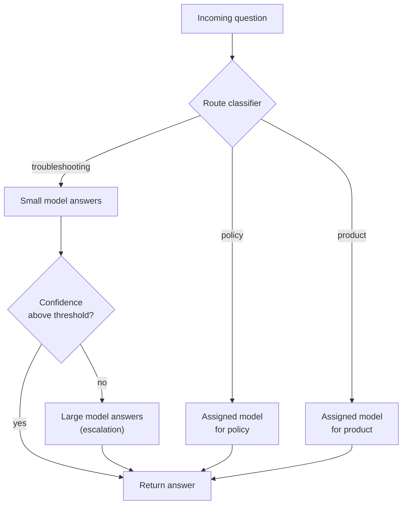

The single largest lever on a RAG system's bill is which language model generates the answers. Prices per token differ between a provider's smallest and largest models by an order of magnitude or more, and the [LLM inference costs](/learn/cost-engineering/llm-inference-costs) simulation showed a 78% saving from switching the generator alone. The question is never "which model is best?" but "which is the cheapest model that is good enough *for this kind of question*?", and the answer is often different for different parts of the traffic.

This lesson is about choosing the **generator** for cost. Choosing an embedding model is a different decision with different constraints, covered in [Model selection](/learn/embedding-optimisation/model-selection) in the Embedding Optimisation module. Here you will learn to define "good enough" with an evaluation set, to pick a model per route, to decide when a **cascade** (try a cheap model first, escalate when unsure) beats a fixed choice, and to avoid the statistical trap of choosing a model on a difference your evaluation set is too small to detect.

## Learning objectives

- Define a quality bar for a route and select the cheapest model that meets it on a labelled evaluation set.
- Identify Pareto-dominated options on a cost-quality plot and explain why they should never be chosen.
- Compute the expected cost and accuracy of a two-model cascade and its break-even escalation rate.
- Use a bootstrap or standard-error bound to avoid choosing a model on a difference the evaluation set cannot resolve.
- Compare per-route assignment, learned routing and cascades, and list the operational costs each adds.

## Prerequisites

- [LLM inference costs](/learn/cost-engineering/llm-inference-costs): cost per call and per successful answer.
- [Golden datasets](/learn/testing-and-benchmarking/golden-datasets): building the labelled questions that define "good enough".
- [Faithfulness](/learn/generation-evaluation/faithfulness): one of the qualities you will measure.
- [Query routing](/learn/agentic-rag/query-routing): classifying a query to decide how to handle it.

## Why this matters

Teams usually choose a generator in one of two ways, and both are expensive. The first is to use the most capable model for everything, because it is safest; the bill is then set by the hardest question even though most questions are easy. The second is to switch everything to a cheap model after a quick test on a dozen questions, and discover weeks later, from user complaints, that a whole category of questions now gets wrong answers.

Neither team measured. A RAG system's traffic is a mixture: policy look-ups that any competent model answers from the retrieved paragraph, product questions that need careful synthesis across chunks, troubleshooting questions where a subtly wrong step causes real harm. A model choice that is right for one category can be wasteful or dangerous for another. Choosing per category, on evidence, is how cost falls without quality falling with it.

## The intuition

A hospital does not send every patient to a consultant. A nurse triages: minor cases are treated by a general practitioner, complex ones go to the specialist, and when the GP is unsure they refer upwards. The consultant's time is expensive and is spent where it changes outcomes.

Model selection works the same way. The **routes** are the triage categories. The cheap model is the GP, the expensive model the consultant. A **static assignment** sends whole categories to one or the other. A **cascade** lets the GP see everyone first and refer the uncertain cases, which saves money only if the GP can tell when they are unsure, and if most patients do not need referring. A referral system with a GP who never refers, or who refers everyone, is worse than just sending everyone to the consultant.

## How it works

### Step 1: define "good enough" per route

A quality bar is a measurable threshold on a labelled evaluation set: for example, "at least 92% of answers judged correct and grounded" for HR policy questions, "at least 95% with zero unsafe instructions" for IT troubleshooting. Three things make it usable:

1. **Routes.** Split traffic into categories that differ in difficulty or in the cost of a wrong answer. Use real traffic to choose them, and a classifier (rules, embeddings or a small model) to assign queries to them, as in [Query routing](/learn/agentic-rag/query-routing).
2. **A labelled set per route**, large enough to measure the bar (see the statistics below), drawn from real questions and graded against reference answers by people or by a validated LLM judge.
3. **A metric that reflects what matters**: correctness and [faithfulness](/learn/generation-evaluation/faithfulness), refusal when the context lacks the answer, format compliance where downstream code parses the answer.

### Step 2: measure candidates and draw the frontier

Run every candidate model on every route's evaluation set with the *same* retrieval and prompt, recording quality and cost per question. Candidates include different models, and also the same model at different settings: a model's reasoning effort (Anthropic's models expose an *effort* control) or output length cap changes both cost and quality. A useful habit is to test the most capable model at a lower effort setting before building anything more complicated; on some workloads it matches a cheaper model's cost with better quality, and it keeps the system to a single model.

Plot quality against cost. An option is **Pareto-dominated** if another option is at least as good on quality *and* at least as cheap, and strictly better on one. Dominated options should never be chosen. The undominated options form the **Pareto frontier**, and the choice along the frontier is a business decision: how much quality is a given saving worth? The bar from step 1 turns that into a rule: the cheapest point on the frontier that clears the bar.

### Step 3: choose a strategy



- **Static per-route assignment.** Each route gets the cheapest model that meets its bar. Simple, predictable and easy to monitor. It needs only a route classifier, and it is the right first step for most teams.
- **Learned routing.** A trained router predicts, per query, whether the cheap model will suffice. Research systems such as RouteLLM (Ong and colleagues, 2024) train routers on preference data and report substantial savings on their benchmarks; whether a router transfers to your traffic is something to measure, not assume. A router adds a model to train, evaluate and keep current.
- **Cascades.** The cheap model answers first; a **confidence signal** decides whether to accept its answer or escalate to the expensive model. FrugalGPT (Chen, Zaharia and Zou, 2023) studied cascades of this kind. The confidence signal can be a separate verifier (an LLM judge or a [faithfulness](/learn/generation-evaluation/faithfulness) check), the cheap model's own stated uncertainty, an "I don't know" from the cheap model, or retrieval signals such as a low top reranker score. Its quality decides whether the cascade works.

### The economics of a cascade

A cascade always pays for the cheap model, and pays for the expensive model on the escalated fraction. It is cheaper than using the expensive model alone only if the escalation rate stays below a break-even point, computed below. It is as accurate as the expensive model only if the confidence signal escalates the questions the cheap model gets wrong; questions it gets wrong and confidently accepts are lost. Cascades also add latency on escalated questions (two calls in sequence) and complicate caching: provider-side prompt caches are scoped to a model, so a cascade's two models cannot share cached prefixes, which [Caching strategies](/learn/cost-engineering/caching-strategies) quantifies.

### Step 4: keep the choice current

Models are updated, repriced and retired; traffic drifts; retrieval changes alter what the generator has to do. Re-run the evaluation when any of these happen, and monitor the production signals that correlate with quality (refusal rate, user feedback, escalation rate in a cascade) per route. A rise in a cascade's escalation rate is both a quality signal and a cost signal.

### Self-hosted and open-weight models

Open-weight models that you run yourself are candidates like any other, with a cost per token computed from hardware, throughput and utilisation as in [LLM inference costs](/learn/cost-engineering/llm-inference-costs), and an operational cost that per-token APIs do not have. They are often attractive for narrow, high-volume routes (query rewriting, classification, short extraction), where a small model is good enough and keeps a machine busy. [Quantisation](/learn/cost-engineering/quantisation) can make them cheaper still.

## The mathematics

### Cascade cost and break-even

**Intuition.** You always pay for the small model; you pay for the large one only when you escalate.

$$
C_{\text{cascade}} = C_s + q \, C_L, \qquad C_{\text{cascade}} < C_L \iff q < 1 - \frac{C_s}{C_L}
$$

$C_s$ and $C_L$ are the costs per question of the small and large models, $q$ is the escalation rate (fraction of questions sent to the large model), and $1 - C_s / C_L$ is the **break-even escalation rate** above which the cascade costs more than the large model alone.

**By hand.** $C_s = 0.0030$, $C_L = 0.0150$ dollars (hypothetical), $q = 0.40$: $C_{\text{cascade}} = 0.0030 + 0.40 \times 0.0150 = 0.0090$ dollars, 40% cheaper. Break-even: $1 - 0.003 / 0.015 = 0.80$; a cascade that escalates more than 80% of questions loses money.

### Cascade accuracy

$$
A_{\text{cascade}} = (1 - q) \, a_{\text{kept}} + q \, a_{\text{esc}}
$$

$a_{\text{kept}}$ is the small model's accuracy on the questions it keeps, and $a_{\text{esc}}$ the large model's accuracy on the questions escalated to it. With $q = 0.4$, $a_{\text{kept}} = 0.95$ and $a_{\text{esc}} = 0.80$: $0.6 \times 0.95 + 0.4 \times 0.80 = 0.89$. Note that $a_{\text{kept}}$ is the small model's accuracy *after* selection by the confidence signal, which is why a good signal can make a weak model look strong on the questions it keeps.

### How precise is a measured accuracy?

**Intuition.** Accuracy measured on $n$ questions is itself an estimate, with a margin of error that shrinks only as $1/\sqrt{n}$.

$$
\text{SE} = \sqrt{\frac{p(1 - p)}{n}}, \qquad \text{lower bound} \approx p - 1.645 \, \text{SE}
$$

$p$ is the measured accuracy, $n$ the number of evaluation questions, SE the standard error, and $p - 1.645\,\text{SE}$ an approximate one-sided 95% lower bound (1.645 is the 95th percentile of the standard normal distribution). The approximation is poor when $p$ is very close to 0 or 1 or $n$ is small; the bootstrap used in the code makes no such assumption.

**By hand.** $p = 0.93$, $n = 300$: $\text{SE} = \sqrt{0.93 \times 0.07 / 300} = \sqrt{0.000217} = 0.0147$. Lower bound: $0.93 - 1.645 \times 0.0147 = 0.906$. A model that measures 93% on 300 questions cannot be said, with 95% confidence, to clear a 92% bar.

```python
import math
C_s, C_L = 0.0030, 0.0150                    # hypothetical cost per question
q = 0.40                                     # escalation rate
print(f"cascade cost {C_s + q * C_L:.4f} vs large alone {C_L:.4f}; "
      f"break-even escalation rate {1 - C_s / C_L:.0%}")

a_s, a_L = 0.95, 0.80                        # accuracy of small on kept, large on escalated
print(f"cascade accuracy {(1 - q) * a_s + q * a_L:.1%}")

p, n = 0.93, 300
se = math.sqrt(p * (1 - p) / n)
print(f"standard error {se:.4f}; one-sided 95% lower bound {p - 1.645 * se:.3f}")
```

```output
cascade cost 0.0090 vs large alone 0.0150; break-even escalation rate 80%
cascade accuracy 89.0%
standard error 0.0147; one-sided 95% lower bound 0.906
```

## In code

**The problem.** Given per-question grades for three candidate generators on AskMeridian's three routes, choose the cheapest model per route that meets a 92% bar, check whether the evidence is strong enough to justify each choice, and test a small-to-large cascade on the route where no single model is cheap enough.

**Dependencies.** NumPy only. The evaluation results are **simulated**: every accuracy and cost below is invented for the exercise, generated from a simple model in which each question has a difficulty and each model a skill. In practice the `correct` arrays come from grading real model outputs on your labelled set; the selection logic is unchanged.

```bash
pip install numpy
```

```python
import numpy as np

rng = np.random.default_rng(0)

# --- A hypothetical labelled evaluation set: 600 AskMeridian questions -------------
# Every number below is invented for the simulation; replace them with your own eval results.
ROUTES = {"policy": 300, "product": 180, "troubleshooting": 120}
DIFFICULTY = {"policy": (2, 6), "product": (3, 4), "troubleshooting": (5, 3)}   # beta(a, b)
MODELS = {   # skill on the same scale as difficulty; cost per question in dollars (hypothetical)
    "small":  {"skill": 0.55, "cost": 0.0030},
    "medium": {"skill": 0.72, "cost": 0.0090},
    "large":  {"skill": 0.85, "cost": 0.0150},
}

route = np.concatenate([[r] * n for r, n in ROUTES.items()])
difficulty = np.concatenate([rng.beta(*DIFFICULTY[r], n) for r, n in ROUTES.items()])
correct = {}   # did model m answer question i correctly? (graded against the reference answer)
for m, spec in MODELS.items():
    p = 1 / (1 + np.exp(-12 * (spec["skill"] - difficulty)))
    correct[m] = rng.random(len(difficulty)) < p

# --- 1. Accuracy and cost of each model on each route ------------------------------
print(f"{'route':<16}" + "".join(f"{m:>10}" for m in MODELS))
for r in ROUTES:
    mask = route == r
    print(f"{r:<16}" + "".join(f"{correct[m][mask].mean():>10.1%}" for m in MODELS))
print(f"{'cost/question':<16}" + "".join(f"{MODELS[m]['cost']:>10.4f}" for m in MODELS))

# --- 2. Cheapest model per route that meets the bar, with a bootstrap check --------
BAR = 0.92
def bootstrap_low(x, n=2000, q=5):
    """Lower 5th percentile of accuracy over bootstrap resamples."""
    idx = rng.integers(0, len(x), size=(n, len(x)))
    return np.percentile(x[idx].mean(axis=1), q)

print(f"\ncheapest model meeting {BAR:.0%} (point estimate / 5th-percentile bootstrap):")
for r in ROUTES:
    mask = route == r
    by_point = next((m for m in MODELS if correct[m][mask].mean() >= BAR), "none")
    by_low = next((m for m in MODELS if bootstrap_low(correct[m][mask]) >= BAR), "none")
    print(f"  {r:<16} {by_point:<8} / {by_low}")

# --- 3. A cascade: small answers first, escalates to large when unsure --------------
# The confidence signal is imperfect: higher when the small model is right, plus noise.
confidence = 0.35 * correct["small"] + rng.normal(0.4, 0.15, len(difficulty))
print("\ncascade small -> large on troubleshooting:")
mask = route == "troubleshooting"
for tau in (0.0, 0.5, 0.6, 0.7, 1.1):
    esc = confidence[mask] < tau
    acc = np.where(esc, correct["large"][mask], correct["small"][mask]).mean()
    cost = MODELS["small"]["cost"] + esc.mean() * MODELS["large"]["cost"]
    print(f"  tau {tau:>3}: escalate {esc.mean():>5.1%}  accuracy {acc:>5.1%}  cost {cost:.4f}")
print(f"  large alone:   accuracy {correct['large'][mask].mean():.1%}  cost {MODELS['large']['cost']:.4f}")

# --- 4. The whole system: one model for everything versus a per-route plan ----------
plan_correct = np.where(route == "policy", correct["medium"],
               np.where(route == "product", correct["large"],
                        np.where(confidence < 0.7, correct["large"], correct["small"])))
plan_cost = np.where(route == "policy", MODELS["medium"]["cost"],
            np.where(route == "product", MODELS["large"]["cost"],
                     MODELS["small"]["cost"] + (confidence < 0.7) * MODELS["large"]["cost"]))
print("\nwhole system (600 questions):")
print(f"  all large:      accuracy {correct['large'].mean():.1%}  cost {MODELS['large']['cost']:.4f}")
print(f"  per-route plan: accuracy {plan_correct.mean():.1%}  cost {plan_cost.mean():.4f}")
```

```output
route                small    medium     large
policy               93.0%     98.7%    100.0%
product              70.0%     86.1%     95.0%
troubleshooting      42.5%     74.2%     83.3%
cost/question       0.0030    0.0090    0.0150

cheapest model meeting 92% (point estimate / 5th-percentile bootstrap):
  policy           small    / medium
  product          large    / large
  troubleshooting  none     / none

cascade small -> large on troubleshooting:
  tau 0.0: escalate  0.0%  accuracy 42.5%  cost 0.0030
  tau 0.5: escalate 41.7%  accuracy 74.2%  cost 0.0093
  tau 0.6: escalate 57.5%  accuracy 82.5%  cost 0.0116
  tau 0.7: escalate 70.8%  accuracy 85.0%  cost 0.0136
  tau 1.1: escalate 99.2%  accuracy 83.3%  cost 0.0179
  large alone:   accuracy 83.3%  cost 0.0150

whole system (600 questions):
  all large:      accuracy 95.2%  cost 0.0150
  per-route plan: accuracy 94.8%  cost 0.0117
```

**The important lines.**

- `correct[m]` is a Boolean array, one entry per question: the only thing the selection logic needs from an evaluation. Keeping per-question results, not just averages, is what makes bootstrapping and cascade simulation possible.
- `p = 1 / (1 + np.exp(-12 * (skill - difficulty)))` is the simulation's assumption that a model is likely to answer questions below its skill and unlikely above it. The difficulties are shared across models, so their errors are correlated, as real models' errors are: hard questions are hard for everyone.
- `next((m for m in MODELS if ...), "none")` walks the models from cheapest to most expensive and returns the first that meets the bar. Ordering `MODELS` by cost is what makes "first" mean "cheapest".
- `bootstrap_low()` resamples the per-question results 2,000 times with replacement and takes the 5th percentile of the resampled accuracies: a lower bound that reflects how much the measured accuracy could move with a different sample of questions.
- `confidence` simulates an imperfect signal: on average 0.35 higher when the small model is correct, but with enough noise (standard deviation 0.15) that the two groups overlap.

**What the output means.**

- **The point estimate and the bootstrap disagree on the policy route.** The small model measures 93.0% on 300 questions, just above the 92% bar, but its bootstrap lower bound falls below it: the evidence cannot distinguish "93%" from "91%". The cautious choice is the medium model at three times the cost. The cheaper, braver choice is to collect more evaluation questions until the bound is tight enough to decide. The *wrong* choice is to treat 93.0% as a fact.
- **No single model meets the bar for troubleshooting.** The large model reaches 83.3%. No amount of model selection fixes that; the route needs better retrieval, a narrower scope, or a policy of handing such questions to the support desk. Model selection is not a substitute for a working pipeline.
- **The cascade at $\tau = 0.7$ is slightly more accurate than the large model alone (85.0% against 83.3%) and cheaper (0.0136 against 0.0150).** It is more accurate because a few questions that the small model answers correctly are ones the large model gets wrong, and the cascade keeps the small model's answer for those. But its saving is small, because it escalates 70.8% of questions, close to the 80% break-even. At $\tau = 1.1$ it escalates almost everything and costs more than the large model alone: the worst of both.
- **The per-route plan cuts average cost by 22% (0.0117 against 0.0150) for 0.4 percentage points of accuracy.** Whether that trade is acceptable is a product decision; the 0.4-point difference is itself well within the measurement noise of a 600-question set.

**Errors people commonly hit.**

- Running each model with a prompt tuned for a different model. Prompts tuned on one model can disadvantage another; give each candidate a fair, equivalent prompt, and re-check prompt behaviour when switching.
- Grading with an LLM judge from the same family as one of the candidates, which can favour its own family's style. Validate the judge against human grades on a sample.
- Comparing models on averages over all routes, which hides a failure on a small but important route.

**Extending it.** Replace the simulated `correct` arrays with graded outputs from your own evaluation. Add the medium model as an intermediate cascade stage (small, then medium, then large). Add a cost for running the confidence signal itself, if it is a separate verifier call.

## A real-world example

When Meridian's finance team asked for a cheaper AskMeridian, the first proposal on the table was simple: switch the whole assistant to the provider's smallest model. Lena, who led the evaluation work, asked for two weeks to measure first.

The team already had a golden set of about 450 graded questions, built for regression testing. Lena split it by route and ran three candidate models with identical retrieval and prompts. The picture resembled the simulation: on HR policy questions every model did well; on product questions only the larger models were reliable; on IT troubleshooting even the largest model fell short of the bar the IT team had set, because many failures came from missing runbook content, not from generation.

The decision had three parts. HR policy questions moved to the mid-sized model, after the team added 200 more policy questions to the golden set because the first measurement's margin of error straddled the bar. Product questions stayed on the large model. Troubleshooting questions also stayed on the large model, and a separate project fixed the runbook gaps that retrieval evaluation had exposed. The "everything on the small model" proposal would have saved more money on paper and would have broken the product-documentation answers that the sales engineers relied on. The routing classifier, the per-route metrics and a monthly re-run of the evaluation became part of the system, and the following quarter's model price change was assessed in an afternoon.

## Common mistakes

- **Choosing one model for all traffic.** Easy routes pay hard-route prices, or hard routes get easy-route quality.
- **Deciding on a handful of examples.** Small evaluation sets cannot resolve differences of a few points; choices made on noise reverse themselves in production.
- **Ignoring the cost of a wrong answer per route.** A 2% error rate is acceptable on one route and unacceptable on another; the bar must reflect consequences.
- **Building a cascade without measuring the confidence signal.** A signal that does not separate right from wrong answers either escalates almost everything (costing more than the large model) or accepts confident errors.
- **Treating the choice as permanent.** Prices, models and traffic change; an unmonitored choice silently becomes the wrong one.
- **Using model selection to paper over retrieval failures.** If the right chunk never arrives, no generator can answer, and a larger model only produces more convincing wrong answers.

## Best practices

- Define routes and a quality bar per route before comparing models; involve the people who own each route's consequences.
- Keep per-question evaluation results and report uncertainty (bootstrap bounds or standard errors) alongside every accuracy.
- Discard Pareto-dominated options; choose along the frontier with the bar as the rule.
- Start with static per-route assignment; add a cascade or learned router only where measurement shows a material saving and the confidence signal is validated.
- Test the most capable model at lower effort or shorter output before adding more models; one model is simpler to operate and cache.
- Re-run the evaluation on every model, price, prompt or retrieval change, and monitor per-route production signals.

## Performance considerations

Smaller models are usually faster per output token, so cost savings often come with latency savings. Cascades are the exception: escalated questions wait for two calls in sequence, so their latency is the sum, and the 95th-percentile latency of a cascade can be worse than that of the large model alone. If latency matters, consider streaming the small model's answer only when it will be accepted, or running the confidence check on retrieval signals before generation so that escalation decisions are made up front.

Route classification adds a step to every request. A rules-based or embedding-based classifier costs little (milliseconds and a nearest-centroid computation); an LLM classifier costs another call, which must be included in the per-request cost.

Evaluation itself costs money: running three models over 600 questions, with an LLM judge, is several thousand calls. Batch interfaces, where available, make repeated evaluation cheaper, which in turn makes it easier to re-evaluate often.

## Security considerations

Different models can behave differently on the same adversarial input. A model that refuses prompt-injection attempts in retrieved documents well may be replaced by a cheaper one that does not, so include adversarial cases (injected instructions in documents, requests for data outside the user's permissions) in every route's evaluation set and treat them as part of the bar. A cascade's confidence signal is also a target: if an attacker can make the small model sound confident, they can keep their query away from the more robust model. Self-hosted open-weight models move responsibility for patching, access control and content filtering onto your team.

## Summary

- Choose the generator per route: the cheapest model that meets a measured quality bar on a labelled evaluation set for that route.
- Discard Pareto-dominated options; the bar selects a point on the remaining frontier.
- Measured accuracy has a margin of error that shrinks as $1/\sqrt{n}$; use bootstrap or standard-error bounds before claiming a model clears a bar.
- A cascade costs $C_s + q\,C_L$ and only saves money below the break-even escalation rate $1 - C_s/C_L$; its accuracy depends on how well the confidence signal separates right from wrong answers.
- Start with static per-route assignment, re-evaluate whenever models, prices or retrieval change, and never use a bigger model to compensate for retrieval failures.

## Exercises

**1.** A small model costs 0.002 dollars per question and a large one 0.012. A cascade escalates 35% of questions. What does it cost per question, what is its break-even escalation rate, and how much does it save against the large model alone?

<details><summary>Show solution</summary>

$C = 0.002 + 0.35 \times 0.012 = 0.0062$ dollars. Break-even: $1 - 0.002/0.012 = 83.3\%$. Saving: $1 - 0.0062 / 0.012 \approx 48\%$.

</details>

**2.** A model measures 95% accuracy on 120 questions. Using the standard-error formula, can you say with about 95% confidence that it clears a 92% bar? How many questions would give a lower bound above 92% if the measured accuracy stayed at 95%?

<details><summary>Show solution</summary>

$\text{SE} = \sqrt{0.95 \times 0.05 / 120} = 0.0199$; lower bound $0.95 - 1.645 \times 0.0199 = 0.917$, just below 0.92, so no. Solve $1.645\sqrt{0.0475/n} \le 0.03$: $n \ge 0.0475 \times (1.645 / 0.03)^2 \approx 143$. About 145 questions would be enough, if the accuracy held.

</details>

**3.** In the code, add the medium model as a middle stage on the troubleshooting route: small first, escalate to medium below $\tau_1$, and escalate from medium to large below $\tau_2$, using a second simulated confidence signal for the medium model built the same way. Search a small grid of thresholds and report the cheapest configuration whose accuracy is at least that of the large model alone.

<details><summary>Show solution</summary>

```python
conf_m = 0.35 * correct["medium"] + rng.normal(0.4, 0.15, len(difficulty))
mask = route == "troubleshooting"
best = None
for t1 in np.arange(0.3, 1.0, 0.05):
    for t2 in np.arange(0.3, 1.0, 0.05):
        to_m = confidence[mask] < t1
        to_l = to_m & (conf_m[mask] < t2)
        ans = np.where(to_l, correct["large"][mask],
              np.where(to_m, correct["medium"][mask], correct["small"][mask]))
        cost = (MODELS["small"]["cost"] + to_m.mean() * MODELS["medium"]["cost"]
                + to_l.mean() * MODELS["large"]["cost"])
        if ans.mean() >= correct["large"][mask].mean() and (best is None or cost < best[0]):
            best = (cost, t1, t2, ans.mean())
print(best)
```

On our run (continuing the same random stream) the best grid point was $\tau_1 = 0.60$, $\tau_2 = 0.45$: 83.3% accuracy at 0.0106 dollars per question, about 30% cheaper than the large model alone, because the medium model resolves many escalations without the large one. That will not always hold: every escalated question pays for every stage it passes through, so a middle stage that resolves few escalations makes the cascade dearer. Note also that searching many thresholds on the same 120 questions overfits them: choose thresholds on one half of the data and report accuracy on the other.

</details>

**4.** Meridian's IT team insists that troubleshooting answers must never recommend an unsafe action, such as disabling the VPN on public Wi-Fi. How would you change the quality bar and the selection procedure for that route?

<details><summary>Show solution</summary>

Make safety a separate, hard constraint rather than part of an average: the bar becomes "accuracy at least X% *and* zero unsafe recommendations on a dedicated set of safety-critical questions", including adversarial ones. Evaluate safety with a strict rubric (human-reviewed), and choose only among models with zero failures on that set, accepting that the set's size bounds how confident "zero" can be. Add a run-time guard that checks answers on this route against known unsafe patterns before they are shown. A cascade on this route needs its confidence signal to escalate any answer touching security settings, regardless of the small model's confidence.

</details>

## Check your understanding

```quiz
[
  {
    "q": "Option A costs 0.010 per question with 91% accuracy. Option B costs 0.008 with 92%. What can you say about A?",
    "options": [
      "A is on the Pareto frontier",
      "A is Pareto-dominated by B and should not be chosen",
      "A is better because it costs more",
      "Nothing without knowing the bar"
    ],
    "answer": 1,
    "why": "B is both cheaper and more accurate, so A is dominated whatever the bar."
  },
  {
    "q": "A small model costs one fifth of a large one. Above what escalation rate does a small-then-large cascade cost more than the large model alone?",
    "options": ["20%", "50%", "80%", "100%"],
    "answer": 2,
    "why": "Break-even is 1 - C_s / C_L = 1 - 0.2 = 0.8."
  },
  {
    "q": "Why can a cascade be slightly more accurate than the large model alone?",
    "options": [
      "Because two answers are averaged",
      "Because the small model is right on some questions the large model gets wrong, and the cascade keeps those answers",
      "Because escalated questions are answered twice by the large model",
      "It cannot; a cascade is always less accurate"
    ],
    "answer": 1,
    "why": "Errors are correlated but not identical; questions kept by the cascade include some the large model would have got wrong."
  },
  {
    "q": "A model scores 93% on 300 questions against a 92% bar. What is the soundest conclusion?",
    "options": [
      "It clears the bar",
      "It fails the bar",
      "The measurement cannot separate 93% from about 91%, so collect more questions or choose conservatively",
      "Accuracy is not a useful metric"
    ],
    "answer": 2,
    "why": "The standard error is about 1.5 points, so the one-sided lower bound is about 90.6%, below the bar."
  },
  {
    "q": "On one route, even the largest model falls well short of the bar. What should you do first?",
    "options": [
      "Build a cascade",
      "Lower the bar until a model meets it",
      "Investigate the pipeline (retrieval coverage, scope) because model selection cannot fix missing evidence",
      "Use a self-hosted model"
    ],
    "answer": 2,
    "why": "If the evidence is missing or wrong, a larger generator only produces more convincing wrong answers."
  }
]
```

## Further reading

- Chen, L., Zaharia, M. and Zou, J. (2023). *FrugalGPT: How to Use Large Language Models While Reducing Cost and Improving Performance.* [arXiv:2305.05176](https://arxiv.org/abs/2305.05176). LLM cascades and their cost-quality trade-offs.
- Ong, I. et al. (2024). *RouteLLM: Learning to Route LLMs with Preference Data.* [arXiv:2406.18665](https://arxiv.org/abs/2406.18665). Learned routers between a strong and a weak model.
- Efron, B. and Tibshirani, R. J. (1993). *An Introduction to the Bootstrap.* Chapman and Hall. The standard reference for the resampling method used here.
- Anthropic's [models overview](https://docs.anthropic.com/en/docs/about-claude/models) documentation: current model tiers, context sizes and prices. Check it at decision time; it changes.
