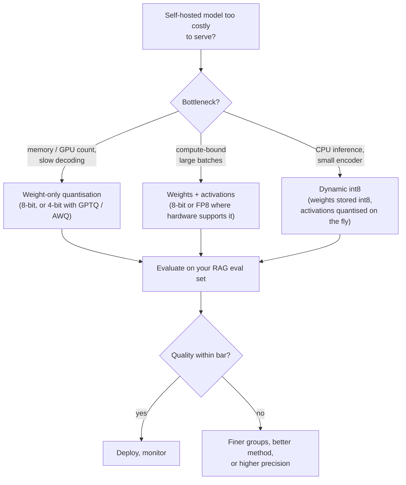

A model's weights are, by default, stored as 16- or 32-bit floating-point numbers. **Quantisation** stores them with fewer bits, typically 8 or 4, so the model takes less memory, moves fewer bytes for every token it processes, and fits on smaller or fewer machines. For a team that runs its own models, it is one of the most direct ways to cut serving cost, and it comes with a quality risk that must be measured rather than assumed.

This lesson is about quantising **model weights**: the generator, the embedding model and the reranker that you host yourself. Quantising the *vectors you store* is a different technique with different trade-offs, covered in [Embedding quantisation](/learn/embedding-optimisation/embedding-quantisation), [Scalar quantisation](/learn/vector-indexing-algorithms/scalar-quantisation) and [Product quantisation](/learn/vector-indexing-algorithms/product-quantisation). You will learn how weight quantisation works, why it speeds up generation, which methods exist and what each assumes, and you will quantise a real embedding model and measure what it does to retrieval quality, speed and size.

## Learning objectives

- Quantise a number with a symmetric scale by hand and compute its rounding error.
- Explain why per-channel or per-group scales lose less accuracy than one scale per tensor, especially when weights contain outliers.
- Calculate the memory of a model at 16, 8 and 4 bits and the bandwidth-bound ceiling on its decoding speed.
- Distinguish weight-only, dynamic and weight-and-activation quantisation, and name the established methods for each.
- Quantise an embedding model and evaluate the effect on retrieval quality, size and speed before deploying it.

## Prerequisites

- [Model inference](/learn/understanding-large-language-models/model-inference): prefill, decoding and the KV cache.
- [LLM inference costs](/learn/cost-engineering/llm-inference-costs): self-hosted cost per token from hardware cost, throughput and utilisation.
- [Scalar quantisation](/learn/vector-indexing-algorithms/scalar-quantisation): the same affine mapping applied to stored vectors.
- [Recall@K](/learn/retrieval-fundamentals/recall-k): the retrieval metric used to judge the quantised model.

## Why this matters

Self-hosted inference cost is dominated by hardware, and the hardware you need is set largely by memory. A model must hold its weights, plus a KV cache for every sequence it is serving, in accelerator memory. If the weights of a generator need 140 GB at 16 bits, they need two 80 GB GPUs before serving a single request; at 4 bits they need about 35 GB plus some overhead for scales, and fit on one. That halves the hardware bill for the same model, or lets the same hardware serve larger batches.

The second effect is speed. Generating each token requires reading every weight from memory once, and at small batch sizes the time to read them, not the arithmetic, is the bottleneck. Fewer bytes per weight means more tokens per second per GPU, and cost per token is hourly cost divided by throughput.

The risk is that quantisation changes the model. Rounding every weight introduces small errors that usually average out and sometimes do not: on long contexts, on precise instructions such as "answer only from the sources", or on the rare words that matter most in a particular corpus. A team that quantises without evaluating on its own task trades a known saving for an unknown quality loss.

## The intuition

Imagine measuring a room in millimetres and then deciding to record every measurement to the nearest centimetre. The notebook gets shorter, you can read it faster, and almost every calculation you do from it (how much paint, how much carpet) comes out the same. But if the room also contains one wall that is 40 metres long, and you insist on using a single ruler with a hundred markings for every measurement in the room, each marking must cover 40 cm, and all the small measurements become useless.

That is quantisation in two sentences. Rounding to a coarser grid is usually harmless, and the art lies in choosing the grid. Using a separate ruler for each wall (a **per-channel** or **per-group** scale) keeps small measurements precise even when one wall is huge. The methods in this lesson are, mostly, clever ways of choosing rulers.

## How it works

### Mapping floats to integers

The standard scheme is the same affine map used for vectors in [Scalar quantisation](/learn/vector-indexing-algorithms/scalar-quantisation), applied to weights:

1. Choose a group of weights that will share one **scale** $s$: a whole tensor, one output channel (a row of a weight matrix), or a block of, say, 64 or 128 consecutive weights.
2. For **symmetric** quantisation to $b$ bits, set $s = \max |w| / (2^{b-1} - 1)$ over the group, so the largest weight maps to the largest integer code. **Asymmetric** quantisation adds a zero point so that an off-centre range uses all the codes.
3. Store each weight as the integer $q = \text{round}(w / s)$, clipped to the code range, plus the scale for the group.
4. At inference time, either **dequantise** ($\hat{w} = q \cdot s$) just before the multiplication, or multiply integers directly and apply the scale to the result.

The rounding error of each weight is at most $s/2$. Everything else follows from that: a smaller scale means a smaller error, and the scale is set by the largest value in the group.

### Granularity and outliers

Large language models are known to have **outlier features**: a few dimensions whose activations, and the weights that interact with them, are far larger than the rest. Dettmers and colleagues (2022) documented this in their LLM.int8() work and handled it by computing the outlier dimensions in 16-bit and the rest in 8-bit. With one scale per tensor, an outlier inflates the scale for every weight in the tensor, and the ordinary weights collapse onto a handful of codes. Finer granularity limits the damage to the group containing the outlier:

| Granularity | Scales stored | Effect of an outlier |
| --- | --- | --- |
| Per tensor | 1 per matrix | Degrades every weight in the matrix |
| Per channel | 1 per row | Degrades one row |
| Per group (for example 128 weights) | 1 per group | Degrades one group |

Per-group scales are standard for 4-bit schemes, where the grid is coarse enough that a per-channel scale is not fine enough. The scales themselves cost memory: a 16-bit scale per group of 128 four-bit weights adds $16/128 = 0.125$ bits per weight, so "4-bit" models are really about 4.1 to 4.5 bits per weight once scales and any unquantised layers are counted.

### What gets quantised, and when



- **Weight-only quantisation** stores weights in 8 or 4 bits and dequantises them on the fly, doing the arithmetic in 16-bit. It cuts memory and memory traffic, which is what matters for token-by-token decoding at modest batch sizes. Most 4-bit LLM deployments are weight-only.
- **Weight-and-activation quantisation** (often written W8A8) quantises the inputs to each layer as well, so the multiplication itself runs on fast low-precision hardware units. It helps compute-bound workloads such as large-batch prefill. Activations have worse outliers than weights; SmoothQuant (Xiao and colleagues, 2022) migrates the difficulty from activations to weights with a mathematically equivalent rescaling. Recent data-centre GPUs also support 8-bit floating-point (FP8) arithmetic, which tolerates a wide range of values more gracefully than 8-bit integers.
- **Dynamic quantisation** stores weights as int8 and quantises activations at run time with a scale computed from each input. It needs no calibration data, which makes it the easiest option for small models on CPUs, and it is what the code below uses.
- **KV-cache quantisation** stores the attention cache in 8 bits. Some serving engines support it; it frees memory for more concurrent sequences or longer contexts.

### Methods for 4-bit weights

Plain **round-to-nearest** (RTN) works well at 8 bits and noticeably less well at 4 bits. Two established post-training methods improve on it, using a small set of calibration inputs rather than retraining:

- **GPTQ** (Frantar and colleagues, 2022) quantises the weights of a layer one column at a time and adjusts the not-yet-quantised weights to compensate for the error introduced so far, using second-order information computed from the calibration inputs.
- **AWQ** (activation-aware weight quantisation, Lin and colleagues, 2023) observes that a small fraction of weights matter much more than others, identified by the size of the activations that multiply them, and scales those channels to protect them before rounding.

For fine-tuning on limited hardware, QLoRA (Dettmers and colleagues, 2023) introduced the 4-bit **NF4** data type, whose grid is placed to suit normally distributed weights. Packaged formats differ by runtime: GGUF files for llama.cpp, GPTQ and AWQ checkpoints for GPU servers, and the bitsandbytes library for loading models in 8 or 4 bits inside Hugging Face Transformers. Which format you use is usually decided by the serving engine you run.

### What quantisation does to quality

The established picture, from the papers above and from wide practice, is that 8-bit weight quantisation of large models is close to lossless on standard benchmarks, and 4-bit with a good method loses a little, with smaller models losing more than larger ones. That picture comes from general benchmarks, not from your task. RAG stresses things general benchmarks may not: following "answer only from the context" precisely, copying identifiers and numbers exactly, attending across long contexts, and refusing when the answer is missing. So the rule is the one from [Model selection](/learn/cost-engineering/model-selection): a quantised model is a new candidate model, and it must clear the same quality bar on the same evaluation set.

### Where quantisation applies in a RAG system

- **The generator**, if self-hosted: the largest saving, because it is the largest model.
- **The embedding model**: smaller saving in absolute terms, but useful for CPU-only deployments and high-volume query embedding. Note that quantising the embedding model changes the vectors it produces, so the corpus must be re-embedded with the quantised model: mixing vectors from the original and quantised versions in one index degrades retrieval.
- **The reranker**: a cross-encoder runs once per candidate per query, so its cost scales with candidates times queries; int8 can make reranking cheaper on CPUs.
- **Hosted APIs**: you do not control the provider's numerics. Quantisation is a lever only for models you run.

## The mathematics

### Quantising one weight

**Intuition.** Divide by the step size, round to an integer, multiply back.

$$
s = \frac{\max_{i} |w_i|}{2^{b-1} - 1}, \qquad q = \text{round}\!\left(\frac{w}{s}\right), \qquad \hat{w} = q \, s, \qquad |w - \hat{w}| \le \frac{s}{2}
$$

$w_i$ are the weights in the group sharing the scale, $b$ is the number of bits, $s$ the scale (step size), $q$ the stored integer, and $\hat{w}$ the dequantised weight used at inference.

**By hand.** A group whose largest absolute weight is $0.52$, quantised to 8 bits: $s = 0.52 / 127 = 0.004094$. The weight $w = 0.0371$ becomes $q = \text{round}(0.0371 / 0.004094) = \text{round}(9.06) = 9$, dequantised to $9 \times 0.004094 = 0.036850$. Error: $0.000250$, below the bound $s/2 = 0.002047$.

### Memory and the decoding ceiling

**Intuition.** At small batch sizes, every generated token reads every weight once, so tokens per second cannot exceed memory bandwidth divided by the bytes of weights.

$$
M = P \times \frac{b}{8}, \qquad \text{tokens/s per sequence} \lesssim \frac{\text{bandwidth}}{M}
$$

$P$ is the number of parameters, $b$ the bits per weight, $M$ the weight memory in bytes. The ceiling ignores the KV cache, scale overhead and compute, so real throughput is lower, but the ratio between precisions carries over. Batching raises total throughput because one read of the weights serves every sequence in the batch.

**By hand.** An 8-billion-parameter model (an assumed size): $8 \times 10^9 \times 16 / 8 = 16$ GB at 16 bits, 8 GB at 8 bits, 4 GB at 4 bits. On an accelerator with an assumed 1,000 GB/s of memory bandwidth, the per-sequence decoding ceilings are $1{,}000 / 16 = 62.5$, $125$ and $250$ tokens per second.

### Why granularity matters

The script below quantises a random $256 \times 256$ weight matrix in which one row has been scaled up 25 times, and measures the relative error of the matrix-vector product $W\mathbf{x}$ with one scale per tensor and one per row.

```python
import numpy as np

# Memory for weights at different precisions (8 billion parameters, an assumed model size)
P = 8e9
for name, bits in [("bf16", 16), ("int8", 8), ("int4", 4)]:
    gb = P * bits / 8 / 1e9
    print(f"{name:<5} {gb:5.1f} GB   decode ceiling at 1,000 GB/s: {1000 / gb:5.1f} tokens/s per sequence")

# Symmetric quantisation of one weight, by hand: w = 0.0371, scale from max |w| = 0.52
w, max_abs, b = 0.0371, 0.52, 8
s = max_abs / (2 ** (b - 1) - 1)
q = round(w / s)
print(f"\nscale {s:.6f}  code {q}  dequantised {q * s:.6f}  error {abs(q * s - w):.6f}")

# Per-tensor versus per-channel scales on a matrix with one outlier output channel
rng = np.random.default_rng(0)
W = rng.normal(0, 0.02, size=(256, 256))
W[17] *= 25                                    # one row (output channel) with large weights
x = rng.normal(size=256)

def quantise(W, bits, axis):
    qmax = 2 ** (bits - 1) - 1
    s = np.abs(W).max(axis=axis, keepdims=True) / qmax
    return np.round(W / s).clip(-qmax, qmax) * s

for bits in (8, 4):
    for label, axis in [("per-tensor", None), ("per-channel", 1)]:
        Wq = quantise(W, bits, axis)
        err = np.linalg.norm(Wq @ x - W @ x) / np.linalg.norm(W @ x)
        print(f"int{bits} {label:<12} relative output error {err:.4f}")
```

```output
bf16   16.0 GB   decode ceiling at 1,000 GB/s:  62.5 tokens/s per sequence
int8    8.0 GB   decode ceiling at 1,000 GB/s: 125.0 tokens/s per sequence
int4    4.0 GB   decode ceiling at 1,000 GB/s: 250.0 tokens/s per sequence

scale 0.004094  code 9  dequantised 0.036850  error 0.000250
int8 per-tensor   relative output error 0.0590
int8 per-channel  relative output error 0.0053
int4 per-tensor   relative output error 0.3508
int4 per-channel  relative output error 0.1221
```

One outlier row makes the per-tensor error at 8 bits eleven times the per-channel error. At 4 bits, even per-channel scales leave a 12% error on this matrix, which is why 4-bit schemes use smaller groups and error-compensating methods such as GPTQ and AWQ rather than plain rounding.

## In code

**The problem.** AskMeridian's query embedding runs on CPU-only application servers. Would int8 quantisation of the embedding model make it cheaper to run without hurting retrieval? Measure it on a real retrieval benchmark rather than guessing: model size, time to encode a corpus, and retrieval quality, for the original and the quantised model.

**Dependencies.** sentence-transformers, PyTorch, pandas and huggingface_hub. The script downloads `all-MiniLM-L6-v2` and the BEIR SciFact dataset (5,183 abstracts, 300 test claims with relevance judgements). It uses PyTorch's built-in dynamic quantisation, which runs on CPU.

```bash
pip install sentence-transformers pandas pyarrow huggingface_hub
```

```python
import io, time, warnings
import numpy as np
import pandas as pd
import torch
from huggingface_hub import hf_hub_download
from sentence_transformers import SentenceTransformer
from torch.ao.quantization import quantize_dynamic

warnings.filterwarnings("ignore", category=DeprecationWarning)
torch.manual_seed(0)
torch.set_num_threads(4)
torch.backends.quantized.engine = "qnnpack"          # the int8 kernel backend on this CPU (Arm)

def get(repo, path):
    return hf_hub_download(repo, path, repo_type="dataset")

corpus = pd.read_parquet(get("BeIR/scifact", "corpus/corpus-00000-of-00001.parquet"))
queries = pd.read_parquet(get("BeIR/scifact", "queries/queries-00000-of-00001.parquet"))
qrels = pd.read_csv(get("BeIR/scifact-qrels", "test.tsv"), sep="\t", dtype=str)
relevant = qrels.groupby("query-id")["corpus-id"].apply(set).to_dict()
queries = queries[queries["_id"].isin(relevant)].reset_index(drop=True)
doc_ids = corpus["_id"].to_numpy()
doc_texts = (corpus["title"] + ". " + corpus["text"]).tolist()

NAME = "sentence-transformers/all-MiniLM-L6-v2"
fp32 = SentenceTransformer(NAME, device="cpu")
int8 = quantize_dynamic(SentenceTransformer(NAME, device="cpu"), {torch.nn.Linear}, dtype=torch.qint8)

def size_mb(model):
    buf = io.BytesIO()
    torch.save(model.state_dict(), buf)
    return buf.getbuffer().nbytes / 1e6

def evaluate(model):
    t0 = time.perf_counter()
    D = model.encode(doc_texts, batch_size=64, normalize_embeddings=True)
    secs = time.perf_counter() - t0
    Q = model.encode(queries["text"].tolist(), normalize_embeddings=True)
    top = np.argsort(-(Q @ D.T), axis=1)[:, :10]
    ndcg, recall = [], []
    for qi, qid in enumerate(queries["_id"]):
        rel = relevant[qid]
        hits = [doc_ids[j] in rel for j in top[qi]]
        dcg = sum(h / np.log2(r + 2) for r, h in enumerate(hits))
        idcg = sum(1 / np.log2(r + 2) for r in range(min(len(rel), 10)))
        ndcg.append(dcg / idcg)
        recall.append(sum(hits) / len(rel))
    return D, top, secs, np.mean(ndcg), np.mean(recall)

results = {}
for name, model in [("float32", fp32), ("int8 dynamic", int8)]:
    results[name] = evaluate(model)
    D, top, secs, ndcg, rec = results[name]
    print(f"{name:<13} size {size_mb(model):6.1f} MB   corpus encode {secs:5.1f} s   "
          f"nDCG@10 {ndcg:.4f}   recall@10 {rec:.4f}")

D32, top32 = results["float32"][:2]
D8, top8 = results["int8 dynamic"][:2]
cos = (D32 * D8).sum(axis=1)
overlap = np.mean([len(set(a) & set(b)) / 10 for a, b in zip(top32, top8)])
print(f"\nsame document, float32 vs int8 vector: mean cosine {cos.mean():.4f}, min {cos.min():.4f}")
print(f"top-10 lists shared between the two models: {overlap:.1%}")
```

Timings depend on the machine and its load; the size, quality and agreement figures are deterministic for a given library version. This run was on a laptop with an Arm CPU:

```output
float32       size   90.9 MB   corpus encode  66.3 s   nDCG@10 0.6484   recall@10 0.7883
int8 dynamic  size   58.6 MB   corpus encode 176.4 s   nDCG@10 0.6432   recall@10 0.7896

same document, float32 vs int8 vector: mean cosine 0.9380, min 0.8756
top-10 lists shared between the two models: 78.4%
```

**The important lines.**

- `quantize_dynamic(model, {torch.nn.Linear}, dtype=torch.qint8)` replaces every linear layer with a version whose weights are stored as int8 with a scale, and whose activations are quantised on the fly for each input. Embeddings, layer normalisation and attention softmax stay in float32. Linear layers hold the large majority of a transformer encoder's parameters, so this is where the size goes.
- `torch.backends.quantized.engine = "qnnpack"` selects the int8 kernel library. QNNPACK targets Arm CPUs; on x86 servers the usual choice is `"x86"` or `"fbgemm"`. If no engine is set, quantisation fails with *"Didn't find engine for operation quantized::linear_prepack NoQEngine"*.
- `size_mb()` serialises the model's weights to measure their real size, rather than trusting a back-of-envelope calculation.
- `evaluate()` embeds the corpus and queries with *the same* model, which is essential: a quantised model must be paired with an index built by itself.
- The last two lines compare the two models directly: how close each document's two vectors are, and how many of each query's top 10 results the two models share.

**What the output means.**

- **Retrieval quality barely moved.** nDCG@10 fell from 0.6484 to 0.6432 (0.8% relative) and recall@10 rose slightly, from 0.7883 to 0.7896. On 300 queries, differences of this size are within noise. For this model and task, int8 is good enough.
- **Yet the vectors themselves changed noticeably.** The same document's two vectors have a mean cosine of only 0.938, and the two models share 78.4% of their top-10 lists. The quantised model is a *different* model that happens to rank about as well. That is why its vectors must not be mixed with the original's in one index.
- **The file shrank by only 36%, not 75%.** Dynamic quantisation converts linear layers only. This model's token-embedding table (a 30,522-word vocabulary times 384 dimensions, about 11.7 million parameters, roughly half the model) stays in float32. Know where your model's parameters are before predicting the saving.
- **On this machine, int8 was 2.7 times *slower*.** The corpus took 176 seconds to encode against 66 for float32. The float32 path uses highly optimised matrix kernels, and the int8 path here added quantisation and dequantisation work that the int8 kernels did not repay. Other CPUs, particularly x86 servers with int8 instructions and the `fbgemm` or `x86` backend, may show the opposite; we did not measure them. The lesson is the one this module keeps returning to: a cost optimisation is a hypothesis until it is measured on the hardware you will actually pay for. Here, the measured result says *do not deploy this*: smaller, but slower, and so more expensive per query.

**Errors people commonly hit.**

- Querying an index built with the original model using a quantised query encoder (or the reverse). The vectors are close but not identical, and ranking degrades; re-embed the corpus with the model you will serve.
- Expecting speed-ups on hardware without fast int8 kernels, or on a GPU, where PyTorch's dynamic quantisation does not run. GPU deployments use different tools (8-bit or 4-bit loading through bitsandbytes, GPTQ or AWQ checkpoints, FP8 in serving engines).
- `torch.ao.quantization` prints a deprecation warning in recent PyTorch releases, which point to the separate `torchao` library as its successor. The eager-mode API used here still worked in the version tested, but check your PyTorch version's documentation before building on it.

**Quantising a generator.** For a self-hosted LLM on a GPU, the common route is to load it in 4 bits through the Transformers integration of bitsandbytes. This needs a CUDA GPU and a model download, and was not executed here:

```python
import torch
from transformers import AutoModelForCausalLM, AutoTokenizer, BitsAndBytesConfig

MODEL = "your-org/your-open-weight-model"     # placeholder: an open-weight model you are licensed to run
config = BitsAndBytesConfig(
    load_in_4bit=True,
    bnb_4bit_quant_type="nf4",                 # the NormalFloat4 grid from QLoRA
    bnb_4bit_compute_dtype=torch.bfloat16,     # dequantise to bf16 for the matrix multiplications
)
tokenizer = AutoTokenizer.from_pretrained(MODEL)
model = AutoModelForCausalLM.from_pretrained(MODEL, quantization_config=config, device_map="auto")
print(f"{model.get_memory_footprint() / 1e9:.1f} GB")
```

For production serving, engines such as vLLM load GPTQ, AWQ and FP8 checkpoints directly; follow the engine's documentation for the formats it supports. Whatever the route, run the quantised model through the same RAG evaluation set as the original before it serves traffic.

## A real-world example

Meridian's Platform team self-hosts a small open-weight model for one narrow task: rewriting follow-up questions into stand-alone queries before retrieval. It ran on a single GPU instance that was busy only during office hours, and the team wanted to move it to cheaper hardware.

Kofi, who owned the rewrite service, tested a 4-bit AWQ version of the model. It fitted comfortably on a smaller, cheaper GPU, and on the team's general rewrite test set it scored within a point of the original. He nearly shipped it. Then he split the test set by query type and found that rewrites of questions containing error codes and product names had degraded noticeably: the quantised model occasionally changed "E-4021" to "E-4012" or dropped "Meridian Relay" in favour of "Relay". Exact identifiers were exactly the case where retrieval depended on the rewrite being literal.

The team did not abandon quantisation. They tried an 8-bit version, which preserved identifiers on the test set and still fitted on the smaller GPU, and added a cheap guard: any identifier-like token in the original question (matched by a regular expression) must appear verbatim in the rewrite, or the original question is used instead. They also added identifier-heavy questions to the golden set permanently. The 8-bit model went to production with most of the planned saving. The lesson recorded in the design notes was that an aggregate score can hide a regression concentrated in a small, important slice of traffic, and that quantisation errors tend to land on rare tokens.

## Common mistakes

- **Deploying a quantised model on general benchmark results.** RAG-specific behaviours (exact copying, grounding, refusal, long context) can degrade while general scores hold; evaluate on your own set, sliced by query type.
- **Mixing precisions between index and queries.** A quantised embedding model must re-embed the corpus; otherwise query and document vectors come from slightly different models.
- **Choosing 4-bit when 8-bit already fits.** If the memory saving of 8-bit is enough to reach the cheaper hardware, the extra saving of 4-bit buys nothing and costs quality.
- **Ignoring the KV cache in memory planning.** The weights may fit at 4 bits, but long contexts and many concurrent sequences need cache memory too; plan for both.
- **Expecting speed-ups everywhere.** Gains depend on kernels and hardware; on some CPUs and for compute-bound large batches, weight-only quantisation saves memory but little time.
- **Quantising with per-tensor scales at low bit widths.** Outliers make the shared scale coarse for everything; use per-channel or per-group scales.

## Best practices

- Treat each quantised variant as a new candidate model and require it to pass the same evaluation as the original, sliced by route and by query type.
- Start with 8-bit; go to 4-bit only if the extra memory or speed saving changes the hardware you need.
- Use established methods and formats supported by your serving engine (GPTQ, AWQ, FP8, GGUF) rather than plain rounding at 4 bits.
- Re-embed the corpus whenever the embedding model's precision changes, and record the precision in the index metadata.
- Measure size, latency and throughput on the hardware you will deploy on, at realistic batch sizes.
- Add guards for the failure modes you find (for example, identifier preservation) and keep the cases that exposed them in the golden set.

## Performance considerations

The cost effect of quantisation comes through hardware and throughput. Fewer bits per weight can reduce the number or size of accelerators needed to hold a model, and at small batch sizes, where decoding is limited by memory bandwidth, raise tokens per second roughly in proportion to the bytes saved (the ceiling computed above). At large batch sizes, decoding becomes compute-bound and weight-only quantisation helps less; weight-and-activation schemes with hardware support (int8 or FP8 units) are needed to speed up the arithmetic itself. Dequantisation also has a cost, so small models on fast hardware may see little speed-up from weight-only schemes.

Memory freed from weights can be spent on the KV cache, allowing more concurrent sequences or longer contexts, which raises throughput and therefore lowers cost per token at the same utilisation. Re-run the self-hosted cost formula from [LLM inference costs](/learn/cost-engineering/llm-inference-costs) with the measured throughput of the quantised model: if throughput rises by a factor of 1.5 at the same hourly cost, cost per token falls by a third. [GPU acceleration](/learn/performance-optimisation/gpu-acceleration) covers the serving side.

For CPU-hosted encoders and rerankers, int8 dynamic quantisation is the easiest optimisation to try, needing no calibration data and no retraining. Its benefit depends entirely on the CPU's int8 support and the kernel library; the measurement above, where it made encoding slower, shows why you must test on the deployment machine.

## Summary

- Quantisation stores model weights with fewer bits, mapping each to an integer with a shared scale; the rounding error is at most half the scale.
- Finer granularity (per channel, per group) limits the damage from outlier weights; 4-bit schemes use small groups and error-compensating methods such as GPTQ and AWQ.
- Memory falls in proportion to bits, which can reduce the hardware needed, and bandwidth-bound decoding speeds up roughly in proportion, lowering cost per token.
- Weight-only, dynamic, and weight-and-activation quantisation suit different bottlenecks; quantising the stored vectors is a separate technique.
- A quantised model is a new model: evaluate it on your own RAG tasks, sliced by query type, and re-embed the corpus when the embedding model's precision changes.

## Exercises

**1.** A group of weights has a maximum absolute value of 0.30. Quantise $w = -0.1234$ symmetrically to 4 bits and to 8 bits, and give the dequantised value and the error in each case.

<details><summary>Show solution</summary>

4 bits: $s = 0.30 / 7 = 0.042857$; $q = \text{round}(-0.1234 / 0.042857) = \text{round}(-2.879) = -3$; $\hat{w} = -0.128571$; error $0.005171$. 8 bits: $s = 0.30 / 127 = 0.002362$; $q = \text{round}(-52.24) = -52$; $\hat{w} = -0.122835$; error $0.000565$. The 4-bit error is about nine times larger, in line with a step about 18 times larger.

</details>

**2.** A 70-billion-parameter generator is to be served on GPUs with 80 GB of memory each. How many GPUs are needed just to hold the weights at 16, 8 and 4 bits (with 0.25 extra bits per weight for scales at 4 bits)? What else must fit?

<details><summary>Show solution</summary>

16-bit: $140$ GB, two GPUs (three if you want headroom). 8-bit: $70$ GB, one GPU with only 10 GB spare. 4-bit with scales: $70 \times 10^9 \times 4.25 / 8 \approx 37$ GB, one GPU with about 43 GB spare. The KV cache for all concurrent sequences, activations and the runtime's own overhead must also fit, so the 8-bit model on one GPU may support only a few short sequences; the 4-bit model leaves room for many more.

</details>

**3.** Extend the code to quantise the cross-encoder `cross-encoder/ms-marco-MiniLM-L-6-v2` with `quantize_dynamic`, rerank the float32 bi-encoder's top 20 for each SciFact query with the original and the quantised cross-encoder, and compare nDCG@10 and total reranking time.

<details><summary>Show solution</summary>

```python
from sentence_transformers import CrossEncoder
ce32 = CrossEncoder("cross-encoder/ms-marco-MiniLM-L-6-v2", device="cpu")
ce8 = quantize_dynamic(CrossEncoder("cross-encoder/ms-marco-MiniLM-L-6-v2", device="cpu"),
                       {torch.nn.Linear}, dtype=torch.qint8)

D, Q = results["float32"][0], fp32.encode(queries["text"].tolist(), normalize_embeddings=True)
top20 = np.argsort(-(Q @ D.T), axis=1)[:, :20]
for name, ce in [("float32", ce32), ("int8", ce8)]:
    t0 = time.perf_counter()
    ndcg = []
    for qi, qid in enumerate(queries["_id"]):
        cand = top20[qi]
        scores = ce.predict([(queries["text"][qi], doc_texts[j]) for j in cand])
        order = cand[np.argsort(-scores)][:10]
        hits = [doc_ids[j] in relevant[qid] for j in order]
        idcg = sum(1 / np.log2(r + 2) for r in range(min(len(relevant[qid]), 10)))
        ndcg.append(sum(h / np.log2(r + 2) for r, h in enumerate(hits)) / idcg)
    print(name, f"nDCG@10 {np.mean(ndcg):.4f}", f"{time.perf_counter() - t0:.1f} s")
```

Unlike the bi-encoder case, no index needs rebuilding: the cross-encoder scores pairs at query time, so it can be swapped independently. Compare the quality change with the time saved; reranking runs once per candidate per query, so a speed-up multiplies across all traffic.

</details>

**4.** Meridian's self-hosted rewrite model passes its evaluation at 4 bits overall but fails on identifier-heavy questions. List three options, with their cost implications, and recommend one.

<details><summary>Show solution</summary>

(a) Use 8-bit instead: higher memory than 4-bit but often still fits the cheaper hardware, so most of the saving remains. (b) Keep 4-bit and add a guard that falls back to the original question when an identifier is not preserved: the full saving, a small amount of code, and occasional lower-quality retrieval on the fallback path. (c) Try a better 4-bit method or smaller groups: more engineering effort, uncertain result. Recommend (a) plus the guard from (b) if 8-bit fits the target hardware, because it removes the measured regression at little cost; keep (c) as an experiment only if the remaining saving matters.

</details>

## Check your understanding

```quiz
[
  {
    "q": "Why does a single large outlier weight hurt per-tensor quantisation so much?",
    "options": [
      "It cannot be represented at all",
      "It sets a large shared scale, so all the ordinary weights are rounded onto very few codes",
      "It makes the model slower",
      "It changes the number of bits per weight"
    ],
    "answer": 1,
    "why": "The scale is set by the maximum absolute value; one outlier coarsens the grid for every weight that shares its scale."
  },
  {
    "q": "At small batch sizes, why does 4-bit weight quantisation speed up token generation?",
    "options": [
      "Integer arithmetic is always faster than floating point",
      "Decoding is limited by reading weights from memory, and 4-bit weights are a quarter of the bytes of 16-bit ones",
      "The model generates fewer tokens",
      "The KV cache is no longer needed"
    ],
    "answer": 1,
    "why": "Each token reads every weight once; fewer bytes per weight means less memory traffic per token."
  },
  {
    "q": "After quantising the embedding model, what must happen to the existing vector index?",
    "options": [
      "Nothing; the vectors are compatible",
      "It must be quantised with product quantisation",
      "The corpus should be re-embedded with the quantised model so queries and documents come from the same model",
      "Only the HNSW graph must be rebuilt"
    ],
    "answer": 2,
    "why": "A quantised model produces slightly different vectors; mixing them with the original model's vectors degrades ranking."
  },
  {
    "q": "Which method quantises a layer's weights column by column while adjusting the remaining weights to compensate for the error so far?",
    "options": ["AWQ", "GPTQ", "Round-to-nearest", "Dynamic quantisation"],
    "answer": 1,
    "why": "GPTQ uses second-order information from calibration data to compensate for quantisation error as it proceeds."
  },
  {
    "q": "A team uses a hosted LLM API and wants to cut its generation bill with quantisation. What is the correct advice?",
    "options": [
      "Request 4-bit weights in the API call",
      "Quantise the prompt",
      "Quantisation is a lever only for models you host; for an API, use model selection, budgets and caching",
      "Quantise the retrieved chunks"
    ],
    "answer": 2,
    "why": "You do not control a provider's numerics; quantisation applies to self-hosted models."
  }
]
```

## Further reading

- Dettmers, T., Lewis, M., Belkada, Y. and Zettlemoyer, L. (2022). *LLM.int8(): 8-bit Matrix Multiplication for Transformers at Scale.* [arXiv:2208.07339](https://arxiv.org/abs/2208.07339).
- Frantar, E., Ashkboos, S., Hoefler, T. and Alistarh, D. (2022). *GPTQ: Accurate Post-Training Quantization for Generative Pre-trained Transformers.* [arXiv:2210.17323](https://arxiv.org/abs/2210.17323).
- Lin, J. et al. (2023). *AWQ: Activation-aware Weight Quantization for LLM Compression and Acceleration.* [arXiv:2306.00978](https://arxiv.org/abs/2306.00978).
- Xiao, G. et al. (2022). *SmoothQuant: Accurate and Efficient Post-Training Quantization for Large Language Models.* [arXiv:2211.10438](https://arxiv.org/abs/2211.10438).
- Dettmers, T., Pagnoni, A., Holtzman, A. and Zettlemoyer, L. (2023). *QLoRA: Efficient Finetuning of Quantized LLMs.* [arXiv:2305.14314](https://arxiv.org/abs/2305.14314). Introduces the NF4 data type.
- [PyTorch quantization documentation](https://pytorch.org/docs/stable/quantization.html) and the Hugging Face Transformers documentation on quantization, for the current APIs and their successors.
