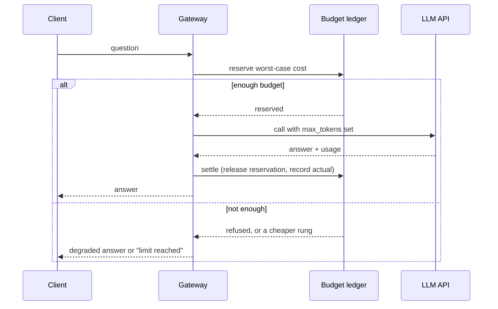

A **token budget** is a limit on how many tokens, or how many dollars' worth of tokens, some unit of work may consume: one request, one user's day, one tenant's month, the whole system's quarter. The previous lesson, [LLM inference costs](/learn/cost-engineering/llm-inference-costs), showed how to *predict* what a request costs. This lesson is about *enforcing* a limit on it, so that cost stays bounded when traffic, users or documents behave in ways you did not predict.

You have already met one kind of token budget: the arithmetic in [Context windows](/learn/understanding-large-language-models/context-windows) that keeps a prompt inside the model's window, and the selection policies in [Context selection](/learn/context-engineering/context-selection) that choose the best evidence for a given number of tokens. Those budgets protect correctness. The budgets here protect the bill. They are set from a cost target rather than from a window size, they apply across many requests as well as within one, and when they run low they do not simply fail: they degrade the service in planned steps.

## Learning objectives

- Derive per-request input and output limits from a cost ceiling and per-token prices.
- Implement a per-tenant spending budget that reserves a request's worst-case cost before the call and settles the actual cost afterwards.
- Design a degradation ladder that keeps a service answering, more cheaply, as a budget runs down.
- Explain how a token bucket enforces a sustained rate while allowing bursts, and compute its waiting time.
- Choose where in a RAG pipeline each kind of budget should be enforced.

## Prerequisites

- [LLM inference costs](/learn/cost-engineering/llm-inference-costs): the cost of a call as input and output tokens at their prices.
- [Context windows](/learn/understanding-large-language-models/context-windows): budgeting a prompt to fit the window.
- [Context selection](/learn/context-engineering/context-selection): choosing chunks within a token budget.

## Why this matters

Without enforced budgets, the cost of a RAG system is set by its least careful caller. Three failure patterns recur:

- **The runaway client.** An integration test, a scheduled script or a misconfigured agent sends thousands of requests overnight. Each one is individually reasonable; together they consume a month's allowance before anyone wakes up.
- **The long tail of a single request.** A question retrieves twenty long chunks, the model reasons at length, and the answer runs to thousands of tokens. One request costs as much as a hundred ordinary ones. Agent loops make this worse, because every step resends the growing transcript.
- **The noisy neighbour.** In a shared deployment, one team's heavy use exhausts a shared rate limit or budget, and every other team's requests start failing.

Monitoring tells you about these after they happen. Budgets stop them while they happen, and a well-designed budget does so without abruptly cutting off legitimate users.

## The intuition

Think of a company expense policy. Each claim has a ceiling: a hotel night may cost at most so much (a **per-request budget**). Each employee has an annual allowance (a **per-user budget**), and each department has its own (a **per-tenant budget**). Before booking an expensive trip, you get pre-approval for the estimated amount, so two people cannot both spend the last of the department's money on the same day (a **reservation**). After the trip, the real receipt replaces the estimate (**settlement**). When the department's money runs low, people do not stop travelling; they take the train instead of flying, then video-call instead of travelling (a **degradation ladder**). Only when nothing at all is left do requests get refused.

A token budget works the same way, with tokens or dollars in place of money and model configurations in place of travel classes.

## How it works

### Three scopes of budget

| Scope | Limits | Enforced | Protects against |
| --- | --- | --- | --- |
| Per request | Input tokens per region, `max_tokens` for output, reasoning effort, agent steps | When building the prompt and calling the model | The long tail of a single request |
| Per principal (user, tenant, API key) | Tokens or dollars per minute, day or month | At the gateway, before the call | Runaway clients and noisy neighbours |
| Global | Total spend per day or month | At the gateway, with alerts | Everything else, including your own bugs |

They compose: a request must fit its own limits, its principal's remaining budget, and the global budget.

### Per-request budgets

A per-request budget starts from a cost ceiling, which itself comes from the economics of the product (what one answer is worth), and turns it into token limits:

1. **Fix the output cap first.** Output is the expensive meter. Set `max_tokens` on every call to the longest answer you are willing to pay for. If the model reaches it, the API stops generation and says so (Anthropic's API sets `stop_reason` to `"max_tokens"`); your code must detect this and handle it, for instance by noting that the answer is incomplete, not by silently showing a truncated sentence.
2. **Account for reasoning.** Models that reason before answering spend output tokens on it. Reasoning counts towards `max_tokens`, so a cap that is fine for the visible answer can cut a reasoning model off before it answers. Where the provider offers a control over reasoning depth (Anthropic's models accept an *effort* setting, for example), lower it for routes that do not need deep reasoning rather than squeezing `max_tokens`.
3. **Derive the input allowance** from what is left of the ceiling after the output cap, at the input price.
4. **Split the input allowance by region.** The system prompt and the question are fixed; history and retrieved chunks share the rest. Give each a cap, so that a long conversation cannot crowd out the evidence, and fill the chunk allowance with a selection policy.
5. **Count before sending.** Count tokens with the provider's tokeniser (`client.messages.count_tokens(...)` for Claude) and refuse or trim prompts that exceed the allowance, rather than discovering the cost on the invoice.
6. **Cap loops.** An agent or iterative-retrieval loop needs a maximum number of steps and a cumulative token limit, checked before each step.

### Per-principal budgets: reserve, call, settle

A spending budget for a user or tenant looks simple: keep a running total, refuse when it exceeds the limit. The catch is concurrency. If a tenant has 0.05 dollars left and ten requests arrive at once, a check-then-call design lets all ten through, because each check sees the same remaining balance. The fix is the **reservation** pattern:



1. Compute the request's **worst-case cost**: its full input allowance at the input price plus `max_tokens` at the output price. This is an upper bound precisely because `max_tokens` is enforced.
2. **Reserve** that amount atomically in the ledger. If the remaining budget (limit minus spent minus already reserved) cannot cover it, do not call the model.
3. Make the call.
4. **Settle**: release the reservation and record the actual cost from the response's usage figures. Settle in a `finally` block, so that a failed call releases its reservation.

In production the ledger must be shared by every server instance and its reserve operation must be atomic, so it typically lives in a database or a store such as Redis, using a transaction or an atomic script. The logic is the same as the in-memory version in the code below.

### Rate limits: the token bucket

A daily budget caps the total but not the speed. A client could spend its whole day's budget in one minute and saturate your provider's rate limit for everyone else. A **token bucket** limits rate while allowing short bursts. Picture a bucket that holds at most $B$ tokens and is refilled at a steady $\rho$ tokens per second. Each request removes the tokens it needs; if the bucket lacks them, the request waits (or is rejected) until the refill catches up. Full buckets allow a burst of up to $B$; over any long period, consumption cannot exceed $\rho$ per second. Providers enforce limits of this kind on you (tokens per minute, requests per minute), and you should enforce your own, per principal, inside them. [Latency optimisation](/learn/performance-optimisation/latency-optimisation) covers the queuing side of this.

### The degradation ladder

Refusing requests when a budget runs out is a blunt instrument. A **degradation ladder** defines cheaper configurations that still give useful answers, and steps down through them as the remaining budget falls:

1. **Full**: the best model, generous retrieved context, normal answer length.
2. **Lean**: the same model with fewer chunks and a lower `max_tokens`.
3. **Economy**: a smaller, cheaper model with lean settings.
4. **Cached or extractive only**: answer from a response cache or return the top retrieved passages without generation.
5. **Refuse** with a clear message and a reset time.

The thresholds at which to step down are policy decisions. Stepping down *before* the budget is exhausted keeps a reserve for later in the period, which matters when a budget resets daily and users arrive throughout the day. Every rung must be evaluated for quality like any other configuration ([Model selection](/learn/cost-engineering/model-selection) and [Cost-performance trade-offs](/learn/cost-engineering/cost-performance-trade-offs) show how), and every response should record which rung served it, so that quality metrics can be split by rung.

### Where each budget is enforced

Per-request limits belong in the code that builds the prompt and calls the model, since only it knows the regions. Principal and global budgets belong in one place that every request passes through, typically an API gateway or a shared client library, so that no code path can bypass them. Ingestion-time model calls (contextual enrichment, summaries) need a budget too, usually a per-job limit checked before each batch.

## The mathematics

### Input allowance from a cost ceiling

**Intuition.** Reserve the output's worst case first; whatever is left of the ceiling buys input.

$$
T_{\text{in}}^{\max} = \frac{C_{\max} - p_{\text{out}} \, T_{\text{out}}^{\max}}{p_{\text{in}}}
$$

$C_{\max}$ is the cost ceiling per request, $T_{\text{out}}^{\max}$ the output cap (`max_tokens`), $p_{\text{in}}$ and $p_{\text{out}}$ the per-token prices, and $T_{\text{in}}^{\max}$ the largest input the request may send. If the numerator is negative, the output cap alone breaks the ceiling.

**By hand.** Ceiling $0.015$ dollars, hypothetical prices of 5 and 25 dollars per million tokens, output cap 300 tokens. Output worst case: $300 \times 25 / 10^6 = 0.0075$. Remaining: $0.0075$, which buys $0.0075 / (5 / 10^6) = 1{,}500$ input tokens. With a 700-token system prompt and a 40-token question, the chunks may use $1{,}500 - 740 = 760$ tokens: about three 250-token chunks.

### Worst-case reservation

$$
R = p_{\text{in}} \, T_{\text{in}} + p_{\text{out}} \, T_{\text{out}}^{\max}
$$

$R$ is the amount reserved, using the request's actual input $T_{\text{in}}$ (known before the call, by counting) and the output cap. The actual cost is never more than $R$, because the output cannot exceed its cap. The ratio of reserved to actual cost is the over-reservation; a high ratio means a budget looks exhausted while much of it is merely held, so keep `max_tokens` realistic.

### Token bucket

**Intuition.** You can spend what is in the bucket immediately; beyond that, you wait for the refill.

For a bucket of capacity $B$ refilled at $\rho$ tokens per second, a burst of $X > B$ tokens arriving at a full bucket is served $B$ immediately, and the remaining $X - B$ after

$$
t_{\text{wait}} = \frac{X - B}{\rho}
$$

seconds. **By hand.** $B = 200{,}000$ tokens, $\rho = 100{,}000$ tokens per minute ($1{,}666.7$ per second). A burst of $250{,}000$ tokens: the last $50{,}000$ wait $50{,}000 / 1{,}666.7 = 30$ seconds.

```python
p_in, p_out = 5.00 / 1e6, 25.00 / 1e6       # hypothetical dollars per token
C_max, T_out, fixed = 0.015, 300, 740        # ceiling per request, output cap, system + question
T_in_max = (C_max - p_out * T_out) / p_in
print(f"input allowed: {T_in_max:,.0f} tokens, of which chunks: {T_in_max - fixed:,.0f}")

B, rho = 200_000, 100_000 / 60               # bucket capacity, refill in tokens per second
burst_then_wait = (B + 50_000 - B) / rho     # a 250k-token burst: how long must the last 50k wait?
print(f"long-run rate {rho * 60:,.0f} tokens/min; extra 50k tokens wait {burst_then_wait:.0f} s")
```

```output
input allowed: 1,500 tokens, of which chunks: 760
long-run rate 100,000 tokens/min; extra 50k tokens wait 30 s
```

## In code

**The problem.** AskMeridian serves three internal tenants (HR, IT and Sales), each with a daily spending limit. One day a Sales integration script goes wrong and sends three times its usual traffic. Implement per-tenant budgets with reservation and settlement, and a three-rung degradation ladder, and see what each tenant experiences.

**Dependencies.** NumPy only; the model calls are simulated with seeded draws, since the subject here is the budget logic, not the model.

```bash
pip install numpy
```

```python
from dataclasses import dataclass, field
import numpy as np

# Hypothetical prices in dollars per million tokens (check your provider's current page).
PRICES = {"large": (5.00, 25.00), "small": (1.00, 5.00)}

# The degradation ladder: each rung is cheaper than the one above it.
LADDER = [
    {"name": "full",    "model": "large", "chunk_tokens": 1500, "max_tokens": 400},
    {"name": "lean",    "model": "large", "chunk_tokens": 800,  "max_tokens": 250},
    {"name": "economy", "model": "small", "chunk_tokens": 800,  "max_tokens": 250},
]
FIXED_INPUT = 700 + 40            # system prompt + question

def worst_case(rung) -> float:
    """Most a request on this rung can cost: full input plus max_tokens of output."""
    p_in, p_out = PRICES[rung["model"]]
    return ((FIXED_INPUT + rung["chunk_tokens"]) * p_in + rung["max_tokens"] * p_out) / 1e6

@dataclass
class TenantBudget:
    daily_limit: float                       # dollars per day
    spent: float = 0.0                       # settled spend
    reserved: float = 0.0                    # held for requests in flight
    served: dict = field(default_factory=lambda: {r["name"]: 0 for r in LADDER} | {"refused": 0})

    def remaining(self) -> float:
        return self.daily_limit - self.spent - self.reserved

    def choose_rung(self):
        """Highest rung whose worst case fits; degrade earlier as the budget runs down."""
        frac_left = self.remaining() / self.daily_limit
        start = 0 if frac_left > 0.40 else 1 if frac_left > 0.15 else 2
        for rung in LADDER[start:]:
            if worst_case(rung) <= self.remaining():
                return rung
        return None

    def reserve(self, amount):  self.reserved += amount
    def settle(self, held, actual):
        self.reserved -= held
        self.spent += actual

def actual_cost(rung, rng) -> float:
    """What the call really cost: chunks rarely fill the cap; answers vary."""
    p_in, p_out = PRICES[rung["model"]]
    chunks = rng.uniform(0.6, 1.0) * rung["chunk_tokens"]
    out = min(rung["max_tokens"], rng.lognormal(np.log(170), 0.5))
    return ((FIXED_INPUT + chunks) * p_in + out * p_out) / 1e6

rng = np.random.default_rng(7)
tenants = {"hr": TenantBudget(4.00), "it": TenantBudget(4.00), "sales": TenantBudget(4.00)}
requests_per_day = {"hr": 150, "it": 200, "sales": 600}        # sales has a runaway script

for rung in LADDER:
    print(f"worst case on {rung['name']:<8} {worst_case(rung):.5f} dollars")

for name, n in requests_per_day.items():
    t = tenants[name]
    for _ in range(n):
        rung = t.choose_rung()
        if rung is None:
            t.served["refused"] += 1
            continue
        t.served[rung["name"]] += 1
        held = worst_case(rung)
        t.reserve(held)                              # before the call
        t.settle(held, actual_cost(rung, rng))       # after the call returns
    print(f"\n{name}: {n} requests, spent {t.spent:.3f} of {t.daily_limit:.2f} dollars")
    print("   " + "  ".join(f"{k} {v}" for k, v in t.served.items()))
```

```output
worst case on full     0.02120 dollars
worst case on lean     0.01395 dollars
worst case on economy  0.00279 dollars

hr: 150 requests, spent 2.111 of 4.00 dollars
   full 150  lean 0  economy 0  refused 0

it: 200 requests, spent 2.701 of 4.00 dollars
   full 173  lean 27  economy 0  refused 0

sales: 600 requests, spent 3.998 of 4.00 dollars
   full 167  lean 92  economy 267  refused 74
```

**The important lines.**

- `worst_case()` is the reservation amount: full input allowance plus `max_tokens` of output. It is a true upper bound only because `max_tokens` is enforced by the API on every call.
- `remaining()` subtracts both settled spend and outstanding reservations. Subtracting only `spent` would reintroduce the concurrency bug that reservations exist to fix.
- `choose_rung()` encodes the policy: full service while more than 40% of the budget remains, lean between 40% and 15%, economy below 15%, and within those bands the highest rung whose worst case still fits.
- `reserve()` before and `settle()` after the call mirror the sequence diagram. In this single-threaded simulation they happen back to back; in a server they bracket a network call, during which other requests see the reservation.
- `actual_cost()` draws a cost below the worst case, as real calls are: chunks rarely fill their allowance and most answers stop well before `max_tokens`.

**What the output means.**

- **HR was untouched**: 150 requests, all at full quality, using about half its budget.
- **IT was affected by its own success**: 200 requests took it past 60% of its budget, so its last 27 requests were served lean. This is the policy working as designed, but it is also a signal that IT's limit may be too tight for its normal traffic. Whether that is acceptable depends on how much worse "lean" answers are, which you must measure.
- **Sales' runaway script was contained.** It got 167 full answers, then 92 lean and 267 economy ones, and the last 74 requests were refused. Total spend stayed under 4 dollars. Without the ladder, the first 190 or so requests would have used the whole budget at full quality, and the remaining 400 would all have been refused. With it, the tenant received more than twice as many answers for the same money.
- **The per-request worst cases differ by a factor of about 7.6** between full and economy. That ratio is what makes the ladder effective; a ladder whose rungs differ by 10% buys little.
- **Spend lands just under the limit (3.998 of 4.00)** because each request is admitted only if its worst case fits. A design that checks only the expected cost would overshoot.

**Enforcing the per-request budget with the real API.** Before a call, count the prompt's tokens and check them against the allowance; on the call, set `max_tokens`; after it, check why generation stopped. This needs an API key and was not executed here:

```python
import anthropic

client = anthropic.Anthropic()  # reads ANTHROPIC_API_KEY from the environment
SYSTEM = "Answer only from the provided context. If the answer is not there, say you don't know."
MAX_INPUT, MAX_OUTPUT = 1_500, 300

count = client.messages.count_tokens(
    model="claude-opus-5-5",
    system=SYSTEM,
    messages=[{"role": "user", "content": prompt}],
)
if count.input_tokens > MAX_INPUT:
    raise ValueError(f"prompt is {count.input_tokens} tokens; trim the chunks to fit {MAX_INPUT}")

response = client.messages.create(
    model="claude-opus-5-5",
    max_tokens=MAX_OUTPUT,
    system=SYSTEM,
    messages=[{"role": "user", "content": prompt}],
)
answer = "".join(block.text for block in response.content if block.type == "text")
if response.stop_reason == "max_tokens":
    answer += "\n\n[Answer truncated at the length limit.]"
```

Counting costs a round trip, so many systems count locally with an approximate tokeniser and a safety margin, and call the counting endpoint only near the limit.

**Errors people commonly hit.**

- Releasing a reservation only on success. A call that times out keeps its reservation forever and the budget leaks; settle in a `finally` block, recording zero (or whatever the provider billed) on failure.
- Setting `max_tokens` too low for a reasoning model, which then spends the whole allowance reasoning and returns little or no answer. Check `stop_reason` and size the cap for reasoning plus answer.
- Keeping budgets in process memory on a multi-instance service; each instance enforces its own copy and the true limit is the per-instance limit times the number of instances.

**Extending it.** Add a token bucket per tenant (capacity and refill rate) in front of `choose_rung()` and replay the Sales traffic arriving in a ten-minute burst. Add a global budget shared by all tenants. Record the rung on every response so quality can be measured per rung.

## A real-world example

Meridian opened AskMeridian's API to other internal teams, so that their tools could ask it questions directly. Within a fortnight, the Sales Operations team's CRM integration started calling it once for every account record during a nightly enrichment job: tens of thousands of questions in a few hours, most of them near-duplicates. The Platform team discovered this from the provider's rate-limit errors, which were now hitting interactive users of the chat interface every night.

The response was a gateway in front of the model calls with three budgets. Every API key received a token bucket sized for interactive use, so that bulk jobs were slowed rather than allowed to saturate the shared rate limit. Every tenant received a monthly spending allowance with reservation and settlement, and a ladder that switched to fewer chunks and then to a smaller model as the allowance ran down. And bulk callers were given a separate route: a batch endpoint that queued their questions, deduplicated them, and processed them overnight through the provider's discounted batch interface.

Interactive users stopped seeing rate-limit errors, the Sales Operations job still completed, and a question that nobody had asked before, *what is one answer worth to each team?*, became part of how limits were set. The gateway also recorded the rung that served each response, which later let the evaluation team show that lean answers were nearly as good as full ones for HR policy questions but noticeably worse for IT troubleshooting, and the IT tenant's thresholds were adjusted accordingly.

## Common mistakes

- **No `max_tokens`, or a huge one.** Output cost has no upper bound and worst-case reservations become meaningless.
- **Checking the budget without reserving.** Concurrent requests all pass the check and overspend together.
- **Hard refusal as the only response to an exhausted budget.** Users lose service abruptly when a cheaper rung would have answered them.
- **Thresholds that never reset sensibly.** A daily budget that degrades early in the morning punishes legitimate morning users for the previous night's script.
- **Enforcing budgets in several places.** Each service keeps its own totals; the limits drift apart and some code paths bypass them. Enforce in one gateway or library.
- **Forgetting ingestion-time calls.** Contextual enrichment over a large corpus can cost more than a month of queries and needs its own job budget.

## Best practices

- Derive per-request limits from a cost ceiling that reflects what an answer is worth, and set `max_tokens` on every call.
- Use reservation and settlement with an atomic, shared ledger for every principal budget.
- Combine a rate limit (token bucket) with a period budget; they protect against different failures.
- Design the degradation ladder in advance, evaluate every rung's quality, and record the rung on every response.
- Alert well before limits are reached (for example at 50% and 80% of a period budget), and treat an unexpected budget exhaustion as an incident to investigate.
- Route bulk and offline callers to batch interfaces with their own budgets.

## Performance considerations

Budget checks sit on the request path, so they must be fast: an atomic increment in an in-memory store adds well under a millisecond, while a relational database transaction adds a few milliseconds and can become a contention point if every request for a tenant updates the same row. Sharding a tenant's budget into several counters that are summed periodically reduces contention at the cost of slight overspend.

Token counting before a call adds a round trip if done through the provider's endpoint. A local approximate count with a margin (say 10%) avoids the round trip; only prompts close to the limit need an exact count.

Degradation changes latency as well as cost, usually for the better: fewer chunks shorten time to first token and a smaller model usually generates faster. A ladder can therefore double as a load-shedding mechanism under latency pressure, which [Latency optimisation](/learn/performance-optimisation/latency-optimisation) discusses.

## Security considerations

Budgets are a defence against denial-of-wallet attacks: a malicious or compromised client that tries to run up cost is slowed by its rate limit and stopped by its budget. That defence only works if budgets are keyed to an authenticated identity; budgets keyed to something a caller controls, such as a header value or a session identifier the client can regenerate, can be evaded by rotating it.

Prompt injection can target cost, too. A retrieved document that instructs the model to "repeat the following text 500 times" or to call a search tool in a loop is bounded only by `max_tokens` and the step limit. Never rely on the model to stay within budget; enforce limits in code around it.

Budget ledgers record who asked how much. Treat usage records as personal data where they are linked to individual users, and retain them no longer than billing and audit require.

## Summary

- Token budgets enforce cost limits at three scopes: per request (input and output caps), per principal (rate and period budgets) and global.
- A per-request budget fixes the output cap first, derives the input allowance from the remaining cost ceiling, and splits it between history and retrieved evidence.
- Principal budgets must reserve each request's worst-case cost before the call and settle the actual cost afterwards, using a shared, atomic ledger; otherwise concurrent requests overspend.
- A token bucket caps sustained rate while allowing bursts; a period budget caps the total. Use both.
- A degradation ladder steps down through cheaper configurations before refusing, serving more answers for the same money; each rung needs its own quality evaluation.

## Exercises

**1.** A product team sets a ceiling of 0.008 dollars per request. At hypothetical prices of 3 and 15 dollars per million tokens, with a 250-token output cap, a 900-token system prompt and a 30-token question, how many chunk tokens may each request use?

<details><summary>Show solution</summary>

Output worst case: $250 \times 15 / 10^6 = 0.00375$. Remaining: $0.00425$, buying $0.00425 / (3 / 10^6) \approx 1{,}417$ input tokens. Chunks: $1{,}417 - 930 = 487$ tokens, about two 240-token chunks. If that is too little evidence, the options are a shorter system prompt, a lower output cap, a cheaper model, or a higher ceiling.

</details>

**2.** Explain, with an example of two concurrent requests, why `remaining()` in the code must subtract `reserved` as well as `spent`.

<details><summary>Show solution</summary>

Suppose a tenant has 0.03 dollars left and a full request's worst case is 0.021. Request A reserves 0.021; before it settles, request B arrives. If `remaining()` ignored reservations it would report 0.03, admit B, and the two could together spend up to 0.042, overspending by 0.012. Subtracting reservations reports 0.009, so B is degraded to a rung whose worst case fits, or refused.

</details>

**3.** Add a token bucket to the simulation: each tenant may use at most 30,000 tokens per minute with a burst capacity of 60,000. Give every request a timestamp (Sales sends its 600 requests within 10 minutes; the others spread theirs over 8 hours) and make requests that find the bucket empty wait. Report the longest wait for Sales.

<details><summary>Show solution</summary>

A bucket that returns the time at which a request may start:

```python
class TokenBucket:
    def __init__(self, capacity, per_second):
        self.capacity, self.rate = capacity, per_second
        self.level, self.t = capacity, 0.0
    def acquire(self, tokens, now):
        """Take `tokens`; return the time at which the request may start."""
        start = max(now, self.t)
        self.level = min(self.capacity, self.level + (start - self.t) * self.rate)
        if self.level < tokens:                       # wait for the refill
            start += (tokens - self.level) / self.rate
            self.level = tokens
        self.level -= tokens
        self.t = start
        return start
```

Draw sorted arrival times with `np.sort(rng.uniform(0, span, n))`, and after choosing a rung call `bucket.acquire(FIXED_INPUT + rung["chunk_tokens"] + rung["max_tokens"], now)`; the wait is the returned time minus `now`. On our run (seed 7), HR and IT never waited, and the longest Sales wait was 1,513 seconds, about 25 minutes. The bucket turns a ten-minute burst into a steady stream at 500 tokens per second, protecting the shared provider limit, while the budget still caps the total (Sales again spent just under 4 dollars). In a real system you would reject requests whose wait exceeds a timeout instead of queueing them for 25 minutes.

</details>

**4.** Design the degradation ladder for an IT-support route where a wrong answer (for example a wrong VPN fix) is costly, and explain how it should differ from the ladder for HR policy questions.

<details><summary>Show solution</summary>

For IT support, quality loss is expensive, so rungs that reduce evidence or switch to a weaker model should be entered later and evaluated more strictly. A reasonable ladder: full; full model with fewer chunks only if evaluation shows no loss on troubleshooting questions; then extractive mode (return the top runbook passages with links, no generated answer), which cannot hallucinate a fix; then refusal with a pointer to the support desk (08:00 to 18:00 UK time). For HR policy questions, where lean and economy answers measure nearly as well, the cheaper generated rungs are acceptable earlier. The general rule: the ladder for a route is set by the measured quality of each rung on that route's questions and the cost of a wrong answer there.

</details>

## Check your understanding

```quiz
[
  {
    "q": "Why does a worst-case reservation need `max_tokens` to be set on the call?",
    "options": [
      "Because the API rejects calls without it",
      "Because without an output cap there is no upper bound on the call's cost",
      "Because it makes the model answer faster",
      "Because input tokens cannot be counted otherwise"
    ],
    "answer": 1,
    "why": "Input is known before the call; output is bounded only by max_tokens, so the worst case is finite only when the cap is set."
  },
  {
    "q": "A tenant budget subtracts only settled spend when checking whether a request fits. What goes wrong under load?",
    "options": [
      "Nothing; reservations are only an optimisation",
      "Requests are refused too early",
      "Concurrent requests all see the same balance and together overspend the budget",
      "The ledger becomes slower"
    ],
    "answer": 2,
    "why": "Without reservations, every in-flight request checks against the same remaining balance before any of them settles."
  },
  {
    "q": "What does a token bucket with capacity 200,000 and refill 100,000 tokens per minute allow?",
    "options": [
      "At most 100,000 tokens in any single request",
      "A burst of up to 200,000 tokens, and at most about 100,000 per minute sustained",
      "Exactly 200,000 tokens per minute",
      "Unlimited tokens as long as requests are spaced a minute apart"
    ],
    "answer": 1,
    "why": "The capacity sets the largest burst; the refill rate sets the long-run average."
  },
  {
    "q": "In the simulation, why did the Sales tenant receive more answers with the degradation ladder than it would have with refusal alone?",
    "options": [
      "The ladder raised its daily limit",
      "Cheaper rungs cost a fraction of a full request, so the remaining budget paid for many more answers",
      "The ladder cached repeated questions",
      "Refused requests were retried later"
    ],
    "answer": 1,
    "why": "An economy request's worst case was about a seventh of a full one, so the last part of the budget served several times as many requests."
  },
  {
    "q": "A reasoning model with `max_tokens=200` often returns a very short or empty answer with `stop_reason` equal to \"max_tokens\". What is the most likely cause?",
    "options": [
      "The input was too long",
      "The prompt cache expired",
      "Reasoning tokens count towards max_tokens and used up the allowance before the answer",
      "The API was rate-limited"
    ],
    "answer": 2,
    "why": "Reasoning is output; a cap sized for the visible answer alone can be exhausted by reasoning. Raise the cap or lower the reasoning effort."
  }
]
```

## Further reading

- Anthropic documentation on [rate limits](https://docs.anthropic.com/en/api/rate-limits) and token counting: how provider-side limits are expressed, which your own budgets must sit inside.
- Tanenbaum, A. S. and Wetherall, D. J. *Computer Networks*, 5th edition (2011), section 5.4 (quality of service), which covers traffic shaping with the leaky-bucket and token-bucket algorithms in their original networking setting.
- [Redis documentation](https://redis.io/docs/latest/) on transactions and Lua scripting: the usual way to make reserve-and-settle atomic across server instances.
- OWASP *Top 10 for Large Language Model Applications* (2025), the entry on unbounded consumption: denial-of-wallet and resource-exhaustion risks.
