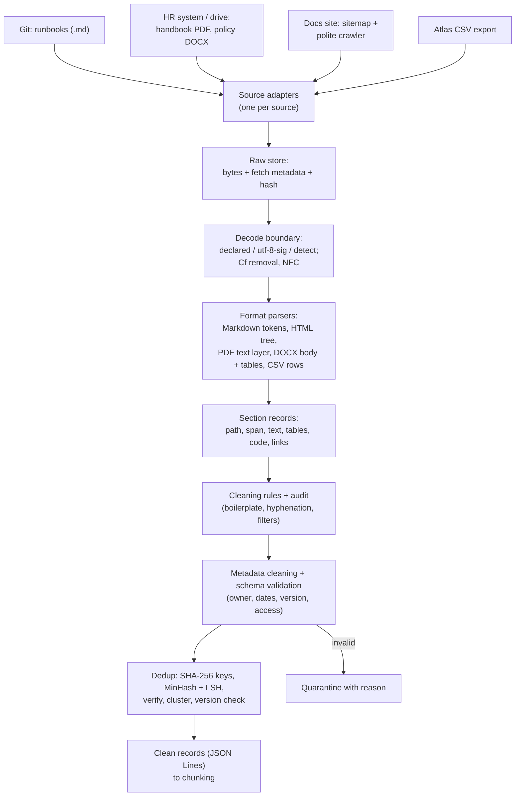

This assessment covers all eleven lessons of **Data Processing**: text processing, regular expressions, JSON and CSV, XML and HTML, PDF and DOCX extraction, Markdown parsing, web scraping, data cleaning, encoding and Unicode, and duplicate detection. Answer the 20 multiple-choice questions first; the pass mark is 70% (14 of 20). Then work through the open questions, the coding exercises, the design challenge and the troubleshooting scenarios, writing your own answer to each before opening the model answer. The written parts are not scored, but they are where you find out whether you can build an ingestion pipeline that turns messy sources into clean, traceable text, and not merely recognise the terms.

```quiz
[
  {
    "q": "What does `len(\"café\".encode(\"utf-8\"))` return?",
    "options": ["4", "5", "6", "8"],
    "answer": 1,
    "why": "Three ASCII letters take one byte each and é (U+00E9) takes two bytes in UTF-8: 3 + 2 = 5."
  },
  {
    "q": "Why should text be decoded from bytes once, at the boundary where it enters the pipeline?",
    "options": [
      "Because Python cannot store bytes in memory",
      "Because decoding is the slowest step and should be done only once for speed",
      "Because every later stage can then work with one well-defined type (str), and decoding decisions are made and recorded in one place",
      "Because UTF-8 bytes cannot be compared"
    ],
    "answer": 2,
    "why": "Mixing bytes and str through a pipeline spreads encoding guesses everywhere. One decoding point makes the choice explicit, testable and auditable."
  },
  {
    "q": "What does this print?\n```python\nimport re\nprint(re.findall(r\"E-\\d{4}\", \"Codes E-4021, E-40211 and e-4012\"))\n```",
    "options": [
      "['E-4021']",
      "['E-4021', 'E-4021']",
      "['E-4021', 'E-40211', 'e-4012']",
      "['E-4021', 'e-4012']"
    ],
    "answer": 1,
    "why": "Without a boundary after the digits, the pattern also matches the first four digits of E-40211. Lower-case e does not match without re.IGNORECASE. Add \\b to require the code to end there."
  },
  {
    "q": "A CSV export has an `employee_id` column with values such as `00123`. You load it with `pandas.read_csv` and default settings. What happens to that value?",
    "options": [
      "It is kept as the string '00123'",
      "pandas raises an error about leading zeros",
      "It becomes the integer 123, losing the leading zeros",
      "It becomes the float 0.0123"
    ],
    "answer": 2,
    "why": "pandas infers a numeric type for the column. Identifiers must be read as strings, for example with dtype=str for that column."
  },
  {
    "q": "What does `json.loads('{\"a\": 1, \"a\": 2}')` return in Python?",
    "options": [
      "{'a': 2}",
      "{'a': 1}",
      "{'a': [1, 2]}",
      "It raises json.JSONDecodeError"
    ],
    "answer": 0,
    "why": "Python's json module accepts duplicate keys and keeps the last value, silently. Use object_pairs_hook if duplicates must be detected."
  },
  {
    "q": "In Python's ElementTree, for `<p>Leave is <b>25</b> days.</p>`, where is the text ' days.' stored?",
    "options": [
      "In the text of the <p> element",
      "In the tail of the <b> element",
      "In the text of the <b> element",
      "It is discarded"
    ],
    "answer": 1,
    "why": "Text that follows a child element belongs to that child's tail. Code that reads only .text loses it; itertext() collects everything."
  },
  {
    "q": "A PDF of a scanned policy document returns an empty string from text extraction on every page. What is the most likely reason?",
    "options": [
      "The PDF is encrypted with a password",
      "The extractor needs a layout mode to be switched on",
      "The pages are images of text with no text layer, so OCR is needed",
      "The PDF uses UTF-16 internally"
    ],
    "answer": 2,
    "why": "A scanned PDF typically contains page images and no text objects. A text extractor can only return text that is stored as text; OCR is needed to recover it."
  },
  {
    "q": "You extract a Word document with python-docx by iterating over `document.paragraphs`. The expenses rate table is missing from the output. Why?",
    "options": [
      "python-docx cannot read tables",
      "Tables are stored as images in .docx files",
      "The table is in a different section of the document",
      "`document.paragraphs` contains only body-level paragraphs; text inside tables must be read from `document.tables`"
    ],
    "answer": 3,
    "why": "Table cells hold their own paragraphs, which are not included in document.paragraphs. Walk the tables (or the body elements in order) as well."
  },
  {
    "q": "A Markdown runbook contains a fenced bash block with the line `# Run as administrator`. Which approach correctly avoids treating it as a heading?",
    "options": [
      "Splitting the file on lines that match ^# ",
      "Parsing with a CommonMark parser and taking headings from heading_open tokens",
      "Removing all lines that start with #",
      "Converting the file to plain text with str.replace('#', '')"
    ],
    "answer": 1,
    "why": "Only a parser that tracks open blocks knows the line is inside a code fence. Line-by-line patterns cannot."
  },
  {
    "q": "The heading stack is [(1, 'Handbook'), (2, 'Expenses'), (3, 'Receipts')]. A level-3 heading 'Mileage' arrives. What is the new heading path?",
    "options": [
      "Handbook > Expenses > Receipts > Mileage",
      "Mileage",
      "Handbook > Mileage",
      "Handbook > Expenses > Mileage"
    ],
    "answer": 3,
    "why": "Headings of level 3 or deeper are popped (Receipts), then Mileage is pushed as a sibling under Expenses."
  },
  {
    "q": "What does `urljoin(\"https://docs.meridian.example/handbook/leave\", \"remote\")` return?",
    "options": [
      "https://docs.meridian.example/handbook/remote",
      "https://docs.meridian.example/handbook/leave/remote",
      "https://docs.meridian.example/remote",
      "remote"
    ],
    "answer": 0,
    "why": "A relative link replaces the last path segment of the base URL. With a trailing slash (.../leave/) the result would be .../leave/remote, which is why links must be resolved against the page's actual final URL."
  },
  {
    "q": "A crawler receives HTTP 429 with `Retry-After: 60` for a page already in the index. What should it do?",
    "options": [
      "Mark the page as deleted and remove it from the index",
      "Retry immediately in parallel to get the page faster",
      "Wait 60 seconds, reduce its request rate, and retry a bounded number of times; keep the indexed copy if all retries fail",
      "Ignore robots.txt for the rest of the crawl"
    ],
    "answer": 2,
    "why": "429 means slow down. It is a transient condition, never evidence that a page was deleted."
  },
  {
    "q": "Which statement about robots.txt is correct?",
    "options": [
      "It technically prevents crawlers from fetching disallowed pages",
      "Obeying it gives you legal permission to use everything else on the site",
      "Crawl-delay is a required part of RFC 9309",
      "It expresses the site's wishes to crawlers; respecting it is expected, but it is neither access control nor a licence"
    ],
    "answer": 3,
    "why": "robots.txt is a convention standardised in RFC 9309. It cannot enforce anything, and copyright, terms and data-protection law apply independently."
  },
  {
    "q": "A cleaning rule removes every line shorter than 25 characters to get rid of page numbers. What is the main risk?",
    "options": [
      "It is too slow for large corpora",
      "It also deletes short factual lines such as 'Annual leave: 25 days.'",
      "It cannot remove page numbers",
      "It changes the encoding of the text"
    ],
    "answer": 1,
    "why": "Rules should describe the noise precisely (a page-number pattern, or lines repeated across most pages), not a property that content can share."
  },
  {
    "q": "Why is it worth having each cleaning rule report how many changes it made?",
    "options": [
      "The counts form an audit: they explain what cleaning did to each document and reveal when a rule suddenly stops or starts matching",
      "Python requires a return value from every function",
      "It allows rules to run in parallel",
      "Embedding models need the counts as input"
    ],
    "answer": 0,
    "why": "Counts per rule and document make cleaning explainable and make changes in the input visible in monitoring."
  },
  {
    "q": "Text extracted from a file shows 'Budget: £400'. What most likely happened?",
    "options": [
      "The document author typed an extra character",
      "The text was normalised with NFKC",
      "The PDF extractor added a ligature",
      "UTF-8 bytes were decoded as Windows-1252 or Latin-1"
    ],
    "answer": 3,
    "why": "£ is C2 A3 in UTF-8; a single-byte legacy codec reads C2 as  and A3 as £. This mojibake is silent, unlike the opposite mistake."
  },
  {
    "q": "Which normalisation should be applied to the text you store and display, and which to lexical matching keys?",
    "options": [
      "NFKC for stored text, NFC for keys",
      "NFC for stored text; NFKC plus case folding for keys, applied identically to queries",
      "NFD for both",
      "No normalisation for stored text; ASCII transliteration for keys"
    ],
    "answer": 1,
    "why": "NFC changes nothing visible. NFKC also unifies compatibility characters (ligatures, fullwidth letters), which helps matching but can lose distinctions, so it belongs in keys."
  },
  {
    "q": "Two documents have word-shingle sets with 12 shingles in common and 30 distinct shingles in total. What is their Jaccard similarity?",
    "options": ["0.29", "0.40", "0.60", "0.67"],
    "answer": 1,
    "why": "Jaccard is intersection over union: 12 / 30 = 0.40."
  },
  {
    "q": "MinHash signatures of 128 values estimate a pair's Jaccard similarity as 0.50. Roughly what is the standard error of that estimate?",
    "options": ["0.004", "0.01", "0.044", "0.25"],
    "answer": 2,
    "why": "The standard error is sqrt(J(1 - J)/k) = sqrt(0.25/128) ≈ 0.044, so estimates near a decision threshold should be verified exactly."
  },
  {
    "q": "Near-duplicate detection groups Meridian's current handbook with the superseded 2023 handbook (similarity 0.7). What should the pipeline do?",
    "options": [
      "Keep whichever copy is shorter",
      "Keep both unmarked, since they are not exact duplicates",
      "Treat it as a versioning decision: index the current version and exclude or clearly label the superseded one",
      "Merge the two texts into one document"
    ],
    "answer": 2,
    "why": "The 2023 version disagrees on the equipment budget, laptop cycle and support hours. Similarity finds the pair; version metadata decides what to keep."
  }
]
```

## Conceptual questions

**1.** Explain the difference between a character, a code point, a byte and an encoding, and use it to explain why decoding legacy bytes as UTF-8 usually fails loudly while decoding UTF-8 as Windows-1252 fails silently.

<details><summary>Show model answer</summary>

A **character** is the abstract unit a reader sees ("é"). Unicode gives each character one or more **code point** representations, numbers such as U+00E9; a Python `str` is a sequence of code points. Files and networks hold **bytes**, values from 0 to 255. An **encoding** is the rule that maps code points to bytes and back; UTF-8 uses one to four bytes per code point, Windows-1252 exactly one byte per character from a fixed set of 256.

UTF-8 has a strict structure: lead bytes announce how many continuation bytes follow, and continuation bytes all start with the bits `10`. Most legacy-encoded non-ASCII bytes, such as `0xA3` for "£" in Windows-1252, cannot appear where they do under UTF-8's rules, so the decoder raises `UnicodeDecodeError`. Windows-1252, in contrast, maps nearly every byte to some character, so any byte sequence decodes "successfully": UTF-8's `C2 A3` becomes "£". The first mistake stops the pipeline; the second produces plausible garbage (mojibake) that flows into the index. That asymmetry is why a pipeline should try strict UTF-8 first and never default to a single-byte codec "because it never fails".

</details>

**2.** A colleague argues that parsing (Markdown, HTML, PDF, DOCX) is a solved problem and that the data-processing stage should simply "convert everything to plain text as early as possible". Give three concrete things that would be lost, and how each affects retrieval or answers.

<details><summary>Show model answer</summary>

1. **Heading structure.** Flattening removes the heading path. A section saying "The budget is £400" no longer carries "Remote work > Equipment budget", so a chunk containing it embeds and matches poorly for questions phrased around remote work, and the chunker loses natural boundaries.
2. **Code and tables as units.** Code blocks and tables become ordinary lines. Chunkers then cut through them, and inline syntax (pipes, backticks, shell comments that look like headings) pollutes the text. Runbook answers lose their commands or get half a script.
3. **Provenance and metadata.** Source line numbers, page numbers, front matter (owner, date, access level) and link targets are discarded. Citations can no longer point to the exact place, freshness and access filters have nothing to filter on, and debugging a bad chunk means searching by hand.

Others are acceptable answers: reading order in multi-column PDFs, tables inside DOCX files (missed entirely by paragraph-only extraction), text in HTML `tail` positions. The principle is to parse into a structured record first and produce plain text from it deliberately, at the point where each consumer needs it.

</details>

**3.** What makes a cleaning rule safe to run on a whole corpus? Describe the properties you would require and how you would verify them before enabling a new rule.

<details><summary>Show model answer</summary>

Properties:

- **Precise**: it describes the noise (an anchored footer pattern, lines repeated on most pages) rather than a property that content can share (short lines, digits).
- **Pure and idempotent**: the same input always gives the same output, and running it twice changes nothing more.
- **Measured**: it reports how many changes it made, per document.
- **Reversible in practice**: the raw extraction is kept, so the rule's effect can be undone by re-running cleaning without it.
- **Ordered sensibly** relative to other rules (encoding repair before line removal, line removal before hyphenation repair, filters last).

Verification: unit tests with examples of the noise and of look-alike content that must survive; a dry run over the whole corpus that records the counts and a random sample of the actual changes; reading the pages a filter would drop around its threshold; and checking the audit per source type, since a rule that is safe for prose (a letter-ratio filter) can be harmful for runbooks or tables. After enabling, monitor the counts so that a sudden change is noticed.

</details>

**4.** Explain why MinHash with LSH scales to millions of documents while exact all-pairs Jaccard does not, and what you give up in exchange.

<details><summary>Show model answer</summary>

All-pairs comparison of $N$ documents needs $N(N-1)/2$ comparisons, about $5 \times 10^{11}$ for a million documents, and each exact Jaccard needs both full shingle sets. MinHash replaces each set with a fixed-length signature (say 128 numbers) whose agreement rate estimates Jaccard, so a comparison is cheap and storage is bounded. LSH then splits each signature into $b$ bands of $r$ values and buckets documents by each band; only documents sharing a bucket become candidates. Each document is inserted into and looked up in $b$ buckets, so the work is roughly linear in $N$.

What you give up is certainty. The MinHash estimate has a standard error of $\sqrt{J(1-J)/k}$, about 0.044 at $k = 128$ and $J = 0.5$. LSH produces false positives (dissimilar pairs that share a bucket) and false negatives (similar pairs that never do), with candidate probability $1 - (1 - s^r)^b$, an S-curve that is only about a coin toss near its threshold. In practice you set the LSH threshold below the similarity you care about and verify candidates exactly.

</details>

**5.** Name three ways in which data processing can create or close security holes in a RAG system, one each from scraping, Unicode handling and cleaning or deduplication.

<details><summary>Show model answer</summary>

- **Scraping:** a fetcher that accepts user-supplied URLs can be abused for server-side request forgery, fetching internal addresses from inside the network. Allow-list hosts, block private IP ranges and re-check after redirects. Separately, a crawler with an administrator's session indexes pages ordinary users cannot see unless permissions are carried into the index.
- **Unicode:** invisible format characters (zero-width spaces, bidirectional controls, tag characters) can hide instructions or break pattern-based redaction; look-alike letters from other scripts can spoof names. Remove category Cf characters (except the joiners), normalise before validating or redacting, and flag mixed-script words.
- **Cleaning and deduplication:** filling a missing access level with a permissive default exposes restricted documents; merging duplicates with different permissions can widen or narrow access unintentionally; letting an untrusted source become the canonical copy lets an attacker displace trusted content. Fail closed on security metadata, carry permissions through merges, and rank sources by trust.

Untrusted XML (external entities, entity expansion) and regular expressions with catastrophic backtracking are also good answers.

</details>

## Coding exercises

**1. A deduplication key that survives encoding differences.** Six files arrive as bytes: some UTF-8 with Windows line endings or a byte order mark, one in Windows-1252, and two spellings of "café" (composed and decomposed) with different case and spacing. Write `decode(data)` (strict `utf-8-sig`, falling back to `cp1252`) and `dedup_key(text)` (NFKC, case folding, whitespace collapsed, SHA-256), and group the files by key.

<details><summary>Show solution</summary>

```python
import hashlib
import re
import unicodedata

files = {
    "hr/leave.txt":      "Annual leave is 25 days.\r\nUp to 5 unused days carry over.".encode("utf-8"),
    "drive/leave.txt":   "Annual leave is 25 days.\nUp to 5 unused days carry over.\n".encode("utf-8"),
    "old/leave.txt":     "Annual leave is 25 days.\nUp to 5 unused days carry over.".encode("cp1252"),
    "wiki/cafe.txt":     "Café vouchers: see the expenses policy.".encode("utf-8"),
    "drive/cafe.txt":    "Café vouchers:  see the EXPENSES policy.".encode("utf-8"),
    "drive/budget.txt":  "Equipment budget: £400.".encode("cp1252"),
}

def decode(data: bytes) -> str:
    try:
        return data.decode("utf-8-sig")
    except UnicodeDecodeError:
        return data.decode("cp1252")          # the only legacy encoding these sources use

def dedup_key(text: str) -> str:
    text = unicodedata.normalize("NFKC", text).casefold()
    text = re.sub(r"\s+", " ", text).strip()
    return hashlib.sha256(text.encode("utf-8")).hexdigest()[:12]

groups: dict[str, list[str]] = {}
for path, data in files.items():
    groups.setdefault(dedup_key(decode(data)), []).append(path)
for key, paths in groups.items():
    print(key, paths)
```

```output
2f929d6bab7d ['hr/leave.txt', 'drive/leave.txt', 'old/leave.txt']
63e4996ea896 ['wiki/cafe.txt', 'drive/cafe.txt']
4416d7e2c350 ['drive/budget.txt']
```

The three leave files differ in bytes (CRLF line endings, a BOM and a trailing newline, a legacy encoding that happens to be pure ASCII) but share one key. The two café files differ in Unicode composition, case and spacing, and also share one. The budget file fails strict UTF-8 (its `£` is the single byte `0xA3`) and is decoded by the fallback. Falling back to a fixed `cp1252` is acceptable only because the sources are known; for unknown sources use detection and record the guess. The key is truncated to 12 hex characters for display; store the full digest.

</details>

**2. Markdown sections to JSON Lines.** Parse the runbook below (front matter with `id` and `owner`, headings, a fenced code block containing a `#` comment) into one JSON object per section with a stable `id` derived from the runbook id and the heading path, the owner, the heading path and the section text. Print the JSON Lines.

```text
---
id: NET-114
owner: IT
---
# VPN client

## Updating the client

Error E-4021 means the client is out of date. Run:

~~~bash
# check the installed version
meridian-vpn --version
~~~

## Public Wi-Fi

VPN is required on public Wi-Fi.
```

<details><summary>Show solution</summary>

```python
import json
import re

import frontmatter
from markdown_it import MarkdownIt

RUNBOOK = """---
id: NET-114
owner: IT
---
# VPN client

## Updating the client

Error E-4021 means the client is out of date. Run:

~~~bash
# check the installed version
meridian-vpn --version
~~~

## Public Wi-Fi

VPN is required on public Wi-Fi.
"""

def sections_to_jsonl(source: str) -> list[str]:
    post = frontmatter.loads(source)
    tokens = MarkdownIt("commonmark").parse(post.content)
    records, trail, current = [], [], None
    for i, tok in enumerate(tokens):
        if tok.type == "heading_open":
            level, title = int(tok.tag[1]), tokens[i + 1].content
            trail = [h for h in trail if h[0] < level] + [(level, title)]
            current = {"doc": post["id"], "path": [t for _, t in trail], "blocks": []}
            records.append(current)
        elif current is not None and tok.type == "inline" and tokens[i - 1].type != "heading_open":
            current["blocks"].append(tok.content)
        elif current is not None and tok.type == "fence":
            current["blocks"].append(tok.content.rstrip())
    lines = []
    for rec in (r for r in records if r["blocks"]):
        slug = "/".join(re.sub(r"[^a-z0-9]+", "-", p.lower()).strip("-") for p in rec["path"])
        rec = {"id": f"{rec['doc']}#{slug}", "doc": rec["doc"], "owner": post["owner"],
               "path": rec["path"], "text": "\n".join(rec["blocks"])}
        lines.append(json.dumps(rec, ensure_ascii=False))
    return lines

for line in sections_to_jsonl(RUNBOOK):
    print(line)
```

```output
{"id": "NET-114#vpn-client/updating-the-client", "doc": "NET-114", "owner": "IT", "path": ["VPN client", "Updating the client"], "text": "Error E-4021 means the client is out of date. Run:\n# check the installed version\nmeridian-vpn --version"}
{"id": "NET-114#vpn-client/public-wi-fi", "doc": "NET-114", "owner": "IT", "path": ["VPN client", "Public Wi-Fi"], "text": "VPN is required on public Wi-Fi."}
```

The `# check the installed version` line stays inside the first section's text, because the parser reports it as part of a `fence` token, not a heading. The "VPN client" heading has no text of its own, so it produces no record but remains in its children's paths. The `trail` comprehension is the heading stack written functionally: keep shallower headings, then push the new one. Ids built from the heading path stay the same when a section is inserted elsewhere in the file, unlike ids built from a position counter; they do change if a heading is renamed, which is a trade-off to note in the document-identifier design. `ensure_ascii=False` keeps non-ASCII characters readable in the output; JSON Lines files should then be written as UTF-8.

</details>

**3. Boilerplate removal and a quality filter.** A four-page runbook PDF has extracted to the pages below. Write `clean(pages)` that removes lines appearing (after masking digits) on at least 60% of pages, then drops pages with fewer than four words or a letter ratio below 0.6, recording the reason for every drop.

```text
Page 1: "MERIDIAN IT RUNBOOKS\nReset the VPN client from the IT portal.\nPage 1 of 4"
Page 2: "MERIDIAN IT RUNBOOKS\nContents\nVPN ..... 1\nLaptops ..... 3\nPage 2 of 4"
Page 3: "MERIDIAN IT RUNBOOKS\nLaptops are refreshed every 3 years.\nReport a lost laptop to the support desk at once.\nPage 3 of 4"
Page 4: "MERIDIAN IT RUNBOOKS\nPage 4 of 4"
```

<details><summary>Show solution</summary>

```python
import re
from collections import Counter

pages = [
    "MERIDIAN IT RUNBOOKS\nReset the VPN client from the IT portal.\nPage 1 of 4",
    "MERIDIAN IT RUNBOOKS\nContents\nVPN ..... 1\nLaptops ..... 3\nPage 2 of 4",
    "MERIDIAN IT RUNBOOKS\nLaptops are refreshed every 3 years.\nReport a lost laptop to the support desk at once.\nPage 3 of 4",
    "MERIDIAN IT RUNBOOKS\nPage 4 of 4",
]

def boilerplate(pages, threshold=0.6):
    mask = lambda line: re.sub(r"\d+", "#", line.strip())
    freq = Counter(k for p in pages for k in {mask(l) for l in p.split("\n")})
    return {k for k, c in freq.items() if c / len(pages) >= threshold}, mask

def clean(pages):
    bp, mask = boilerplate(pages)
    kept, dropped = [], []
    for n, page in enumerate(pages, start=1):
        text = "\n".join(l for l in page.split("\n") if mask(l) not in bp).strip()
        letters = sum(c.isalpha() for c in text)
        if len(text.split()) < 4:
            dropped.append((n, "too short"))
        elif letters / len(text) < 0.6:
            dropped.append((n, f"letter ratio {letters / len(text):.2f}"))
        else:
            kept.append((n, text))
    return kept, dropped

kept, dropped = clean(pages)
for n, text in kept:
    print(n, repr(text))
print("dropped:", dropped)
```

```output
1 'Reset the VPN client from the IT portal.'
3 'Laptops are refreshed every 3 years.\nReport a lost laptop to the support desk at once.'
dropped: [(2, 'letter ratio 0.50'), (4, 'too short')]
```

"MERIDIAN IT RUNBOOKS" and the masked "Page # of #" appear on all four pages and are removed. The contents page keeps 36 characters of which 18 are letters (ratio 0.50) and is dropped; page 4 is empty after boilerplate removal. Digits are masked only to compare lines: "every 3 years" survives intact in the kept text. With so few pages the frequency statistic is fragile (on a two-page document every shared line scores 1.0), so apply it only above a minimum page count, or across many documents from the same template.

</details>

## Architecture design challenge

**Brief.** Design the data-processing stage of AskMeridian's ingestion pipeline, from raw sources to clean, de-duplicated section records ready for chunking. Sources: the employee handbook (PDF, owned by the HR team, with a superseded 2023 edition still on the shared drive); about 300 IT runbooks (Markdown in Git, with front matter); the finance department's expenses policy (DOCX, with a rates table); product documentation for Meridian Sync, Meridian Relay and Meridian Reports (an external documentation site, HTML only, with a sitemap); and a CSV export of the Atlas error-code catalogue from an older system, in an unknown encoding. Requirements: every record traces back to its source location; nothing is indexed that its source's permissions would hide; superseded content is never presented as current; re-runs process only what changed; and every removal can be explained.

Sketch the stages, the record that flows between them, and where each requirement is met. State the trade-offs.

<details><summary>Show reference design</summary>



**The record.** Every stage passes the same structure: a stable document id from the source (Git path plus runbook id, HR system id, canonical URL, Atlas code), source location (URL, file path and line span, or page number), heading path, text blocks with code and tables kept as units, metadata (owner, last-modified, version, access level, encoding and how it was determined), the content hash, and an audit list of every rule that changed it.

**Where requirements are met.**

- *Traceability:* the raw store keeps the original bytes; parsers record line spans and page numbers; cleaning keeps an audit; deduplication keeps the locations of merged copies on the canonical record.
- *Permissions:* adapters read access information from each source (Git repository permissions, HR system roles, the docs site is public) and validation rejects records without an access level rather than defaulting to open. Deduplication never merges records with different access levels without carrying both.
- *Never present superseded content as current:* the handbook adapter reads edition metadata; the 2023 edition is marked superseded and excluded from the index. Near-duplicate clusters between 0.6 and 0.9 similarity go through a version check rather than automatic merging.
- *Incremental:* runbooks change detection from Git commits; the docs site uses sitemap `lastmod`, ETags and conditional requests at a polite rate; files use content hashes. Only records whose hash changed move past the raw store.
- *Explainable removals:* every dropped page, removed line count, merge and exclusion is in the audit with its rule and score.

**Source-specific choices.** The Atlas CSV goes through detection once, its encoding is fixed in the adapter configuration after review, and error codes are read as strings. The DOCX parser walks body elements in order so that the rates table appears where it belongs. The PDF parser checks for an empty text layer and routes such pages to OCR (a later module) rather than indexing nothing.

**Trade-offs.** One adapter per source is more code than a generic loader, but it is where source-specific encodings, date formats and permissions belong, and adding a source cannot break the others. Keeping raw bytes costs storage but makes every cleaning improvement a re-run rather than a re-crawl. Conservative deduplication thresholds leave some duplicates in the index, which is preferable to merging versions that disagree. The polite crawler makes full re-crawls of the docs site slow; the sitemap and conditional requests keep nightly runs short, with a periodic full crawl as a safety net.

</details>

## Troubleshooting scenarios

**1.** After a routine dependency upgrade, the nightly ingestion of the IT runbooks reports the same number of documents as before, but the audit shows that the "footer" cleaning rule made zero changes, where it previously removed about 300 lines a night. At the same time, users report that runbook answers now include text like "Meridian IT - internal" at random places. What happened and how do you fix it?

<details><summary>Show diagnosis and fix</summary>

**Diagnosis.** The footer rule stopped matching, so footers now flow into the clean text and the chunks. A count dropping to zero immediately after an upgrade points to a change in the *input* to that rule, not in the documents. The likely cause is that the upgraded extractor or parser now emits the footer differently: for example with a non-breaking space or a different dash, as part of the preceding line, or with trailing whitespace that an anchored pattern does not allow. Compare raw output for one document from before and after the upgrade (the raw store makes this possible) and look at the footer lines with `repr()` to reveal invisible characters.

**Fix.** Make the rule robust to the variation (normalise with NFKC and collapse whitespace before matching, or switch to the page-frequency method, which does not depend on exact wording), re-run cleaning from the stored raw extractions, and re-index the affected chunks. Then add a monitoring alert on large changes in per-rule counts, and pin and test extractor versions with a small regression corpus, so that the next upgrade is caught before it reaches the index.

</details>

**2.** Staff in the Lyon office report that searching AskMeridian for "congés" finds nothing, while "conges" (no accent) finds the French leave policy. English searches work normally. The French policy displays correctly in the AskMeridian interface. What is going on?

<details><summary>Show diagnosis and fix</summary>

**Diagnosis.** The document displays correctly, so it was decoded correctly; the problem is a mismatch between the form of the terms in the lexical index and the form of the query. The pattern (unaccented query works, accented query fails) fits a key function that strips accents when building index terms, for example through transliteration, but is not applied to queries. The indexed term is "conges"; the query term "congés" never matches it, while the unaccented query happens to.

A related cause to rule out is composition: if the indexed text were in NFD (decomposed accents, common in text extracted from some PDFs) and queries arrived in NFC, accented terms would also fail to match, even though both display identically.

Check by printing `[hex(ord(c)) for c in term]` for the indexed term and for the query term at the point where the lexical index receives it.

**Fix.** Define one key function (NFKC, case folding and, if desired, accent removal) and apply it both when building index terms and when processing queries; normalise stored text to NFC at ingestion. Re-index the affected documents. Add a test that indexes a document with accented words and queries it with both accented and unaccented forms.

</details>

**3.** The week after the docs-site crawler was switched from a sitemap-based crawl to link-following, the number of indexed product-documentation chunks roughly tripled, although the site had not grown. Retrieval for Meridian Reports questions now often returns the same paragraph two or three times. What is the likely cause, and what would you change?

<details><summary>Show diagnosis and fix</summary>

**Diagnosis.** Link-following discovers the same pages under several URLs that the sitemap listed only once: fragment links (`#saml-setup`), tracking or navigation parameters (`?ref=sidebar`, `?version=latest`), host-case or trailing-slash variants, or the same page reached through both an old path and its redirect target. Without normalisation, each URL variant is a new entry in the seen-set and a new document in the index, so content is triplicated and retrieval returns copies.

**Fix.** Normalise URLs before the seen-set check (drop fragments, drop known non-content parameters, lower-case scheme and host, remove default ports, sort query parameters), add redirect targets to the seen-set, and prefer the page's canonical link where it is trustworthy. Behind that, run exact and near-duplicate detection on the crawled content: hashing the normalised extracted text catches any variants normalisation missed. Clean up the index by clustering the existing duplicates and keeping one canonical record per page, with the other URLs as metadata. Finally, reconsider the switch: the sitemap was a better seed, and link-following is best used to discover pages the sitemap misses, not to replace it.

</details>
