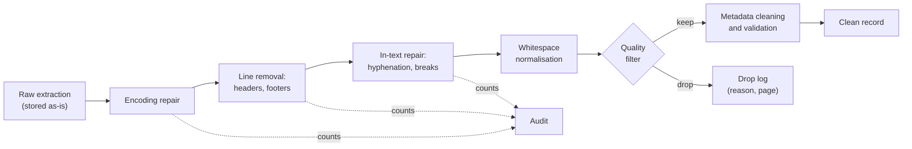

Text extracted from PDFs, Word files, web pages and exports is never clean. It carries page footers repeated on every page, words split across lines by the typesetter, invisible control characters, tables of contents made of dots, empty pages, and metadata whose dates come in three formats and whose owner field is sometimes blank. **Data cleaning** is the stage that turns this raw extraction into text and records that are worth indexing.

This lesson is about the discipline of cleaning rather than any single trick: how to decide what counts as noise, how to write cleaning rules as small, ordered, testable functions, how to filter out pages that should not be indexed at all, how to clean the metadata that travels with the text, and how to keep an audit of every change so that cleaning never silently destroys content. The [Text processing](/learn/data-processing/text-processing) lesson already covered whitespace normalisation and offset maps, and [Regular expressions](/learn/data-processing/regular-expressions) the patterns you will use; this lesson builds on both. The [Document Preprocessing](/learn/document-preprocessing) module later returns to cleaning at production scale, with dedicated lessons on header and footer removal and noise removal.

## Learning objectives

- Distinguish noise from content for a given retrieval task, and justify each cleaning rule by the retrieval problem it solves.
- Implement cleaning as an ordered pipeline of small, pure functions that each report how many changes they made.
- Apply document-level quality filters (length, letter ratio, repetition) and explain the cost of each threshold.
- Detect repeated boilerplate lines by their page frequency, and rejoin words broken by end-of-line hyphenation without merging true compounds.
- Clean record metadata with pandas: missing values, inconsistent dates and types, and record the result for audit.

## Prerequisites

- [Text processing](/learn/data-processing/text-processing): strings, whitespace normalisation and offset maps.
- [Regular expressions](/learn/data-processing/regular-expressions): substitution with `re.sub` and `re.subn`.
- [JSON and CSV](/learn/data-processing/json-and-csv): tabular records and pandas basics.
- [PDF extraction](/learn/data-processing/pdf-extraction): where most of the mess in this lesson comes from.

## Why this matters

Every chunk in the index competes for a place in the model's context. Noise hurts in four concrete ways.

**It dilutes chunks.** A 300-token chunk containing 40 tokens of footer, page number and running header carries 13% less useful text. Its embedding is pulled towards "the handbook in general" rather than the specific fact it holds, and its lexical score includes matches on words like "confidential" that appear everywhere.

**It creates false matches.** A user who asks about "confidential documents" gets every page of the handbook ranked equally, because the footer "Meridian confidential" is on all of them.

**It breaks words.** A PDF extractor that keeps the typesetter's line breaks turns "equipment" into "equip-" and "ment". Neither half matches the query "equipment budget", and the embedding model sees two odd fragments.

**It fills the index with junk documents.** Tables of contents, blank pages, cover pages and pages of navigation links are retrieved surprisingly often, because they mention many topics in passing. A contents page listing "Leave ........ 1" matches every leave question and answers none.

The opposite failure is just as real: **over-cleaning**. A rule that deletes "lines shorter than 20 characters" also deletes "Annual leave: 25 days." A rule that strips digits to remove page numbers also strips "E-4021". Cleaning is a set of deliberate trade-offs, and the rest of this lesson is about making them visible.

## The intuition

Think of a museum conservator cleaning a painting. She does not scrub the whole canvas with one solvent. She tests each technique on a corner first, removes one kind of grime at a time, photographs before and after, keeps notes of every step, and never does anything she cannot justify or undo. If a stroke of paint looks like dirt but might be the artist's, she leaves it.

A cleaning pipeline should behave the same way:

- **One rule per kind of dirt.** A footer remover, a hyphenation fixer, a control-character remover, each separate.
- **Test on a corner.** Run each rule on a sample and read what it changed before running it on the corpus.
- **Keep notes.** Count every change each rule makes, per document.
- **Keep the original.** Store the raw extraction, so that a better cleaner can be run later without extracting again.
- **When in doubt, leave it.** A little noise costs a little retrieval quality; deleted content costs answers.

## How it works

### Noise is defined by the task

There is no universal definition of noise. Page numbers are noise for a policy assistant and essential for a legal assistant that must cite "page 14". Code is content in a runbook and noise in a marketing page's embedded analytics script. Before writing rules, write down what the index is for and what a good chunk looks like, then classify what you see in a sample of raw extractions:

| Kind | Examples | Usual action |
| --- | --- | --- |
| Layout artefacts | running headers and footers, page numbers, line-end hyphenation, hard line breaks inside paragraphs | Remove or repair |
| Encoding artefacts | control characters, null bytes, mis-decoded characters | Remove or repair (see [Encoding and Unicode](/learn/data-processing/encoding-and-unicode)) |
| Navigation and chrome | tables of contents, menus, cookie banners, "back to top" | Remove; often drop whole pages |
| Low-value pages | blank pages, cover pages, pages of only figures or dots | Drop the page, but record that you did |
| Content that looks like noise | short lines that are facts, codes with digits, tables | Keep; make rules precise enough to spare them |

### Cleaning as a pipeline of small functions

Each cleaning rule is a function that takes text and returns the cleaned text plus a count of changes. That shape has three benefits: each rule can be unit-tested in isolation; the counts form an **audit log** that tells you, per document, what every rule did; and the order of rules is explicit.

Order matters. Removing footers before rejoining hyphenated words prevents a footer line from being glued to the word above it. Removing control characters before quality filtering stops invisible characters from inflating length counts. A typical order:

1. **Decode** bytes to text correctly (the subject of the encoding lesson).
2. **Repair encoding artefacts**: control characters, null bytes, mis-decoded text.
3. **Remove layout artefacts** that are whole lines: headers, footers, page numbers.
4. **Repair layout artefacts inside the text**: line-end hyphenation, hard line breaks within paragraphs.
5. **Normalise whitespace**, keeping paragraph breaks.
6. **Apply quality filters** to decide whether the page or document is indexed at all.
7. **Clean the metadata** and validate the record.
8. **Write the audit**: which rules changed what, and which pages were dropped and why.



Each rule should also be **pure** (same input, same output, no hidden state) and **idempotent** (running it twice changes nothing the second time). Idempotence is easy to test and catches a common bug: a rule that keeps eating characters every time it runs, as `rstrip(".pdf")` does in the text-processing lesson.

### Repeated boilerplate lines

Running headers and footers have one property real content almost never has: they appear on most pages of a document. Counting, for each distinct line, the fraction of pages it appears on separates them cleanly. Page numbers make otherwise identical footers differ ("page 1", "page 2"), so lines are compared after replacing digits with a placeholder. The mathematics section gives the formula. This is the basic idea behind [Header and footer removal](/learn/document-preprocessing/header-and-footer-removal), which deals with harder cases such as alternating left and right page headers.

### Line-end hyphenation

Typeset documents break long words at line ends with a hyphen: "equip-" at the end of one line, "ment" at the start of the next. Joining every `letter-hyphen-newline-letter` sequence repairs these, but it also damages real compounds that happened to break at their own hyphen: "home-" / "office" should become "home-office", not "homeoffice". A practical rule is to let the document vote: if the hyphenated form appears elsewhere in the document (or in a vocabulary you trust), keep the hyphen; otherwise join. The second exercise implements this.

### Quality filters

Some pages should not be indexed at all. Simple, explainable heuristics catch most of them:

- **Minimum length.** Pages with fewer than a handful of words after cleaning are usually blank, cover or divider pages.
- **Letter ratio.** The fraction of characters that are letters. Prose sits well above half; tables of contents (dots and numbers), garbled extractions and pages of figures fall below.
- **Repetition.** The fraction of lines that are duplicates of other lines in the same document, which flags navigation menus and broken extractions that repeat a line many times.
- **Language** where the index is meant to be single-language; [Language detection](/learn/document-preprocessing/language-detection) covers how.

Every threshold drops some good pages and keeps some bad ones. The way to choose one is to look: sort pages by the score, read the pages either side of the candidate threshold, and pick the point where they turn from junk to content. Then log every drop with its reason, so a mistake can be found and reversed. Filters of this kind are well established for cleaning large web text corpora for language-model training; for a RAG index the scale is smaller, so you can afford to inspect more of what you drop.

### Cleaning the metadata

Text is half the record. The other half is metadata: document identifier, owner, last-updated date, source system, access level. Metadata drives filtering, freshness ranking, citations and access control, so dirty metadata does as much harm as dirty text. The usual problems:

- **Missing values.** An owner that is `None` in one source and an empty string in another. Decide on one representation, and decide whether the field is required (reject the record) or optional (fill a documented default).
- **Inconsistent formats.** Dates as `2025-01-15`, `15/01/2025` and `Jan 15, 2025`. Parse them into one type at ingestion. Beware ambiguity: `03/04/2025` is 3 April in the UK and 4 March in the US. Parse each source with that source's known format rather than letting a parser guess across sources.
- **Wrong types.** Numbers stored as strings, booleans as `"yes"`, identifiers that lost leading zeros by passing through a spreadsheet.
- **Inconsistent vocabularies.** "HR", "HR team" and "Human Resources" as owners. Map them to canonical values with an explicit table.

pandas is convenient for this kind of column-wise cleaning across many records. Validation against a schema, which rejects records that are still wrong after cleaning, is covered in [Data validation](/learn/document-engineering/data-validation).

### Raw, clean and the audit trail

Keep three things for every document: the **raw extraction** exactly as the extractor produced it, the **clean text** that will be chunked, and the **audit** of what cleaning did (rule counts, dropped pages with reasons, pipeline version). The raw copy lets you re-clean without re-extracting when a rule improves. The audit lets you answer "why is this sentence missing from the index?" in minutes instead of hours, and lets you spot a rule that suddenly starts removing far more than usual after an upstream change.

## The mathematics

Two of the filters above are ratios, and writing them down makes their thresholds easy to reason about.

### Page frequency of a line

**Intuition.** A line that appears on nearly every page is almost certainly a header or footer.

$$
f(\ell) = \frac{\left|\{\, p \in P : \ell \in \operatorname{lines}(p) \,\}\right|}{|P|}
$$

- $P$: the set of pages in one document, and $|P|$ its size.
- $\ell$: a line after **masking** (digits replaced by `#`, whitespace trimmed), so that "page 1" and "page 2" become the same key.
- $\operatorname{lines}(p)$: the set of masked lines on page $p$ (a set, so a line repeated on one page counts once).
- $f(\ell)$: the fraction of pages containing $\ell$, between 0 and 1.

A line is treated as boilerplate if $f(\ell) \ge \theta$ for a threshold $\theta$, and the document has enough pages for the statistic to mean something (with two pages, every line common to both scores 1.0).

**Worked example.** A four-page excerpt: every page ends "Meridian confidential - page N", the first three start "Meridian Employee Handbook", and each has one line of content. The footer masks to "Meridian confidential - page #" and appears on all four pages: $f = 4/4 = 1.00$. The header appears on three: $f = 3/4 = 0.75$. Each content line appears once: $f = 1/4 = 0.25$. With $\theta = 0.6$, both boilerplate lines are removed and all content stays. Note that masking turns "25 days" into "# days" too; that is harmless here, because the masked key is used only for counting, and the original line is what is kept or removed.

```python
import re
from collections import Counter

pages = [
    "Meridian Employee Handbook\nAnnual leave is 25 days.\nMeridian confidential - page 1",
    "Meridian Employee Handbook\nRemote work: up to 3 days a week.\nMeridian confidential - page 2",
    "Meridian Employee Handbook\nExpenses within 30 days.\nMeridian confidential - page 3",
    "Laptop refresh every 3 years.\nMeridian confidential - page 4",
]
def key(line):
    return re.sub(r"\d+", "#", line.strip())        # page numbers stop lines matching

df = Counter(k for p in pages for k in {key(l) for l in p.split("\n")})
for line, count in df.most_common(4):
    print(f"{count / len(pages):.2f}  {line}")
```

```output
1.00  Meridian confidential - page #
0.75  Meridian Employee Handbook
0.25  Annual leave is # days.
0.25  Remote work: up to # days a week.
```

### Letter ratio

**Intuition.** Prose is mostly letters; contents pages, garbled extractions and numeric dumps are not.

$$
r(t) = \frac{\#\{\text{letters in } t\}}{\#\{\text{characters in } t\}}
$$

- $t$: the cleaned text of a page.
- the numerator counts characters for which `str.isalpha()` is true (which includes accented and non-Latin letters).
- the denominator counts all characters, including spaces and punctuation.

**Worked example.** The line "Leave ........ 1" has 16 characters: 5 letters ("Leave"), 2 spaces, 8 dots and 1 digit, so $r = 5/16 \approx 0.31$. The sentence "Annual leave is 25 days." has 24 characters, of which 17 are letters, so $r = 17/24 \approx 0.71$. A threshold of 0.6 separates them. Code-heavy runbook pages also have lower letter ratios than prose, so check the threshold against them before applying it to a mixed corpus.

## In code

**The problem.** Clean five extracted pages from two Meridian documents: remove the confidentiality footer, rejoin words broken at line ends, strip a null byte and turn a form feed into a paragraph break, drop a contents page and an empty page, fill a missing owner, and parse two date formats, while counting every change.

**Dependencies.** pandas and the standard library.

```bash
pip install pandas
```

```python
import re
from collections import Counter

import pandas as pd

pages = pd.DataFrame([
    {"doc": "handbook", "page": 1, "owner": "HR team", "updated": "2025-01-15",
     "text": "Meridian Employee Handbook\nAnnual leave is 25 days. Up to 5 un-\nused days carry over.\nMeridian confidential - page 1"},
    {"doc": "handbook", "page": 2, "owner": "HR team", "updated": "2025-01-15",
     "text": "Contents\nLeave ........ 1\nRemote work ........ 2\nMeridian confidential - page 2"},
    {"doc": "handbook", "page": 3, "owner": "HR team", "updated": "2025-01-15",
     "text": "Remote work: up to 3 days a week. The home-office equip-\nment budget is £400.\x00\nMeridian confidential - page 3"},
    {"doc": "handbook", "page": 4, "owner": "HR team", "updated": "2025-01-15",
     "text": "Meridian confidential - page 4"},
    {"doc": "runbook-vpn", "page": 1, "owner": None, "updated": "15/01/2025",
     "text": "VPN is required on public Wi-Fi.\x0cError E-4021: update the client."},
])

FOOTER = re.compile(r"^Meridian confidential - page \d+$")

def remove_footer(text):
    lines = text.split("\n")
    kept = [l for l in lines if not FOOTER.match(l)]
    return "\n".join(kept), len(lines) - len(kept)

def join_hyphenated(text):
    # "un-\nused" -> "unused", but keep real hyphens such as "home-office" and "Wi-Fi"
    new, n = re.subn(r"(\w)-\n(\w)", r"\1\2", text)
    return new, n

def strip_controls(text):
    # keep \n and \t; turn form feeds into paragraph breaks; drop other C0 controls
    text = text.replace("\x0c", "\n\n")
    new, n = re.subn(r"[\x00-\x08\x0b\x0e-\x1f\x7f]", "", text)
    return new, n

STEPS = [("footer", remove_footer), ("hyphenation", join_hyphenated), ("controls", strip_controls)]

def quality(text):
    """Return a reason to drop the page, or None to keep it."""
    words = text.split()
    if len(words) < 4:
        return "too short"
    letters = sum(c.isalpha() for c in text)
    if letters / max(len(text), 1) < 0.6:
        return "low letter ratio"
    return None

audit = Counter()
rows = []
for rec in pages.to_dict("records"):
    text = rec["text"]
    for name, step in STEPS:
        text, changes = step(text)
        audit[name] += changes
    reason = quality(text)
    if reason:
        audit[f"dropped: {reason}"] += 1
        continue
    rows.append({**rec, "text": text.strip()})

clean = pd.DataFrame(rows)
clean["owner"] = clean["owner"].fillna("unassigned")
clean["updated"] = pd.to_datetime(clean["updated"], format="mixed", dayfirst=True).dt.date

for rec in clean.to_dict("records"):
    print(f"{rec['doc']} p{rec['page']} | {rec['owner']} | {rec['updated']}\n  {rec['text']!r}")
print("\naudit:", dict(audit))
```

```output
handbook p1 | HR team | 2025-01-15
  'Meridian Employee Handbook\nAnnual leave is 25 days. Up to 5 unused days carry over.'
handbook p3 | HR team | 2025-01-15
  'Remote work: up to 3 days a week. The home-office equipment budget is £400.'
runbook-vpn p1 | unassigned | 2025-01-15
  'VPN is required on public Wi-Fi.\n\nError E-4021: update the client.'

audit: {'footer': 4, 'hyphenation': 2, 'controls': 1, 'dropped: low letter ratio': 1, 'dropped: too short': 1}
```

**The important lines.**

- `FOOTER` is anchored with `^` and `$`, so it removes only lines that consist entirely of the footer. A sentence that mentions "Meridian confidential" in passing is left alone.
- Each step returns `(text, changes)`; `re.subn` returns the number of substitutions alongside the new string, which is exactly the count the audit needs.
- `join_hyphenated` requires a hyphen *immediately followed by a newline*. "home-office" and "Wi-Fi", whose hyphens are mid-line, are untouched; "un-\nused" and "equip-\nment" are joined.
- `strip_controls` first turns the form feed (`\x0c`, which PDF tools often emit between pages) into a paragraph break, then removes the remaining C0 control characters except tab (`\x09`), newline (`\x0a`) and carriage return (`\x0d`), plus DEL (`\x7f`).
- `quality` runs *after* the cleaning steps, so the empty page is judged on what is left once the footer has gone.
- `fillna("unassigned")` makes the missing owner explicit rather than leaving a null that downstream filters treat inconsistently.
- `pd.to_datetime(..., format="mixed", dayfirst=True)` parses each value on its own and prefers day-first for ambiguous dates, so "15/01/2025" becomes 15 January.

**What the output means.**

- Three pages survive out of five. The contents page was dropped for its letter ratio (dots and numbers) and page 4 for being empty after the footer was removed.
- The audit records 4 footer removals (one per handbook page), 2 hyphenation repairs, 1 control character and 2 dropped pages. Running the same code on a new batch and seeing, say, zero footer removals would be a signal that the footer's wording changed and the rule no longer matches.
- "unused" and "equipment" are whole words again, so they can match queries; "home-office", "Wi-Fi" and "E-4021" kept their hyphens.
- Both date formats became the same `date` value.

**Errors people commonly hit.**

- Joining every `-\n` without a word-character check, which merges list markers or dashes at line ends with the next line.
- Passing `format="mixed"` and `dayfirst=True` across sources from different countries. A US-sourced "03/04/2025" becomes 3 April. Parse each source with its own explicit format whenever you know it.
- `TypeError` from string methods on `None`, `NaN` or numbers in a text column. Check types before cleaning, or convert with `.astype("string")`, which keeps missing values as `<NA>` rather than turning them into the string "nan".
- Removing digits to get rid of page numbers, which also removes "25 days", "£400" and "E-4021". Mask digits for *matching*, never for the output.

**Extending it.** Replace the hard-coded footer with the page-frequency detector from the mathematics section; replace `join_hyphenated` with the vocabulary-aware version from the exercises; keep the audit per document rather than in total; and store the raw text alongside the clean text in the output records.

## A real-world example

Meridian's finance department publishes its expenses policy as a 40-page PDF. After AskMeridian indexed it, finance staff complained that questions about receipts were answered with "Refer to section 4.2", and nothing else.

Daniel, on the Platform team, looked at what was retrieved. The top chunk for "do I need a receipt?" came from page 2, the table of contents, which contains "4.2 Receipts ........ 11". It shared the key word "receipts" with the query and was short, which helped its lexical score. The chunk from page 11 that held the actual rule, "anything over £75 needs a receipt", ranked third, partly because the extractor had split "re-" and "ceipt" across a line break in one of its sentences, and partly because every page's chunk began with a running header and ended with a footer.

The team added three rules: a page-frequency footer and header remover, a vocabulary-aware hyphenation fixer and a letter-ratio filter that dropped contents and index pages. Before turning them on, they ran the pipeline over every document in the index and reviewed the audit: which pages each rule would drop, and a random sample of the changes it made. The review caught one problem: the letter-ratio filter would also have dropped two IT runbook pages that were mostly command-line examples. They exempted documents tagged as runbooks from that filter, re-ran the audit, and shipped.

The receipt question now retrieves page 11 first. The lasting change was not the three rules but the audit review, which became a required step before any new cleaning rule is enabled.

## Common mistakes

- **Cleaning without looking.** Writing rules from imagination rather than from a sample of real extractions produces rules that miss the real noise and hit real content.
- **One big regular expression.** A single pattern that "cleans everything" cannot be tested, audited or partly disabled, and nobody can say what it removed.
- **Destroying content that looks like noise.** Short factual lines, codes containing digits, and tables are casualties of rules such as "remove short lines" or "remove digits".
- **Not keeping the raw text.** Every cleaning improvement then requires re-extraction, and every cleaning bug is irreversible.
- **Silent drops.** Pages removed by a quality filter without a log entry cannot be found when someone asks why a document is missing.
- **Guessing date formats across sources.** Day-month and month-day dates are swapped without any error, and freshness ranking and filters quietly go wrong.
- **Cleaning metadata and text with different rules in different places.** The same record gets cleaned twice, inconsistently.

## Best practices

- Start from a sample: print 20 raw extractions from each source and list the noise you actually see.
- Write each rule as a small, pure, idempotent function returning the text and a change count, and unit-test it with examples of both noise and look-alike content.
- Order the rules deliberately (encoding, whole lines, in-text repairs, whitespace, filters, metadata) and keep the order in one place.
- Keep the raw extraction, the clean text and the audit for every document, along with a cleaning-pipeline version number.
- Choose filter thresholds by reading the documents either side of the candidate threshold, and log every drop with its reason.
- Parse metadata per source with explicit formats, map vocabularies to canonical values with a table, and validate the result.
- Monitor the audit over time; a sudden change in how much a rule removes means the input changed.

## Performance considerations

Cleaning is cheap compared with embedding. Each rule is a pass over the text, so a pipeline of $k$ rules over a corpus of $C$ characters does on the order of $k \times C$ character operations. For a corpus of 10,000 documents averaging 50,000 characters ($C = 5 \times 10^8$) and $k = 10$ rules, that is about $5 \times 10^9$ simple operations: regular expressions and string methods implemented in C get through that in minutes on one core, and the work parallelises perfectly across documents.

Three things make cleaning slow in practice:

- **Python-level loops over characters.** A loop that inspects each character in Python is often one or two orders of magnitude slower than a compiled regular expression or a built-in string method doing the same job. Use `re.subn`, `str.translate` and friends.
- **Badly written regular expressions.** Patterns with nested quantifiers can backtrack catastrophically on unlucky input; the [Regular expressions](/learn/data-processing/regular-expressions) lesson shows how to spot them.
- **Row-by-row pandas.** For metadata, vectorised column operations (`fillna`, `to_datetime`, `.str` methods) are much faster than `apply` with a Python function per row, which matters at millions of records.

Cleaning also *saves* money downstream. Every token of boilerplate removed is a token that is not embedded, stored or sent to the model. Removing a 15-token header and footer from each of 400,000 pages saves $6 \times 10^6$ tokens of embedding input on every full re-index.

## Security considerations

Cleaning is a natural place for some defences, and an easy place to weaken others.

- **Hidden text.** Control characters, zero-width characters and text hidden by formatting can carry content a human reviewer never sees, including instructions aimed at the model. Removing invisible characters is a cleaning step; deciding what to do with hidden-but-visible-to-the-extractor text is a policy decision covered under [Malicious documents](/learn/rag-security-fundamentals/malicious-documents).
- **Personal data.** Cleaning is where you can detect and redact personal data (email addresses, phone numbers, national insurance numbers) before it reaches the index, if policy requires it. Redaction rules need the same audit as any other rule.
- **Do not clean away security metadata.** Fields such as access level or classification must never be filled with a permissive default. A missing access level should cause the record to be rejected or treated as most restrictive, not assigned "public".
- **Raw copies are sensitive too.** The stored raw extraction contains everything the cleaned version removed, including any redacted personal data. Apply the same access control and retention rules to it.

## Summary

- Noise is defined by the task: decide what a good chunk looks like before deciding what to remove.
- Build cleaning as an ordered pipeline of small, pure, idempotent rules that each report how much they changed.
- Repeated boilerplate is found by page frequency after masking digits; line-end hyphenation is repaired by joining, unless the document shows the hyphen is real.
- Quality filters (length, letter ratio, repetition) remove pages that should not be indexed; choose thresholds by inspection and log every drop.
- Metadata needs cleaning as much as text: one representation for missing values, explicit per-source date formats, canonical vocabularies, and validation.
- Keep raw text, clean text and an audit for every document, so that cleaning is reversible and explainable.

## Exercises

**1.** For each rule, give one piece of real content from the Meridian corpus it would destroy, and a safer version of the rule: (a) "delete lines shorter than 25 characters"; (b) "delete all digits to remove page numbers"; (c) "delete every line that contains the word Meridian".

<details><summary>Show solution</summary>

(a) Destroys "Annual leave: 25 days." or "Error E-4021: update." Safer: remove short lines only when they also occur on most pages (page-frequency rule) or match a specific pattern such as a bare page number `^\d+$`.

(b) Destroys "25 days", "£400", "31 March", "E-4021". Safer: remove only lines that consist of a page number or a page-number pattern ("Page 3 of 40"); mask digits only when *comparing* lines.

(c) Destroys "Meridian Reports supports PDF and CSV export." and every line about the company's products. Safer: anchor the pattern to the full boilerplate line (`^Meridian confidential - page \d+$`) or use page frequency.

The general point: a rule should describe the noise precisely, not a property the noise happens to share with content.

</details>

**2.** Write a vocabulary-aware hyphenation repair: when a word is broken as `left-\nright`, keep the hyphen if the hyphenated form `left-right` occurs more often in the document than the joined form `leftright`; otherwise join. Test it on text containing "home-office" (also broken across a line), "un-\nused" and "Re-\nquest".

<details><summary>Show solution</summary>

```python
import re
from collections import Counter

text = ("The home-office budget is £400. Ask about home-\noffice kit early. "
        "Unused days carry over; un-\nused days expire on 31 March. Re-\nquest a laptop every 3 years.")
vocab = Counter(w.lower() for w in re.findall(r"[A-Za-z]+(?:-[A-Za-z]+)*", text))

def rejoin(m):
    left, right = m.group(1), m.group(2)
    joined, hyphenated = (left + right).lower(), f"{left}-{right}".lower()
    if vocab[hyphenated] > vocab[joined]:
        return f"{left}-{right}"          # a real compound that happened to break at the hyphen
    return left + right                   # a word split by the typesetter

print(re.sub(r"([A-Za-z]+)-\n([A-Za-z]+)", rejoin, text))
```

```output
The home-office budget is £400. Ask about home-office kit early. Unused days carry over; unused days expire on 31 March. Request a laptop every 3 years.
```

"home-office" occurs once unbroken in the document, and "homeoffice" never, so the hyphen is kept. "unused" occurs unbroken ("Unused"), so it is joined. "Request" occurs in neither form; on a tie the function joins, which is the right default because typesetters break ordinary words far more often than compounds. For short documents, back the document vocabulary with a corpus-wide one.

</details>

**3.** A letter-ratio filter with threshold 0.6 is about to be enabled for all of AskMeridian's sources. Name two kinds of legitimate page in the Meridian corpus likely to fall below it, and describe how you would decide on the threshold and on any exemptions.

<details><summary>Show solution</summary>

Likely victims: **IT runbook pages dominated by commands and configuration** (paths, flags, IP addresses and punctuation lower the ratio), and **pages that are mainly tables of numbers**, such as an expenses rate table or a pricing table for Meridian Reports. Error-code catalogue pages for Atlas ("E-4021", "E-4012", ...) are another candidate.

To decide: compute the ratio for every page, sort, and read pages around candidate thresholds (for example a sample at 0.4 to 0.5, 0.5 to 0.6, 0.6 to 0.7). Count how many content pages and junk pages fall in each band. Then either pick a lower threshold, or apply the filter only to source types where it works (prose policy documents), or combine it with a second signal (drop only if the ratio is low *and* the page also matches a contents-page pattern such as many lines ending in a dot leader and a number). Log every drop and review the log after the first run.

</details>

**4.** Design decision. AskMeridian ingests documents from the HR system, the IT runbook repository and the finance department's shared drive. Each source has its own date format and owner vocabulary, and a new source will be added next quarter. Design how metadata cleaning is organised so that adding a source does not risk breaking the others.

<details><summary>Show solution</summary>

Give each source a **source adapter** with its own explicit configuration: date format strings (for example `%Y-%m-%d` for the runbook repository, `%d/%m/%Y` for the shared drive), the mapping from its owner values to canonical owners ("HR", "Human Resources" → "HR team"), and its defaults for optional fields. The adapter converts raw records into one canonical record type; everything downstream sees only that type.

Then validate every canonical record against one schema (required fields present, dates are dates, owner in the canonical list, access level present and valid) and reject failures to a quarantine with the reason, rather than filling them with guesses.

Adding the new source means writing and testing one new adapter; the shared schema and the other adapters are untouched. Test each adapter with real sample records, including the ambiguous dates, and include the adapter's version in the audit.

</details>

## Check your understanding

```quiz
[
  {
    "q": "Why should each cleaning rule return a count of the changes it made?",
    "options": [
      "So that the rules run faster",
      "So that the audit shows what each rule did, and a sudden change in a count reveals a change in the input",
      "Because re.sub cannot be used without a count",
      "So that the pipeline can skip rules that made no changes last time"
    ],
    "answer": 1,
    "why": "Counts per rule and per document make cleaning explainable and let you notice when a rule stops matching or starts over-matching."
  },
  {
    "q": "A footer reads 'Meridian confidential - page 7' on page 7 of every document. Why are digits masked before counting page frequency?",
    "options": [
      "Digits are noise and should be removed from the output",
      "Without masking, each page's footer is a different string and none of them looks frequent",
      "Masking makes the regular expression faster",
      "Page numbers are personal data"
    ],
    "answer": 1,
    "why": "Masking makes 'page 1' and 'page 7' the same key for counting. The masked form is used only for matching; content keeps its digits."
  },
  {
    "q": "What does this print?\n```python\nimport re\nprint(re.subn(r\"(\\w)-\\n(\\w)\", r\"\\1\\2\", \"equip-\\nment and Wi-Fi\"))\n```",
    "options": [
      "('equip-\\nment and Wi-Fi', 0)",
      "('equipment and WiFi', 2)",
      "('equipment and Wi-Fi', 1)",
      "('equip ment and Wi-Fi', 1)"
    ],
    "answer": 2,
    "why": "Only the hyphen followed by a newline matches; Wi-Fi's hyphen is mid-line. subn returns the new string and the number of substitutions."
  },
  {
    "q": "Metadata from a US-based source contains '03/04/2025', and the pipeline parses all sources with dayfirst=True. What happens?",
    "options": [
      "pandas raises an error because the date is ambiguous",
      "The date is parsed as 4 March 2025",
      "The value is left as a string",
      "The date is parsed as 3 April 2025, silently wrong for a source that writes month first"
    ],
    "answer": 3,
    "why": "Ambiguous dates parse without error. Parse each source with its own explicit format."
  },
  {
    "q": "Which is the strongest reason to store the raw extraction alongside the cleaned text?",
    "options": [
      "Cleaning can then be improved and re-run, and any removal investigated, without extracting the documents again",
      "The raw text produces better embeddings",
      "Vector databases require the raw text",
      "It makes the cleaned text smaller"
    ],
    "answer": 0,
    "why": "Keeping raw text makes cleaning reversible and debuggable; extraction is often the slowest and most fragile stage to repeat."
  }
]
```

## Further reading

- pandas documentation, "Working with missing data" and [`pandas.to_datetime`](https://pandas.pydata.org/docs/reference/api/pandas.to_datetime.html), at [pandas.pydata.org/docs](https://pandas.pydata.org/docs/).
- Python documentation, [`re`](https://docs.python.org/3/library/re.html), for `re.sub` and `re.subn`.
- Hadley Wickham (2014), "Tidy Data", *Journal of Statistical Software* 59(10), on organising records so that cleaning is systematic.
- Raffel et al. (2020), "Exploring the Limits of Transfer Learning with a Unified Text-to-Text Transformer", [arXiv:1910.10683](https://arxiv.org/abs/1910.10683), whose description of the C4 corpus shows heuristic text-quality filters (minimum length, line filters, boilerplate removal) applied at web scale.
