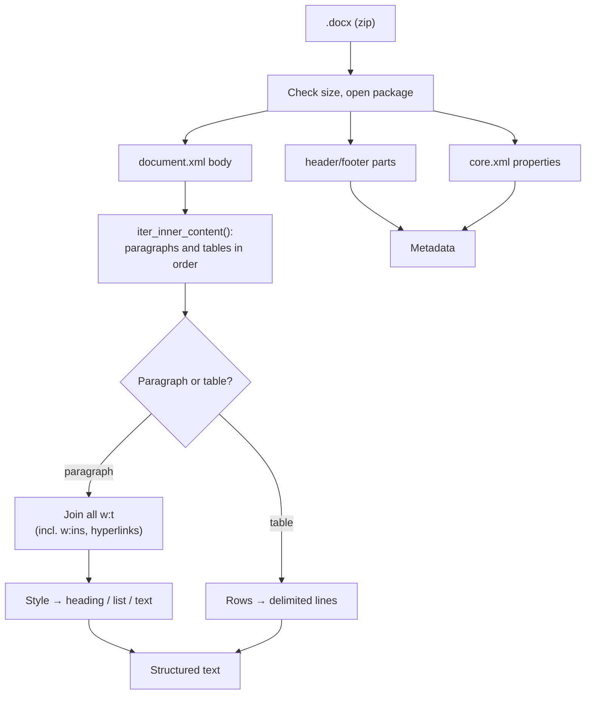

Word documents are where much of an organisation's policy and process knowledge is first written: handbooks, procedures, proposals, meeting notes. Unlike a PDF, a `.docx` file keeps the author's structure: it knows which paragraph is a heading, which is a list item, where the tables are and what changed in the last revision. That makes it one of the friendliest formats for RAG, provided you read it properly. Read it carelessly and you will lose headings, miss text the author added with tracked changes switched on, or index a footer on every chunk.

This lesson opens a `.docx` file to show what it really is (a zip archive of XML files), explains the WordprocessingML model of paragraphs, runs and styles, and builds an extractor with python-docx that emits text in document order with headings and lists preserved, handles tables, hyperlinks and tracked changes, and separates headers and footers into metadata. It builds directly on the XML skills from [XML and HTML](/learn/data-processing/xml-and-html).

## Learning objectives

- Describe the structure of a `.docx` package and the WordprocessingML elements for paragraphs, runs, text, tables and tracked changes.
- Extract paragraphs and tables in document order with python-docx, using paragraph styles to recover headings and lists.
- Explain why a paragraph's text is split across runs, and why searching or processing run by run is a mistake.
- Identify the content python-docx's convenience API misses (tracked insertions, footnotes, list numbers, text boxes) and extract it from the XML when it matters.
- Choose how to handle legacy `.doc` files, revision marks and untrusted uploads safely.

## Prerequisites

- [XML and HTML](/learn/data-processing/xml-and-html): element trees, namespaces, text and tail.
- [Text processing](/learn/data-processing/text-processing): whitespace and paragraph boundaries.
- [PDF extraction](/learn/data-processing/pdf-extraction): the contrast between a format that stores layout and one that stores structure.

## Why this matters

The appeal of `.docx` for RAG is structure, and the failures are all about losing it or misreading it.

- **Flattened headings.** An extractor that joins all paragraph text produces a wall of prose. The chunker cannot split at section boundaries, and chunks lose the heading that says what they are about. Word stores headings explicitly, as paragraph styles, so this loss is entirely avoidable.
- **Missing text from tracked changes.** If an author edited with "Track Changes" on and nobody accepted the changes, the new wording sits inside revision elements. A common library call skips it, as you will see in this lesson, so the index holds a sentence with a hole where the updated fact should be.
- **Duplicated or out-of-place text.** An automatically generated table of contents repeats every heading at the top of the document. Headers and footers repeat on every page. Text boxes may be stored twice. Each creates noise that competes in retrieval.
- **Tables reduced to soup.** Reading table cells as unrelated paragraphs loses which value belongs to which column.

Because `.docx` is so common, getting these right once in a shared extractor improves a large part of most corpora.

## The intuition

A `.docx` file is like a ring binder of typed sheets with a table of contents at the front. Open the binder (unzip the file) and you find separate sheets: one for the main text, one for the styles ("this is what a Heading 2 looks like"), one for the header and footer, one for footnotes, one listing the pictures. The main sheet is written in a strict markup where every paragraph is wrapped in a paragraph tag and every stretch of identically formatted characters inside it is wrapped in a "run" tag.

Think of runs as the places where the typist changed pens. "Annual leave is **25** days" is three runs: plain, bold, plain. The words are what matter to a reader; the pen changes are formatting. Extracting text means reading across all the pen changes in a paragraph, using the paragraph's label (its style) to know whether it is a heading or a list item, and knowing which other sheets in the binder to read and which to set aside.

## How it works

### The package: a zip of XML parts

A `.docx` file follows the **Office Open XML** standard (ECMA-376, also ISO/IEC 29500). It is a zip archive, called a **package**, of **parts**, most of them XML:

| Part | Contains |
| --- | --- |
| `[Content_Types].xml` | The media type of every part |
| `_rels/.rels`, `word/_rels/document.xml.rels` | **Relationships**: links between parts and to external targets such as hyperlink URLs and images |
| `word/document.xml` | The main body text |
| `word/styles.xml` | Style definitions (Normal, Heading 1, List Bullet...) |
| `word/numbering.xml` | List numbering definitions |
| `word/header1.xml`, `word/footer1.xml` | Headers and footers |
| `word/footnotes.xml`, `word/endnotes.xml`, `word/comments.xml` | Notes and comments, when present |
| `docProps/core.xml` | Core properties: title, author, created and modified dates |
| `word/media/` | Embedded images |

You can open one with Python's `zipfile` and read any part with an XML parser. Everything python-docx does is built on this.

### WordprocessingML: paragraphs, runs and text

The body in `document.xml` uses the **WordprocessingML** vocabulary, in a namespace conventionally given the prefix `w`. The elements that matter for extraction:

- `w:body` contains the document's block-level content in order: paragraphs `w:p` and tables `w:tbl`, ending with section properties `w:sectPr`.
- `w:p` is a **paragraph**. Its properties `w:pPr` may name a style (`<w:pStyle w:val="Heading2"/>`) and list numbering (`w:numPr`).
- `w:r` is a **run**: a stretch of text with uniform formatting. Its properties `w:rPr` hold bold, italic, font and so on.
- `w:t` holds the actual characters of a run. `w:tab` is a tab and `w:br` a line break inside the paragraph.
- `w:hyperlink` wraps runs that form a link; its `r:id` attribute points into the relationships part, where the URL lives.
- `w:ins` and `w:del` wrap runs that were inserted or deleted while tracking changes, with the author and date. Deleted characters are stored in `w:delText`, not `w:t`.
- `w:tbl` contains rows `w:tr`, which contain cells `w:tc`, which contain paragraphs.

**Why runs split text arbitrarily.** Word starts a new run whenever formatting changes, and also for reasons invisible to a reader: spell-check state, revision tracking identifiers, edits made in different sessions, language tagging. A phrase as simple as "annual leave" may be split as `"ann"`, `"ual leave"`. That has one firm consequence: **never search, match or replace text run by run.** Join a paragraph's runs first, then process the paragraph.

### python-docx

**python-docx** is the standard Python library for reading and writing `.docx`. Its reading API covers the common case well:

- `Document(path)` opens a file. It reads `.docx` only; legacy `.doc` (a binary format) is not supported.
- `doc.paragraphs` lists body paragraphs; `doc.tables` lists body tables. Each is in order *within its own list*, but the two lists do not tell you how paragraphs and tables interleave.
- `doc.iter_inner_content()` yields paragraphs and tables **interleaved in document order**, which is what an extractor needs.
- `paragraph.style.name` gives the style's display name, such as `"Heading 2"` or `"List Bullet"`. `paragraph.text` joins its text; `paragraph.runs` lists its runs.
- `table.rows`, `row.cells` and `cell.paragraphs` navigate tables.
- `doc.sections[i].header` and `.footer` give headers and footers; `doc.core_properties` gives title, author and dates.

The convenience API has gaps, and they matter for RAG. In the version used here (python-docx 1.2), `paragraph.text` includes hyperlink text but **skips runs inside tracked insertions** (`w:ins`), as the code below demonstrates. There is no API for footnotes or endnotes. List numbers ("1.", "2.", "a)") are not text at all: Word computes them from `numbering.xml` at display time, so no `w:t` contains them. When you need any of these, drop to the XML: python-docx exposes each paragraph's underlying lxml element (as the internal attribute `paragraph._p`), and every part can be read from the zip directly.

### Styles are the structure

Paragraph styles are how Word records structure, and they are why `.docx` extraction can do much better than PDF:

- Built-in heading styles are named `Heading 1` to `Heading 9` (and `Title`). The level is in the name.
- List paragraphs typically use styles such as `List Bullet` or `List Number`, or carry numbering properties directly.
- Captions, quotes and code often have their own styles.

The caveat is that authors do not always use styles. A "heading" made by typing a line in bold at 14 points is, as far as the file is concerned, a Normal paragraph with bold runs. An extractor should use styles first and fall back on formatting heuristics (a short paragraph whose runs are all bold) only for documents that need it. Style names are also localised in some versions of Word and can be renamed in custom templates, so match on what your organisation's templates actually use.

### Tracked changes and what "the text" means

When a document has unaccepted revisions, there are two texts: the original and the revised. The usual right answer for a RAG index is the document **as it would read with all changes accepted**: include `w:ins` content, exclude `w:del` content. That is what a reader opening the file with "No Markup" display sees. But a document full of pending revisions is also a sign that its content is not yet agreed, so a good pipeline records that fact in metadata, and some teams refuse to index documents with unaccepted changes at all.

### An extraction procedure

1. Open the file, checking it is a valid zip of reasonable uncompressed size.
2. Iterate the body in document order with `iter_inner_content()`.
3. For each paragraph, collect its full text from the XML (all `w:t`, plus tabs and breaks), which includes hyperlinks and tracked insertions and excludes deletions. Skip empty paragraphs.
4. Map style to structure: headings become Markdown-style `#` lines at their level, list paragraphs become bullet lines, the rest become plain paragraphs separated by blank lines.
5. For each table, emit one line per row with cell texts joined by a delimiter (or convert to sentences, as [JSON and CSV](/learn/data-processing/json-and-csv) did for rows).
6. Read headers and footers separately and keep them as metadata, not body text.
7. Read core properties into document metadata, and record revision counts.



Emitting Markdown-style headings is a deliberate choice: it gives the next stage a structure it already knows how to parse ([Markdown parsing](/learn/data-processing/markdown-parsing)) and split ([Heading-based chunking](/learn/advanced-chunking-strategies/heading-based-chunking)).

## In code

### A test document

**The problem.** Build a small Meridian policy document that contains each feature this lesson discusses: core properties, a header and footer, headings at two levels, a paragraph split into runs by bold formatting, bullet list items, a table, a hyperlink and a tracked change that replaces the superseded support hours (09:00 to 17:00) with the current ones (08:00 to 18:00). python-docx has no API for creating hyperlinks or tracked changes, so the script writes those two as raw WordprocessingML.

**Dependencies.**

```bash
pip install python-docx lxml
```

```python
from docx import Document               # pip install python-docx
from docx.oxml import parse_xml
from docx.oxml.ns import nsdecls

doc = Document()
doc.core_properties.title = "Leave and remote work policy"
doc.core_properties.author = "HR team"
doc.sections[0].header.paragraphs[0].text = "Meridian Employee Handbook - HR team"
doc.sections[0].footer.paragraphs[0].text = "Internal - do not distribute"

doc.add_heading("Leave and remote work", level=1)
doc.add_heading("Annual leave", level=2)
p = doc.add_paragraph()
p.add_run("Annual leave is ")
p.add_run("25").bold = True
p.add_run(" days per year. Up to 5 unused days carry over and must be used by 31 March.")

doc.add_heading("Remote work", level=2)
doc.add_paragraph("Staff may work remotely up to 3 days a week.")
doc.add_paragraph("Equipment budget: £400", style="List Bullet")
doc.add_paragraph("Contractors are not eligible", style="List Bullet")

table = doc.add_table(rows=2, cols=2)
for cell, text in zip(table.rows[0].cells + table.rows[1].cells, ["Item", "Limit", "Monitor", "£150"]):
    cell.text = text

# A paragraph containing a hyperlink, and a paragraph with tracked changes,
# written as raw WordprocessingML because python-docx has no API to create them.
link = doc.add_paragraph("Read the ")
r_id = doc.part.relate_to("https://wiki.meridian.example/it/vpn",
                          "http://schemas.openxmlformats.org/officeDocument/2006/relationships/hyperlink",
                          is_external=True)
link._p.append(parse_xml(
    f'<w:hyperlink {nsdecls("w", "r")} r:id="{r_id}"><w:r><w:t>VPN guide</w:t></w:r></w:hyperlink>'))
link.add_run(" before using public Wi-Fi.")

tracked = doc.add_paragraph("Support desk hours are ")
tracked._p.append(parse_xml(
    f'<w:del {nsdecls("w")} w:id="1" w:author="HR" w:date="2025-01-06T00:00:00Z">'
    f'<w:r><w:delText>09:00 to 17:00</w:delText></w:r></w:del>'))
tracked._p.append(parse_xml(
    f'<w:ins {nsdecls("w")} w:id="2" w:author="HR" w:date="2025-01-06T00:00:00Z">'
    f'<w:r><w:t>08:00 to 18:00</w:t></w:r></w:ins>'))
tracked.add_run(" UK time.")

doc.save("policy.docx")
print("saved policy.docx")
```

```output
saved policy.docx
```

### Looking inside

Before extracting, open the package with nothing but `zipfile` and lxml to see what Word (here, python-docx) actually wrote.

```python
import re
import zipfile
from lxml import etree
from docx import Document

W = "{http://schemas.openxmlformats.org/wordprocessingml/2006/main}"

with zipfile.ZipFile("policy.docx") as z:
    names = z.namelist()
    print(len(names), "parts, including:", [n for n in names if n.startswith("word/")][:5])
    root = etree.fromstring(z.read("word/document.xml"))

body = root.find(f"{W}body")
print("body children:", [child.tag.removeprefix(W) for child in body])

# A paragraph whose text is split across three runs
for p in body.iter(f"{W}p"):
    runs = ["".join(t.text for t in r.iter(f"{W}t")) for r in p.findall(f"{W}r")]
    if len(runs) == 3:
        print("runs:", runs)

# The paragraph with tracked changes, as Word stores it
for p in body.iter(f"{W}p"):
    if "Support desk" in "".join(p.itertext()):
        xml = etree.tostring(p, encoding="unicode")
        xml = re.sub(r' xmlns:\w+="[^"]+"', "", xml)      # hide namespace declarations
        print(xml.replace("><", ">\n<"))

print("python-docx p.text:", repr(Document("policy.docx").paragraphs[-1].text))
```

```output
19 parts, including: ['word/document.xml', 'word/_rels/document.xml.rels', 'word/styles.xml', 'word/stylesWithEffects.xml', 'word/settings.xml']
body children: ['p', 'p', 'p', 'p', 'p', 'p', 'p', 'tbl', 'p', 'p', 'sectPr']
runs: ['Annual leave is ', '25', ' days per year. Up to 5 unused days carry over and must be used by 31 March.']
<w:p>
<w:r>
<w:t xml:space="preserve">Support desk hours are </w:t>
</w:r>
<w:del w:id="1" w:author="HR" w:date="2025-01-06T00:00:00Z">
<w:r>
<w:delText>09:00 to 17:00</w:delText>
</w:r>
</w:del>
<w:ins w:id="2" w:author="HR" w:date="2025-01-06T00:00:00Z">
<w:r>
<w:t>08:00 to 18:00</w:t>
</w:r>
</w:ins>
<w:r>
<w:t xml:space="preserve"> UK time.</w:t>
</w:r>
</w:p>
python-docx p.text: 'Support desk hours are  UK time.'
```

Look closely at the output, because the last line is the reason this lesson does not rely on `paragraph.text`. The body is a flat sequence of paragraphs and one table, closed by section properties. The bold "25" split its paragraph into three runs. The tracked change is stored as a `w:del` holding the old hours in `w:delText` and a `w:ins` holding the new hours in an ordinary `w:t` inside a run. And python-docx's `paragraph.text` returned `'Support desk hours are  UK time.'`, with a double space where the current support hours should be: it does not look inside `w:ins`. An index built on `paragraph.text` would say nothing about when the support desk is open.

### The extractor

**The problem.** Produce structured text in document order, with headings, lists and the table preserved, the tracked insertion included and the deletion excluded, and headers, footers and properties as metadata.

```python
from docx import Document               # pip install python-docx
from docx.oxml.ns import qn
from docx.table import Table
from docx.text.paragraph import Paragraph

def paragraph_text(p: Paragraph) -> str:
    """All visible text in a paragraph, including hyperlinks and tracked insertions.

    python-docx's p.text skips runs inside <w:ins>; deleted text lives in
    <w:delText>, a different tag, so walking <w:t>, <w:tab> and <w:br> gets
    the document as it reads with all changes accepted.
    """
    parts = []
    for node in p._p.iter(qn("w:t"), qn("w:tab"), qn("w:br")):
        if node.tag == qn("w:t"):
            parts.append(node.text or "")
        elif node.tag == qn("w:tab"):
            parts.append("\t")
        else:
            parts.append("\n")
    return "".join(parts)

def heading_level(p: Paragraph) -> int | None:
    name = p.style.name if p.style is not None else ""
    if name == "Title":
        return 1
    if name.startswith("Heading "):
        suffix = name.removeprefix("Heading ")
        return int(suffix) if suffix.isdecimal() else None
    return None

def table_lines(t: Table) -> list[str]:
    rows = []
    for row in t.rows:
        cells = [" ".join(paragraph_text(cp).strip() for cp in cell.paragraphs) for cell in row.cells]
        rows.append(" | ".join(cells))
    return rows

def extract_docx(path: str) -> dict:
    doc = Document(path)
    lines: list[str] = []
    for item in doc.iter_inner_content():          # paragraphs and tables in document order
        if isinstance(item, Table):
            if lines and lines[-1]:
                lines.append("")
            lines.extend(table_lines(item))
            lines.append("")
            continue
        text = paragraph_text(item).strip()
        if not text:
            continue
        level = heading_level(item)
        if level:
            lines.extend(["#" * level + " " + text, ""])
        elif item.style is not None and item.style.name.startswith("List"):
            lines.append("- " + text)
        else:
            lines.extend([text, ""])
    furniture = [p.text for s in doc.sections for part in (s.header, s.footer)
                 for p in part.paragraphs if p.text.strip()]
    props = doc.core_properties
    return {"text": "\n".join(lines).strip(),
            "metadata": {"title": props.title, "author": props.author, "furniture": furniture}}

result = extract_docx("policy.docx")
print(result["metadata"])
print()
print(result["text"])
```

```output
{'title': 'Leave and remote work policy', 'author': 'HR team', 'furniture': ['Meridian Employee Handbook - HR team', 'Internal - do not distribute']}

# Leave and remote work

## Annual leave

Annual leave is 25 days per year. Up to 5 unused days carry over and must be used by 31 March.

## Remote work

Staff may work remotely up to 3 days a week.

- Equipment budget: £400
- Contractors are not eligible

Item | Limit
Monitor | £150

Read the VPN guide before using public Wi-Fi.

Support desk hours are 08:00 to 18:00 UK time.
```

**The important lines.**

- `p._p.iter(qn("w:t"), qn("w:tab"), qn("w:br"))` walks every text, tab and break element *anywhere* inside the paragraph, whatever wraps it: plain runs, hyperlinks, tracked insertions. Deleted text is in `w:delText`, which the walk ignores. `qn("w:t")` converts the prefixed name to lxml's `{namespace}t` form. `_p` is python-docx's internal handle on the paragraph's XML element; it is not part of the documented API, so pin your python-docx version and keep a test like the one above.
- `doc.iter_inner_content()` interleaves paragraphs and tables exactly as they appear in the body, so the table lands between the list and the hyperlink paragraph, where the author put it.
- `heading_level` reads the level from the style name and treats `Title` as level 1. `suffix.isdecimal()` guards against custom styles such as "Heading Custom".
- List paragraphs are detected by a style name beginning with `List`; they are emitted on consecutive lines so the list stays a single block.
- `table_lines` joins all paragraphs of a cell (cells can hold several) and joins cells with `" | "`.
- Headers and footers are collected per section into `furniture`, kept out of the body text.

**What the output means.** The text is in document order with structure that the next stages can use: two heading levels, a list, a table and paragraphs separated by blank lines. The bold run in "25" has disappeared into the paragraph as it should. The hyperlink text is present. The support hours read 08:00 to 18:00, the accepted revision, and the superseded 09:00 to 17:00 does not appear anywhere. The header and footer are metadata. Compared with `"\n".join(p.text for p in doc.paragraphs)`, this version is correct about the support desk, has the table in the right place, and keeps every heading identifiable.

**Errors people commonly hit.**

- `docx.opc.exceptions.PackageNotFoundError`: the path is wrong, or the file is not a `.docx` at all, often a legacy `.doc` renamed, or an HTML or RTF file saved with a `.docx` extension. Check the first bytes: a real `.docx` is a zip and starts with `PK`.
- `KeyError` on a style name, or `None` styles: documents from other tools sometimes reference styles that are not defined. Guard every `p.style` access, as the extractor does.
- Text appearing twice: a generated table of contents repeats headings as hyperlinked text at the top of the document. Skip paragraphs whose style name starts with `TOC` (Word's built-in table-of-contents styles are `TOC 1`, `TOC 2`, and so on), or detect the TOC field.
- Merged table cells repeated: python-docx returns a merged cell once per grid position it covers, so a cell spanning two columns appears twice in `row.cells`. Deduplicate consecutive identical cell objects if that matters.
- Missing numbers in numbered lists and missing footnotes: both are outside what the convenience API reads, as explained above.

**How to extend it.** Carry a heading path for every paragraph (exercise 2) and emit it as chunk metadata. Read `word/footnotes.xml` and append footnotes at the end of the section that references them. Record revision counts and authors (exercise 3) and flag documents with pending changes. For bold-only "headings" in style-less documents, add a fallback rule: a short paragraph whose runs are all bold is treated as a heading.

## A real-world example

In Meridian's first AskMeridian pilot, staff asked "What are the support desk hours?" and received a confident "I don't know" from a system that indexed the IT runbooks, which certainly stated the hours. The Platform team searched the index for "08:00" and found nothing. They searched for "support desk hours are" and found a chunk reading "Support desk hours are UK time." with the hours missing.

The runbook had been updated by the IT team's lead, who changed the hours from the superseded 09:00 to 17:00 to 08:00 to 18:00 with Track Changes on, and nobody had accepted the revision. The ingestion pipeline used python-docx's `paragraph.text`, which skips tracked insertions and, correctly, skips deletions, leaving nothing at all. In Word, with the default "Simple Markup" view, the document looked perfectly normal.

The team changed the extractor to walk all `w:t` elements, as in this lesson, so that pending insertions are included and deletions excluded. They also added a metadata field, `pending_revisions`, with the count of `w:ins` and `w:del` elements, and a weekly report to document owners listing their documents with unaccepted changes. Several dozen documents appeared on the first report. The fix to the extractor took an hour; the report changed how teams treated revisions, which was the longer-lasting improvement.

## Common mistakes

- **Concatenating `paragraph.text` for every paragraph.** Loses headings, puts tables nowhere, and silently drops tracked insertions.
- **Processing text run by run.** Words and phrases are split across runs for invisible reasons; search, regex and replacement must work on joined paragraph text.
- **Reading `doc.paragraphs` and `doc.tables` separately.** The relative order of tables and paragraphs is lost; use `iter_inner_content()`.
- **Indexing headers, footers and the table of contents as body text.** Adds repeated noise to many chunks and duplicates every heading.
- **Assuming list numbers are in the text.** "Step 3" references then point at nothing; numbering is computed from `numbering.xml`.
- **Treating every `.docx`-named file as a valid package.** Renamed `.doc`, RTF or HTML files fail or, worse, are parsed as something else.
- **Ignoring pending revisions.** Either the new text is missing or unagreed text is presented as policy; decide deliberately and record it.

## Best practices

- Extract in document order with `iter_inner_content()` and keep structure: headings with levels, list items, tables as rows.
- Join all text inside a paragraph from the XML (`w:t`, `w:tab`, `w:br`) so hyperlinks and tracked insertions are included and deletions excluded.
- Keep headers, footers and core properties as metadata; skip table-of-contents paragraphs.
- Record revision counts and authors; decide a policy for documents with pending changes.
- Convert legacy `.doc` files to `.docx` before extraction, for example with LibreOffice in headless mode (`soffice --headless --convert-to docx file.doc`), and keep a record that the document was converted.
- Pin your python-docx version and keep golden test documents covering tables, lists, hyperlinks and tracked changes.
- Consider converting to an intermediate format with mature structure handling (tools such as Pandoc or Mammoth convert `.docx` to Markdown or HTML) when you need footnotes, numbering or nested structures handled for you.

## Performance considerations

- **Extraction is cheap.** A `.docx` is a compressed XML file; python-docx parses a typical policy document of tens of pages in a fraction of a second. A corpus of 20,000 documents at an assumed 0.2 seconds each takes about $20{,}000 \times 0.2 = 4{,}000$ seconds, just over an hour on one core, and parallelises trivially across processes.
- **Memory follows the XML, not the file.** A 2 MB `.docx` can contain 20 MB or more of XML once decompressed, and the parsed lxml tree is several times larger again. Embedded images do not count unless you load them. Check uncompressed sizes before parsing.
- **Do not load images you will not use.** python-docx loads image parts lazily for reading purposes; if you extract images for multimodal processing, stream them from the zip one at a time.
- **Incremental re-ingestion.** `docProps/core.xml` holds a modified timestamp, but it is set by the authoring tool and is not always reliable. A content hash of `word/document.xml` (and the header, footer and footnote parts) is a dependable change signal for [incremental ingestion](/learn/understanding-document-ingestion/incremental-ingestion).

## Security considerations

- **Zip bombs.** A `.docx` is a zip archive, and a small archive can expand to an enormous size. Before reading a part, check `ZipInfo.file_size` (the uncompressed size) for every entry in `zipfile.ZipFile.infolist()` and refuse files whose total exceeds a limit.
- **XML attacks.** The parts are XML; the entity-expansion and external-entity attacks from [XML and HTML](/learn/data-processing/xml-and-html) apply in principle. python-docx parses with lxml under its own parser configuration; when you parse parts yourself, use a hardened parser (`defusedxml`, or lxml with `resolve_entities=False, no_network=True`).
- **Macros and external links.** Macro-enabled documents (`.docm`) contain executable VBA; your pipeline never runs it, but do not open such files with an office suite on an ingestion server. Documents can also contain links to external templates and images; never fetch them during ingestion.
- **Hidden content and personal data.** Comments, tracked deletions, hidden text and document properties may contain names, internal remarks or text the author believed removed. Decide explicitly which of these you index. Deleted text, in particular, should not reach the index or the model by accident.
- **Prompt injection.** Text in white font, tiny font or hidden formatting is still `w:t` text and is extracted. Treat all document text as untrusted input when it reaches the model.

## Summary

- A `.docx` file is a zip package of XML parts; the body is in `word/document.xml`, with styles, numbering, headers, footers, notes and properties in their own parts.
- WordprocessingML stores paragraphs (`w:p`) made of runs (`w:r`) of text (`w:t`); runs split text arbitrarily, so always work on joined paragraph text.
- Paragraph styles carry structure: use them to emit headings and lists, and `iter_inner_content()` to keep tables in document order.
- python-docx's `paragraph.text` skips tracked insertions, and its API does not cover footnotes or list numbers; read the XML when those matter.
- Keep headers, footers and properties as metadata, record pending revisions, convert legacy `.doc` files, and treat uploads as untrusted zip and XML input.

## Exercises

**1. Why not run by run?** A colleague proposes to redact employee names by iterating over `paragraph.runs` and replacing any run whose text matches a name in the HR directory. Explain why this fails, and how you would do it instead.

<details><summary>Show solution</summary>

Runs split text at formatting and editing boundaries that have nothing to do with words. "Priya Shah" may be stored as `"Pri"`, `"ya Shah"` (a spell-check boundary) or as `"Priya "`, `"Shah"` (one word was edited later), so no single run matches the name and nothing is redacted. Partial matches are no better: replacing the run `"Shah"` alone leaves `"Priya"`.

For *extraction*, redact after joining: build the paragraph's full text, find names with a matcher over the joined string, and replace them there; the redacted text is what you index. If you must redact *in the document itself* (producing a redacted `.docx`), map each match's character span in the joined text back to the runs it covers (an offset map, exactly as in [Text processing](/learn/data-processing/text-processing)), then edit those runs, which may mean splitting a run at the span boundary. Remember also to handle names in tracked deletions, comments, headers and properties, which a body-only pass misses.

</details>

**2. Heading paths.** Write `sections_with_paths(path)` that returns, for each section of body text, the full path of headings above it (for example `["Leave and remote work", "Remote work"]`) and its text. Run it on `policy.docx`.

<details><summary>Show solution</summary>

```python
from docx import Document
from docx.text.paragraph import Paragraph

def sections_with_paths(path: str) -> list[dict]:
    doc = Document(path)
    stack: list[str] = []              # heading texts, one per level
    sections = [{"path": [], "text": []}]
    for item in doc.iter_inner_content():
        if not isinstance(item, Paragraph):
            continue                    # tables omitted for brevity
        name = item.style.name if item.style is not None else ""
        text = item.text.strip()
        if name.startswith("Heading ") and name[8:].isdecimal() and text:
            level = int(name[8:])
            stack = stack[: level - 1] + [text]
            sections.append({"path": list(stack), "text": []})
        elif text:
            sections[-1]["text"].append(text)
    return [s for s in sections if s["text"]]

for s in sections_with_paths("policy.docx"):
    print(" > ".join(s["path"]), "|", " ".join(s["text"])[:70])
```

```output
Leave and remote work > Annual leave | Annual leave is 25 days per year. Up to 5 unused days carry over and m
Leave and remote work > Remote work | Staff may work remotely up to 3 days a week. Equipment budget: £400 Co
```

`stack[: level - 1] + [text]` keeps the headings above the new level and replaces everything at or below it, so a new level-2 heading replaces the previous level-2 heading but keeps the level-1 heading. If a document skips a level (a Heading 3 directly under a Heading 1), the slice simply keeps what exists. For brevity this version uses `item.text`, so in a real pipeline replace it with the lesson's `paragraph_text` to keep tracked insertions, and add tables. The path is ideal chunk metadata: a chunk from "Remote work" can be prefixed with "Leave and remote work > Remote work" when embedded, which [Context preservation](/learn/chunking-optimisation/context-preservation) discusses.

</details>

**3. Revision report.** Write `revision_report(path)` that opens the package with `zipfile` and lxml and returns the number of tracked insertions and deletions, the set of revision authors, and the deleted text. Run it on `policy.docx`.

<details><summary>Show solution</summary>

```python
import zipfile
from lxml import etree

W = "{http://schemas.openxmlformats.org/wordprocessingml/2006/main}"

def revision_report(path: str) -> dict:
    with zipfile.ZipFile(path) as z:
        root = etree.fromstring(z.read("word/document.xml"))
    ins = root.findall(f".//{W}ins")
    dels = root.findall(f".//{W}del")
    return {
        "insertions": len(ins),
        "deletions": len(dels),
        "authors": sorted({e.get(f"{W}author") for e in ins + dels}),
        "deleted_text": ["".join(t.text or "" for t in d.iter(f"{W}delText")) for d in dels],
    }

print(revision_report("policy.docx"))
```

```output
{'insertions': 1, 'deletions': 1, 'authors': ['HR'], 'deleted_text': ['09:00 to 17:00']}
```

Attributes in the `w` namespace need the full `{uri}author` name, just like elements. Two refinements for production: Word also uses `w:ins` and `w:del` inside run and paragraph properties to mark an inserted or deleted *paragraph mark*, which inflates the counts, so you may want to count only those whose parent is a paragraph; and the same revision elements can appear in headers, footers and footnotes, so scan those parts too. Be careful where the deleted text goes: it is useful in a report to the document owner and should not be indexed.

</details>

**4. Design: a mixed Word archive.** The legal team's archive has 8,000 `.docx` files and 1,500 legacy `.doc` files. Some `.docx` files contain text boxes and SmartArt diagrams with important labels, many have generated tables of contents, and a few hundred have pending revisions. Design the extraction path, including what you would test.

<details><summary>Show solution</summary>

- **Triage by content, not extension.** Check the first bytes: zip (`PK`) for `.docx`, the OLE compound-file signature for `.doc`, otherwise RTF, HTML or unknown. Route unknowns to a review queue.
- **Legacy `.doc`.** Convert with LibreOffice headless in an isolated worker with a time limit, then run the normal `.docx` path. Record `converted_from: doc` in metadata, and sample converted files for quality, since conversion can lose formatting such as list numbering.
- **Body extraction.** The lesson's extractor, plus: skip `TOC` styled paragraphs; read footnotes; render list numbers if documents cross-reference steps.
- **Text boxes and SmartArt.** Text-box text is stored in `w:txbxContent` inside drawing elements in a run; Word often stores it twice (a modern version and a fallback inside `mc:AlternateContent`), so a naive walk of every `w:t` can emit it twice or in the middle of a sentence. Extract text boxes separately, take only one branch of each `mc:AlternateContent`, and append their text after the paragraph that anchors them. SmartArt text lives in separate diagram parts; extract it if labels matter, or send the rendered diagram to the multimodal path.
- **Pending revisions.** Index with changes accepted, set `pending_revisions` in metadata, and report them to the owners; for legal content, consider excluding documents with pending changes from answers until they are resolved.
- **Tests.** A golden set of real documents covering each feature, with expected output; assertions that no heading appears twice (TOC leak), that known phrases from text boxes appear exactly once, and that deleted text never appears; and aggregate monitoring of characters per document and of conversion failures.

</details>

## Check your understanding

```quiz
[
  {
    "q": "What is a `.docx` file, physically?",
    "options": ["A binary format readable only by Word", "A zip archive of XML parts plus media, following the Office Open XML standard", "A single XML file", "A PDF with editing metadata"],
    "answer": 1,
    "why": "A .docx is an OPC package: a zip containing document.xml, styles.xml, relationships, properties and other parts."
  },
  {
    "q": "Why can the phrase \"annual leave\" fail to match when you search each run's text separately?",
    "options": ["Runs are stored in reverse order", "Runs are encrypted", "Word splits text into runs at formatting and editing boundaries, so a phrase can span several runs", "Runs never contain spaces"],
    "answer": 2,
    "why": "Runs mark changes in formatting and other invisible state; a phrase may be divided across them, so match on joined paragraph text."
  },
  {
    "q": "A paragraph contains `<w:del>` with old hours and `<w:ins>` with new hours. What does python-docx 1.2's `paragraph.text` return for it?",
    "options": ["Both old and new hours", "Only the old hours", "Only the new hours", "Neither: it skips both the deletion and the insertion"],
    "answer": 3,
    "why": "Deleted text is in w:delText, which is not read, and paragraph.text does not look inside w:ins, so both disappear, as the lesson's output shows."
  },
  {
    "q": "Which python-docx method yields paragraphs and tables interleaved in document order?",
    "options": ["`doc.paragraphs`", "`doc.tables`", "`doc.iter_inner_content()`", "`doc.sections`"],
    "answer": 2,
    "why": "`paragraphs` and `tables` are separate lists; `iter_inner_content()` walks the body in order."
  },
  {
    "q": "Where do the numbers of a numbered list (\"1.\", \"2.\") come from in a .docx?",
    "options": ["They are ordinary text in `w:t` elements", "Word computes them at display time from numbering definitions in `numbering.xml`", "They are stored in `docProps/core.xml`", "They are images"],
    "answer": 1,
    "why": "List numbering is generated from numbering.xml and the paragraph's numbering properties, so no w:t contains it."
  }
]
```

## Further reading

- [python-docx documentation](https://python-docx.readthedocs.io/): the API, including `iter_inner_content`, styles, tables and sections.
- ECMA-376, *Office Open XML File Formats* (Ecma International), Part 1: the WordprocessingML reference, including paragraphs, runs and revision elements.
- [Python documentation: `zipfile`](https://docs.python.org/3/library/zipfile.html): reading packages and the warning about decompression bombs.
- [Pandoc User's Guide](https://pandoc.org/MANUAL.html): converting `.docx` to Markdown when you want a mature converter to handle notes, numbering and tables.
- LibreOffice Help, "Starting the LibreOffice Software With Parameters": the `--headless` and `--convert-to` options for converting legacy `.doc` files.
