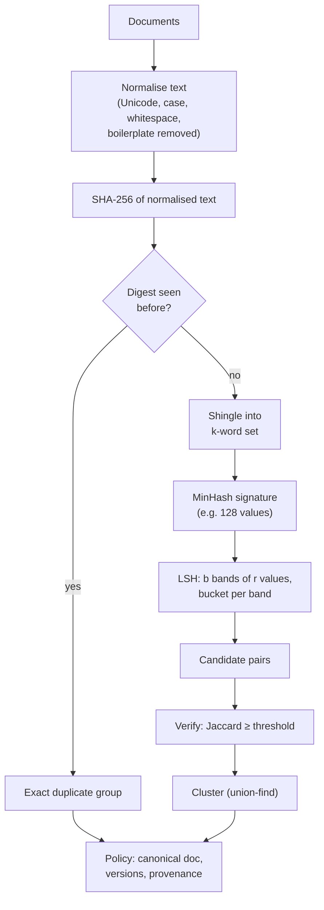

Real document collections are full of copies. The same policy is saved as a PDF and a Word file; a wiki page is exported to the shared drive; a runbook is pasted into three team spaces; a web page is reachable under several URLs; last year's handbook sits next to this year's, ninety per cent identical. Indexed naively, every copy becomes its own set of chunks, and retrieval returns the same paragraph three times while the answer the user needed is pushed out of the top results.

This lesson teaches the standard techniques for finding duplicates before they reach the index: **exact** duplicates, by hashing normalised text, and **near** duplicates, by comparing sets of overlapping word sequences with **Jaccard similarity**, estimating it cheaply with **MinHash**, and finding candidate pairs among millions of documents with **locality-sensitive hashing (LSH)**. It also covers the decision that matters most and is easiest to get wrong: what to do once you have found a duplicate, especially when the "duplicate" is an older version that disagrees with the current one. Removing duplicate *chunks* from a retrieved result list is a later topic, covered in [Duplicate removal](/learn/advanced-retrieval-optimisation/duplicate-removal) and [Context deduplication](/learn/context-engineering/context-deduplication); this lesson works at ingestion time, on documents.

## Learning objectives

- Detect exact duplicates with a cryptographic hash of normalised text, and explain why normalisation must come first.
- Compute Jaccard similarity over word shingles by hand and in Python, and choose a shingle size for a corpus.
- Explain why MinHash estimates Jaccard similarity, and compute its standard error for a given number of hash functions.
- Configure LSH banding and compute the probability that a pair with given similarity becomes a candidate.
- Design a deduplication policy that clusters near duplicates, chooses a canonical document, and handles versions that conflict.

## Prerequisites

- [Encoding and Unicode](/learn/data-processing/encoding-and-unicode): normalisation, so that identical text is byte-identical.
- [Data cleaning](/learn/data-processing/data-cleaning): boilerplate removal, which strongly affects similarity.
- [Web scraping fundamentals](/learn/data-processing/web-scraping-fundamentals): URL normalisation, the first line of defence against crawled duplicates.
- [Query-document matching](/learn/rag-architecture-fundamentals/query-document-matching): similarity scores and what they measure.

## Why this matters

Duplicates harm a RAG system in several distinct ways.

**They waste the context window.** If a query's top five chunks include three copies of the same paragraph, the model gets two distinct pieces of evidence instead of five. Information that would have answered the question sits at position six and is never seen.

**They distort ranking.** A document that exists in four copies has four chances to be retrieved for every query. Content that happens to be copied often (popular pages, boilerplate) is over-represented in results regardless of relevance.

**They inflate cost.** Every copy is chunked, embedded, stored and searched. In corpora assembled from shared drives and wikis, duplication is common enough that removing it noticeably reduces the size of the index.

**They hide conflicts.** The most dangerous near duplicates are not copies but versions. Meridian's superseded 2023 handbook and its current handbook are mostly identical text, but the 2023 one says the equipment budget is £250, the laptop cycle 4 years and the support desk open 09:00 to 17:00. If both are indexed, the model may be shown both and answer with either. Detecting that two documents are near duplicates is how you find these pairs; deciding what to do about them is a policy question with real consequences.

## The intuition

Imagine checking a pile of essays for copying.

**Exact copies** are easy: photocopy one essay, hold it over another, and see whether everything lines up. In software, the photocopy is a **hash**: a short fingerprint computed from the whole text. Identical texts give identical fingerprints; change one character and the fingerprint is completely different. Compare fingerprints, not essays.

**Near copies** (a student changed a few words, added a sentence) need a different approach. You might cut each essay into overlapping three-word snippets and ask: what fraction of all the snippets in either essay appear in both? Two essays that share most of their snippets are near copies, however the changes are spread around. That fraction is **Jaccard similarity**, and the snippets are **shingles**.

With a pile of a million essays, comparing every pair is impossible: that is half a trillion comparisons. So you do something cleverer. For each essay you write a short **summary card** (a MinHash signature) in such a way that two essays with similar snippet sets get similar cards. Then you sort the cards into **buckets** by parts of the card (LSH), so that only essays landing in the same bucket need a careful look. Most pairs are never compared at all.

## How it works

### Exact duplicates: hash the normalised text

A **cryptographic hash function** such as SHA-256 maps any input to a fixed-size digest (32 bytes for SHA-256) in such a way that, for practical purposes, different inputs never give the same digest. Hashing every document and grouping by digest finds all exact duplicates in one pass, with one dictionary lookup per document.

The catch is the word *exact*. A single extra space, a different line ending, a byte order mark or a decomposed accent changes the digest. So hash a **normalised** form of the text, not the raw bytes:

1. Decode correctly and normalise Unicode (NFKC is reasonable for a dedup key).
2. Case-fold.
3. Collapse all whitespace runs to a single space and trim.
4. Optionally remove boilerplate first (see [Data cleaning](/learn/data-processing/data-cleaning)), so that two copies differing only in a footer hash the same.

The normalised form is used only to compute the key; the stored text is unchanged. The same hash, stored with each document, also tells an ingestion pipeline whether a document has changed since the last run, which is the basis of [Incremental ingestion](/learn/understanding-document-ingestion/incremental-ingestion).

### Near duplicates: shingles and Jaccard similarity

To compare texts that are almost the same, represent each one as a **set of shingles**: every run of $k$ consecutive words (word shingles) or $k$ consecutive characters (character shingles). For $k = 3$, "up to 5 unused days" yields `up to 5`, `to 5 unused`, `5 unused days`.

The **Jaccard similarity** of two sets is the size of their intersection divided by the size of their union: the fraction of all distinct shingles that the two documents share. It is 1 for identical sets and 0 for sets with nothing in common. Its complement, $1 - J$, is a proper distance.

Choosing $k$ is a trade-off:

- **Small $k$** (1 or 2 words) makes unrelated documents look similar, because common words and pairs appear everywhere.
- **Large $k$** makes small edits look large: one changed word alters up to $k$ shingles.
- For word shingles, values from about 3 to 5 are common for documents of paragraph length or more; for short texts, character shingles of about 5 to 9 characters give smoother scores. Tune on labelled pairs from your own corpus.

### MinHash: estimating Jaccard from short signatures

Computing exact Jaccard needs both full shingle sets. MinHash, introduced by Andrei Broder in 1997 for finding near-duplicate web pages, replaces each set with a short **signature** of $k$ numbers from which Jaccard can be estimated.

The trick: apply a random hash function $h$ to every shingle in a set and keep only the **minimum** value. For two sets $A$ and $B$, the minimum over $A \cup B$ belongs to some shingle; the minimum of $A$ equals the minimum of $B$ exactly when that shingle is in both sets. Since every shingle in the union is equally likely to be the one with the smallest hash, the probability of that is the fraction of the union that is shared, which is exactly the Jaccard similarity. Repeat with $k$ independent hash functions and count how often the minima agree: the fraction is an unbiased estimate of $J$.

Steps for one document:

1. Shingle the normalised text into a set.
2. For each of $k$ hash functions, hash every shingle and keep the minimum.
3. The $k$ minima are the signature (for example 128 numbers, regardless of the document's length).

Two signatures are compared position by position; the fraction of equal positions estimates Jaccard.

### LSH: finding candidates without comparing every pair

Even with signatures, comparing every pair of $N$ documents costs $N(N-1)/2$ comparisons, which is about $5 \times 10^{11}$ for a million documents. **Locality-sensitive hashing** avoids this. Split each signature into $b$ **bands** of $r$ values each. For each band, hash the $r$ values together into a bucket. Two documents become a **candidate pair** if they land in the same bucket in at least one band.

Similar documents agree on many signature positions, so they are likely to agree on all $r$ positions of at least one band. Dissimilar documents almost never do. Each document is inserted into $b$ buckets and a query looks up $b$ buckets, so the work grows roughly linearly with the number of documents instead of quadratically. The choice of $b$ and $r$ sets a similarity threshold and the sharpness of the cut-off, which the mathematics section quantifies.

Candidates are *candidates*: LSH has false positives (dissimilar pairs that collided) and false negatives (similar pairs that never collided). Verify each candidate with the exact Jaccard similarity of the shingle sets, or with the signature estimate when the sets are not kept.



### Other near-duplicate techniques

- **SimHash** (Moses Charikar, 2002) produces a single 64-bit fingerprint per document such that similar documents differ in few bits. It approximates cosine similarity of weighted feature vectors rather than Jaccard, and was used for near-duplicate detection of crawled web pages at scale (Manku, Jain and Das Sarma, 2007).
- **Embedding similarity** catches paraphrases that share few exact words, which shingle methods miss. It is more expensive (a model inference per document or chunk) and much less precise about *what* differs: two versions of a policy that differ in one number will typically have extremely similar embeddings. Use it to find candidate "same topic" pairs, not to decide that two documents are interchangeable.
- **Containment** rather than similarity: $|A \cap B| / |A|$ measures how much of $A$ appears in $B$. It detects a short document that is fully quoted inside a longer one, which Jaccard scores low because the union is dominated by the long document.

### What to do with a duplicate

Detection produces groups. Policy decides what happens to them, and the right policy depends on why the copies exist.

1. **True copies** (same content, different file or URL): index one **canonical** document. Choose it by an explicit rule, such as most authoritative source first, then most recent, then cleanest extraction. Keep the other locations as metadata on the canonical document, so that citations can point to whichever copy the user can access and deletions in one source do not orphan the content.
2. **Versions** (same document, different dates, conflicting facts): do not treat them as duplicates to collapse arbitrarily. Index the current version; mark superseded versions as such, or exclude them, according to whether users ever need history. This is the domain of [Document versioning](/learn/document-engineering/document-versioning).
3. **Overlapping documents** (a page that quotes a policy; two runbooks sharing a section): often both should stay, but shared passages may be deduplicated at the chunk level.
4. **Access-controlled copies**: two identical documents with different permissions are *not* interchangeable. Keeping only the copy in a restricted space hides the content from users who could read the other; keeping only the open copy may be fine, but the decision must consider permissions explicitly.

Thresholds belong to policy too. Pairs above a high threshold (say a verified Jaccard of 0.9) can usually be merged automatically; pairs in a middle band are best routed to a person or to a version check. The numbers are tuned per corpus by reading pairs at different similarities.

## The mathematics

### Jaccard similarity

**Intuition.** Of all the distinct shingles in either document, what fraction is in both?

$$
J(A, B) = \frac{|A \cap B|}{|A \cup B|}
$$

- $A$, $B$: the shingle sets of the two documents.
- $|A \cap B|$: the number of shingles the documents share.
- $|A \cup B|$: the number of distinct shingles in either.

**Worked example.** $A = \{a, b, c, d\}$ and $B = \{b, c, d, e\}$ share three elements ($b, c, d$), and their union has five ($a, b, c, d, e$), so $J = 3/5 = 0.6$.

### MinHash estimate and its error

**Intuition.** Each hash function gives a yes/no answer ("did the minima agree?") that is "yes" with probability $J$. Averaging $k$ such answers estimates $J$, and like any average of coin flips its error shrinks with the square root of $k$.

$$
\Pr\left[\min_{x \in A} h(x) = \min_{x \in B} h(x)\right] = J(A, B), \qquad \hat{J} = \frac{1}{k}\sum_{i=1}^{k} \mathbb{1}\left[m_i(A) = m_i(B)\right], \qquad \operatorname{SE}(\hat{J}) = \sqrt{\frac{J(1-J)}{k}}
$$

- $h$: a random hash function, treated as a random ordering of all possible shingles.
- $m_i(A)$: the minimum of hash function $i$ over the shingles of $A$.
- $\mathbb{1}[\cdot]$: 1 if the condition holds, 0 otherwise.
- $k$: the number of hash functions (the signature length).
- $\hat{J}$: the estimate; $\operatorname{SE}$: its standard error.

**Worked example.** With $J = 0.5$ and $k = 128$: $\operatorname{SE} = \sqrt{0.5 \times 0.5 / 128} = \sqrt{0.001953} \approx 0.044$. So an estimate is typically within about $\pm 0.09$ (two standard errors) of the truth. Quadrupling $k$ to 512 halves the error to about 0.022, at four times the computation and storage. This is why an estimate near a threshold should be verified exactly.

### LSH banding

**Intuition.** A pair becomes a candidate if *all* $r$ values agree in *at least one* of $b$ bands. Requiring all $r$ to agree makes a single band strict; offering $b$ bands gives similar pairs many chances.

$$
P(s) = 1 - \left(1 - s^{r}\right)^{b}, \qquad t \approx \left(\frac{1}{b}\right)^{1/r}
$$

- $s$: the Jaccard similarity of the pair.
- $s^r$: the probability that all $r$ values of one band agree (each agrees with probability $s$).
- $(1 - s^r)^b$: the probability that no band agrees.
- $P(s)$: the probability that the pair becomes a candidate.
- $t$: the approximate similarity at which the S-shaped curve $P(s)$ rises most steeply, the effective threshold.

**Worked example.** With $b = 25$ bands of $r = 5$ (125 hash values, the configuration `datasketch` picks for a threshold of 0.5 and 128 permutations): for $s = 0.6$, $s^5 = 0.0778$, $1 - 0.0778 = 0.9222$, $0.9222^{25} \approx e^{25 \ln 0.9222} = e^{-2.024} \approx 0.132$, so $P \approx 0.868$. For $s = 0.2$, $s^5 = 0.00032$ and $P \approx 1 - (0.99968)^{25} \approx 0.008$. The threshold is $t \approx (1/25)^{1/5} \approx 0.525$. Raising $r$ makes the curve steeper and moves it right; raising $b$ moves it left.

```python
import numpy as np

def p_candidate(s, b, r):
    return 1 - (1 - s**r) ** b

b, r = 25, 5                      # what MinHashLSH(threshold=0.5, num_perm=128) chose
print(f"approximate threshold (1/b)^(1/r) = {(1 / b) ** (1 / r):.3f}")
for s in [0.2, 0.4, 0.52, 0.6, 0.8]:
    print(f"s={s:.2f}  P(candidate)={p_candidate(s, b, r):.3f}")

# MinHash estimate spread: standard error sqrt(J(1-J)/k)
J, k = 0.5, 128
rng = np.random.default_rng(seed=0)
estimates = rng.binomial(k, J, size=10_000) / k
print(f"\nk={k}: theory SE={np.sqrt(J * (1 - J) / k):.4f}  simulated SE={estimates.std():.4f}")
```

```output
approximate threshold (1/b)^(1/r) = 0.525
s=0.20  P(candidate)=0.008
s=0.40  P(candidate)=0.227
s=0.52  P(candidate)=0.621
s=0.60  P(candidate)=0.868
s=0.80  P(candidate)=1.000

k=128: theory SE=0.0442  simulated SE=0.0444
```

A pair at the threshold is a coin toss: at $s = 0.52$ it becomes a candidate only 62% of the time. Pairs well above the threshold are found almost surely, and pairs well below almost never. The simulation draws 10,000 estimates as binomial counts out of 128 and confirms the standard-error formula. (The value at $s = 0.8$ is $1 - 4.8 \times 10^{-5}$, which rounds to 1.000.)

## In code

**The problem.** Seven short Meridian documents contain an exact copy that differs only in case and whitespace, a lightly edited copy, a web copy with an extra footer sentence, and a superseded 2023 version of the remote-work policy. Find the exact duplicates, measure near-duplicate similarity exactly and with MinHash, and use LSH to generate candidate pairs.

**Dependencies.** `datasketch` for MinHash and LSH; the rest is the standard library.

```bash
pip install datasketch
```

```python
import hashlib
import re
import unicodedata
from itertools import combinations

from datasketch import MinHash, MinHashLSH

docs = {
    "leave":       "Annual leave is 25 days per year. Up to 5 unused days carry over and must be used by 31 March.",
    "leave-copy":  "ANNUAL LEAVE is 25 days per year.\n\nUp to 5 unused days carry over and must be used by 31 March.",
    "leave-edit":  "Annual leave is 25 days a year. Up to five unused days carry over and must be used by 31 March.",
    "remote-2025": "Staff may work remotely up to 3 days a week. The home-office equipment budget is £400. "
                   "Laptops are refreshed every 3 years.",
    "remote-2023": "Staff may work remotely up to 3 days a week. The home-office equipment budget is £250. "
                   "Laptops are refreshed every 4 years.",
    "remote-web":  "Staff may work remotely up to 3 days a week. The home-office equipment budget is £400. "
                   "Laptops are refreshed every 3 years. Printed from the Meridian intranet.",
    "expenses":    "Expenses must be submitted within 30 days. Anything over £75 needs a receipt.",
}

def normalise(text: str) -> str:
    text = unicodedata.normalize("NFKC", text).casefold()
    return re.sub(r"\s+", " ", text).strip()

# ---- 1. exact duplicates: hash of the normalised text
groups: dict[str, list[str]] = {}
for doc_id, text in docs.items():
    digest = hashlib.sha256(normalise(text).encode("utf-8")).hexdigest()
    groups.setdefault(digest, []).append(doc_id)
print("exact duplicate groups:", [ids for ids in groups.values() if len(ids) > 1])

# ---- 2. near duplicates: shingles and Jaccard similarity
def shingles(text: str, k: int = 3) -> set[str]:
    words = re.findall(r"\w+", normalise(text))
    return {" ".join(words[i:i + k]) for i in range(len(words) - k + 1)}

def jaccard(a: set, b: set) -> float:
    return len(a & b) / len(a | b)

sh = {d: shingles(t) for d, t in docs.items()}

def minhash(s: set[str], num_perm: int = 128) -> MinHash:
    m = MinHash(num_perm=num_perm, seed=42)
    for shingle in s:
        m.update(shingle.encode("utf-8"))
    return m

mh = {d: minhash(s) for d, s in sh.items()}
print("\npair                        exact J   MinHash est.")
for a, b in combinations(docs, 2):
    j = jaccard(sh[a], sh[b])
    if j > 0.1:
        print(f"{a:12} {b:14} {j:7.3f}   {mh[a].jaccard(mh[b]):7.3f}")

# ---- 3. candidate pairs with locality-sensitive hashing
lsh = MinHashLSH(threshold=0.5, num_perm=128)
for d, m in mh.items():
    lsh.insert(d, m)
print("\nLSH candidates (threshold 0.5):")
for d in docs:
    others = sorted(x for x in lsh.query(mh[d]) if x != d)
    if others:
        print(f"  {d:12} -> {others}")
```

```output
exact duplicate groups: [['leave', 'leave-copy']]

pair                        exact J   MinHash est.
leave        leave-copy       1.000     1.000
leave        leave-edit       0.520     0.547
leave-copy   leave-edit       0.520     0.547
remote-2025  remote-2023      0.615     0.648
remote-2025  remote-web       0.808     0.844
remote-2023  remote-web       0.516     0.562

LSH candidates (threshold 0.5):
  leave        -> ['leave-copy']
  leave-copy   -> ['leave']
  remote-2025  -> ['remote-2023', 'remote-web']
  remote-2023  -> ['remote-2025', 'remote-web']
  remote-web   -> ['remote-2023', 'remote-2025']
```

**The important lines.**

- `normalise` applies NFKC, case folding and whitespace collapsing. Because of it, `leave-copy` (upper case, a blank line in the middle) hashes to the same SHA-256 digest as `leave`.
- `hashlib.sha256(...).hexdigest()` is the exact-duplicate key; grouping by it is one dictionary operation per document.
- `shingles` builds the set of 3-word shingles from the normalised words. A set, not a list: repeated shingles count once, as Jaccard requires.
- `MinHash(num_perm=128, seed=42)` creates a signature of 128 minima. Every MinHash that will be compared must use the same `num_perm` and `seed`, otherwise the positions do not correspond. `update` takes bytes, hence the `.encode("utf-8")`.
- `mh[a].jaccard(mh[b])` estimates Jaccard from the signatures alone.
- `MinHashLSH(threshold=0.5, num_perm=128)` chooses a band configuration for the threshold (here 25 bands of 5 values); `insert` adds a signature under a key, and `query` returns the keys that share at least one band bucket.

**What the output means.**

- Exact hashing found the case-and-whitespace copy, and nothing else, as it should.
- The MinHash estimates are within a few hundredths of the exact values, consistent with a standard error of about 0.04 at 128 permutations.
- One edit of two words ("per" to "a", "5" to "five") brought `leave-edit` down to $J = 0.52$. On short texts each changed word destroys up to three of only about twenty shingles, so small edits look large. Shingle size and threshold must suit the length of your documents.
- LSH did **not** return `leave-edit` as a candidate for `leave`, although its true similarity (0.52) is just above the 0.5 threshold. That is the S-curve at work: at $s = 0.52$ the candidate probability is only about 62%. In production, set the LSH threshold somewhat below the similarity you actually care about, and verify candidates exactly.
- The pair that matters most is `remote-2025` and `remote-2023`, at $J = 0.615$. By similarity alone they are near duplicates. In content they conflict: £400 against £250, a 3-year against a 4-year laptop cycle. A pipeline that collapsed near duplicates by keeping "any one" of them could keep the superseded version.
- `remote-web` is the current policy plus a footer sentence ($J = 0.808$). It is a true copy, and removing the footer during cleaning would have made it an exact duplicate.

**Errors people commonly hit.**

- `ValueError` when comparing or inserting MinHashes created with different `num_perm` values.
- Passing a `str` to `MinHash.update`, which expects `bytes`.
- Inserting the same key twice into `MinHashLSH`, which raises an error; keys must be unique.
- Shingling raw text instead of normalised text, so that case and punctuation differences lower similarity.
- Very short documents: a text of fewer than $k$ words has no $k$-word shingles at all, and the empty set makes Jaccard undefined (a division by zero in the `jaccard` function above). Fall back to character shingles or exact hashing for very short texts.

**Extending it.** Cluster the verified pairs with union-find and choose a canonical document per cluster (exercise 3). Add a version check that compares extracted facts or dates within a cluster before merging. For large corpora, persist the LSH index (`datasketch` supports external storage back ends such as Redis, configured through `storage_config`) so that new documents are checked against existing ones without rebuilding.

## A real-world example

When AskMeridian first indexed the HR team's shared drive, two kinds of complaint arrived. Some answers cited the same paragraph three times. Other answers were simply wrong: asked about the home-office equipment budget, the assistant sometimes said £250.

Sam, on the Platform team, ran exact and near-duplicate detection across the ingested documents. Exact hashing found many byte-for-byte copies: policies saved into several team folders, the same PDF uploaded twice. Near-duplicate detection, at a verified Jaccard threshold of 0.8, found more: Word and PDF exports of the same policy (identical after footer removal), and wiki pages with and without a "last edited by" line.

The £250 answer came from a pair in the middle band. The 2023 handbook and the current handbook had a Jaccard similarity that was high but well below that of true copies, because a few dozen sentences had changed. Both were being indexed, and on budget questions both were retrieved. A first proposal was to merge every cluster above 0.6 and keep one document at random. Sam rejected it after checking the cluster that contained the two handbooks: the random choice would have been the 2023 version half the time.

The adopted policy had three tiers. Pairs above 0.9 after cleaning are merged automatically, keeping the copy from the most authoritative source (the HR system over the shared drive) and recording the other locations as metadata. Pairs between 0.6 and 0.9 are checked for version metadata: where one document is marked as superseded, it is excluded from the index; where neither has version information, the pair goes to the document owner for review. Pairs below 0.6 are left alone. The superseded handbook was excluded, and the duplicated citations disappeared with the merged copies.

## Common mistakes

- **Hashing raw bytes.** Copies that differ in whitespace, case, line endings or a byte order mark get different digests and are not detected.
- **Treating near duplicates as interchangeable.** Versions of a policy are near duplicates that disagree on exactly the facts users ask about. Keeping an arbitrary member of the cluster can keep the outdated one.
- **Using embedding similarity to declare duplicates.** Two documents that differ in one number have nearly identical embeddings. Embeddings find same-topic pairs, not safe-to-merge pairs.
- **Trusting LSH output without verification.** Candidates include false positives, and pairs near the threshold are missed with substantial probability. Verify, and set the LSH threshold below the decision threshold.
- **Ignoring permissions when merging.** Keeping only the copy in a restricted space removes the content for users who could read the open copy.
- **Deleting copies without keeping provenance.** When the canonical copy is later deleted at its source, content that still exists elsewhere disappears from the index.
- **Deduplicating before cleaning.** Footers, headers and navigation dominate the shingle sets of short documents, making unrelated pages look similar and true copies look different.

## Best practices

- Clean and normalise before deduplicating; use the same normalisation for keys everywhere.
- Run exact hashing first (cheap, certain), then near-duplicate detection on what remains.
- Choose shingle size and thresholds by labelling a sample of pairs at different similarities from your own corpus.
- Use MinHash with LSH for candidate generation, and verify candidates with exact Jaccard (or a longer signature) before acting.
- Write an explicit canonical-choice rule (source authority, recency, extraction quality) and record all other locations as metadata.
- Treat versions as versions: check dates and version metadata within clusters, and exclude or label superseded documents rather than merging them blindly.
- Log every merge and exclusion with the similarity score and the rule applied, so that decisions can be reviewed and reversed.

## Performance considerations

The costs of each technique, for $N$ documents averaging $L$ words, with signature length $k$:

- **Exact hashing** is linear: one pass over the text and one dictionary lookup per document. SHA-256 processes hundreds of megabytes per second on ordinary hardware (an order of magnitude); it is never the bottleneck.
- **Shingling and MinHash** cost about $L \times k$ hash operations per document. For $N = 10^6$, $L = 1{,}000$ and $k = 128$, that is $10^6 \times 1{,}000 \times 128 \approx 1.3 \times 10^{11}$ operations: substantial, but vectorised implementations and parallelism across documents make it a batch job of reasonable size. Smaller $k$ is faster but noisier.
- **Signature storage** is $N \times k$ integers. At 8 bytes each, $10^6 \times 128 \times 8 \approx 1$ GB; at 4 bytes, half that.
- **All-pairs comparison** would need $N(N-1)/2 \approx 5 \times 10^{11}$ signature comparisons for $N = 10^6$, each of $k$ values. LSH replaces this with $b$ bucket insertions and lookups per document, plus verification of the candidates, which is roughly linear in $N$ as long as buckets stay small. Very common boilerplate can create huge buckets; cleaning first keeps them small.
- **Incremental operation**: new documents are hashed, shingled and queried against the existing LSH index, then inserted. There is no need to recompute anything for the existing corpus, which makes deduplication cheap to run on every ingestion batch.

Embedding-based similarity, by contrast, costs a model inference per document and a nearest-neighbour search per query; it is worth paying only when paraphrase-level duplicates matter.

## Security considerations

- **Hash choice.** Use a cryptographic hash such as SHA-256 for exact-duplicate keys. Fast non-cryptographic hashes are fine for MinHash internals, but if an attacker can submit documents, a weak hash used for identity can be made to collide deliberately, causing a malicious document to be treated as a copy of a legitimate one, or the reverse.
- **Deduplication can be gamed.** An attacker who wants a poisoned document indexed alongside a legitimate one only needs to make it dissimilar enough to avoid merging; one who wants a legitimate document *removed* might submit a near copy from a more "authoritative" path. Canonical-choice rules should prefer trusted sources and never let an untrusted source displace a trusted one. See [Data poisoning](/learn/rag-security-fundamentals/data-poisoning).
- **Permissions across copies.** Never merge documents with different access rules without carrying the rules forward; a merged document must not become visible to users who could not read any of its copies.
- **Information leakage through dedup signals.** A system that tells users "this document is a duplicate of one you cannot see" leaks the existence and approximate content of restricted documents. Keep deduplication decisions internal to the pipeline.

## Summary

- Exact duplicates are found by hashing normalised text with SHA-256; normalisation decides what "exact" means.
- Near duplicates are measured by the Jaccard similarity of shingle sets; shingle size and threshold must suit the length of the documents.
- MinHash estimates Jaccard from short signatures, with standard error $\sqrt{J(1-J)/k}$; LSH banding turns signatures into candidate pairs with an S-shaped probability around $(1/b)^{1/r}$.
- Candidates must be verified, and LSH thresholds set below the decision threshold, because pairs near the threshold are often missed.
- Near duplicates are not necessarily interchangeable: versions disagree on facts, and copies may differ in permissions. Detection is mechanical; the policy is the hard part.
- Deduplicate after cleaning, choose canonical documents by explicit rules, and keep provenance for everything merged or excluded.

## Exercises

**1.** Shingle the two sentences below into word 2-grams (after lower-casing and dropping punctuation) and compute their Jaccard similarity by hand. A: "Laptops are refreshed every 3 years." B: "Laptops are refreshed every 4 years."

<details><summary>Show solution</summary>

A's 2-grams: `laptops are`, `are refreshed`, `refreshed every`, `every 3`, `3 years` (5 shingles). B's: `laptops are`, `are refreshed`, `refreshed every`, `every 4`, `4 years` (5 shingles).

Shared: `laptops are`, `are refreshed`, `refreshed every` (3). Union: $5 + 5 - 3 = 7$. So $J = 3/7 \approx 0.43$.

A one-character change produced a similarity well below any typical duplicate threshold, because short texts have few shingles and one changed word touches two of them. Notice also that the *meaning* of the change (3 versus 4 years) is exactly the fact a user would ask about.

</details>

**2.** You need near-duplicate candidates for pairs with Jaccard 0.8 and above, and you want pairs at 0.8 to be found at least 99% of the time, using 128 hash values. Compare $b = 16, r = 8$ with $b = 32, r = 4$: compute $P(0.8)$ and $P(0.4)$ for each, and say which you would choose.

<details><summary>Show solution</summary>

$b = 16, r = 8$: $0.8^8 = 0.168$, so $P(0.8) = 1 - (1 - 0.168)^{16} = 1 - 0.832^{16} \approx 1 - 0.0526 \approx 0.947$. $0.4^8 = 0.00066$, so $P(0.4) \approx 1 - (0.99934)^{16} \approx 0.010$.

$b = 32, r = 4$: $0.8^4 = 0.4096$, so $P(0.8) = 1 - 0.5904^{32} \approx 1 - 4.8 \times 10^{-8} \approx 1.000$. $0.4^4 = 0.0256$, so $P(0.4) = 1 - 0.9744^{32} \approx 1 - 0.436 \approx 0.564$.

Only $b = 32, r = 4$ meets the 99% requirement at 0.8, at the price of many more false candidates (more than half of the pairs at 0.4 become candidates), each of which costs one exact verification. That is the usual trade: since verification is cheap compared with missing a duplicate, choose $b = 32, r = 4$ (threshold $\approx (1/32)^{1/4} \approx 0.42$) and verify. If verification were expensive, an intermediate setting would be a reasonable compromise.

</details>

**3.** Extend the lesson's script: cluster documents whose LSH candidates verify at an exact Jaccard of at least 0.75, using union-find, and keep one document per cluster, preferring the handbook over web copies and then the shorter text. Which documents are dropped, and why is `remote-2023` not among them?

<details><summary>Show solution</summary>

Append to the lesson's script (it reuses `docs`, `sh`, `mh` and `jaccard`):

```python
# Continues from the lesson's script: docs, sh (shingle sets), mh (MinHashes) and jaccard() exist.
from datasketch import MinHashLSH

SOURCE_RANK = {"handbook": 0, "web": 1}            # lower is preferred
source = {d: ("web" if d.endswith("-web") or d.endswith("-copy") else "handbook") for d in docs}

parent = {d: d for d in docs}
def find(x):
    while parent[x] != x:
        parent[x] = parent[parent[x]]               # path halving keeps the trees shallow
        x = parent[x]
    return x

lsh = MinHashLSH(threshold=0.5, num_perm=128)
for d, m in mh.items():
    lsh.insert(d, m)
for d in docs:
    for other in lsh.query(mh[d]):
        if other != d and jaccard(sh[d], sh[other]) >= 0.75:   # verify each candidate exactly
            parent[find(other)] = find(d)

clusters: dict[str, list[str]] = {}
for d in docs:
    clusters.setdefault(find(d), []).append(d)
for members in clusters.values():
    keep = min(members, key=lambda d: (SOURCE_RANK[source[d]], len(docs[d])))
    print(f"keep {keep:12} drop {[m for m in members if m != keep]}")
```

```output
keep leave        drop ['leave-copy']
keep leave-edit   drop []
keep remote-2025  drop ['remote-web']
keep remote-2023  drop []
keep expenses     drop []
```

`leave-copy` and `remote-web` are dropped as copies of handbook documents. `remote-2023` survives because its verified Jaccard with the current policy (0.615) is below 0.75. That is the right outcome for deduplication, but it means the superseded version is still indexed: removing it is a *versioning* decision, which needs version metadata, not a similarity threshold. `leave-edit` (0.52) also survives; whether it should depends on whether it is a copy with a typo or a different version, which similarity cannot tell you. The `source` mapping from the document id is a stand-in; in a real pipeline it comes from metadata.

</details>

**4.** Design decision. Meridian Reports' documentation is published in three places: the product docs site, a PDF manual for Enterprise customers, and excerpts quoted inside IT runbooks. The PDF lags the site by a release. Design how AskMeridian should detect and handle duplication across these sources, including which similarity measure you would use for the runbook excerpts.

<details><summary>Show solution</summary>

**Site versus PDF manual.** Clean both (remove PDF headers and footers, site navigation), then use MinHash with LSH on word shingles and verify with exact Jaccard. Sections that match closely are copies; prefer the docs site as canonical, because it is current, and keep the PDF location in metadata. Sections that are similar but differ belong to different releases: index the site's version and treat the PDF's as superseded, unless users need release-specific answers, in which case keep both with an explicit release field and filter by it. Comparing at section level rather than whole-document level is important, since the documents as a whole differ by a release's worth of changes.

**Runbook excerpts.** A short excerpt quoted inside a long runbook has low Jaccard with the source (the union is dominated by the runbook's other content). Use **containment**, $|A \cap B| / |A|$ with $A$ the excerpt, to detect that the excerpt's shingles appear in the docs. Do not drop the runbook: it has its own content. Instead, deduplicate at chunk level, or mark the quoted passage so retrieval prefers the canonical documentation chunk and does not return both.

**Throughout:** carry permissions and provenance with each canonical chunk (the PDF manual may be Enterprise-only, which is a different audience from internal staff), log merge decisions, and re-run detection incrementally as each source updates.

</details>

## Check your understanding

```quiz
[
  {
    "q": "Two files contain the same policy text, but one uses Windows line endings and an extra blank line. Their SHA-256 digests differ. What is the fix?",
    "options": [
      "Use MD5 instead of SHA-256",
      "Hash a normalised form of the text (Unicode normalisation, case folding, collapsed whitespace)",
      "Compare the files with embeddings instead",
      "Increase the hash length"
    ],
    "answer": 1,
    "why": "Any hash changes completely with a single byte. Normalising the text before hashing defines which differences should not count."
  },
  {
    "q": "Sets A = {a, b, c} and B = {b, c, d, e}. What is their Jaccard similarity?",
    "options": ["0.4", "0.5", "0.67", "0.75"],
    "answer": 0,
    "why": "The intersection {b, c} has 2 elements and the union {a, b, c, d, e} has 5, so J = 2/5 = 0.4."
  },
  {
    "q": "Why does the probability that two sets share the same MinHash minimum equal their Jaccard similarity?",
    "options": [
      "Because hash functions preserve set sizes",
      "Because the minimum is always the alphabetically first shingle",
      "Because the shingle with the smallest hash in the union is equally likely to be any of them, and the minima agree exactly when it is in both sets",
      "Because MinHash computes the intersection directly"
    ],
    "answer": 2,
    "why": "A random hash is a random ordering; the first element of the union lies in the intersection with probability |A ∩ B| / |A ∪ B|."
  },
  {
    "q": "LSH is configured with an effective threshold of 0.5. A pair with true Jaccard 0.52 is not returned as a candidate. What is the most likely explanation?",
    "options": [
      "A bug: LSH always returns pairs above its threshold",
      "The MinHash signatures were created with different seeds",
      "The pair is an exact duplicate, which LSH ignores",
      "LSH is probabilistic; near the threshold a pair becomes a candidate only part of the time"
    ],
    "answer": 3,
    "why": "The candidate probability is an S-curve, about 50 to 60 per cent near the threshold. Set the LSH threshold below the similarity you need and verify candidates."
  },
  {
    "q": "The current and superseded handbooks have Jaccard similarity 0.7 and differ in the equipment budget. What should the ingestion pipeline do?",
    "options": [
      "Keep whichever document was ingested first",
      "Merge them into one document containing both texts",
      "Treat it as a versioning decision: index the current version and exclude or label the superseded one",
      "Keep both without any marking, since they are not exact duplicates"
    ],
    "answer": 2,
    "why": "Near duplicates that conflict are versions. Keeping one at random or both unlabelled lets the model answer with outdated facts."
  }
]
```

## Further reading

- Andrei Z. Broder (1997), "On the resemblance and containment of documents", *Proceedings of Compression and Complexity of Sequences*, the original MinHash paper, which also defines containment.
- Jure Leskovec, Anand Rajaraman and Jeffrey D. Ullman, *Mining of Massive Datasets*, chapter 3, "Finding Similar Items" (shingling, MinHash and LSH banding). Free online at [mmds.org](http://www.mmds.org/).
- Moses S. Charikar (2002), "Similarity estimation techniques from rounding algorithms", *STOC 2002*, the origin of SimHash.
- Gurmeet Singh Manku, Arvind Jain and Anish Das Sarma (2007), "Detecting near-duplicates for web crawling", *WWW 2007*.
- `datasketch` documentation, at [ekzhu.com/datasketch](https://ekzhu.com/datasketch/), for `MinHash`, `MinHashLSH` and storage back ends.
- Katherine Lee et al. (2022), "Deduplicating Training Data Makes Language Models Better", *ACL 2022*, on near-duplicate removal at corpus scale.
