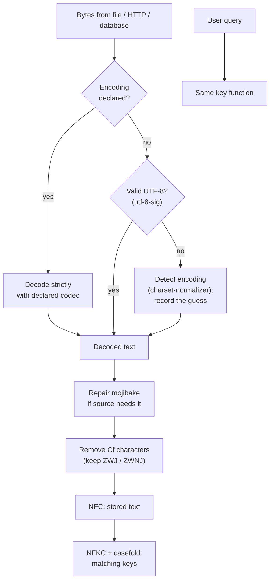

Every document a RAG system reads arrives as bytes: from a file, a database column, an HTTP response. Before any of the processing in this module can start, those bytes have to become text, and that step goes wrong more often than any other in an ingestion pipeline. "£400" turns into "£400"; "café" in one document and "café" in another refuse to match although they look identical; an error code containing an invisible character cannot be found by searching for it. None of these failures raises an error at the point where it happens.

This lesson explains what text really is in a computer: **code points**, the **encodings** that turn them into bytes (UTF-8 above all), how decoding fails loudly or silently, how to repair and detect encodings, and **Unicode normalisation**, which decides when two different sequences of code points count as the same text. It ends with the characters attackers like: invisible ones and look-alikes. [Text processing](/learn/data-processing/text-processing) introduced the rule "decode once, at the boundary"; this lesson is about doing that decoding correctly and deciding what the text should look like afterwards.

## Learning objectives

- Explain the difference between characters, code points, bytes and encodings, and encode a code point to UTF-8 by hand.
- Diagnose mojibake and decoding errors from their symptoms, and repair or prevent them with explicit codecs, `ftfy` and encoding detection.
- Apply the four Unicode normalisation forms (NFC, NFD, NFKC, NFKD) and choose the right one for stored text, matching keys and identifiers.
- Remove or neutralise invisible format characters and recognise homoglyph attacks that normalisation does not fix.
- Measure how encoding problems change token counts and matching in a retrieval pipeline.

## Prerequisites

- [Text processing](/learn/data-processing/text-processing): Python strings as sequences of code points, and `casefold()`.
- [Tokens and tokenisation](/learn/understanding-large-language-models/tokens-and-tokenisation): how text becomes model tokens.
- [Web scraping fundamentals](/learn/data-processing/web-scraping-fundamentals): where `Content-Type` charsets come from.

## Why this matters

Encoding problems damage retrieval at every stage, and quietly.

- **Matching breaks.** Lexical search compares exact tokens. "café" written with a precomposed `é` and "café" written as `e` plus a combining accent are different strings, so a query typed one way misses a document written the other way. An invisible zero-width space inside "E-4021" makes the error code unfindable.
- **Text becomes garbage.** Decoding UTF-8 bytes as Windows-1252 turns every non-ASCII character into two or three wrong ones: "£" becomes "£", "–" becomes "–". Embedding models see words they were never trained on, and users see corrupted citations.
- **Costs rise.** Mis-decoded and decomposed text usually splits into more tokens, so every chunk costs more to embed and to send to the model, and fits less meaning in the same budget.
- **Data is lost.** Decoding with `errors="ignore"` silently drops bytes; decoding with `errors="replace"` turns them into `�`. Either way the original characters are gone, and nothing downstream can bring them back.
- **Attacks hide.** Look-alike letters and invisible characters let a document appear to say one thing to a human reviewer and another to a matching algorithm or a language model.

## The intuition

Think of a song. The *song* is abstract: a melody, a sequence of notes. To store it you have to choose a format: sheet music, a vinyl record, an MP3 file. The same song in each format is a completely different physical object, and if you put a vinyl record into a CD player you get nothing, or noise.

Text works the same way. The abstract sequence is a list of **code points**, numbers that Unicode assigns to characters: 65 is `A`, 163 is `£`. To store or send text you choose an **encoding**, a rule for turning those numbers into bytes. UTF-8 is one encoding, Windows-1252 another, UTF-16 a third. The same text in each is a different sequence of bytes. **Decoding** with the wrong rule is the vinyl in the CD player: either an error, or plausible-looking noise.

There is a second, subtler idea. Some characters can be written as more than one sequence of code points, as a chord can be written with its notes in a different order. "é" can be one code point, or an "e" followed by an accent that sits on top of it. Both render identically. **Normalisation** is agreeing on one way to write each chord, so that two copies of the same text compare equal.

## How it works

### Characters, code points and encodings

**Unicode** is a catalogue that gives every character in (nearly) every writing system a number, its **code point**, written `U+` followed by hexadecimal digits: `U+0041` is `A`, `U+00A3` is `£`, `U+20AC` is `€`. There is room for 1,114,112 code points, from `U+0000` to `U+10FFFF`. A Python `str` is a sequence of code points; `ord("£")` is 163 and `chr(163)` is `"£"`.

An **encoding** (Python calls it a *codec*) maps code points to bytes and back:

- **UTF-8** uses 1 to 4 bytes per code point. ASCII characters take one byte and are unchanged, which is why UTF-8 is backwards-compatible with ASCII. It is the dominant encoding on the web and the right default for everything you write.
- **UTF-16** uses 2 or 4 bytes per code point. It appears in Windows internals, some Excel CSV exports and some older systems, often with a byte order mark.
- **Windows-1252** (`cp1252`) and **ISO-8859-1** (`latin-1`) are legacy single-byte encodings: each byte is one character, so only 256 characters are possible. Older Western European files and many CSV exports from older software use them.

"What encoding is this file in?" cannot be answered from the bytes with certainty; it must be declared (an HTTP `Content-Type` charset, an HTML `<meta charset>`, an XML declaration, a format specification) or guessed.

### How UTF-8 lays out bits

UTF-8's design explains several of its useful properties. Each code point is written in one of four patterns, depending on how many bits it needs:

| Code point range | Bytes | Bit pattern |
| --- | --- | --- |
| `U+0000` to `U+007F` | 1 | `0xxxxxxx` |
| `U+0080` to `U+07FF` | 2 | `110xxxxx 10xxxxxx` |
| `U+0800` to `U+FFFF` | 3 | `1110xxxx 10xxxxxx 10xxxxxx` |
| `U+10000` to `U+10FFFF` | 4 | `11110xxx 10xxxxxx 10xxxxxx 10xxxxxx` |

The first byte announces how many bytes follow; every continuation byte starts with `10`. Three consequences:

1. **UTF-8 is self-synchronising.** From any position you can find the start of the next character, so a corrupted byte damages one character, not the rest of the file.
2. **Most random byte sequences are invalid UTF-8.** A byte such as `0xA3` cannot start a character, and a lead byte must be followed by the right number of continuation bytes. That is why decoding legacy-encoded text *as* UTF-8 usually fails loudly, while decoding UTF-8 *as* a single-byte legacy encoding never fails at all.
3. **Byte length is not character length.** A 1,000-character string can be 1,000 to 4,000 bytes. Size limits in databases and APIs are often in bytes.

### Decoding failures: loud and silent

There are two directions of mistake, and they behave very differently.

**Legacy bytes decoded as UTF-8: loud.** The Windows-1252 encoding of "£" is the single byte `0xA3`. Decoded as UTF-8, `0xA3` is a continuation byte with no lead byte, and Python raises `UnicodeDecodeError: invalid start byte`. This is the good case: you find out.

**UTF-8 bytes decoded as a legacy encoding: silent.** The UTF-8 encoding of "£" is `C2 A3`. Windows-1252 maps every byte to some character, so it reads `C2` as `Â` and `A3` as `£`, giving "£". No error is raised; the text is simply wrong. This damaged text is called **mojibake** (from the Japanese for "character transformation"). Its fingerprints are easy to learn: `é` for `é`, `’` for a curly apostrophe, `–` for an en dash, `Â` before a symbol or a non-breaking space.

The `errors` argument of `bytes.decode` controls what happens on invalid input:

- `"strict"` (the default) raises. Prefer it at ingestion, so you learn which files are mis-declared.
- `"replace"` substitutes the replacement character `U+FFFD` (`�`). Use it only when keeping *something* matters more than accuracy, and count the replacements.
- `"ignore"` drops invalid bytes silently. Almost never appropriate for documents.
- `"surrogateescape"` smuggles the invalid bytes through as special code points so that they can be re-encoded exactly; useful for file names, rarely for document text.

### Repairing and detecting

Two tools cover the cases where the encoding is not known or was got wrong upstream.

- **Repairing mojibake.** If text has already been decoded wrongly (perhaps by a system you do not control), the original can often be recovered, because the mistake is systematic: re-encode with the wrong codec, decode with the right one. The `ftfy` library ("fixes text for you") detects common mojibake patterns and reverses them, along with related problems such as HTML entities left in text. It is heuristic and conservative, and it works on text that is consistently mis-decoded; it cannot recover bytes that were dropped or replaced with `�`.
- **Detecting an unknown encoding.** Libraries such as `charset-normalizer` (and the older `chardet`) guess an encoding from the bytes by trying candidates and scoring how plausible the decoded text looks. The guess is statistical. It is good on long texts in common languages and unreliable on short or mixed ones; a 20-byte string can be valid in many encodings. Use detection as a fallback when no declaration exists, and record that the encoding was guessed.

A practical decoding order for ingested files:

1. Use the encoding the source declares, if it declares one you trust.
2. Otherwise try UTF-8 strictly (as `utf-8-sig`, which also removes a byte order mark).
3. If that fails, run detection and decode with its best guess, recording the guess.
4. If detection fails, decode as UTF-8 with replacement, count the `�` characters, and flag the document for review.

### The byte order mark

The **byte order mark (BOM)** is the code point `U+FEFF` placed at the start of a file. In UTF-16 it tells the reader the byte order; in UTF-8 it has no purpose but is still written by some Windows tools, notably for CSV files. Decoded with plain `utf-8`, it survives as an invisible first character of the text, which breaks things that check the very start of a file: a CSV's first column name becomes `"doc_id"` instead of `"doc_id"`, and front matter is not recognised (see [Markdown parsing](/learn/data-processing/markdown-parsing)). Decoding with `utf-8-sig` removes a leading BOM if present and is otherwise identical to `utf-8`.

### Normalisation: when are two strings equal?

Unicode allows some text to be written in more than one way.

- **Canonical equivalence.** "é" can be the single code point `U+00E9` (LATIN SMALL LETTER E WITH ACUTE), or `U+0065` (e) followed by `U+0301` (COMBINING ACUTE ACCENT). The two are defined to mean exactly the same thing and render identically. Text typed on macOS, text extracted from PDFs and text from some input methods often arrives decomposed.
- **Compatibility equivalence.** Some characters are variants of others kept for compatibility with older standards: the ligature `fi` (one code point) for "fi", the circled digit `①` for "1", fullwidth letters such as `Ａ`, superscript `²`, the non-breaking space. They mean *roughly* the same as the plain form, but the formatting difference can matter (`x²` is not `x2`).

**Normalisation** rewrites a string into a standard form. Unicode defines four (in Unicode Standard Annex #15):

| Form | Equivalence | Composition | Effect |
| --- | --- | --- | --- |
| NFC | Canonical | Composed | `e` + accent becomes `é`; nothing else changes |
| NFD | Canonical | Decomposed | `é` becomes `e` + accent |
| NFKC | Compatibility | Composed | Also `fi` becomes `fi`, `①` becomes `1`, `Ａ` becomes `A`, no-break space becomes space |
| NFKD | Compatibility | Decomposed | As NFKC, but with accents separated |

The choice for a RAG pipeline:

- **NFC for stored and displayed text.** It changes nothing a reader can see, only which code points represent it, and it is the form most text is already in. Apply it once at ingestion.
- **NFKC (plus `casefold()`) for matching keys**: lexical index terms, deduplication keys, identifier comparison. It makes `file` match `file` and fullwidth `ＡＴＬＡＳ` match `ATLAS`. It loses distinctions (`x²` becomes `x2`), so do not use it for the text you show users or send to the model unless you have checked that nothing important is lost.
- **Apply the same normalisation to queries as to documents.** A query that is not normalised the same way will not match.

Normalisation is not the same as case folding or accent stripping. NFC and NFKC keep accents. Removing them (turning "congés" into "conges") is a separate, lossy step; it can help matching for users who type without accents, at the price of merging words that differ only by an accent. Libraries such as `unidecode` transliterate to ASCII, and are best kept for matching keys, never stored text.

### Invisible and format characters

Unicode has characters that are not displayed at all. Most belong to the general category **Cf** (format):

- `U+200B` ZERO WIDTH SPACE, common in text copied from web pages and chat tools.
- `U+00AD` SOFT HYPHEN, an invisible "you may break the word here", common in typeset HTML.
- `U+FEFF`, the byte order mark, when it appears in the middle of text.
- `U+200C` and `U+200D`, the zero-width non-joiner and joiner, which are **meaningful** in scripts such as Persian and Hindi and in emoji sequences, and must be kept.
- Bidirectional controls such as `U+202E` RIGHT-TO-LEFT OVERRIDE, which change the order text is displayed in.
- The "tag" characters in the range `U+E0000` to `U+E007F`, which most interfaces render as nothing at all.

These characters break exact matching and can carry hidden content. A reasonable default for document text is to remove category Cf characters except the two joiners, and to count what was removed.

### Look-alikes (homoglyphs)

Different code points can look identical: Latin `e` (`U+0065`) and Cyrillic `е` (`U+0435`); Latin `o` and Greek `ο`; the digit `0` and the letter `O` in some fonts. Normalisation does **not** unify them: they are different letters of different scripts, and NFKC leaves both unchanged. Unicode Technical Standard #39 defines "confusable" mappings and mixed-script detection for exactly this problem. For most RAG corpora, the practical check is to flag words that mix scripts (a Latin word containing one Cyrillic letter is almost always either an error or an attack).

### The full decode-and-normalise step

Putting it together, the boundary where bytes become text does this:

1. Determine the encoding (declared, else strict UTF-8, else detected), and record how it was determined.
2. Decode strictly where possible; where replacement is unavoidable, count replacement characters.
3. Repair mojibake if the source is known to produce it.
4. Remove unwanted format characters (category Cf, keeping the joiners).
5. Normalise to NFC for storage.
6. Derive matching keys separately (NFKC, case folding, optional accent removal), and apply the identical function to queries.



## The mathematics

### Encoding a code point in UTF-8

**Intuition.** Write the code point in binary, choose the shortest pattern from the table that has enough `x` slots, and pour the bits into the slots from right to left.

The number of bytes $n$ for a code point $c$ is:

$$
n(c) = \begin{cases} 1 & c < 2^{7} \\ 2 & 2^{7} \le c < 2^{11} \\ 3 & 2^{11} \le c < 2^{16} \\ 4 & 2^{16} \le c < 2^{21} \text{ (in practice } c \le \texttt{0x10FFFF}) \end{cases}
$$

- $c$: the code point as an integer.
- $2^7, 2^{11}, 2^{16}, 2^{21}$: the number of distinct values that fit in the 7, 11, 16 and 21 payload bits of the 1-, 2-, 3- and 4-byte patterns.

The payload bits are then split into 6-bit groups for the continuation bytes, with the remainder in the lead byte. In integer arithmetic, for the 2-byte case:

$$
b_1 = 192 + \left\lfloor c / 64 \right\rfloor, \qquad b_2 = 128 + (c \bmod 64)
$$

- $192$ is `11000000` in binary, the lead-byte prefix; $128$ is `10000000`, the continuation prefix.
- $\lfloor c/64 \rfloor$ is the code point shifted right by 6 bits (the high bits); $c \bmod 64$ is its low 6 bits.

**Worked example.** `£` is $c = \texttt{0xA3} = 163$. Since $128 \le 163 < 2048$, it takes 2 bytes. $\lfloor 163/64 \rfloor = 2$ and $163 \bmod 64 = 35$, so $b_1 = 192 + 2 = 194 = \texttt{0xC2}$ and $b_2 = 128 + 35 = 163 = \texttt{0xA3}$. The UTF-8 bytes are `C2 A3`. Now the mojibake is explained: Windows-1252 reads `0xC2` as `Â` and `0xA3` as `£`, so "£" becomes "£".

`€` is $c = \texttt{0x20AC} = 8364$, which needs 3 bytes ($2048 \le 8364 < 65536$). In binary it is `0010 0000 1010 1100`; split as 4 + 6 + 6 bits: `0010`, `000010`, `101100`, giving `11100010 10000010 10101100`, that is `E2 82 AC`.

```python
def utf8_encode(cp: int) -> bytes:
    if cp < 0x80:
        return bytes([cp])
    if cp < 0x800:
        return bytes([0b11000000 | cp >> 6, 0b10000000 | cp & 0x3F])
    if cp < 0x10000:
        return bytes([0b11100000 | cp >> 12, 0b10000000 | cp >> 6 & 0x3F, 0b10000000 | cp & 0x3F])
    return bytes([0b11110000 | cp >> 18, 0b10000000 | cp >> 12 & 0x3F,
                  0b10000000 | cp >> 6 & 0x3F, 0b10000000 | cp & 0x3F])

for ch in "£€":
    mine = utf8_encode(ord(ch))
    print(ch, f"U+{ord(ch):04X}", " ".join(f"{b:08b}" for b in mine), mine.hex(" "), mine == ch.encode("utf-8"))
```

```output
£ U+00A3 11000010 10100011 c2 a3 True
€ U+20AC 11100010 10000010 10101100 e2 82 ac True
```

`cp >> 6` is $\lfloor c/64 \rfloor$ and `cp & 0x3F` is $c \bmod 64$; the bitwise OR with the prefix is the addition in the formula, because the prefix and payload bits do not overlap. (A real encoder also rejects the surrogate range `U+D800` to `U+DFFF`, which is not valid in UTF-8.)

## In code

**The problem.** See each failure mode with your own eyes, then fix it: bytes per character, a loud and a silent decoding error, mojibake repair, encoding detection and the byte order mark; then normalisation forms, invisible characters and look-alikes; finally, what all this does to token counts.

**Dependencies.** `ftfy` and `charset-normalizer` for the first script, the standard library's `unicodedata` for the second, and `tiktoken` for the third (it downloads its tokeniser file the first time it is used).

```bash
pip install ftfy charset-normalizer tiktoken
```

### Bytes, decoding and repair

```python
import unicodedata

import ftfy
from charset_normalizer import from_bytes

# 1. One string, several byte representations
for ch in ["A", "£", "€", "\U0001D400"]:
    print(f"{ch!r:5} U+{ord(ch):04X}  utf-8={ch.encode('utf-8').hex(' ')}  ({len(ch.encode('utf-8'))} bytes)")

# 2. Decoding with the wrong codec
raw = "Budget: £400 – see café policy".encode("utf-8")
print("\nas cp1252:", raw.decode("cp1252"))
try:
    "Budget: £400".encode("cp1252").decode("utf-8")
except UnicodeDecodeError as e:
    print("cp1252 bytes as utf-8:", e.reason, "at byte", e.start)
print("errors='replace':", "Budget: £400".encode("cp1252").decode("utf-8", errors="replace"))

# 3. Repairing mojibake after the fact
broken = raw.decode("cp1252")
print("\nftfy:", ftfy.fix_text(broken))

# 4. Guessing an unknown encoding
legacy = ("Les congés annuels sont de 25 jours. Le budget d'équipement est de 400 £. "
          "Les dépenses doivent être soumises dans les 30 jours.").encode("cp1252")
best = from_bytes(legacy).best()
print("\ndetected:", best.encoding, "->", str(best)[:40])

# 5. Byte order mark
bom_bytes = "title: Leave".encode("utf-8")
print("\nutf-8    :", repr(bom_bytes.decode("utf-8")))
print("utf-8-sig:", repr(bom_bytes.decode("utf-8-sig")))
```

```output
'A'   U+0041  utf-8=41  (1 bytes)
'£'   U+00A3  utf-8=c2 a3  (2 bytes)
'€'   U+20AC  utf-8=e2 82 ac  (3 bytes)
'𝐀'   U+1D400  utf-8=f0 9d 90 80  (4 bytes)

as cp1252: Budget: £400 – see café policy
cp1252 bytes as utf-8: invalid start byte at byte 8
errors='replace': Budget: �400

ftfy: Budget: £400 – see café policy

detected: cp1252 -> Les congés annuels sont de 25 jours. Le 

utf-8    : 'title: Leave'
utf-8-sig: 'title: Leave'
```

**What it shows.**

- The four characters take 1, 2, 3 and 4 bytes. `U+1D400` is MATHEMATICAL BOLD CAPITAL A, a character outside the first 65,536 code points.
- UTF-8 bytes decoded as `cp1252` produced the classic mojibake with no error: `£`, `–`, `é`. Legacy bytes decoded as UTF-8 failed loudly at byte 8, the `0xA3` that cannot start a UTF-8 character. With `errors="replace"`, the failure became a `�` and the pound sign was lost for good.
- `ftfy.fix_text` reversed the mojibake completely, because the damage was a consistent wrong decoding of intact bytes.
- `charset-normalizer` identified the French text as Windows-1252. On a long passage with accented letters this is a reasonable guess; on a short ASCII-heavy string it might not be, so record that the encoding was detected rather than declared.
- With plain `utf-8` the BOM survived as an invisible `` at the start; `utf-8-sig` removed it.

### Normalisation, invisible characters and look-alikes

```python
import re
import unicodedata

composed = "café"            # é as one code point
decomposed = "café"         # e followed by a combining acute accent
print(composed, decomposed, composed == decomposed, len(composed), len(decomposed))
for form in ["NFC", "NFD", "NFKC", "NFKD"]:
    a, b = unicodedata.normalize(form, composed), unicodedata.normalize(form, decomposed)
    print(f"{form}: equal={a == b} lengths={len(a)},{len(b)}")

samples = ["file", "①", "ＡＴＬＡＳ", "25 days", "x²", "\U0001D400"]
print()
for s in samples:
    nfkc = unicodedata.normalize("NFKC", s)
    print(f"{s!r:22} NFC={unicodedata.normalize('NFC', s)!r:22} NFKC={nfkc!r}")

# invisible characters defeat exact matching
doc = "Error E-40​21: update the VPN client."
print("\n'E-4021' in doc:", "E-4021" in doc, " length:", len(doc))
INVISIBLE = dict.fromkeys(c for c in range(0x110000)
                          if unicodedata.category(chr(c)) == "Cf" and chr(c) not in "‌‍")
print("after removing Cf:", "E-4021" in doc.translate(INVISIBLE))
print("categories:", [(f"U+{ord(c):04X}", unicodedata.name(c), unicodedata.category(c)) for c in "​­"])

# homoglyphs survive every normalisation form
latin, cyrillic = "Meridian", "Mеridian"     # second 'e' is CYRILLIC SMALL LETTER IE
print("\nlook-alike equal?", latin == cyrillic, unicodedata.normalize("NFKC", cyrillic) == latin,
      unicodedata.name(cyrillic[1]))
```

```output
café café False 4 5
NFC: equal=True lengths=4,4
NFD: equal=True lengths=5,5
NFKC: equal=True lengths=4,4
NFKD: equal=True lengths=5,5

'file'                  NFC='file'                  NFKC='file'
'①'                    NFC='①'                    NFKC='1'
'ＡＴＬＡＳ'                NFC='ＡＴＬＡＳ'                NFKC='ATLAS'
'25\xa0days'           NFC='25\xa0days'           NFKC='25 days'
'x²'                   NFC='x²'                   NFKC='x2'
'𝐀'                    NFC='𝐀'                    NFKC='A'

'E-4021' in doc: False  length: 37
after removing Cf: True
categories: [('U+200B', 'ZERO WIDTH SPACE', 'Cf'), ('U+00AD', 'SOFT HYPHEN', 'Cf'), ('U+FEFF', 'ZERO WIDTH NO-BREAK SPACE', 'Cf')]

look-alike equal? False False CYRILLIC SMALL LETTER IE
```

(The columns of the fullwidth row look misaligned because each fullwidth letter occupies two columns in a terminal.)

**What it shows.**

- The two spellings of "café" print identically, but are unequal and of different lengths until normalised. Every form makes them equal; the forms differ in whether the result is composed (4 code points) or decomposed (5).
- NFC leaves compatibility characters alone. NFKC maps the ligature, the circled digit, the fullwidth letters, the non-breaking space and the mathematical bold A to plain characters, and also turns `x²` into `x2`, which is the information loss to keep in mind.
- One zero-width space made the error code unfindable, while the document still *looks* as if it contains "E-4021". Removing category Cf restored the match. `str.translate` with a table built once is fast; build the table at start-up, not per document. (Building it scans all 1,114,112 code points, which takes a moment.)
- The Cyrillic `е` survives NFKC. Normalisation is not a defence against look-alikes.

**Errors people commonly hit.**

- `UnicodeDecodeError` from `open(path).read()`: for most of Python 3's history, `open` without `encoding=` used the locale's encoding, which on Windows is often a legacy code page. PEP 686 makes UTF-8 the default in recent versions, but code runs on many versions and machines, so always pass `encoding="utf-8"` or `"utf-8-sig"` explicitly.
- `UnicodeEncodeError` when *writing* or printing: the output stream's encoding cannot represent a character. Write files with `encoding="utf-8"`.
- Normalising documents but not queries, or the reverse, so that they no longer match.
- Calling `ftfy.fix_text` on text that is fine but legitimately contains sequences like "é" (rare, but possible in text *about* mojibake). Apply repair to sources known to need it, and log changes.

### What it does to token counts

Tokenisers are trained mostly on clean, NFC text. Decomposed or mis-decoded text splits into more, rarer tokens:

```python
import unicodedata

import tiktoken

enc = tiktoken.get_encoding("cl100k_base")
for label, s in [("NFC", "Les congés annuels"),
                 ("NFD", unicodedata.normalize("NFD", "Les congés annuels")),
                 ("mojibake", "Les congés annuels")]:
    print(f"{label:9} {len(enc.encode(s))} tokens")
```

```output
NFC       5 tokens
NFD       7 tokens
mojibake  7 tokens
```

Two extra tokens on a three-word phrase is 40% more. Spread across a corpus with many accented words, decomposed or mis-decoded text costs more to embed and to send to a model, and the unfamiliar token sequences are likely to be represented less well. (`cl100k_base` is one particular tokeniser, used here because it runs locally; other models' tokenisers give different counts but behave the same way in kind.)

## A real-world example

Meridian has an office in Lyon, and its French-language annexe to the employee handbook arrived as a CSV export from an older HR system. After it was indexed, French-speaking staff reported that AskMeridian could not find anything about "congés" (leave) and that its citations showed text such as "congés".

Léa, on the Platform team, traced it in three steps. First, she printed the raw bytes of the file with `repr(data[:200])` and saw the two-byte sequences `\xc3\xa9` where "é" should be: the file was UTF-8. Second, she found the loader: it opened files with `encoding="latin-1"`, chosen years earlier because "it never throws errors". It never did; it had been silently producing mojibake for every UTF-8 file. Third, she noticed that the first column of every CSV was called `"doc_id"` after she switched to UTF-8, which broke the record mapping: the export wrote a byte order mark.

The fix was a single decoding function used by every loader: try `utf-8-sig` strictly, fall back to detection with the guess recorded in metadata, then remove format characters and normalise to NFC. Matching keys for the lexical index were built with NFKC and case folding, and the same function was applied to queries. She re-ingested the affected files and added a check to ingestion monitoring: any document whose text contains common mojibake sequences (such as `é` or `’`) or any `�` characters is flagged. The check found two more affected sources within a week.

## Common mistakes

- **Choosing `latin-1` "because it never fails".** Every byte sequence decodes, so UTF-8 files become mojibake silently. Not failing is the problem.
- **Relying on the default encoding.** `open()` without `encoding=` has behaved differently across machines and Python versions; say what you mean.
- **Using `errors="ignore"` or `"replace"` by default.** Characters are lost without trace. Decode strictly, and if you must replace, count and flag.
- **Ignoring the BOM.** The first CSV column name or the first line of a file silently gains an invisible character.
- **Normalising inconsistently.** Documents in NFC and queries in whatever form the user's device produced, or index keys in NFKC and stored text compared to them in NFC.
- **Using NFKC for stored text without checking.** It changes `x²` to `x2` and removes formatting distinctions that may matter in technical or mathematical text.
- **Removing every invisible character.** The zero-width joiner and non-joiner are required for correct text in several scripts and in emoji sequences.
- **Assuming normalisation catches look-alikes.** Cyrillic and Greek letters that look Latin survive every normalisation form.

## Best practices

- Decode once, at the boundary, in one shared function that every loader uses; work with `str` everywhere after that, and write everything as UTF-8.
- Prefer declared encodings, then strict `utf-8-sig`, then detection; record which happened in the document's metadata.
- Normalise stored text to NFC; build matching keys with NFKC and `casefold()`; apply the identical key function to queries.
- Remove category Cf characters except the zero-width joiner and non-joiner, and count removals per document.
- Monitor for mojibake fingerprints and replacement characters in ingested text, per source.
- Flag words that mix scripts in corpora where that should not happen.
- Remember that byte length and character length differ when sizing fields, chunks and API payloads.

## Performance considerations

The operations in this lesson are linear in the length of the text and implemented in C, so they are fast: decoding, `unicodedata.normalize` and `str.translate` each process text at a rate measured in tens or hundreds of megabytes per second on ordinary hardware (an order of magnitude; measure on yours). A 10 GB corpus passes through all of them in minutes. A few points matter more than raw speed:

- **Encoding detection is the expensive step.** It tries several candidate encodings and scores each, so it is much slower than a direct decode. Run it only after strict UTF-8 has failed, and on a prefix of large files (a few tens of kilobytes is usually enough) rather than the whole file.
- **Build translation tables once.** The Cf table above scans the whole code space; build it at start-up.
- **Normalisation can change length.** NFD and NFKD lengthen text, NFKC can shorten or lengthen it (`fi` becomes two characters). Any offsets recorded before normalisation no longer line up afterwards; apply normalisation before recording offsets, or keep an offset map as described in [Text processing](/learn/data-processing/text-processing).
- **Token costs.** As the code showed, unnormalised or mis-decoded text can need noticeably more tokens. If 10% of a corpus's words were affected and each needed one extra token, a 50-million-token corpus would cost about $50 \times 10^6 \times 0.1 = 5$ million extra tokens per full embedding run (the 10% and one-token figures are assumptions for the arithmetic).

## Security considerations

Unicode gives attackers ways to make text look different to a human than it does to a program.

- **Invisible instructions.** Zero-width characters, bidirectional overrides and tag characters can hide or reorder text so that a reviewer reading a document does not see what a language model will read. This is a known vector for [indirect prompt injection](/learn/rag-security-fundamentals/indirect-prompt-injection). Removing format characters at ingestion closes the simplest versions; keep a count per document so unusual documents can be inspected.
- **Look-alike spoofing.** A document can impersonate "Meridian" or a product name with a Cyrillic letter, evading filters and exact-match allow-lists while looking identical to people. Flag mixed-script words, and compare identifiers with confusable-aware checks (Unicode Technical Standard #39) where it matters.
- **Evasion of filters and redaction.** A redaction rule for national insurance numbers or e-mail addresses written against plain ASCII patterns can be bypassed with fullwidth digits or inserted zero-width spaces. Normalise (NFKC, Cf removal) *before* pattern-based detection.
- **Normalisation after validation.** Validating a string and then normalising it can produce a string the validator would have rejected, because normalisation can create new characters (for example, fullwidth `＜` becomes `<` under NFKC). Normalise first, then validate.
- **Decoding as a denial of service.** Encoding detection on very large inputs is slow; cap the number of bytes examined.

## Summary

- Text in Python is a sequence of code points; files and networks carry bytes; an encoding maps one to the other, and UTF-8 should be the default everywhere you have a choice.
- Decoding legacy bytes as UTF-8 fails loudly; decoding UTF-8 as a legacy encoding fails silently as mojibake ("£", "é"). Decode strictly, detect only as a fallback, and record what you did.
- `ftfy` repairs consistent mojibake; nothing recovers characters dropped by `errors="ignore"` or replaced with `�`.
- Normalise stored text to NFC; build matching keys with NFKC plus case folding; apply exactly the same function to queries.
- Remove invisible format characters (keeping the joiners), and remember that look-alike letters survive all normalisation.
- Encoding problems increase token counts, break exact matching and hide attacks, all without raising an error.

## Exercises

**1.** Without running code, work out the UTF-8 bytes of `é` (`U+00E9`, decimal 233), and predict what the text "café" looks like if its UTF-8 bytes are decoded as Windows-1252.

<details><summary>Show solution</summary>

$233$ is between 128 and 2047, so 2 bytes. $\lfloor 233/64 \rfloor = 3$ and $233 \bmod 64 = 41$. $b_1 = 192 + 3 = 195 = \texttt{0xC3}$ and $b_2 = 128 + 41 = 169 = \texttt{0xA9}$: the bytes are `C3 A9`.

In Windows-1252, `0xC3` is `Ã` and `0xA9` is `©`. So "café" becomes "café", the most recognisable mojibake pattern of all.

</details>

**2.** Write `decode_document(data: bytes) -> tuple[str, str]` that tries strict `utf-8-sig`, falls back to `charset-normalizer`, and as a last resort decodes UTF-8 with replacement; then removes category Cf characters except the two joiners and normalises to NFC. Return the text and a description of how it was decoded. Test it on a UTF-8 file with a BOM, a Windows-1252 French sentence, and UTF-8 text containing a decomposed accent and a zero-width space.

<details><summary>Show solution</summary>

```python
import unicodedata

from charset_normalizer import from_bytes

KEEP = {"‌", "‍"}      # joiners that some scripts need

def decode_document(data: bytes) -> tuple[str, str]:
    """Bytes in, (clean NFC text, how it was decoded) out."""
    try:
        text, how = data.decode("utf-8-sig"), "utf-8"
    except UnicodeDecodeError:
        best = from_bytes(data).best()
        if best is None:
            text, how = data.decode("utf-8", errors="replace"), "utf-8 with replacements"
        else:
            text, how = str(best), f"detected {best.encoding}"
    text = "".join(c for c in text if unicodedata.category(c) != "Cf" or c in KEEP)
    return unicodedata.normalize("NFC", text), how

inputs = {
    "utf-8 with BOM": "Remote work: £400 budget.".encode("utf-8"),
    "windows-1252": ("Les congés annuels sont de 25 jours ; le budget d'équipement "
                     "est de 400 £ et les notes de frais sont dues sous 30 jours.").encode("cp1252"),
    "decomposed + ZWSP": "Café policy: E-40​21".encode("utf-8"),
}
for name, data in inputs.items():
    text, how = decode_document(data)
    print(f"{name:18} {how:18} {text!r}")
```

```output
utf-8 with BOM     utf-8              'Remote work: £400 budget.'
windows-1252       detected cp1252    "Les congés annuels sont de 25 jours ; le budget d'équipement est de 400 £ et les notes de frais sont dues sous 30 jours."
decomposed + ZWSP  utf-8              'Café policy: E-4021'
```

Note the order: Cf removal happens before NFC, so that a format character sitting between a letter and its combining accent cannot block composition. In production, also return the count of removed characters and replacement characters, and store `how` in the document's metadata.

</details>

**3.** AskMeridian's lexical index stores terms built with NFKC and `casefold()`. A user searches for "finance" (typed with the ligature, copied from a PDF) and another for "FINANCE" in fullwidth letters. Explain whether each finds documents containing "Finance", and what would happen if queries were not passed through the same key function.

<details><summary>Show solution</summary>

With the shared key function, both match. NFKC turns `fi` into `fi` and fullwidth `ＦＩＮＡＮＣＥ` into `FINANCE`; `casefold()` then makes both `finance`, the same key as the indexed "Finance".

If queries skipped the key function, the ligature query would be the term `finance` (a different string from `finance`) and the fullwidth query would be a string of fullwidth code points; neither would match any indexed term, and lexical search would return nothing relevant. Dense retrieval might partly rescue them, depending on how the embedding model's tokeniser handles these characters, but the lexical half of a hybrid system would fail. The rule is to treat the key function as part of the index: whatever is applied at indexing time must be applied identically at query time.

</details>

**4.** Design decision. A security reviewer asks AskMeridian to "strip all non-ASCII characters at ingestion" to defeat hidden-text and look-alike attacks. Give the case against this, and propose an alternative that addresses the reviewer's concern.

<details><summary>Show solution</summary>

**Against.** Stripping non-ASCII destroys legitimate content: the pound sign in "£400" and "£75", accented letters in the French annexe ("congés" becomes "congs"), names of staff with non-English names, en dashes, curly quotes and every non-Latin script. Answers would become wrong ("the budget is 400") and some documents unreadable. It also does not fully solve the problem it targets: ASCII alone still allows look-alikes such as `l` and `1` or `O` and `0`.

**Alternative.** Apply targeted controls: remove category Cf characters (keeping the joiners) and count removals; normalise to NFC for stored text and NFKC for keys and for pattern-based detection; flag mixed-script words and documents with unusual counts of removed characters for review; use confusable-aware comparison (Unicode Technical Standard #39) for identifiers such as product names and domains; and treat retrieved text as untrusted at generation time regardless. This addresses invisible text and spoofing while keeping the content correct.

</details>

## Check your understanding

```quiz
[
  {
    "q": "A file of UTF-8 text is opened with `encoding=\"cp1252\"`. What happens?",
    "options": [
      "Python raises UnicodeDecodeError at the first non-ASCII character",
      "The text is read correctly because cp1252 is a superset of UTF-8",
      "No error is raised, and non-ASCII characters become sequences such as 'é'",
      "Non-ASCII characters are replaced with U+FFFD"
    ],
    "answer": 2,
    "why": "Windows-1252 maps nearly every byte to some character, so UTF-8's multi-byte sequences decode silently into mojibake."
  },
  {
    "q": "How many bytes does `\"£400\".encode(\"utf-8\")` contain?",
    "options": ["4", "5", "6", "8"],
    "answer": 1,
    "why": "The pound sign (U+00A3) takes 2 bytes in UTF-8 and each digit takes 1: 2 + 3 = 5."
  },
  {
    "q": "Which normalisation form is the best default for text you store and show to users?",
    "options": [
      "NFKD, because it separates everything into its simplest parts",
      "NFKC, because it removes all formatting differences",
      "No normalisation, because any change risks corrupting the text",
      "NFC, because it unifies canonically equivalent spellings without changing what the reader sees"
    ],
    "answer": 3,
    "why": "NFC only changes which code points represent the same visible text. Compatibility forms can lose distinctions such as x² versus x2."
  },
  {
    "q": "A document contains 'E-40\\u200b21'. A user searches for 'E-4021'. What is the most direct fix at ingestion?",
    "options": [
      "Remove format (Cf) characters such as U+200B before indexing",
      "Normalise the document to NFC",
      "Decode the document with errors='ignore'",
      "Lower-case the document"
    ],
    "answer": 0,
    "why": "U+200B ZERO WIDTH SPACE is a format character. NFC does not remove it; removing Cf characters (except the joiners) restores the exact match."
  },
  {
    "q": "Why does NFKC normalisation not protect against a document that spells 'Meridian' with a Cyrillic 'е'?",
    "options": [
      "NFKC only affects whitespace",
      "The Cyrillic and Latin letters are distinct characters, not compatibility variants, so NFKC leaves them unchanged",
      "NFKC converts all text to Cyrillic",
      "Python's unicodedata does not support Cyrillic"
    ],
    "answer": 1,
    "why": "Look-alikes from different scripts are different letters. Detecting them needs mixed-script checks or confusable mappings (UTS #39)."
  }
]
```

## Further reading

- The Unicode Consortium, *Unicode Standard Annex #15: Unicode Normalization Forms*, at [unicode.org/reports/tr15](https://unicode.org/reports/tr15/).
- The Unicode Consortium, *Unicode Technical Standard #39: Unicode Security Mechanisms*, at [unicode.org/reports/tr39](https://unicode.org/reports/tr39/), for confusables and mixed-script detection.
- F. Yergeau (2003), *UTF-8, a transformation format of ISO 10646*, IETF RFC 3629, at [rfc-editor.org/rfc/rfc3629](https://www.rfc-editor.org/rfc/rfc3629).
- Python documentation, [Unicode HOWTO](https://docs.python.org/3/howto/unicode.html) and [`unicodedata`](https://docs.python.org/3/library/unicodedata.html).
- `ftfy` documentation, at [ftfy.readthedocs.io](https://ftfy.readthedocs.io/).
- Nicholas Boucher and Ross Anderson (2021), "Trojan Source: Invisible Vulnerabilities", [arXiv:2111.00169](https://arxiv.org/abs/2111.00169), on bidirectional control characters used to make text read differently to humans and machines.
