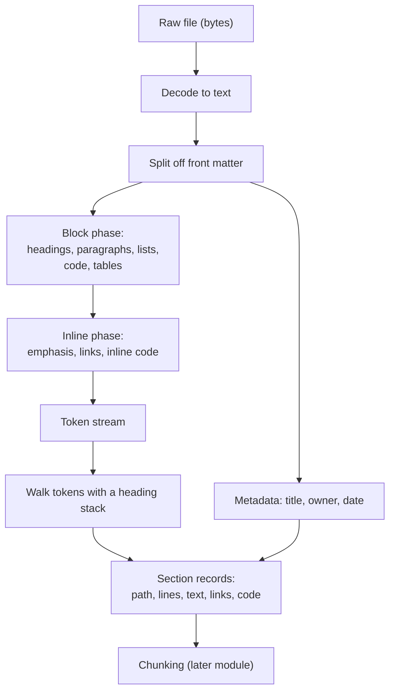

A great deal of the knowledge a RAG system indexes is already written in Markdown: engineering wikis, README files, runbooks kept in Git, documentation sites, and the output of many PDF and HTML converters. Markdown looks like plain text, so it is tempting to treat it as plain text. That throws away the most useful thing about it: the author has already told you where every section starts, which lines are code, and which text is a table.

This lesson teaches you to read Markdown the way a Markdown renderer does, by parsing it into a token stream, and to turn that stream into **section records**: pieces of text that each know their heading trail, their line numbers in the source, and the links and code they contain. You will see why line-by-line regular expressions get Markdown wrong, how the CommonMark specification resolves the ambiguous cases, and how to handle front matter safely. Splitting those sections into chunks is the job of [Markdown chunking](/learn/advanced-chunking-strategies/markdown-chunking), later in the course; this lesson produces the clean, structured input that chunking needs.

## Learning objectives

- Explain the two-phase structure of a CommonMark parse (block structure, then inline content) and why it defeats line-by-line regular expressions.
- Parse a Markdown document with `markdown-it-py` and interpret its token stream: `type`, `tag`, `nesting`, `map`, `info` and `children`.
- Build section records that carry a heading path, source line span, plain text, tables, code blocks and link targets.
- Split YAML front matter from the body and recognise the type-coercion surprises YAML introduces.
- Identify the security risks of rendering or indexing untrusted Markdown and choose parser settings that reduce them.

## Prerequisites

- [Text processing](/learn/data-processing/text-processing): Python strings, splitting and joining lines.
- [Regular expressions](/learn/data-processing/regular-expressions): you will see exactly where they stop being enough.
- [XML and HTML](/learn/data-processing/xml-and-html): Markdown is usually rendered to HTML, and the two trees are closely related.
- [Indexing pipeline](/learn/rag-architecture-fundamentals/indexing-pipeline): where parsing sits between loading and chunking.

## Why this matters

Retrieval quality is decided long before any embedding is computed. A chunk is only as good as the text that went into it, and for Markdown sources three things go wrong regularly when the text is handled naively.

**Structure is lost.** The sentence "The budget is £400." means little on its own. Under the headings *Remote work › Equipment budget* it is a precise answer. If you strip the Markdown to a flat string and split every 500 characters, the heading lands in one chunk and the fact in another, and the retriever cannot connect them. Keeping the heading path with each section is one of the cheapest ways to make chunks self-explanatory.

**Syntax leaks into the text.** Pipes and dashes from tables, `**` from bold text, link URLs, and HTML comments end up in the embedded text. They waste tokens, add noise to lexical matching, and occasionally break things: a long URL can dominate a short chunk.

**Code is mistaken for prose, and prose for code.** A line beginning with `#` inside a fenced shell example is a comment, not a heading. A careless splitter that treats it as a heading starts a new section in the middle of a code block, and both halves become meaningless. Runbooks, the documents engineers most often ask about, are full of exactly these code blocks.

Each of these failures is silent. Nothing crashes; answers just get a little worse, and nobody can say why. Parsing properly removes the whole class of problem.

## The intuition

Think of a printed handbook with a good table of contents. If someone hands you a single page torn out of the middle, you can still tell where it belongs: the running header says "Remote work", the subheading says "Equipment budget", and a boxed example is obviously a boxed example, not part of the paragraph. You read the *layout* as well as the words.

A Markdown file carries the same layout information, encoded in characters: `#` for headings, three backticks for a code box, pipes for a table. A parser is the reader who knows the encoding. It does not look at one line at a time and guess; it reads the whole document, keeps track of whether it is currently inside a code box or a list, and only then decides what each line is.

A tiny example shows why the context matters. Consider these lines:

```text
## Connecting from home

    # check the client version
```

The second non-blank line starts with `#`, but it is indented by four spaces, and in Markdown four spaces of indentation means "this is code". A reader who looks at the line alone sees a heading. A reader who knows the rules sees a code sample. Every Markdown parsing bug in a RAG pipeline is some version of this.

## How it works

### Markdown, CommonMark and flavours

John Gruber published Markdown in 2004 as a short description plus a Perl script. The description left many cases undefined (how much indentation continues a list item? can a heading interrupt a paragraph?), and different implementations answered differently. **CommonMark**, led by John MacFarlane and others, is a precise specification of the core syntax with hundreds of examples that serve as a test suite. **GitHub Flavored Markdown (GFM)** is a strict superset of CommonMark that adds tables, strikethrough, task-list items and automatic links.

Real documents are written in some flavour: GFM on GitHub, a CommonMark variant with extensions on most documentation sites, and occasionally something exotic such as admonition blocks (`!!! note`) or wiki links (`[[Page]]`). Before you parse a corpus, find out which flavour its authors were looking at when they wrote it. If they previewed it on GitHub, a GFM-compatible parser will see what they saw.

### Two phases: blocks, then inlines

The CommonMark specification describes parsing in two phases, and understanding them is the key to everything else.

1. **Block structure.** The parser reads the document line by line and builds a tree of *blocks*: paragraphs, headings, block quotes, lists and list items, fenced and indented code, tables, HTML blocks and thematic breaks. Whether a line starts a new block depends on what is already open. A line `# foo` inside an open fenced code block is just more code; the same line after a blank line is a heading.
2. **Inline content.** Only once the blocks are known does the parser process the text *inside* paragraphs and headings: emphasis, inline code, links, images, autolinks, raw inline HTML and line breaks. Code blocks get no inline processing at all, which is why `*` inside a code block stays a literal asterisk.

A regular expression applied line by line has no memory of which blocks are open. That is why it cannot tell a heading from a shell comment inside a fence, and why it cannot handle setext headings (a line of text underlined with `===` or `---`), which are only recognisable by looking at the *following* line.



### The token stream

`markdown-it-py`, a Python port of the JavaScript `markdown-it` library maintained by the Executable Books project, does not hand you a tree by default. It hands you a flat **token stream**, which is easier to walk. Each token has:

- `type`: what it is, such as `heading_open`, `inline`, `paragraph_close`, `fence`, `table_open`, `link_open`.
- `tag`: the HTML tag it would render as (`h2`, `p`, `code`, `td`). The heading level is in the tag.
- `nesting`: `1` for an opening token, `-1` for a closing one, `0` for a self-contained token such as `fence` or `inline`.
- `map`: `[first_line, last_line_exclusive]` in the source, 0-based, for block-level tokens. This is how you get line numbers for citations.
- `content`: the raw text of an `inline` or code token.
- `info`: for a fenced code block, the text after the opening backticks, usually the language (`bash`, `python`).
- `children`: for an `inline` token, the inline tokens inside it: `text`, `em_open`, `link_open` (with an `href` attribute), `code_inline`, `softbreak` and so on.

For the input `# Hi` followed by a paragraph containing a link, the stream is `heading_open(h1)`, `inline("Hi")`, `heading_close`, `paragraph_open`, `inline(...)` whose children include `link_open`, `text`, `link_close`, and `paragraph_close`. Opening and closing tokens bracket their contents, exactly like HTML tags. If you prefer a nested tree, `markdown_it.tree.SyntaxTreeNode(tokens)` builds one, but for section extraction the flat stream is simpler.

### Presets and extensions

`MarkdownIt()` takes a preset name that decides which rules are switched on:

- `"commonmark"` follows the specification strictly. It does **not** include tables or strikethrough, and it passes raw HTML through (`html=True`).
- `"default"` (also called `"js-default"`) enables tables and strikethrough and disables raw HTML (`html=False`).
- `"zero"` turns almost everything off, leaving paragraphs and text, as a base to enable rules one at a time.
- `"gfm-like"` adds GFM features including automatic linking, which needs the separate `linkify-it-py` package.

You can switch individual rules on and off: `MarkdownIt("commonmark").enable("table")`. Front matter, footnotes, admonitions and similar syntax live in the separate `mdit-py-plugins` package. When a feature is not enabled, its syntax is not an error; it is treated as ordinary text. A GFM table parsed with the bare `commonmark` preset comes back as a paragraph full of pipes, which is a quiet way to put syntax noise into your chunks.

### Front matter

Many Markdown files begin with a block of YAML between two `---` lines:

```text
---
title: Remote work and equipment
owner: HR team
updated: 2025-01-15
---
```

This **front matter** is metadata about the document, not content. It belongs in your document record (title, owner, date, tags, access level), and it should not be embedded as if it were prose. The `python-frontmatter` package splits it off: `frontmatter.loads(text)` returns a `Post` whose `.metadata` is a dictionary and whose `.content` is the remaining body.

YAML is a richer format than it looks, and the parser converts values into Python types. `2025-01-15` becomes a `datetime.date`, `1.10` becomes the float `1.1`, and under YAML 1.1 rules (which PyYAML follows) the bare words `yes`, `no`, `on` and `off` become booleans. The code section shows a country code `NO` turning into `False`. Validate front matter against a schema as soon as you read it; [Data validation](/learn/document-engineering/data-validation) covers how.

### From tokens to section records

The core algorithm walks the token stream once and keeps a **heading stack**: the list of headings that are "open" above the current position.

1. Parse the front matter and remember how many lines it occupied, so that line numbers can be reported relative to the original file.
2. Parse the body into tokens.
3. Start an empty current section with an empty heading path.
4. For each token:
   1. If it is `heading_open` at level $n$, pop every heading of level $n$ or deeper off the stack, push the new heading, close the current section (if it has content) and start a new one whose path is the stack.
   2. If it is an `inline` token in a paragraph, list item or block quote, append its plain text and collect its link targets.
   3. If it is an `inline` token inside a table cell, append it to the current row; on `tr_close`, append the row as one line.
   4. If it is a `fence` or `code_block`, append its content verbatim with a marker that records the language.
   5. Extend the current section's line span using the token's `map`.
5. Close the final section.

The popping rule in step 4.1 is what makes the path correct when a document goes back up a level. Step through it on a five-heading outline:

```trace
{
  "title": "Maintaining a heading stack",
  "code": [
    "headings = [(1, \"Handbook\"), (2, \"Leave\"), (3, \"Carry-over\"), (2, \"Expenses\"), (1, \"IT\")]",
    "trail = []",
    "for level, title in headings:",
    "    while trail and trail[-1][0] >= level:",
    "        trail.pop()",
    "    trail.append((level, title))",
    "    print(\" > \".join(t for _, t in trail))"
  ],
  "steps": [
    {"line": 2, "vars": {"trail": "[]"}, "note": "Nothing is open yet."},
    {"line": 6, "vars": {"level": "1", "title": "Handbook", "trail": "[(1, 'Handbook')]"}, "note": "The stack was empty, so nothing is popped."},
    {"line": 7, "vars": {"trail": "[(1, 'Handbook')]"}, "out": ["Handbook"], "note": "Path of the first section."},
    {"line": 6, "vars": {"level": "2", "title": "Leave", "trail": "[(1, 'Handbook'), (2, 'Leave')]"}, "out": ["Handbook", "Handbook > Leave"], "note": "Level 1 is shallower than 2, so it stays; Leave nests under it."},
    {"line": 6, "vars": {"level": "3", "title": "Carry-over", "trail": "[(1, 'Handbook'), (2, 'Leave'), (3, 'Carry-over')]"}, "out": ["Handbook", "Handbook > Leave", "Handbook > Leave > Carry-over"], "note": "A level-3 heading nests under the level-2 one."},
    {"line": 5, "vars": {"level": "2", "title": "Expenses", "trail": "[(1, 'Handbook'), (2, 'Leave')]"}, "note": "Carry-over (level 3 >= 2) is popped first."},
    {"line": 5, "vars": {"level": "2", "title": "Expenses", "trail": "[(1, 'Handbook')]"}, "note": "Leave (level 2 >= 2) is popped too: a sibling replaces it."},
    {"line": 7, "vars": {"trail": "[(1, 'Handbook'), (2, 'Expenses')]"}, "out": ["Handbook", "Handbook > Leave", "Handbook > Leave > Carry-over", "Handbook > Expenses"], "note": "Expenses is a sibling of Leave, not a child of Carry-over."},
    {"line": 7, "vars": {"level": "1", "title": "IT", "trail": "[(1, 'IT')]"}, "out": ["Handbook", "Handbook > Leave", "Handbook > Leave > Carry-over", "Handbook > Expenses", "IT"], "note": "A new level-1 heading empties the stack and starts a new top-level branch."}
  ]
}
```

The same rule handles skipped levels gracefully. If an author jumps from `#` straight to `###`, the level-3 heading simply nests under the level-1 one, and a later `##` pops it.

### What to keep, what to drop

Turning tokens into plain text forces small decisions, and they are worth making deliberately:

- **Emphasis markers** (`**`, `_`) carry almost no retrievable meaning. Drop them and keep the text.
- **Link text** stays in the prose. **Link targets** (URLs) go into a separate list on the section, where they are useful for metadata, for following internal links, and for checking which documents reference which, without polluting the embedded text.
- **Images** keep their alt text, which is often the only description of what the image shows.
- **Inline code** keeps its content (`meridian-vpn`), because users search for exact command names.
- **Code blocks** stay verbatim, newlines and all, tagged with their language. Whether to embed them with the prose, embed them separately or not embed them at all is a chunking decision; the parser's job is to preserve them intact.
- **Tables** become one line per row with cells joined by a separator. A row such as `Monitor | £150` survives as a readable unit; [Table chunking](/learn/advanced-chunking-strategies/table-chunking) discusses richer representations such as repeating the header with each row.
- **Raw HTML** blocks and comments are usually dropped, after deciding whether they hide anything you need (some wikis put content inside collapsible HTML `details` elements).

## In code

**The problem.** Turn one Meridian handbook page, with front matter, a link, a table and a fenced shell example containing a `#` comment, into section records with heading paths and source line spans. Then show what a line-by-line regular expression would have made of the same file.

**Dependencies.** `markdown-it-py` for parsing and `python-frontmatter` (which brings PyYAML) for front matter. No API key or model.

```bash
pip install markdown-it-py python-frontmatter
```

```python
import re
from dataclasses import dataclass, field

import frontmatter
from markdown_it import MarkdownIt

SOURCE = """---
title: Remote work and equipment
owner: HR team
updated: 2025-01-15
---
# Remote work

Staff may work remotely **up to 3 days a week**. See the [leave policy](leave.md)
for days away from work.

## Equipment budget

The home-office equipment budget is £400. Contractors are not eligible.

| Item | Typical cost |
| --- | --- |
| Monitor | £150 |
| Chair | £200 |

## Connecting from home

Use the VPN on any public Wi-Fi. To check the client version:

~~~bash
# This line is a shell comment, not a heading
meridian-vpn --version
~~~
"""

@dataclass
class Section:
    path: list[str]                       # heading trail, e.g. ["Remote work", "Equipment budget"]
    lines: tuple[int, int]                # first and last source line (0-based, end exclusive)
    blocks: list[str] = field(default_factory=list)
    links: list[str] = field(default_factory=list)

    @property
    def text(self) -> str:
        return "\n".join(self.blocks)


def inline_text(token) -> tuple[str, list[str]]:
    """Plain text of an inline token, plus the targets of any links inside it."""
    parts, links = [], []
    for child in token.children or []:
        if child.type in ("text", "code_inline"):
            parts.append(child.content)
        elif child.type in ("softbreak", "hardbreak"):
            parts.append(" ")
        elif child.type == "link_open":
            links.append(child.attrGet("href"))
        elif child.type == "image":
            parts.append(child.content)     # alt text
    return "".join(parts), links


def parse_sections(source: str) -> tuple[dict, list[Section]]:
    post = frontmatter.loads(source)                  # splits YAML front matter from the body
    offset = source.count("\n", 0, source.index(post.content)) if post.metadata else 0
    md = MarkdownIt("commonmark").enable("table")
    tokens = md.parse(post.content)

    sections: list[Section] = []
    trail: list[tuple[int, str]] = []                 # stack of (level, heading text)
    current = Section(path=[], lines=(0, 0))
    row: list[str] = []
    i = 0
    while i < len(tokens):
        tok = tokens[i]
        if tok.type == "heading_open":
            level = int(tok.tag[1])                    # "h2" -> 2
            title, _ = inline_text(tokens[i + 1])
            while trail and trail[-1][0] >= level:     # close deeper or equal headings
                trail.pop()
            trail.append((level, title))
            if current.blocks:
                sections.append(current)
            start = tok.map[0] + offset
            current = Section(path=[t for _, t in trail], lines=(start, start + 1))
            i += 3                                     # skip inline and heading_close
            continue
        if tok.type == "inline" and tokens[i - 1].type in ("th_open", "td_open"):
            cell, _ = inline_text(tok)
            row.append(cell)
        elif tok.type == "tr_close":
            current.blocks.append(" | ".join(row))
            row = []
        elif tok.type == "inline":
            text, links = inline_text(tok)
            current.blocks.append(text)
            current.links.extend(links)
        elif tok.type in ("fence", "code_block"):
            current.blocks.append(f"[code:{tok.info or 'text'}]\n{tok.content.rstrip()}")
        if tok.map:
            current.lines = (current.lines[0], tok.map[1] + offset)
        i += 1
    if current.blocks:
        sections.append(current)
    return post.metadata, sections


meta, sections = parse_sections(SOURCE)
print("metadata:", meta)
for s in sections:
    print("\n" + " > ".join(s.path), f"(lines {s.lines[0]}-{s.lines[1]})")
    for block in s.blocks:
        print("   ", block.replace("\n", "\n    "))
    if s.links:
        print("    links:", s.links)

naive = [line for line in SOURCE.splitlines() if re.match(r"#{1,6} ", line)]
print("\nnaive regex headings:", naive)
```

The sample document fences its shell example with `~~~` rather than backticks. CommonMark accepts either three backticks or three tildes as a code fence, and the parser treats them identically; tildes are used here only so that the example can sit inside this page's own code block.

```output
metadata: {'title': 'Remote work and equipment', 'owner': 'HR team', 'updated': datetime.date(2025, 1, 15)}

Remote work (lines 5-9)
    Staff may work remotely up to 3 days a week. See the leave policy for days away from work.
    links: ['leave.md']

Remote work > Equipment budget (lines 10-18)
    The home-office equipment budget is £400. Contractors are not eligible.
    Item | Typical cost
    Monitor | £150
    Chair | £200

Remote work > Connecting from home (lines 19-27)
    Use the VPN on any public Wi-Fi. To check the client version:
    [code:bash]
    # This line is a shell comment, not a heading
    meridian-vpn --version

naive regex headings: ['# Remote work', '## Equipment budget', '## Connecting from home', '# This line is a shell comment, not a heading']
```

**The important lines.**

- `frontmatter.loads(source)` separates the YAML block from the body. `offset` counts the lines the front matter used, so that the line spans refer to the original file, which is what an editor or a citation link needs.
- `MarkdownIt("commonmark").enable("table")` is strict CommonMark plus GFM tables. Without `.enable("table")`, the table would come back as a paragraph of pipes.
- `int(tok.tag[1])` reads the heading level from the tag (`h2` gives 2). This works for both `#`-style and underlined (setext) headings, because the parser has already normalised them.
- The `while trail and trail[-1][0] >= level` loop is the heading stack from the trace above.
- `inline_text` walks an inline token's `children`, keeping `text` and `code_inline` content, turning soft line breaks into spaces, and diverting `link_open` targets into a separate list. The `**` markers never appear because emphasis arrives as separate `strong_open` and `strong_close` tokens, which the function ignores.
- `tokens[i - 1].type in ("th_open", "td_open")` identifies inline tokens that are table cells, so they can be joined into rows rather than emitted as separate lines.
- `tok.map[1] + offset` stretches the section's span to cover each block it contains.

**What the output means.**

- The front matter became typed metadata: `updated` is a `datetime.date`, not a string. Store it as metadata; do not embed it.
- Each section knows where it sits in the document (`Remote work > Equipment budget`) and where it came from (lines 10 to 18). Prefixing a chunk with its path, or storing the path as metadata, lets a question about "the equipment budget for remote staff" match a section whose body never uses the word "remote".
- The table survived as three readable lines, and the bold markers and the link URL are gone from the prose, with the URL kept in `links`.
- The shell comment is inside the `bash` code block, where it belongs. The naive regular expression reported it as a fourth heading. Splitting on that "heading" would have cut the code example in half.

**Errors people commonly hit.**

- `ModuleNotFoundError: Linkify enabled but not installed.` You chose the `gfm-like` preset, which needs `linkify-it-py`. Install it, or use `commonmark` with the rules you need.
- Tables or strikethrough appearing as raw text. The preset does not include them; `.enable(["table", "strikethrough"])` adds them.
- `tok.map` is `None`. Closing tokens and inline children have no map; only block-level opening and self-contained tokens do.
- Front matter not detected. `python-frontmatter` looks for the opening `---` at the start of the text. A byte order mark (an invisible U+FEFF character some editors write at the start of a file) in front of it means `metadata` comes back empty and the YAML is treated as body text, where the closing `---` may then be read as a setext underline. Decode files with the `utf-8-sig` codec, which removes the mark; [Encoding and Unicode](/learn/data-processing/encoding-and-unicode) explains why.

**Extending it.** Add `list_item_open` handling so that each bullet becomes its own block with a leading "- ", which keeps list items separable for chunking. Resolve relative link targets such as `leave.md` against the document's own path with `urllib.parse.urljoin`, so that links point at document identifiers in your index. Record `tok.info` languages in metadata so code-heavy sections can be routed to a [code chunker](/learn/advanced-chunking-strategies/code-chunking).

### YAML front matter surprises

The second example is short, and its output is worth remembering:

```python
import frontmatter

post = frontmatter.loads("""---
region: NO
version: 1.10
updated: 2025-01-15
reviewed: yes
---
body""")
print(post.metadata)
```

```output
{'region': False, 'version': 1.1, 'updated': datetime.date(2025, 1, 15), 'reviewed': True}
```

The country code for Norway became `False`, version `1.10` became the float `1.1` (now indistinguishable from version `1.1`), and `yes` became `True`. None of these raised an error. The fix is to quote values that must stay strings (`region: "NO"`, `version: "1.10"`) and to validate metadata against a schema that rejects the wrong type, so that the problem surfaces at ingestion rather than as a filter that silently matches nothing.

## A real-world example

Meridian's IT runbooks live in a Git repository as Markdown, one file per runbook, with front matter giving an owner and a runbook number. The first version of AskMeridian's ingestion read each file as plain text and split it every 800 characters.

Tom, an engineer on the Platform team, investigated a complaint: asked "how do I reset the VPN client on a Mac?", the assistant answered with half a shell script and no explanation. The retrieved chunk began in the middle of a fenced code block. The 800-character split had cut the runbook between the prose that explained the steps and the commands, and the chunk containing the commands carried no heading, so nothing in it said "Mac" or "VPN reset" except the commands themselves.

He also found a second, stranger fault: one runbook's sections were indexed under the wrong headings. A teammate's attempt at a quick fix had been to split on lines matching `^#`, and that runbook's code block contained `# Run as administrator`. Everything after that comment was filed under a heading called "Run as administrator".

The rewrite parsed each file into tokens, built section records with heading paths, kept every code block whole, and moved the front matter into metadata. Chunks were built from sections (never across a section boundary) and prefixed with the runbook title and heading path. The runbook number from the front matter became a filterable field, which also fixed a separate complaint about questions that quoted the number directly. No retrieval setting changed; the improvement came entirely from reading the documents correctly.

## Common mistakes

- **Splitting Markdown with line-by-line regular expressions.** Shell comments in code blocks become headings, setext headings are missed, and sections are cut in the wrong places.
- **Using a parser whose flavour does not match the authors'.** Tables parsed by a strict CommonMark parser without the table rule become paragraphs of pipes and dashes, which then get embedded.
- **Embedding the front matter as text.** YAML keys and dates pollute the first chunk of every document and are lost as filterable metadata.
- **Trusting YAML types.** `NO`, `yes`, `1.10` and unquoted dates change type silently, so filters and version comparisons stop matching.
- **Dropping code blocks to "clean" the text.** For runbooks and technical documentation, commands and configuration are often exactly what users ask about.
- **Throwing away source line numbers.** Without them you cannot link a citation back to the place in the file, and debugging a bad chunk means searching by hand.
- **Rendering to HTML and then scraping the HTML.** It works, but it adds a lossy step and a second parser; the token stream already has everything you need.

## Best practices

- Find out which Markdown flavour the corpus was written for and configure the parser to match it; test with a few real documents that contain tables, nested lists and code.
- Parse once into a neutral section record (path, line span, text blocks, code blocks, links, metadata) and let every later stage work from that record.
- Keep the heading path with each section, both as metadata and, usually, as a prefix of the text that is embedded.
- Validate front matter against a schema immediately after parsing, and quote string values in templates authors copy from.
- Keep a small regression suite of awkward Markdown files (code fences containing `#`, setext headings, tables, HTML blocks, front matter with a byte order mark) and run it whenever the parser or its configuration changes.
- Record the parser name, version and preset in each document's ingestion metadata, so a later change of parser can be traced when chunks change.

## Performance considerations

Markdown parsing is rarely the bottleneck in an ingestion pipeline. The parser makes a small, fixed number of passes over the text, so its cost grows roughly linearly with document length, and a pure-Python parser handles typical documentation files (a few kilobytes to a few hundred kilobytes) in milliseconds. A rough budget: if a corpus of 20,000 files averaging 10 KB takes 5 ms per file to parse, the whole corpus takes $20{,}000 \times 5 = 100{,}000$ ms, under two minutes on one core. Compare that with the embedding step, which needs a model inference per chunk, and parsing is noise. Measure on your own corpus before optimising; the figure of 5 ms is an assumption for the arithmetic, not a benchmark.

Two practical points matter more than raw speed:

- **Re-parse only what changed.** Store a hash of each file's bytes with its records and skip files whose hash has not changed. The [Duplicate detection](/learn/data-processing/duplicate-detection) lesson shows how to compute such hashes.
- **Watch pathological inputs.** Very deeply nested lists or block quotes, or files that are megabytes of a single table, are slow in any parser and produce useless chunks. Set a size limit and log files that exceed it rather than letting one file stall a batch.

The token list for a document is several times larger in memory than the text itself, because each token is a Python object. Process files one at a time and discard tokens once the section records are built.

## Security considerations

Markdown in a RAG corpus is untrusted input, even when it comes from an internal wiki, because anyone with edit rights can change it.

- **Raw HTML passes through the `commonmark` preset.** If you ever render indexed Markdown (or retrieved snippets) as HTML in a web interface, a `<script>` tag or an `onerror` attribute in a document becomes a cross-site scripting vector. Use a preset with `html=False` (`"default"` or `"zero"`) for rendering, or sanitise the HTML output with an allow-list sanitiser.
- **Links can carry `javascript:` URLs.** `markdown-it-py` validates link targets and refuses some dangerous schemes by default, but do not rely on the parser alone when you display links to users; check schemes against an allow-list.
- **Hidden text is still text.** HTML comments, collapsed HTML `details` blocks and white-on-white HTML are invisible when rendered but present in the source. If your pipeline indexes them, they can carry instructions aimed at the model. This is a form of [indirect prompt injection](/learn/rag-security-fundamentals/indirect-prompt-injection); decide explicitly whether hidden content is indexed.
- **YAML loading must be safe.** `python-frontmatter` uses PyYAML's `SafeLoader` by default, which does not construct arbitrary Python objects. Never replace it with the full loader for documents you did not write.
- **Front matter may declare access levels.** If a field such as `visibility: internal` controls who may retrieve a document, validate it strictly and fail closed when it is missing or malformed.

## Summary

- Markdown carries structure (headings, code, tables, links) that a RAG pipeline should keep, not flatten.
- CommonMark parses in two phases, blocks then inlines, and whether a line is a heading depends on what is open around it; line-by-line regular expressions cannot reproduce that.
- `markdown-it-py` produces a token stream with types, tags, nesting, source line maps and inline children, and its preset decides which syntax (tables, raw HTML) is recognised.
- A single pass with a heading stack turns tokens into section records with heading paths, line spans, plain text, verbatim code and link targets.
- Front matter is metadata: split it off, validate its types, and be wary of YAML's silent conversions.
- Treat Markdown as untrusted: disable raw HTML when rendering, check link schemes, and decide whether hidden content is indexed.

## Exercises

**1.** Without running code, list the headings (level and text) that a CommonMark parser finds in the document below, and explain each line that is *not* a heading.

```text
Expenses
========

#Receipts are needed over £75

    # also not a heading: indented code

Receipts
--------
```

<details><summary>Show solution</summary>

Two headings: level 1 "Expenses" (a setext heading, underlined with `=`) and level 2 "Receipts" (setext, underlined with `-`).

- `#Receipts are needed over £75` is a paragraph. An ATX heading needs a space (or the end of the line) after the `#` characters.
- `    # also not a heading: indented code` is indented by four spaces after a blank line, which makes it an indented code block.

A regular expression such as `^#{1,6} ` would find neither real heading (they use underlines) and, with a looser pattern such as `^#`, would also report the paragraph as a heading.

</details>

**2.** Write `outline(source)` that returns `(level, title, line)` for every real heading in a Markdown string, with 1-based line numbers, using `markdown-it-py`. Test it on a document that includes a setext heading, a `#` without a space, a fenced code block (written with `~~~`) containing `# not a heading`, and an indented code line starting with `#`.

<details><summary>Show solution</summary>

```python
from markdown_it import MarkdownIt

def outline(source: str) -> list[tuple[int, str, int]]:
    """(level, title, 1-based line) for every real heading in the document."""
    tokens = MarkdownIt("commonmark").parse(source)
    result = []
    for i, tok in enumerate(tokens):
        if tok.type == "heading_open":
            result.append((int(tok.tag[1]), tokens[i + 1].content, tok.map[0] + 1))
    return result

doc = """Expenses
========

Submit claims within 30 days.

#Receipts are needed over £75

~~~text
# not a heading
~~~

    # also not a heading: indented code

Receipts
--------
"""
for item in outline(doc):
    print(item)
```

```output
(1, 'Expenses', 1)
(2, 'Receipts', 14)
```

The token immediately after `heading_open` is always the heading's `inline` token, so `tokens[i + 1].content` is the heading text. For a setext heading, `map[0]` points at the text line, not the underline. Using `.content` keeps any inline markup (such as `**`); use the `inline_text` helper from the lesson if you need plain text.

</details>

**3.** AskMeridian indexes section records whose text is embedded on its own. A user asks "what's the equipment allowance for home working?", and the right section's body reads only "The home-office equipment budget is £400. Contractors are not eligible." Propose two ways to use the heading path to improve the chance this section is retrieved, and give one drawback of each.

<details><summary>Show solution</summary>

**Prefix the path to the embedded text**, for example "Remote work > Equipment budget: The home-office equipment budget is £400. ..." The embedding now reflects the section's topic as well as its sentence, and lexical search can match "remote" or "equipment". Drawback: the prefix repeats in every section of the document, taking tokens from each chunk and making sibling sections more similar to each other, which can blur ranking between them.

**Store the path as metadata and use it at query time**, for instance as a separate field in a lexical index that is searched alongside the body, or as a filter when the query names a topic. Drawback: it needs extra machinery (a second field, a fusion step or a router), and it does nothing for a pure embedding search unless the path also reaches the embedded text.

Many systems do both: a short path prefix in the embedded text and the full path in metadata for display and citations.

</details>

**4.** Design decision. Meridian's product documentation site is written in a Markdown flavour with admonition blocks (`!!! warning` followed by an indented paragraph) and a custom include syntax (``) that pulls in shared text. Explain what a plain CommonMark parser will do with each, and how you would handle them in ingestion.

<details><summary>Show solution</summary>

**Admonitions.** CommonMark does not know `!!! warning`. The marker line becomes a paragraph, and the indented paragraph after it, preceded by a blank line, becomes an indented code block. The warning text would be stored as code and probably routed or weighted wrongly. Options: enable an admonition plugin from `mdit-py-plugins` that matches the site's syntax, or pre-process the files to convert admonitions into block quotes before parsing. Whichever you choose, test it against real pages, since admonition syntaxes differ between tools.

**Includes.** The include directive is just text to a Markdown parser, so the included content (here, presumably SAML single sign-on details) would be missing from the indexed page while the directive itself is indexed. The right fix is to resolve includes the way the site generator does, before parsing, so that the indexed text matches what readers see. Keep a record of which snippets each page includes, so that a change to a snippet triggers re-ingestion of every page that uses it.

The general principle: parse what the readers saw, not what the source file literally contains. When the source has a build step, either reproduce it or ingest the build output.

</details>

## Check your understanding

```quiz
[
  {
    "q": "Why does a line-by-line regular expression such as `^#` misidentify headings in Markdown?",
    "options": [
      "Regular expressions cannot match the # character",
      "Whether a line is a heading depends on the blocks already open, such as a fenced code block",
      "Markdown headings must always be underlined with = signs",
      "Python's re module does not support multi-line strings"
    ],
    "answer": 1,
    "why": "CommonMark's block phase decides what each line is in context. Inside a fence, `# foo` is code; a regex looking at one line at a time cannot know that."
  },
  {
    "q": "You parse a GFM table with `MarkdownIt(\"commonmark\")` and no extra rules. What do you get?",
    "options": [
      "A ValueError, because tables are not CommonMark",
      "table_open, tr_open and td_open tokens as usual",
      "An empty token list",
      "A paragraph whose inline content contains the pipes and dashes"
    ],
    "answer": 3,
    "why": "Unrecognised syntax is not an error in Markdown; it is ordinary text. The table rule must be enabled for tables to be parsed."
  },
  {
    "q": "What does a token's `map` attribute hold?",
    "options": [
      "The first and last (exclusive) source lines of a block-level token, 0-based",
      "A dictionary of the token's HTML attributes",
      "The heading path of the section containing the token",
      "The byte offsets of the token in the UTF-8 encoded file"
    ],
    "answer": 0,
    "why": "`map` is [start_line, end_line) for block tokens, which is what lets you cite or highlight the source lines."
  },
  {
    "q": "The heading stack is [(1, 'Handbook'), (2, 'Leave'), (3, 'Carry-over')]. A level-2 heading 'Expenses' arrives. What is the stack afterwards?",
    "options": [
      "[(1, 'Handbook'), (2, 'Leave'), (3, 'Carry-over'), (2, 'Expenses')]",
      "[(2, 'Expenses')]",
      "[(1, 'Handbook'), (2, 'Expenses')]",
      "[(1, 'Handbook'), (2, 'Leave'), (2, 'Expenses')]"
    ],
    "answer": 2,
    "why": "Every heading of level 2 or deeper is popped (Carry-over and Leave), then Expenses is pushed under Handbook."
  },
  {
    "q": "A front matter field reads `region: NO` and is loaded with PyYAML. What value does your code receive?",
    "options": [
      "The string 'NO'",
      "The boolean False",
      "None",
      "A YAML parse error"
    ],
    "answer": 1,
    "why": "PyYAML follows YAML 1.1, where yes/no/on/off are booleans. Quote values that must remain strings and validate metadata types."
  }
]
```

## Further reading

- John MacFarlane et al., *CommonMark Spec*, at [spec.commonmark.org](https://spec.commonmark.org/), including the appendix "A parsing strategy" that describes the block and inline phases.
- GitHub, *GitHub Flavored Markdown Spec*, at [github.github.com/gfm](https://github.github.com/gfm/), for tables, strikethrough, task lists and autolinks.
- `markdown-it-py` documentation, at [markdown-it-py.readthedocs.io](https://markdown-it-py.readthedocs.io/), especially the pages on the token stream and on using and configuring presets.
- `python-frontmatter` documentation, at [python-frontmatter.readthedocs.io](https://python-frontmatter.readthedocs.io/).
- John Gruber (2004), *Markdown: Syntax*, at [daringfireball.net/projects/markdown/syntax](https://daringfireball.net/projects/markdown/syntax), the original description.
