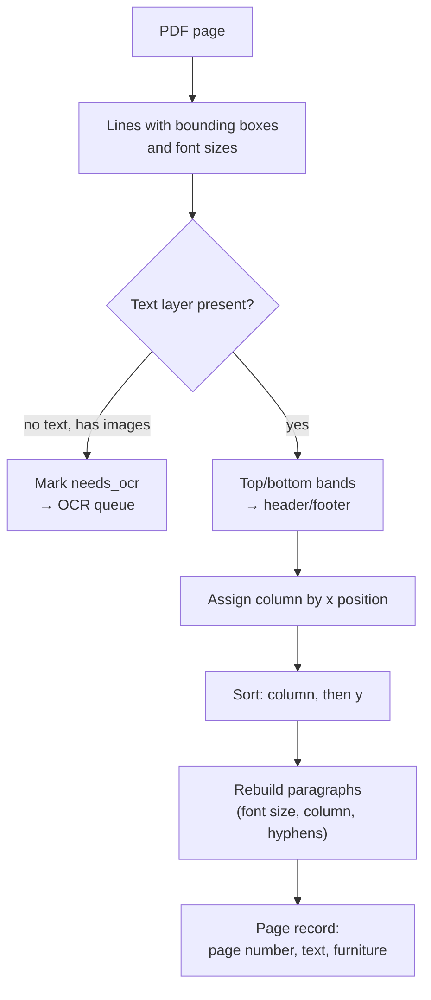

PDF is the format in which most organisations' important documents end up: policies, contracts, manuals, reports, scanned forms. It is also the hardest common format to get text out of, because a PDF does not contain text in the sense that HTML or Word does. It contains instructions for painting glyphs at positions on a page. Paragraphs, columns, reading order, even the spaces between words are things an extractor has to *infer* from geometry, and sometimes there is no text at all, only a picture of a page.

This lesson explains what is really inside a PDF, why extraction goes wrong in the specific ways it does, and how to build a first extractor that keeps page numbers, separates running headers and footers from content, puts two-column pages back in reading order, and recognises pages that need OCR. It uses pypdf and PyMuPDF at an introductory level; the [Advanced Document Parsing](/learn/advanced-document-parsing) module gives each library its own lesson and covers OCR and layout-aware parsing in depth.

## Learning objectives

- Explain how a PDF page represents text (fonts, glyphs, positions, content streams) and why extracted text can be out of order, missing spaces or garbled.
- Extract text page by page with pypdf and PyMuPDF and compare their output on the same document.
- Use line positions to remove running headers and footers and to reconstruct reading order on multi-column pages.
- Detect pages with no usable text layer and route them to OCR rather than indexing them as empty.
- Keep page-level provenance so that every chunk can cite the page it came from.

## Prerequisites

- [Text processing](/learn/data-processing/text-processing): whitespace normalisation and offset bookkeeping.
- [Regular expressions](/learn/data-processing/regular-expressions): pattern-based removal of headers and hyphenation.
- [Indexing pipeline](/learn/rag-architecture-fundamentals/indexing-pipeline): the parse stage this lesson implements for PDF.

## Why this matters

PDF extraction errors damage a RAG system in ways that are hard to see from the outside, because the output still *looks* like text.

- **Interleaved columns.** On a two-column page, an extractor that reads straight across produces lines like "Expenses must be submitted Passwords must be rotated". Each sentence is now split across two unrelated chunks, and neither chunk answers either question.
- **Repeated furniture.** "Meridian Employee Handbook ... Page 7 of 40" appears on every page. Left in, it is embedded into every chunk, making them more alike, and it breaks sentences that continue across a page boundary.
- **Empty pages that are not empty.** A scanned page has no text layer. The extractor returns an empty string without complaint, the pipeline indexes nothing, and questions about that page are answered "I don't know" forever, or, worse, answered from an older document that *was* extractable.
- **Lost page numbers.** Users and auditors want "see page 12 of the policy". If pages are concatenated before chunking without recording where each began, that citation is impossible.

Each of these is cheap to detect and handle at extraction time, and expensive to diagnose once it has degraded answers.

## The intuition

Imagine receiving a poster not as a file but as a list of instructions to a sign painter: "Using Helvetica at 11 points, paint 'Expenses must be submitted' with its baseline 125 points from the top, 50 from the left. Now paint 'Passwords must be rotated' at 310 from the left on the same line. Now move down 14 points..." The painter does not know or care that these belong to two columns, or that the second line continues the first sentence. Nothing in the instructions says "paragraph" or "column".

To recover the text you must stand back and look at where everything was painted: these lines line up on the left at 50, those at 310, so there are two columns; this line is small and at the very top of every page, so it is a running header; this one is large, so it is a heading. PDF text extraction is exactly this act of reverse-engineering a layout from painting instructions. And if the poster was photographed rather than painted from instructions, there are no instructions at all, only pixels, and you need someone to read the photograph: that is OCR.

## How it works

### What is inside a PDF

A PDF file (the format is standardised as ISO 32000) is a collection of numbered **objects**: dictionaries, arrays, numbers, strings and compressed **streams**. A cross-reference table lets a reader find each object by number without scanning the file. The objects form a tree: a catalogue points to a page tree, each page points to its resources (fonts, images) and to one or more **content streams**.

A content stream is a sequence of drawing operators. Text appears between `BT` (begin text) and `ET` (end text) operators. Inside, `Tf` selects a font and size, `Td` or `Tm` sets a position, and `Tj` or `TJ` paint a string of glyph codes. Schematically:

```text
BT
/F1 11 Tf                 % font F1 at 11 points
50 717 Td                 % move to x=50, y=717 (measured up from the bottom)
(Expenses must be submitted) Tj
260 0 Td                  % move 260 points right
(Passwords must be rotated) Tj
ET
```

This is pseudocode in the spirit of real PDF syntax, simplified for reading. Four consequences follow.

1. **Order is whatever the producer chose.** The operators can paint lines in any order: across columns, footer first, headings last. Extractors that follow the content stream inherit that order.
2. **Strings are glyph codes, not characters.** The bytes in `(...)` index into the font. To get Unicode text, the extractor needs the font's encoding or a **ToUnicode map**. If a producer embedded a subset font without one, extraction yields garbage or nothing, even though the page looks perfect.
3. **Spaces may not exist.** Many producers do not paint space characters; they simply move the next word to the right. The extractor must decide from the size of a horizontal gap whether it was a space. Too strict and words merge (`unuseddays`); too lax and words split (`Ann ual`).
4. **Structure is optional.** A **tagged PDF** carries a structure tree (headings, paragraphs, tables, reading order) for accessibility. Many PDFs, especially older ones and those printed to PDF, have none. Most extractors do not rely on tags even when present.

Other things you will meet: **ligatures** (a single glyph for "fi" or "fl" that may extract as the Unicode ligature character `fi`, so "file" fails to match "file" until normalised, as [Encoding and Unicode](/learn/data-processing/encoding-and-unicode) explains); **hyphenation** at line ends; **text in images**; **annotations and form fields** whose text lives outside the content stream; and **encryption**, which may prevent opening without a password or, with an owner password, restrict operations such as copying.

### Text layers and scans

A **born-digital** PDF, produced by software from a text source, has a text layer: the painting instructions above. A **scanned** PDF contains a photograph of each page as an image and no text operators at all. Some scanned PDFs have had OCR applied already and carry an invisible text layer under the image; its quality depends on the OCR. A practical extractor must classify each page:

| Page type | Extracted text | Has images | Action |
| --- | --- | --- | --- |
| Born-digital | Plenty | Maybe | Extract |
| Scan, no OCR | Empty or near-empty | Yes, page-sized | Send to OCR |
| Scan with OCR layer | Present, maybe noisy | Yes | Extract, check quality |
| Genuinely blank or a pure diagram | Empty | Maybe | Skip, or describe the diagram |

The check is per page, not per document: many PDFs mix born-digital pages with scanned appendices or signed pages. [OCR](/learn/advanced-document-parsing/ocr) and [Scanned documents](/learn/advanced-document-parsing/scanned-documents) handle the second and third rows properly.

### Coordinates

PDF positions are measured in **points**, $1/72$ of an inch. An A4 page is about 595 by 842 points; US Letter is 612 by 792. PDF's own coordinate system puts the origin at the bottom-left corner with $y$ increasing upwards; PyMuPDF converts everything to a top-left origin with $y$ increasing downwards, which matches how people read a page. Every line or word an extractor reports comes with a **bounding box** `(x0, y0, x1, y1)`, the smallest rectangle containing it, and that box is the raw material of all layout reasoning.

### Two libraries

- **pypdf** is a pure-Python library (BSD licence) for reading, splitting, merging and extracting text from PDFs. `PdfReader(path).pages[i].extract_text()` returns a page's text in content-stream order with line breaks inferred from position. It installs anywhere and is ideal for born-digital documents with simple layouts. It also has an `extraction_mode="layout"` option that tries to reproduce the visual layout with spaces.
- **PyMuPDF** (imported as `pymupdf`; older code uses `fitz`) wraps the MuPDF C library. It is fast, exposes positions at the level of blocks, lines, spans and characters through `page.get_text("dict")`, can render pages to images (needed for OCR), and can report a page's images. It is dual-licensed under the AGPL and a commercial licence from Artifex, which matters if you distribute software built on it; check the terms for your situation.

Neither library reconstructs reading order for complex layouts on its own. PyMuPDF's `get_text(sort=True)` sorts by vertical then horizontal position, which helps single-column pages with out-of-order content streams and reads straight across columns on multi-column pages.

### A layout-aware extraction procedure

For each page:

1. **Get lines with positions**: text, bounding box and font size for each line.
2. **Classify the page**: if there is almost no text and the page has images, mark it `needs_ocr` and stop.
3. **Separate furniture**: lines entirely within a top or bottom band (a margin in points) are candidate headers and footers. Confirm across pages: a line that repeats on most pages, once its digits are masked, is furniture.
4. **Assign columns**: a line that starts left of the page centre belongs to the left column, one that starts right of it to the right column, and one that straddles the centre spans the page (a title, a full-width paragraph).
5. **Order lines**: by column, then by vertical position.
6. **Rebuild paragraphs**: start a new paragraph when the column or font size changes (or, in a fuller version, when the vertical gap exceeds the usual line spacing); otherwise join the line to the previous one with a space, or without one if the previous line ended in a hyphen.
7. **Record provenance**: the page number, and the furniture removed, alongside the text.



This procedure is a heuristic for the common cases: one or two columns, a running header and footer, headings in a larger font. Three-column layouts, sidebars, figures with captions, footnotes and tables need more; that is the job of [Layout-aware parsing](/learn/advanced-document-parsing/layout-aware-parsing), which uses trained layout models rather than hand-set thresholds.

## The mathematics

### From points to pixels

**Intuition.** Rendering a page for OCR turns points into pixels. Resolution is given in **dots per inch** (dpi), and a point is a fixed fraction of an inch, so the conversion is a ratio. Getting it right matters because OCR accuracy and memory cost both depend on it.

$$
\text{pixels} = \text{points} \times \frac{\text{dpi}}{72}
$$

*points* is a length on the page in PDF units, *dpi* the rendering resolution, and 72 the number of points per inch.

**By hand.** An A4 page is 595 × 842 points. At 300 dpi, the width is $595 \times 300 / 72 = 2{,}479.2$ pixels and the height $842 \times 300 / 72 = 3{,}508.3$ pixels, about $8.7$ million pixels. As 8-bit RGB that is about $8.7 \times 10^6 \times 3 \approx 26$ MB per page in memory, before any OCR model touches it. At 100 dpi it is about 1 megapixel, but small print becomes unreadable to OCR; 300 dpi is the common recommendation for OCR input.

**Flipping the y axis.** PyMuPDF reports $y$ from the top; PDF's own coordinates measure from the bottom. For a page of height $H$, $y_\text{PDF} = H - y_\text{top-down}$. A baseline 90 points from the top of an A4 page is at $842 - 90 = 752$ in PDF coordinates. You need this whenever you mix PyMuPDF positions with raw PDF operators or other tools.

**In Python**, using the sample PDF built in the next section:

```python
import pymupdf

width_pt, height_pt = 595, 842          # A4 page in points (1 pt = 1/72 inch)
for dpi in (72, 100, 300):
    w_px = width_pt * dpi / 72
    h_px = height_pt * dpi / 72
    print(f"{dpi:>3} dpi: {w_px:7.1f} x {h_px:7.1f} px  ~ {w_px * h_px / 1e6:4.1f} megapixels")

page = pymupdf.open("handbook.pdf")[0]
pix = page.get_pixmap(dpi=300)
print("PyMuPDF at 300 dpi:", pix.width, "x", pix.height)

# PyMuPDF measures y downwards from the top; PDF's own coordinates measure y upwards from the bottom.
y_top_down = 90
print("baseline at y =", y_top_down, "from the top is y =", height_pt - y_top_down, "in PDF coordinates")
```

```output
 72 dpi:   595.0 x   842.0 px  ~  0.5 megapixels
100 dpi:   826.4 x  1169.4 px  ~  1.0 megapixels
300 dpi:  2479.2 x  3508.3 px  ~  8.7 megapixels
PyMuPDF at 300 dpi: 2480 x 3509
baseline at y = 90 from the top is y = 752 in PDF coordinates
```

PyMuPDF rounded the fractional pixel counts up to whole pixels, 2,480 by 3,509, matching the hand calculation.

## In code

### A test document with known problems

**The problem.** To see extraction failures clearly you need a PDF whose correct text you know. The script below builds a three-page extract of the Meridian handbook: page 1 is a well-behaved two-column page; page 2 has the same layout but its producer painted the footer first and wrote the two columns line by line *across* the page, which is legal PDF and common in practice; page 3 is a "scan", an image of text with no text layer.

**Dependencies.**

```bash
pip install pymupdf pypdf
```

```python
import pymupdf  # pip install pymupdf

doc = pymupdf.open()

def furniture(page, page_no):
    page.insert_text((50, 40), "Meridian Employee Handbook", fontsize=9)
    page.insert_text((280, 815), f"Page {page_no} of 3", fontsize=9)

# Page 1: each column written as one text box, top to bottom.
p1 = doc.new_page(width=595, height=842)                  # A4, in points
furniture(p1, 1)
p1.insert_text((50, 90), "Leave and remote work", fontsize=16)
p1.insert_textbox(pymupdf.Rect(50, 110, 290, 400),
    "Annual leave is 25 days per year. Up to 5 unused days carry over "
    "and must be used by 31 March. Book leave through the HR portal.", fontsize=11)
p1.insert_textbox(pymupdf.Rect(310, 110, 550, 400),
    "Staff may work remotely up to 3 days a week. The home-office "
    "equipment budget is £400. Contractors are not eligible.", fontsize=11)

# Page 2: the producer wrote the footer first, then the two columns
# line by line ACROSS the page -- legal PDF, hostile reading order.
p2 = doc.new_page(width=595, height=842)
p2.insert_text((280, 815), "Page 2 of 3", fontsize=9)
p2.insert_text((50, 90), "Expenses and security", fontsize=16)
left = ["Expenses must be submitted", "within 30 days. Anything over", "£75 needs a receipt."]
right = ["Passwords must be rotated", "every 90 days. VPN is required", "on public Wi-Fi."]
for i, (l, r) in enumerate(zip(left, right)):
    y = 125 + i * 14
    p2.insert_text((50, y), l, fontsize=11)
    p2.insert_text((310, y), r, fontsize=11)
p2.insert_text((50, 40), "Meridian Employee Handbook", fontsize=9)

# Page 3: a "scan" -- the text exists only as pixels in an image.
src = pymupdf.open()
s = src.new_page(width=595, height=842)
s.insert_textbox(pymupdf.Rect(50, 110, 550, 400),
    "Laptops are refreshed every 3 years. Report a lost laptop to the support desk at once.", fontsize=14)
p3 = doc.new_page(width=595, height=842)
p3.insert_image(p3.rect, pixmap=s.get_pixmap(dpi=100))

doc.set_metadata({"title": "Meridian Employee Handbook (extract)", "author": "HR team"})
doc.save("handbook.pdf", deflate=True, garbage=3)
print("pages:", doc.page_count)
```

```output
pages: 3
```

`insert_text` paints a single line at a baseline position; `insert_textbox` wraps text inside a rectangle. Page 3 is made by rendering a page to a pixmap (an image) and placing only that image on a new page, which is exactly what a scanner produces.

### Naive extraction

First, what a straightforward extractor returns.

```python
from pypdf import PdfReader   # pip install pypdf

reader = PdfReader("handbook.pdf")
print("pages:", len(reader.pages), "| title:", reader.metadata.title)
for number, page in enumerate(reader.pages, start=1):
    text = page.extract_text()
    print(f"\n--- page {number}: {len(text)} characters")
    print(text)
```

```output
pages: 3 | title: Meridian Employee Handbook (extract)

--- page 1: 306 characters
Meridian Employee Handbook
Page 1 of 3
Leave and remote work
Annual leave is 25 days per year. Up to 5
unused days carry over and must be used by 31
March. Book leave through the HR portal.
Staff may work remotely up to 3 days a week.
The home-office equipment budget is £400.
Contractors are not eligible.

--- page 2: 212 characters
Page 2 of 3
Expenses and security
Expenses must be submitted Passwords must be rotated
within 30 days. Anything over every 90 days. VPN is required
£75 needs a receipt. on public Wi-Fi.
Meridian Employee Handbook

--- page 3: 0 characters
```

Every failure from "Why this matters" is here. On page 1 the footer `Page 1 of 3` comes second, before the heading, because the producer painted the header and footer first; the content is otherwise in order, but sentences are broken by hard line breaks (`31` / `March`). On page 2, pypdf saw left and right fragments on the same baseline and joined them, so each line mixes the expenses rule with the password rule. The header comes last. Page 3 returned zero characters and no error: nothing distinguishes "this page is blank" from "this page is a scan" in the output.

### Layout-aware extraction with PyMuPDF

**The problem.** Fix all four: separate furniture by position, restore reading order by column, rebuild paragraphs, and flag the scan.

```python
import pymupdf  # pip install pymupdf

MARGIN = 60          # points: lines entirely inside the top or bottom band are page furniture
MIN_CHARS = 20       # fewer extracted characters than this on a page with images -> probably a scan

def page_lines(page):
    """Yield (bbox, font size, text) for every text line, in content-stream order."""
    for block in page.get_text("dict")["blocks"]:
        if block["type"] != 0:            # 1 = image block
            continue
        for line in block["lines"]:
            text = "".join(span["text"] for span in line["spans"]).strip()
            size = max(span["size"] for span in line["spans"])
            if text:
                yield pymupdf.Rect(line["bbox"]), round(size), text

def extract_page(page) -> dict:
    width, height = page.rect.width, page.rect.height
    body, furniture = [], []
    for bbox, size, text in page_lines(page):
        if bbox.y1 < MARGIN or bbox.y0 > height - MARGIN:
            furniture.append(text)
            continue
        spans_both = bbox.x0 < width / 2 < bbox.x1
        column = 0 if spans_both or bbox.x0 < width / 2 else 1
        body.append((column, bbox.y0, size, text))
    body.sort(key=lambda item: (item[0], item[1]))   # left column top to bottom, then right

    paragraphs: list[str] = []
    prev = None
    for column, _, size, text in body:
        new_para = prev is None or column != prev[0] or size != prev[1]
        if new_para:
            paragraphs.append(text)
        elif paragraphs[-1].endswith("-"):           # word hyphenated across lines
            paragraphs[-1] = paragraphs[-1][:-1] + text
        else:                                        # line wrapped mid-sentence
            paragraphs[-1] += " " + text
        prev = (column, size)

    text = "\n\n".join(paragraphs)
    return {"page": page.number + 1, "text": text, "furniture": furniture,
            "needs_ocr": bool(page.get_images()) and len(text) < MIN_CHARS}

doc = pymupdf.open("handbook.pdf")
print("metadata:", {k: v for k, v in doc.metadata.items() if k in ("format", "title", "author")})
for page in doc:
    rec = extract_page(page)
    print(f"\n=== page {rec['page']}  needs_ocr={rec['needs_ocr']}  furniture={rec['furniture']}")
    print(rec["text"] or "(no text layer)")
```

```output
metadata: {'format': 'PDF 1.7', 'title': 'Meridian Employee Handbook (extract)', 'author': 'HR team'}

=== page 1  needs_ocr=False  furniture=['Meridian Employee Handbook', 'Page 1 of 3']
Leave and remote work

Annual leave is 25 days per year. Up to 5 unused days carry over and must be used by 31 March. Book leave through the HR portal.

Staff may work remotely up to 3 days a week. The home-office equipment budget is £400. Contractors are not eligible.

=== page 2  needs_ocr=False  furniture=['Page 2 of 3', 'Meridian Employee Handbook']
Expenses and security

Expenses must be submitted within 30 days. Anything over £75 needs a receipt.

Passwords must be rotated every 90 days. VPN is required on public Wi-Fi.

=== page 3  needs_ocr=True  furniture=[]
(no text layer)
```

**The important lines.**

- `page.get_text("dict")` returns the page as nested blocks, lines and spans, each with a bounding box; spans also carry font name and size. Image blocks have `type` 1 and are skipped here.
- `bbox.y1 < MARGIN or bbox.y0 > height - MARGIN` puts a line in the furniture list only if it lies *entirely* within the top or bottom 60 points. A margin chosen by eye is fine for one document collection; exercise 2 confirms furniture by repetition across pages instead.
- `spans_both = bbox.x0 < width / 2 < bbox.x1` detects full-width lines such as a long title, which belong before the columns rather than in one of them.
- `body.sort(key=lambda item: (item[0], item[1]))` is the reading-order rule: column first, then top to bottom. It ignores the order in which the producer painted the lines, which is exactly why it fixes page 2.
- `new_para = ... column != prev[0] or size != prev[1]` starts a paragraph at a column change or a font-size change, so the 16-point heading stays separate from the 11-point body.
- `needs_ocr` combines two signals: almost no text, and at least one image. Neither alone is enough: a page of diagrams has images and little text but may not need OCR; a blank page has no text and no images.

**What the output means.** All three pages now read correctly. Page 2's sentences are reassembled in full, the heading is separated, and the header and footer are reported as furniture rather than mixed into the content. Page 3 is no longer silently empty: it is flagged for OCR, which a pipeline can route to a separate queue. The document metadata (title, author) can go into document-level metadata, although in real collections the PDF title field is often empty or wrong ("Microsoft Word - Document1"), so treat it as a hint.

**Errors people commonly hit.**

- `ModuleNotFoundError: No module named 'fitz'` or a deprecation warning about it: current PyMuPDF is imported as `pymupdf`; `fitz` is the old name.
- `pypdf.errors.FileNotDecryptedError`: the PDF is encrypted. Check `reader.is_encrypted` and call `reader.decrypt(password)`; AES-encrypted files also need the `cryptography` package installed.
- Text with `(cid:12)`-style codes or random symbols: the font has no usable Unicode mapping. No extractor can fix that from the text layer; render the page and OCR it.
- Words run together or split apart: the extractor's space-detection threshold does not suit the document's font. Try the other library, or PyMuPDF's word-level output (`get_text("words")`) and rebuild lines yourself.
- Headers not removed on some pages: the margin is too small for that document, or the header is in the body area on landscape pages. Use repetition across pages, not position alone.

**How to extend it.** Detect furniture by repetition (exercise 2). Record each line's bounding box so that a citation can highlight the exact region of the page. Add a vertical-gap rule for paragraph breaks within a column. Store each page's text with its page number, as exercise 3 does, so that chunks spanning a page boundary can cite both pages.

## A real-world example

Meridian's finance team supplied the expenses policy to AskMeridian as a PDF exported years ago from a desktop publishing tool: two columns per page, running header, page numbers. After indexing, the Platform team's test questions came back half right. "How long do I have to submit expenses?" was answered with "within 30 days", correct, but the cited chunk also mentioned password rotation, and "Do I need a receipt for a 90-pound train ticket?" retrieved nothing useful.

Printing the raw extraction showed the cause in seconds: lines alternated between the two columns, so the expenses rule and the security rule were interleaved, and the receipt threshold ("Anything over £75 needs a receipt") had been split across two chunks with unrelated text between its halves. The team switched the PDF parser for that source to a column-aware extractor along the lines of this lesson, and added a cheap automatic check to the pipeline: for each page, compare the share of lines whose left edge is near the left margin with the share starting near the page centre; if both are substantial, the page is two-column and must go through the column-aware path. They also found three pages of signed approvals at the end of the policy that had been indexed as empty; those were routed to OCR. The incident cost an afternoon. The lasting lesson was the habit: *look at the extracted text of a few pages of every new source before indexing it*.

## Common mistakes

- **Trusting content-stream order.** Multi-column and badly produced pages extract interleaved, splitting sentences across chunks.
- **Indexing running headers and footers.** They repeat on every page, make chunks look alike and break sentences at page boundaries.
- **Treating empty extraction as an empty page.** Scanned pages silently disappear from the index.
- **Concatenating pages before recording where each starts.** Page citations become impossible.
- **Joining every line break with a space.** Paragraph and heading boundaries vanish; the chunker then splits in arbitrary places.
- **Assuming one extractor works for every PDF.** Producers differ widely; a library that is perfect on one source fails on another. Evaluate on samples from each source.
- **Ignoring the licence.** PyMuPDF's AGPL terms have obligations if you distribute or offer software built on it; check before you ship.

## Best practices

- Extract page by page and keep the page number with every piece of text from the start.
- Use positions (bounding boxes, font sizes) for layout decisions: furniture removal, column order, headings.
- Classify each page as text, scan or blank, and route scans to OCR explicitly.
- Confirm headers and footers by repetition across pages, with digits masked, not by position alone.
- Keep a small set of representative PDFs from each source with their expected extracted text, and test extraction against them.
- Log per-page signals (characters extracted, image count, columns detected) so that problems are visible in aggregate.
- Treat PDF metadata (title, author, dates) as hints to validate, not facts.

## Performance considerations

- **Extraction is usually cheap; OCR is not.** Text-layer extraction with PyMuPDF typically takes on the order of milliseconds per page, pypdf somewhat longer since it is pure Python (measure on your documents). OCR is often hundreds of times slower per page. For a 10,000-page corpus at an assumed 10 ms per page, extraction takes 100 seconds; if 5% of pages need OCR at an assumed 2 seconds each, OCR adds $500 \times 2 = 1{,}000$ seconds, ten times more. Detect scans precisely so that you OCR only what needs it.
- **Rendering memory.** At 300 dpi an A4 page is about 8.7 megapixels, roughly 26 MB as RGB. Rendering many pages in parallel multiplies that; bound the concurrency.
- **Process isolation.** Malformed PDFs can make parsers consume large amounts of memory or time. Run extraction in worker processes with memory and time limits, so one bad file does not stall the pipeline.
- **Parallelism.** Pages are independent, so large documents can be split across workers by page range; keep page numbers absolute when you do.

## Security considerations

- **PDFs are untrusted input.** PDF parsers handle a complex format and have a long history of vulnerabilities. Keep libraries patched, run parsing with least privilege, and isolate it (separate processes or containers) from credentials and the network.
- **Resource exhaustion.** A small PDF can declare enormous pages, deeply nested objects or highly compressed streams that expand hugely. Enforce file-size limits, per-document time limits and memory limits.
- **Hidden text.** Text can be painted in white, at tiny sizes, outside the visible page, or underneath images. Extractors return it like any other text. This is a known vector for planting instructions aimed at the language model in documents that look innocent to a human reviewer; consider dropping text outside the page box or rendered invisible, and treat all retrieved text as untrusted in the prompt.
- **Encrypted documents.** Store passwords for protected sources in a secrets manager, never in code, and respect the access restrictions that encryption signals: a protected document may have a narrower audience than your index.

## Summary

- A PDF page is a set of instructions for painting glyphs at positions; reading order, spaces, paragraphs and columns must be inferred, and scanned pages have no text at all.
- pypdf (pure Python) and PyMuPDF (fast, position-rich, AGPL or commercial) both extract text, and both follow the producer's content-stream order by default.
- Bounding boxes and font sizes let you separate headers and footers, order columns and rebuild paragraphs.
- Classify each page and route scans to OCR rather than indexing them as empty.
- Keep page numbers with the text from the start so that chunks can cite their pages.

## Exercises

**1. Diagnose from output.** pypdf returned `Expenses must be submitted Passwords must be rotated` as one line of page 2. Explain why, using what you know about content streams and baselines, and say why PyMuPDF's `get_text(sort=True)` would not fix it.

<details><summary>Show solution</summary>

The producer painted the left-column fragment and the right-column fragment one after the other at the same baseline (y = 125). pypdf follows the content stream and starts a new line when the vertical position changes; since it did not, it joined the two fragments with a space, treating the horizontal gap between the fragments as a word space. `sort=True` sorts lines by vertical position and then horizontal position, which reproduces the same left-then-right order *within each row*, so the output still reads straight across the page. Only a rule that groups by column before sorting vertically, as the lesson's extractor does, restores reading order.

</details>

**2. Find furniture by repetition.** Write `repeated_lines(path, min_share=0.6)` that returns the lines, with digits masked as `#`, appearing on at least 60% of the pages that have text. Run it on `handbook.pdf`.

<details><summary>Show solution</summary>

```python
import re
from collections import Counter
import pymupdf

def repeated_lines(path: str, min_share: float = 0.6) -> set[str]:
    """Lines (with digits masked) that appear on at least min_share of text pages."""
    doc = pymupdf.open(path)
    pages_with_text, seen = 0, Counter()
    for page in doc:
        lines = {re.sub(r"\d+", "#", l.strip()) for l in page.get_text().splitlines() if l.strip()}
        if lines:
            pages_with_text += 1
            seen.update(lines)
    return {line for line, n in seen.items() if n / pages_with_text >= min_share}

print(sorted(repeated_lines("handbook.pdf")))
```

```output
['Meridian Employee Handbook', 'Page # of #']
```

Using a set per page counts each line once per page however often it appears there. Masking digits turns `Page 1 of 3` and `Page 2 of 3` into the same string. The denominator counts only pages with text, so the scanned page does not dilute the share. On a two-page sample this is fragile (a heading repeated on both pages would qualify); on real documents with dozens of pages it is robust, and combining it with the position test (repeated *and* near the top or bottom) is better still. [Header and footer removal](/learn/document-preprocessing/header-and-footer-removal) develops the technique.

</details>

**3. Page provenance.** Concatenate the pages of `handbook.pdf` into one string (whitespace collapsed within each page, pages joined by a blank line) while recording the offset where each page starts. Write `page_of(offset)` and use it to report which page contains `31 March`, `receipt` and `VPN is required`.

<details><summary>Show solution</summary>

```python
import bisect
import pymupdf

doc = pymupdf.open("handbook.pdf")
parts, page_starts, offset = [], [], 0
for page in doc:
    text = " ".join(page.get_text().split())   # collapse line breaks inside the page
    page_starts.append(offset)
    parts.append(text)
    offset += len(text) + 2          # + 2 for the "\n\n" separator added by join
full_text = "\n\n".join(parts)

def page_of(char_offset: int) -> int:
    """1-based page number containing the character at char_offset."""
    return bisect.bisect_right(page_starts, char_offset)

for phrase in ["31 March", "receipt", "VPN is required"]:
    at = full_text.find(phrase)
    print(f"{phrase!r:18} offset {at:>3} -> page {page_of(at)}")
print("page_starts:", page_starts)
```

```output
'31 March'         offset 146 -> page 1
'receipt'          offset 468 -> page 2
'VPN is required'  offset 440 -> page 2
page_starts: [0, 308, 522]
```

`bisect_right` finds how many page starts are at or before the offset, which is the 1-based page number. The whitespace collapse matters: without it, `31 March` is not found, because the PDF broke the line between `31` and `March`. A chunk's page range is then `page_of(chunk_start)` to `page_of(chunk_end - 1)`. This version uses naive extraction for brevity; in a pipeline you would use the layout-aware page text instead. Note the empty third page still gets a start offset (522), so page numbering stays correct after it.

</details>

**4. Design: triaging a mixed archive.** Meridian's legal team wants 10,000 PDFs of contracts indexed: some born-digital, some scanned, some scanned with an old OCR layer, a few password-protected. Design the triage step that decides how each document, and each page, is processed, and say what you would measure to know it is working.

<details><summary>Show solution</summary>

Per document: try to open it; if it is encrypted, look up a password in the secrets manager or move it to a "needs password" queue with an alert, never skip silently. Record page count and producer metadata.

Per page: extract the text layer and compute characters per page, the fraction of characters that are letters or digits, the share of words found in a dictionary (a cheap quality signal), and the area covered by images. Route:

- plenty of text and good quality: text extraction (layout-aware if the column check fires);
- little or no text and a page-sized image: OCR;
- text present but poor quality on a page-sized image (an old OCR layer): re-OCR and keep whichever output scores better;
- no text and no image: blank, skip but count.

Measure: the distribution of route decisions per source (a sudden jump in OCR share means something changed), OCR confidence scores, the fraction of pages ending with no text after all processing, and a spot check of a random sample per route by a person. Keep the per-page decision and signals as metadata so that any bad answer can be traced to how its page was processed. The full treatment is in [Scanned documents](/learn/advanced-document-parsing/scanned-documents) and [OCR pipelines](/learn/multimodal-ingestion/ocr-pipelines).

</details>

## Check your understanding

```quiz
[
  {
    "q": "Why can text extracted from a PDF come out in the wrong reading order?",
    "options": ["PDF stores text right to left", "Extractors follow the content stream, and a producer may paint lines in any order, for example across columns or footer first", "PDF compresses text", "pypdf sorts lines alphabetically"],
    "answer": 1,
    "why": "A content stream is a sequence of painting operations at positions; nothing requires them to follow reading order."
  },
  {
    "q": "A page returns zero characters from `extract_text()` and has one page-sized image. What is the most likely situation and action?",
    "options": ["A blank page; skip it", "A corrupt file; delete it", "A scanned page with no text layer; send it to OCR", "An encrypted page; ask for a password"],
    "answer": 2,
    "why": "No text plus a page-sized image is the signature of a scan without an OCR layer."
  },
  {
    "q": "In the lesson's extractor, how is a line assigned to a column?",
    "options": ["By its font name", "By whether its left edge is left or right of the page centre, with lines that straddle the centre treated as full width", "By the order in which it appears in the content stream", "By its length in characters"],
    "answer": 1,
    "why": "Bounding-box x positions reveal columns; straddling lines are titles or full-width paragraphs."
  },
  {
    "q": "How many pixels wide is an A4 page (595 points) rendered at 300 dpi?",
    "options": ["About 595", "About 1,785", "About 2,479", "About 3,508"],
    "answer": 2,
    "why": "Pixels = points × dpi / 72 = 595 × 300 / 72 ≈ 2,479. 3,508 is the height."
  },
  {
    "q": "Why should running headers be confirmed by repetition across pages rather than position alone?",
    "options": ["Position is not available in PDFs", "Real body text, such as a page's first heading, can sit near the top of the page, and header position varies between documents", "Repetition is faster to compute", "Headers never repeat exactly"],
    "answer": 1,
    "why": "A position band alone can catch real content; text that repeats (with digits masked) on most pages is very likely furniture."
  }
]
```

## Further reading

- ISO 32000-2:2020, *Document management — Portable document format — Part 2: PDF 2.0*: the PDF specification (PDF 1.7 is ISO 32000-1:2008).
- [pypdf documentation](https://pypdf.readthedocs.io/): reading, text extraction (including layout mode) and encryption.
- [PyMuPDF documentation](https://pymupdf.readthedocs.io/): `get_text` output formats, coordinates and rendering, and its licensing page.
- John Whitington (2011), *PDF Explained*, O'Reilly: a short, clear introduction to the file format.
- The [Advanced Document Parsing](/learn/advanced-document-parsing) module of this course: [PyMuPDF](/learn/advanced-document-parsing/pymupdf), [pypdf](/learn/advanced-document-parsing/pypdf), [OCR](/learn/advanced-document-parsing/ocr) and [Layout-aware parsing](/learn/advanced-document-parsing/layout-aware-parsing).
