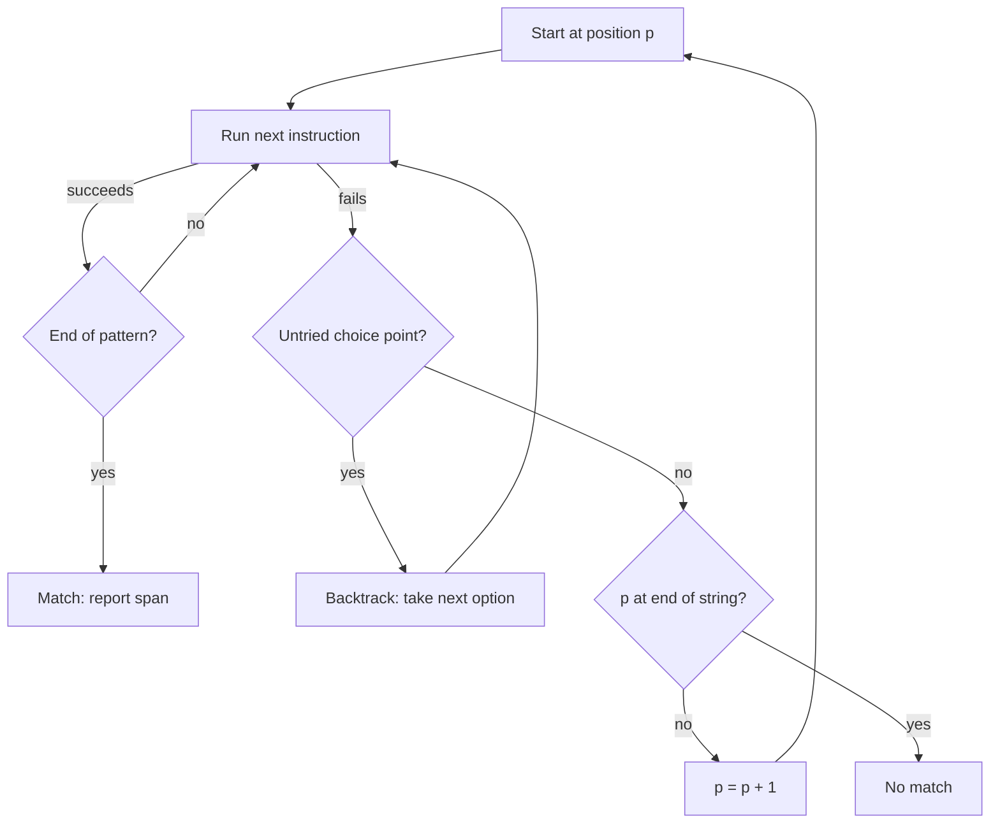

A **regular expression** (regex) is a small pattern language for describing sets of strings: "the letter E, a hyphen, then four digits", "a line that starts with *Page* and ends with a number", "any run of spaces and tabs". In a RAG ingestion pipeline, regular expressions do a large share of the unglamorous work: stripping running headers from PDF text, re-joining words hyphenated across lines, pulling error codes and dates out of runbooks into metadata, redacting e-mail addresses, and finding sentence boundaries for the chunker.

This lesson teaches Python's `re` module from the ground up: the pattern syntax, the functions that apply it, how the matching engine actually works, and why that engine can be made to run for hours on a 30-character input. It builds on the string methods from [Text processing](/learn/data-processing/text-processing); reach for a regex when those methods run out, not before.

## Learning objectives

- Write patterns using character classes, quantifiers, anchors, groups, alternation and lookarounds, and predict what they match.
- Choose the right `re` function (`search`, `match`, `fullmatch`, `findall`, `finditer`, `sub`, `split`) for a given task, and use the match object's groups and spans.
- Use flags (`MULTILINE`, `VERBOSE`, `IGNORECASE`, `ASCII`) deliberately, and explain how `\d` and `\w` behave on Unicode text.
- Explain backtracking, calculate how nested quantifiers make matching time grow exponentially, and rewrite a vulnerable pattern safely.
- Build a small cleaning and extraction pass for extracted document text.

## Prerequisites

- [Text processing](/learn/data-processing/text-processing): Python strings, slicing, half-open spans and offset maps.
- [Indexing pipeline](/learn/rag-architecture-fundamentals/indexing-pipeline): where cleaning and enrichment happen.

## Why this matters

Extracted text is messy in highly regular ways. Every page of a PDF repeats the same header with a different page number. Every line that ended in a hyphen split a word. Every error code in a runbook follows the same format. String methods handle fixed text well (`replace("Page 3 of 12", "")`), but they cannot say "Page, then any number". Regular expressions can, in one line.

The cost of getting them wrong is high in both directions. A pattern that is too loose deletes real content: a header-removal pattern that matches any line containing "Meridian" will remove the sentence "Meridian Relay supports SAML". A pattern that is too strict leaves the noise in: the header survives, gets embedded into every chunk from that document, and makes every chunk look similar to every other, which damages retrieval. And a pattern written carelessly can freeze an ingestion worker for minutes on one unlucky line, or, if users can supply input to it, give an attacker a way to exhaust your CPU. Understanding the engine, not just the syntax, is what prevents all three.

## The intuition

Imagine searching a long scroll for a word with a stencil cut in the shape of the pattern. You lay the stencil at the start of the scroll and check whether the letters underneath fit. If they do not, you slide it one letter along and try again. That sliding is what `re.search` does.

Now make the stencil flexible: some holes can stretch to cover "one or more letters". When a flexible hole could cover two letters or five, the engine tries one choice, carries on, and if the rest of the stencil does not fit, comes back and tries the next choice. Coming back is called **backtracking**. With one flexible hole there are only a few choices to revisit. With flexible holes inside flexible holes, the number of ways to lay the stencil explodes, and the engine dutifully tries every one before admitting that nothing fits.

Everything in this lesson is either a way to describe the stencil, a way to apply it, or a way to stop it from trying too many layouts.

## How it works

### Raw strings and literal characters

Write patterns as **raw strings**, `r"..."`, in which a backslash is an ordinary character. In a normal string `"\b"` is a backspace character; in a raw string `r"\b"` is the two characters backslash and `b`, which the regex engine reads as a word boundary. Forgetting the `r` is a classic source of patterns that silently match nothing.

Most characters match themselves. Twelve **metacharacters** have special meanings: `. ^ $ * + ? { } [ ] \ | ( )`. To match one literally, escape it with a backslash (`\.` matches a full stop). To match an arbitrary user-supplied string literally, wrap it in `re.escape()`, which escapes every metacharacter for you.

### Character classes

A **character class** matches one character from a set.

| Syntax | Matches |
| --- | --- |
| `[abc]` | `a`, `b` or `c` |
| `[a-z0-9]` | a lower-case ASCII letter or digit (ranges) |
| `[^0-9]` | any character that is *not* a digit (negation) |
| `.` | any character except a newline (unless `DOTALL` is set) |
| `\d`, `\D` | a digit; a non-digit |
| `\w`, `\W` | a "word" character (letter, digit, underscore); its opposite |
| `\s`, `\S` | whitespace; non-whitespace |

For `str` patterns, `\d`, `\w` and `\s` are **Unicode-aware** by default: `\d` matches any character in Unicode category Nd, including Arabic-Indic and Devanagari digits, and `\w` matches `é` and `ß`. That is usually right for multilingual documents, but it surprises people who use `\d+` to validate an ASCII identifier. The `re.ASCII` flag restricts these classes to ASCII.

### Quantifiers, greedy and lazy

A **quantifier** says how many times the preceding item may repeat.

| Syntax | Meaning |
| --- | --- |
| `*` | zero or more |
| `+` | one or more |
| `?` | zero or one (optional) |
| `{4}` | exactly four |
| `{1,3}` | between one and three |

By default quantifiers are **greedy**: they take as much as they can and give back only if the rest of the pattern fails. Adding `?` makes them **lazy**: they take as little as they can and extend only when needed. On `"<b>Annual leave</b> is <b>25 days</b>"`, the greedy `<b>.*</b>` matches the whole string, from the first `<b>` to the last `</b>`, while the lazy `<b>.*?</b>` matches each bold section separately. (Parsing HTML with regular expressions beyond toy cases is a mistake; [XML and HTML](/learn/data-processing/xml-and-html) shows the right tool.)

Python 3.11 added **possessive** quantifiers (`*+`, `++`, `?+`) and **atomic groups** (`(?>...)`). Both take as much as they can and *never* give it back, which removes backtracking at that point. They are a precise tool for the performance problem described below.

### Anchors and boundaries

Anchors match a *position*, not a character.

- `^` and `$` match the start and end of the string. With the `re.MULTILINE` flag, they also match at the start and end of every line, which is what you want when removing whole header lines from page text.
- `\b` matches a **word boundary**: a position between a `\w` character and a non-`\w` character (or the edge of the string). `\bE-\d{4}\b` finds `E-4021` but not the `E-4021` hidden inside `XE-40211`.
- `\A` and `\Z` always mean the start and end of the whole string, whatever the flags.

### Groups, alternation and backreferences

Parentheses do two jobs. They **group**, so a quantifier or alternation applies to the whole group: `(?:days|years)` matches either word. And, unless written `(?:...)`, they **capture**: the text matched inside is remembered and can be retrieved from the match object as `m.group(1)`. A **named group**, `(?P<code>E-\d{4})`, is retrieved as `m.group("code")`, which keeps long patterns readable.

The vertical bar `|` is **alternation**: try the left side, and if it fails, the right. Alternatives are tried in order, and the first that leads to an overall match wins, not the longest.

A **backreference** refers to an earlier captured group. In a replacement string, `\1` inserts what group 1 captured: `re.sub(r"(\w)-\n(\w)", r"\1\2", text)` keeps the letters on either side of a line-end hyphen and drops the hyphen and the newline.

### Lookarounds

A **lookaround** checks what comes before or after a position without consuming it. `(?=...)` is a lookahead, `(?!...)` a negative lookahead, `(?<=...)` a lookbehind and `(?<!...)` a negative lookbehind. They are ideal for splitting at a position: `re.split(r"(?<=[.!?])\s+(?=[A-Z])", text)` splits at whitespace that follows sentence punctuation and precedes a capital letter, keeping the punctuation with its sentence. In Python's `re`, a lookbehind must have a fixed width.

### Flags

| Flag | Effect |
| --- | --- |
| `re.IGNORECASE` (`re.I`) | Case-insensitive matching |
| `re.MULTILINE` (`re.M`) | `^` and `$` match at every line |
| `re.DOTALL` (`re.S`) | `.` also matches newlines |
| `re.VERBOSE` (`re.X`) | Whitespace and `#` comments in the pattern are ignored, so patterns can be laid out and annotated |
| `re.ASCII` (`re.A`) | `\d`, `\w`, `\s` and `\b` use ASCII definitions only |

Combine flags with `|`: `re.compile(pattern, re.MULTILINE | re.VERBOSE)`. In verbose mode, a literal space in the pattern must be written as `\s`, `[ ]` or `\ `.

### The functions

- `re.search(p, s)` finds the first match **anywhere** in `s`, or returns `None`.
- `re.match(p, s)` matches only at the **start** of `s`. `re.match(r"\d+", "Room 42")` is `None`; `search` finds `42`. Confusing the two is a common bug.
- `re.fullmatch(p, s)` requires the **whole** string to match. Use it for validation.
- `re.findall(p, s)` returns a list of matched strings, or, if the pattern has groups, a list of the groups (tuples if there are several), which changes the return type the moment you add parentheses.
- `re.finditer(p, s)` yields match objects lazily, each with `.group()`, `.groupdict()`, `.span()` and `.lastgroup`. Prefer it whenever you need positions, which in RAG you nearly always do.
- `re.sub(p, repl, s)` replaces matches. `repl` can be a string with backreferences or a function that receives each match object and returns the replacement.
- `re.split(p, s)` splits at matches. Capturing groups in the pattern are included in the result.

`re.compile(p, flags)` turns a pattern into a reusable object with the same methods. The module caches recently used patterns, so compiling is about clarity (a named, documented constant) more than speed.

### How the engine matches

Python's `re` is a **backtracking** engine. Given a pattern and a string, it does the following.

1. Compile the pattern into a sequence of instructions (match this literal, try this class, repeat this group, branch here).
2. Set the start position to 0.
3. Execute the instructions against the string from the start position. At every point where the pattern allows a choice (how many times to repeat, which alternative to take), record a **choice point** and take the first option.
4. If an instruction fails, return to the most recent choice point and take its next option. This is backtracking.
5. If the end of the pattern is reached, report a match with its span.
6. If every choice point is exhausted, move the start position one character right and go to step 3 (for `search`; `match` gives up instead).
7. If the start position passes the end of the string, report no match.



The important property is in step 4: **failing is expensive**, because the engine must exhaust every combination of choices before it can conclude that there is no match. A successful match can stop at the first combination that works. This is why vulnerable patterns run quickly on normal input and catastrophically on input that *almost* matches.

### Catastrophic backtracking

Consider `^(\w+\s?)+$`, intended to mean "a line of words separated by single spaces". On a line of 28 letters followed by `!`, the `$` must fail, because `!` is not a word character. Before it can report failure, the engine tries every way of dividing the 28 letters among repetitions of the outer group: one group of 28, a group of 27 and one of 1, and so on. The space is optional, so nothing forces a group to end at a space, and the number of divisions doubles with each extra letter. The mathematics section counts them exactly.

The fix is to make the pattern **unambiguous**, so that each character can be matched in only one way: `^\w+(?:\s\w+)*$` says "a word, then any number of (one space, one word)". Every space now separates two groups, so there is exactly one way to divide any line, and failure is detected immediately. Possessive quantifiers and atomic groups are another fix: they forbid giving characters back. A third, operational defence is a time limit, which the third-party `regex` module offers through a `timeout` argument, and which the standard `re` module does not have.

Patterns are vulnerable when they contain a quantified group whose contents can match the same text in more than one way: nested quantifiers (`(a+)+`), overlapping alternatives (`(a|aa)+`, `(\w|\d)+`), or adjacent quantified items that can trade characters (`\w+\w+`).

## The mathematics

### Counting the ways to divide a string

**Intuition.** Matching `(a+)+` against $n$ letters means cutting the run of letters into consecutive non-empty pieces, one piece per repetition of the group. Between each pair of neighbouring letters there is a gap, and for each gap the engine can choose "cut here" or "do not cut here".

There are $n - 1$ gaps, each with two independent choices, so the number of divisions (called **compositions** of $n$) is:

$$
C(n) = 2^{\,n-1}
$$

$n$ is the number of characters the group could absorb, and $C(n)$ the number of distinct ways the engine can assign them to repetitions. When a match is impossible, a backtracking engine explores all of them, so its running time grows at least in proportion to $C(n)$: each extra character doubles the work.

**By hand.** For $n = 4$ letters `aaaa`, there are three gaps and $2^3 = 8$ divisions: `aaaa`; `a|aaa`; `aa|aa`; `aaa|a`; `a|a|aa`; `a|aa|a`; `aa|a|a`; `a|a|a|a`. Going from 24 to 28 letters multiplies the count by $2^4 = 16$.

**In Python**, first counting the divisions by brute force (each gap is a 0 or a 1), then timing the vulnerable and the safe pattern. Your times will differ from these; the growth rate is what matters.

```python
import re
import time
from itertools import product

def compositions(n: int) -> int:
    # each of the n-1 gaps between letters is either a cut or not
    return sum(1 for _ in product([0, 1], repeat=n - 1))

for n in [1, 2, 3, 4, 10, 20]:
    print(f"n={n:<3} ways={compositions(n):>7}   2**(n-1)={2 ** (n - 1):>7}")
print()

# "A line of words separated by single spaces" -- written two ways.
nested = re.compile(r"^(\w+\s?)+$")     # looks harmless
flat = re.compile(r"^\w+(?:\s\w+)*$")   # matches the same strings

for n_chars in [16, 20, 24, 28]:
    line = "a" * n_chars + "!"          # the "!" means no match is possible
    t0 = time.perf_counter(); nested.match(line); t_nested = time.perf_counter() - t0
    t0 = time.perf_counter(); flat.match(line); t_flat = time.perf_counter() - t0
    print(f"{n_chars} chars  nested: {t_nested:7.3f} s   flat: {t_flat * 1e6:5.1f} µs")
```

```output
n=1   ways=      1   2**(n-1)=      1
n=2   ways=      2   2**(n-1)=      2
n=3   ways=      4   2**(n-1)=      4
n=4   ways=      8   2**(n-1)=      8
n=10  ways=    512   2**(n-1)=    512
n=20  ways= 524288   2**(n-1)= 524288

16 chars  nested:   0.003 s   flat:   1.6 µs
20 chars  nested:   0.043 s   flat:   0.8 µs
24 chars  nested:   0.605 s   flat:  10.6 µs
28 chars  nested:   9.728 s   flat:   2.6 µs
```

Every four extra characters multiplied the time of the nested pattern by roughly 15, close to the predicted $2^4 = 16$. Extrapolating, 40 characters would take about $9.7 \times 2^{12} \approx 40{,}000$ seconds, eleven hours, on one line of input. The flat pattern stayed in microseconds throughout (the small variations are timer noise).

## In code

**The problem.** Two pages of a Meridian IT runbook have come out of a PDF extractor with a running header on each page, a word hyphenated across a line break, and hard line breaks inside sentences. Clean the text into one flowing passage, extract error codes, durations, times and amounts with their positions, and redact e-mail addresses.

**Dependencies.** Only the standard library `re` module.

```bash
python --version   # 3.11 or later if you want possessive quantifiers
```

```python
import re

PAGE = """Meridian IT Runbook                                   Page 3 of 12
If the VPN client shows error E-4021, update it from the IT por-
tal. Error E-4012 means the certificate has expired.
Passwords must be rotated every 90 days. Contact it-support@meridian.example
or call the support desk (08:00 to 18:00 UK time).
Meridian IT Runbook                                   Page 4 of 12
Laptops are refreshed every 3 years; report a lost laptop to the
support desk at once. Expenses over £75 need a receipt.
"""

# 1. Remove running headers: a whole line, anchored with ^ and $ in MULTILINE mode.
HEADER = re.compile(r"^Meridian IT Runbook\s+Page \d+ of \d+[ \t]*\n", re.MULTILINE)
text = HEADER.sub("", PAGE)

# 2. Re-join words hyphenated across a line break: "por-\ntal" -> "portal".
text = re.sub(r"(\w)-\n(\w)", r"\1\2", text)

# 3. Turn the remaining single line breaks into spaces.
text = re.sub(r"[ \t]*\n[ \t]*", " ", text).strip()
print(text, end="\n\n")

# 4. Extract facts with one verbose pattern and named groups.
FACTS = re.compile(r"""
      (?P<error>\bE-\d{4}\b)                      # Atlas error code
    | (?P<money>£\d+(?:\.\d{2})?)                 # sterling amount
    | (?P<period>\b\d+\s(?:days|years)\b)         # a duration
    | (?P<time>\b(?:[01]\d|2[0-3]):[0-5]\d\b)     # 24-hour clock time
""", re.VERBOSE)

for m in FACTS.finditer(text):
    kind = m.lastgroup                 # name of the group that matched
    print(f"{kind:<7} {m.group():<10} span={m.span()}")

# 5. Redact e-mail addresses with a function, keeping the domain.
EMAIL = re.compile(r"\b[\w.+-]+@([\w-]+(?:\.[\w-]+)+)\b")
def redact(m: re.Match) -> str:
    return f"[email at {m.group(1)}]"
print()
redacted = EMAIL.sub(redact, text)
print(redacted[redacted.index("Contact"):redacted.index("UK time") + 9])
```

```output
If the VPN client shows error E-4021, update it from the IT portal. Error E-4012 means the certificate has expired. Passwords must be rotated every 90 days. Contact it-support@meridian.example or call the support desk (08:00 to 18:00 UK time). Laptops are refreshed every 3 years; report a lost laptop to the support desk at once. Expenses over £75 need a receipt.

error   E-4021     span=(30, 36)
error   E-4012     span=(74, 80)
period  90 days    span=(148, 155)
time    08:00      span=(219, 224)
time    18:00      span=(228, 233)
period  3 years    span=(272, 279)
money   £75        span=(345, 348)

Contact [email at meridian.example] or call the support desk (08:00 to 18:00 UK time).
```

**The important lines.**

- `HEADER` is anchored with `^` and requires the exact header text, the word `Page` and two numbers. In `MULTILINE` mode `^` matches at the start of every line, so both headers go. Including the trailing `\n` in the match removes the line itself rather than leaving a blank one. A loose pattern such as `Meridian.*\n` would also have deleted any body line that mentioned Meridian.
- `r"(\w)-\n(\w)"` requires a word character on both sides of the line-end hyphen. The two groups capture those characters and `r"\1\2"` writes them back without the hyphen. The hyphen inside `it-support` is not followed by a newline, so it is untouched.
- `r"[ \t]*\n[ \t]*"` consumes a newline together with any spaces or tabs around it, so a line that ended in trailing spaces does not produce a double space.
- `re.VERBOSE` lets the extraction pattern be laid out one alternative per line with comments. Each alternative is a named group, and `m.lastgroup` reports which one matched, so one pass over the text classifies every fact.
- `\b` on both sides of `E-\d{4}` and the duration pattern stops them matching inside longer tokens.
- The time pattern `(?:[01]\d|2[0-3]):[0-5]\d` encodes the valid range of hours and minutes, so `25:99` is not extracted.
- `EMAIL.sub(redact, text)` calls `redact` for each match. Because the replacement is computed by a function, it can use the captured domain, look values up, or log what was removed.

**What the output means.** The two headers are gone, `por-tal` is `portal` again, and the text is one passage with no hard line breaks. The extraction found both error codes, both durations, both times and the amount, each with a span into the cleaned text. Those spans can be attached to chunks as metadata (a chunk covering characters 0 to 120 "mentions E-4021 and E-4012"), and, combined with an offset map from the previous lesson, traced back to the PDF. The redaction kept the domain and removed the mailbox.

**Errors people commonly hit.**

- `re.error: bad escape` or a pattern that silently matches nothing: the pattern was not a raw string, so Python interpreted `\b` or `\d` before the regex engine saw it.
- `findall` suddenly returns tuples or single groups instead of whole matches: a capturing group was added. Use `(?:...)` for grouping that should not capture, or use `finditer`.
- `re.error: look-behind requires fixed-width pattern`: Python's `re` does not support `(?<=\s+)`. Rewrite it, or use the `regex` module, which does.
- A verbose pattern stops matching: a literal space in it is now ignored. Write `\s` or `[ ]`.
- `'NoneType' object has no attribute 'group'`: `search` or `match` found nothing. Check for `None` before calling methods.

**How to extend it.** Make the header pattern data-driven: collect the first and last lines of every page, find the lines that repeat across most pages, and build a pattern from them with `re.escape`, replacing digits by `\d+`. That is the core of [Header and footer removal](/learn/document-preprocessing/header-and-footer-removal). Feed the extracted facts into chunk metadata so that a query for `E-4021` can filter on it exactly.

### More behaviours, side by side

```python
import re
html = "<b>Annual leave</b> is <b>25 days</b>"
print(re.findall(r"<b>.*</b>", html))     # greedy
print(re.findall(r"<b>.*?</b>", html))    # lazy
print(re.findall(r"<b>(.*?)</b>", html))  # with a capturing group

print(re.match(r"\d+", "Room 42"), re.search(r"\d+", "Room 42"))
print(re.fullmatch(r"E-\d{4}", "E-4021"), re.fullmatch(r"E-\d{4}", "E-40211"))
print(re.findall(r"(\d+) (days|years)", "25 days, 3 years"))
print(re.split(r"(?<=[.!?])\s+(?=[A-Z])", "Leave is 25 days. Up to 5 carry over. See the handbook, e.g. section 2."))
```

```output
['<b>Annual leave</b> is <b>25 days</b>']
['<b>Annual leave</b>', '<b>25 days</b>']
['Annual leave', '25 days']
None <re.Match object; span=(5, 7), match='42'>
<re.Match object; span=(0, 6), match='E-4021'> None
[('25', 'days'), ('3', 'years')]
['Leave is 25 days.', 'Up to 5 carry over.', 'See the handbook, e.g. section 2.']
```

The greedy pattern swallowed everything between the first opening and last closing tag; the lazy one stopped at the first closing tag each time. `match` returned `None` because the string does not *start* with a digit. `fullmatch` rejected `E-40211`. With two groups, `findall` returned tuples. The sentence splitter worked here only because `e.g.` happened to be followed by a lower-case word; exercise 3 makes it robust.

### Putting a time limit on a pattern

If a pattern might meet hostile or simply unexpected input, put a ceiling on how long it can run. The standard `re` module cannot do this; the third-party `regex` module, a largely compatible replacement, accepts a `timeout` in seconds.

```bash
pip install regex
```

```python
import time
import regex   # pip install regex

text = "a" * 45 + "!"
t0 = time.perf_counter()
try:
    regex.match(r"^(a|aa)+$", text, timeout=0.5)
    print("matched or failed normally")
except TimeoutError as exc:
    print(f"TimeoutError after {time.perf_counter() - t0:.1f} s: {exc}")
```

```output
TimeoutError after 0.5 s: regex timed out
```

The `regex` module also detects and short-circuits some simple cases of nested repetition, such as the `^(\w+\s?)+$` example above, that the standard module does not. It does not catch all of them, as `(a|aa)+` shows, so treat its optimisations as a bonus and the timeout as the guarantee.

### Watching a loop merge pieces

The trace below steps through the abbreviation-repair loop that exercise 3 builds. A boundary pattern has already split the text at every full stop followed by a capital letter, including the one after `e.g.`. Watch `out` as the loop decides whether each piece starts a new sentence or continues the previous one.

```trace
{
  "title": "Repairing sentence splits after abbreviations",
  "code": [
    "parts = ['Use the portal, e.g.', 'Meridian Reports.', 'Leave is 25 days.']",
    "out = []",
    "for part in parts:",
    "    if out and out[-1].endswith(('e.g.', 'i.e.')):",
    "        out[-1] += ' ' + part",
    "    else:",
    "        out.append(part)"
  ],
  "steps": [
    {"line": 1, "vars": {"parts": "3 pieces"}, "note": "The splitter has cut after every full stop followed by whitespace and a capital, including the one after e.g."},
    {"line": 2, "vars": {"out": "[]"}, "note": "Start with no sentences."},
    {"line": 3, "vars": {"part": "'Use the portal, e.g.'", "out": "[]"}, "note": "First piece."},
    {"line": 4, "vars": {"part": "'Use the portal, e.g.'", "out": "[]"}, "note": "out is empty, so the condition is False."},
    {"line": 7, "vars": {"out": "['Use the portal, e.g.']"}, "note": "The first piece becomes the first sentence."},
    {"line": 3, "vars": {"part": "'Meridian Reports.'", "out": "['Use the portal, e.g.']"}, "note": "Second piece."},
    {"line": 4, "vars": {"part": "'Meridian Reports.'", "out": "['Use the portal, e.g.']"}, "note": "The previous sentence ends with e.g., so this was a false boundary."},
    {"line": 5, "vars": {"out": "['Use the portal, e.g. Meridian Reports.']"}, "note": "Glue the piece back on, restoring the space the split removed."},
    {"line": 3, "vars": {"part": "'Leave is 25 days.'", "out": "['Use the portal, e.g. Meridian Reports.']"}, "note": "Third piece."},
    {"line": 4, "vars": {"part": "'Leave is 25 days.'", "out": "['Use the portal, e.g. Meridian Reports.']"}, "note": "The previous sentence ends with 'Reports.', not an abbreviation."},
    {"line": 7, "vars": {"out": "['Use the portal, e.g. Meridian Reports.', 'Leave is 25 days.']"}, "note": "A real boundary: start a new sentence. Two sentences, correctly split."}
  ]
}
```

## A real-world example

Meridian's Platform team ran AskMeridian's ingestion as a queue of worker processes, each taking one document at a time. One Monday the queue stopped draining. Two workers showed 100% CPU and had been on the same documents for over an hour; the rest were idle because the scheduler had assigned them nothing new while it waited.

Both stuck documents were IT runbook exports containing long base64-encoded certificate blobs: hundreds of characters of letters and digits with no spaces, ending in `=`. A recent change had added a "tidy up word runs" step using a pattern equivalent to `^(\w+\s?)+$`, intended to detect lines made only of words. On ordinary lines it matched or failed in microseconds. On a blob line, the trailing `=` made the match impossible, and the engine set about trying an astronomical number of ways to divide the run of word characters.

The fix had three parts. The pattern was rewritten unambiguously as `^\w+(?:\s\w+)*$`, which matches the same lines in linear time. The team added a test that runs every pattern in the cleaning module against adversarial strings (long runs of `a`, long runs followed by `!`) with a time budget, so a vulnerable pattern fails in continuous integration rather than in production. And each document's cleaning step now runs under a per-document time limit in the worker, so that one pathological input is logged and skipped rather than stalling the pipeline. None of these involved giving up regular expressions; they involved understanding the engine.

## Common mistakes

- **Forgetting the `r` prefix.** `"\b"` is a backspace character, so the pattern looks for a character that is never there and matches nothing, with no error.
- **Using `match` when you meant `search`.** `match` only tries the start of the string, so a code in the middle of a line is never found.
- **Patterns that are too loose for deletion.** A header pattern like `Meridian.*` deletes body text that mentions Meridian; deletion patterns should be anchored and as specific as possible.
- **Joining every line-end hyphen.** Genuinely hyphenated compounds split at a line break (`home-` / `office`) become `homeoffice`; check whether the hyphenated form appears elsewhere in the document before joining, or accept the error knowingly.
- **Nested or overlapping quantifiers.** `(a+)+`, `(\w|\d)+` and friends run in exponential time on near-misses and can stall a worker or be exploited.
- **Relying on `\d` meaning ASCII digits.** It also matches other scripts' digits, so `\d+` validation accepts strings that later code may not expect; use `[0-9]` or `re.ASCII` when you mean ASCII.
- **Parsing nested structures with regex.** HTML, XML and JSON nest arbitrarily; a regex for them works on today's examples and breaks on tomorrow's. Use a parser.

## Best practices

- Write every pattern as a raw string, give important ones a name with `re.compile`, and lay out long ones with `re.VERBOSE` and comments.
- Use `finditer` and keep spans, so extracted facts can be attached to chunks and traced to the source.
- Anchor deletion patterns (`^`, `$`, `\b`) and make them as specific as the data allows.
- Make every quantified group unambiguous: each character should be matchable in only one way. Use possessive quantifiers or atomic groups (Python 3.11 and later) where ambiguity is unavoidable.
- Test patterns against near-miss inputs (long runs followed by an impossible character), not only against examples that match.
- Put a time limit around pattern matching on untrusted or user-supplied input: the `regex` module's `timeout`, a linear-time engine such as RE2 (Python binding: the `google-re2` package), or a per-task time limit in the worker.
- Use `re.escape` whenever a pattern includes text you did not write.

## Performance considerations

- **Linear patterns are fast.** A well-formed pattern scans text at speeds that make it negligible next to embedding. A 50,000-character document with five cleaning passes is 250,000 character steps, a few milliseconds in C.
- **Backtracking cost is the risk.** The question is never "how fast is the average case" but "what is the worst case on the worst line". A pattern with a nested quantifier on a 40-character line can need $2^{39} \approx 5.5 \times 10^{11}$ steps; at a generous $10^8$ steps a second, that is more than an hour.
- **Combine passes where it stays readable.** One `finditer` with named alternatives scans the text once; five separate `findall` calls scan it five times. The difference is small for one document and real for millions.
- **Compiling.** `re` caches recently compiled patterns (a few hundred), so calling `re.sub(pattern, ...)` in a loop is fine for a handful of patterns. With many dynamically built patterns, compile them yourself and keep them.
- **Line-by-line processing.** If text is processed line by line, a pathological pattern's exponent is bounded by the line length, which caps the damage; running a vulnerable pattern over a whole document with `DOTALL` removes that cap.

## Security considerations

- **Regular expression denial of service (ReDoS).** If an attacker controls the text, and the text meets a vulnerable pattern, they can choose input that maximises backtracking. Ingested documents count as attacker-controlled when they come from outside your organisation or from anyone who can edit a shared wiki. Audit patterns, add time limits, and prefer linear-time engines for anything exposed.
- **User-supplied patterns.** Never let users submit regular expressions to run with `re` in a shared service (for example, an admin "search the index by pattern" feature). If you must, use a linear-time engine such as RE2, cap pattern and input length, and run it under a timeout.
- **Redaction by regex is best effort.** A pattern catches e-mail addresses and card numbers in their usual formats, not every format. Treat regex redaction as one layer of personal-data handling, and test it against real samples; [Data cleaning](/learn/data-processing/data-cleaning) discusses where it fits.

## Summary

- A regular expression describes a set of strings; Python's `re` module searches, extracts, replaces and splits with it. Write patterns as raw strings and compile important ones with names and comments.
- Character classes, quantifiers, anchors, groups, alternation and lookarounds are the core syntax; `\d` and `\w` are Unicode-aware unless `re.ASCII` is set.
- `finditer` with named groups gives you each match's kind and span, which is exactly what chunk metadata and provenance need.
- `re` is a backtracking engine: failure means exhausting every choice, and a quantified group that can divide text in many ways makes that exponential, $2^{n-1}$ ways for $n$ characters.
- Make patterns unambiguous, test them on near-misses, and put time limits on any pattern that can meet untrusted input.

## Exercises

**1. Dates in prose.** Write a verbose pattern with named groups `day`, `month` and an optional `year` that finds dates like `31 March` and `1 January 2025`, accepts days 1 to 31 without a leading zero, and does not match `32 March`. Run it on `"Unused days must be used by 31 March. The 2023 handbook was replaced on 1 January 2025; 32 March is not a date."`.

<details><summary>Show solution</summary>

```python
import re

MONTHS = "January|February|March|April|May|June|July|August|September|October|November|December"
DATE = re.compile(rf"""
    \b(?P<day>[1-9]|[12]\d|3[01])      # 1 to 31, no leading zero
    \s(?P<month>{MONTHS})\b
    (?:\s(?P<year>\d{{4}}))?           # optional four-digit year
""", re.VERBOSE)

text = "Unused days must be used by 31 March. The 2023 handbook was replaced on 1 January 2025; 32 March is not a date."
for m in DATE.finditer(text):
    print(m.groupdict(), m.span())
```

```output
{'day': '31', 'month': 'March', 'year': None} (28, 36)
{'day': '1', 'month': 'January', 'year': '2025'} (72, 86)
```

The day alternatives are ordered so that every valid day has exactly one way to match. `32 March` fails: at the `3`, neither `[12]\d` nor `3[01]` fits, and `[1-9]` matches `3` but must then be followed by whitespace, not `2`; at the `2`, the `\b` fails because `3` and `2` are both word characters. The pattern is an f-string as well as a raw string (`rf`), so literal braces in `\d{4}` are doubled. An unmatched optional group gives `None` in `groupdict()`. The pattern does not check that 31 February is impossible; validate with `datetime` after extraction.

</details>

**2. Predict, then run.** What do these print?

```python
import re
print(re.findall(r"\d+", "Room ٣ and 42"))
print(re.findall(r"\d+", "Room ٣ and 42", flags=re.ASCII))
print(re.findall(r"\w+", "café naïve", re.ASCII))
print(re.findall(r"\bE-\d{4}\b", "E-4021, XE-40211 E-4012."))
```

<details><summary>Show solution</summary>

```output
['٣', '42']
['42']
['caf', 'na', 've']
['E-4021', 'E-4012']
```

`٣` is ARABIC-INDIC DIGIT THREE, in Unicode category Nd, so the default Unicode-aware `\d` matches it; `re.ASCII` excludes it. Under `re.ASCII`, `é` and `ï` are not word characters, so the words are cut at them, which is why that flag is wrong for European-language text. In the last line, the `E` inside `XE-40211` follows the word character `X`, so there is no word boundary before it; and even if there were, `40211` has a fifth digit where the trailing `\b` needs a non-word character.

</details>

**3. A sentence splitter that survives abbreviations.** Splitting on `(?<=[.!?])\s+(?=[A-Z])` breaks `"Use the portal, e.g. Meridian Reports."` in two, and misses a sentence that starts with a digit or `£`. Write `sentences(text)` that splits at sentence punctuation followed by whitespace and a capital letter, digit, `£`, quote or bracket, then repairs splits that follow a known abbreviation. Test it on `"Claims over £75.50 need a receipt. Use the portal, e.g. Meridian Reports. Leave is 25 days. 5 days carry over! Ask Dr. Patel, i.e. HR, if unsure."`.

<details><summary>Show solution</summary>

```python
import re

ABBREVIATIONS = ("e.g.", "i.e.", "etc.", "approx.", "Dr.", "No.")
BOUNDARY = re.compile(r"(?<=[.!?])\s+(?=[A-Z0-9£\"“(])")

def sentences(text: str) -> list[str]:
    parts = BOUNDARY.split(text)
    out: list[str] = []
    for part in parts:
        # If the previous piece ended in a known abbreviation, it was not a real boundary.
        if out and out[-1].endswith(ABBREVIATIONS):
            out[-1] += " " + part
        else:
            out.append(part)
    return out

text = ("Claims over £75.50 need a receipt. Use the portal, e.g. Meridian Reports. "
        "Leave is 25 days. 5 days carry over! Ask Dr. Patel, i.e. HR, if unsure.")
for s in sentences(text):
    print(repr(s))
```

```output
'Claims over £75.50 need a receipt.'
'Use the portal, e.g. Meridian Reports.'
'Leave is 25 days.'
'5 days carry over!'
'Ask Dr. Patel, i.e. HR, if unsure.'
```

`£75.50` is safe because the boundary needs whitespace after the full stop. The repair loop (the trace above steps through it) is easier to maintain than a lookbehind per abbreviation, and Python's `re` would reject a variable-width lookbehind anyway. The `" "` it inserts is an approximation: if the original had two spaces or a newline there, the repaired sentence differs from the source, so a production version would split with `finditer` and keep spans instead. This is still a heuristic; [Sentence-based chunking](/learn/chunking-fundamentals/sentence-based-chunking) compares it with trained sentence segmenters.

</details>

**4. Design: a pattern search for administrators.** The Platform team wants an admin page where staff can type a regular expression and see every chunk in the index that matches it. The index holds about two million chunks. Identify the risks, and design the feature so that it is safe and responsive.

<details><summary>Show solution</summary>

Risks: a vulnerable pattern (deliberate or accidental) pins a CPU core per request for hours; scanning two million chunks with any pattern is slow even when linear; a pattern can be crafted to be expensive to *compile* as well as to run; and results may expose chunks from documents the administrator should not see.

A sound design:

- Run patterns with a **linear-time engine** (RE2 through the `google-re2` package). It does not support backreferences or lookarounds, which is an acceptable restriction for search, and its running time is proportional to input length whatever the pattern.
- **Cap the pattern length** (a few hundred characters) and reject patterns RE2 cannot compile, returning the error message.
- **Narrow before scanning.** Require a metadata filter (document, source, date range), or use a literal substring from the pattern to pre-filter with the keyword index, and then run the regex only on candidates.
- **Run the scan as a background job** with an overall time budget and a result limit (for example, the first 500 matches), streaming results to the page.
- **Apply the same access control** as normal retrieval, so the admin tool cannot reveal chunks the user could not otherwise read, and log every pattern run.

The general lesson: anywhere a pattern or the text it runs on is not under your control, bound the work by construction (a linear engine, length limits) and by policy (timeouts, job limits).

</details>

## Check your understanding

```quiz
[
  {
    "q": "What does `re.match(r\"\\d+\", \"Room 42\")` return?",
    "options": ["A match for `42`", "`None`", "A match for `Room`", "It raises `re.error`"],
    "answer": 1,
    "why": "`re.match` only tries to match at the start of the string, and `R` is not a digit. `re.search` would find `42`."
  },
  {
    "q": "On `\"<b>a</b> and <b>b</b>\"`, what does `re.findall(r\"<b>.*?</b>\", s)` return?",
    "options": ["`['<b>a</b> and <b>b</b>']`", "`['a', 'b']`", "`['<b>a</b>', '<b>b</b>']`", "`[]`"],
    "answer": 2,
    "why": "The lazy `.*?` stops at the first `</b>` each time, and with no capturing group `findall` returns the whole matches."
  },
  {
    "q": "Why does `^(\\w+\\s?)+$` take exponential time on a long run of letters followed by `!`?",
    "options": ["Because `\\w` is Unicode-aware", "Because `$` is evaluated before the group", "Because the letters can be divided among repetitions of the group in exponentially many ways, and failure forces the engine to try them all", "Because Python recompiles the pattern for every character"],
    "answer": 2,
    "why": "The optional `\\s?` lets any letter end a repetition, giving 2^(n-1) divisions of n letters; a backtracking engine must exhaust them before reporting no match."
  },
  {
    "q": "You want to remove running header lines such as `Meridian IT Runbook   Page 3 of 12` from page text. Which approach is safest?",
    "options": ["`re.sub(r\"Meridian.*\", \"\", text)`", "`re.sub(r\"^Meridian IT Runbook\\s+Page \\d+ of \\d+[ \\t]*\\n\", \"\", text, flags=re.MULTILINE)`", "`text.replace(\"Meridian\", \"\")`", "`re.sub(r\"Page\", \"\", text)`"],
    "answer": 1,
    "why": "Anchored to the start of a line and specific to the header's exact shape, it removes whole header lines without touching body text that mentions Meridian or pages."
  },
  {
    "q": "Which is a property of Python's standard `re` module?",
    "options": ["It accepts a `timeout` argument", "It guarantees linear-time matching", "It supports possessive quantifiers and atomic groups from Python 3.11", "It supports variable-width lookbehind"],
    "answer": 2,
    "why": "Python 3.11 added `*+`, `++`, `?+` and `(?>...)`. The timeout and variable-width lookbehind belong to the third-party `regex` module; linear time is RE2's guarantee."
  }
]
```

## Further reading

- [Python documentation: `re` — Regular expression operations](https://docs.python.org/3/library/re.html): the complete syntax and function reference.
- [Python documentation: Regular Expression HOWTO](https://docs.python.org/3/howto/regex.html): a gentler tutorial by A.M. Kuchling.
- [`regex` on PyPI](https://pypi.org/project/regex/): the third-party module with timeouts, variable-width lookbehind and fuller Unicode support.
- Russ Cox (2007), "Regular Expression Matching Can Be Simple And Fast": why backtracking engines go exponential and how automaton-based engines avoid it.
- [OWASP: Regular expression Denial of Service (ReDoS)](https://owasp.org/www-community/attacks/Regular_expression_Denial_of_Service_-_ReDoS): the attack and how to defend against it.
- Jeffrey Friedl (2006), *Mastering Regular Expressions*, 3rd edition, O'Reilly: the standard book on how regex engines work.
