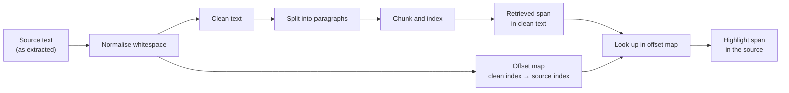

Every document that enters a RAG system, whatever format it arrived in, ends up as a Python string. The PDF parser, the HTML parser and the Word parser all hand the next stage a `str`, and from then on splitting, counting, trimming and searching that string is the whole job until the chunker takes over. This lesson is about doing that job correctly: what a Python string really is, which built-in operations behave differently from what their names suggest, and how to transform text without losing the ability to point back at the exact place in the source it came from.

It is the first lesson of the Data Processing module, so it deliberately stays with plain Python. [Regular expressions](/learn/data-processing/regular-expressions) come next, and the deep questions about bytes, encodings and Unicode normalisation belong to [Encoding and Unicode](/learn/data-processing/encoding-and-unicode).

## Learning objectives

- Explain what a Python `str` stores and why it is immutable, and predict the cost of building large strings piece by piece.
- Choose correctly between `split()` and `split(" ")`, `lower()` and `casefold()`, `split("\n")` and `splitlines()`, and justify each choice for ingestion code.
- Normalise whitespace in extracted text while keeping paragraph boundaries intact.
- Build and use an offset map that traces each character of processed text back to its position in the source.
- Recognise when a text transformation changes string length and so invalidates stored character offsets.

## Prerequisites

- [Python fundamentals](/learn/python-for-rag-engineering/python-fundamentals): variables, loops, functions, lists and dictionaries.
- [Indexing pipeline](/learn/rag-architecture-fundamentals/indexing-pipeline): where parsing and cleaning sit among the seven indexing stages.
- [Tokens and tokenisation](/learn/understanding-large-language-models/tokens-and-tokenisation): the difference between the words you split here and the tokens a model sees.

## Why this matters

Text processing is the least glamorous code in a RAG system and one of the most consequential. The retriever can only find what the index contains, and the index contains whatever your string handling produced. Three failures recur in real pipelines.

**Silent damage to content.** A function that splits on a single space produces empty strings for every double space; a function that lower-cases text to compare it, and then stores the lower-cased version, loses the capital letters that distinguish "Relay" (a product) from "relay" (a verb). Nothing crashes. The text is simply a little worse, everywhere, and retrieval quality drops in a way no single test catches.

**Lost provenance.** A good RAG answer cites its source, and the best citations highlight the exact sentence. That needs character offsets: "this chunk is characters 1,204 to 1,830 of the handbook". If cleaning collapsed whitespace or removed a header without recording what moved, the offsets you store describe the cleaned text, which nobody can open. The citation then points at the wrong sentence or at nothing.

**Structure thrown away too early.** Paragraph breaks, headings and line breaks are signals the chunker needs. A normaliser that turns every run of whitespace into one space produces tidy text with no paragraphs, and the chunker must then guess where ideas begin and end. [Chunking Fundamentals](/learn/chunking-fundamentals) depends on the structure this stage keeps.

## The intuition

Think of a museum restorer cleaning an old manuscript. She can remove dust, flatten creases and even transcribe the faded words into a fresh, legible copy. What she must never do is lose track of which page and line each transcribed sentence came from, because scholars will want to check the original. So she keeps a ledger: "line 14 of my copy is page 3, line 22 of the original".

Text processing in a pipeline is the same. You will make a cleaner copy of every document: consistent spacing, no stray tabs, paragraphs clearly marked. That is the copy the retriever searches. But the citations a user sees point at the original, so your cleaning code should keep the ledger as it goes. A ledger is cheap to keep while you are making the copy, and impossible to reconstruct afterwards.

A tiny example makes this concrete. The source says `"25  days"` with two spaces; the clean copy says `"25 days"`. Character 3 of the clean copy (the `d`) came from character 4 of the source. Write that down for every character and you can always find your way back.

## How it works

### What a string is

A Python `str` is an immutable sequence of **Unicode code points**: abstract character numbers such as 65 for `A`, 163 for `£` and 128512 for an emoji. It is not a sequence of bytes. Bytes are what files and network sockets contain; a string is what you get after **decoding** those bytes with an encoding such as UTF-8. Every ingestion pipeline should decode once, at the boundary where data enters, and work with `str` from then on. How to decode correctly, and what to do when you do not know the encoding, is the subject of [Encoding and Unicode](/learn/data-processing/encoding-and-unicode).

Two consequences follow from the definition.

1. **`len()` counts code points**, not bytes and not what a reader would call characters. `len("£400")` is 4, although UTF-8 needs 5 bytes to store it. Some visible characters are built from two code points (a letter followed by a combining accent), so `len()` can also exceed what you see on screen.
2. **Strings are immutable.** `text.replace("a", "b")` does not change `text`; it returns a new string. Any function that "modifies" text returns a new object and leaves the original untouched, which is exactly what you want when you are keeping the original for provenance.

Internally, CPython (the standard Python interpreter) stores each string using 1, 2 or 4 bytes per code point, chosen by the widest code point in that string (this is PEP 393). A 1,000-character ASCII string occupies about 1 KB; add a single emoji and the whole string switches to 4 bytes per code point. That matters when you hold thousands of documents in memory, as the performance section shows.

### Indexing and slicing

A string is indexed from 0, and negative indices count from the end. A slice `s[start:end]` returns the code points from `start` up to, but not including, `end`. Slices never raise an error for out-of-range bounds: `"Meridian"[100:]` is simply `""`. This half-open convention (start included, end excluded) is the one you should use for every character span you store, because the length of a span is then just `end - start` and adjacent spans share a boundary without overlapping.

### Splitting: the method that surprises everyone

`str.split` has two quite different modes, and choosing the wrong one is the most common bug in hand-written text processing.

- **`text.split()` with no argument** splits on any run of whitespace (spaces, tabs, newlines, form feeds, non-breaking spaces) and discards leading and trailing whitespace. It never returns empty strings. This is what you want for counting words.
- **`text.split(" ")` with an argument** splits on exactly that string, every time it occurs. Two spaces in a row produce an empty string between them; a leading space produces an empty string at the start; tabs and newlines are not separators at all.

Line splitting has the same trap in a different form. `text.split("\n")` splits only on the newline character. `text.splitlines()` splits on every character Unicode considers a line boundary: `\n`, `\r\n`, `\r`, the form feed `\x0c`, the vertical tab, the file, group and record separators, `\x85` and the Unicode line and paragraph separators `
` and `
`. That is usually what you want for text from Windows files (which end lines with `\r\n`), but it means a form feed, which several PDF tools emit between pages, starts a new "line" in the middle of what you thought was one. Know which behaviour you are relying on.

### Case: `lower()` versus `casefold()`

To compare text without regard to case, use `casefold()`, not `lower()`. `lower()` applies the language-neutral lower-case mapping; `casefold()` applies **case folding**, a more aggressive mapping designed precisely for caseless comparison. The classic example is the German `ß`, which `lower()` leaves alone and `casefold()` turns into `ss`, so that "Straße" and "STRASSE" compare equal.

Two warnings come with this.

- **Case changes can change length.** The Turkish dotted capital `İ` lower-cases to two code points (`i` followed by a combining dot). Any offset computed on the original string is wrong on the transformed one.
- **Case is information.** "Relay" the product and "relay" the verb, "US" and "us", "IT" (the department) and "it" all differ only in case. Fold case for *matching* (a keyword index, a duplicate check), but store and embed the original text. Modern embedding models are trained on cased text and use the case.

### Whitespace normalisation

Text from PDFs, Word files and web pages arrives with whitespace in every shape: double spaces from justified layouts, tabs from tables, `\r\n` from Windows, non-breaking spaces (` `) from HTML `&nbsp;`, lines broken in the middle of sentences, and runs of blank lines. **Whitespace normalisation** rewrites this into a predictable form. A sensible target for RAG is:

- inside a paragraph, every run of whitespace becomes one ordinary space;
- between paragraphs (a run containing two or more line breaks), exactly `"\n\n"`;
- no leading or trailing whitespace on the document.

This keeps the one structural signal that whitespace carries, the paragraph break, and discards the noise. Note what `str.isspace()` does and does not count: the non-breaking space is whitespace (so `split()` splits on it), but the zero-width space `​` is not, and survives every whitespace-based cleaning step. Characters like that are handled in [Data cleaning](/learn/data-processing/data-cleaning).

### Offsets and the offset map

An **offset** is a position in a string, counted in code points from 0. A **span** is a pair `(start, end)` of offsets. When you store a chunk, storing the span it occupies in the source document lets the user interface highlight exactly that passage, and lets you re-extract the chunk later to check it.

The problem is that any length-changing transformation (collapsing whitespace, removing a header, joining hyphenated words) shifts every later offset. The fix is an **offset map**: a list with one entry per character of the output, holding the index in the input that character came from. Building it costs one integer per character and one extra line of code wherever you append output. Using it is a lookup.



The procedure, step by step:

1. Walk the input one character at a time.
2. For an ordinary character, append it to the output and append its input index to the map.
3. For a run of whitespace, decide what replaces it (nothing, one space, or a paragraph break), append that, and append the run's starting index once for each character you appended.
4. Join the output pieces once at the end.
5. To map an output span `(s, e)` back, take `origin[s]` as the source start and `origin[e - 1] + 1` as the source end. Using the last character inside the span, rather than `origin[e]`, matters: `e` may be the end of the string, and even when it is not, the character at `e` may come from somewhere unrelated.

### Building strings efficiently

Because strings are immutable, `result = result + piece` creates a new string each time and copies everything accumulated so far into it. Done in a loop over $n$ pieces, the total copying grows with the square of the output length. CPython has an optimisation that sometimes extends a string in place when nothing else refers to it, but it is an implementation detail that other interpreters lack and that silently stops applying in many situations. The reliable idiom is to append pieces to a list and call `"".join(pieces)` once, which computes the final length, allocates once and copies each piece exactly once.

### Small methods worth knowing

| Method | What it does | Watch out for |
| --- | --- | --- |
| `strip()`, `lstrip()`, `rstrip()` | Remove characters from the ends | The argument is a *set of characters*, not a prefix: `"staff.pdf".rstrip(".pdf")` gives `"sta"` |
| `removeprefix()`, `removesuffix()` | Remove one exact prefix or suffix | Python 3.9 and later; use these instead of `strip` for prefixes |
| `startswith()`, `endswith()` | Test prefix or suffix | Accept a tuple: `name.endswith((".pdf", ".docx"))` |
| `find()`, `index()` | Position of a substring | `find` returns `-1` when absent, `index` raises `ValueError`; `-1` used as an index silently means "last character" |
| `partition()` | Split at the first occurrence into three parts | Handy for `"Key: value"` lines |
| `isdigit()`, `isdecimal()` | Character-class tests | `"²".isdigit()` is `True` but `int("²")` fails; use `isdecimal()` before `int()` |
| `str.translate()` | Map or delete many characters in one pass | Faster than chained `replace()` calls |

## In code

**The problem.** A parser has handed you the text of a Meridian handbook page, with Windows line endings, double spaces, a stray tab and a line broken mid-sentence. Produce a clean version with paragraphs preserved, split it into paragraphs, count its terms, and prove that a phrase found in the clean text can be traced to its exact span in the original.

**Dependencies.** None: only the standard library (`string`, `collections`). Python 3.10 or later for the type-hint syntax.

```bash
python --version   # 3.10 or later
```

```python
import string
from collections import Counter

RAW = (
    "ANNUAL LEAVE\r\n"
    "\r\n"
    "Annual leave is 25  days per year.   Up to 5 unused days\r\n"
    "carry over and must be used by 31 March.\r\n"
    "\r\n"
    "\r\n"
    "Remote work: staff may work remotely up to 3 days a week.\t\r\n"
)

def collapse_whitespace(text: str) -> tuple[str, list[int]]:
    """Collapse whitespace, keeping paragraph breaks.

    Returns the new text and a list `origin` where origin[i] is the
    index in `text` of the character that produced output character i.
    """
    out: list[str] = []
    origin: list[int] = []
    i, n = 0, len(text)
    while i < n:
        if text[i].isspace():
            start = i
            while i < n and text[i].isspace():
                i += 1
            run = text[start:i]
            # Two or more line breaks in the run mean a paragraph break.
            newlines = run.count("\n")
            if out and i < n:  # drop leading and trailing whitespace entirely
                sep = "\n\n" if newlines >= 2 else " "
                out.append(sep)
                origin.extend([start] * len(sep))
        else:
            out.append(text[i])
            origin.append(i)
            i += 1
    return "".join(out), origin

def paragraphs(text: str) -> list[str]:
    return [p for p in text.split("\n\n") if p]

def terms(text: str) -> list[str]:
    words = (w.strip(string.punctuation) for w in text.casefold().split())
    return [w for w in words if w]

clean, origin = collapse_whitespace(RAW)
print(f"raw: {len(RAW)} chars   clean: {len(clean)} chars")
print(repr(clean))
print()
for n, p in enumerate(paragraphs(clean), 1):
    print(f"paragraph {n}: {p}")
print()
print("top terms:", Counter(terms(clean)).most_common(4))

# Find a phrase in the clean text, then recover the exact span in the source.
phrase = "unused days carry over"
start = clean.find(phrase)
end = start + len(phrase)
src_start, src_end = origin[start], origin[end - 1] + 1
print()
print(f"clean[{start}:{end}] = {clean[start:end]!r}")
print(f"RAW[{src_start}:{src_end}]   = {RAW[src_start:src_end]!r}")
```

```output
raw: 180 chars   clean: 167 chars
'ANNUAL LEAVE\n\nAnnual leave is 25 days per year. Up to 5 unused days carry over and must be used by 31 March.\n\nRemote work: staff may work remotely up to 3 days a week.'

paragraph 1: ANNUAL LEAVE
paragraph 2: Annual leave is 25 days per year. Up to 5 unused days carry over and must be used by 31 March.
paragraph 3: Remote work: staff may work remotely up to 3 days a week.

top terms: [('days', 3), ('annual', 2), ('leave', 2), ('up', 2)]

clean[56:78] = 'unused days carry over'
RAW[61:84]   = 'unused days\r\ncarry over'
```

**The important lines.**

- `if text[i].isspace():` treats every Unicode whitespace character the same way, so tabs, `\r`, `\n` and non-breaking spaces are all handled by one branch.
- `newlines = run.count("\n")` is the only structural decision the function makes. A run such as `"\r\n\r\n"` contains two `\n` characters and becomes a paragraph break; `"\r\n"` alone (a line wrapped mid-sentence) contains one and becomes a space. Counting `\n` rather than calling `splitlines()` is deliberate: it ignores `\r`, so Windows and Unix line endings give the same answer.
- `if out and i < n:` drops whitespace at the very start (`out` is still empty) and at the very end (`i` has reached `n`), which is the "no leading or trailing whitespace" rule.
- `origin.extend([start] * len(sep))` keeps the map exactly as long as the output. A two-character paragraph break gets two entries, both pointing at the start of the whitespace run it replaced.
- `"".join(out)` builds the result once, at the end, rather than concatenating inside the loop.
- `w.strip(string.punctuation)` removes punctuation from the ends of each word only, so `"March."` becomes `"march"` while an internal hyphen, as in an error code like `"e-4021"`, survives.
- `origin[end - 1] + 1` maps the *last character inside* the span and adds one to make a half-open end, as described in the mechanism above.

**What the output means.** Cleaning removed 13 characters: one from the doubled space, two from the run of three spaces, one from the wrapped line (`\r\n` became a space), two from the paragraph break after the heading (`\r\n\r\n` became `\n\n`), four from the triple line break before `Remote work`, and the three trailing characters (tab, `\r`, `\n`). Three paragraphs survived as three paragraphs, including the heading `ANNUAL LEAVE`, which a later stage can recognise as a title. The phrase `unused days carry over` sits at clean offsets 56 to 78; the offset map translates that to source offsets 61 to 84, and the source slice really does contain the original line break `\r\n` where the clean text has a space. A citation built from those numbers would highlight the right words in the original file. The term counts show `days` three times, once from each sentence that mentions days, because case folding merged `ANNUAL` and `Annual`.

**Errors people commonly hit.**

- `IndexError: list index out of range` from `origin[end]`: mapping the exclusive end directly fails when the span reaches the end of the text. Map `end - 1` and add one.
- Offsets that are slightly wrong after an extra step: any later transformation (removing a footer, fixing hyphenation) needs its own offset map, and the maps must be **composed**: `final_to_source[i] = first_map[second_map[i]]`.
- `clean.find(phrase)` returns `-1` and the code carries on, slicing from the last character. Always check for `-1` (or use `index()`, which raises).
- The heading and the paragraph run together: the source used a single line break after a heading, so the normaliser treated it as a wrapped line. Real extractors need format knowledge here, which is why the [PDF](/learn/data-processing/pdf-extraction) and [DOCX](/learn/data-processing/docx-extraction) lessons extract structure before plain text.

**How to extend it.** Add a parameter that also treats a single line break as a paragraph break when the previous line is short and has no closing punctuation (a heading heuristic; exercise 2 builds one). Wrap the text and its map in a small class whose methods each return a new text with a composed map, so every cleaning step stays traceable. Store `(src_start, src_end)` in each chunk's metadata, as [Document metadata](/learn/document-engineering/document-metadata) recommends.

### Behaviours to check before you trust a pipeline

The second script collects five behaviours from the "How it works" section into a single run, so you can see them rather than take them on trust.

```python
# Five string behaviours that surprise people in ingestion code
raw = "  Annual leave is 25 days.\r\n\r\nUp to 5 unused days\tcarry over.\x0cPage 2\n"

print(repr(raw.split(" ")[:4]))      # split on one literal space
print(repr(raw.split()[:4]))         # split on any run of whitespace
print(raw.count("\n"), "newline characters, but", len(raw.splitlines()), "lines from splitlines()")
print(repr(raw.splitlines()))

for word in ["Straße", "İstanbul", "Džemal"]:
    print(f"{word!r:12} lower={word.lower()!r:14} casefold={word.casefold()!r:14} len {len(word)} -> {len(word.lower())}")

s = "Meridian"
print(s[0], s[-1], s[2:5], s[::-1], s[100:] == "")
```

```output
['', '', 'Annual', 'leave']
['Annual', 'leave', 'is', '25']
3 newline characters, but 4 lines from splitlines()
['  Annual leave is 25 days.', '', 'Up to 5 unused days\tcarry over.', 'Page 2']
'Straße'     lower='straße'       casefold='strasse'      len 6 -> 6
'İstanbul'   lower='i̇stanbul'    casefold='i̇stanbul'    len 8 -> 9
'Džemal'      lower='džemal'        casefold='džemal'        len 5 -> 5
M n rid naidireM True
```

Read it line by line. `split(" ")` produced two empty strings from the two leading spaces. `split()` produced clean words. The text has three `\n` characters but `splitlines()` returns four lines, because the form feed `\x0c` before `Page 2` counts as a line boundary; a page footer has silently become its own line, which may be what you want or may not. `casefold()` expands `ß` to `ss`, and lower-casing `İ` turned 8 code points into 9, which would shift every offset after it. (The titlecase letter `Dž`, a single code point, lower-cases to the single code point `dž`.) Slicing beyond the end returned an empty string rather than raising an error.

## A real-world example

The Platform team at Meridian added source highlighting to AskMeridian: each answer listed its citations, and clicking one opened the handbook with the cited passage highlighted. In testing, roughly one highlight in ten landed a few words off, and on some long pages it landed in the wrong paragraph entirely.

The cause was ordinary. The ingestion pipeline computed chunk offsets after cleaning, and cleaning did three things: collapsed whitespace, removed the repeated page header "Meridian Employee Handbook, HR team", and joined words hyphenated across line breaks. Pages exported from the old PDF version of the handbook had many headers and hyphenations, so the cleaned text drifted further from the original with every page; pages written natively in the wiki had almost none, which is why most highlights looked fine and why the bug survived review.

The team considered two fixes. The first was to search the original text for each chunk's content at display time. It failed on exactly the hard cases, because the cleaned chunk no longer matched the original character for character. The second, which they shipped, was to give every cleaning step an offset map and compose them, storing source offsets in each chunk's metadata at indexing time. It cost a few hours of refactoring and some memory during ingestion (one integer per character, freed when the document was done). They also added a test that, for every chunk of every document in a sample, mapped the chunk back to the source and checked that the source slice, after whitespace normalisation, equalled the chunk. That test would have caught the original bug on its first run.

## Common mistakes

- **Splitting on `" "` when you meant whitespace.** Produces empty strings and leaves tabs and newlines inside "words", so term counts and keyword matches are wrong.
- **Storing case-folded or lower-cased text.** Destroys distinctions the embedding model and the reader both need; fold case only inside comparisons and keyword indexes.
- **Collapsing all whitespace to single spaces.** Erases paragraph boundaries, which the chunker then cannot recover.
- **Computing offsets after cleaning and storing them as if they referred to the source.** Citations and highlights point at the wrong text, increasingly so the more cleaning a document needed.
- **Using `strip(".pdf")` to remove a suffix.** `strip` takes a set of characters, so it eats any trailing `.`, `p`, `d` or `f`; use `removesuffix`.
- **Ignoring `find()` returning `-1`.** Python accepts `-1` as an index, so the bug produces plausible-looking but wrong slices instead of an error.
- **Concatenating in a loop to build a large document.** Can turn a linear job quadratic; collect pieces in a list and join once.

## Best practices

- Decode bytes to `str` once, at the edge of the pipeline, and pass only `str` inside it.
- Keep the original text unchanged and produce cleaned text as a new string; never mutate your only copy.
- Make every length-changing transformation return an offset map alongside its output, and compose maps across steps.
- Use half-open spans `(start, end)` everywhere, and store source spans in chunk metadata.
- Normalise whitespace to a small, documented form: single spaces within paragraphs, `"\n\n"` between them, nothing at the ends.
- Use `casefold()` for caseless comparison and keep case in stored and embedded text.
- Write a round-trip test: for every chunk, the source slice its offsets name should normalise to the chunk text.

## Performance considerations

Text processing is rarely the bottleneck of a RAG pipeline (embedding is), but memory and accidental quadratic behaviour can still hurt at scale.

- **Memory per string.** CPython stores 1, 2 or 4 bytes per code point depending on the widest character in the string. A 50 KB ASCII document costs about 50 KB; if it contains one emoji or one character outside the Basic Multilingual Plane, it costs about 200 KB. Holding 10,000 such documents in memory at once is the difference between roughly 0.5 GB and 2 GB. Stream documents through the pipeline rather than loading the whole corpus.
- **Offset maps.** A Python list of integers costs about 8 bytes per entry for the pointer, plus the integer objects themselves (small integers up to 256 are shared, larger ones are not). For a 50,000-character document the map costs a few hundred kilobytes, briefly. If that matters, store the map as an `array.array("i")` (4 bytes per entry) or store only the positions where the shift changes, which is far smaller.
- **Character-by-character loops.** A Python loop over every character runs at a few million characters per second, which is fine for documents but slow for terabytes. The built-in methods (`split`, `replace`, `translate`, `join`) run in C and are much faster; regular expressions, next lesson, can collapse whitespace in one call when you do not need an offset map.
- **Concatenation.** Building a 1 MB string from 10,000 pieces with `+=` can copy up to about $10{,}000 \times 0.5\ \text{MB} = 5\ \text{GB}$ of data in the worst case, whereas `join` copies 1 MB once.

## Summary

- A Python `str` is an immutable sequence of Unicode code points; decode bytes once at the boundary and work only with `str` inside the pipeline.
- `split()` and `split(" ")`, `splitlines()` and `split("\n")`, `casefold()` and `lower()` behave differently in ways that silently change your index; know which one you mean.
- Normalise whitespace to a predictable form but keep paragraph breaks, because they are structure the chunker needs.
- Keep the original text and build an offset map for every length-changing step, so that chunks and citations can always be traced to their exact source span.
- Build large strings with `"".join(...)`, and remember that string memory depends on the widest character present.

## Exercises

**1. Predict the output.** Without running it, write down what each line prints, then check.

```python
t = " a  b\tc\n"
print(t.split(" "))
print(t.split())
print("staff.pdf".rstrip(".pdf"), "staff.pdf".removesuffix(".pdf"))
print("ANNUAL".casefold() == "annual", "Straße".lower() == "strasse")
```

<details><summary>Show solution</summary>

```output
['', 'a', '', 'b\tc\n']
['a', 'b', 'c']
sta staff
True False
```

`split(" ")` splits at every single space: the leading space gives an empty string before `a`, the two adjacent spaces give an empty string between them, and the tab and newline are not separators, so they stay inside the last piece. `split()` treats the tab and newline as separators and drops empties. `rstrip(".pdf")` does not remove the suffix `.pdf`: it removes trailing characters for as long as they belong to the set `{".", "p", "d", "f"}`, so after `.pdf` it carries on and eats both `f`s of `staff`, stopping only at `a`. `removesuffix` removes the exact suffix once. `casefold()` and `lower()` agree on `ANNUAL`, but only `casefold()` expands `ß` to `ss`, so the last comparison is `False`.

</details>

**2. Detect headings.** Write `heading_like(paragraph)` that returns `True` for short paragraphs (six words or fewer) that do not end with sentence punctuation or a colon. Test it on `"ANNUAL LEAVE"`, `"Annual leave is 25 days per year."`, `"Remote work"`, `"Contact the support desk:"` and `"Laptop refresh cycle"`.

<details><summary>Show solution</summary>

```python
def heading_like(paragraph: str) -> bool:
    words = paragraph.split()
    return 0 < len(words) <= 6 and not paragraph.rstrip().endswith((".", ":", "?", "!"))

paras = ["ANNUAL LEAVE", "Annual leave is 25 days per year.", "Remote work", "Contact the support desk:", "Laptop refresh cycle"]
for p in paras:
    print(f"{heading_like(p)!s:5}  {p}")
```

```output
True   ANNUAL LEAVE
False  Annual leave is 25 days per year.
True   Remote work
False  Contact the support desk:
True   Laptop refresh cycle
```

`endswith` accepts a tuple, which keeps the test on one line. The colon is excluded because a short line ending in a colon usually introduces a list rather than naming a section. This is a heuristic: a one-line paragraph such as "See the IT portal" would be misclassified. Real extractors prefer explicit structure (heading styles in Word, heading tags in HTML) and fall back on heuristics only for formats that lack it.

</details>

**3. Unicode punctuation.** `string.punctuation` contains only ASCII punctuation. Show that `terms()` from the lesson fails to strip curly quotes and guillemets from `"“Holiday” isn’t a term the handbook uses—it says «annual leave» (25 days)."`, and write a `strip_punct(word)` that strips any character whose Unicode category starts with `P`.

<details><summary>Show solution</summary>

```python
import string
import unicodedata

def strip_punct(word: str) -> str:
    """Strip leading and trailing characters in any Unicode punctuation category."""
    start, end = 0, len(word)
    while start < end and unicodedata.category(word[start]).startswith("P"):
        start += 1
    while end > start and unicodedata.category(word[end - 1]).startswith("P"):
        end -= 1
    return word[start:end]

text = "“Holiday” isn’t a term the handbook uses—it says «annual leave» (25 days)."
print([w.strip(string.punctuation) for w in text.casefold().split()])
print([strip_punct(w) for w in text.casefold().split()])
```

```output
['“holiday”', 'isn’t', 'a', 'term', 'the', 'handbook', 'uses—it', 'says', '«annual', 'leave»', '25', 'days']
['holiday', 'isn’t', 'a', 'term', 'the', 'handbook', 'uses—it', 'says', 'annual', 'leave', '25', 'days']
```

`unicodedata.category` returns a two-letter code such as `Pi` (initial quote), `Pf` (final quote) or `Pd` (dash); every punctuation category starts with `P`. The em dash in `uses—it` is internal, so it survives both versions: splitting on it is a tokenisation decision, best made with a regular expression (next lesson). Note that `£` is category `Sc` (currency symbol), not punctuation, so `£400` keeps its sign, which is usually what you want.

</details>

**4. Design: composing maps.** Your pipeline runs `collapse_whitespace` and then a second step, `remove_header`, which deletes a repeated header line and returns its own offset map from its output to its input. Explain how to compute the source offset of character `i` of the final text, and what goes wrong if a later step *inserts* characters (for example, adding `"Section: "` before each heading).

<details><summary>Show solution</summary>

Each map points one step back, so you apply them from last to first: `source_index = collapse_map[header_map[i]]`. In general, with steps 1 to *k* and maps $m_1, \dots, m_k$, the source index is $m_1(m_2(\dots m_k(i)))$. You can compose eagerly (build `final_map = [collapse_map[j] for j in header_map]` after each step, so only one map is ever kept) or lazily (keep the list of maps and look up through all of them when needed).

Inserted characters have no source. Give them the source index of the nearest real character (the convention used above for replacement whitespace), or mark them with a sentinel such as `-1` and teach the span-mapping code to skip sentinels. What you must not do is let them shift the map, which is exactly what happens if a step forgets to emit map entries for inserted text: every later offset is then off by the length of the insertion. Better still, add labels like `"Section: "` as metadata rather than as text.

</details>

## Check your understanding

```quiz
[
  {
    "q": "What does `\"a  b\".split(\" \")` return?",
    "options": ["`['a', 'b']`", "`['a', '', 'b']`", "`['a', ' ', 'b']`", "`['a b']`"],
    "answer": 1,
    "why": "With an explicit separator, `split` splits at every occurrence, so the two adjacent spaces produce an empty string between them."
  },
  {
    "q": "Why should a RAG pipeline usually store original-case text even though it compares text with `casefold()`?",
    "options": ["`casefold()` is too slow to apply at query time", "Case carries meaning (product names, acronyms) that embedding models and readers use", "Vector databases reject lower-case text", "`casefold()` only works on ASCII"],
    "answer": 1,
    "why": "Folding case is right for caseless matching, but the stored and embedded text should keep distinctions such as Relay versus relay or IT versus it."
  },
  {
    "q": "A cleaning step turns `\"25  days\"` into `\"25 days\"`. What does an offset map record?",
    "options": ["For each output character, the index of the input character it came from", "The number of characters removed", "The positions of all spaces in the output", "A hash of the input"],
    "answer": 0,
    "why": "An offset map has one entry per output character pointing back into the input, which lets any output span be translated to a source span."
  },
  {
    "q": "Which statement about `\"İstanbul\".lower()` is true?",
    "options": ["It raises a `UnicodeError`", "It returns a string of the same length", "It returns a longer string, because `İ` lower-cases to two code points", "It leaves the string unchanged"],
    "answer": 2,
    "why": "The dotted capital I lower-cases to `i` plus a combining dot above, so the length grows from 8 to 9 and later offsets shift."
  },
  {
    "q": "You build a 1 MB document from 10,000 pieces. Which approach reliably avoids quadratic copying?",
    "options": ["`result += piece` inside the loop", "`result = piece + result` inside the loop", "Append pieces to a list and call `\"\".join(pieces)` once", "Convert each piece to bytes first"],
    "answer": 2,
    "why": "`join` computes the total length, allocates once and copies each piece once; repeated concatenation may copy the accumulated string on every step."
  }
]
```

## Further reading

- [Python documentation: Text Sequence Type — str](https://docs.python.org/3/library/stdtypes.html#text-sequence-type-str): the authoritative list of string methods and their exact behaviour, including `splitlines` boundaries.
- [Python documentation: Unicode HOWTO](https://docs.python.org/3/howto/unicode.html): code points, encodings and comparison, the foundation for [Encoding and Unicode](/learn/data-processing/encoding-and-unicode).
- [PEP 393 — Flexible String Representation](https://peps.python.org/pep-0393/): why CPython strings use 1, 2 or 4 bytes per code point.
- The Unicode Standard, Chapter 5 (Implementation Guidelines) and Section 3.13 (Default Case Algorithms): the definition of case folding.
- Manning, Raghavan and Schütze (2008), *Introduction to Information Retrieval*, Chapter 2, "The term vocabulary and postings lists": tokenisation and normalisation decisions from the search-engine side.
