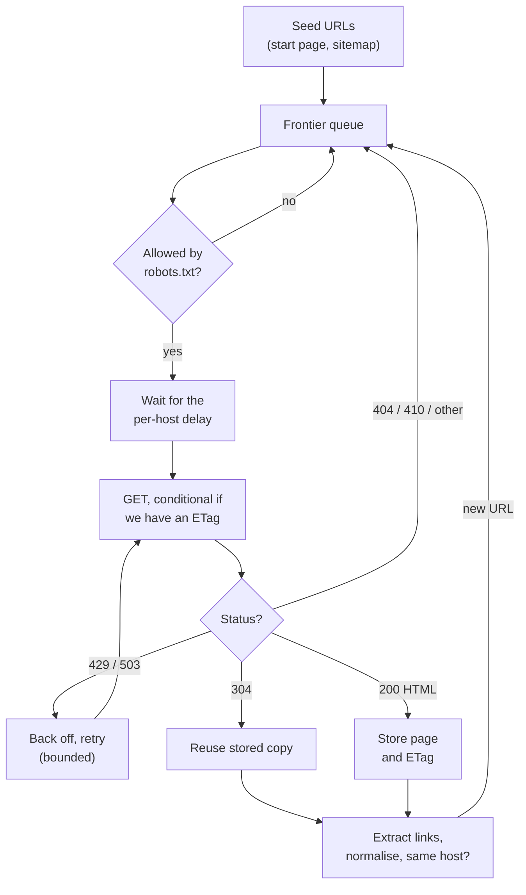

Sooner or later a RAG system has to index content that lives on web pages: an internal documentation site, a product help centre, a supplier's public specifications. Getting that content means writing a **crawler**, a program that fetches a page, finds the links on it, and fetches those in turn. A crawler that works on your laptop for ten pages is easy. A crawler that runs every night against a real site, never hammers the server, respects the site's rules, survives errors and redirects, does not fetch the same page under five different addresses, and only downloads what has changed is an engineering job.

This lesson covers that job: the HTTP you need, `robots.txt`, politeness and rate limits, retries with backoff, URL normalisation, the crawl frontier, change detection with conditional requests, and the legal and security questions every scraping project has to answer. Extracting clean text from the HTML once you have it is covered in [XML and HTML](/learn/data-processing/xml-and-html) and, in depth, in [HTML parsing](/learn/advanced-document-parsing/html-parsing); here the focus is on fetching correctly and responsibly.

## Learning objectives

- Describe an HTTP request and response and act correctly on the status codes and headers a crawler meets: 200, 301/302, 304, 404, 410, 429 and 503, `Content-Type`, `ETag`, `Last-Modified` and `Retry-After`.
- Parse a `robots.txt` file with `urllib.robotparser` and decide whether a given URL may be fetched.
- Implement a breadth-first crawler with a frontier, a seen-set, URL normalisation, a per-host delay and bounded retries.
- Use conditional requests to re-crawl a site and download only the pages that changed.
- Compute crawl duration and exponential backoff schedules, and judge when scraping is the wrong tool.

## Prerequisites

- [Working with APIs](/learn/python-for-rag-engineering/working-with-apis): making HTTP requests from Python with `httpx`.
- [Exception handling](/learn/python-for-rag-engineering/exception-handling): retries and failure handling.
- [XML and HTML](/learn/data-processing/xml-and-html): how HTML is structured and how to find elements in it.
- [Indexing pipeline](/learn/rag-architecture-fundamentals/indexing-pipeline): where fetching sits in the offline path.

## Why this matters

A crawler is the first stage of the indexing pipeline for web content, so its mistakes flow into everything after it.

- **Duplicates.** The same page reachable as `/handbook/leave`, `/handbook/leave#carry-over` and `/handbook/leave?utm_source=mail` gets indexed three times. Retrieval then returns three copies of one chunk, and the model's context fills with repetition.
- **Missing pages.** A crawler that gives up on the first 503 error, or never follows a redirect, silently drops content. Users ask about it and the assistant says it does not know.
- **Stale pages.** A crawler that cannot tell what changed either re-downloads everything every night (slow and expensive for both sides) or skips pages it should have refreshed.
- **Harm to the site.** A loop that requests pages as fast as Python can go can overload a small server. Site owners respond by blocking you, and on a site you do not own you may also be breaching its terms.
- **Indexing what you should not.** Admin pages, login-protected areas, personal data and pages the owner asked crawlers to avoid all end up in the index if the crawler does not check.

None of these failures stops the program. They show up weeks later as poor answers.

## The intuition

Picture a librarian asked to photocopy everything in a large reference library, one item at a time, from a single starting shelf.

She keeps a **to-do list** of shelves to visit, starting with the first, and a **ticked list** of shelves she has already queued, so she never visits the same one twice. Each item she copies contains references to other shelves; she adds those to the to-do list unless they are already ticked. She checks the **house rules** pinned at the entrance ("staff rooms are off limits"; "no more than one request at the desk every two seconds") and follows them. When the desk says "come back in five minutes", she waits five minutes rather than asking again immediately. She notices that "Room 3, Shelf A" and "room 3, shelf a" are the same place. And next month, instead of copying everything again, she asks the desk "has this changed since I last copied it?" and only copies what has.

The to-do list is the **frontier**, the ticked list is the **seen-set**, the house rules are **robots.txt**, waiting is **politeness and backoff**, recognising the same shelf is **URL normalisation**, and asking whether something changed is a **conditional request**.

## How it works

### HTTP in one page

The web runs on **HTTP**: a client sends a **request** (a method such as `GET`, a URL and some headers), and the server sends back a **response** (a numeric **status code**, headers and usually a body). The semantics are standardised in RFC 9110. A crawler needs a small part of it.

**Status codes** come in classes. The ones a crawler must handle deliberately:

| Code | Meaning | What the crawler should do |
| --- | --- | --- |
| 200 OK | Here is the page | Store it and extract links |
| 301, 308 | Moved permanently | Follow; record the new URL as the page's identity |
| 302, 303, 307 | Moved temporarily | Follow, but keep the original URL as the identity |
| 304 Not Modified | Unchanged since your last copy | Keep your stored copy; do not re-index |
| 404 Not Found | No such page | Skip; if you had it indexed, schedule its removal |
| 410 Gone | Removed deliberately | Remove it from the index |
| 429 Too Many Requests | You are going too fast | Wait (see `Retry-After`) and slow down |
| 500, 502, 503, 504 | Server-side failure | Retry a limited number of times with backoff |

**Headers** a crawler reads or sends:

- `User-Agent` (sent): who you are. A good crawler identifies itself with a name and a URL or contact address, so a site owner can find out who is crawling and how to reach them.
- `Content-Type` (received): what the body is, for example `text/html; charset=utf-8`. Only parse HTML as HTML; PDFs and images need different handling. The `charset` parameter says how to decode the bytes; [Encoding and Unicode](/learn/data-processing/encoding-and-unicode) covers what to do when it is missing or wrong.
- `ETag` and `Last-Modified` (received): a version label and a timestamp for the page.
- `If-None-Match` and `If-Modified-Since` (sent): "only send the page if it no longer matches this ETag, or has changed since this time". These make a request **conditional**.
- `Retry-After` (received with 429 or 503): how long to wait, either a number of seconds or an HTTP date.
- `Location` (received with a redirect): where the page went.

### robots.txt

A site publishes its rules for crawlers at `/robots.txt`. The format was an informal convention for decades and was standardised as the **Robots Exclusion Protocol** in RFC 9309 (2022). A file is a set of groups, each starting with one or more `User-agent` lines followed by `Allow` and `Disallow` rules on URL path prefixes:

```text
User-agent: *
Disallow: /admin/
Allow: /admin/help/
Crawl-delay: 2
Sitemap: https://docs.meridian.example/sitemap.xml
```

Four details matter in practice:

1. A crawler uses the group whose `User-agent` matches its own product token most specifically, falling back to `*`. It does not combine groups.
2. Under RFC 9309, when several rules match a path, the **most specific (longest) match wins**, and `Allow` wins a tie. Here `/admin/help/` is allowed even though `/admin/` is not. Older versions of Python's `urllib.robotparser` applied rules in file order instead; check the behaviour of the version you run on a rule pair like this one.
3. `Crawl-delay` is **not** part of RFC 9309. Some crawlers honour it and some ignore it. Python's parser exposes it through `crawl_delay()`, and honouring it costs you nothing but time.
4. `Sitemap` lines point at XML **sitemaps**, files that list a site's URLs, often with a `<lastmod>` date. A sitemap is usually a better starting point than link-following: it lists pages that no link reaches, and its dates tell you what to re-fetch.

`robots.txt` is a request, not a lock. It does not stop anyone from fetching anything, and it is not a legal permission either. Respecting it is the baseline of good behaviour, not the whole of it.

### Politeness and rate limits

A server that receives requests faster than it can serve them slows down for every user. Responsible crawlers therefore limit themselves to a modest rate **per host**: a common default is one request at a time to each host with a pause of a second or more between them, longer if the site asks. Parallelism across *different* hosts is fine; parallelism against one host is what does damage.

When a server answers 429 or 503 it is telling you to slow down. The correct response is to wait, for the `Retry-After` time if given, and otherwise for an exponentially growing interval, and to cap the number of retries so that a broken page cannot stall the crawl forever.

### The crawl loop

A breadth-first crawler is a short loop around a queue. Breadth-first means it fetches all pages one link away from the start before any page two links away, which tends to reach the important, well-linked pages early and makes a page budget behave sensibly.



Step by step:

1. Fetch and parse `robots.txt` for the host. Read the crawl delay and any sitemap URLs.
2. Put the seed URLs, normalised, into the frontier queue and the seen-set.
3. While the frontier is not empty and the page budget is not spent, take the next URL.
4. If `robots.txt` disallows it, skip it.
5. Wait the per-host delay, then send a `GET`, adding `If-None-Match` if a previous crawl stored an ETag for this URL.
6. On 429 or 503, wait (`Retry-After` or backoff) and retry, up to a limit.
7. On a redirect, follow it and treat the final URL as seen as well.
8. On 304, load the stored copy. On 200 with an HTML content type, store the body and its ETag, and mark the page as changed. On anything else, move on.
9. Extract the links from the page, resolve each against the page's own URL, normalise it, and add it to the frontier if it is on an allowed host and not yet seen.
10. At the end, hand the changed pages to the rest of the ingestion pipeline, and the pages that disappeared to deletion.

### URL normalisation

Two URLs that differ as strings can name the same page. Normalising them to one canonical form before checking the seen-set is what prevents duplicates. Safe normalisations:

- **Drop the fragment.** `#carry-over` points at a place in the page; the server never sees it.
- **Lower-case the scheme and host.** `Docs.Meridian.example` and `docs.meridian.example` are the same host. Paths, by contrast, may be case-sensitive, so leave them alone.
- **Remove default ports.** `:443` for HTTPS and `:80` for HTTP.
- **Drop tracking parameters** such as `utm_source`, which change nothing on the page. Do not drop parameters in general: `?page=2` or `?lang=fr` can name genuinely different content.
- **Sort the remaining query parameters**, so that `?a=1&b=2` and `?b=2&a=1` match. This is safe for nearly all sites.

Some normalisations are judgement calls: whether `/leave` and `/leave/` are the same page depends on the server. A page's `<link rel="canonical" href="...">` element, if present, states the site's own preferred URL; it is a useful hint, though a page can claim any canonical URL, so treat it with care across hosts. Even with good normalisation, some pages will reach you under different URLs with identical content, which is why crawled content also goes through [Duplicate detection](/learn/data-processing/duplicate-detection).

### Change detection

Re-downloading an entire site every night to find the handful of pages that changed wastes bandwidth on both sides. HTTP offers a better way. When a server sends an `ETag` (an opaque version identifier) or a `Last-Modified` time, store it with the page. Next time, send it back in `If-None-Match` or `If-Modified-Since`. If the page has not changed, the server replies `304 Not Modified` with no body, and you keep your stored copy.

Not every server supports conditional requests, and some send an ETag that changes on every request (because the page embeds a timestamp or a session token). As a fallback, hash the extracted text and compare hashes: the download still happens, but unchanged pages are not re-chunked or re-embedded, which is where the real cost lies. The [Incremental ingestion](/learn/understanding-document-ingestion/incremental-ingestion) lesson builds on exactly this.

### Pages that need JavaScript

Some sites send an almost empty HTML page and build the content in the browser with JavaScript. A plain HTTP client sees only the empty shell. The options, in order of preference:

1. **Look for the data source.** The page's JavaScript usually fetches its content from a JSON API; calling that API directly is faster and more stable than rendering, provided you are permitted to.
2. **Look for a server-rendered alternative**: a sitemap with full pages, an export, a print view.
3. **Render with a headless browser** (Playwright and Selenium are the common tools). This works on nearly anything, but each page costs a full browser load, often a large multiple of a plain request in time and memory.

### When not to scrape

For content you or your organisation owns, scraping is usually the worst option. Wiki and documentation platforms typically offer an API or an export with structured content, page identifiers, version numbers, permissions and modification times, all of which a scraper has to reconstruct or guess. Use the API when there is one. Scrape when the content is only published as web pages, and then do it carefully.

## The mathematics

Two small calculations let you predict how a crawler will behave before you run it.

### Crawl duration

**Intuition.** With one request at a time to a host, each request takes at least the politeness delay, and at least the time the server takes to answer, whichever is longer.

$$
T \approx N \times \max(d,\ \ell)
$$

- $T$: total crawl time for one host, in seconds.
- $N$: number of pages to fetch.
- $d$: the politeness delay between requests, in seconds.
- $\ell$: the typical response time (latency) of one request, in seconds. (If the delay is measured from the end of one response to the start of the next, the time is $N(d + \ell)$ instead; either way the delay dominates.)

**Worked example.** A documentation site of $N = 5{,}000$ pages, a `Crawl-delay` of $d = 2$ s, and responses taking $\ell = 0.3$ s: $T \approx 5{,}000 \times 2 = 10{,}000$ s, about 2.8 hours. A full nightly crawl fits; an hourly one does not. Conditional requests do not shorten $T$ (each page is still requested), but they cut the bytes transferred and the downstream re-processing. A sitemap with `<lastmod>` dates can shorten $T$, because unchanged pages need not be requested at all.

### Exponential backoff with jitter

**Intuition.** After a failure, wait; after each further failure, wait twice as long, up to a ceiling. Many clients failing at the same moment and retrying on the same schedule would hit the server in synchronised waves, so each client picks a random wait below the ceiling instead (the "full jitter" strategy).

$$
c_k = \min\left(C,\ b \cdot 2^{k}\right), \qquad w_k \sim \mathrm{Uniform}(0,\ c_k)
$$

- $k$: the retry number, starting at 0.
- $b$: the base wait, in seconds.
- $C$: the cap, the longest a single wait may be.
- $c_k$: the ceiling for retry $k$.
- $w_k$: the actual wait, drawn uniformly between 0 and the ceiling.

**Worked example.** With $b = 1$ and $C = 60$, the ceilings are $1, 2, 4, 8, 16, 32, 60, 60$ seconds for $k = 0$ to $7$. Their sum, $1+2+4+8+16+32+60+60 = 183$ seconds, is the worst-case total wait for eight retries, and the expected total with full jitter is half that, about 92 seconds. That is the cost of giving one stubborn page eight chances, which tells you why the retry count must be bounded. A `Retry-After` header, when present, overrides the formula: the server has told you exactly how long to wait.

```python
import numpy as np

pages, delay, latency = 5_000, 2.0, 0.3
print(f"crawl time: {pages * max(delay, latency) / 3600:.2f} hours")

base, cap = 1.0, 60.0
ceilings = [min(cap, base * 2**k) for k in range(8)]
rng = np.random.default_rng(seed=7)
waits = [round(float(rng.uniform(0, c)), 2) for c in ceilings]
print("ceilings:", ceilings)
print("jittered:", waits)
print("worst-case total wait:", sum(ceilings), "seconds")
```

```output
crawl time: 2.78 hours
ceilings: [1.0, 2.0, 4.0, 8.0, 16.0, 32.0, 60.0, 60.0]
jittered: [0.63, 1.79, 3.1, 1.8, 4.8, 27.95, 0.32, 49.27]
worst-case total wait: 183.0 seconds
```

The jittered waits are scattered below their ceilings: some retries happen almost at once, which is the point. Across many clients the retries spread out instead of arriving together.

## In code

**The problem.** Crawl a small documentation site from its home page: obey `robots.txt` and its crawl delay, stay on one host, normalise URLs so that fragments and tracking parameters do not create duplicates, follow a redirect, survive a 503, skip a 404, and on a second crawl download only what changed.

**Dependencies.** `httpx` for HTTP, `beautifulsoup4` to find links, and the standard library's `urllib.robotparser` and `urllib.parse`.

```bash
pip install httpx beautifulsoup4
```

To make the example reproducible and safe to run, it does not touch the internet. `httpx.MockTransport` lets you plug a Python function in place of the network: every request the client makes is passed to `site()`, which plays the part of a web server with a `robots.txt`, a redirect, an overloaded page, a missing page and ETags. The crawler code is unchanged when you remove the mock and point it at a real site you are permitted to crawl. Sleeping is also injected (`sleep=slept.append` records waits instead of performing them), so the example runs instantly; in real use you pass `time.sleep`.

```python
import hashlib
from collections import deque
from urllib.parse import urldefrag, urljoin, urlsplit, urlunsplit
from urllib.robotparser import RobotFileParser

import httpx
from bs4 import BeautifulSoup

# ---------------------------------------------------------------- a fake website
PAGES = {
    "/robots.txt": "User-agent: *\nDisallow: /admin/\nCrawl-delay: 2\n",
    "/": '<a href="/handbook/leave">Leave</a> <a href="handbook/remote#budget">Remote</a> '
         '<a href="/admin/users">Admin</a> <a href="https://elsewhere.example/">Out</a>',
    "/handbook/leave": "<h1>Leave</h1><p>Annual leave is 25 days.</p><a href='/old-expenses'>Expenses</a>",
    "/handbook/remote": "<h1>Remote</h1><p>The equipment budget is £400.</p><a href='/handbook/leave?utm_source=nav'>Leave</a>",
    "/handbook/expenses": "<h1>Expenses</h1><p>Claims within 30 days.</p><a href='/handbook/missing'>Gone</a>",
}
calls = {"/handbook/expenses": 0}

def site(request: httpx.Request) -> httpx.Response:
    path = request.url.path
    if path == "/old-expenses":
        return httpx.Response(301, headers={"Location": "/handbook/expenses"})
    if path == "/handbook/expenses":
        calls[path] += 1
        if calls[path] == 1:                                   # first attempt: overloaded
            return httpx.Response(503, headers={"Retry-After": "5"})
    if path not in PAGES:
        return httpx.Response(404, text="not found")
    body = PAGES[path]
    etag = '"' + hashlib.sha256(body.encode()).hexdigest()[:12] + '"'
    if request.headers.get("If-None-Match") == etag:
        return httpx.Response(304, headers={"ETag": etag})
    ctype = "text/plain" if path.endswith(".txt") else "text/html; charset=utf-8"
    return httpx.Response(200, text=body, headers={"Content-Type": ctype, "ETag": etag})

# ---------------------------------------------------------------- the crawler
AGENT = "AskMeridianBot/1.0 (+https://intranet.meridian.example/bot)"
DROP_PARAMS = ("utm_",)

def normalise(url: str) -> str:
    url, _fragment = urldefrag(url)                       # #budget is the same page
    parts = urlsplit(url)
    query = "&".join(p for p in parts.query.split("&") if p and not p.startswith(DROP_PARAMS))
    return urlunsplit((parts.scheme.lower(), parts.netloc.lower(), parts.path or "/", query, ""))

class Crawler:
    def __init__(self, start: str, client: httpx.Client, sleep, max_pages: int = 20, max_retries: int = 2):
        self.start, self.client, self.sleep = start, client, sleep
        self.host = urlsplit(start).netloc
        self.max_pages, self.max_retries = max_pages, max_retries
        self.robots = RobotFileParser()
        self.robots.parse(client.get(urljoin(start, "/robots.txt")).text.splitlines())
        self.delay = self.robots.crawl_delay(AGENT) or 1.0
        self.etags: dict[str, str] = {}               # url -> ETag from the last 200
        self.cache: dict[str, str] = {}               # url -> last HTML body

    def fetch(self, url: str) -> httpx.Response:
        headers = {"If-None-Match": self.etags[url]} if url in self.etags else {}
        for attempt in range(self.max_retries + 1):
            self.sleep(self.delay)                         # politeness: one request per delay
            resp = self.client.get(url, headers=headers)
            if resp.status_code not in (429, 503) or attempt == self.max_retries:
                return resp
            wait = float(resp.headers.get("Retry-After", 2 ** attempt))
            print(f"  {resp.status_code} on {url}; waiting {wait:g}s")
            self.sleep(wait)
        raise AssertionError("unreachable")

    def crawl(self) -> dict[str, str]:
        """Return the pages that are new or changed since the previous crawl."""
        frontier, seen, changed = deque([normalise(self.start)]), {normalise(self.start)}, {}
        fetched = 0
        while frontier and fetched < self.max_pages:
            url = frontier.popleft()
            if not self.robots.can_fetch(AGENT, url):
                print(f"  robots.txt forbids {url}")
                continue
            resp = self.fetch(url)
            fetched += 1
            final = normalise(str(resp.url))
            seen.add(final)                                 # a redirect target counts as seen
            print(f"{resp.status_code} {url}" + (f" -> {final}" if final != url else ""))
            if resp.status_code == 304:
                html = self.cache[url]                      # unchanged: reuse our copy for links
            elif resp.status_code == 200 and "text/html" in resp.headers.get("Content-Type", ""):
                html = changed[final] = self.cache[url] = resp.text
                self.etags[url] = resp.headers.get("ETag", "")
            else:
                continue                                    # 404, 410, non-HTML, exhausted retries
            for a in BeautifulSoup(html, "html.parser").find_all("a", href=True):
                link = normalise(urljoin(final, a["href"]))
                if urlsplit(link).netloc == self.host and link not in seen:
                    seen.add(link)
                    frontier.append(link)
        return changed

slept = []
with httpx.Client(transport=httpx.MockTransport(site),
                  headers={"User-Agent": AGENT}, follow_redirects=True, timeout=10.0) as client:
    crawler = Crawler("https://docs.meridian.example/", client, sleep=slept.append)
    print("crawl delay from robots.txt:", crawler.delay)
    changed = crawler.crawl()
    print("changed pages:", sorted(changed))
    print("simulated waiting:", sum(slept), "seconds over", len(slept), "pauses")

    PAGES["/handbook/leave"] = PAGES["/handbook/leave"].replace("25 days", "25 days per year")
    print("\nsecond crawl, after an edit to the leave page:")
    print("changed pages:", sorted(crawler.crawl()))
```

```output
crawl delay from robots.txt: 2
200 https://docs.meridian.example/
200 https://docs.meridian.example/handbook/leave
200 https://docs.meridian.example/handbook/remote
  robots.txt forbids https://docs.meridian.example/admin/users
  503 on https://docs.meridian.example/old-expenses; waiting 5s
200 https://docs.meridian.example/old-expenses -> https://docs.meridian.example/handbook/expenses
404 https://docs.meridian.example/handbook/missing
changed pages: ['https://docs.meridian.example/', 'https://docs.meridian.example/handbook/expenses', 'https://docs.meridian.example/handbook/leave', 'https://docs.meridian.example/handbook/remote']
simulated waiting: 17.0 seconds over 7 pauses

second crawl, after an edit to the leave page:
304 https://docs.meridian.example/
200 https://docs.meridian.example/handbook/leave
304 https://docs.meridian.example/handbook/remote
  robots.txt forbids https://docs.meridian.example/admin/users
304 https://docs.meridian.example/old-expenses -> https://docs.meridian.example/handbook/expenses
404 https://docs.meridian.example/handbook/missing
changed pages: ['https://docs.meridian.example/handbook/leave']
```

**The important lines.**

- `httpx.Client(..., headers={"User-Agent": AGENT}, follow_redirects=True, timeout=10.0)` sets the crawler's identity once for every request, follows redirects (httpx does not by default), and sets a timeout so a server that never answers cannot hang the crawl.
- `RobotFileParser().parse(...)` reads the rules; `can_fetch(AGENT, url)` applies them, and `crawl_delay(AGENT)` returns the requested delay, or `None` when the file sets none.
- `normalise` drops the fragment (`handbook/remote#budget` becomes `handbook/remote`), removes `utm_` parameters (`leave?utm_source=nav` becomes `leave`, which is already seen) and lower-cases scheme and host.
- `urljoin(final, a["href"])` resolves relative links such as `handbook/remote` against the URL of the page they appear on. Joining against the *final* URL after redirects matters: relative links are relative to where the page actually is.
- `urlsplit(link).netloc == self.host` keeps the crawl on one host, so the link to `elsewhere.example` is never followed.
- In `fetch`, the delay is applied before every request, including retries, and a 429 or 503 leads to a wait of `Retry-After` seconds (or `2 ** attempt` if the header is absent), at most `max_retries` times.
- `If-None-Match` is sent whenever an ETag is stored for the URL. On 304, the stored body is reused so that link discovery still works; without that, an unchanged home page would end the crawl after one request.

**What the output means.**

- The admin page was discovered but never requested. The external link was never even queued.
- The 503 cost one retry and a 5-second wait; the redirect from `/old-expenses` landed on `/handbook/expenses`, which is stored under its final URL.
- The 404 was skipped without stopping the crawl.
- Total politeness cost: six requests at 2 seconds each plus the 5-second `Retry-After`, 17 seconds. On a real 5,000-page site this is the term that dominates crawl time, as the mathematics section predicted.
- On the second crawl the server answered 304 for every unchanged page, and only the edited leave page came back with a body. Only that page needs re-chunking and re-embedding.

**Errors people commonly hit.**

- Redirects not followed. `httpx` returns the 301 response itself unless you pass `follow_redirects=True`; the body is empty and the crawler stores nothing.
- `httpx.ReadTimeout` or `httpx.ConnectError` escaping and killing the crawl. In production wrap `client.get` in `try`/`except httpx.TransportError`, log the URL, and count it as a failed attempt.
- `ValueError` from `float(resp.headers["Retry-After"])`. The header may be an HTTP date rather than a number of seconds; `email.utils.parsedate_to_datetime` parses the date form.
- Links resolved against the wrong base. Pages may contain a `<base href>` element that changes the base URL; check for it before joining.
- Infinite crawls on calendar pages or faceted search (`?page=1`, `?page=2`, ...) that generate endless distinct URLs. The `max_pages` budget is the safety net; URL patterns to exclude are the real fix.

**Extending it.** Seed the frontier from the sitemap URLs in `robots.txt` (`self.robots.site_maps()`), add `If-Modified-Since` for servers without ETags, persist `etags` and `cache` to disk or a database between runs, and record pages that returned 404 or 410 so their chunks can be deleted from the index. For many hosts, keep one queue and one timer per host and crawl them concurrently with `httpx.AsyncClient`, still one request at a time per host.

## A real-world example

Meridian's public product documentation for Meridian Sync, Meridian Relay and Meridian Reports is published by an external documentation platform, and the product team wanted AskMeridian to answer customer-facing questions from it. The platform offered no export on Meridian's plan, so the Platform team wrote a crawler.

The first version, written in an afternoon, used a thread pool of 32 workers against the single docs host and no delay. It finished in four minutes. On the third night the documentation provider's rate limiter started answering 429, the crawler treated any non-200 response as "page missing", and the next ingestion run deleted two thirds of the product documentation from the index. Support staff noticed the next morning when AskMeridian could no longer explain how to set up SAML single sign-on for Meridian Reports.

Asha, who took over the crawler, made four changes. She limited the crawler to one request at a time with a 1-second delay, honouring `Retry-After`. She separated "failed to fetch" from "page is gone": only a 404 or 410 seen on two consecutive crawls now leads to deletion, and a crawl with an unusually high failure rate is aborted before it can delete anything. She seeded the crawl from the site's sitemap and used its `lastmod` dates and ETags, so the nightly run downloaded only changed pages. And she added normalisation for the `?version=` parameter the site appended to links, which had been producing three copies of every page.

The nightly crawl now takes longer than four minutes, but it is far gentler on the provider, and an outage on their side can no longer empty the index.

## Common mistakes

- **Hammering one host in parallel.** It can degrade the site for real users, gets you blocked, and may breach the site's terms.
- **Treating every non-200 as "page deleted".** A rate limit or outage then deletes content from your index. Distinguish transient failures (429, 5xx, timeouts) from permanent ones (404, 410), and require confirmation before deleting.
- **Unbounded retries.** A single broken page retried forever stalls the crawl; retries must have a cap and backoff.
- **Skipping URL normalisation.** Fragments, tracking parameters and host case produce the same page many times, and duplicates crowd the retrieved context.
- **Ignoring `Content-Type`.** Parsing a PDF or an image as HTML produces garbage text that gets indexed.
- **Reading robots.txt as permission.** It expresses the site's wishes about automated access; it says nothing about copyright, terms of service or personal data.
- **Re-processing unchanged pages.** Without conditional requests or content hashes, every crawl re-embeds the whole site.

## Best practices

- Prefer an official API, export or sitemap to link-following; scrape only what is published solely as web pages.
- Identify your crawler with a descriptive `User-Agent` that includes a contact URL or address.
- Fetch and obey `robots.txt`; crawl each host sequentially with a delay; honour `Retry-After` and back off exponentially with jitter.
- Set timeouts on every request, cap retries, and cap pages per crawl.
- Normalise URLs before the seen-set check, and keep the original and final (post-redirect) URLs in each page's metadata.
- Store ETags, `Last-Modified` values and content hashes; send conditional requests; re-index only changed pages.
- Make deletion conservative: confirm a page is gone before removing it, and abort runs with abnormal error rates.
- Keep the raw HTML of each fetched page, so that extraction can be improved and re-run without crawling again.

## Performance considerations

Crawling is dominated by waiting, not computing. With one request at a time per host, a site of $N$ pages at delay $d$ takes about $N \times d$ seconds no matter how fast your machine is. That has three consequences:

- **Speed comes from fetching less, not from going faster.** Sitemaps with `lastmod` let you skip unchanged pages entirely; conditional requests make the unchanged ones cheap. If 2% of a 5,000-page site changes each day and the sitemap's dates are reliable, a nightly run requests about $5{,}000 \times 0.02 = 100$ pages, which takes $100 \times 2 = 200$ seconds instead of nearly three hours. (The 2% is an assumption for the arithmetic.)
- **Parallelism belongs across hosts.** A crawler covering 20 hosts can run 20 polite sequential crawls at once. An asynchronous client (`httpx.AsyncClient`) handles hundreds of concurrent connections in one process because each is mostly waiting.
- **Downstream cost dwarfs fetching.** Every page that is re-processed is parsed, chunked and embedded again. Change detection pays for itself at the embedding step.

Memory: the seen-set holds every URL discovered; at around 100 bytes per URL string, a million URLs take on the order of 100 MB in a Python set, more with object overhead. For crawls of that size, store the frontier and seen-set in a database or use a probabilistic structure such as a Bloom filter. Storage: keep raw HTML compressed; HTML usually compresses well because of its repetitive markup.

## Security considerations

- **Fetched pages are untrusted input.** They may contain text written to manipulate a language model, hidden in invisible elements or comments. Everything a crawler stores is a candidate for [indirect prompt injection](/learn/rag-security-fundamentals/indirect-prompt-injection); decide what you extract and keep provenance (URL, fetch time) so a bad page can be traced and removed.
- **Server-side request forgery (SSRF).** If users can submit URLs for your system to fetch, an attacker can submit internal addresses (`http://169.254.169.254/`, `http://localhost:8080/admin`) and have your crawler fetch them from inside your network. Allow-list hosts, resolve and check IP addresses against private ranges, and re-check after redirects.
- **Credentials.** Crawling an authenticated intranet means the crawler holds a session or token. Keep it in a secret store, scope it to read-only, and remember that a crawler with an administrator's session indexes pages ordinary staff cannot see. Indexing must preserve the access rules of the source; see [Access Control and Privacy](/learn/access-control-and-privacy).
- **Resource limits.** Cap response size and parsing time. A hostile or broken server can return an endless stream or a deeply nested document.
- **Legal and personal data.** Terms of service, copyright and data-protection law (such as the GDPR in the UK and EU) apply to scraped content independently of `robots.txt`. Pages containing personal data need a lawful basis to be processed and indexed. This lesson is not legal advice; get it from your organisation's legal team before scraping sites you do not own.

## Summary

- A crawler is a loop over a frontier queue with a seen-set; URL normalisation decides what counts as "seen" and is the first defence against duplicates.
- Handle HTTP status codes deliberately: follow redirects, retry 429 and 5xx with bounded exponential backoff and `Retry-After`, skip 404, remove 410, and never confuse a transient failure with a deletion.
- `robots.txt` (RFC 9309) states what a site asks crawlers to avoid; obey it, but do not mistake it for permission.
- Politeness means one request at a time per host with a delay, so crawl time is roughly pages times delay; you go faster by fetching less.
- Conditional requests (`ETag`/`If-None-Match`, `Last-Modified`/`If-Modified-Since`) and content hashes make re-crawls cheap and limit re-embedding to what changed.
- Prefer APIs, exports and sitemaps to scraping, and treat everything fetched as untrusted.

## Exercises

**1.** Given this `robots.txt`, decide for each URL whether `AskMeridianBot` may fetch it under RFC 9309, and why: (a) `/docs/intro`, (b) `/docs/internal/keys`, (c) `/docs/internal/public-faq`, (d) `/search?q=leave`.

```text
User-agent: *
Disallow: /search

User-agent: AskMeridianBot
Disallow: /docs/internal/
Allow: /docs/internal/public-
```

<details><summary>Show solution</summary>

`AskMeridianBot` matches its own group, so it uses **only** that group and ignores the `*` group entirely.

(a) **Allowed.** No rule in its group matches `/docs/intro`.

(b) **Disallowed.** `Disallow: /docs/internal/` matches.

(c) **Allowed.** Both rules match; `Allow: /docs/internal/public-` is the longer, more specific match, so it wins.

(d) **Allowed.** The `Disallow: /search` rule is in the `*` group, which does not apply to a crawler that has its own group. This surprises people: a site that wants a rule to apply to every crawler must repeat it in each named group.

</details>

**2.** Extend `normalise` so that it also removes default ports, sorts query parameters, and drops `fbclid` and `gclid` as well as `utm_` parameters. Test it on URLs that differ by host case, port, fragment, tracking parameters, path case and a trailing slash, and say which pairs it (correctly) does not merge.

<details><summary>Show solution</summary>

```python
from urllib.parse import parse_qsl, urldefrag, urlencode, urlsplit, urlunsplit

DEFAULT_PORTS = {"http": 80, "https": 443}
TRACKING = ("utm_", "fbclid", "gclid")

def normalise(url: str) -> str:
    url, _ = urldefrag(url)
    p = urlsplit(url)
    scheme, host = p.scheme.lower(), (p.hostname or "").lower()
    netloc = host if p.port in (None, DEFAULT_PORTS.get(scheme)) else f"{host}:{p.port}"
    params = sorted((k, v) for k, v in parse_qsl(p.query, keep_blank_values=True)
                    if not k.startswith(TRACKING))
    return urlunsplit((scheme, netloc, p.path or "/", urlencode(params), ""))

urls = [
    "https://Docs.Meridian.example:443/handbook/leave",
    "https://docs.meridian.example/handbook/leave#carry-over",
    "https://docs.meridian.example/handbook/leave?utm_source=mail&lang=en",
    "https://docs.meridian.example/handbook/leave?lang=en",
    "https://docs.meridian.example/handbook/Leave",
    "https://docs.meridian.example/handbook/leave/",
]
for u in urls:
    print(f"{normalise(u):55}  <- {u}")
```

```output
https://docs.meridian.example/handbook/leave             <- https://Docs.Meridian.example:443/handbook/leave
https://docs.meridian.example/handbook/leave             <- https://docs.meridian.example/handbook/leave#carry-over
https://docs.meridian.example/handbook/leave?lang=en     <- https://docs.meridian.example/handbook/leave?utm_source=mail&lang=en
https://docs.meridian.example/handbook/leave?lang=en     <- https://docs.meridian.example/handbook/leave?lang=en
https://docs.meridian.example/handbook/Leave             <- https://docs.meridian.example/handbook/Leave
https://docs.meridian.example/handbook/leave/            <- https://docs.meridian.example/handbook/leave/
```

`p.hostname` is already lower-cased by `urllib`, and `p.port` parses the port so that `:443` on HTTPS can be dropped. The function does **not** merge `/handbook/Leave` with `/handbook/leave` (paths can be case-sensitive) or `/leave/` with `/leave` (the server may treat them differently). Those are right to leave alone: merging them is a per-site decision, best settled by checking the page's canonical link or by content-hash deduplication after fetching. It also keeps `lang=en`, because a language parameter can select different content.

</details>

**3.** A site has 12,000 pages and a `Crawl-delay` of 3 seconds; responses take about 0.5 seconds. (a) How long does a full crawl take? (b) The sitemap lists `lastmod` dates, and typically 150 pages change per day. How long does a nightly incremental crawl take if you fetch only pages whose `lastmod` is newer than your last crawl, plus the sitemap itself? (c) What risk does relying on `lastmod` introduce, and how would you cover it?

<details><summary>Show solution</summary>

(a) $T \approx 12{,}000 \times \max(3, 0.5) = 36{,}000$ s, which is 10 hours.

(b) About $(150 + 1) \times 3 = 453$ s, roughly 7.5 minutes (one request for the sitemap, which on a large site may be split into several sitemap files, each costing one more request).

(c) `lastmod` values are produced by the site's software and can be wrong: a template change that alters every page may not update them, and some generators set every date to the build time. Cover it with a periodic full crawl using conditional requests (for example weekly) and by watching for anomalies, such as a sitemap whose dates are all identical.

</details>

**4.** Design decision. Meridian's HR team asks for AskMeridian to index a new internal wiki. The wiki has a REST API that returns page content, last-modified times and page permissions, and it is also browsable as HTML. A colleague proposes reusing the docs crawler because it already exists. Make the case for one approach and list what the other would lose.

<details><summary>Show solution</summary>

Use the **API**. It returns structured content without navigation and page chrome; stable page identifiers rather than URLs that change when pages are renamed; reliable modification times, so incremental ingestion needs no ETag guesswork; and, most importantly, the **permissions** of each page. AskMeridian must not show HR pages to staff who cannot read them in the wiki, and a crawler sees only what its own session can see, with no record of who else can.

What the crawler approach would lose: permissions (a serious problem), stable identifiers, clean content (it needs boilerplate removal) and efficiency (it must request every page to discover changes unless the wiki has a sitemap). What the API approach costs: new code against a new API, authentication setup, and the API's own rate limits, which you must respect just like a crawl delay. Reusing the crawler is only attractive for content that has no API at all.

</details>

## Check your understanding

```quiz
[
  {
    "q": "Your crawler receives `503 Service Unavailable` with `Retry-After: 30` for a page that is already in the index. What should it do?",
    "options": [
      "Delete the page from the index, since it is unavailable",
      "Retry immediately, up to ten times",
      "Wait 30 seconds and retry a bounded number of times; keep the indexed copy if retries fail",
      "Ignore the header and move on to other pages on the same host at full speed"
    ],
    "answer": 2,
    "why": "503 is a transient server condition. Honour Retry-After, cap retries, and never treat a temporary failure as a deletion."
  },
  {
    "q": "Which two URLs is it safe to treat as the same page in general?",
    "options": [
      "`https://Docs.Example.com/a` and `https://docs.example.com/a`",
      "`https://docs.example.com/A` and `https://docs.example.com/a`",
      "`https://docs.example.com/a?page=2` and `https://docs.example.com/a`",
      "`https://docs.example.com/a` and `http://docs.example.com:8080/a`"
    ],
    "answer": 0,
    "why": "Host names are case-insensitive. Paths can be case-sensitive, query parameters such as page select different content, and a different scheme and port can be a different server."
  },
  {
    "q": "On a re-crawl the crawler sends `If-None-Match` with the stored ETag and gets `304 Not Modified`. What is true?",
    "options": [
      "The page was deleted and should be removed",
      "The response contains the full page, which should be re-embedded",
      "The server does not support ETags",
      "The response has no body; the stored copy is still current and need not be re-processed"
    ],
    "answer": 3,
    "why": "304 means the representation matches the ETag you sent. Keep the stored copy and skip re-chunking and re-embedding."
  },
  {
    "q": "A `robots.txt` contains `Disallow: /docs/` and `Allow: /docs/public/` in the group that applies to your crawler. Under RFC 9309, may you fetch `/docs/public/faq`?",
    "options": [
      "Yes, because the longest matching rule, Allow: /docs/public/, wins",
      "No, because Disallow rules always override Allow rules",
      "No, because the Disallow rule appears first",
      "Only if the file also sets a Crawl-delay"
    ],
    "answer": 0,
    "why": "RFC 9309 applies the most specific match. Some older parsers used file order instead, so test your parser's behaviour."
  },
  {
    "q": "A crawl of one host with a 2-second delay is too slow. Which change speeds it up without being less polite to that host?",
    "options": [
      "Running eight threads against the host",
      "Using sitemap lastmod dates and conditional requests to fetch only changed pages",
      "Ignoring Crawl-delay because it is not in RFC 9309",
      "Removing the request timeout"
    ],
    "answer": 1,
    "why": "Polite crawl time is about pages times delay, so the way to go faster is to request fewer pages, not to request them faster."
  }
]
```

## Further reading

- IETF RFC 9309 (2022), *Robots Exclusion Protocol*, M. Koster, G. Illyes, H. Zeller and L. Sassman, at [rfc-editor.org/rfc/rfc9309](https://www.rfc-editor.org/rfc/rfc9309).
- IETF RFC 9110 (2022), *HTTP Semantics*, R. Fielding, M. Nottingham and J. Reschke, at [rfc-editor.org/rfc/rfc9110](https://www.rfc-editor.org/rfc/rfc9110), for status codes and conditional requests.
- The sitemaps protocol, at [sitemaps.org](https://www.sitemaps.org/protocol.html).
- `httpx` documentation, at [www.python-httpx.org](https://www.python-httpx.org/), including the pages on clients, timeouts and transports (`MockTransport`).
- Python documentation, [`urllib.robotparser`](https://docs.python.org/3/library/urllib.robotparser.html) and [`urllib.parse`](https://docs.python.org/3/library/urllib.parse.html).
- Marc Brooker (2015), "Exponential Backoff And Jitter", AWS Architecture Blog, for the full-jitter strategy.
