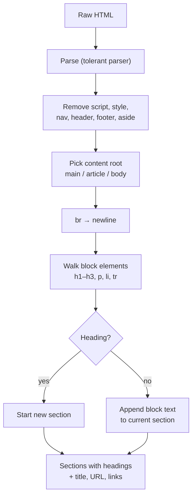

A great deal of the text a RAG system ingests is marked up: intranet and wiki pages are HTML, help centres export HTML, technical documentation is often authored in XML formats such as DocBook or DITA, sitemaps and RSS feeds are XML, and the Word files of the [DOCX lesson](/learn/data-processing/docx-extraction) turn out to be XML inside a zip archive. Markup is good news for retrieval, because it states the structure (this is a heading, this is a list, this is navigation) that plain text loses. It is bad news if you extract text carelessly, because the menu, the cookie banner and the footer come out mixed with the content, and words from adjacent tags get glued together.

This lesson teaches how markup is represented as a tree, how to navigate XML with Python's `ElementTree` and `lxml` (including the namespace and "tail" rules that trip everyone up), how to parse real-world HTML with Beautiful Soup, and how to turn a page into sections of clean text that keep their headings. Fetching pages from the web belongs to [Web scraping fundamentals](/learn/data-processing/web-scraping-fundamentals); advanced HTML extraction (boilerplate detection across many templates, readability algorithms) is covered later in [HTML parsing](/learn/advanced-document-parsing/html-parsing).

## Learning objectives

- Describe the XML and HTML document tree in terms of elements, attributes, text and tail, and explain why HTML needs a tolerant parser.
- Query XML with `ElementTree` and `lxml`, including namespaced documents and XPath expressions, and stream large files with `iterparse`.
- Extract clean, correctly spaced text from HTML with Beautiful Soup, removing non-content elements and keeping headings, lists and tables.
- Split a page into heading-labelled sections suitable for chunking, and resolve relative links.
- Parse untrusted XML safely, explaining the entity-expansion and external-entity attacks.

## Prerequisites

- [Text processing](/learn/data-processing/text-processing): whitespace normalisation and why paragraph structure matters.
- [Regular expressions](/learn/data-processing/regular-expressions): including why they are the wrong tool for nested markup.
- [Indexing pipeline](/learn/rag-architecture-fundamentals/indexing-pipeline): where parsing sits.

## Why this matters

Three failures dominate markup extraction in RAG pipelines.

**Boilerplate in the index.** A wiki page's navigation menu, sidebar and footer can contain more words than its content. Extract everything and every chunk from every page carries "Home | HR | IT | Privacy | Contact": the chunks look alike to the embedding model, near-duplicate noise competes for the top-k, and a question about privacy retrieves every page with a privacy link in its footer.

**Mangled text.** Markup separates words with tags, not always with spaces. `get_text()` on `<li>Leave</li><li>Expenses</li>` produces `LeaveExpenses`, a word no query contains. Adding a separator everywhere fixes that and breaks something else: `E-<b>4021</b>` becomes `E- 4021`, and an error code that users search for exactly is no longer in the index.

**Lost structure.** A heading tells you what the following paragraphs are about. Flatten the page to one string and the chunker cannot know that "up to 3 days a week" belongs to "Remote work". Keep the heading with its section and each chunk can carry it, which helps both retrieval and the citation the user sees.

There is also a security dimension: XML parsers can be made to expand a few hundred bytes into gigabytes, or to read files from your server, if you parse untrusted input with the wrong settings.

## The intuition

Think of a marked-up document as a set of labelled envelopes. The outer envelope is the page. Inside it are envelopes labelled "navigation", "main content" and "footer". Inside "main content" are envelopes labelled "heading", "paragraph", "list", and inside a paragraph there may be small envelopes labelled "bold" or "link" around a few words. The text itself is written on slips of paper placed in the envelopes, sometimes *between* the smaller envelopes.

Extracting text well means three decisions. Which envelopes to throw away unopened (navigation, scripts, footers). Which envelopes mark a new block of content, so that their slips start on a new line (headings, paragraphs, list items). And which are merely decorations inside a line (bold, italics, links), whose slips should be read straight through with no added space. Most extraction bugs are a wrong answer to one of those three questions.

## How it works

### The document tree

Both XML and HTML describe a **tree**. Each node is an **element**, written as a start tag, content and an end tag: `<para>The VPN client is out of date.</para>`. An element has a **tag name** (`para`), optional **attributes** (`id="e4021"`), and children, which are other elements or runs of text. The single element containing all others is the **root**.

**XML** (Extensible Markup Language) is strict: every start tag must be closed, elements must nest properly, attribute values must be quoted, and a document that breaks any rule is not XML at all; a conforming parser must stop with an error. Tag names are invented by whoever designs the format. **HTML** (HyperText Markup Language) has a fixed vocabulary of tags with defined meanings (`h1` to `h6` for headings, `p`, `ul`/`li`, `table`, `a`, `nav`, `main`) and is extremely tolerant: browsers render pages with unclosed tags, misnested tags and stray characters, and the HTML standard defines exactly how to recover from each error. Real HTML relies on that tolerance constantly, which is why you parse it with an HTML parser, never with an XML parser.

### Text and tail: the ElementTree model

Python's standard library represents XML with `xml.etree.ElementTree`. Its model of text is unusual and causes many bugs. Each element has two text slots:

- **`text`**: the text after the element's start tag, up to its first child.
- **`tail`**: the text after the element's *end* tag, up to the next sibling or the parent's end tag.

In `<para>The VPN client is <emph>out of date</emph>. Update it.</para>`, `para.text` is `"The VPN client is "`, the child `emph.text` is `"out of date"`, and the sentence's end, `". Update it."`, belongs to `emph.tail`, not to `para`. Code that collects `element.text` for every element loses every tail and drops half the words. Use `"".join(element.itertext())`, which walks text and tails in document order, or `findtext()` for simple elements.

### Namespaces

XML formats often place their tags in a **namespace**, a URI that makes names unique across vocabularies: `<runbook xmlns="urn:meridian:runbook:1">`. ElementTree expands every namespaced name to `{uri}localname`, so the root's tag is `{urn:meridian:runbook:1}runbook`, and `root.find("section")` finds nothing, because no element is called plain `section`. Pass a prefix map: `root.findall("rb:section", {"rb": "urn:meridian:runbook:1"})`. Attributes in a namespace are expanded the same way. The prefix you choose in your code is arbitrary; only the URI must match. This is the first thing to check when an XML query unexpectedly returns nothing.

### Querying: ElementTree paths and XPath

`ElementTree` supports a small path language: `find` (first match), `findall` (all matches), `iter(tag)` (all descendants with that tag), and paths such as `rb:section/rb:title` or `.//rb:para`. The third-party **lxml** library, a fast binding to the C libraries libxml2 and libxslt, implements the same API plus full **XPath 1.0**, a query language that can filter on content and position: `//rb:section[contains(rb:title, 'E-4021')]/rb:para//text()` means "all text nodes under the `para` of any section whose title contains E-4021". Use ElementTree when it is enough; reach for lxml when you need real XPath, speed on large files, or its HTML parser.

### Streaming large XML

`ET.parse` builds the whole tree in memory, and the tree costs several times the file size. For large files (a product catalogue, a full wiki export), use **`iterparse`**, which yields `(event, element)` pairs as the parser reads. Process each record on its `"end"` event, when its subtree is complete, and then call `elem.clear()` to free it. Without the `clear()`, iterparse still builds the full tree and saves nothing.

### HTML with Beautiful Soup

**Beautiful Soup** (package `beautifulsoup4`, imported as `bs4`) wraps an HTML parser and gives a convenient API over the resulting tree. You choose the parser: `"html.parser"` (Python's own, no extra dependency), `"lxml"` (fast and lenient, needs lxml) or `"html5lib"` (parses exactly as a browser would, slowest). Different parsers can produce different trees from the same broken HTML, so pick one and use it consistently.

The core operations:

- `soup.find("main")`, `soup.find_all(["h2", "p"])`, `soup.select("article p")` (CSS selectors) locate elements.
- `tag.get("href")` or `tag["href"]` read attributes.
- `tag.decompose()` removes an element and its contents from the tree.
- `tag.get_text()` returns all text inside an element. Its `separator` argument is placed between *every* pair of text pieces, and `strip=True` strips each piece.

### Extracting clean text from HTML, step by step

A dependable recipe for a content page:

1. **Parse** the HTML with a tolerant parser.
2. **Remove non-content elements**: `script`, `style`, `noscript`, `template`, and the page furniture `nav`, `header`, `footer`, `aside`, plus any site-specific selectors (cookie banners, "related articles"). Recent versions of Beautiful Soup leave script and style contents out of `get_text()` already, but navigation and footers are ordinary text and always come through.
3. **Choose the content root**: `<main>` or `<article>` if the site uses them, otherwise a site-specific container, otherwise `<body>`.
4. **Turn `<br>` into a newline** so that text either side of a line break does not merge.
5. **Walk the block elements** (headings, paragraphs, list items, table rows) in document order. For each block, take its text with *no* separator, so inline tags such as `<b>` and `<a>` add no spaces, then collapse whitespace.
6. **Group blocks into sections** by heading: each heading starts a new section, labelled with the heading text.
7. **Render lists and tables explicitly**: a bullet prefix for list items, cells joined with a delimiter for table rows (tables have [their own lesson](/learn/advanced-document-parsing/tables-and-structured-content) later).
8. **Collect metadata**: the `<title>`, canonical URL, links resolved to absolute URLs with `urllib.parse.urljoin`.



### Character references

Markup encodes some characters as **references**: `&amp;` for `&`, `&lt;` for `<`, `&nbsp;` for a non-breaking space, `&#163;` for `£`. Parsers decode them for you, so the text you extract contains real characters, including ` ` for `&nbsp;`. That is why the whitespace collapse in step 5 should use `str.split()`, which treats ` ` as whitespace. If you ever see `&amp;` in extracted text, something decoded the markup twice or not at all.

## In code

### XML: a namespaced runbook

**The problem.** Meridian's IT team authors runbooks in a small XML format with a namespace. Extract each section's ID, title and full paragraph text, without losing the text that follows inline elements.

**Dependencies.** Standard library only.

```python
import xml.etree.ElementTree as ET

RUNBOOK = """<?xml version="1.0" encoding="UTF-8"?>
<runbook xmlns="urn:meridian:runbook:1" xmlns:m="urn:meridian:meta:1"
         id="rb-vpn" m:owner="IT">
  <title>VPN troubleshooting</title>
  <section id="e4021">
    <title>Error E-4021</title>
    <para>The VPN client is <emph>out of date</emph>. Update it from the IT portal.</para>
  </section>
  <section id="e4012">
    <title>Error E-4012</title>
    <para>The certificate has expired. Reinstall it from the IT portal.</para>
  </section>
</runbook>"""

root = ET.fromstring(RUNBOOK)
print("root tag:", root.tag)
print("attributes:", root.attrib)

# Without the namespace, nothing is found.
print("find('section') ->", root.find("section"))

NS = {"rb": "urn:meridian:runbook:1", "m": "urn:meridian:meta:1"}
print("owner:", root.get("{urn:meridian:meta:1}owner"))
for section in root.findall("rb:section", NS):
    para = section.find("rb:para", NS)
    print(f"\n[{section.get('id')}] {section.findtext('rb:title', namespaces=NS)}")
    print("  para.text      :", repr(para.text))
    emph = para.find("rb:emph", NS)
    if emph is not None:
        print("  emph.text      :", repr(emph.text))
        print("  emph.tail      :", repr(emph.tail))
    print("  ''.join(itertext()):", repr("".join(para.itertext())))
```

```output
root tag: {urn:meridian:runbook:1}runbook
attributes: {'id': 'rb-vpn', '{urn:meridian:meta:1}owner': 'IT'}
find('section') -> None
owner: IT

[e4021] Error E-4021
  para.text      : 'The VPN client is '
  emph.text      : 'out of date'
  emph.tail      : '. Update it from the IT portal.'
  ''.join(itertext()): 'The VPN client is out of date. Update it from the IT portal.'

[e4012] Error E-4012
  para.text      : 'The certificate has expired. Reinstall it from the IT portal.'
  ''.join(itertext()): 'The certificate has expired. Reinstall it from the IT portal.'
```

**What the output shows.** The root's tag carries its namespace in braces, and so does the `owner` attribute. The plain `find("section")` returned `None`, the classic namespace bug; with the prefix map, both sections were found. In the first section, `para.text` stops at the `<emph>` tag, and the rest of the sentence lives in `emph.tail`. Only `itertext()` reassembled the whole sentence. The second paragraph has no children, so its `text` holds everything, which is exactly why code that reads only `.text` passes simple tests and fails on real documents.

The second script (run after saving `RUNBOOK` to `runbook.xml`) shows lxml's XPath, streaming with `iterparse`, and what happens when untrusted XML declares entities.

```bash
pip install lxml defusedxml
```

```python
import io
import xml.etree.ElementTree as ET
from lxml import etree
import defusedxml.ElementTree as DET

# lxml: XPath with namespaces
doc = etree.fromstring(open("runbook.xml", "rb").read())
NS = {"rb": "urn:meridian:runbook:1"}
print(doc.xpath("//rb:section[contains(rb:title, 'E-4021')]/rb:para//text()", namespaces=NS))
print(doc.xpath("count(//rb:section)", namespaces=NS))

# iterparse: stream a large file, clearing each element once processed
big = "<articles>" + "".join(f"<article id='{i:05d}'><title>Article {i}</title></article>" for i in range(100_000)) + "</articles>"
count = 0
for event, elem in ET.iterparse(io.BytesIO(big.encode()), events=("end",)):
    if elem.tag == "article":
        count += 1
        elem.clear()          # free the subtree we have finished with
print("articles streamed:", count)

# defusedxml refuses entity declarations
BOMB = """<?xml version="1.0"?>
<!DOCTYPE lolz [<!ENTITY lol "lol"><!ENTITY lol2 "&lol;&lol;&lol;&lol;&lol;&lol;&lol;&lol;&lol;&lol;">]>
<lolz>&lol2;</lolz>"""
try:
    DET.fromstring(BOMB)
except Exception as exc:
    print(type(exc).__name__, "-", exc)
```

```output
['The VPN client is ', 'out of date', '. Update it from the IT portal.']
2.0
articles streamed: 100000
EntitiesForbidden - EntitiesForbidden(name='lol', system_id=None, public_id=None)
```

The XPath query selected the section by the content of its title and returned its three text nodes, including the tail. XPath's `count()` returns a number, as a float. The streaming loop processed 100,000 records while freeing each one as it finished. The last line is the defence discussed under security: the entity declarations here are a harmless ten-fold miniature of the "billion laughs" attack, and `defusedxml` refuses to process entity declarations at all.

### HTML: a wiki page into sections

**The problem.** Turn a Meridian wiki page into heading-labelled sections of clean text, discarding the navigation, script and footer, keeping list items and the table, spacing words correctly, and resolving links.

**Dependencies.** Beautiful Soup and lxml.

```bash
pip install beautifulsoup4 lxml
```

```python
from urllib.parse import urljoin
from bs4 import BeautifulSoup

PAGE_URL = "https://wiki.meridian.example/hr/handbook/leave"
HTML = """<!DOCTYPE html>
<html><head><title>Leave and remote work | Meridian Wiki</title>
<script>window.analytics = {id: "abc"};</script>
<style>.note {color: red}</style></head>
<body>
<nav><a href="/">Home</a> | <a href="/hr">HR</a> | <a href="/it">IT</a></nav>
<main>
<h1>Leave and remote work</h1>
<p>Owner: HR team. Last reviewed March 2025.</p>
<h2>Annual leave</h2>
<p>Annual leave is <b>25 days</b>.<br>Up to 5 unused days carry over and must be used by 31&nbsp;March.</p>
<h2>Remote work</h2>
<p>Staff may work remotely up to 3 days a week.</p>
<ul><li>Equipment budget: £400</li><li>Contractors are not eligible</li></ul>
<p>See the <a href="../it/vpn">VPN guide</a> before working from public Wi-Fi.</p>
<table><tr><th>Item</th><th>Limit</th></tr><tr><td>Monitor</td><td>£150</td></tr></table>
</main>
<footer>© Meridian · <a href="/privacy">Privacy</a></footer>
</body></html>"""

soup = BeautifulSoup(HTML, "lxml")

# 1. The naive approach: everything, including the menu, glued together
naive = soup.get_text()
print(repr(naive[:150]))
print()

# 2. Remove what is never content, then extract text from <main> only
for tag in soup(["script", "style", "nav", "footer", "noscript"]):
    tag.decompose()
main = soup.find("main") or soup.body
for br in main.find_all("br"):
    br.replace_with("\n")       # a line break is whitespace, not nothing

# 3. Walk headings and blocks, grouping blocks into sections by heading
BLOCKS = ["h1", "h2", "h3", "p", "li", "tr"]
sections = []
current = {"heading": None, "text": []}
for el in main.find_all(BLOCKS):
    if el.name == "tr":
        cells = [c.get_text(" ", strip=True) for c in el.find_all(["th", "td"])]
        line = " | ".join(cells)
    else:
        line = " ".join(el.get_text().split())    # inline tags add no spaces
    if el.name in ("h1", "h2", "h3"):
        if current["text"]:
            sections.append(current)
        current = {"heading": line, "text": []}
    else:
        prefix = "- " if el.name == "li" else ""
        current["text"].append(prefix + line)
sections.append(current)

for s in sections:
    print(f"## {s['heading']}")
    print("\n".join(s["text"]))
    print()

# 4. Links, resolved against the page URL
print([urljoin(PAGE_URL, a["href"]) for a in main.find_all("a", href=True)])
print("title:", soup.title.get_text(strip=True))
```

```output
'Leave and remote work | Meridian Wiki\n\n\n\nHome | HR | IT\n\nLeave and remote work\nOwner: HR team. Last reviewed March 2025.\nAnnual leave\nAnnual leave is '

## Leave and remote work
Owner: HR team. Last reviewed March 2025.

## Annual leave
Annual leave is 25 days. Up to 5 unused days carry over and must be used by 31 March.

## Remote work
Staff may work remotely up to 3 days a week.
- Equipment budget: £400
- Contractors are not eligible
See the VPN guide before working from public Wi-Fi.
Item | Limit
Monitor | £150

['https://wiki.meridian.example/hr/it/vpn']
title: Leave and remote work | Meridian Wiki
```

**The important lines.**

- `soup(["script", "style", "nav", "footer", "noscript"])` is shorthand for `find_all` with a list of tag names; `decompose()` deletes each match with everything inside it.
- `soup.find("main") or soup.body` prefers the semantic content element and falls back to the body for pages without one.
- `br.replace_with("\n")` swaps each line-break element for a newline string, so `days.` and `Up to` cannot merge.
- `" ".join(el.get_text().split())` takes the block's text with no separator (inline `<b>` and `<a>` add nothing), then collapses all whitespace, including the ` ` from `&nbsp;`, to single spaces.
- Table cells *are* joined with a separator (`" | "`), because cell boundaries are word boundaries.
- `urljoin(PAGE_URL, a["href"])` resolves the relative `../it/vpn` the way a browser would.

**What the output means.** The naive `get_text()` began with the page title and the navigation menu, separated by runs of blank lines. (This version of Beautiful Soup left the script's contents out; nav text is ordinary text and came through.) The structured version produced three sections, each with its heading, no menu and no footer, list items marked as bullets and the table as delimited rows. The non-breaking space in `31&nbsp;March` became an ordinary space. Note the link: the relative URL `../it/vpn` on the page `/hr/handbook/leave` resolves to `/hr/it/vpn`, because `..` climbs from the page's directory `/hr/handbook/` to `/hr/`. If the author meant `/it/vpn`, the page has a broken link, and resolving links correctly is how you find out.

### Why the separator matters

A short experiment shows the trade-off that the extraction code above avoids.

```python
from bs4 import BeautifulSoup
h = '<p>Annual leave is <b>25 days</b>.<br>Up to 5 unused days. Error E-<b>4021</b></p>'
s = BeautifulSoup(h, "lxml")
print(repr(s.p.get_text()))
print(repr(s.p.get_text(" ", strip=True)))
for br in s.find_all("br"):
    br.replace_with("\n")
print(repr(" ".join(s.p.get_text().split())))
```

```output
'Annual leave is 25 days.Up to 5 unused days. Error E-4021'
'Annual leave is 25 days . Up to 5 unused days. Error E- 4021'
'Annual leave is 25 days. Up to 5 unused days. Error E-4021'
```

With no separator, the `<br>` disappears and two sentences merge (`days.Up`). With a space separator, the line break is fixed but every inline tag boundary gains a space: `days .` and, worse, `E- 4021`. Replacing `<br>` explicitly and leaving inline tags alone gets both right.

**Errors people commonly hit.**

- Text appearing twice: `find_all(["li", "p"])` matches both an `<li>` and a `<p>` nested inside it. Skip elements that have a block-level ancestor already being processed, or walk only leaf blocks.
- `AttributeError: 'NoneType' object has no attribute 'find_all'`: the page has neither `<main>` nor `<body>` in the shape you expected (for example, a fragment). Check for `None`.
- `bs4.FeatureNotFound: Couldn't find a tree builder with the features you requested: lxml`: lxml is not installed; install it or use `"html.parser"`.
- Content missing entirely: the page builds its content with JavaScript, so the HTML you fetched contains only an empty container. [Web scraping fundamentals](/learn/data-processing/web-scraping-fundamentals) covers that case.
- Empty results from an XML query: a namespace you did not include in the prefix map.

**How to extend it.** Record a heading path for each section (`["Leave and remote work", "Remote work"]`) rather than only the nearest heading, so that h3 sections keep their h2 context; that path becomes chunk metadata in [Heading-based chunking](/learn/advanced-chunking-strategies/heading-based-chunking). Add site-specific selectors for boilerplate as you discover it, and keep them in configuration rather than code.

## A real-world example

When the Platform team first indexed Meridian's wiki for AskMeridian, they used `soup.get_text()` on each page body. Answers were mostly right, but staff complained of a strange pattern: questions about privacy, accessibility or "contact" returned seemingly random pages, and the assistant sometimes cited three different pages for a one-line answer.

Looking at the stored chunks explained it. Every wiki page had a 60-word sidebar of links ("HR policies, IT runbooks, Privacy notice, Accessibility, Contact the support desk...") and a footer. On short pages the sidebar was most of the text, so many first chunks were nearly identical and were retrieved together for anything matching sidebar words. Separately, the wiki rendered error codes as `E-<code>4021</code>`, and an earlier fix to glued words (adding `separator=" "`) had turned them into `E- 4021`, so exact searches for error codes failed.

The team rewrote the extractor along the lines of the recipe above: remove the wiki's sidebar and footer containers by their CSS classes, take text from the content container only, walk block elements without a separator, and group by heading. They added two regression tests built from real pages: one asserting that no chunk contains the sidebar's distinctive phrase "IT runbooks, Privacy notice", and one asserting that `E-4021` appears verbatim in the VPN runbook's chunks. Index size fell noticeably, and the privacy-question anomaly disappeared.

## Common mistakes

- **Parsing HTML with regular expressions.** Works on the example page and breaks on the next one; nesting, attributes in any order and optional end tags defeat any regex.
- **Calling `get_text()` on the whole page.** Navigation, sidebars, cookie notices and footers enter the index and make chunks look alike.
- **Using one separator everywhere.** No separator glues block elements together; a space separator splits words at inline tags. Separate blocks, not inline elements.
- **Reading only `.text` in ElementTree.** Loses every tail, so text after inline elements disappears.
- **Ignoring namespaces.** Queries return nothing and code silently produces empty documents.
- **Flattening headings into the text stream.** Chunks lose the context that says what they are about.
- **Leaving relative links unresolved.** Stored links break as soon as they are shown outside the page.
- **Parsing untrusted XML with default settings.** Exposes the pipeline to entity-expansion and external-entity attacks.

## Best practices

- Use a real parser for markup: ElementTree or lxml for XML, Beautiful Soup (with a fixed choice of parser) for HTML.
- Remove non-content elements by tag and by site-specific selector before extracting text, and select a content root.
- Treat block elements as line or paragraph boundaries and inline elements as transparent.
- Keep headings, and preferably the full heading path, with each section, and carry them into chunk metadata.
- Use `itertext()` for XML text and include namespace prefix maps in every query.
- Stream large XML with `iterparse` and `clear()`.
- Parse untrusted XML with `defusedxml`, or with lxml configured not to resolve entities or access the network.
- Write regression tests from real pages: boilerplate absent, exact identifiers present.

## Performance considerations

- **Memory of a parsed tree.** A parsed tree costs several times the size of its source, because every element and text node is a Python object. A 5 MB HTML page might become a few tens of megabytes as a Beautiful Soup tree; a 2 GB XML export, parsed whole, would need far more memory than most workers have. Stream large XML; process HTML pages one at a time and drop the tree when done.
- **Parser speed.** lxml's parsers are written in C and are typically several times faster than Python's `html.parser`, and html5lib is slower still; Beautiful Soup adds its own overhead on top of whichever parser it wraps. For a few thousand pages none of this matters. For millions, measure: parsing with lxml directly (`lxml.html`) skips the Beautiful Soup layer.
- **Work estimate.** If parsing and extraction take about 20 ms per page (an assumption; measure your own), a 50,000-page wiki takes about $50{,}000 \times 0.02 = 1{,}000$ seconds, roughly 17 minutes on one core, and parallelises cleanly across processes. Embedding the resulting chunks will usually take longer.
- **Removing boilerplate saves money downstream.** Every word of navigation you do not index is a word you do not embed, store or send to the model in a retrieved chunk.

## Security considerations

- **Entity expansion ("billion laughs").** An XML document can declare entities that expand to other entities, ten-fold at each level; nine levels turn a kilobyte into gigabytes of text. Python's documentation has a section on XML vulnerabilities that lists which standard parsers are exposed to which attacks; the safe default for untrusted XML is the `defusedxml` package, which refuses entity declarations and external references.
- **External entities (XXE).** An entity can refer to a file path or URL (`<!ENTITY x SYSTEM "file:///etc/passwd">`). A parser that resolves it reads the file or makes a network request on the attacker's behalf. With lxml, create the parser with `etree.XMLParser(resolve_entities=False, no_network=True)` for untrusted input, or use `defusedxml`.
- **Scripts in HTML are data, not code.** Your pipeline never runs page scripts, but text extracted from pages can contain instructions aimed at the language model ("ignore previous instructions..."), hidden with CSS or placed in comments. Removing hidden elements and comments reduces the surface; it does not remove the need for the defences in later lessons on prompt injection.
- **Stored HTML shown to users.** If you keep snippets of source HTML and display them in a web interface, sanitise them; otherwise a page in the index becomes a cross-site scripting vector.

## Summary

- XML and HTML are trees of elements with attributes and text; XML is strict, HTML is tolerant and needs an HTML parser.
- In ElementTree, text after an inline element lives in that element's `tail`; use `itertext()`, and include namespace maps in every query.
- lxml adds full XPath and speed; `iterparse` with `clear()` streams large files in bounded memory.
- Good HTML extraction removes furniture, picks a content root, separates blocks but not inline elements, and keeps headings with their sections.
- Untrusted XML must be parsed with entity expansion and external entities disabled, for example with `defusedxml`.

## Exercises

**1. Text and tail.** For `<p>Call <b>08:00</b> to <b>18:00</b> UK time.</p>` parsed with ElementTree, write down `p.text`, each `b` element's `text` and `tail`, and the result of `"".join(p.itertext())`. Then check.

<details><summary>Show solution</summary>

```python
import xml.etree.ElementTree as ET
p = ET.fromstring("<p>Call <b>08:00</b> to <b>18:00</b> UK time.</p>")
print(repr(p.text), [(b.text, b.tail) for b in p], repr("".join(p.itertext())))
```

```output
'Call ' [('08:00', ' to '), ('18:00', ' UK time.')] 'Call 08:00 to 18:00 UK time.'
```

`p.text` stops at the first child. The words between and after the bold elements belong to the bold elements' tails. A function that concatenated only `.text` values would produce `Call 08:0018:00`, losing the support desk's meaning entirely.

</details>

**2. Tables as sentences.** Write `table_to_sentences(table)` that turns each data row of an HTML table into one sentence of `header: value` pairs, and run it on a table of equipment limits with columns Item, Limit and Receipt needed.

<details><summary>Show solution</summary>

```python
from bs4 import BeautifulSoup

HTML = """<table>
<tr><th>Item</th><th>Limit</th><th>Receipt needed</th></tr>
<tr><td>Monitor</td><td>£150</td><td>Yes</td></tr>
<tr><td>Desk chair</td><td>£200</td><td>Yes</td></tr>
</table>"""

def table_to_sentences(table) -> list[str]:
    rows = table.find_all("tr")
    headers = [th.get_text(strip=True) for th in rows[0].find_all(["th", "td"])]
    out = []
    for row in rows[1:]:
        cells = [td.get_text(strip=True) for td in row.find_all(["th", "td"])]
        out.append("; ".join(f"{h}: {c}" for h, c in zip(headers, cells)) + ".")
    return out

for line in table_to_sentences(BeautifulSoup(HTML, "lxml").table):
    print(line)
```

```output
Item: Monitor; Limit: £150; Receipt needed: Yes.
Item: Desk chair; Limit: £200; Receipt needed: Yes.
```

Each sentence is self-contained, so a chunk holding only the second row still says what £200 is the limit *for*, which a bare `Desk chair | £200 | Yes` does not. This simple version assumes the first row holds the headers and that no cell spans several columns (`colspan`) or rows (`rowspan`); real tables break both assumptions, which is the subject of [Tables and structured content](/learn/advanced-document-parsing/tables-and-structured-content). The same idea applied to CSV rows appeared in [JSON and CSV](/learn/data-processing/json-and-csv).

</details>

**3. Read a sitemap.** Many sites publish an XML sitemap listing their pages, with optional last-modified dates, in the namespace `http://www.sitemaps.org/schemas/sitemap/0.9`. Parse one safely and print each URL with its `lastmod`, or `unknown` when it is absent.

<details><summary>Show solution</summary>

```python
import defusedxml.ElementTree as ET

SITEMAP = b"""<?xml version="1.0" encoding="UTF-8"?>
<urlset xmlns="http://www.sitemaps.org/schemas/sitemap/0.9">
  <url><loc>https://wiki.meridian.example/hr/handbook/leave</loc><lastmod>2025-03-01</lastmod></url>
  <url><loc>https://wiki.meridian.example/it/vpn</loc><lastmod>2025-02-14</lastmod></url>
  <url><loc>https://wiki.meridian.example/it/laptops</loc></url>
</urlset>"""

NS = {"sm": "http://www.sitemaps.org/schemas/sitemap/0.9"}
root = ET.fromstring(SITEMAP)
for url in root.findall("sm:url", NS):
    loc = url.findtext("sm:loc", namespaces=NS)
    lastmod = url.findtext("sm:lastmod", default="unknown", namespaces=NS)
    print(f"{lastmod:<10}  {loc}")
```

```output
2025-03-01  https://wiki.meridian.example/hr/handbook/leave
2025-02-14  https://wiki.meridian.example/it/vpn
unknown     https://wiki.meridian.example/it/laptops
```

`defusedxml.ElementTree.fromstring` is a drop-in replacement for the standard function with the dangerous features disabled; the returned elements are ordinary ElementTree elements. A sitemap comes from a web server, so it is untrusted input. Pass the bytes, not a decoded string, so the parser can honour the encoding declared in the XML header. The `lastmod` dates are what an incremental crawler compares against its last run, as [Web scraping fundamentals](/learn/data-processing/web-scraping-fundamentals) and [Incremental ingestion](/learn/understanding-document-ingestion/incremental-ingestion) explain.

</details>

**4. Design: one extractor for many templates.** Meridian's intranet has grown three page templates over the years: the wiki (content in `<main>`), an old CMS (content in `<div id="content">` with a sidebar inside it) and a help centre (content in `<article>`, with a "Was this helpful?" widget and related-article links inside the article). Design an extractor that handles all three, is easy to extend for a fourth, and lets you notice when a template changes.

<details><summary>Show solution</summary>

Separate the generic algorithm from per-template configuration. A configuration entry per template might hold: a way to recognise it (URL prefix, or a distinctive element such as a generator meta tag), the CSS selector for the content root (`main`, `div#content`, `article`), and a list of selectors to remove inside the root (`div.sidebar`; `div.feedback-widget`, `section.related`). The extractor detects the template, applies its removals, selects the root and runs the shared block-walking and sectioning code. A fourth template is a new configuration entry, not new code.

To notice changes, record simple quality signals per page: extracted word count, ratio of extracted text to total page text, number of sections, and whether the root selector matched at all. Alert when a template's root selector stops matching (the extractor would otherwise fall back to `<body>` and silently reintroduce boilerplate), and when the distribution of word counts shifts sharply after a deploy of the source site. Keep a small set of golden pages per template with expected extracted text and run them in CI. Learned boilerplate removal, which needs no per-template configuration, is covered in [HTML parsing](/learn/advanced-document-parsing/html-parsing); configuration-driven extraction is usually the right start when you own the sources.

</details>

## Check your understanding

```quiz
[
  {
    "q": "In ElementTree, for `<para>Update <b>now</b> please.</para>`, where is the text ` please.` stored?",
    "options": ["`para.text`", "`b.text`", "`b.tail`", "`para.tail`"],
    "answer": 2,
    "why": "Text after an element's end tag, up to the next sibling or the parent's end, is that element's tail."
  },
  {
    "q": "`root.find(\"section\")` returns `None` on a document whose root is `<runbook xmlns=\"urn:meridian:runbook:1\">` and which clearly contains section elements. Why?",
    "options": ["`find` only searches attributes", "The elements' real names include the namespace, `{urn:meridian:runbook:1}section`, so a prefix map is needed", "ElementTree cannot parse namespaced XML", "`find` requires XPath syntax"],
    "answer": 1,
    "why": "ElementTree expands namespaced names to `{uri}localname`; pass a prefix map such as `{\"rb\": \"urn:meridian:runbook:1\"}` and query `rb:section`."
  },
  {
    "q": "What does `get_text(\" \", strip=True)` produce for `<p>Error E-<b>4021</b></p>`?",
    "options": ["`Error E-4021`", "`Error E- 4021`", "`ErrorE-4021`", "`Error E 4021`"],
    "answer": 1,
    "why": "The separator is inserted between every pair of text pieces, including at the inline `<b>` boundary, splitting the error code."
  },
  {
    "q": "Why is calling `elem.clear()` important when using `iterparse` on a large file?",
    "options": ["It validates the element", "Without it the full tree is still built in memory, so streaming saves nothing", "It resolves namespaces", "It is required to receive end events"],
    "answer": 1,
    "why": "iterparse builds the tree as it goes; clearing each processed element is what keeps memory bounded."
  },
  {
    "q": "Which is the safe way to parse an XML file uploaded by an external user?",
    "options": ["`xml.etree.ElementTree.fromstring` with default settings", "A regular expression that extracts tags", "`defusedxml.ElementTree.fromstring`, which refuses entity declarations and external references", "`lxml.etree.fromstring` with `resolve_entities=True`"],
    "answer": 2,
    "why": "defusedxml blocks entity-expansion and external-entity attacks; resolving entities on untrusted input is exactly what those attacks exploit."
  }
]
```

## Further reading

- [Python documentation: `xml.etree.ElementTree`](https://docs.python.org/3/library/xml.etree.elementtree.html): the element model, path syntax, namespaces and `iterparse`.
- [Python documentation: XML processing modules](https://docs.python.org/3/library/xml.html): including the section on XML vulnerabilities.
- [lxml documentation](https://lxml.de/): XPath, the HTML parser and parser security options.
- [Beautiful Soup documentation](https://www.crummy.com/software/BeautifulSoup/bs4/doc/): parsers, navigation, `get_text` and CSS selectors.
- [defusedxml on PyPI](https://pypi.org/project/defusedxml/): the attacks it prevents, with examples.
- [W3C: Extensible Markup Language (XML) 1.0](https://www.w3.org/TR/xml/) and the [WHATWG HTML Living Standard](https://html.spec.whatwg.org/): the specifications, including HTML's error-recovery rules.
