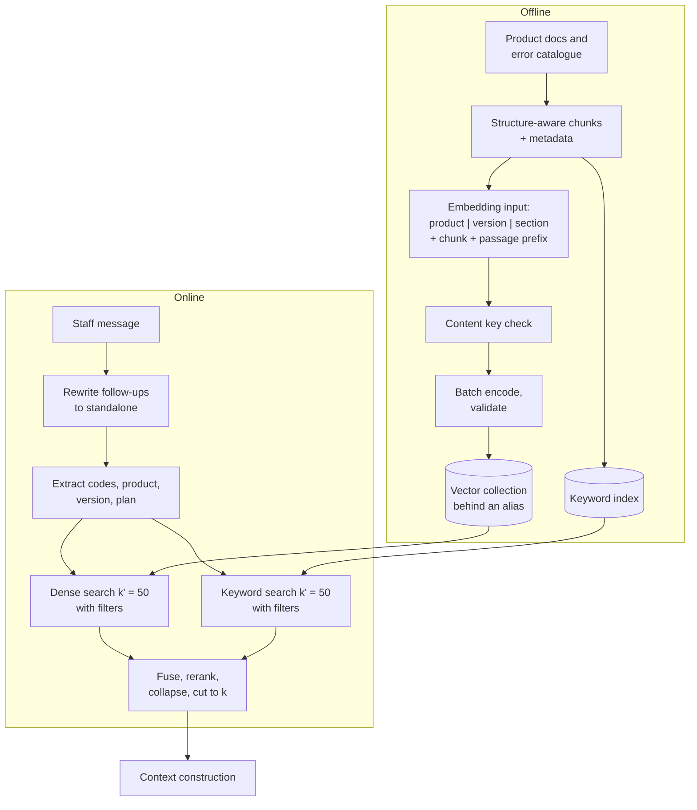

This assessment covers the whole Dense Retrieval module: the bi-encoder architecture and the contract between its offline and online paths, semantic search as a task, the query and document sides of the encoder, turning scores into a ranking, and the limitations that no tuning removes. It mixes recall, calculation, code-reading and production scenarios. Aim for at least 70% on the quiz (13 of 18) before moving on, and write your own answer to every open question before opening the model answer. The coding exercises run locally with NumPy and `sentence-transformers` and need no API key.

```quiz
[
  {
    "q": "What property of a bi-encoder makes dense retrieval over millions of chunks practical?",
    "options": [
      "It reads the query and passage together in one input",
      "The document vector does not depend on the query, so it can be computed once, offline",
      "It uses fewer parameters than a keyword index",
      "It always returns exact nearest neighbours"
    ],
    "answer": 1,
    "why": "The score factorises into a query vector and a document vector. Precomputing document vectors leaves one encoder pass and fast vector comparisons per query."
  },
  {
    "q": "Which change does NOT require re-embedding the whole corpus?",
    "options": [
      "Switching to a newer revision of the embedding model",
      "Adding the section path to every embedding input",
      "Changing the document prefix from none to 'passage: '",
      "Raising the final k from 5 to 8"
    ],
    "answer": 3,
    "why": "k is a query-time setting. The other three change what the encoder produces for each chunk, so every vector must be recomputed."
  },
  {
    "q": "What does this print?\n```python\nimport numpy as np\nq = np.array([0.6, 0.8])\nd = np.array([1.2, 1.6])\nprint(round(float(q @ d), 2), round(float(q @ d / np.linalg.norm(d)), 2))\n```",
    "options": ["2.0 1.0", "1.0 1.0", "2.0 2.0", "1.0 0.5"],
    "answer": 0,
    "why": "The dot product is 0.72 + 1.28 = 2.0. d has length 2 and points the same way as the unit vector q, so the cosine is 1.0."
  },
  {
    "q": "Which task is symmetric semantic search?",
    "options": [
      "Answering 'when does the support desk open?' from the handbook",
      "Finding the runbook section that fixes a described symptom",
      "Finding past incident reports similar to a new incident report",
      "Retrieving passages for a RAG answer"
    ],
    "answer": 2,
    "why": "Incident report against incident reports compares texts of the same kind. The others match a short query against passages that answer it."
  },
  {
    "q": "An FAQ index stores only the stored questions' vectors. Which failure is characteristic of this design?",
    "options": [
      "It cannot handle any paraphrase",
      "A stored question that merely resembles the query wins over the entry whose answer is relevant",
      "It always returns the longest answer",
      "It requires a cross-encoder"
    ],
    "answer": 1,
    "why": "Question-to-question matching rewards surface resemblance, as when 'buy a monitor for working at home' matched 'Can I work from home?'."
  },
  {
    "q": "An E5 index was built with 'passage: ' on every chunk. The query service sends queries with 'passage: ' too. What is the likely effect?",
    "options": [
      "No effect, since both sides match",
      "A crash due to a dimension mismatch",
      "Better recall, because the prefixes match",
      "Lower recall, with no error raised"
    ],
    "answer": 3,
    "why": "E5 is trained with 'query: ' for queries. In the SciFact run, the document prefix on queries cost about four points of recall@10 against either correct option."
  },
  {
    "q": "Searching with the normalised blend alpha * q_now + (1 - alpha) * q_prev ranks documents the same as which of these?",
    "options": [
      "alpha * cos(q_now, d) + (1 - alpha) * cos(q_prev, d)",
      "max(cos(q_now, d), cos(q_prev, d))",
      "cos(q_now, d) alone",
      "cos(q_now, d) * cos(q_prev, d)"
    ],
    "answer": 0,
    "why": "The dot product is linear, and the normalising length is the same for every document, so it cannot change the order."
  },
  {
    "q": "Which query preprocessing step is safe for a Transformer embedding model?",
    "options": [
      "Removing stop words such as 'not'",
      "Stemming 'rotating' to 'rotat'",
      "Unicode NFKC normalisation and collapsing whitespace",
      "Stripping hyphens from 'E-4021'"
    ],
    "answer": 2,
    "why": "Normalisation makes identical-looking input identical without removing information. The others delete words or characters the model or a keyword index needs."
  },
  {
    "q": "Why should a query-embedding cache key include the model version?",
    "options": [
      "To make keys unique across users",
      "So that after a model change, old-space vectors are never served against the new index",
      "Because hashing text alone is too slow",
      "To reduce memory usage"
    ],
    "answer": 1,
    "why": "Vectors from different models are not comparable. Including the version invalidates every old entry automatically."
  },
  {
    "q": "Which item belongs in a chunk's metadata rather than its embedding input?",
    "options": [
      "The chunk's text",
      "The document title, as context",
      "The model's document prefix",
      "The document's 'superseded' status"
    ],
    "answer": 3,
    "why": "Status is a fact that needs exact handling with a filter. Embed meaning, filter facts."
  },
  {
    "q": "What does this print?\n```python\ndef waste(lengths, b):\n    computed = sum(max(lengths[i:i+b]) * len(lengths[i:i+b]) for i in range(0, len(lengths), b))\n    return round(1 - sum(lengths) / computed, 2)\nprint(waste([10, 90, 10, 90], 2), waste(sorted([10, 90, 10, 90]), 2))\n```",
    "options": ["0.0 0.44", "0.44 0.0", "0.44 0.44", "0.5 0.0"],
    "answer": 1,
    "why": "Unsorted: two batches of (10, 90) compute 360 positions for 200 real tokens, waste 0.44. Sorted: (10, 10) and (90, 90) compute exactly 200, waste 0.0."
  },
  {
    "q": "A team computes content keys as sha256(chunk_text). They then add section paths to every embedding input. What happens on the next incremental run?",
    "options": [
      "Nothing is re-embedded, because the chunk text did not change",
      "Every chunk is re-embedded",
      "Only new chunks get section paths",
      "The job fails with a key collision"
    ],
    "answer": 0,
    "why": "The key ignores the embedding input, so the change is invisible to the incremental logic. Keys must hash the model, its revision and the exact embedding input. (New or edited chunks would get section paths, so the index ends up inconsistent.)"
  },
  {
    "q": "Similarities are 0.72 (current) and 0.75 (superseded); recency boosts are 0.5 and 0.25. With final = (1 - w) * s + w * b, roughly what is the smallest w that ranks the current chunk first?",
    "options": ["0.03", "0.25", "0.107", "0.5"],
    "answer": 2,
    "why": "w > 0.03 / (0.03 + 0.25) = 0.03 / 0.28, about 0.107."
  },
  {
    "q": "The rule is 'contractors must never see the benefits section'. How should it be implemented?",
    "options": [
      "A negative boost on benefits chunks for contractors",
      "A metadata filter inside the vector search",
      "Removing benefits chunks from the top 5 after retrieval",
      "An instruction in the system prompt"
    ],
    "answer": 1,
    "why": "An access rule is absolute, so it must be a hard filter applied in the search. Boosts and post-filters can leak or return short result lists, and prompts are not access control."
  },
  {
    "q": "Two chunks tie on score. Without a secondary sort key, what can happen?",
    "options": [
      "The database rejects the query",
      "Both are dropped",
      "Their order can change between runs or after an index rebuild",
      "The higher-dimensional one always wins"
    ],
    "answer": 2,
    "why": "Tied items come back in storage order, which is not stable across rebuilds, so the same query can produce different lists."
  },
  {
    "q": "In the minimal-pair test with all-MiniLM-L6-v2, which pair scored highest?",
    "options": [
      "'Expenses over £75 need a receipt' and 'Expenses over £750 need a receipt'",
      "'Annual leave is 25 days per year' and 'Staff get twenty-five days of holiday a year'",
      "'Expenses over £75 need a receipt' and a correct paraphrase of it",
      "'Contractors are eligible' and 'Contractors are not eligible'"
    ],
    "answer": 0,
    "why": "The £75 and £750 versions scored 0.995: nearly identical wording dominates, even though the facts differ."
  },
  {
    "q": "Four unit vectors in 2-D sit at 0, 90, 180 and 270 degrees. Which top-2 set can no query produce?",
    "options": [
      "The vectors at 0 and 90 degrees",
      "The vectors at 90 and 180 degrees",
      "The vectors at 270 and 0 degrees",
      "The vectors at 0 and 180 degrees"
    ],
    "answer": 3,
    "why": "For opposite vectors, one of the pair always scores at most zero while one of the other two scores at least zero, so the pair is never strictly the top 2."
  },
  {
    "q": "Engineers pasting bare Atlas error codes often get a neighbouring code's runbook. Which combination addresses this best?",
    "options": [
      "A larger embedding model and a higher k",
      "Keyword retrieval fused with dense retrieval, plus an exact-match error-code field",
      "Adding the word 'error' to every query",
      "Lowering the similarity threshold"
    ],
    "answer": 1,
    "why": "Identifiers carry little learned meaning, so dense vectors blur them. Keyword matching and exact fields handle them; fusion keeps dense retrieval's strengths."
  }
]
```

## Conceptual questions

1. Explain why a dense index and its query encoder must be treated as one versioned artefact. List the settings that make up that version, and describe what happens, observably and unobservably, when one of them differs between the two paths.

<details><summary>Show model answer</summary>

Query and chunk vectors are only comparable if they were produced in the same vector space with the same conventions. The version consists of: model name and exact revision; query and document prefixes or instructions; the embedding-input format (title, section path, context); normalisation; maximum sequence length; and the index metric. If any differs, nothing errors as long as the dimensions match: every query still returns $k$ results with plausible scores. What changes is the quality of the ranking, which degrades from slightly to badly depending on how far the two sides diverge. Close variants (two revisions of one model) produce vague, off-to-one-side results rather than obvious nonsense, which makes the fault harder to notice. Only a judged evaluation set or a canary set run against the live query path reveals it, which is why the configuration should be shared by both jobs, stored with the index, and checked by the query service at start-up.

</details>

2. A colleague argues that "semantic search" and "dense vector search" are the same thing. Explain the distinction and why it matters for choosing a model and an index layout.

<details><summary>Show model answer</summary>

Dense vector search is a mechanism: encode texts as vectors and return nearest neighbours. Semantic search is a task: finding information by meaning. The same mechanism serves different tasks, and the task decides the details. Symmetric tasks (duplicate detection, FAQ question matching) need a model that recognises paraphrase; asymmetric tasks (question to answering passage, most RAG) need a model trained on query-passage pairs, often with prefixes. The task also decides what each index entry should represent: stored questions, answers, combined text, several vectors per entry, small chunks returned as larger parents. A model or layout chosen for one task can disappoint on the other, and the choice should be made by measuring on judged queries of the right kind.

</details>

3. Compare rewriting a conversational follow-up with a language model against interpolating query vectors. When would you use each?

<details><summary>Show model answer</summary>

Rewriting produces a standalone query ("Are contractors eligible for the home-office equipment budget?") and can resolve pronouns, ellipsis and changes of subject. It is the most robust and the most expensive: an extra model call, often hundreds of milliseconds, and a prompt-injection surface. Interpolation blends the current and previous query vectors; it is cheap (one extra embedding, often cached) and needs no model call, but it is equivalent to blending two searches' scores, so it cannot resolve a reference or express anything those two searches could not. Use rewriting for follow-ups that are short or contain references and continuations ("and", "what about", "it", "that"), and skip it for first messages and self-contained ones; use interpolation as a cheap fallback or when latency budgets forbid a model call.

</details>

4. Why is "embed meaning, filter facts" a good rule for the document side? Give three examples of facts and say what goes wrong if they are embedded instead of filtered.

<details><summary>Show model answer</summary>

Embeddings capture topic and wording well and exact details poorly, and similarity is graded while many rules are absolute. Examples: (1) document status ("superseded"): embedding it nudges the vector slightly and cannot guarantee exclusion, so outdated policy still reaches the model; (2) access rights ("HR only"): similarity cannot enforce permissions, so restricted chunks leak; (3) effective dates or product versions: "v2.3" and "v3.2" or "2023" and "2024" are nearly indistinguishable to the encoder, so the wrong version ranks first. As metadata, each becomes an exact filter or a transparent ranking signal. Meanwhile, meaning-bearing context such as the title and section path belongs in the embedding input, where it helps the encoder place chunks that do not name their subject.

</details>

5. Explain, using the top-$k$ reachability argument, why some combinations of conditions are better handled by filters than by a single query vector.

<details><summary>Show model answer</summary>

A retriever can only return top-$k$ sets that some query vector produces. With $n$ documents there are $\binom{n}{k}$ possible sets, and in a space of fixed dimension only some are reachable: in 2-D with four evenly spaced unit vectors, only the 4 neighbouring pairs of 6 are reachable. Higher dimensions allow more combinations, but for fixed dimension and large $n$ the number of possible sets grows much faster, and recent work (Weller and colleagues, 2025) relates representable combinations to dimension formally. A query such as "HR documents updated this year that mention contractors" asks for the intersection of three independent conditions, a set that need not correspond to any single direction in the space. Expressing "HR" and "this year" as metadata filters leaves only "mentions contractors" for the vector, which it can handle.

</details>

## Coding exercises

### Exercise 1: exact top-k with reproducible ties

Write `top_k(matrix, ids, query, k)` that normalises the query, scores every row of a matrix of unit vectors, and returns the top `k` as `(id, score)` pairs. It must use `np.argpartition` rather than a full sort, and ties must be broken by id, including ties at the $k$-th position.

<details><summary>Show solution</summary>

```python
import numpy as np

def top_k(matrix, ids, query, k):
    """Exact top-k by inner product; ties broken by id so the order is reproducible."""
    q = query / np.linalg.norm(query)
    scores = matrix @ q
    k = min(k, len(ids))
    cand = np.argpartition(-scores, k - 1)[:k]
    # A tie at the k-th score could leave an equally good item outside cand: widen to include ties.
    kth = scores[cand].min()
    cand = np.flatnonzero(scores >= kth)
    ranked = sorted(cand, key=lambda i: (-round(float(scores[i]), 6), ids[i]))[:k]
    return [(ids[i], round(float(scores[i]), 3)) for i in ranked]

ids = ["d", "b", "a", "c", "e"]
M = np.array([[0.6, 0.8], [0.8, 0.6], [0.8, 0.6], [0.0, 1.0], [1.0, 0.0]])
M = M / np.linalg.norm(M, axis=1, keepdims=True)
print(top_k(M, ids, np.array([1.0, 1.0]), k=2))
print(top_k(M, ids, np.array([1.0, 0.0]), k=3))
```

```output
[('a', 0.99), ('b', 0.99)]
[('e', 1.0), ('a', 0.8), ('b', 0.8)]
```

Rows "a", "b" and "d" all score 0.99 for the first query (since (0.6, 0.8) and (0.8, 0.6) are mirror images about the query direction). `argpartition` would pick two of the three arbitrarily; widening the candidate set to every score at least the $k$-th, then sorting by score and id, makes the answer always "a", "b". Rounding the score before comparing prevents floating-point noise in the last digits from defeating the tie-break.

</details>

### Exercise 2: a minimal-pair probe

Write `probe(model, pairs)` that takes `(label, text_a, text_b)` triples and returns the mean cosine per label. Use it to compare pairs in which one fact changes against true paraphrases, using new Meridian facts.

<details><summary>Show solution</summary>

```python
from collections import defaultdict
from sentence_transformers import SentenceTransformer

def probe(model, pairs):
    """Mean cosine per label for (label, text_a, text_b) pairs."""
    a = model.encode([p[1] for p in pairs], normalize_embeddings=True)
    b = model.encode([p[2] for p in pairs], normalize_embeddings=True)
    by_label = defaultdict(list)
    for (label, _, _), x, y in zip(pairs, a, b):
        by_label[label].append(float(x @ y))
    return {label: round(sum(v) / len(v), 3) for label, v in by_label.items()}

pairs = [
    ("changed", "Remote work is allowed up to 3 days a week.", "Remote work is allowed up to 2 days a week."),
    ("changed", "Passwords must be rotated every 90 days.", "Passwords must be rotated every 30 days."),
    ("changed", "VPN is required on public Wi-Fi.", "VPN is not required on public Wi-Fi."),
    ("paraphrase", "Remote work is allowed up to 3 days a week.", "You can work from home three days in every week."),
    ("paraphrase", "Passwords must be rotated every 90 days.", "Change your password once a quarter."),
    ("paraphrase", "VPN is required on public Wi-Fi.", "Always connect through the VPN when using a café's wireless network."),
]
model = SentenceTransformer("sentence-transformers/all-MiniLM-L6-v2")
print(probe(model, pairs))
```

```output
{'changed': 0.971, 'paraphrase': 0.67}
```

Pairs stating *different* facts average 0.971; pairs stating the *same* fact in other words average 0.67. Encoding all texts in two batched calls is much faster than encoding pair by pair. A probe like this, run on your own domain's critical facts, tells you which distinctions you must not leave to the embedding model.

</details>

### Exercise 3: interpolation equals score blending

Verify numerically, on 1,000 random unit vectors in 64 dimensions, that ranking by a normalised blend of two query vectors gives the same top 10 as ranking by the same blend of their cosine scores.

<details><summary>Show solution</summary>

```python
import numpy as np

rng = np.random.default_rng(42)
D = rng.normal(size=(1000, 64))
D /= np.linalg.norm(D, axis=1, keepdims=True)
q_now, q_prev = rng.normal(size=64), rng.normal(size=64)
q_now /= np.linalg.norm(q_now); q_prev /= np.linalg.norm(q_prev)
alpha = 0.6

blend = alpha * q_now + (1 - alpha) * q_prev
by_vector = np.argsort(-(D @ (blend / np.linalg.norm(blend))))[:10]
by_scores = np.argsort(-(alpha * (D @ q_now) + (1 - alpha) * (D @ q_prev)))[:10]
print("same top 10:", np.array_equal(by_vector, by_scores))
print("norm of blend:", round(float(np.linalg.norm(blend)), 4))
```

```output
same top 10: True
norm of blend: 0.69
```

The blend has length 0.69, so every blended-vector score is the blended score divided by 0.69. Dividing every score by the same positive constant cannot change their order.

</details>

## Architecture design challenge

Meridian wants AskMeridian to answer customer-support staff questions about its products as well as internal policy. The new corpus is the product documentation for Meridian Sync, Meridian Relay and Meridian Reports, including features that differ by plan (for example SAML single sign-on on the Enterprise plan for Meridian Reports), and the Atlas error-code catalogue. Documentation exists for several product versions at once, and a new version is published every quarter. Assume about 2 million chunks. Support staff paste error codes, describe customer symptoms in plain English, and ask follow-up questions in a chat.

Design the dense retrieval layer: what is embedded and how, what is metadata, how queries are processed, how results are ranked, how the index is kept current and how model upgrades are handled. Say where dense retrieval alone is not enough and what you add.

<details><summary>Show reference design</summary>



**Embedding input.** Product name, version and section path, then the chunk text, with the model's document prefix. Error-catalogue entries embed the code's description and resolution with the code included, but exact matching on the code is not left to the vector.

**Metadata.** Product, product version, applicable plans, document status (current, deprecated), error codes mentioned, last updated date, and the embedding configuration version. Versions and plans are facts: filter on them.

**Query path.** Rewrite short or referential follow-ups into standalone queries. Extract error codes with a regular expression, and product, version and plan when stated (or from the customer record the support agent is viewing). Apply the model's query prefix. Cache query vectors by normalised text and model version.

**Retrieval and ranking.** Dense and keyword search in parallel, both with filters for product, version and plan, each returning around 50 candidates. An exact error-code match short-circuits to the catalogue entry. Fuse with Reciprocal Rank Fusion, rerank the top 30 with a cross-encoder to separate negations and close variants, collapse near-duplicates across versions (prefer the version the customer runs), cap chunks per document, and cut to 5 to 8. If the reranker's top score is below a threshold calibrated on unanswerable questions, say so instead of answering.

**Freshness and scale.** Incremental embedding by content key; a quarterly version adds new chunks rather than replacing old ones, with older versions marked by metadata, not deleted, because customers run them. At 2 million chunks of 768 dimensions in `float32`, the vectors take about 6.1 GB before index overhead, so an ANN index (HNSW) is required, and its recall should be measured against exact search on a sample of real queries; scalar quantisation is an option if memory is tight.

**Model upgrades.** Blue/green: build a new collection, evaluate on a judged set covering error codes, plan-specific features, version differences, symptoms, follow-ups and unanswerable questions, then switch the alias and the query configuration in one deployment. Twice the vector storage is needed during the migration.

**Trade-offs.** Hybrid search and reranking add latency (the reranker dominates; tune $k'$). Filtering by version requires knowing the customer's version; when unknown, retrieve across versions and show the version in each citation. Rewriting follow-ups adds a model call, so apply it only to messages that need it.

</details>

## Troubleshooting scenarios

### Scenario 1: recall fell after a "no-op" deployment

After a routine dependency upgrade in the query service, AskMeridian's canary set of twenty questions drops from 19 correct top-5 retrievals to 15. The index was not rebuilt. Query latency and error rates are unchanged, and every query still returns five results.

<details><summary>Show diagnosis and fix</summary>

The vector space or its conventions changed on the query side only. Likely causes, in order of likelihood: the upgrade changed the embedding model revision downloaded at start-up (an unpinned model); it changed how prompts are applied (for example a helper that previously added the query prefix now uses the model's configured prompt, which is empty); or it changed a default such as normalisation or maximum sequence length. Diagnose by encoding a fixed query in the old and new environments and comparing the vectors directly (cosine near 1.0 if nothing changed), and by logging the exact text sent to the encoder. Fix by pinning the model revision, passing prefixes explicitly from shared configuration, and making the query service compare its configuration with the version stored in the collection at start-up. Keep the canary set running after every deployment, since it caught this.

</details>

### Scenario 2: the same question, different answers

Support staff report that asking the same question twice, a day apart, sometimes produces different answers. The logs show the top five chunks differ between the two runs, though the corpus did not change. The scores of the third to sixth results are identical to three decimal places.

<details><summary>Show diagnosis and fix</summary>

Ties. Several chunks have identical or near-identical scores (duplicated text, or a passage repeated across product versions), and the order of tied items comes from storage order, which changed when the vector database merged segments or rebuilt part of its index overnight. An approximate index can also return slightly different candidates after a rebuild. Fix by sorting deterministically with a secondary key (chunk id), widening the candidate set to include all items tied at the $k$-th position, collapsing near-duplicates by a duplicate-group id assigned at ingestion, and rescoring candidates exactly. If an ANN index is involved, measure its recall against exact search and raise its search-time parameter if misses are frequent.

</details>

### Scenario 3: a contractor is told he is eligible

A contractor asks "Can I claim the home-office equipment budget?" and AskMeridian answers that he can claim £400. The retrieved chunks, in order, are: "Permanent staff are eligible for the £400 home-office equipment budget", a remote-work chunk, and "Contractors are not eligible for the home-office equipment budget". A second report says that a question about laptop replacement was answered with "every 4 years".

<details><summary>Show diagnosis and fix</summary>

Two distinct limitations. The first is negation and qualification: the eligible and not-eligible chunks are about the same topic and score similarly, and the positive one ranked first; the model answered from the first chunk. A cross-encoder reranker over the top candidates is better at the distinction, and, more robustly, eligibility should be structured metadata (`eligible_groups`) that the prompt includes explicitly, with an instruction to check it. The generation prompt should also tell the model to reconcile conflicting chunks rather than answer from the first. The second is a superseded document: the 2023 handbook (4-year laptop cycle) is still indexed and won on similarity, which cannot tell versions apart. Mark superseded editions with a `status` field at ingestion and apply `status = current` as a hard filter in the search; a recency boost alone would leave the outdated chunk in the context. Add both questions to the judged regression set, with a check that no superseded chunk ever reaches the context.

</details>
