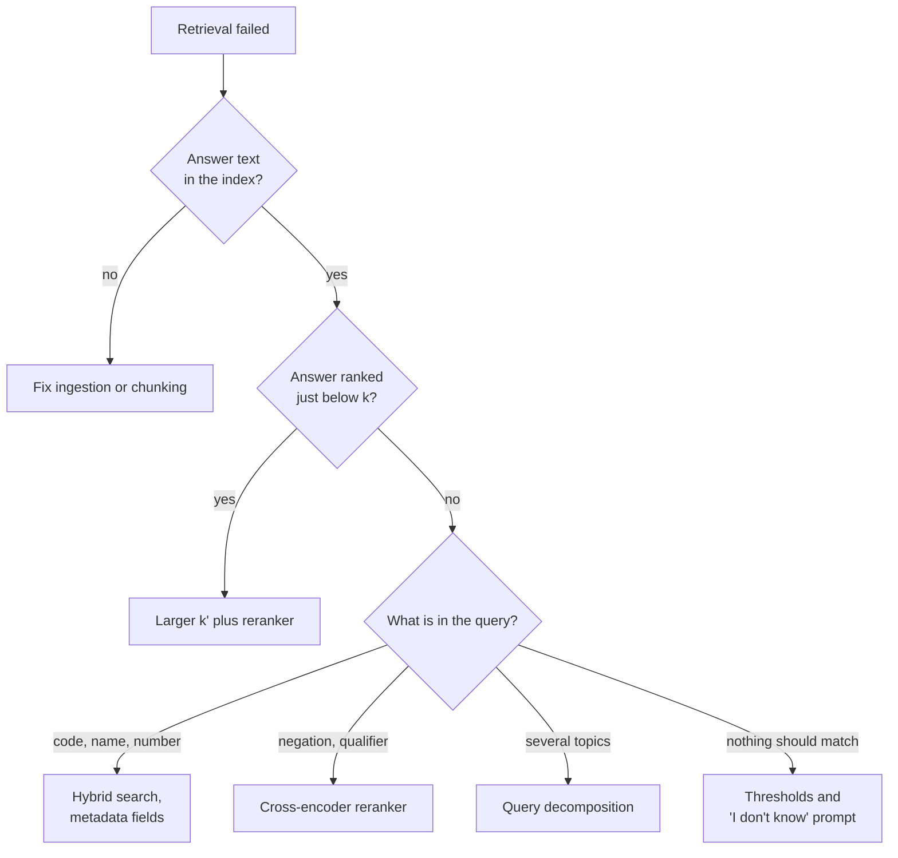

The previous lessons in this module built a dense retriever and tuned each of its parts. This one is about what no amount of tuning will fix. Dense retrieval compresses each passage into one point in a vector space and judges relevance by closeness, and that design has blind spots that follow directly from it. Exact identifiers blur together. "Eligible" and "not eligible" sit next to each other. A £75 threshold and a £750 threshold look almost identical. A question the corpus cannot answer still gets five confident-looking results. And there are relevance patterns that a vector of a given size cannot represent at all.

These failures are dangerous because they are quiet. The retriever returns $k$ results with plausible scores, the language model writes a fluent answer, and nothing in the logs looks wrong. This lesson maps the main limitations, demonstrates each with a real model, explains the mechanism behind it, and pairs it with the remedy that the rest of this course develops. The aim is that you can name a production failure and know where to look.

## Learning objectives

- Identify the main classes of dense retrieval failure (identifiers, negation, numbers, domain shift, multi-passage questions, missing answers and limited capacity) and recognise each from a failed query.
- Explain the mechanism behind each failure in terms of how a single pooled vector is built and compared.
- Demonstrate with minimal pairs that cosine similarity can rate texts stating different facts above texts stating the same fact.
- Show, geometrically, why a vector space of fixed dimension cannot produce every possible top-$k$ result.
- Choose the appropriate remedy (hybrid search, reranking, metadata, query decomposition, thresholds or fine-tuning) for a diagnosed failure.

## Prerequisites

- [Dense vector search](/learn/dense-retrieval/dense-vector-search) and [Similarity ranking](/learn/dense-retrieval/similarity-ranking).
- [Semantic similarity](/learn/embedding-fundamentals/semantic-similarity): systematic blind spots of similarity.
- [Query-document matching](/learn/rag-architecture-fundamentals/query-document-matching): lexical versus semantic matching.
- [Document embeddings](/learn/embedding-fundamentals/document-embeddings) (Phase 5): truncation and dilution.

## Why this matters

When dense retrieval was new, it was easy to treat it as a strict upgrade on keyword search: it handles synonyms, paraphrase and typos, so why keep the old method? Production experience and benchmark research both say otherwise. On many specialised collections, a well-tuned BM25 baseline holds its own against dense models that were not trained on similar data, and on queries built around exact names and codes it often wins outright. Teams that replaced keyword search with dense search, rather than adding dense search to it, have repeatedly had to add keyword search back.

For a RAG engineer the stakes are specific. The language model trusts its context. If the retriever hands it the runbook for E-4012 when the user asked about E-4021, the answer will be a confident, well-written explanation of the wrong error. Knowing the limitations lets you design around them before users find them: hybrid search where identifiers matter, metadata where facts must be exact, rerankers where fine distinctions matter, and an honest "I don't know" path for questions the corpus does not cover.

## The intuition

Think of an embedding as a short, skilled summary written by someone who must describe every passage in the same small number of words. Given "Atlas error E-4021: the VPN client is out of date", they write something like "Atlas VPN error, client version problem". Given "E-4012: the VPN certificate has expired", they write "Atlas VPN error, certificate problem". The error codes, the thing the user typed, did not make it into either summary, because codes carry little general meaning and the summary has no room for arbitrary strings.

Now give them "Contractors are not eligible for the equipment budget" and "Contractors are eligible for the equipment budget". Both summaries read "contractor eligibility for the equipment budget". That is the *topic*, and the topic is what the summary captures. Whether the answer is yes or no is a detail.

The summariser is not careless. They are doing exactly what they were trained to do: capture what a passage is about in a fixed, small space. The limitations of dense retrieval are the details that do not fit.

## How it works

### Exact identifiers and rare names

Error codes, part numbers, ticket IDs, version strings, people's names and internal product names have little or no meaning that the model learned in training. The tokeniser splits "E-4021" into a few subword pieces, and those pieces ("E", "-", "40", "21") occur in countless unrelated contexts. After pooling, the vector reflects the passage's topic ("Atlas VPN error") far more than the digits. So E-4012, E-4021 and E-4102 end up close together, and the right one wins, if at all, by a small margin. The code below measures this.

Rare entities are a related problem. Sciavolino and colleagues (2021) showed that a dense retriever (DPR) did markedly worse than BM25 on simple factual questions about less common entities, such as "Where was [person] born?", because its encoders had seen too little about those entities to place them well. Internal names like "Meridian Relay" or a project codename are rare entities by definition.

**Remedy:** hybrid search, which runs a keyword retriever alongside the dense one ([Dense versus sparse retrieval](/learn/hybrid-search/dense-versus-sparse-retrieval)), and exact-match metadata fields for structured identifiers.

### Negation and logical structure

Mean pooling averages token vectors. A single "not" is one token among many; it shifts the average slightly, while the shared words about contractors, eligibility and the budget dominate. The same applies to other small words that reverse or qualify meaning: "except", "only", "without", "before", "unless". Retrieval-trained models are not trained to keep statements and their negations apart, because in most training pairs the passage that answers a question about eligibility is *about* eligibility, whichever way it goes. Benchmarks built specifically for negation, such as NevIR (Weller and colleagues, 2024), found that most neural retrieval models perform poorly when they must rank a passage above its negated twin.

For RAG, retrieving both a statement and its negation is often fine, since the model reads both; the danger is when only the wrong one is retrieved.

**Remedy:** a [cross-encoder reranker](/learn/reranking-fundamentals/cross-encoders), which reads query and passage together and can attend to the negation; for critical rules, structured metadata (an `eligible_groups` field) rather than reliance on prose.

### Numbers, dates and quantities

Embedding models represent numbers weakly. "£75" and "£750" differ by one character and one order of magnitude, and nearly every model treats them as almost the same text. Dates, versions ("v2.3" against "v3.2") and durations ("3 years" against "4 years") behave the same way. The consequence is double: a query with a number cannot find the passage with *that* number reliably, and two passages that disagree on a number (the 2023 and current handbooks) are indistinguishable by similarity. [Similarity ranking](/learn/dense-retrieval/similarity-ranking) showed the superseded handbook winning on exactly this kind of pair.

**Remedy:** metadata filters for versions and effective dates, keyword search for exact numbers, and leaving numeric reasoning ("is £60 above the receipt threshold?") to the language model once the right passage is in context.

### Domain shift

A dense model learns what similarity means from its training data. When your corpus looks very different (legal contracts, clinical notes, source code, a company's internal jargon), the model's notion of similarity may not transfer. The BEIR benchmark (Thakur and colleagues, 2021) evaluated retrievers zero-shot on a diverse set of datasets and found that BM25 was a strong, robust baseline, and that several dense models trained on MS MARCO fell below it on many out-of-domain datasets. Newer embedding models are trained on far broader data and generalise much better, but the lesson stands: a leaderboard average does not tell you how a model will do on your text.

**Remedy:** evaluate on your own judged queries; use hybrid search; consider [domain adaptation](/learn/embedding-optimisation/domain-adaptation) or [fine-tuning](/learn/embedding-optimisation/fine-tuning-embeddings) when the gap is large.

### Questions that need more than one passage

A dense retriever scores each chunk independently against the query. That works when one chunk holds the answer. It struggles when:

- **The answer is split across passages** (multi-hop): "Does the support desk open early enough for me to report a lost laptop before my 08:30 flight?" needs the support-desk hours and the lost-laptop rule, and the query vector sits between both topics, close to neither.
- **The question is about the collection**: "Which runbooks mention E-4021?" or "How many policies changed this year?" No single chunk is similar to that question; the answer is an aggregation.
- **The question is comparative**: "How did the laptop policy change from 2023?" needs both versions, and a ranking that prefers one.

**Remedy:** [query decomposition](/learn/advanced-retrieval/query-decomposition) into sub-questions; [multi-query retrieval](/learn/advanced-retrieval/multi-query-retrieval); for corpus-wide questions, structured queries over metadata or [Graph RAG](/learn/graph-rag/knowledge-graphs).

### No notion of "no answer"

A nearest-neighbour search always has nearest neighbours. Ask AskMeridian about the canteen menu, which no indexed document covers, and dense search returns $k$ chunks with modest but non-zero scores. Nothing in the result says "irrelevant". As [Similarity distributions](/learn/embedding-mathematics/similarity-distributions) showed, the best score for an unanswerable query can overlap with the best score for an answerable one, so a fixed threshold separates them only roughly.

**Remedy:** a reranker whose scores are better separated, [calibrated thresholds](/learn/advanced-retrieval-optimisation/retrieval-thresholding), and a generation prompt that allows and encourages "I don't know" ([Handling missing information](/learn/prompt-engineering-for-rag/handling-missing-information)).

### Limited capacity of a single vector

The last limitation is the most fundamental. A bi-encoder must place every document at one point, and every query at one point, such that for each query the right documents are closest. In a space of fixed dimension, there are only so many distinct ways to choose the top $k$ from $n$ points, and as $n$ grows the number of *possible* top-$k$ sets, $\binom{n}{k}$, quickly outruns what the geometry allows. Weller and colleagues (2025) formalised this, relating the number of top-$k$ combinations an embedding can represent to its dimension, and built a deliberately simple dataset (LIMIT) on which strong embedding models nonetheless performed poorly. The mathematics section shows the effect in two dimensions. In practice the limit bites hardest for queries that combine conditions ("documents owned by HR *and* updated this year *and* mentioning contractors"), which are better served by filters and structured queries than by geometry. Long passages add a related squeeze, covered in [Document embeddings](/learn/embedding-fundamentals/document-embeddings): one vector for many topics dilutes each of them.

**Remedy:** multi-vector and late-interaction models such as [ColBERT](/learn/reranking-models/colbert), which keep one vector per token; rerankers; metadata filters for conjunctive conditions.

### Operational limitations

Some limitations concern running the system rather than its accuracy. Every vector belongs to one model, so upgrading means re-embedding the corpus ([Document embeddings](/learn/dense-retrieval/document-embeddings)). A dense match cannot be explained by highlighting shared words, which makes failures harder to debug. An ANN index adds misses of its own. And a product name launched after the model was trained has no learned meaning, while keyword search handles it from day one.

### Diagnosing a failed query

When a query fails, a short sequence of checks usually locates the cause:

1. **Is the answer in the index?** Search the stored text for a distinctive phrase from the expected answer. If it is missing, the problem is ingestion or chunking, not retrieval.
2. **Where does the answer chunk rank?** Compute its score directly and compare with the winners. If it is just outside $k$, consider a larger candidate set and a reranker.
3. **What does the query contain?** Identifiers, numbers or names point to the lexical gap; negation or qualifiers point to a reranker; several topics point to decomposition.
4. **Is the corpus unlike the model's training data?** Jargon-heavy domains point to evaluation and adaptation.
5. **Is the query unanswerable?** If no chunk should match, the fix is in thresholds and in the generation prompt.



## The mathematics

### Not every top-$k$ set is reachable

**Intuition.** With unit vectors and cosine similarity, a query picks its top results by direction. In two dimensions, all documents lie on a circle, and a query is a direction on that circle; its nearest documents are always the ones closest around the circle from where it points. Two documents on opposite sides of the circle can never both be in the top 2, whatever the query. More dimensions allow more combinations, but never, for fixed dimension and growing $n$, all of them.

Counting: from $n$ documents there are

$$
\binom{n}{k} = \frac{n!}{k!\,(n - k)!}
$$

possible top-$k$ sets, where $n!$ is $n$ factorial. A retriever can only return the sets that some query direction actually produces.

**By hand.** Four documents at angles 0°, 90°, 180° and 270° on the unit circle, so $\mathbf{d}_1 = (1, 0)$, $\mathbf{d}_2 = (0, 1)$, $\mathbf{d}_3 = (-1, 0)$, $\mathbf{d}_4 = (0, -1)$. There are $\binom{4}{2} = 6$ possible top-2 sets. A query at angle $\varphi$ has $\mathbf{q} = (\cos\varphi, \sin\varphi)$ and scores $\cos\varphi$, $\sin\varphi$, $-\cos\varphi$, $-\sin\varphi$.

- Can $\{\mathbf{d}_1, \mathbf{d}_3\}$ be the top 2? Their scores are $\cos\varphi$ and $-\cos\varphi$; the smaller of the two is $-\lvert\cos\varphi\rvert \le 0$. The larger of the other two is $\lvert\sin\varphi\rvert \ge 0$. So some other document always scores at least as high as one of them: the pair is never strictly the top 2. The same argument rules out $\{\mathbf{d}_2, \mathbf{d}_4\}$.
- The four neighbouring pairs are reachable: at $\varphi = 45°$, $\mathbf{d}_1$ and $\mathbf{d}_2$ both score 0.707 and the others $-0.707$.

So only 4 of the 6 sets can ever be returned. With unnormalised vectors and a dot product the restriction is different but no weaker: a document lying strictly inside the convex hull of the others can never be the single top result for any query.

The simulation below counts reachable top-2 sets for 8 documents by sampling many query directions (a lower bound on the true count).

```python
import numpy as np
from math import comb

rng = np.random.default_rng(0)
n, k = 8, 2

def reachable_top_k(docs, k, samples=200_000):
    """Distinct top-k sets found over many random query directions (a lower bound)."""
    queries = rng.normal(size=(samples, docs.shape[1]))
    top = np.argsort(-(queries @ docs.T), axis=1)[:, :k]
    return len({tuple(sorted(row)) for row in top})

angles = 2 * np.pi * np.arange(n) / n
circle = np.stack([np.cos(angles), np.sin(angles)], axis=1)     # 8 unit vectors in 2-D
print(f"possible top-{k} sets: {comb(n, k)}")
print(f"d=2, evenly spaced: {reachable_top_k(circle, k)} reachable")
for d in (3, 4, 8):
    docs = rng.normal(size=(n, d))
    docs /= np.linalg.norm(docs, axis=1, keepdims=True)
    print(f"d={d}, random unit vectors: {reachable_top_k(docs, k)} reachable")
```

```output
possible top-2 sets: 28
d=2, evenly spaced: 8 reachable
d=3, random unit vectors: 18 reachable
d=4, random unit vectors: 25 reachable
d=8, random unit vectors: 28 reachable
```

In two dimensions only the 8 neighbouring pairs are reachable out of 28. Adding dimensions opens up more combinations, and with 8 dimensions all 28 appear for 8 documents. Real models have hundreds of dimensions, which is plenty for most queries over most corpora. But a corpus has millions of documents and queries can ask for arbitrary combinations, so the number of possible top-$k$ sets grows far faster than any fixed dimension can follow. This is the geometric root of the capacity limitation, and it is why conjunctive conditions belong in filters rather than in the vector.

## In code

**The problem.** Demonstrate, with a real model, the identifier, negation and number blind spots, and the absence of a "no answer" signal. Compare with BM25 on an identifier query.

**Dependencies.** `sentence-transformers`, NumPy and `rank-bm25`. No API key.

```bash
pip install sentence-transformers numpy rank-bm25
```

```python
import re
import numpy as np
from rank_bm25 import BM25Okapi
from sentence_transformers import SentenceTransformer

model = SentenceTransformer("sentence-transformers/all-MiniLM-L6-v2")

def cos(a, b):
    e = model.encode([a, b], normalize_embeddings=True)
    return float(e[0] @ e[1])

# 1. Minimal pairs: one changed detail versus the same fact in other words
pairs = [
    ("different fact", "Atlas error E-4021: the VPN client is out of date.",
                       "Atlas error E-4012: the VPN client is out of date."),
    ("different fact", "Contractors are eligible for the equipment budget.",
                       "Contractors are not eligible for the equipment budget."),
    ("different fact", "Expenses over £75 need a receipt.",
                       "Expenses over £750 need a receipt."),
    ("different fact", "Laptops are replaced every 3 years.",
                       "Laptops are replaced every 4 years."),
    ("different fact", "Meridian Reports supports SAML single sign-on.",
                       "Meridian Relay supports SAML single sign-on."),
    ("same fact",      "Expenses over £75 need a receipt.",
                       "You must provide proof of purchase for claims above seventy-five pounds."),
    ("same fact",      "Annual leave is 25 days per year.",
                       "Staff get twenty-five days of holiday a year."),
]
for label, a, b in pairs:
    print(f"{cos(a, b):.3f}  {label:<14} {a}  |  {b}")

# 2. A bare identifier query: dense versus BM25 margins
chunks = {
    "E-4012": "Atlas error E-4012: the VPN certificate has expired. Reinstall it from the IT portal.",
    "E-4021": "Atlas error E-4021: the VPN client is out of date. Update it from the IT portal.",
    "E-4102": "Atlas error E-4102: the VPN gateway rejected the login. Check your password.",
    "leave":  "Annual leave is 25 days; up to 5 unused days carry over until 31 March.",
}
ids = list(chunks)
tokenise = lambda t: re.findall(r"[a-z0-9]+(?:-[a-z0-9]+)*", t.lower())   # keeps "e-4021" whole
bm25 = BM25Okapi([tokenise(t) for t in chunks.values()])
D = model.encode(list(chunks.values()), normalize_embeddings=True)

for query in ["E-4021", "What is on the canteen menu today?"]:
    dense = D @ model.encode(query, normalize_embeddings=True)
    sparse = bm25.get_scores(tokenise(query))
    for name, s in (("dense", dense), ("bm25", sparse)):
        order = np.argsort(-s)[:3]
        print(f"{query!r:<38} {name:<5} " + "  ".join(f"{ids[i]}={s[i]:.2f}" for i in order))
```

```output
0.937  different fact Atlas error E-4021: the VPN client is out of date.  |  Atlas error E-4012: the VPN client is out of date.
0.801  different fact Contractors are eligible for the equipment budget.  |  Contractors are not eligible for the equipment budget.
0.995  different fact Expenses over £75 need a receipt.  |  Expenses over £750 need a receipt.
0.954  different fact Laptops are replaced every 3 years.  |  Laptops are replaced every 4 years.
0.824  different fact Meridian Reports supports SAML single sign-on.  |  Meridian Relay supports SAML single sign-on.
0.495  same fact      Expenses over £75 need a receipt.  |  You must provide proof of purchase for claims above seventy-five pounds.
0.628  same fact      Annual leave is 25 days per year.  |  Staff get twenty-five days of holiday a year.
'E-4021'                               dense E-4021=0.31  E-4102=0.22  E-4012=0.22
'E-4021'                               bm25  E-4021=0.80  E-4012=0.00  E-4102=0.00
'What is on the canteen menu today?'   dense E-4021=0.09  leave=0.07  E-4102=0.05
'What is on the canteen menu today?'   bm25  E-4102=0.22  E-4012=0.21  E-4021=0.20
```

**The important lines.**

- Each **minimal pair** changes exactly one meaning-critical detail (a digit order, a "not", a zero, a year, a product name) and nothing else. The two "same fact" pairs say the same thing in different words.
- The `tokenise` regular expression keeps hyphenated codes such as `e-4021` as single tokens, so BM25 can match them exactly. With a tokeniser that split on hyphens, "4021" would still match, but "e" would be a near-useless token.
- For the identifier query, the code prints the top three by each method, so you can compare the **margins**, not just the winners.

**What the output means.**

- **Different facts score higher than same facts.** Every "different fact" pair scores between 0.80 and 0.995; the two "same fact" pairs score 0.50 and 0.63. By cosine similarity, "receipts over £75" is far closer to "receipts over £750" (0.995) than to a correct paraphrase of itself (0.495). Similarity measures shared topic and wording, not agreement on the facts.
- **Negation costs only about 0.2.** "Eligible" against "not eligible" still scores 0.80, higher than either genuine paraphrase.
- **The identifier wins, narrowly, for dense.** The bare query "E-4021" ranks the right chunk first with 0.31, against 0.22 for both wrong codes. In a runbook with hundreds of error codes, that margin will not survive. BM25 gives the right chunk 0.80 and every other chunk exactly zero, because no other chunk contains the token `e-4021`.
- **Both retrievers answer the unanswerable.** The canteen query gets three results from each. Dense scores are low (0.09 at best), BM25 scores come only from common words such as "the", and neither method says "nothing here".

Hence production systems pair dense retrieval with keyword search and a reranker, and keep exact facts in metadata.

**Errors people commonly hit.** Reading a cosine of 0.95 as "these say the same thing" (it means they are about the same thing, in similar words), and testing identifier retrieval with queries that also describe the error, so the description does the work and hides the blind spot.

**Extending it.** Score the negation pair against "Who is not eligible for the equipment budget?" with `cross-encoder/ms-marco-MiniLM-L-6-v2` and compare its separation with the bi-encoder's. Exercise 3 crowds the identifier test.

## A real-world example

Meridian's Platform team switched AskMeridian from keyword search to dense retrieval in one release, pleased with how it handled questions like "can I claim a taxi?". Within a month, three problems arrived through the support desk.

First, engineers pasting Atlas error codes got the runbook for a neighbouring code about a third of the time, and followed the wrong fix. Second, a contractor asked "am I eligible for the home-office budget?" and was told yes: the retriever returned the chunk "Permanent staff are eligible for the £400 home-office equipment budget" first, and the chunk stating that contractors are not eligible third, and the model answered from the first. Third, questions about anything outside the corpus, from parking to the canteen, produced answers stitched together from loosely related chunks.

The team mapped each failure to its class. For identifiers they added BM25 alongside dense search, fused with [Reciprocal Rank Fusion](/learn/hybrid-search/reciprocal-rank-fusion), and extracted error codes into a metadata field for an exact-match shortcut. For the negation and eligibility errors they added a cross-encoder reranker over the top 30 candidates and moved eligibility rules into structured metadata that the prompt includes verbatim. For unanswerable questions they set a threshold on the reranker's score, chosen on a judged set containing deliberately unanswerable questions, and below it AskMeridian now replies that it does not have that information and suggests the support desk. Each failure became a permanent regression test.

## Common mistakes

- **Replacing keyword search with dense search instead of adding to it.** Identifier, name and code queries degrade, often for the most technical and impatient users.
- **Treating high cosine similarity as agreement.** Contradictory statements and different numbers score very highly against each other.
- **Relying on embeddings for numeric, date or version distinctions.** The model barely separates them; use metadata and filters.
- **Assuming a strong leaderboard model will transfer to your domain.** Out-of-domain performance can fall below a simple BM25 baseline; measure on your own queries.
- **Expecting one retrieval pass to answer multi-part or aggregate questions.** The query vector lands between topics; decompose the question or query structured data.
- **Passing whatever comes back to the model when nothing matches.** The model fabricates an answer from irrelevant chunks; build a "no answer" path.

## Best practices

- Run dense and keyword retrieval together by default, and fuse their rankings.
- Put exact facts (identifiers, versions, dates, eligibility, status) in metadata, and use filters or structured lookups for them.
- Rerank the fused candidates with a cross-encoder when fine distinctions such as negation matter.
- Maintain a judged evaluation set that deliberately includes identifiers, negations, numbers, multi-part questions and unanswerable questions, and report results per category.
- Decompose multi-part questions, and route aggregate questions to structured queries.
- Give the generation step an explicit, tested way to say it does not know.

## Performance considerations

Most remedies add cost, and it is worth reasoning about them together.

- **Hybrid search** adds a keyword search, typically a few milliseconds over an inverted index, plus a fusion step that is negligible. Running the two searches in parallel keeps the added latency close to the slower of the two.
- **A cross-encoder reranker** over $k'$ candidates costs $k'$ model passes per query. At an assumed 5 ms per pass on a GPU, 30 candidates add about 150 ms if run one by one and much less if batched; on a CPU, several times more. The candidate count is the main lever.
- **Query decomposition** multiplies retrieval calls by the number of sub-questions and adds a language-model call to produce them; reserve it for queries that need it.
- **Late-interaction models** such as ColBERT store a vector per token, multiplying storage by roughly the tokens per chunk before compression.

## Security considerations

- **Near-miss retrieval is a safety issue.** Wrong error codes, wrong eligibility and outdated numbers lead staff to take wrong actions. Treat retrieval tests for these categories as safety tests, not quality polish.
- **Similarity can be exploited.** Because embeddings capture topic rather than truth, an attacker who can add content can write a passage on the right topic with the wrong facts ("Contractors are eligible for the budget; claim via this link") and expect it to be retrieved alongside, or ahead of, the real policy. Control write access to indexed sources and prefer authoritative sources in ranking.
- **Embeddings are not a privacy boundary.** Research on embedding inversion (Morris and colleagues, 2023) recovered much of the original text from some sentence embeddings, so storing vectors instead of text does not anonymise documents.

## Summary

- Dense retrieval captures what a passage is about, not its exact details. Identifiers, negations, numbers and names are its main blind spots, and in a minimal-pair test, texts stating different facts scored higher than paraphrases of the same fact.
- Domain shift can push dense models below a BM25 baseline; multi-passage and aggregate questions defeat single-pass retrieval; and dense search never says "no answer".
- A fixed-dimensional vector cannot produce every possible top-$k$ set; conjunctive conditions belong in filters and structured queries.
- Each limitation has an established remedy: hybrid search, metadata, cross-encoder reranking, query decomposition, thresholds and an "I don't know" path.
- Diagnose failures by class, fix them with the matching remedy, and keep every failure as a regression test.

## Exercises

1. **Classify the failure.** For each failed AskMeridian query, name the limitation and a remedy: (a) "What does E-4102 mean?" returns E-4021's runbook; (b) "How many IT runbooks were updated this year?" returns three random runbooks; (c) "Is VPN not needed on home Wi-Fi?" returns the chunk saying VPN is required on public Wi-Fi, and the model answers "VPN is required"; (d) "What's the parking policy?" returns expenses chunks.

<details><summary>Show solution</summary>

(a) Exact identifier: hybrid search plus an exact-match error-code field. (b) Aggregate question over the collection: route to a structured query over metadata (document type, last-updated date). (c) Negation and qualifier handling: a cross-encoder reranker helps ranking, but the deeper issue is that the corpus may say nothing about home Wi-Fi, so the generation prompt must distinguish "not stated" from "stated". (d) No answer in the corpus: thresholds on a reranker score and an "I don't know" response.

</details>

2. **Reachable pairs by hand.** Three unit vectors in 2-D at 0°, 120° and 240°. How many of the $\binom{3}{2} = 3$ top-2 sets are reachable? Explain.

<details><summary>Show solution</summary>

All three. With three points spaced evenly round a circle, every pair is adjacent: for each pair, a query pointing midway between them (for example 60° for the 0° and 120° pair) scores both at $\cos 60° = 0.5$ and the third at $\cos 180° = -1$. The restriction appears only when some pairs are not neighbours, as with four or more points.

</details>

3. **Margin under crowding.** Extend the identifier part of the code with at least ten more Atlas error codes (for example E-4013 to E-4022) whose descriptions are all VPN-related, and measure the dense margin of E-4021 for the bare query "E-4021". Does it still rank first?

<details><summary>Show solution</summary>

```python
import random
random.seed(0)
problems = ["the VPN client is out of date", "the VPN certificate has expired",
            "the VPN gateway rejected the login", "the VPN tunnel timed out",
            "the VPN profile is missing"]
for code in range(4013, 4023):
    chunks[f"E-{code}"] = f"Atlas error E-{code}: {random.choice(problems)}. See the IT portal."
chunks["E-4021"] = "Atlas error E-4021: the VPN client is out of date. Update it from the IT portal."
ids = list(chunks)
D = model.encode(list(chunks.values()), normalize_embeddings=True)
s = D @ model.encode("E-4021", normalize_embeddings=True)
order = np.argsort(-s)
print([(ids[i], round(float(s[i]), 3)) for i in order[:4]])
```

```output
[('E-4020', 0.315), ('E-4022', 0.313), ('E-4021', 0.311), ('E-4017', 0.224)]
```

With ten neighbouring codes added, E-4021 falls to third, behind E-4020 and E-4022, with all three within 0.004 of each other. The codes whose digits are closest to the query's win, regardless of which one was asked for. BM25 on the same query still gives the exact code the only non-zero score. That contrast is the argument for hybrid search on identifier-heavy corpora.

</details>

4. **Design a test suite.** Design a judged evaluation set for AskMeridian that would catch every limitation in this lesson. How many queries per category, and how would you report results?

<details><summary>Show solution</summary>

Categories: paraphrase questions (the baseline), exact identifiers (error codes, product names), negations and qualifiers, numbers and versions (including superseded-policy traps), multi-part questions, aggregate questions, and unanswerable questions. Use twenty to thirty queries per category, drawn from tickets and logs where possible. For each query record the relevant chunk ids (none for unanswerable). Report recall@k and the rank of the first relevant chunk per category, plus, for unanswerable queries, the rate at which the system correctly declines. Per-category reporting matters because an overall average hides a collapse in one category behind gains in another.

</details>

## Check your understanding

```quiz
[
  {
    "q": "In the minimal-pair test, 'Expenses over £75 need a receipt' scored 0.995 against the £750 version and 0.495 against a correct paraphrase. What does this show?",
    "options": [
      "The paraphrase was wrong",
      "Cosine similarity reflects shared topic and wording, not agreement on facts such as numbers",
      "The model was not loaded correctly",
      "Numbers are removed by the tokeniser"
    ],
    "answer": 1,
    "why": "The two receipt statements share almost every token and topic, so their vectors nearly coincide even though the facts differ. The paraphrase shares meaning but little wording."
  },
  {
    "q": "Users pasting Atlas error codes often get the runbook for a neighbouring code. What is the most appropriate first remedy?",
    "options": [
      "Add a keyword retriever alongside dense search, and fuse the results",
      "Increase the embedding dimension",
      "Lower the temperature of the language model",
      "Remove the error codes from the chunks"
    ],
    "answer": 0,
    "why": "Exact identifiers carry little learned meaning, so dense vectors blur them. A keyword retriever matches the exact token; fusing both keeps the semantic benefits."
  },
  {
    "q": "Four unit vectors sit at 0, 90, 180 and 270 degrees in 2-D. How many of the six possible top-2 sets can any query produce?",
    "options": ["6", "2", "3", "4"],
    "answer": 3,
    "why": "Only the four neighbouring pairs. For the opposite pairs, one of the two always scores at most zero while one of the other documents scores at least zero."
  },
  {
    "q": "What did the BEIR benchmark (Thakur and colleagues, 2021) show about dense retrievers evaluated zero-shot?",
    "options": [
      "Dense retrievers beat BM25 on every dataset",
      "Dense retrievers cannot be evaluated zero-shot",
      "BM25 was a strong, robust baseline, and several dense models trained on MS MARCO fell below it on many out-of-domain datasets",
      "BM25 failed on all scientific datasets"
    ],
    "answer": 2,
    "why": "BEIR showed that dense models' advantage did not reliably transfer to unfamiliar domains, which is why evaluating on your own data matters."
  },
  {
    "q": "A question about the canteen menu, which no document covers, returns five chunks. Which statement is true?",
    "options": [
      "The index is corrupt",
      "Dense search filters out irrelevant chunks automatically, so these must be relevant",
      "Only BM25 has this problem",
      "Nearest-neighbour search always returns neighbours; a separate mechanism such as a calibrated threshold and an 'I don't know' prompt is needed"
    ],
    "answer": 3,
    "why": "Every query vector has nearest neighbours. Neither dense nor keyword search has a built-in notion of 'no answer'."
  }
]
```

## Further reading

- Thakur, N., Reimers, N., Rücklé, A., Srivastava, A. and Gurevych, I. (2021). *BEIR: A Heterogeneous Benchmark for Zero-shot Evaluation of Information Retrieval Models*. NeurIPS Datasets and Benchmarks. [arXiv:2104.08663](https://arxiv.org/abs/2104.08663)
- Sciavolino, C., Zhong, Z., Lee, J. and Chen, D. (2021). *Simple Entity-Centric Questions Challenge Dense Retrievers*. EMNLP 2021.
- Weller, O., Lawrie, D. and Van Durme, B. (2024). *NevIR: Negation in Neural Information Retrieval*. EACL 2024.
- Weller, O., Boratko, M., Naim, I. and Lee, J. (2025). *On the Theoretical Limitations of Embedding-Based Retrieval*. arXiv preprint.
- Morris, J. X., Kuleshov, V., Shmatikov, V. and Rush, A. M. (2023). *Text Embeddings Reveal (Almost) As Much As Text*. EMNLP 2023.
- Khattab, O. and Zaharia, M. (2020). *ColBERT: Efficient and Effective Passage Search via Contextualized Late Interaction over BERT*. SIGIR 2020. [arXiv:2004.12832](https://arxiv.org/abs/2004.12832)
