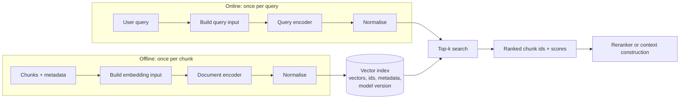

The earlier phases gave you every part of a dense retriever separately: [sentence embeddings](/learn/embedding-fundamentals/sentence-embeddings) that turn text into vectors, the [cosine similarity](/learn/embedding-mathematics/cosine-similarity) that compares them, and the [similarity search](/learn/vector-database-fundamentals/similarity-search) a vector database performs. This lesson assembles them into one working system and examines it as a system. **Dense vector search** is retrieval in which the query and every chunk are each represented by one learned, dense vector, and relevance is estimated by comparing the two vectors.

The point of the lesson is the architecture and its contract. You will see why the query and the documents are encoded separately, why that single design decision is what makes dense search fast enough to use, which invariants must hold between the offline and online halves for the scores to mean anything, and where a dense retriever belongs in a RAG pipeline. You will build a small, exact dense retriever in about thirty lines and check it against FAISS. The rest of this module then looks at each part in turn: what [semantic search](/learn/dense-retrieval/semantic-search) means as a product, the [query side](/learn/dense-retrieval/query-embeddings) and the [document side](/learn/dense-retrieval/document-embeddings) of the encoder, how scores become a [ranking](/learn/dense-retrieval/similarity-ranking), and [where dense retrieval fails](/learn/dense-retrieval/dense-retrieval-limitations).

## Learning objectives

- Describe the bi-encoder architecture of a dense retriever and explain why encoding queries and documents independently makes large-scale search possible.
- List the steps of the offline indexing path and the online query path, and name the invariants that must hold between them.
- Implement an exact dense retriever with an embedding model and NumPy, and verify it against a library index.
- Explain why maximising the dot product of unit-length vectors is the same as maximising cosine similarity, and what goes wrong when vectors are not normalised.
- Estimate the per-query cost of dense retrieval against a cross-encoder that reads every chunk.

## Prerequisites

- [What is retrieval?](/learn/retrieval-fundamentals/what-is-retrieval): retrieval as ranking, and the shape of a retriever.
- [Sentence embeddings](/learn/embedding-fundamentals/sentence-embeddings): how an encoder and pooling turn a passage into one vector.
- [Cosine similarity](/learn/embedding-mathematics/cosine-similarity) and [Vector normalisation](/learn/embedding-mathematics/vector-normalisation).
- [Similarity search](/learn/vector-database-fundamentals/similarity-search): the top-k operation a vector database exposes.

## Why this matters

A retriever has to answer a question about relevance, for every chunk in the collection, within the time a user is willing to wait. The most accurate way to judge whether a passage answers a question is to show both to a large model together and ask it. That is far too slow to do for every chunk: Meridian's index holds tens of thousands of chunks, and a large product-documentation index can hold millions. Keyword search is fast, because an inverted index jumps straight to the chunks that contain the query's words, but it only finds chunks that share those words, so "holiday" never reaches the chunk about "annual leave".

Dense vector search is the compromise that made semantic retrieval practical. It pays the expensive cost of understanding the text once per chunk, at indexing time, and leaves only a cheap vector comparison for query time. Without this split, you would have to choose between search that understands meaning and search that is fast. With it you get a useful approximation of both.

The split also creates a new class of bug. The two halves of the system are built at different times, often by different jobs, sometimes months apart. If they disagree about anything (the model, its version, the normalisation, the input format), every query still returns k results with plausible-looking scores, and quality falls without a single error being raised. Knowing the contract between the halves is what lets you prevent this, and detect it when it happens anyway.

## The intuition

Picture a large library where every book has been read, once, by a cataloguer who pins it to a spot on an enormous map. Books about the same subject end up close together: travel guides to Portugal in one neighbourhood, Portuguese cookery a street away, Portuguese grammar a little further. The cataloguer never sees your question; she only ever placed books.

When you arrive with a question, a second person, trained alongside the cataloguer to use the same map, reads your question and puts a pin where its answer ought to be. Finding candidate books is now a matter of looking at what is pinned nearest. Nobody re-reads any book while you wait. All the reading happened in advance; at question time there is one short read (your question) and a measurement of distance.

Two things follow from the picture. First, the method depends completely on both people using **the same map**. If the question-reader learned a slightly different map, her pin lands in the wrong neighbourhood and the nearest books are confidently wrong. Second, the map is the only thing that links your question to a book. If the map has no way to separate two books (say, two editions of one guide that differ only in a phone number), proximity cannot separate them either.

## How it works

### The bi-encoder: two inputs, encoded apart

A dense retriever is built around a **bi-encoder**: a model (or a pair of models) that encodes the query and the document *independently*, each into a single vector of the same dimension. The relevance score is a cheap function of the two vectors, almost always the **dot product** or the **cosine similarity**:

$$
\text{score}(q, d) = \langle E_Q(q),\, E_D(d) \rangle
$$

$E_Q$ is the query encoder, $E_D$ the document encoder and $\langle \cdot, \cdot \rangle$ the dot product. In many models, including `all-MiniLM-L6-v2`, $E_Q$ and $E_D$ are the same network; in others they are two networks trained together, as in Dense Passage Retrieval (Karpukhin and colleagues, 2020), or one network that is told which side it is encoding through a prefix such as `query: ` or `passage: `. The bi-encoder's internal mechanics, from tokens to pooled vector, are covered in [Sentence embeddings](/learn/embedding-fundamentals/sentence-embeddings); [Bi-encoders](/learn/reranking-fundamentals/bi-encoders) compares the architecture with its alternatives.

The property that matters here is the **factorisation**. Because the document's vector does not depend on the query, it can be computed before any query exists. The score of every (query, chunk) pair is then a product of two things computed separately, one of which is already sitting in storage.

Contrast this with a **cross-encoder**, which reads the query and the passage together, in one input, and outputs a relevance score directly. A cross-encoder lets every query token attend to every passage token, so it is usually more accurate, but nothing can be precomputed: each new query needs one full model pass per candidate. That is why cross-encoders are used to [rerank](/learn/reranking-fundamentals/why-reranking-is-needed) a short list rather than to search a whole collection.

### Two paths: offline and online

A dense retriever is two pipelines that meet at the index. The general offline/online split was introduced in [Offline and online processing](/learn/rag-architecture-fundamentals/offline-and-online-processing); here are the steps specific to dense search.

**Offline (indexing), once per chunk:**

1. Take each chunk produced by the [chunking](/learn/chunking-fundamentals/why-chunking-matters) stage, with its identifier and metadata.
2. Build the **embedding input**: the exact text the encoder will see. This may be more than the chunk's text (a title, a section path, a model-specific prefix); [Document embeddings](/learn/dense-retrieval/document-embeddings) covers what belongs there.
3. Encode the inputs in batches with the document encoder, producing one vector per chunk.
4. Apply the model's post-processing, usually **L2 normalisation** to length 1.
5. Write each vector, its chunk identifier and its metadata to the index, together with a record of which model and version produced it.

**Online (query), once per query:**

1. Receive the query, and optionally rewrite it into a standalone question (the subject of [Query embeddings](/learn/dense-retrieval/query-embeddings)).
2. Build the query's embedding input, with the query-side prefix if the model has one.
3. Encode it with the query encoder and apply the same post-processing as step 4 above.
4. Search the index for the $k$ vectors with the highest score, optionally restricted by a metadata [filter](/learn/vector-database-fundamentals/filtering).
5. Look up the chunks for the returned identifiers and pass them, in [ranked order](/learn/dense-retrieval/similarity-ranking), to a reranker or straight to context construction.



### Finding the nearest vectors

Step 4 of the online path is a **nearest-neighbour search**: find the stored vectors that score highest against the query vector. When the score is a dot product this is called **maximum inner product search** (MIPS).

The simplest correct implementation is **exact** (or brute-force) search: compute the score against every stored vector and keep the best $k$. With $N$ chunks of dimension $d$ that is $N \times d$ multiply-adds per query, which is cheap for tens of thousands of chunks and becomes the bottleneck somewhere in the millions, depending on latency budget and hardware. Beyond that point, production systems use an **approximate nearest neighbour** (ANN) index such as [HNSW](/learn/vector-indexing-algorithms/hnsw) or [IVF](/learn/vector-indexing-algorithms/ivf), which examines a small fraction of the vectors and usually, but not always, returns the true top $k$. [Approximate nearest neighbour search](/learn/vector-indexing-algorithms/approximate-nearest-neighbour-search) covers that bargain in depth. For this module the key fact is that an ANN index adds a second, separate source of error on top of the model's own: the model may place the right chunk second, and the index may then fail to find it at all.

Drag the query point in the visualiser and watch which stored vectors become its nearest neighbours.

```playground
vector-search
```

### What comes back, and what does not

A dense search returns exactly $k$ results (or fewer only if a filter leaves fewer candidates), each with a score. It never returns "nothing matched". Every vector has *some* nearest neighbour, so a question about the canteen menu, asked of an index that contains no canteen information, still gets five chunks back, and their scores will not be zero. Scores also have no fixed meaning: a cosine of 0.34 can be a confident match for one model and noise for another, as [Similarity distributions](/learn/embedding-mathematics/similarity-distributions) showed. The retriever's output is a **ranking**, and treating its scores as probabilities is one of the most common mistakes in RAG systems.

### The contract between the two paths

The offline and online paths only work together if they agree on everything that affects the vectors. These invariants are worth writing down for every index you build:

| Invariant | What breaks if it is violated |
| --- | --- |
| Same model, same weights version | Query and chunk vectors live in different spaces; scores become close to meaningless |
| Same input conventions (prefixes, instructions, casing) | Vectors drift apart systematically; quality drops quietly |
| Same post-processing (normalised or not) | Long or "loud" chunks dominate dot-product rankings |
| Index metric matches the model's training objective | Rankings differ from what the model was trained to produce |
| Same truncation limit | Text past the limit is ignored on one side only |

The first row deserves emphasis. Two different embedding models, even two versions of the same model, produce vectors whose coordinates are unrelated. There is no conversion between them. Changing the model means **re-embedding every chunk**, and the index must record which model produced its vectors so the query path can check it. This is the reason step 5 of the offline path stores the model version.

> [!KEY]
> A dense retriever is two programs written at different times that must agree perfectly about the vector space. Put the model name, version, prefix and normalisation in one shared configuration that both the indexing job and the query service read, and make the query service refuse to start if the index was built with a different one.

### Where dense search sits in a RAG pipeline

In most production RAG systems dense search is a **candidate generator**: it narrows a large collection to a few dozen plausible chunks quickly, and a more expensive stage then decides which few reach the model. Typical pipelines combine it with a keyword retriever in [hybrid search](/learn/hybrid-search/dense-versus-sparse-retrieval), because the two fail on different queries, and follow it with a [cross-encoder reranker](/learn/reranking-fundamentals/cross-encoders). [Candidate generation](/learn/retrieval-fundamentals/candidate-generation) explains why the first stage should be judged by recall over a generous $k$ rather than by the precision of its first result.

## The mathematics

### Why normalised dot product equals cosine

**Intuition.** The dot product mixes two things: how closely two vectors point in the same direction, and how long they are. Cosine similarity keeps only the direction. If every vector is scaled to length 1 before it is stored, length can no longer contribute, so the dot product and the cosine become the same number.

$$
\cos(\mathbf{q}, \mathbf{d}) = \frac{\mathbf{q} \cdot \mathbf{d}}{\lVert \mathbf{q} \rVert \, \lVert \mathbf{d} \rVert}
\quad\Longrightarrow\quad
\cos(\mathbf{q}, \mathbf{d}) = \mathbf{q} \cdot \mathbf{d} \;\text{ when }\; \lVert \mathbf{q} \rVert = \lVert \mathbf{d} \rVert = 1
$$

$\mathbf{q}$ and $\mathbf{d}$ are the query and document vectors, $\mathbf{q} \cdot \mathbf{d} = \sum_i q_i d_i$ is their dot product, and $\lVert \cdot \rVert$ is length (the square root of the sum of squared components). This is why most retrieval code normalises at encoding time and then asks the index for inner product: it gets cosine rankings at dot-product speed.

**By hand.** Let $\mathbf{q} = (0.6, 0.8)$, which has length 1. Three documents:

- $\mathbf{d}_1 = (0.8, 0.6)$, length 1. Dot $= 0.6 \times 0.8 + 0.8 \times 0.6 = 0.96$. Cosine $= 0.96$.
- $\mathbf{d}_2 = (0, 1)$, length 1. Dot $= 0.8$. Cosine $= 0.8$.
- $\mathbf{d}_3 = (1.2, 1.6)$, length 2, pointing exactly along $\mathbf{q}$. Dot $= 0.72 + 1.28 = 2.0$. Cosine $= 2.0 / (1 \times 2) = 1.0$.

By cosine the order is $\mathbf{d}_3, \mathbf{d}_1, \mathbf{d}_2$, and $\mathbf{d}_3$ wins on direction. By raw dot product the order is the same here, but $\mathbf{d}_3$'s score of 2.0 comes half from direction and half from its length. Give $\mathbf{d}_3$ a slightly worse direction and a length of 3, and it would still beat a perfectly aligned unit vector. If a model was trained for cosine and you index unnormalised vectors under a dot-product metric, chunks with large norms win rankings they did not earn.

### The cost of factorisation

**Intuition.** A cross-encoder needs one model pass per (query, chunk) pair. A bi-encoder needs one model pass per query, plus one cheap dot product per chunk.

With $N$ chunks of dimension $d$, per query:

$$
\text{cost}_{\text{bi}} = C_{\text{enc}} + N d \cdot c_{\text{mad}}, \qquad \text{cost}_{\text{cross}} = N \cdot C_{\text{enc}}
$$

$C_{\text{enc}}$ is the cost of one forward pass of the model and $c_{\text{mad}}$ the cost of one multiply-add. For $N = 1{,}000{,}000$ and $d = 384$, the bi-encoder needs one model pass and 384 million multiply-adds, which a modern CPU core performs in a fraction of a second with vectorised code (and an ANN index cuts it much further). The cross-encoder needs a million model passes, each of which costs millions of multiply-adds on its own. The difference is several orders of magnitude, and it is the whole reason dense retrieval exists.

```python
import numpy as np

q = np.array([0.6, 0.8])
docs = {"d1": np.array([0.8, 0.6]), "d2": np.array([0.0, 1.0]), "d3": np.array([1.2, 1.6])}

for name, d in docs.items():
    dot = q @ d
    cos = dot / (np.linalg.norm(q) * np.linalg.norm(d))
    print(f"{name}: dot={dot:.2f}  cosine={cos:.2f}")

# Cost of scoring N chunks per query: bi-encoder versus cross-encoder
N, d = 1_000_000, 384
print(f"bi-encoder: 1 model pass + {N * d:,} multiply-adds")
print(f"cross-encoder: {N:,} model passes")
```

```output
d1: dot=0.96  cosine=0.96
d2: dot=0.80  cosine=0.80
d3: dot=2.00  cosine=1.00
bi-encoder: 1 model pass + 384,000,000 multiply-adds
cross-encoder: 1,000,000 model passes
```

## In code

**The problem.** Build a complete, exact dense retriever over a handful of Meridian handbook chunks: index once, search many times, and confirm that a library index returns the same thing.

**Dependencies.** `sentence-transformers` (which installs PyTorch), NumPy and `faiss-cpu`. The first run downloads `all-MiniLM-L6-v2`, about 90 MB; after that it works offline. No API key is needed.

```bash
pip install sentence-transformers numpy faiss-cpu
```

```python
import numpy as np
from sentence_transformers import SentenceTransformer

class DenseRetriever:
    """Exact dense retrieval: embed chunks once, then score every chunk per query."""

    def __init__(self, model_name="sentence-transformers/all-MiniLM-L6-v2"):
        self.model = SentenceTransformer(model_name)
        self.ids: list[str] = []
        self.texts: list[str] = []
        self.matrix = None                      # shape (N, d), one unit-length row per chunk

    def index(self, chunks: dict[str, str]) -> None:
        self.ids = list(chunks)
        self.texts = list(chunks.values())
        self.matrix = self.model.encode(
            self.texts, normalize_embeddings=True, convert_to_numpy=True
        ).astype(np.float32)

    def search(self, query: str, k: int = 3) -> list[tuple[str, float]]:
        q = self.model.encode([query], normalize_embeddings=True, convert_to_numpy=True)[0]
        scores = self.matrix @ q                # cosine, because every vector has length 1
        k = min(k, len(scores))
        top = np.argpartition(-scores, k - 1)[:k]          # the k best, unordered
        top = top[np.argsort(-scores[top], kind="stable")]  # order just those k
        return [(self.ids[i], float(scores[i])) for i in top]

chunks = {
    "leave":     "Annual leave is 25 days per year. Up to 5 unused days carry over and must be used by 31 March.",
    "remote":    "Staff may work remotely up to 3 days a week. The home-office equipment budget is £400.",
    "expenses":  "Expenses must be submitted within 30 days. Anything over £75 needs a receipt.",
    "passwords": "Passwords must be rotated every 90 days. VPN is required on public Wi-Fi.",
    "laptops":   "Laptops are replaced on a 3-year refresh cycle. Report a lost laptop to the support desk at once.",
    "support":   "The support desk is open from 08:00 to 18:00 UK time.",
}

retriever = DenseRetriever()
retriever.index(chunks)
print("index shape:", retriever.matrix.shape, retriever.matrix.dtype)
print("row lengths:", np.round(np.linalg.norm(retriever.matrix, axis=1), 4))

for query in ["How much holiday do I get?",
              "My computer is getting old, when can I get a new one?",
              "Can I claim back the cost of a taxi?"]:
    print(f"\n{query}")
    for cid, score in retriever.search(query, k=3):
        print(f"  {score:.3f}  {cid}")

# The same exact search, delegated to FAISS
import faiss
index = faiss.IndexFlatIP(retriever.matrix.shape[1])   # inner product, no approximation
index.add(retriever.matrix)
q = retriever.model.encode(["How much holiday do I get?"], normalize_embeddings=True).astype(np.float32)
scores, rows = index.search(q, 3)
print("\nFAISS:", [(retriever.ids[r], round(float(s), 3)) for r, s in zip(rows[0], scores[0])])
```

```output
index shape: (6, 384) float32
row lengths: [1. 1. 1. 1. 1. 1.]

How much holiday do I get?
  0.344  leave
  0.316  expenses
  0.311  remote

My computer is getting old, when can I get a new one?
  0.461  laptops
  0.144  support
  0.104  leave

Can I claim back the cost of a taxi?
  0.399  expenses
  0.152  remote
  0.106  leave

FAISS: [('leave', 0.344), ('expenses', 0.316), ('remote', 0.311)]
```

**The important lines.**

- `index()` is the whole offline path. `normalize_embeddings=True` scales each row to length 1, which the `row lengths` line confirms. The matrix is cast to `float32` because that is what vector indexes store and what FAISS requires.
- `search()` is the whole online path. The query goes through **the same model with the same normalisation**: that is the contract from the table above, enforced by sharing one object.
- `self.matrix @ q` scores every chunk in one matrix-vector product. Because both sides are unit length, these are cosines.
- `np.argpartition` finds the $k$ largest scores in time proportional to $N$ without sorting all of them; only those $k$ are then sorted.
- `faiss.IndexFlatIP` is FAISS's exact inner-product index. It returns the same chunks and scores, which is the check that the hand-written version is right. Swapping it for an approximate index (for example `IndexHNSWFlat`) changes only the construction line.

**What the output means.** None of the three queries shares a content word with its answer: "holiday" against "annual leave", "computer getting old" against "refresh cycle", "taxi" against "expenses". All three are ranked first anyway, which is the point of dense retrieval. Look at the margins, though. The laptop and expenses queries win by more than 0.2; the holiday query wins by 0.028, with the expenses chunk close behind. A slightly different phrasing, a larger corpus or one more chunk mentioning "days" could flip it. Small margins are normal for short, general queries against a small general-purpose model, and they are why the first stage should return more than one or two candidates. [Similarity ranking](/learn/dense-retrieval/similarity-ranking) looks at what score gaps do and do not tell you.

**Errors people commonly hit.**

- Encoding the query with `normalize_embeddings=True` but loading document vectors that were stored without it, or the reverse. The rankings change, sometimes subtly; nothing errors.
- Passing a 1-D query array to FAISS. `index.search` expects a 2-D array of shape `(number_of_queries, d)`, which is why the example encodes a list of one query.
- Passing `float64` arrays to FAISS. Convert with `.astype(np.float32)`.

**Extending it.** Save the model name and version next to the matrix and check them on load. Batch queries with `self.matrix @ Q.T`. Move to a vector database such as [Qdrant](/learn/vector-database-ecosystem/qdrant) once the collection outgrows one process.

## A real-world example

Meridian's Platform team runs AskMeridian on a Qdrant cluster. Their first dense index was built by a nightly batch job that a team member wrote in a notebook; the query service was written separately a fortnight later. Both used a model from the same family, so nobody looked closely.

Three months on, the support desk reported that AskMeridian had become "vague": answers were not wrong so much as off to one side. A question about the VPN on public Wi-Fi returned the remote-work chunk first, and the password-rotation chunk, which holds the answer, came fourth. The service logs showed nothing unusual: every query returned five chunks, every chunk had a score between 0.3 and 0.6, latency was normal.

The cause was a contract violation. A dependency upgrade in the query service had moved it to a newer version of the embedding model, while the nightly job, pinned in its own environment, still used the old one. Query vectors and chunk vectors now came from two slightly different spaces. Because the versions were close, the spaces were similar enough for broadly topical matches to keep working, which is exactly why the failure was vague rather than total.

The team made three changes. They moved the model name, version, input prefixes and normalisation flag into one configuration file read by both jobs. They stored that configuration in the Qdrant collection's metadata at build time and made the query service compare it at start-up and refuse to serve on a mismatch. And they added a small canary set of twenty questions with known answer chunks, run after every deployment, which would have caught the drift on the first day. The lesson they wrote in their runbook: *a dense index and its query encoder are one artefact, versioned together*.

## Common mistakes

- **Encoding queries and documents with different models or model versions.** Scores remain plausible but rankings degrade; there is no error to alert you.
- **Indexing unnormalised vectors under a dot-product metric for a model trained with cosine.** Chunks with large vector norms rank highly regardless of relevance.
- **Treating the top result as an answer rather than a candidate.** Dense search always returns $k$ results, including for questions the corpus cannot answer, so downstream stages must be prepared to reject them.
- **Using a general sentence-similarity model where a retrieval-trained model is needed.** Paraphrase models place a question near other questions, not near the passage that answers it; [Semantic search](/learn/dense-retrieval/semantic-search) explains the difference.
- **Forgetting that an ANN index can miss.** Evaluating the model with exact search and deploying with an approximate index measures a system you are not running.
- **Not storing the model version with the vectors.** When the model changes, nobody can tell which vectors need re-embedding.

## Best practices

- Keep one shared encoder configuration (model, version, prefixes, normalisation, maximum sequence length) for both the indexing and query paths, and verify it at query-service start-up.
- Normalise vectors at encoding time and use an inner-product index, unless the model's documentation says otherwise.
- Start with exact search while the collection is small; switch to ANN only when latency demands it, and then measure recall of the ANN index against exact search on your own queries.
- Retrieve more candidates than you will finally use (say 20 to 50) and let a reranker or later stage select the few that reach the model.
- Keep a small labelled canary set of queries with known answer chunks and run it after every change to the model, index or chunking.
- Combine dense search with keyword search when queries contain identifiers, codes or rare names; the module on [hybrid search](/learn/hybrid-search) shows how.

## Performance considerations

The costs of dense search split cleanly along the offline/online line.

**Offline**, the cost is one encoder pass per chunk. For a CPU-only small model, throughput is in the tens to hundreds of chunks per second depending on chunk length and hardware; a GPU is one to two orders of magnitude faster. For Meridian's tens of thousands of chunks this is minutes on a CPU. Re-embedding is needed whenever the model, prefixes or chunking change, so this cost recurs.

**Online**, the cost is one encoder pass for the query (a few milliseconds to tens of milliseconds for a small model on CPU, since queries are short) plus the search. Exact search is $N \times d$ multiply-adds: 50,000 chunks at $d = 384$ is about 19 million, which NumPy does in well under 10 ms on a laptop. At 10 million chunks it is 3.8 billion per query, and an ANN index becomes necessary.

**Memory** for the vectors is $N \times d \times 4$ bytes in `float32`. Fifty thousand 384-dimensional vectors take about 77 MB; ten million 1,024-dimensional vectors take about 41 GB, before index overhead. [Embedding quantisation](/learn/embedding-optimisation/embedding-quantisation) and smaller dimensions cut this, at some cost in accuracy.

For small collections the query encoder is often the larger part of online latency; [Query embeddings](/learn/dense-retrieval/query-embeddings) covers caching it.

## Security considerations

- **Access control belongs in the search, not after it.** If a user may only see some chunks, apply that restriction as a filter in the vector query. Retrieving the top $k$ and then removing forbidden chunks returns fewer than $k$ results and leaks, through timing and counts, that hidden matches exist.
- **Vectors are not anonymised text.** Research on embedding inversion has shown that a considerable amount of the original text can be recovered from some embeddings, so treat a vector index with the same sensitivity as the documents it was built from.
- **Indexed documents are untrusted input.** Anything that reaches the index can be retrieved and placed in a prompt. A planted chunk written to sit close to common questions can be pulled into many answers; control who can add content to the indexed sources.

## Summary

- Dense vector search encodes queries and chunks separately into vectors in one shared space and ranks chunks by vector similarity.
- The bi-encoder's factorisation lets chunk vectors be computed once, offline, leaving one encoder pass and a fast vector search per query, which is orders of magnitude cheaper than a cross-encoder over the whole collection.
- The offline and online paths must agree on model, version, input conventions, normalisation and metric; violations degrade quality silently.
- With unit-length vectors, inner-product search gives cosine rankings; unnormalised vectors let long vectors win.
- Dense search always returns $k$ candidates with model-specific scores; it is a candidate generator, usually followed by reranking and often combined with keyword search.

## Exercises

1. **Contract check.** List every setting that must be identical between the offline and online paths of the `DenseRetriever` class above, and for each one, say where in the code it is enforced (or not).

<details><summary>Show solution</summary>

The model name and weights (enforced by sharing `self.model`); normalisation (both calls pass `normalize_embeddings=True`, but by convention only: nothing stops a future edit changing one); input format (neither path adds prefixes, so they agree by default); and maximum sequence length (shared through the model object). A robust version would put these settings in one configuration object used by both methods and save it next to the matrix.

</details>

2. **Unnormalised vectors.** Change `index()` to `normalize_embeddings=False`, keep the query normalised, and rerun the three queries. Do the rankings change? Why might they, or might they not, for this model?

<details><summary>Show solution</summary>

Scores change in scale, because each chunk's score is now multiplied by that chunk's vector length. Whether the order changes depends on how much the lengths differ across chunks. `all-MiniLM-L6-v2` ends with its own normalisation layer, so its raw outputs already have length close to 1 and the rankings will barely move. For a model without such a layer, chunk norms vary more and rankings can change. The safe habit is to normalise explicitly rather than rely on a model's internals.

</details>

3. **Cost estimate.** Meridian plans to index 2 million chunks of product documentation with a 768-dimensional model. Estimate the `float32` memory for the vectors and the multiply-adds per query for exact search. Would you use exact search?

<details><summary>Show solution</summary>

Memory: 2,000,000 × 768 × 4 bytes = 6.1 GB. Multiply-adds: 2,000,000 × 768 ≈ 1.5 billion per query. A single CPU core with vectorised code would take on the order of a few hundred milliseconds to a second, before the encoder and the rest of the pipeline, and memory bandwidth limits concurrent queries. An ANN index (HNSW or IVF) is the right choice here, with its recall measured against exact search on a sample of real queries.

</details>

## Check your understanding

```quiz
[
  {
    "q": "Why can a bi-encoder search millions of chunks per query while a cross-encoder cannot?",
    "options": [
      "Bi-encoders use smaller vocabularies than cross-encoders",
      "Chunk vectors do not depend on the query, so they are computed once offline and each query needs only one encoder pass plus vector comparisons",
      "Cross-encoders cannot process text longer than one sentence",
      "Bi-encoders return approximate results, which are always faster"
    ],
    "answer": 1,
    "why": "The score factorises into a query vector and a document vector. Document vectors are precomputed, so query time costs one encoder pass and cheap dot products, whereas a cross-encoder needs a full model pass per chunk."
  },
  {
    "q": "A team upgrades the embedding model in the query service but not in the indexing job. What is the most likely symptom?",
    "options": [
      "The query service crashes with a dimension mismatch every time",
      "Search returns no results",
      "Searches keep returning k results with plausible scores, but relevance degrades",
      "Latency doubles"
    ],
    "answer": 2,
    "why": "If the dimensions happen to match, nothing errors. The query and chunk vectors come from different spaces, so rankings become worse while every result still looks normal. That is why the model version must be stored and checked."
  },
  {
    "q": "Vectors q = (0.6, 0.8) and d = (1.2, 1.6). What are their dot product and cosine similarity?",
    "options": [
      "Dot 2.0, cosine 1.0",
      "Dot 1.0, cosine 1.0",
      "Dot 2.0, cosine 2.0",
      "Dot 0.96, cosine 0.96"
    ],
    "answer": 0,
    "why": "0.6 x 1.2 + 0.8 x 1.6 = 2.0. The vectors point the same way, so the cosine is 1.0; the dot product is doubled because d has length 2."
  },
  {
    "q": "Someone asks AskMeridian a question that no indexed document answers. What does a plain dense search return?",
    "options": [
      "An empty list, because no chunk passes the similarity test",
      "An error from the vector database",
      "Only chunks whose cosine is exactly zero",
      "The k nearest chunks, with non-zero scores, as for any other query"
    ],
    "answer": 3,
    "why": "Every query vector has nearest neighbours. Dense search has no built-in notion of 'no match'; rejecting weak candidates needs a separate mechanism such as a reranker or a calibrated threshold."
  },
  {
    "q": "Why is the first-stage dense retriever usually asked for 20 to 50 candidates rather than the 3 to 5 that reach the model?",
    "options": [
      "Vector databases are faster with larger k",
      "Embedding scores are noisy and margins are often small, so a generous k keeps the relevant chunk in the candidate set for a more accurate later stage to promote",
      "The language model needs at least 20 chunks to answer",
      "Larger k reduces the memory used by the index"
    ],
    "answer": 1,
    "why": "The first stage is a candidate generator judged by recall. The relevant chunk is often ranked a few places down, so retrieving more and reranking recovers it."
  }
]
```

## Further reading

- Karpukhin, V., Oğuz, B., Min, S., Lewis, P., Wu, L., Edunov, S., Chen, D. and Yih, W. (2020). *Dense Passage Retrieval for Open-Domain Question Answering*. EMNLP 2020. [arXiv:2004.04906](https://arxiv.org/abs/2004.04906)
- Reimers, N. and Gurevych, I. (2019). *Sentence-BERT: Sentence Embeddings using Siamese BERT-Networks*. EMNLP 2019. [arXiv:1908.10084](https://arxiv.org/abs/1908.10084)
- Sentence Transformers documentation, "Semantic Search": [sbert.net](https://www.sbert.net/)
- FAISS documentation and wiki: [github.com/facebookresearch/faiss](https://github.com/facebookresearch/faiss)
- Manning, C. D., Raghavan, P. and Schütze, H. (2008). *Introduction to Information Retrieval*, chapter 6 (scoring and the vector space model). Cambridge University Press.
