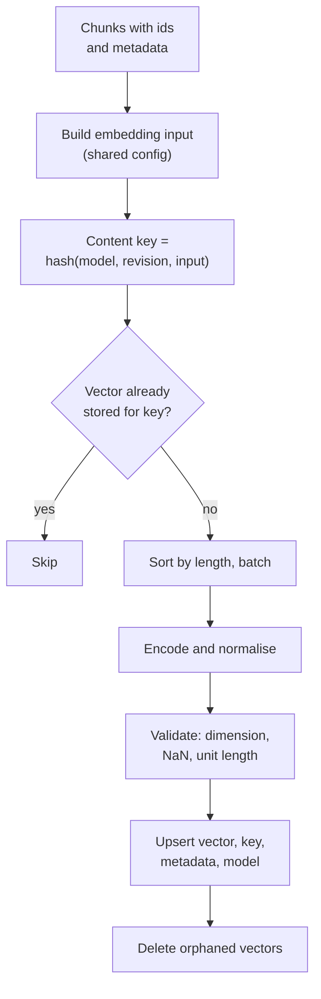

[Document embeddings](/learn/embedding-fundamentals/document-embeddings) in Phase 5 asked what a single vector can represent, and concluded that for retrieval the unit should usually be a chunk, not a whole document. This lesson takes that as settled and looks at the document side of a dense retriever as an engineering system. Three questions organise it. What exactly should the encoder read for each chunk? How should the embedding job run, so that it is efficient and repeatable? And how do you keep millions of vectors correct while documents are edited and models are replaced?

These questions decide a large part of retrieval quality and most of the operational cost of a dense index, and they are where many production incidents begin. You will measure the effect of adding a document title and section path to the embedding input, build an incremental embedding step keyed by content hashes, and work out why sorting inputs by length can remove most of the wasted computation in a large embedding job.

## Learning objectives

- Distinguish the stored text, the embedding input and the metadata of a chunk, and decide what belongs in each.
- Construct an embedding input with document context and measure its effect on retrieval margins.
- Implement incremental embedding with content-addressed keys, so that only new or changed inputs are encoded.
- Compute the padding waste of a batched embedding job and explain how length-sorting reduces it.
- Plan a model migration that re-embeds a corpus without downtime or mixed vector spaces.

## Prerequisites

- [Dense vector search](/learn/dense-retrieval/dense-vector-search): the offline path and the contract it shares with the query path.
- [Document embeddings](/learn/embedding-fundamentals/document-embeddings) (Phase 5): truncation, dilution and why chunks are the usual unit.
- [Query embeddings](/learn/dense-retrieval/query-embeddings): query and document prefixes.
- [Document metadata](/learn/document-engineering/document-metadata) and [Document identifiers](/learn/document-engineering/document-identifiers).

## Why this matters

A chunk that reads "Up to 5 unused days carry over and must be used by 31 March" is perfectly clear to someone who knows it comes from the annual-leave section of the employee handbook. To an embedding model that sees only that sentence, it could be about leave, a mobile data plan or a gym membership. The splitter that produced it did its job; the context it removed was in the heading two lines above. Whether that context reaches the encoder is a decision someone has to make, and if nobody makes it, the default is "no".

The embedding job is also the most expensive repeated computation in a RAG system's offline path. Every change of model, chunking strategy or input format means re-encoding everything, and a naive job that re-embeds the whole corpus every night, or wastes half its compute on padding, multiplies that cost. Finally, vectors outlive the code that created them. An index that cannot say which model, which input format and which version of the source text produced each vector cannot be safely updated, and a half-migrated index that mixes two models' vectors gives wrong answers without any error.

## The intuition

A museum labels each exhibit with a small card. The object is the chunk; the card is what visitors search by. A good card says what the object is *in context*: "Roman oil lamp, 2nd century, from the Thames foreshore at Southwark". A card that reads "Lamp, clay" is accurate and almost useless, because there are four hundred of those.

Writing cards is slow, so a well-run museum keeps a register: each card's text and the date it was written. When an exhibit is re-dated, only that card is rewritten. When the museum decides to translate every card into a new language, it prints a complete new set before swapping them in overnight, rather than leaving visitors to read half the gallery in one language and half in another.

The embedding input is the card. The content-hash register is how you know which cards to rewrite. The full overnight swap is how you change embedding models.

## How it works

### Three views of a chunk

Every indexed chunk has three distinct representations, and confusing them causes a large share of document-side bugs.

| View | Purpose | Example |
| --- | --- | --- |
| **Stored text** | What is returned and shown to the language model | "Up to 5 unused days carry over and must be used by 31 March." |
| **Embedding input** | What the encoder reads to produce the vector | "passage: Employee handbook \| Annual leave > Carry-over\nUp to 5 unused days carry over and must be used by 31 March." |
| **Metadata** | What is filtered, sorted, displayed and audited | `{"doc_id": "hb-2025", "section": "Annual leave", "status": "current", "owner": "HR", "model": "e5-small-v2@<revision>"}` |

The embedding input exists to place the vector well. It can carry context the stored text lacks, and a model-specific prefix the language model should never see. Metadata exists for exact operations: "only current documents", "only documents this user may read", "sort by date". A useful rule of thumb is **embed meaning, filter facts**: put text that helps the model understand what the chunk is about into the embedding input, and put facts that need exact handling into metadata.

### Constructing the embedding input

A practical recipe, from most to least important:

1. **The chunk's text**, cleaned of boilerplate (repeated headers and footers, navigation, cookie banners) that would otherwise pull every vector towards the same point. [Header and footer removal](/learn/document-preprocessing/header-and-footer-removal) covers how.
2. **Its document title and section path**, such as "Employee handbook | Annual leave > Carry-over". This is the cheapest fix for the "what is *this*?" problem, and the code below measures it.
3. **The model's document prefix**, if it has one (`passage: ` for E5, `search_document: ` for Nomic), exactly as documented.
4. **Optionally, a generated context sentence**, written by a language model from the whole document. This is [contextual retrieval](/learn/advanced-retrieval/contextual-retrieval), and it costs one model call per chunk.

What to leave out of the embedding input:

- **Identifiers and URLs** such as `hb-2025-07-leave-03` or long links. They are noise to the encoder, and exact lookups on them are better served by metadata or keyword search.
- **Access-control labels and statuses** such as "Confidential" or "Superseded". They are facts to filter on, and embedding them nudges vectors in ways no one intended.
- **Dates**, mostly. Embedding models represent numbers and dates poorly, so "valid from 2025" in the vector will not reliably prefer current documents; a `status` or `effective_date` field does. [Similarity ranking](/learn/dense-retrieval/similarity-ranking) shows how to use such fields.

One constraint ties this together: the full embedding input, with prefix and context, must fit within the model's maximum sequence length (256 tokens for `all-MiniLM-L6-v2`, 512 for many BERT-sized models). Anything beyond the limit is silently dropped. Adding a 30-token header to a 240-token chunk pushes the last 14 tokens of the chunk out of the vector. Count tokens with the model's own tokeniser when you design chunk sizes.

### The embedding job, step by step

The offline path in [Dense vector search](/learn/dense-retrieval/dense-vector-search) said "encode the inputs in batches". A production embedding job does considerably more:

1. **Load chunks** from the chunking stage, each with a stable chunk identifier, its stored text and its metadata.
2. **Build each embedding input** with one shared function, using the same configuration (model, prefix, context format) that the query service reads.
3. **Compute a content key** for each input: a hash of the model identifier, its revision and the exact embedding input. Identical keys mean identical vectors.
4. **Skip inputs whose key already has a vector.** Only new or changed inputs go forward.
5. **Order the remaining inputs by length and batch them**, so that each batch contains inputs of similar length and little padding.
6. **Encode and normalise** each batch.
7. **Validate the vectors**: correct dimension, no `NaN` or infinite values, unit length if normalised. A bad vector in an index is very hard to find later.
8. **Upsert** vectors with their chunk identifier, content key and metadata (including model and revision).
9. **Delete orphans**: vectors whose chunk no longer exists or whose content key no longer matches the current chunk.



### Keeping vectors in step with documents

Documents change constantly: Meridian's IT runbooks are edited weekly, and the HR handbook is revised every year. Re-embedding everything nightly is simple and, past a modest size, wasteful. Content-addressed keys make updates incremental: a chunk whose embedding input is unchanged keeps its vector, and an edited chunk gets a new key and is re-embedded. The orphan step removes the vector for the old text, so the index never holds two versions of one chunk.

Two subtleties. First, chunk boundaries can shift: inserting a paragraph near the start of a document can change every chunk after it, so an edit to one sentence may re-embed many chunks. Structure-aware chunking, which splits at headings, limits this ([Structure-aware chunking](/learn/advanced-chunking-strategies/structure-aware-chunking)). Second, if the embedding input includes the document title or section path, renaming a section changes the key of every chunk under it. That is correct behaviour (their context really did change) but worth knowing when a "small" edit triggers a large job. Event-driven pipelines that react to such edits are covered in [Incremental ingestion](/learn/understanding-document-ingestion/incremental-ingestion).

### Changing the embedding model

A new model, a new revision of the same model, a new prefix or a new context format all produce vectors that are not comparable with the old ones. There is no partial migration: every chunk must be re-embedded, and the query service must switch to the new encoder at the same instant the index switches to the new vectors. The usual procedure is a **blue/green** migration:

1. Build a new, separate collection (green) with the new configuration, while the old one (blue) keeps serving.
2. Run the judged evaluation set against green and compare with blue.
3. Keep green up to date with changes made during the build (replay the change log, or run the incremental job against both).
4. Switch the query service's configuration and the collection alias to green together, in one deployment.
5. Keep blue for a rollback period, then delete it.

Many vector databases support **collection aliases**, a name that can be re-pointed atomically, which makes step 4 a single operation; [Collections](/learn/advanced-vector-database-engineering/collections) covers them. During the migration you temporarily need storage for two full indexes, which belongs in the capacity plan.

### More than one vector per chunk

The content key and orphan logic generalise naturally when a chunk has several representations: one vector for its text and another for a generated summary, or a set of generated questions it answers. The idea of indexing predicted questions comes from document expansion for keyword search (Nogueira and colleagues, 2019, *Document Expansion by Query Prediction*) and transfers to dense indexes. [Multi-vector retrieval](/learn/advanced-retrieval/multi-vector-retrieval) covers these designs; for this lesson, the point is that each extra representation multiplies the embedding job and the storage, and must be versioned like the main one.

## The mathematics

### Padding waste in batched encoding

**Intuition.** A batch is processed as a rectangle: every input is padded to the length of the longest input in its batch. A 40-token chunk sharing a batch with a 500-token chunk costs as much as a 500-token chunk, and the 460 padding positions are pure waste. Grouping inputs of similar length makes the rectangles tight.

$$
\text{waste} = 1 - \frac{\sum_{i=1}^{N} \ell_i}{\sum_{b} |b| \cdot \max_{i \in b} \ell_i}
$$

$\ell_i$ is the token length of input $i$, $N$ the number of inputs, $b$ ranges over the batches, $|b|$ is the number of inputs in batch $b$, and $\max_{i \in b} \ell_i$ is the longest input in that batch. The numerator counts real tokens; the denominator counts every position the model actually computes.

**By hand.** Four inputs of lengths 40, 200, 60 and 180 tokens, batch size 2.

- In arrival order the batches are (40, 200) and (60, 180). Computed positions $= 2 \times 200 + 2 \times 180 = 760$. Real tokens $= 480$. Waste $= 1 - 480/760 \approx 0.368$.
- Sorted, the batches are (40, 60) and (180, 200). Computed $= 2 \times 60 + 2 \times 200 = 520$. Waste $= 1 - 480/520 \approx 0.077$.

Sorting cut the computed positions from 760 to 520, almost a third less work for the same vectors. (Attention cost actually grows faster than linearly with length, so the true saving is somewhat larger.)

```python
import numpy as np

def padding_fraction(lengths, batch_size):
    """Share of computed token positions that are padding."""
    computed = 0
    for start in range(0, len(lengths), batch_size):
        batch = lengths[start:start + batch_size]
        computed += max(batch) * len(batch)      # every input is padded to the batch's longest
    return 1 - sum(lengths) / computed

print("hand example:", round(padding_fraction([40, 200, 60, 180], 2), 3),
      "sorted:", round(padding_fraction(sorted([40, 200, 60, 180]), 2), 3))

rng = np.random.default_rng(0)
lengths = rng.integers(30, 512, size=10_000).tolist()   # token counts of 10,000 chunks
print("random order:", round(padding_fraction(lengths, 64), 3))
print("sorted by length:", round(padding_fraction(sorted(lengths), 64), 3))
```

```output
hand example: 0.368 sorted: 0.077
random order: 0.464
sorted by length: 0.006
```

With 10,000 chunks of uniformly random length and batches of 64, nearly half the computed positions are padding in random order, and under 1% once sorted. Sentence Transformers' `encode` already sorts each call's inputs by length internally, which is one reason to pass it large lists rather than one batch at a time. If you write your own batching, call a hosted embedding API batch by batch, or stream chunks through a queue, you must sort yourself.

## In code

**The problem.** Meridian's chunks often lack their subject ("The budget is £400"). Measure whether adding the document title and section path to the embedding input helps retrieval, then make the embedding step incremental with content-addressed keys.

**Dependencies.** `sentence-transformers` and NumPy; the model downloads once. No API key.

```bash
pip install sentence-transformers numpy
```

```python
import hashlib
import numpy as np
from sentence_transformers import SentenceTransformer

MODEL = "sentence-transformers/all-MiniLM-L6-v2"
model = SentenceTransformer(MODEL)

# Chunks as the splitter produced them: the text alone often lacks its subject.
chunks = [
    {"id": "hb-leave-2", "doc": "Employee handbook", "section": "Annual leave > Carry-over",
     "text": "Up to 5 unused days carry over and must be used by 31 March."},
    {"id": "hb-remote-2", "doc": "Employee handbook", "section": "Remote work > Equipment",
     "text": "The budget is £400. Contractors are not eligible."},
    {"id": "hb-exp-1", "doc": "Employee handbook", "section": "Expenses > Deadlines",
     "text": "Claims must be submitted within 30 days. Anything over £75 needs a receipt."},
    {"id": "rb-vpn-1", "doc": "IT runbook: VPN", "section": "Public networks",
     "text": "It is required on public Wi-Fi. Connect before opening any internal system."},
    {"id": "rb-pw-1", "doc": "IT runbook: Accounts", "section": "Passwords > Rotation",
     "text": "Rotate it every 90 days. The portal reminds you a week before expiry."},
    {"id": "hb-leave-1", "doc": "Employee handbook", "section": "Annual leave > Entitlement",
     "text": "Staff receive 25 days per year. Book them through the HR portal."},
    {"id": "hb-remote-1", "doc": "Employee handbook", "section": "Remote work > Eligibility",
     "text": "Staff may work remotely up to 3 days a week, agreed with their manager."},
    {"id": "rb-guest-1", "doc": "IT runbook: Office network", "section": "Guest Wi-Fi",
     "text": "Visitors use the guest network. It does not reach internal systems."},
    {"id": "rb-mfa-1", "doc": "IT runbook: Accounts", "section": "Multi-factor authentication",
     "text": "Approve the sign-in prompt on your phone. Codes expire after 30 seconds."},
    {"id": "hb-exp-2", "doc": "Employee handbook", "section": "Expenses > Approvals",
     "text": "Each team has a travel budget. Your manager approves claims against it."},
]

def embedding_input(chunk, with_context):
    if not with_context:
        return chunk["text"]
    return f"{chunk['doc']} | {chunk['section']}\n{chunk['text']}"

def content_key(text):
    # Identifies one embedding: the exact input text plus the model that encoded it.
    return hashlib.sha256(f"{MODEL}\n{text}".encode("utf-8")).hexdigest()[:16]

queries = [
    ("Can I carry over unused annual leave?", "hb-leave-2"),
    ("What is the home-office equipment budget?", "hb-remote-2"),
    ("Is the VPN required on public Wi-Fi?", "rb-vpn-1"),
    ("How often must I rotate my password?", "rb-pw-1"),
    ("What is the deadline for submitting expenses?", "hb-exp-1"),
]
Q = model.encode([q for q, _ in queries], normalize_embeddings=True)
ids = [c["id"] for c in chunks]

for with_context in (False, True):
    texts = [embedding_input(c, with_context) for c in chunks]
    D = model.encode(texts, normalize_embeddings=True)
    S = Q @ D.T
    print(f"--- embedding input {'with' if with_context else 'without'} title and section")
    for (q, gold), row in zip(queries, S):
        g = ids.index(gold)
        rank = int(np.argsort(-row).tolist().index(g)) + 1
        margin = row[g] - np.max(np.delete(row, g))      # answer's score minus best wrong chunk
        print(f"rank={rank}  margin={margin:+.3f}  | {q}")

# --- Incremental embedding: only encode inputs whose content key is new -----
store = {}                                     # content key -> vector (stands in for the index)

def sync(chunks):
    keyed = {content_key(embedding_input(c, True)): embedding_input(c, True) for c in chunks}
    missing = [k for k in keyed if k not in store]
    if missing:
        vectors = model.encode([keyed[k] for k in missing], normalize_embeddings=True)
        store.update(zip(missing, vectors))
    return len(missing)

print("\nfirst sync, embedded:", sync(chunks))
print("second sync, embedded:", sync(chunks))
chunks[1]["text"] = "The budget is £400 per person. Contractors are not eligible."
print("after editing one chunk, embedded:", sync(chunks))
```

```output
--- embedding input without title and section
rank=1  margin=+0.078  | Can I carry over unused annual leave?
rank=1  margin=+0.150  | What is the home-office equipment budget?
rank=1  margin=+0.309  | Is the VPN required on public Wi-Fi?
rank=1  margin=+0.158  | How often must I rotate my password?
rank=1  margin=+0.064  | What is the deadline for submitting expenses?
--- embedding input with title and section
rank=1  margin=+0.185  | Can I carry over unused annual leave?
rank=1  margin=+0.247  | What is the home-office equipment budget?
rank=1  margin=+0.306  | Is the VPN required on public Wi-Fi?
rank=1  margin=+0.249  | How often must I rotate my password?
rank=1  margin=+0.238  | What is the deadline for submitting expenses?

first sync, embedded: 10
second sync, embedded: 0
after editing one chunk, embedded: 1
```

**The important lines.**

- `embedding_input` is the single function that decides what the encoder reads. In production it is shared by the embedding job and any re-embedding tool, and it reads its format from the same configuration as the query service.
- The header format `doc | section` followed by a newline is a simple, readable convention; what matters is that it is consistent across the whole index.
- `margin` is the answer chunk's score minus the best *wrong* chunk's score. Rank alone hides how close a call was; margin shows how much room there is before a slightly different query or a larger corpus flips the result.
- `content_key` hashes the model name together with the exact input. In production, include the model's revision (for example its Hugging Face commit hash) and the normalisation setting.
- `sync` encodes only inputs whose key is not yet stored. The edited chunk produces a new key, so exactly one input is re-encoded.

**What the output means.** In this ten-chunk corpus every answer is ranked first either way, so rank shows nothing. The margins tell the story. With context, the margin grows for four of the five queries, more than doubling for carry-over and nearly quadrupling for the expenses deadline, and is unchanged for the VPN query, whose chunk text already says "public Wi-Fi". The chunks that gained most are those whose text never names its subject: "Up to 5 unused days carry over" says nothing about leave, and "Claims must be submitted within 30 days" never says "expenses", so without context its nearest rival for the deadline question was the leave-entitlement chunk ("25 days per year"). In a real index with thousands of chunks, many of them similar, a margin of 0.06 is easily overturned; a margin of 0.24 much less so.

The sync lines show the incremental behaviour: ten encodes on the first run, none on an unchanged second run, one after a single edit. Note what the code does *not* do yet: the vector for the old version of the edited chunk is still in `store`. In a real index, that orphan must be deleted, or the old text keeps being retrieved.

**Errors people commonly hit.**

- Hashing the stored text instead of the embedding input. A change to the header format then fails to trigger re-embedding.
- Forgetting the model in the key. After a model change, every key matches and nothing is re-embedded.
- Making headers so long that they push the chunk's own text past the model's sequence limit.

**Extending it.** Add orphan deletion: keep a map from chunk id to content key, and when a chunk's key changes, delete the old key's vector. Then add a validation step that rejects vectors with the wrong dimension or a norm far from 1.

## A real-world example

Meridian's Platform team noticed that AskMeridian answered "What's the equipment budget?" correctly but failed on "Can contractors get the equipment budget?", retrieving a remote-work eligibility chunk instead. The chunk holding the answer read "Contractors are not eligible." with nothing else, because the splitter had broken the equipment section after its first sentence. The chunk text had no mention of equipment, budgets or home working, so its vector sat near other sentences about contractors and eligibility.

The team made two changes. They added the title and section path to every embedding input, after a judged-set run showed the gains were consistent, and they set the chunker to keep short sections whole. The re-embedding was run as a blue/green migration because the input format change altered every content key. The vector-count dashboard showed the green collection at the expected size before the switch, the judged set confirmed improvement, and the alias was moved in the same deployment as the query service's configuration.

One surprise followed. A week later, the HR team renamed the handbook section "Remote work" to "Hybrid working", and the nightly incremental job re-embedded about a fifth of the handbook. Nothing was wrong: every chunk under that heading had a new embedding input. The team added a note to the runbook that renaming headings triggers re-embedding, and an alert if a single run re-embeds more than a set share of the corpus, so that a genuinely accidental change (a template edit adding a footer to every page, for instance) would be caught before it reached production.

## Common mistakes

- **Embedding chunk text without its document context.** Chunks that do not name their subject get vectors near unrelated text and lose to weaker matches.
- **Embedding identifiers, URLs, statuses or dates.** They add noise to the vector and still do not support exact filtering; put them in metadata.
- **Building headers that push the chunk past the sequence limit.** The end of the chunk is silently truncated out of the vector.
- **Re-embedding the whole corpus on every run.** Cost and time scale with corpus size instead of with the size of the change.
- **Not deleting orphaned vectors.** Old versions of edited chunks keep being retrieved, and the language model sees contradictory text.
- **Mixing two models' vectors in one collection during a migration.** Scores between the two populations are meaningless, and rankings become arbitrary.

## Best practices

- Keep the stored text, the embedding input and the metadata as three explicit fields, built by shared, versioned functions.
- Include the document title and section path in the embedding input, and measure the effect on your judged set.
- Key every vector by a hash of model, revision and exact embedding input, and re-embed only on key changes.
- Sort inputs by length before batching whenever you control the batching.
- Validate vectors before upserting, and store the model, revision and input-format version with each one.
- Migrate models blue/green: build, evaluate, switch index and query encoder together, keep the old index for rollback.

## Performance considerations

Embedding cost scales with tokens, not chunks. Adding a 20-token header to 200-token chunks adds about 10% more tokens to every encode; that is usually a good trade, but it is not free.

Some arithmetic for a full re-embed, with assumptions stated. Suppose Meridian's combined corpus is 60,000 chunks averaging 250 tokens with headers: 15 million tokens. On a hosted embedding API priced at an assumed 0.02 US dollars per million tokens (check your provider's current pricing), that is about 0.30 dollars; cost is rarely the problem at this scale. Time and rate limits are: at an assumed limit of 1 million tokens per minute, the job needs at least 15 minutes. With a local model on a CPU at an assumed 100 chunks per second, it needs 10 minutes; on a GPU, much less.

Storage is $N \times d \times 4$ bytes in `float32`: 60,000 vectors at 384 dimensions is about 92 MB, and during a blue/green migration you need twice that, plus each database's index overhead. Incremental embedding turns the nightly cost from "the corpus" into "the day's edits", which for a handbook and runbooks is typically a tiny fraction.

## Security considerations

- **The embedding input can leak.** If you prepend metadata such as a document's confidential title, that text shapes the vector; ensure the same access filters apply to every representation of a chunk.
- **Hosted embedding APIs receive your text.** Sending the whole handbook to a third party for embedding is a data-processing decision that needs the same approval as any other transfer of company documents.
- **Indexed content is an attack surface.** Anyone who can edit a source can plant text designed to be retrieved for common questions; the incremental job will faithfully embed it within hours. Restrict write access to indexed sources and log what each run embedded.

## Summary

- A chunk has three views: stored text for the model, embedding input for the encoder, metadata for exact operations. Embed meaning, filter facts.
- Adding the document title and section path to the embedding input is cheap and typically widens the margin of the right chunk, most of all for chunks that never name their subject.
- A production embedding job builds inputs from shared configuration, skips unchanged content by hash, batches by length, validates vectors and deletes orphans.
- Sorting inputs by length can eliminate most padding waste when you control batching.
- Changing the model, prefix or input format means re-embedding everything; do it blue/green and switch the index and query encoder together.

## Exercises

1. **Padding by hand.** Six inputs of lengths 10, 300, 20, 280, 30 and 290 tokens are encoded in batches of 3. Compute the padding waste in arrival order and after sorting.

<details><summary>Show solution</summary>

Real tokens: 930. Arrival order: batches (10, 300, 20) and (280, 30, 290), computed $3 \times 300 + 3 \times 290 = 1{,}770$, waste $= 1 - 930/1{,}770 \approx 0.475$. Sorted: (10, 20, 30) and (280, 290, 300), computed $3 \times 30 + 3 \times 300 = 990$, waste $= 1 - 930/990 \approx 0.061$.

</details>

2. **What goes where?** For a Meridian IT runbook chunk, decide whether each item belongs in the stored text, the embedding input, the metadata, or several: the runbook title; the error code E-4021; the date last reviewed; the owning team; the instruction text; the `passage: ` prefix.

<details><summary>Show solution</summary>

Runbook title: embedding input (context) and metadata (display). E-4021: in the stored text and embedding input as part of the instruction text, and also as a metadata field or keyword-indexed field, because exact codes are matched far better lexically. Date last reviewed: metadata only. Owning team: metadata only. Instruction text: stored text and embedding input. The `passage: ` prefix: embedding input only; never shown to the language model.

</details>

3. **Orphans.** Extend `sync` so that it also deletes the vector of a chunk's previous version when the chunk changes, and prints how many vectors it deleted.

<details><summary>Show solution</summary>

```python
key_of_chunk = {}                            # chunk id -> content key currently indexed

def sync(chunks):
    added = deleted = 0
    for c in chunks:
        text = embedding_input(c, True)
        key = content_key(text)
        old = key_of_chunk.get(c["id"])
        if old == key:
            continue
        store[key] = model.encode(text, normalize_embeddings=True)
        added += 1
        key_of_chunk[c["id"]] = key
        if old is not None and old not in key_of_chunk.values():   # no other chunk uses it
            store.pop(old, None)
            deleted += 1
    return added, deleted

print(sync(chunks), sync(chunks))
chunks[1]["text"] = "The budget is £400 per person. Contractors are not eligible."
print(sync(chunks), len(store))
```

```output
(10, 0) (0, 0)
(1, 1) 10
```

Run on a fresh `store`, the first sync adds ten vectors, the second does nothing, and the edit adds one vector and deletes one, leaving ten. The membership check before deleting protects a vector that another chunk with identical input still uses. Chunks removed from the source entirely also need handling: compare the set of chunk ids in this run with `key_of_chunk` and delete the vectors of ids that disappeared. This version encodes one input at a time for clarity; batch the new inputs in production.

</details>

4. **Migration plan.** Write the steps to move AskMeridian from `all-MiniLM-L6-v2` (384 dimensions) to an E5 model (768 dimensions, with prefixes) with no downtime. What would you check before switching?

<details><summary>Show solution</summary>

Create a new collection sized for 768 dimensions. Update the shared configuration in a new version (model, revision, `query: ` and `passage: ` prefixes) without deploying it to the query service. Run the embedding job into the new collection, then the incremental job against both collections until the switch. Before switching: vector count matches the chunk count; a sample of vectors has unit norm and no `NaN`; the judged evaluation set, run through the new query path with the new prefix, is at least as good as the old; latency of the new query encoder is within budget. Switch the alias and the query configuration in one deployment. Keep the old collection and configuration for a rollback period, then delete them.

</details>

## Check your understanding

```quiz
[
  {
    "q": "A chunk reads 'Contractors are not eligible.' and nothing else. Which change is most likely to help it be retrieved for 'Can contractors get the equipment budget?'",
    "options": [
      "Embedding the chunk twice",
      "Adding its document title and section path, such as 'Employee handbook | Remote work > Equipment', to the embedding input",
      "Lower-casing the chunk text",
      "Adding the chunk's identifier to the embedding input"
    ],
    "answer": 1,
    "why": "The chunk never names its subject. The section path supplies 'equipment' and 'remote work' to the encoder, moving the vector towards questions about the equipment budget."
  },
  {
    "q": "What does this print?\n```python\ndef padding_fraction(lengths, b):\n    computed = sum(max(lengths[i:i+b]) * len(lengths[i:i+b]) for i in range(0, len(lengths), b))\n    return round(1 - sum(lengths) / computed, 2)\nprint(padding_fraction([100, 100, 50, 50], 2))\n```",
    "options": ["0.5", "0.25", "0.0", "0.75"],
    "answer": 2,
    "why": "The batches are (100, 100) and (50, 50). Each is already uniform, so the computed positions equal the real tokens (300) and there is no padding."
  },
  {
    "q": "Why must a content key include the embedding model and its revision, not just the text?",
    "options": [
      "So that a model change produces new keys and triggers re-embedding, instead of silently reusing old vectors",
      "Because hashes of text alone collide too often",
      "Because vector databases reject keys without a model name",
      "So that the key is longer and more secure"
    ],
    "answer": 0,
    "why": "The same text encoded by a different model produces an incomparable vector. Including the model in the key makes the incremental logic re-embed everything when the model changes."
  },
  {
    "q": "Where should a chunk's 'superseded' status be recorded?",
    "options": [
      "At the start of the embedding input, so the vector reflects it",
      "In the stored text shown to the language model only",
      "Nowhere; superseded chunks should simply be left in the index",
      "In metadata, so that it can be filtered or used in ranking exactly"
    ],
    "answer": 3,
    "why": "Status is a fact that needs exact handling. Embedding it nudges the vector unpredictably and cannot reliably exclude old content; a metadata filter can."
  },
  {
    "q": "During a model migration, a team writes new-model vectors into the existing collection as they are produced. What is the problem?",
    "options": [
      "The collection will run out of identifiers",
      "Queries are encoded by one model at a time, so they are compared against a mixture of comparable and incomparable vectors, and rankings become arbitrary",
      "New vectors will be ignored by the index",
      "There is no problem as long as the dimensions match"
    ],
    "answer": 1,
    "why": "Vectors from different models live in different spaces. A blue/green migration keeps each collection consistent and switches query encoder and index together."
  }
]
```

## Further reading

- Nogueira, R., Yang, W., Lin, J. and Cho, K. (2019). *Document Expansion by Query Prediction*. [arXiv:1904.08375](https://arxiv.org/abs/1904.08375)
- Anthropic (2024). *Introducing Contextual Retrieval*. Anthropic engineering blog.
- Sentence Transformers documentation, "Computing Embeddings" (batching, prompts, normalisation): [sbert.net](https://www.sbert.net/)
- Qdrant documentation on collections and aliases: [qdrant.tech/documentation](https://qdrant.tech/documentation/)
- Kleppmann, M. (2017). *Designing Data-Intensive Applications*, chapter 11 (stream processing and derived data). O'Reilly.
