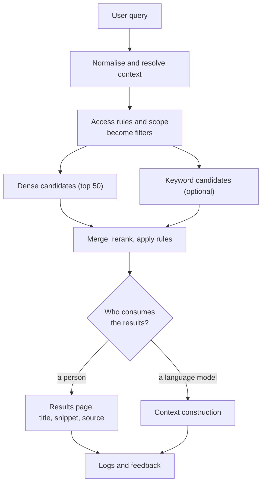

[Dense vector search](/learn/dense-retrieval/dense-vector-search) is a mechanism: encode, compare, return the nearest vectors. **Semantic search** is what that mechanism is for: letting people find information by what they mean rather than by the exact words the author happened to use. The two terms are often used interchangeably, but the distinction is useful. The mechanism is the same everywhere; the *task* it is put to varies, and the task decides which model you need, what you should put in the index, and how you judge whether the search works.

This lesson is about the task. You will see the two shapes semantic search takes (finding text *like* the query, and finding text that *answers* the query), why a model suited to one can disappoint on the other, how to choose what each index entry represents, and what a semantic search feature needs around the vector lookup before people can rely on it. The code compares four ways of indexing the same Meridian FAQ and shows that each fails on a different question, which is the practical argument for measuring on your own queries.

## Learning objectives

- Define semantic search and distinguish it from the dense-retrieval mechanism that implements it.
- Classify a search task as symmetric or asymmetric, and explain how that choice affects the embedding model you select.
- Compare indexing strategies for question-and-answer content (questions, answers, both combined, both separately) and choose one for a given corpus by evaluating it.
- Describe the stages a production semantic search feature needs around the vector lookup, from query handling to result presentation and feedback.
- Decide when semantic search should show results directly instead of passing them to a language model.

## Prerequisites

- [Dense vector search](/learn/dense-retrieval/dense-vector-search): the bi-encoder architecture and the offline and online paths.
- [Semantic similarity](/learn/embedding-fundamentals/semantic-similarity): the different relations hidden under "similar", and similarity versus relevance.
- [Query-document matching](/learn/rag-architecture-fundamentals/query-document-matching): lexical and semantic matching and the vocabulary-mismatch problem.

## Why this matters

People rarely use the author's words. A Meridian employee asks about "holiday" while the handbook says "annual leave"; another asks whether she can "claim back a taxi" while the policy talks about "expenses"; a developer describes a symptom ("the VPN keeps dropping") when the runbook is organised by cause. Keyword search fails all three, and users learn to distrust a search box that needs the right magic word.

Semantic search addresses that, but it introduces failure modes of its own, and most of them come from a mismatch between the task and the setup. A model trained to recognise paraphrases is asked to find answers. An index built from long passages is searched with three-word queries. A team evaluates on a handful of hand-picked examples, sees good results, and ships a feature that half its users find unhelpful. None of these is a bug in the vector search. They are decisions about what the search is for, and getting them right is a large part of the RAG engineer's job.

## The intuition

Imagine two requests made to a well-read librarian.

The first: "Here is a letter I received. Find me other letters that say the same thing." The librarian compares like with like: letters with letters, and the best match is a letter that could almost be a rewording of yours. Similar length, similar style, similar content.

The second: "When does the support desk close?" Here the best match is not another question about the support desk. It is a page that says "the support desk is open from 08:00 to 18:00 UK time". That page looks nothing like the question: it is a statement, not a question; it does not contain the word "close"; and it contains the one thing the question lacks, the answer. To find it, the librarian has to know what kind of text answers that kind of question.

Both requests are semantic search. The first is **symmetric**: query and target are the same kind of text. The second is **asymmetric**: a short question looking for the longer passage that answers it. A librarian who is excellent at the first may be mediocre at the second, and embedding models are the same.

## How it works

### What makes a search semantic

A search is **semantic** when it matches on meaning rather than on surface form: two texts can match with no words in common, and two texts with many words in common can fail to match. In current systems this nearly always means dense retrieval with an embedding model, though older techniques such as latent semantic analysis and query expansion with thesauri pursued the same goal.

The word "meaning" hides a choice. As [Semantic similarity](/learn/embedding-fundamentals/semantic-similarity) showed, models learn a particular blend of relations (paraphrase, topical relatedness, question-answer relevance) and the blend is whatever the training data rewarded. So the first design question for any semantic search feature is: *which relation do my users need?*

### Symmetric and asymmetric search

The Sentence Transformers documentation separates semantic search tasks into two kinds, and the distinction is the most useful single idea for choosing a model.

**Symmetric semantic search.** Query and corpus entries are similar in length and form, and the best result is roughly a paraphrase of the query. Examples: matching a new support ticket against past tickets, finding a stored FAQ question that matches the user's question, detecting duplicate documents. A query and its ideal result could swap places and the match would still make sense.

**Asymmetric semantic search.** The query is short (usually a question or a few keywords) and the target is a longer passage that answers it. Examples: nearly all RAG retrieval, searching documentation, searching a policy handbook. Swapping query and result makes no sense: the passage does not "ask" the question.

| Aspect | Symmetric | Asymmetric |
| --- | --- | --- |
| Query and target | Same kind of text | Short query, longer passage |
| Best match | Paraphrase or near-duplicate | Passage containing the answer |
| Typical training data | Paraphrase pairs, duplicate questions, similarity ratings | Search queries paired with the passages that answered them |
| Typical use | FAQ matching, ticket deduplication, clustering | RAG retrieval, document search |

The training data column is the important one. A model learns whatever relation its training pairs exhibit. One trained mainly on paraphrase pairs will place "When does the support desk close?" nearest to "What time does the help desk shut?" and only then to the passage with the opening hours. A model trained on real search queries paired with the passages that answered them (the MS MARCO dataset, built from Bing queries, is the best-known source of such pairs) learns to place questions near their answers. Many modern general-purpose embedding models are trained on mixtures of both kinds of data, and some take an instruction or prefix telling them which kind of task they are doing; [Query embeddings](/learn/dense-retrieval/query-embeddings) covers how those prefixes work.

> [!KEY]
> Before choosing an embedding model, write down whether your search is symmetric or asymmetric, and check that the model was trained, or is documented, for that shape of task. Leaderboard scores averaged over many tasks can hide a model that is strong at one shape and weak at the other.

### The unit you match and the unit you return

In a plain RAG index, each entry is a chunk, and the chunk is both what you match against and what you return. They do not have to be the same, and separating them is one of the most effective tools in semantic search.

- **Match the question, return the answer.** An FAQ entry can be indexed by the vector of its *question*, turning an asymmetric task into a symmetric one: the user's question is compared with stored questions, and the matched entry's answer is returned.
- **Match the answer, return the answer.** The plain asymmetric approach: embed the answer text and rely on the model to connect questions to answers.
- **Match a combined text.** Embed "question + answer" as one vector, so that both forms contribute.
- **Match several vectors per entry.** Store one vector for the question and one for the answer, both pointing to the same entry, and score the entry by its better match. This is a simple instance of [multi-vector retrieval](/learn/advanced-retrieval/multi-vector-retrieval).

The same idea scales up: match small chunks but return their larger parent section ([small-to-big retrieval](/learn/chunking-optimisation/small-to-big-retrieval)), or match generated summaries but return the full document. Which choice wins depends on the corpus and the queries, and the code below shows that it is hard to predict without measuring.

### The pipeline around the vector lookup

A vector lookup on its own is not a search feature. A production semantic search has the following stages, whether its results go to a person or to a language model:

1. **Receive and normalise the query.** Trim whitespace, normalise Unicode, enforce a length limit. Keep the original text for logging.
2. **Resolve context.** In a conversation, turn a follow-up such as "and for contractors?" into a standalone query. This belongs to [Query embeddings](/learn/dense-retrieval/query-embeddings) and [Query rewriting](/learn/advanced-retrieval/query-rewriting).
3. **Apply access rules and scope.** Determine which documents this user may see and which collection or language applies, and express them as [filters](/learn/vector-database-fundamentals/filtering) on the search.
4. **Retrieve candidates.** Dense search for the top 20 to 100 entries, often in parallel with keyword search for [hybrid](/learn/hybrid-search/hybrid-retrieval-architecture) results.
5. **Refine the ranking.** Optional reranking, removal of near-duplicates, and any business rules (prefer current policy over superseded versions) covered in [Similarity ranking](/learn/dense-retrieval/similarity-ranking).
6. **Present or hand off.** For people: a title, a snippet, the source and a link, for each of the first few results. For RAG: the selected chunks, with their identifiers, to [context construction](/learn/rag-architecture-fundamentals/context-construction).
7. **Log and learn.** Record the query, the results, and any signal of success (a click, a thumbs-up, an answer the user did not rephrase). These logs become your evaluation set.



### Results for people, or results for a model

Semantic search predates RAG, and showing a ranked list of sources is still sometimes the better product. A generated answer is convenient but adds cost, latency and the risk of the model misreading the context. A list of results is slower to read but lets the user judge the source. Three situations favour showing results:

- The user's goal is a document, not a fact: "the expenses policy", "the VPN runbook".
- The retrieved candidates are weak or disagree, and a generated answer would hide that.
- The domain demands that people read the authoritative text (legal, medical, safety procedures).

Many assistants, AskMeridian included, do both: an answer with citations, and the cited sources shown beneath it, so that a user who doubts the answer is one click from the text.

### Judging a semantic search

Relevance is a judgement made by people about their own need, so the only reliable way to know whether a semantic search works is to collect real or realistic queries, record which entries answer each one, and measure how often those entries appear near the top. A few dozen judged queries are enough to compare indexing strategies or models; the [Retrieval evaluation](/learn/retrieval-evaluation) module covers the metrics. Spot-checking a handful of queries you thought of yourself is not evaluation: you will unconsciously phrase them the way the documents are written.

## In code

**The problem.** Meridian's HR team has an FAQ of question-and-answer pairs. Users type their own wording. Should the index contain the questions, the answers, both combined into one text, or both as separate vectors? Run all four on the same five user queries and compare.

**Dependencies.** `sentence-transformers` (with PyTorch). The model `all-MiniLM-L6-v2` downloads once, about 90 MB. No API key.

```bash
pip install sentence-transformers
```

```python
import torch
from sentence_transformers import SentenceTransformer, util

faq = [
    ("How many days of annual leave do I get?",
     "Annual leave is 25 days per year. Up to 5 unused days carry over and must be used by 31 March."),
    ("How often do I have to change my password?",
     "Passwords must be rotated every 90 days."),
    ("Can I work from home?",
     "Staff may work remotely up to 3 days a week."),
    ("Is there a budget for home-office equipment?",
     "The home-office equipment budget is £400. Contractors are not eligible."),
    ("When do I need to submit expenses?",
     "Expenses must be submitted within 30 days. Anything over £75 needs a receipt."),
    ("When will my laptop be replaced?",
     "Laptops are replaced on a 3-year refresh cycle."),
    ("What are the support desk's opening hours?",
     "The support desk is open from 08:00 to 18:00 UK time."),
]
queries = [  # (user query, index of the FAQ entry that answers it)
    ("how much holiday am I entitled to", 0),
    ("do I need to rotate my login credentials", 1),
    ("what time does IT support close", 6),
    ("can I buy a monitor for working at home", 3),
    ("my laptop is ancient, can I get a new one", 5),
]

model = SentenceTransformer("sentence-transformers/all-MiniLM-L6-v2")
def embed(texts):
    return model.encode(texts, normalize_embeddings=True, convert_to_tensor=True)

Q = embed([q for q, _ in queries])
views = {
    "answers":   util.cos_sim(Q, embed([a for _, a in faq])),              # asymmetric
    "questions": util.cos_sim(Q, embed([q for q, _ in faq])),              # symmetric
    "q+a":       util.cos_sim(Q, embed([f"{q} {a}" for q, a in faq])),     # one combined vector
}
views["max(q, a)"] = torch.maximum(views["questions"], views["answers"])   # best of two vectors

for name, scores in views.items():           # scores: (number of queries, number of entries)
    print(f"--- matching against {name}")
    for (query, gold), row in zip(queries, scores):
        top = torch.topk(row, 2)
        best, gap = int(top.indices[0]), float(top.values[0] - top.values[1])
        mark = "ok  " if best == gold else "MISS"
        print(f"{mark} entry={best} score={float(top.values[0]):.3f} gap={gap:.3f} | {query}")
```

```output
--- matching against answers
MISS entry=4 score=0.421 gap=0.018 | how much holiday am I entitled to
ok   entry=1 score=0.607 gap=0.457 | do I need to rotate my login credentials
ok   entry=6 score=0.622 gap=0.336 | what time does IT support close
ok   entry=3 score=0.328 gap=0.090 | can I buy a monitor for working at home
ok   entry=5 score=0.554 gap=0.389 | my laptop is ancient, can I get a new one
--- matching against questions
ok   entry=0 score=0.509 gap=0.135 | how much holiday am I entitled to
ok   entry=1 score=0.471 gap=0.331 | do I need to rotate my login credentials
ok   entry=6 score=0.609 gap=0.360 | what time does IT support close
MISS entry=2 score=0.597 gap=0.164 | can I buy a monitor for working at home
ok   entry=5 score=0.567 gap=0.427 | my laptop is ancient, can I get a new one
--- matching against q+a
ok   entry=0 score=0.416 gap=0.040 | how much holiday am I entitled to
ok   entry=1 score=0.585 gap=0.431 | do I need to rotate my login credentials
ok   entry=6 score=0.628 gap=0.432 | what time does IT support close
MISS entry=2 score=0.496 gap=0.137 | can I buy a monitor for working at home
ok   entry=5 score=0.516 gap=0.383 | my laptop is ancient, can I get a new one
--- matching against max(q, a)
ok   entry=0 score=0.509 gap=0.088 | how much holiday am I entitled to
ok   entry=1 score=0.607 gap=0.457 | do I need to rotate my login credentials
ok   entry=6 score=0.622 gap=0.336 | what time does IT support close
MISS entry=2 score=0.597 gap=0.164 | can I buy a monitor for working at home
ok   entry=5 score=0.567 gap=0.402 | my laptop is ancient, can I get a new one
```

**The important lines.**

- `util.cos_sim(Q, ...)` returns a matrix with one row per query and one column per FAQ entry. Because the embeddings are normalised, it is the same as a matrix product; the helper simply saves writing the transpose.
- Each entry in `views` is a different decision about *what an index entry represents*, applied to the same seven FAQ entries and the same five queries.
- `torch.maximum(...)` implements "two vectors per entry, score the entry by its better match". In a vector database you would store two points with the same `entry_id` in their metadata and collapse the results by that id.
- `torch.topk(row, 2)` gives the best entry and the runner-up; the **gap** between them is a rough indication of how decisive the match was.

**What the output means.** Every strategy misses something, and they miss different things:

- **Answers only** misses the holiday query. The leave answer never says "holiday", and the expenses answer edges ahead of it by 0.018, a margin small enough to be noise. It gets the monitor query right, but only just: 0.328 is the weakest winning score in the whole run.
- **Questions only** fixes the holiday query, because the stored question "How many days of annual leave do I get?" is phrased like a user's question. But it loses the monitor query to "Can I work from home?", a question that looks like the query on the surface ("working at home") without answering it. This is the classic trap of symmetric matching: it rewards questions that *resemble* the query, and the most similar-looking question is not always the one with the right answer.
- **Combined** and **max** both get four of five, missing the same monitor query.

The right conclusion is not "use max". Five queries cannot separate four strategies; with this little evidence, any choice is a guess. The right conclusion is that the indexing decision measurably changes results, the changes go in both directions, and the only way to choose is to run each option over a few dozen judged queries drawn from what users actually type. The code above is the skeleton of exactly that experiment: replace the five queries with your judged set and count the hits.

**Errors people commonly hit.**

- Building the judged queries from the FAQ questions themselves, slightly reworded. Every strategy scores well and the comparison tells you nothing.
- Forgetting to collapse duplicates when an entry has two vectors: the same answer then fills two of the top five slots.
- Comparing gaps or scores across strategies as if they were on one scale. The questions-only view produces higher raw scores because question-to-question matching is symmetric; that does not make it more accurate.

**Extending it.** Add a fifth view that indexes several user-style paraphrases per entry, generated by a language model or taken from search logs, and score by the maximum. Then add a [cross-encoder reranker](/learn/reranking-fundamentals/cross-encoders) over the top five of any view and check whether it repairs the misses.

## A real-world example

Meridian's HR team first built semantic search for its FAQ page. The team indexed the FAQ *questions* with a model fine-tuned on paraphrase pairs, and the feature worked well: staff typed their own wording, the matching question came up first, and its answer was displayed.

The Platform team then reused the same model and code for AskMeridian's search over the full employee handbook and the IT runbooks, where there are no stored questions, only passages. Quality fell sharply on questions that do not resemble the text that answers them. "Can I use the café Wi-Fi for work?" returned the remote-working section, which mentions working away from the office, rather than the passage requiring the VPN on public Wi-Fi. The model had been trained to find paraphrases, and in the handbook there were none to find.

The fix had two parts. The team switched the handbook index to a model documented for asymmetric retrieval, and built a set of sixty judged questions from real support-desk tickets, so that the next model change would be decided by measurement rather than by a demo. For the FAQ page, they kept question matching but added the answer as a second vector per entry after the judged set showed that some failures, like the monitor question above, were repaired by it. The episode taught the team that the same mechanism serves two different tasks, and the task, not the mechanism, decides the model.

## Common mistakes

- **Using a paraphrase-trained model for question-to-passage retrieval.** Questions match other question-like text instead of the passages that answer them; quality drops on exactly the queries that need semantic search.
- **Judging a search on queries written by the team that wrote the documents.** Their wording already matches the documents, so every approach looks good and real users' failures go unseen.
- **Assuming the matched unit must be the returned unit.** Missing the option to match questions, summaries or small chunks while returning answers or larger sections leaves easy accuracy unused.
- **Showing a generated answer when the retrieved candidates are weak.** The user sees a confident sentence instead of evidence that the corpus may not cover the question.
- **Not logging queries and outcomes.** Without logs there is no way to build an evaluation set from real usage or to notice that a class of questions consistently fails.
- **Comparing raw scores between different indexing strategies or models.** Score scales differ; only rankings measured against judged answers are comparable.

## Best practices

- Classify each search feature as symmetric or asymmetric before choosing a model, and read the model card for the task it was trained on.
- Build a judged query set of at least a few dozen realistic queries, ideally from logs or tickets, and use it for every model, indexing and chunking decision.
- Separate the matched representation from the returned content when the corpus has natural structure (FAQ questions, titles, summaries, parent sections).
- Run dense and keyword retrieval together when queries can contain identifiers or exact names; semantic search alone is weak there, as [Dense retrieval limitations](/learn/dense-retrieval/dense-retrieval-limitations) shows.
- Show sources alongside generated answers, and consider showing results only when retrieval is weak or the user is looking for a document.
- Log queries, results and outcome signals from the first day, with appropriate privacy controls.

## Performance considerations

The vector lookup is rarely the expensive part of a semantic search feature. For a collection the size of Meridian's handbook, exact search takes milliseconds. The costs that matter are:

- **Query encoding**: one forward pass per query. Small models on CPU take a few milliseconds to tens of milliseconds for a short query; larger models or a remote embedding API add more, and a remote API adds a network round trip, typically tens of milliseconds or more.
- **Multiple vectors per entry**: indexing questions and answers separately doubles the number of vectors and roughly doubles exact-search work, which is negligible for an FAQ of hundreds of entries and worth planning for at millions.
- **Reranking**: a cross-encoder over 20 candidates is 20 model passes; it is often the largest single cost in the pipeline and is worth it only if it measurably improves the ranking.
- **Generation**: if results go to a language model, the generation step dominates both latency and cost by a wide margin. That is a reason to consider showing results directly for queries that are looking for a document.

## Security considerations

- **Search results must respect permissions.** Apply each user's access rules as a filter in the search itself. A semantic search across HR documents that returns a snippet from a confidential investigation file leaks it, even if the full document is protected.
- **Snippets are disclosure.** Displaying the first lines of a result reveals content; snippets need the same access checks as documents.
- **Queries are personal data.** People type health conditions, grievances and names into internal search. Logs that store queries need retention limits and access controls, and should not be shared casually for evaluation.
- **Poisoned content.** Anyone who can edit an indexed source can write a passage designed to match common questions. Restrict write access to indexed sources and review changes to high-traffic content.

## Summary

- Semantic search is the task of finding information by meaning; dense vector search is the usual mechanism.
- Symmetric search matches like with like; asymmetric search matches a short query to the passage that answers it. Most RAG retrieval is asymmetric, and models trained mainly on paraphrases do it less well.
- What an index entry represents (a question, an answer, a combination, several vectors) is a design decision with measurable and unpredictable effects; measure it on judged queries.
- A semantic search feature needs query handling, filters, candidate retrieval, ranking refinement, presentation and logging around the vector lookup.
- Showing sources, alone or with a generated answer, is often the right product, especially when retrieval is weak.

## Exercises

1. **Classify.** For each of the following, say whether the search is symmetric or asymmetric: (a) finding past Atlas incidents similar to a new incident report, (b) answering "what does error E-4021 mean?" from the error-code catalogue, (c) checking whether a newly submitted FAQ question already exists.

<details><summary>Show solution</summary>

(a) Symmetric: incident report against incident reports of similar form. (b) Asymmetric: a short question against catalogue entries that answer it (and, since it names an exact code, a strong case for adding keyword search). (c) Symmetric: question against questions, a near-duplicate detection task.

</details>

2. **Bigger judged set.** Add five more queries to the code, written as a colleague might phrase them without looking at the FAQ, with their correct entries. Which view now has the most hits? Did the ranking of strategies change?

<details><summary>Show solution</summary>

Results depend on your queries, which is the point of the exercise. Typically, queries that resemble the stored questions favour the questions view, and queries that use the answer's vocabulary (amounts, durations) favour the answers view; the max view tends to be the most robust but not always the best. If the ordering of strategies changes when you add five queries, that tells you five was too few to decide.

</details>

3. **Collapse duplicates.** In a vector database, the max(q, a) strategy stores two points per FAQ entry. Write a function that takes a list of `(entry_id, score)` results, possibly containing the same `entry_id` twice, and returns the top `k` distinct entries by their best score.

<details><summary>Show solution</summary>

```python
def collapse(results, k):
    best = {}
    for entry_id, score in results:
        if entry_id not in best or score > best[entry_id]:
            best[entry_id] = score
    return sorted(best.items(), key=lambda item: item[1], reverse=True)[:k]

print(collapse([(3, 0.59), (2, 0.60), (3, 0.33), (5, 0.20)], k=2))
# [(2, 0.6), (3, 0.59)]
```

Retrieve more raw results than `k` (say `2k`) before collapsing, or you may end up with fewer than `k` distinct entries.

</details>

4. **Design.** Meridian's IT team wants a search box for its runbooks that serves both engineers pasting error messages and staff describing symptoms in plain English. Sketch the design, naming the symmetric and asymmetric parts.

<details><summary>Show solution</summary>

Pasted error messages are near-exact text that should match the runbook entry quoting the same message: keyword search (and possibly exact matching on codes such as E-4021) handles this best, with symmetric dense matching against stored error strings as a back-up. Symptom descriptions are asymmetric: a short description against the runbook passage that explains the cause and fix, served by a retrieval-trained embedding model over runbook chunks, ideally with each runbook's title and error codes in its embedding input. Fuse both result lists, rerank the top candidates, and show the runbook titles with snippets. Evaluate with a judged set containing both kinds of query, measured separately.

</details>

## Check your understanding

```quiz
[
  {
    "q": "Which of these is an asymmetric semantic search task?",
    "options": [
      "Finding support tickets that duplicate a new ticket",
      "Clustering handbook sections by topic",
      "Finding the handbook passage that answers 'how long do I have to submit expenses?'",
      "Detecting near-identical copies of a policy document"
    ],
    "answer": 2,
    "why": "A short question is matched to a passage of a different form that contains its answer. The other three compare texts of the same kind."
  },
  {
    "q": "An FAQ index stores only the questions. A user asks 'can I buy a monitor for working at home?' and gets the answer to 'Can I work from home?'. What is the most accurate explanation?",
    "options": [
      "Symmetric matching rewarded the stored question that looked most like the query on the surface, though another entry holds the answer",
      "The embedding model failed to load",
      "The vectors were not normalised",
      "The FAQ was too short to contain the answer"
    ],
    "answer": 0,
    "why": "Question-to-question matching favours resemblance. 'Working at home' resembles 'work from home', while the entry that answers it is phrased as a budget question."
  },
  {
    "q": "Why does the training data of an embedding model matter so much for asymmetric search?",
    "options": [
      "It determines the vector dimension",
      "It determines how fast the model encodes text",
      "It only matters for multilingual corpora",
      "The model learns the relation its training pairs exhibit; paraphrase pairs teach 'says the same thing', query-passage pairs teach 'answers this'"
    ],
    "answer": 3,
    "why": "A bi-encoder learns to place each training pair close together. If the pairs are paraphrases, it learns paraphrase; if they are questions with answering passages, it learns to bring questions to answers."
  },
  {
    "q": "Strategy A scores a higher average top-1 cosine than strategy B on the same queries. What can you conclude?",
    "options": [
      "A is more accurate",
      "Nothing about accuracy: raw scores are not comparable across strategies; count how often each puts the judged answer first",
      "B should be used because lower scores mean less overconfidence",
      "Both are equally good"
    ],
    "answer": 1,
    "why": "Question-to-question matching typically yields higher raw cosines than question-to-answer matching, regardless of correctness. Only rankings measured against judged answers compare strategies fairly."
  },
  {
    "q": "When is showing a ranked list of sources, rather than a generated answer, the better product?",
    "options": [
      "When the user is looking for a specific document, or the retrieved candidates are weak or disagree",
      "Never; generated answers are always preferable",
      "Only when the corpus has fewer than 100 documents",
      "Only when no language model is available"
    ],
    "answer": 0,
    "why": "A list lets users judge the source and avoids presenting a confident answer built on weak evidence. When the goal is a document, the list is the answer."
  }
]
```

## Further reading

- Sentence Transformers documentation, "Semantic Search" (symmetric versus asymmetric search, and model recommendations): [sbert.net](https://www.sbert.net/)
- Nguyen, T. et al. (2016). *MS MARCO: A Human Generated MAchine Reading COmprehension Dataset*. [arXiv:1611.09268](https://arxiv.org/abs/1611.09268)
- Deerwester, S., Dumais, S., Furnas, G., Landauer, T. and Harshman, R. (1990). *Indexing by Latent Semantic Analysis*. Journal of the American Society for Information Science.
- Manning, C. D., Raghavan, P. and Schütze, H. (2008). *Introduction to Information Retrieval*, chapter 8 (evaluation in information retrieval). Cambridge University Press.
- Muennighoff, N., Tazi, N., Magne, L. and Reimers, N. (2022). *MTEB: Massive Text Embedding Benchmark*. [arXiv:2210.07316](https://arxiv.org/abs/2210.07316)
