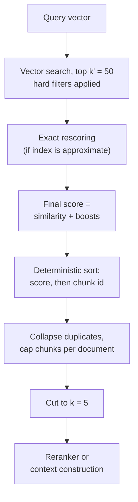

A dense retriever's raw output is a list of similarity scores. What reaches the language model is a short, ordered list of chunks. Between the two sits **similarity ranking**: the rules that turn scores into an order and cut that order to a few results. In the simplest system those rules are "sort by cosine, keep the top five", and for a surprising number of queries that is not good enough. Two versions of the same policy compete and the outdated one wins by a hair. Three near-identical chunks fill three of five slots. Two runs of the same query return results in a different order because of a tie.

This lesson is about getting the order right after the vector search. You will see which properties of a score a ranking actually depends on, how to combine similarity with other signals such as recency and document status without breaking it, why hard filters and soft boosts solve different problems, and how to make rankings deterministic. The code shows a superseded handbook outranking the current one on similarity alone and compares three ways of fixing it. Reranking with a second model, diversity with MMR and calibrated thresholds each have their own lessons later; this one establishes the ranking logic they all plug into.

## Learning objectives

- Explain why a ranking depends only on the order of scores, and identify which score transformations preserve it.
- Combine a similarity score with a recency or authority signal, and compute the weight at which the combination changes an order.
- Choose between a hard filter and a soft boost for a given business rule, and justify the choice.
- Implement a deterministic ranking step with tie-breaking, duplicate collapsing and a final cut to $k$.
- Describe how approximate search and score-scale differences can distort a ranking, and how to guard against them.

## Prerequisites

- [Dense vector search](/learn/dense-retrieval/dense-vector-search): how candidates and their scores are produced.
- [Similarity distributions](/learn/embedding-mathematics/similarity-distributions): what scores look like and why their scale varies by model and query.
- [Top-K retrieval](/learn/retrieval-fundamentals/top-k-retrieval): choosing how many results to keep.
- [Filtering](/learn/vector-database-fundamentals/filtering): metadata filters in a vector database.

## Why this matters

The language model reads the chunks it is given in the order it is given them, and RAG systems usually pass only a handful. A ranking error near the top therefore matters far more than one lower down. If the superseded 2023 handbook ranks above the current one, AskMeridian tells staff their laptop is replaced every four years instead of three. If five near-duplicate copies of one FAQ fill all five slots, the chunk that answers the second half of the question never arrives. If a tie makes the order change between runs, the same question gets different answers, and nobody can reproduce the bug report.

None of these failures is visible in the similarity scores themselves. Each scored chunk is "similar" to the query; the old handbook really is about laptop replacement. The problem is that similarity is one signal among several that decide what the best result is, and the ranking step is where the others come in.

## The intuition

Imagine shortlisting candidates for a job. The first filter is the application form: anyone without the right to work in the UK is out, however strong their CV. That is a **hard filter**: a rule, not a preference. Then you score the remaining CVs on fit. That is **similarity**. Then you adjust: two candidates with nearly identical scores, one of whom has recent experience and one whose experience is ten years old, and you lean towards the recent one. That is a **soft boost**: it moves close calls, but it cannot lift a weak candidate over a strong one. Finally, if three applications are copies of the same CV sent through three agencies, you interview that person once. That is **collapsing duplicates**. And if two candidates are exactly tied, you need a fixed rule for who goes first, so that the panel's list does not depend on which envelope was opened first.

Similarity ranking is that process, applied to chunks.

## How it works

### Only the order matters

A ranking is an ordering. Any change to the scores that preserves every pairwise comparison leaves it untouched. Formally, if $f$ is **strictly increasing**, sorting by $f(s)$ gives the same order as sorting by $s$. That has practical consequences:

- **Converting between metrics on unit vectors does not change rankings.** For normalised vectors, squared Euclidean distance is $2 - 2\cos\theta$, a strictly decreasing function of cosine, so "smallest distance" and "largest cosine" produce the same order. (See [Euclidean distance](/learn/embedding-mathematics/euclidean-distance).)
- **Score conventions differ by database but rank the same.** Some databases return cosine similarity, some return cosine distance ($1 - \cos\theta$), and some rescale cosine into $[0, 1]$. Each is a monotone transform; the order is identical, but code that compares scores with a fixed number, such as `score > 0.7`, means different things in each. [Similarity search](/learn/vector-database-fundamentals/similarity-search) lists the conventions.
- **Combining scores is where order can change.** Adding a second signal is *not* a monotone transform of similarity, so it can reorder results. That is exactly its purpose, and exactly why it needs care.

### Hard filters and soft boosts

Business rules enter a ranking in one of two ways.

A **hard filter** removes candidates entirely: "only documents this user may read", "only documents in English", "only the current version of a policy". It is applied in the vector search itself, as a metadata filter, so that the top $k$ are drawn from the allowed set. A rule belongs here when breaking it is always wrong. A superseded policy should never be presented as current; a document the user may not read should never be retrieved.

A **soft boost** adjusts scores so that some candidates are preferred when similarity is close: "prefer recently updated runbooks", "prefer the official handbook over a team's wiki page". It is applied after retrieval, to a candidate set larger than the final $k$, so that a boosted chunk ranked just outside the top $k$ can move in. A rule belongs here when it is a preference: an old runbook might still be the only one that covers an obscure fault, and it should win if nothing newer is relevant.

The most common error is using a soft boost for a rule that should be hard. A recency boost will usually push the 2023 handbook down, but "usually" is not good enough for a rule like "never answer from superseded policy". The code below shows this: with a moderate recency weight, the old handbook moves to second place but is still in the top three, still in front of the language model.

### Combining similarity with other signals

The simplest and most transparent combination is a **weighted sum**:

$$
\text{final}(d) = (1 - w)\, s(q, d) + w \cdot b(d)
$$

$s(q, d)$ is the similarity score, $b(d)$ is a boost signal for document $d$ scaled to a comparable range (typically $[0, 1]$), and $w$ between 0 and 1 is the weight given to the boost. Common boost signals:

- **Recency**, usually an exponential decay with a half-life: a document published one half-life ago gets 0.5, two half-lives ago 0.25.
- **Authority**: 1.0 for the official handbook, lower for team wikis or archived pages.
- **Popularity or feedback**: how often a chunk was cited in answers that users rated well. Powerful, and prone to rich-get-richer effects.

Two scale problems make weights hard to choose. First, similarity scores for one model may all lie between 0.2 and 0.8 while a boost spans 0 to 1, so the same $w$ can have a large effect for one model and a small one for another. Second, the spread of similarity among the top candidates varies per query; for one query the top two are 0.01 apart, for another 0.3. A boost weight that settles close calls for the first may overturn clear decisions for the second. The mathematics section gives the exact threshold at which a boost flips an order, which is the most useful tool for setting $w$ sensibly. Choose weights against a judged evaluation set, and re-check them when the embedding model changes.

### The ranking step, end to end

A complete ranking step after dense retrieval:

1. **Retrieve more than you need.** Ask the vector search for $k' > k$ candidates (for example $k' = 50$ for a final $k = 5$), with hard filters applied in the search.
2. **Rescore exactly if the index is approximate.** Some ANN configurations, notably those using quantised vectors, return approximate scores; recompute similarity from the full-precision vectors for the $k'$ candidates.
3. **Compute the final score** for each candidate: similarity plus any boosts.
4. **Sort deterministically**: by final score descending, then by a stable tie-breaker such as the chunk identifier.
5. **Collapse duplicates**: keep the best chunk per near-duplicate group, or limit the number of chunks per source document.
6. **Cut to $k$**, optionally also dropping candidates far below the top score.
7. **Pass on** the ranked chunks, with their scores and the reasons for any boosts in the log, to a reranker or to context construction.



### Ties and determinism

Two chunks can have exactly equal scores more often than you might expect: identical text indexed twice, the same boilerplate sentence in several documents, or scores rounded by a database or by quantisation. When scores tie, many sorting routines and many vector databases return the tied items in an order that depends on internal storage, which can change after an index rebuild or a segment merge. The same query then returns a different top five on Tuesday than on Monday. A **secondary sort key** (chunk identifier, or document identifier then chunk position) makes the order fully reproducible, which matters for debugging, caching and evaluation alike.

### Duplicates and crowding

Real corpora contain near-duplicates: the same paragraph in the handbook and in an onboarding guide, a runbook copied into a team wiki, consecutive overlapping chunks from a [sliding window](/learn/advanced-chunking-strategies/sliding-window-chunking). Because duplicates have nearly equal vectors, they also have nearly equal scores, so they arrive in the ranking together and **crowd out** other relevant chunks. Two cheap remedies are collapsing by a duplicate-group identifier assigned at ingestion ([Duplicate detection](/learn/data-processing/duplicate-detection)) and capping the number of chunks per source document. The principled remedy, trading relevance against redundancy within the list, is [MMR](/learn/advanced-retrieval-optimisation/mmr), covered in Phase 8.

### Where to cut

A fixed $k$ is simple and predictable. Two refinements are common:

- **A relative cut-off** drops candidates whose score is far below the top one, for example more than 0.15 below. Because it is relative to the query's own best score, it is less sensitive to per-query score shifts than a fixed number.
- **An absolute threshold** ("drop anything below 0.4") is tempting but fragile, because score scales differ by model, by query and over time, as [Similarity distributions](/learn/embedding-mathematics/similarity-distributions) showed. Doing it properly is the subject of [Retrieval thresholding](/learn/advanced-retrieval-optimisation/retrieval-thresholding) and [Score calibration](/learn/advanced-retrieval-optimisation/score-calibration).

Try changing $k$ and the score cut-off in the visualiser and watch which chunks survive.

```playground
top-k
```

## The mathematics

### When does a boost change the order?

**Intuition.** A boost flips two documents only if the boost difference, weighted by $w$, outweighs the similarity difference, weighted by $1 - w$. The smaller the similarity gap, the smaller the weight needed.

Take two documents: $a$ with lower similarity but higher boost, $b$ with higher similarity but lower boost. With the weighted sum above, $a$ overtakes $b$ when

$$
(1 - w)\, s_a + w\, b_a > (1 - w)\, s_b + w\, b_b
\quad\Longleftrightarrow\quad
w > \frac{s_b - s_a}{(s_b - s_a) + (b_a - b_b)}
$$

$s_a, s_b$ are the similarities, $b_a, b_b$ the boosts, and the right-hand side is the smallest weight that flips the pair. The recency boost used below is

$$
b(d) = 0.5^{\,\text{age}(d)/h}
$$

where $\text{age}(d)$ is the document's age in years and $h$ is the half-life in years.

**By hand.** In the code below, for "How often do we get new laptops?", the superseded 2023 chunk scores $s_b = 0.730$ and the current chunk (handbook of 2025) scores $s_a = 0.712$. With the present year taken as 2026 and $h = 1$, the boosts are $b_a = 0.5^1 = 0.5$ and $b_b = 0.5^3 = 0.125$.

- Smallest flipping weight: $w > 0.018 / (0.018 + 0.375) = 0.018 / 0.393 \approx 0.046$.
- At $w = 0.04$: current $= 0.96 \times 0.712 + 0.04 \times 0.5 = 0.68352 + 0.02 = 0.70352$; superseded $= 0.96 \times 0.730 + 0.04 \times 0.125 = 0.7008 + 0.005 = 0.7058$. Superseded still wins.
- At $w = 0.2$: current $= 0.8 \times 0.712 + 0.2 \times 0.5 = 0.6696$; superseded $= 0.8 \times 0.730 + 0.2 \times 0.125 = 0.5840 + 0.025 = 0.6090$. Current wins.

The formula also shows the danger. If the similarity gap had been 0.3 instead of 0.018, the flipping weight would be $0.3 / 0.675 \approx 0.44$. A weight of 0.2 settles close calls without overturning clear ones, but only for this spread of scores and this boost range.

```python
s_new, s_old = 0.712, 0.730          # cosine of the current and superseded laptop chunks
r_new, r_old = 0.5, 0.125            # recency factors: published 1 and 3 years ago, half-life 1 year
w_min = (s_old - s_new) / ((s_old - s_new) + (r_new - r_old))
print(f"smallest weight that flips the order: {w_min:.3f}")
for w in (0.04, 0.2):
    new = (1 - w) * s_new + w * r_new
    old = (1 - w) * s_old + w * r_old
    print(f"w={w}: current={new:.4f} superseded={old:.4f}")
```

```output
smallest weight that flips the order: 0.046
w=0.04: current=0.7035 superseded=0.7058
w=0.2: current=0.6696 superseded=0.6090
```

## In code

**The problem.** AskMeridian's index contains both the current employee handbook and the superseded 2023 edition, which had a 4-year laptop cycle, a £250 equipment budget and 09:00 to 17:00 support hours. Rank three questions by similarity alone, with a recency boost, and with a hard filter on document status, and compare.

**Dependencies.** `sentence-transformers` and NumPy. No API key.

```bash
pip install sentence-transformers numpy
```

```python
import numpy as np
from sentence_transformers import SentenceTransformer

chunks = [
    # (id, year published, status, text)
    ("hb25-support", 2025, "current", "The support desk is open from 08:00 to 18:00 UK time."),
    ("hb23-support", 2023, "superseded", "Support desk hours are 09:00 to 17:00 UK time."),
    ("hb25-laptop", 2025, "current", "Laptops are replaced on a 3-year refresh cycle."),
    ("hb23-laptop",  2023, "superseded", "Laptops are replaced every 4 years."),
    ("hb25-equip", 2025, "current", "The home-office equipment budget is £400. Contractors are not eligible."),
    ("hb23-equip",   2023, "superseded", "Staff working from home can claim up to £250 for equipment."),
    ("hb25-lost", 2025, "current", "Report a lost laptop to the support desk at once."),
]
model = SentenceTransformer("sentence-transformers/all-MiniLM-L6-v2")
D = model.encode([c[3] for c in chunks], normalize_embeddings=True)
years = np.array([c[1] for c in chunks])

def rank(query, k=3, half_life=None, weight=0.0, now=2026, current_only=False):
    q = model.encode(query, normalize_embeddings=True)
    sim = D @ q
    if half_life:
        recency = 0.5 ** ((now - years) / half_life)        # 1.0 for this year, 0.5 one half-life ago
        score = (1 - weight) * sim + weight * recency
    else:
        score = sim
    allowed = [i for i in range(len(chunks)) if not current_only or chunks[i][2] == "current"]
    # Sort by score, then by id, so that equal scores always come back in the same order.
    order = sorted(allowed, key=lambda i: (-score[i], chunks[i][0]))[:k]
    return [(chunks[i][0], round(float(score[i]), 3)) for i in order]

for query in ["When is the support desk open?",
              "How often do we get new laptops?",
              "How much can I spend on home-office equipment?"]:
    print(query)
    print("  similarity only :", rank(query))
    print("  with recency    :", rank(query, half_life=1, weight=0.2))
    print("  current only    :", rank(query, current_only=True))
```

```output
When is the support desk open?
  similarity only : [('hb25-support', 0.842), ('hb23-support', 0.643), ('hb25-lost', 0.339)]
  with recency    : [('hb25-support', 0.774), ('hb23-support', 0.54), ('hb25-lost', 0.371)]
  current only    : [('hb25-support', 0.842), ('hb25-lost', 0.339), ('hb25-laptop', 0.182)]
How often do we get new laptops?
  similarity only : [('hb23-laptop', 0.73), ('hb25-laptop', 0.712), ('hb25-lost', 0.357)]
  with recency    : [('hb25-laptop', 0.67), ('hb23-laptop', 0.609), ('hb25-lost', 0.385)]
  current only    : [('hb25-laptop', 0.712), ('hb25-lost', 0.357), ('hb25-support', 0.155)]
How much can I spend on home-office equipment?
  similarity only : [('hb25-equip', 0.62), ('hb23-equip', 0.603), ('hb23-laptop', 0.235)]
  with recency    : [('hb25-equip', 0.596), ('hb23-equip', 0.507), ('hb25-laptop', 0.237)]
  current only    : [('hb25-equip', 0.62), ('hb25-laptop', 0.171), ('hb25-lost', 0.134)]
```

**The important lines.**

- Each chunk carries its publication year and a `status` field in metadata, set at ingestion. Neither is in the embedded text: the model sees only the sentence.
- `recency = 0.5 ** ((now - years) / half_life)` is the exponential decay from the mathematics section, computed for every chunk at once.
- `score = (1 - weight) * sim + weight * recency` is the weighted sum. With `weight=0.0` the ranking is similarity only.
- `allowed` implements the hard filter. In a vector database, this would be a metadata filter inside the search request, not a list comprehension after it.
- `key=lambda i: (-score[i], chunks[i][0])` sorts by score descending and breaks ties by chunk identifier, so equal scores always produce the same order.

**What the output means.**

- **Similarity alone gets the laptop question wrong.** The superseded "Laptops are replaced every 4 years" scores 0.730, slightly above the current chunk's 0.712. The model has no idea one of them is out of date, and nothing in either sentence says so.
- **For the other two questions, similarity ranks the current chunk first**, but the superseded chunk is second in both. With $k = 3$, the language model would see two contradictory answers in every case.
- **The recency boost fixes the laptop order** (0.670 against 0.609), exactly as the hand calculation predicted for $w = 0.2$. It does *not* remove the superseded chunks: all three questions still pass an outdated chunk to the model in second place.
- **The hard filter is the right tool here.** With `current_only=True`, every outdated chunk is gone, and the slots are filled by the next most similar current chunks. The scores of the remaining chunks are untouched, because filtering removes candidates rather than adjusting them.

The general lesson: use a filter when a rule is absolute (superseded policy must never be presented as current), and a boost when it is a preference (newer runbooks are usually better, but an old one may be the only one that covers a fault).

**Errors people commonly hit.**

- Filtering after retrieval: asking the database for the top 3 and then dropping superseded ones leaves fewer than 3 results. Apply the filter inside the search, or retrieve a larger $k'$.
- Recency in the wrong unit: an age in days with a half-life in years gives a boost of essentially zero for everything.
- No tie-breaker: Python's `sorted` is stable, so without the secondary key ties would keep insertion order, which in a real index is storage order and can change.

**Extending it.** Add a `doc_id` field and cap results at two chunks per document. Add a relative cut-off that drops anything more than 0.3 below the top score, and check which low-scoring filler chunks it removes from the filtered results.

## A real-world example

When the HR team published the new employee handbook, Meridian's ingestion pipeline indexed it as a new document. Nobody removed the 2023 edition, because nobody had told the pipeline that one replaced the other. Within a week the support desk had two tickets from staff told by AskMeridian that laptops are replaced every four years, and one from a contractor who had been told he could claim £250 for equipment.

The Platform team's first fix was a recency boost, which they could ship without touching ingestion. It fixed the laptop question in testing, and they deployed it. A week later a staff member asked about support hours and got an answer that mentioned both "08:00 to 18:00" and "09:00 to 17:00": the boost had kept the current chunk first, but the old one was still second in the context, and the model, asked to use all the context, hedged between them.

The lasting fix was in ingestion and in the search request. The HR team now marks a handbook edition `superseded` when a new one is published, through a field in the document management system that the pipeline reads into chunk metadata. The query service applies `status = current` as a hard filter on every search of the handbook collection. The recency boost was kept, at a modest weight, only for the IT runbooks, where older documents are often still valid and there is no formal supersession process. The team also added both the laptop and the support-hours questions to the judged regression set, with a check that no `superseded` chunk ever appears in the context.

## Common mistakes

- **Using a soft boost for an absolute rule.** Outdated or forbidden chunks are pushed down but still reach the context, where the model may use them.
- **Applying filters after retrieval instead of in the search.** Results come back short of $k$, and relevant allowed chunks just below the cut are never seen.
- **Choosing boost weights without regard to score spread.** A weight that settles close calls for one model or query overturns clear decisions for another.
- **Comparing raw scores across databases or models.** Different score conventions (similarity, distance, rescaled) rank the same but make fixed thresholds mean different things.
- **No tie-breaker.** The order of tied results depends on storage internals and changes after rebuilds, making bugs irreproducible.
- **Letting near-duplicates fill the top $k$.** One fact occupies several slots, and other relevant chunks are crowded out.

## Best practices

- Encode absolute rules (access, status, language, tenant) as hard filters inside the vector search.
- Retrieve a larger candidate set ($k'$) than the final $k$, so boosts and duplicate collapsing have room to work.
- Use a transparent weighted sum for boosts, log each component per result, and choose weights against a judged set.
- Sort deterministically with a secondary key, and keep the ranking step a pure function of its inputs so it can be tested.
- Collapse near-duplicates and cap chunks per document before cutting to $k$.
- Re-check boost weights and cut-offs whenever the embedding model changes, because score scales change with it.

## Performance considerations

The ranking step is cheap compared with encoding and search. Scoring and sorting $k' = 50$ candidates is a few hundred arithmetic operations; even with exact rescoring of 50 vectors of 768 dimensions it is about 38,000 multiply-adds, a negligible fraction of a millisecond.

The costs that matter are indirect. A larger $k'$ means more data returned from the vector database (vectors and payloads), which can dominate when payloads include full chunk text; return identifiers and scores first, then fetch text only for the final $k$. Filters inside the search can slow an ANN index down when they are very selective, because the index must traverse more of the graph to find enough allowed candidates; most databases mitigate this with payload indexes, covered in [Payload indexes](/learn/advanced-vector-database-engineering/payload-indexes). And a ranking that is not deterministic defeats result caching, since equal queries produce different results.

## Security considerations

- **Access control must be a hard filter in the search.** Implementing it as a boost, or as a post-filter on the top $k$, either leaks restricted chunks or reveals through result counts that they exist.
- **Popularity boosts can be gamed.** If clicks or thumbs-up raise a chunk's rank, a user or script can promote a chunk, including a planted one, by generating feedback. Rate-limit and authenticate feedback, and cap the boost's weight.
- **Status fields are a control.** If anyone can mark a document `current` or `superseded`, they control what AskMeridian answers. Restrict who can change them, and audit changes.

## Summary

- A ranking depends only on the order of scores; monotone transforms and metric conventions do not change it, but combining signals does.
- Hard filters enforce absolute rules inside the search; soft boosts adjust close calls after it. Do not use a boost for a rule that must never be broken.
- A weighted sum of similarity and a boost flips two documents only when $w$ exceeds the similarity gap divided by the sum of the similarity gap and the boost gap.
- A production ranking step retrieves a larger candidate set, rescores if needed, applies boosts, sorts deterministically, collapses duplicates and cuts to $k$.
- On similarity alone, a superseded handbook outranked the current one for one question and sat second for the others; a status filter, not a boost, removed it.

## Exercises

1. **Flipping weight.** Document A has similarity 0.60 and authority boost 1.0; document B has similarity 0.66 and authority boost 0.4. Above what weight $w$ does A rank first?

<details><summary>Show solution</summary>

$w > (0.66 - 0.60) / ((0.66 - 0.60) + (1.0 - 0.4)) = 0.06 / 0.66 \approx 0.091$. Check at $w = 0.1$: A $= 0.9 \times 0.60 + 0.1 \times 1.0 = 0.640$; B $= 0.9 \times 0.66 + 0.1 \times 0.4 = 0.634$. A wins.

</details>

2. **Filter or boost?** For each rule, choose a hard filter or a soft boost: (a) staff in the Leeds office should see Leeds-specific facilities information first; (b) contractors must not see the employee benefits section; (c) prefer runbooks reviewed in the last year; (d) never show draft documents.

<details><summary>Show solution</summary>

(a) Boost: national information is still relevant if no Leeds-specific chunk matches. (b) Filter: an access rule. (c) Boost: an older runbook can still be the only relevant one. (d) Filter: drafts are never valid answers.

</details>

3. **Per-document cap.** Write a function that takes a ranked list of `(chunk_id, doc_id, score)` and returns at most `k` results with at most `per_doc` chunks from any one document, preserving order.

<details><summary>Show solution</summary>

```python
from collections import Counter

def cap_per_document(ranked, k, per_doc):
    taken, out = Counter(), []
    for chunk_id, doc_id, score in ranked:
        if taken[doc_id] < per_doc:
            out.append((chunk_id, doc_id, score))
            taken[doc_id] += 1
            if len(out) == k:
                break
    return out

ranked = [("a1", "A", 0.9), ("a2", "A", 0.88), ("a3", "A", 0.87), ("b1", "B", 0.8), ("c1", "C", 0.7)]
print(cap_per_document(ranked, k=3, per_doc=2))
# [('a1', 'A', 0.9), ('a2', 'A', 0.88), ('b1', 'B', 0.8)]
```

</details>

4. **Design.** AskMeridian also indexes Atlas incident reports, which are never superseded but become less useful as the platform changes. Design a ranking rule for them, and say how you would choose its parameters.

<details><summary>Show solution</summary>

A recency boost with a half-life matched to how quickly the platform changes, for example one year, at a modest weight, applied to a candidate set of 50. Combine it with a per-incident cap of two chunks so a single long report cannot dominate. Choose the half-life and weight on a judged set of real troubleshooting questions with known useful incidents: compute recall and the rank of the first useful result for a small grid of half-lives and weights, and prefer the smallest weight that captures most of the gain. Log the similarity and boost components for each result so later complaints can be diagnosed.

</details>

## Check your understanding

```quiz
[
  {
    "q": "For unit-length vectors, a database switches from returning cosine similarity to returning cosine distance (1 minus cosine), sorted ascending. What happens to rankings?",
    "options": [
      "They reverse",
      "They become random",
      "They are unchanged, but any code using a fixed score threshold now behaves differently",
      "Only the top result changes"
    ],
    "answer": 2,
    "why": "Distance is a strictly decreasing function of similarity, so sorting distance ascending gives the same order. Fixed thresholds written for one convention are wrong for the other."
  },
  {
    "q": "The rule is 'never answer from a superseded policy'. Which implementation is correct?",
    "options": [
      "A recency boost with a large weight",
      "Dropping superseded chunks from the top 5 after retrieval",
      "Adding the word 'superseded' to those chunks' embedding input",
      "A metadata filter on status inside the vector search"
    ],
    "answer": 3,
    "why": "An absolute rule needs a hard filter applied in the search. A boost can leave superseded chunks in the top k, and post-filtering returns fewer results than requested."
  },
  {
    "q": "Similarities are 0.70 (A) and 0.72 (B); boosts are 0.9 (A) and 0.5 (B). Using final = (1 - w) * s + w * b, roughly what is the smallest w at which A ranks first?",
    "options": ["0.048", "0.2", "0.5", "0.02"],
    "answer": 0,
    "why": "w > 0.02 / (0.02 + 0.4) = 0.02 / 0.42, which is about 0.048."
  },
  {
    "q": "Why should the ranking step sort by a secondary key such as the chunk identifier?",
    "options": [
      "It improves recall",
      "It makes the order of tied scores reproducible, so the same query always returns the same list",
      "It is required by all vector databases",
      "It reduces memory use"
    ],
    "answer": 1,
    "why": "Without a tie-breaker, tied items come back in storage order, which can change after rebuilds. Reproducible rankings make debugging, caching and evaluation reliable."
  },
  {
    "q": "Five near-identical copies of one FAQ answer fill the top 5. What is the simplest effective fix in the ranking step?",
    "options": [
      "Increase k to 50 and pass all of them to the model",
      "Lower the similarity threshold",
      "Collapse candidates by a duplicate-group or document identifier before cutting to k",
      "Switch from cosine to dot product"
    ],
    "answer": 2,
    "why": "Near-duplicates score almost identically, so they crowd the top together. Collapsing them keeps one and frees the other slots for different relevant chunks."
  }
]
```

## Further reading

- Manning, C. D., Raghavan, P. and Schütze, H. (2008). *Introduction to Information Retrieval*, chapter 7 (computing scores in a complete search system). Cambridge University Press.
- Robertson, S. E. (1977). *The Probability Ranking Principle in IR*. Journal of Documentation 33(4).
- Carbonell, J. and Goldstein, J. (1998). *The Use of MMR, Diversity-Based Reranking for Reordering Documents and Producing Summaries*. SIGIR 1998.
- Qdrant documentation on filtering and payload indexes: [qdrant.tech/documentation](https://qdrant.tech/documentation/)
