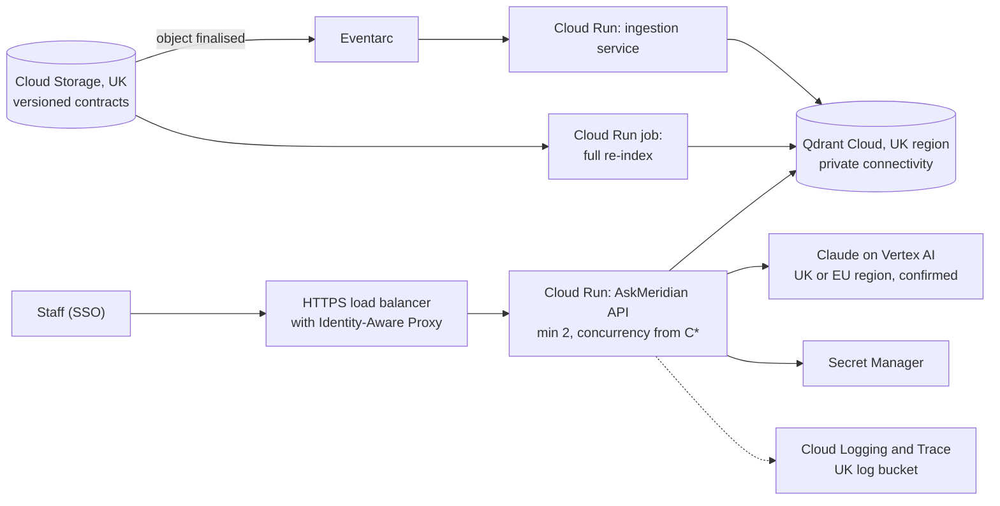

This assessment covers the whole Deployment module: packaging AskMeridian with [Docker](/learn/deployment/docker), running a local stack with [Docker Compose](/learn/deployment/docker-compose), operating it on [Kubernetes](/learn/deployment/kubernetes-fundamentals), the provider-neutral choices of [Cloud deployment](/learn/deployment/cloud-deployment), the three major clouds ([AWS](/learn/deployment/aws), [Azure](/learn/deployment/azure), [Google Cloud](/learn/deployment/google-cloud)), [managed vector databases](/learn/deployment/managed-vector-databases) and [infrastructure configuration](/learn/deployment/infrastructure-configuration). It tests whether you can predict how a deployed RAG service behaves, size it with arithmetic rather than guesses, and diagnose it when it misbehaves. The pass mark is 70% on the quiz; the written sections have model answers to compare against, and the coding solutions were run and their output is shown.

```quiz
[
  {"q": "A Dockerfile copies the whole project and then runs `pip install -r requirements.txt`. Why does every one-line code change trigger a full reinstall of dependencies?", "options": ["pip always ignores its cache inside containers", "The COPY layer's cache key includes the copied files' contents, so any change misses the cache and every later instruction is rebuilt", "BuildKit disables caching for RUN instructions", "requirements.txt is re-downloaded on each build"], "answer": 1, "why": "Once one instruction misses the cache, all later instructions in that stage rebuild. Copy requirements.txt and install first, then copy the source."},
  {"q": "A container is started with `CMD uvicorn app.main:app --host 0.0.0.0`. During a rolling update, in-flight streamed answers are cut off after the grace period. What is the most likely cause?", "options": ["Uvicorn does not support SIGTERM", "Streaming responses cannot be drained", "The grace period is too long", "The shell form runs the server under /bin/sh, which may not forward SIGTERM, so the process is killed at the end of the grace period"], "answer": 3, "why": "Shell form can leave a shell as process 1. Use the exec form, a JSON array, so the server receives the signal and drains."},
  {"q": "Why deploy by image digest (or never-reused tags) rather than a tag such as `latest`?", "options": ["A tag can be moved to a different image; a digest identifies exactly one image, so 'what is running' has one answer", "Digests make images smaller", "Registries delete tagged images after 30 days", "Digests are required for multi-stage builds"], "answer": 0, "why": "Tags are movable labels; digests are content addresses. For RAG, the digest also pins the baked-in embedding model."},
  {"q": "In Docker Compose, the API container uses `QDRANT_URL=http://localhost:6333` and gets `Connection refused`, although Qdrant is running in the same project. What is the fix?", "options": ["Publish Qdrant's port to the host", "Add `network_mode: bridge` to Qdrant", "Use the service name as the host name: `http://qdrant:6333`", "Restart Docker"], "answer": 2, "why": "Inside a container, localhost is that container. Services on the project network reach each other by service name."},
  {"q": "A Kubernetes liveness probe for the API calls Qdrant. Qdrant pauses for 20 seconds during a snapshot. What happens?", "options": ["Nothing; liveness only affects new Pods", "Every API Pod fails liveness and is restarted, turning a short blip into an outage with cold model loads", "The Pods are removed from the Service but not restarted", "The HPA scales the API up"], "answer": 1, "why": "Liveness failures restart containers. Dependency checks belong in readiness, which only stops traffic, if anywhere."},
  {"q": "What does this print?\n```python\nimport math\ndef hpa(current, metric, target, lo, hi, tol=0.1):\n    ratio = metric / target\n    if abs(ratio - 1) <= tol:\n        return current\n    return max(lo, min(hi, math.ceil(current * ratio)))\nprint(hpa(3, 0.95, 0.5, 2, 5))\n```", "options": ["5", "6", "3", "2"], "answer": 0, "why": "The ratio is 1.9, so the raw answer is ceil(3 x 1.9) = 6, then clamped to the maximum of 5."},
  {"q": "A Pod exceeds its memory limit while a second Pod exceeds its CPU limit. What happens to each?", "options": ["Both are throttled", "Both are killed", "The CPU one is killed; the memory one is swapped", "The memory one is killed (OOMKilled); the CPU one is throttled"], "answer": 3, "why": "CPU is compressible and is throttled; memory is not and the container is killed and restarted."},
  {"q": "In the cost-per-query model from Cloud deployment, which term usually dominates a RAG system's cost at moderate volume?", "options": ["Load balancer hours", "Container image storage", "LLM input and output tokens", "DNS queries"], "answer": 2, "why": "With a few thousand tokens of context per query, the token term typically exceeds the share of fixed infrastructure, so shrinking context saves more than shrinking compute."},
  {"q": "On Amazon ECS, which role should carry the `bedrock:InvokeModel` permission?", "options": ["The task role", "The task execution role", "The ALB's service-linked role", "The ECS cluster role"], "answer": 0, "why": "The task role is what your code's SDKs use; the execution role is used by ECS to pull images, send logs and fetch secrets."},
  {"q": "An SQS queue's visibility timeout is 30 seconds, but embedding a large PDF takes 3 minutes. What goes wrong?", "options": ["The message is deleted before processing", "The message becomes visible again and a second worker processes the same document, duplicating work", "SQS rejects the message", "The worker is killed after 30 seconds"], "answer": 1, "why": "Visibility must exceed processing time. Idempotent, deterministic chunk IDs limit the damage of duplicates."},
  {"q": "An Azure AI Search index moves from a 384- to a 1,536-dimensional embedding model and now exceeds its vector quota, while query load is unchanged. What do you add?", "options": ["Replicas", "A second vector profile", "A semantic configuration", "Partitions (or a larger tier)"], "answer": 3, "why": "Partitions add storage, including vector quota; replicas add query throughput."},
  {"q": "Why should the AskMeridian API's identity hold only *Search Index Data Reader* on Azure AI Search, while the ingestion job holds *Search Index Data Contributor*?", "options": ["Readers get faster queries", "Contributors cannot query", "A compromised API then cannot change what other users retrieve", "Azure requires different roles per region"], "answer": 2, "why": "Least privilege: separating read and write limits the blast radius of a compromised component."},
  {"q": "A Cloud Run service receives 25 requests per second with a mean latency of 2.4 seconds. About how many requests are in flight on average?", "options": ["60", "25", "10", "104"], "answer": 0, "why": "Little's law: L = lambda x W = 25 x 2.4 = 60."},
  {"q": "What does this print?\n```python\nimport math\nprint(math.floor(0.6 * 2 * 3.0 / 0.15))\n```\n(It computes a CPU-safe Cloud Run concurrency for 2 vCPUs, 60% target utilisation, 3 s latency and 0.15 CPU-seconds per request.)", "options": ["12", "18", "24", "80"], "answer": 2, "why": "0.6 x 2 x 3.0 / 0.15 = 24.0, and floor gives 24."},
  {"q": "Which of these stays your responsibility on a fully managed vector database?", "options": ["Replacing failed nodes", "Patching the database engine", "Replicating data across zones", "Filtering results so each user sees only documents they may read"], "answer": 3, "why": "The service authenticates your application, not your users; per-user authorisation is your filter on every query."},
  {"q": "A provisioned vector cluster costs 600 USD a month. A usage-based plan costs 20 USD a month plus 4 USD per million queries. At what monthly volume do they cost the same?", "options": ["145 million queries", "150 million queries", "155 million queries", "4 million queries"], "answer": 0, "why": "(600 - 20) / 4 = 145 million queries a month."},
  {"q": "A scheduled job runs `terraform plan -detailed-exitcode` against production and it exits with code 2. What does that mean?", "options": ["The plan failed with an error", "Changes are pending: reality differs from the configuration, for example through drift", "There are no changes", "The state is locked"], "answer": 1, "why": "With -detailed-exitcode, 0 means no changes, 1 an error and 2 pending changes, which a drift alert can act on."},
  {"q": "AskMeridian switches its embedding model from MiniLM to bge-small (both 384 dimensions) but keeps the old collection. What do users see?", "options": ["A dimension-mismatch error on every query", "The service refuses to start", "Slower but correct answers", "Normal-looking answers built on wrong chunks, with no errors anywhere"], "answer": 3, "why": "Dimensions match, so nothing fails, but the vectors live in different spaces. Bind the collection to the model and check it at start-up."}
]
```

## Conceptual questions

**1.** The module placed compute on a spectrum: virtual machines, managed Kubernetes, serverless containers and functions. For AskMeridian's query API and its ingestion workers, which point on the spectrum would you choose, and what would make you move?

<details><summary>Show model answer</summary>

For the **query API**, serverless containers (ECS on Fargate, Azure Container Apps, Cloud Run) are the usual starting point. The API is stateless and bursty, mostly waits on the LLM, and benefits from per-use billing and no cluster to run. Keep at least one warm instance, because cold starts include model loading. For **ingestion**, a queue with workers or batch jobs (Container Apps jobs, Cloud Run jobs, ECS services scaled on queue depth) fits work that is retriable and bursty.

Move to **managed Kubernetes** when you need what serverless platforms lack or make awkward: GPU node pools for self-hosted models, a self-run vector database with persistent volumes, many cooperating services with custom networking, or an existing platform team that already runs clusters. Move to **virtual machines** mainly for specialised hardware or software you must control fully. **Functions** suit small event-driven steps (reacting to an upload) but rarely the API, because of duration and memory limits and cold starts with models. Each step to the left adds control and operational work.

</details>

**2.** Explain why "managed identity" (Azure), "service account" (Google Cloud) and "task role" (AWS) are the same idea, and what problem they solve that environment-variable API keys do not.

<details><summary>Show model answer</summary>

Each is an identity attached to the compute resource itself. The platform issues short-lived credentials to the running code on request (through a metadata or identity endpoint), and the cloud SDKs pick them up automatically. Permissions are granted to the identity through role assignments or IAM policies, scoped to specific resources.

Compared with API keys in environment variables, this removes the long-lived secret entirely: nothing in the image, repository or configuration can leak and remain valid forever; credentials expire within hours and are refreshed automatically; every call is attributable to a named identity in audit logs; permissions can be narrow (read the index, not write it); and revoking access is a single change. The remaining trap is shared by all three: on a developer laptop the same SDK code falls back to the developer's own credentials, which hides missing permissions until the code runs as the real identity.

</details>

**3.** Cloud Run, the Kubernetes HPA and Azure Container Apps all scale a RAG API. Explain why a CPU-heavy in-process reranker changes how you should configure scaling on each, using Little's law and the CPU ceiling on concurrency.

<details><summary>Show model answer</summary>

Little's law, $L = \lambda W$, says how many requests are in flight. For a RAG API, $W$ is long (seconds of LLM wait) so $L$ is large, and most in-flight requests use no CPU. An in-process reranker adds $c$ CPU-seconds per request, so $C$ concurrent requests demand $C c / W$ vCPUs. The safe concurrency is $C^{*} = \lfloor uVW/c \rfloor$.

On **Cloud Run** and **Container Apps**, which route by concurrency, the per-instance concurrency limit must be set at or below $C^{*}$; the default (80 on Cloud Run at the time of writing) can be far too high when $c$ is large, causing CPU queueing, rising $W$ and a spiral. On **Kubernetes**, the HPA's CPU target does the equivalent job: as long as the CPU request reflects reality, a utilisation target of about 60% adds Pods before CPU saturates. In all three, measuring $c$ on the real platform is the step that cannot be skipped, and moving the reranker to a separate (perhaps GPU) service lowers $c$ and changes every one of these settings.

</details>

**4.** A colleague says: "We use a managed vector database, so we don't need to think about backups or lock-in." Give a precise rebuttal.

<details><summary>Show model answer</summary>

Managed services back up *their* infrastructure, but they faithfully store and replicate your mistakes: a delete your code issues is valid, and whether you can restore one collection to a point in time, how far back and how quickly depends on the plan and must be tested with a restore drill. Lock-in is not prevented by the vendor either. It is managed by keeping the source of truth (documents, extracted text, chunks and metadata) in your own storage, so the vector store is a rebuildable index; by coding against a thin storage interface whose adapters normalise scores and errors; and by maintaining a comparison harness (overlap@k against exact search, recall on a golden set) so that a migration with backfill, dual writes and shadow reads is routine rather than a crisis.

</details>

**5.** Why should configuration be validated as a whole at start-up, rather than field by field or lazily when first used? Give two RAG-specific examples.

<details><summary>Show model answer</summary>

Many RAG settings are individually valid and jointly wrong, and the failure is silent: the service runs and returns plausible wrong answers. Validating at start-up turns those silent failures into a failed deployment, which the platform's health checks catch before any traffic arrives, and which is cheap to roll back. Lazy validation fails on the first user request instead, and field-by-field validation misses combinations entirely.

Examples: the embedding model and the collection must match (both 384-dimensional models pass a dimension check, so only binding the collection to the model catches it); the reranker's `top_n` must not exceed the retriever's `top_k`; the request timeout must exceed the worst-case streamed generation time implied by `max_tokens`; production must use TLS and have a vector-database credential. A typo in an environment variable's name must also fail, because settings libraries typically ignore unknown variables.

</details>

## Coding exercises

**1. A capacity planner.** Write `plan_capacity(rps, latency_s, cpu_s, vcpus, target_util=0.6, platform_max=1000)` that returns requests in flight, the CPU-safe concurrency (capped by the platform maximum), the number of instances and the average CPU utilisation; and `hpa_desired(current, metric, target, lo, hi, tol=0.1)` implementing the Kubernetes HPA rule. Run both on AskMeridian-like figures.

<details><summary>Show solution</summary>

```python
import math


def plan_capacity(rps: float, latency_s: float, cpu_s: float, vcpus: float,
                  target_util: float = 0.6, platform_max: int = 1000) -> dict:
    """Little's law for requests in flight, plus the CPU ceiling on per-instance concurrency."""
    in_flight = rps * latency_s                                   # L = lambda * W
    cpu_safe = math.floor(target_util * vcpus * latency_s / cpu_s)
    concurrency = max(1, min(cpu_safe, platform_max))
    instances = math.ceil(in_flight / concurrency)
    cpu_util = (rps / instances) * cpu_s / vcpus                  # average, all instances busy
    return {"in_flight": round(in_flight, 1), "concurrency": concurrency,
            "instances": instances, "avg_cpu_util": round(cpu_util, 2)}


def hpa_desired(current: int, metric: float, target: float, lo: int, hi: int, tol: float = 0.1) -> int:
    ratio = metric / target
    if abs(ratio - 1) <= tol:
        return current
    return max(lo, min(hi, math.ceil(current * ratio)))


print(plan_capacity(rps=12, latency_s=4.0, cpu_s=0.25, vcpus=2))
print(plan_capacity(rps=12, latency_s=4.0, cpu_s=0.02, vcpus=2, platform_max=80))
print(hpa_desired(current=5, metric=0.84, target=0.6, lo=2, hi=20))
print(hpa_desired(current=5, metric=0.63, target=0.6, lo=2, hi=20))
print(hpa_desired(current=5, metric=0.20, target=0.6, lo=2, hi=20))
```

```output
{'in_flight': 48.0, 'concurrency': 19, 'instances': 3, 'avg_cpu_util': 0.5}
{'in_flight': 48.0, 'concurrency': 80, 'instances': 1, 'avg_cpu_util': 0.12}
7
5
2
```

With a 0.25 CPU-second reranker, the safe concurrency is 19 and three instances run at about 50% CPU. With a lightweight API (0.02 CPU-seconds), CPU stops being the limit and the platform maximum of 80 applies; the planner returns a single instance, which is enough for load but not for availability, so set a minimum of two. The HPA calls show scale-up (ratio 1.4, so 5 becomes 7), the tolerance band (ratio 1.05, no change) and scale-down clamped to the minimum of 2.

</details>

**2. A deployment preflight check.** Write `preflight(service)` that inspects a dictionary describing one service and reports: an image not pinned to a version tag or digest; secret-looking variables (`...KEY`, `...TOKEN`, `...SECRET`, `...PASSWORD`) passed as plain environment values; URLs that point at `localhost` inside a container; a liveness probe that is not the process-only `/healthz`; and an interactive service that can scale to zero.

<details><summary>Show solution</summary>

```python
import re

SECRET_NAME = re.compile(r"(KEY|TOKEN|SECRET|PASSWORD)$")


def preflight(service: dict) -> list[str]:
    """Return every problem found in one service's deployment description."""
    problems = []
    image = service["image"]
    if "@sha256:" not in image and (":" not in image.rsplit("/", 1)[-1] or image.endswith(":latest")):
        problems.append(f"image {image!r} is not pinned to a version tag or digest")
    for name, value in service.get("environment", {}).items():
        if SECRET_NAME.search(name):
            problems.append(f"{name} is a plain environment value; inject it from a secret store")
        if re.search(r"//(localhost|127\.0\.0\.1)[:/]", value):
            problems.append(f"{name}={value} points at the container itself, not another service")
    liveness = service.get("liveness_path")
    if liveness and liveness != "/healthz":
        problems.append(f"liveness probe {liveness!r} should check only the process (use /healthz)")
    if service.get("min_instances", 0) < 1 and service.get("interactive", True):
        problems.append("interactive service can scale to zero: users will hit cold starts")
    return problems


api = {
    "image": "meridianacr.azurecr.io/askmeridian-api:latest",
    "environment": {
        "QDRANT_URL": "http://localhost:6333",
        "QDRANT_API_KEY": "abc123",
        "TOP_K": "20",
    },
    "liveness_path": "/readyz",
    "min_instances": 0,
}
ingest = {
    "image": "meridianacr.azurecr.io/askmeridian-ingest@sha256:9f2c1e",
    "environment": {"QDRANT_URL": "http://qdrant:6333"},
    "min_instances": 0,
    "interactive": False,
}
for name, svc in [("api", api), ("ingest", ingest)]:
    found = preflight(svc)
    print(f"{name}: {len(found)} problem(s)")
    for p in found:
        print(f"  - {p}")
```

```output
api: 5 problem(s)
  - image 'meridianacr.azurecr.io/askmeridian-api:latest' is not pinned to a version tag or digest
  - QDRANT_URL=http://localhost:6333 points at the container itself, not another service
  - QDRANT_API_KEY is a plain environment value; inject it from a secret store
  - liveness probe '/readyz' should check only the process (use /healthz)
  - interactive service can scale to zero: users will hit cold starts
ingest: 0 problem(s)
```

Each check corresponds to a failure from the module: movable tags (Docker), the `localhost` trap (Compose), secrets in plain environment variables (Compose, AWS, Azure), liveness probes that check dependencies (Kubernetes) and cold starts on interactive services (Cloud Run, Container Apps). In CI, run such checks over the rendered deployment configuration (for example the output of `docker compose config` or the planned task definition) and fail the build on any problem.

</details>

## Architecture design challenge

Meridian's Legal team wants AskMeridian extended to its contract-management documents. Requirements: documents and all derived data (chunks, vectors, logs, prompts) must stay in the UK; about 400 staff, with a morning peak of roughly 10 requests per second; answers streamed, typically 3 to 5 seconds and occasionally 60; new documents searchable within 10 minutes of upload; the Platform team is four engineers with no dedicated Kubernetes expertise; Legal requires that only members of the Legal group can retrieve contract chunks; and recovery from losing the vector store must take under four hours. Choose a cloud and design the deployment: compute, vector store, ingestion, generation, identity, configuration and recovery.

<details><summary>Show reference design</summary>

The design below uses Google Cloud; the same shape maps onto AWS (ECS on Fargate, SQS, Bedrock) or Azure (Container Apps, Event Grid, Foundry) with the services named in those lessons.



**Compute.** Cloud Run for the API: no cluster for a four-person team without Kubernetes skills, scale with traffic, revisions for gradual roll-outs. Little's law at the peak, $10 \times 4 \approx 40$ requests in flight on average; measure the CPU cost per request and set concurrency at or below $C^{*}$; keep at least two warm instances for availability and to avoid cold starts. Request timeout above the 60-second worst case, with margin.

**Vector store.** Qdrant Cloud in a UK region, matching AskMeridian's existing engine (same API, filters and score semantics, so no retrieval migration risk), reached over private connectivity. Contract chunks carry a `groups` payload field and the API adds a filter on the caller's groups to *every* query, derived from the signed identity, never from the request body.

**Ingestion.** Eventarc delivers each upload to an ingestion service that parses, chunks, embeds and upserts with deterministic chunk IDs, well inside the 10-minute freshness target. A Cloud Run job with parallel tasks handles full rebuilds (new embedding model) into a new versioned collection.

**Generation.** Claude on Vertex AI through the `AnthropicVertex` client, authenticated by the service account. The region must be confirmed against the residency requirement before go-live; if no acceptable region offers the required model, that is a blocking finding to raise with Legal, not a detail.

**Identity and configuration.** One service account per service with narrow roles; Workload Identity Federation for CI; Qdrant credentials in Secret Manager, version-pinned. Everything declared in Terraform with per-environment state and variable files; a typed settings object that validates model, collection, timeouts and the presence of credentials at start-up.

**Recovery.** The four-hour target is met two ways: Qdrant Cloud backups with a tested restore, and, independently, the ability to rebuild the index from the versioned documents in Cloud Storage with the re-index job. Measure the rebuild time in a drill; if it exceeds four hours, the restore path must be the primary one.

**Trade-offs.** Qdrant Cloud adds a vendor and a network hop, against the alternative of AlloyDB with pgvector inside Google Cloud, which would mean a retrieval migration. Cloud Run's per-instance concurrency must be revisited whenever models change. Minimum instances cost money when idle, a deliberate price for latency and availability.

</details>

## Troubleshooting scenarios

**1.** AskMeridian moved from Docker Compose to Kubernetes. Every few days, all API Pods restart within the same minute, and users see errors for two to three minutes. Qdrant's logs show a short pause for a snapshot at the same time. What is happening and how do you fix it?

<details><summary>Show diagnosis and fix</summary>

The liveness probe checks a dependency. During Qdrant's pause, every Pod's liveness check fails, Kubernetes restarts every container, and each restart reloads the models, so a 20-second pause becomes minutes of outage. Make liveness check only the process (`/healthz`, never touching Qdrant), move dependency checks to readiness (which removes a Pod from the Service without restarting it), add a startup probe so model loading does not count against liveness, and consider scheduling snapshots away from peak hours.

</details>

**2.** After deploying AskMeridian to a new cloud environment, long answers stop mid-sentence after exactly 60 seconds, while short answers are fine. Logs show no errors from the application. What do you check?

<details><summary>Show diagnosis and fix</summary>

An exact, round cut-off with no application error points at a timeout in front of the application. Check, in order: the load balancer's idle timeout (60 seconds by default on an AWS ALB, which closes a connection that has sent no data for that long); the platform's request timeout (Cloud Run and Container Apps each have one); and any proxy between them. If the answer streams tokens continuously, an idle timeout is only hit when there is a silent stage (long retrieval or reranking before the first token), so send an early event and confirm streaming is not being buffered. If the limit is a total request timeout, raise it above the worst-case generation time implied by `max_tokens`, and validate that relationship at start-up so it cannot regress.

</details>

**3.** A staging deployment of the ingestion job fails with HTTP 403 when creating the search index, although the same code works on the engineer's laptop. Ten minutes after the engineer adds a role assignment, a retry succeeds, and the next production deployment fails in the same way for a few minutes before succeeding. Explain both failures.

<details><summary>Show diagnosis and fix</summary>

On the laptop, `DefaultAzureCredential` (or Google's Application Default Credentials) used the engineer's own login, which had broad permissions; the job's managed identity lacked the role needed to create indexes. Granting the right role to the job's identity, scoped to the search service, fixed staging. The production failure that resolved itself is role-assignment propagation: the pipeline created the assignment and used it immediately. Create identities and role assignments in an earlier infrastructure stage, retry authorisation failures with bounded backoff only during deployment, and add a post-deployment smoke test that runs as the deployed identity, so no laptop success is mistaken for a working permission.

</details>
