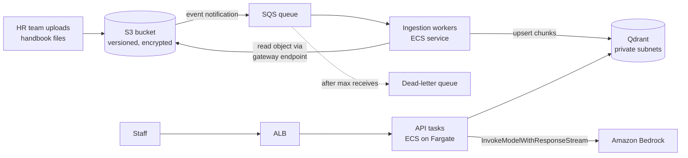

[Cloud deployment](/learn/deployment/cloud-deployment) gave you a vendor-neutral design: a private network with one public load balancer, containers for the API, a queue-driven ingestion path, a private vector store, a secret manager, workload identities and a cost model. This lesson builds that design on **Amazon Web Services (AWS)**, the largest of the public clouds, naming the specific services, the settings that matter for a RAG workload, and the places where AWS's defaults catch people out.

You will deploy AskMeridian's API to Amazon ECS on AWS Fargate behind an Application Load Balancer, call Claude through Amazon Bedrock with no API key, feed ingestion from S3 through SQS, and write a least-privilege IAM policy together with a small local test harness that checks the policy allows what it should and nothing more. Choosing among AWS's vector stores is left to [Managed vector databases](/learn/deployment/managed-vector-databases), and expressing all of this as Terraform to [Infrastructure configuration](/learn/deployment/infrastructure-configuration).

## Learning objectives

- Map each component of a RAG system to an AWS service and justify the choice of ECS on Fargate, EKS, Lambda or EC2 for it.
- Configure an ECS task definition with separate execution and task roles, injected secrets, health checks and logging.
- Call Claude through Amazon Bedrock with the Anthropic SDK using IAM credentials, and grant exactly the permissions it needs.
- Explain how IAM evaluates a request (explicit deny, allow, implicit deny) and test a policy against expected decisions.
- Identify the AWS settings that commonly break RAG services: load-balancer timeouts, deregistration delay, NAT data charges and model quotas.

## Prerequisites

- [Cloud deployment](/learn/deployment/cloud-deployment): the vendor-neutral architecture this lesson implements.
- [Docker](/learn/deployment/docker): the image being deployed.
- [Kubernetes fundamentals](/learn/deployment/kubernetes-fundamentals): probes, rolling updates and autoscaling, whose ideas ECS reuses.

## Why this matters

AWS offers several ways to do almost everything, and the defaults are tuned for generic web services, not for an application that loads models, streams long answers and sends document text to an LLM. Teams that take the defaults meet the same problems:

- **Deployments take five minutes per batch** because the load balancer's default deregistration delay waits 300 seconds before removing old tasks.
- **A surprisingly large networking bill**, because every image pull from the container registry and every call to an AWS API from a private subnet goes through a NAT gateway that charges per gigabyte.
- **Throttling at the busiest hour**, because Bedrock applies per-account, per-model quotas on requests and tokens, and nobody checked them against the expected peak.
- **An over-broad IAM role**, typically `bedrock:*` and `s3:*` on `*`, so a bug or an injected instruction in the application can read or delete far more than it should.

Each is a one-line fix once you know it exists.

## The intuition

AWS is a very large catalogue of parts, many of which overlap. The vendor-neutral design is your shopping list; the skill is picking the one part per line that fits, and knowing which knobs on it to turn.

| Neutral building block | AWS service |
| --- | --- |
| Private network, subnets, firewall rules | Amazon VPC, security groups |
| Public load balancer | Application Load Balancer (ALB) |
| Container registry | Amazon ECR |
| Serverless containers | Amazon ECS on AWS Fargate |
| Managed Kubernetes | Amazon EKS |
| Functions | AWS Lambda |
| Object storage and events | Amazon S3, event notifications |
| Queue | Amazon SQS |
| LLM through the cloud | Amazon Bedrock |
| Secret manager | AWS Secrets Manager (or SSM Parameter Store) |
| Workload identity | IAM roles (task roles, EKS Pod Identity) |
| Logs, metrics, traces | Amazon CloudWatch, AWS X-Ray or OpenTelemetry |

## How it works

### Accounts, regions and the network

Production workloads on AWS are usually separated into **accounts** (development, staging, production), grouped under AWS Organizations, because an account is the strongest isolation boundary AWS offers: permissions, quotas and bills are per account. Meridian runs AskMeridian in a UK region, `eu-west-2` (London), across at least two **availability zones**.

Inside the account, a **VPC** holds:

1. **Public subnets** in two zones, containing the ALB and the NAT gateways.
2. **Private subnets** in two zones, containing the ECS tasks, the ingestion workers and the vector store.
3. **Security groups**, which are stateful firewalls attached to resources. The ALB's group accepts HTTPS from the corporate network; the API's group accepts port 8000 only from the ALB's group; the vector store's group accepts its port only from the API and ingestion groups. Referring to security groups rather than IP ranges keeps rules correct as tasks come and go.
4. **VPC endpoints**, which let private resources reach AWS services without the NAT gateway. A *gateway endpoint* for S3 is free and routes S3 traffic privately. *Interface endpoints* (AWS PrivateLink) exist for ECR, CloudWatch Logs, Secrets Manager and the Bedrock runtime, among many others; they cost an hourly fee per zone plus data processing, but they keep traffic off the internet and avoid NAT processing charges, which matters when every new task pulls a gigabyte-scale image.

### Choosing compute

| Option | Fits AskMeridian's… | Watch out for |
| --- | --- | --- |
| **ECS on Fargate** | API and ingestion workers: containers without managing servers | No GPUs; tasks are sized in fixed CPU/memory combinations |
| **EKS** | Teams already running Kubernetes, or needing GPUs and many services | Cluster fee and upgrade work; IAM through Pod Identity or IRSA |
| **Lambda** | Small, event-driven steps: reacting to an S3 upload, short document conversions | Maximum duration of 15 minutes, package and memory limits, cold starts with models |
| **EC2** | Self-hosted LLMs on GPU instances, or a self-run vector database | You patch and scale the machines |

For a stateless API of AskMeridian's size, **ECS on Fargate** is the usual choice: it runs the container from the [Docker](/learn/deployment/docker) lesson as it is, needs no cluster maintenance, integrates directly with the ALB, IAM and Secrets Manager, and bills per second for the CPU and memory each task reserves. The limits quoted above for Lambda are long-standing, but check the current service quotas page before designing around any limit.

### ECS in four objects

- A **task definition** is a versioned description of one or more containers: image, CPU and memory, ports, environment, secrets, health check, logging, and two IAM roles. Every change registers a new revision.
- A **task** is a running instance of a task definition, like a Pod.
- A **service** keeps a desired number of tasks running, registers them with the ALB's **target group**, replaces failed ones, and performs rolling deployments, like a Deployment.
- A **cluster** is the logical grouping the services run in; with Fargate there are no servers to manage in it.

The two roles are the most commonly confused part of ECS:

- The **task execution role** is used by ECS itself, *before and around* your container: pulling the image from ECR, sending logs to CloudWatch, and fetching secrets from Secrets Manager to inject as environment variables.
- The **task role** is used by *your code*: the credentials the Anthropic and AWS SDKs obtain automatically inside the container. This is where `bedrock:InvokeModel` belongs.

Keeping them separate means the application cannot, for example, read secrets that only the platform needs.

**Deployments.** A service deployment starts new tasks, waits for them to pass the target group's health check, and drains old ones. `minimumHealthyPercent` and `maximumPercent` (defaults 100 and 200) play the roles of `maxUnavailable` and `maxSurge`. Enabling the **deployment circuit breaker** with rollback makes ECS stop and revert a deployment whose tasks keep failing to become healthy. Draining is governed by the target group's **deregistration delay**, 300 seconds by default: the ALB stops sending new requests to a task, waits that long for in-flight requests, then the task is stopped. For an API whose slowest streamed answer takes a minute, 60 to 90 seconds is enough, and deployments get several minutes faster.

**The ALB and streaming.** The ALB closes a connection on which no data has been sent for its **idle timeout**, 60 seconds by default. A streamed answer that sends tokens continuously keeps the connection alive, but a long silent stage before the first token, such as reranking a large candidate set or an agentic retrieval loop, can exceed it. Either send an early event (a "searching…" message) or raise the timeout. The target group's health check should call `/readyz`, so tasks receive traffic only once their model is loaded.

### Ingestion: S3, SQS and workers



When a file lands in the document bucket, an **S3 event notification** sends a message to an **SQS** queue. Workers (an ECS service scaled on queue depth, or Lambda for small files) receive messages, fetch the object, parse, chunk, embed and upsert. Two SQS settings matter:

- The **visibility timeout** hides a received message from other workers while one processes it. It must exceed the longest processing time for one document, or a large PDF will be picked up by a second worker while the first is still embedding it, producing duplicate work.
- A **redrive policy** moves a message to a **dead-letter queue** after a set number of failed receives, so one malformed document cannot block or loop forever. Someone must watch the dead-letter queue; it is where ingestion failures become visible.

Ingestion must be idempotent: S3 can deliver an event more than once, and retries re-run work. Deterministic chunk IDs (for example, a hash of document ID, version and chunk position) make a repeat upsert overwrite rather than duplicate, as the [Indexing pipeline](/learn/rag-architecture-fundamentals/indexing-pipeline) lesson recommends.

### The LLM: Bedrock or the direct API

AskMeridian can reach Claude in two ways from AWS:

1. **Anthropic's API directly**, over the internet through the NAT gateway, authenticated with an API key stored in Secrets Manager.
2. **Amazon Bedrock**, AWS's managed model service, which offers Claude models among others. Requests are authenticated with IAM, billed on the AWS account, can stay on the AWS network through a Bedrock runtime VPC endpoint, and are governed by IAM policies and CloudTrail logging like any other AWS call.

The Anthropic Python SDK supports both with the same `messages.create` interface; only the client class and the model identifier change. On Bedrock, models have Bedrock-specific IDs, and some are invoked through **inference profiles**, which can route requests across several regions within a geography to increase capacity. That routing is an important data-residency question: confirm which regions a profile may send requests to, and whether that is acceptable for your documents, before using it. Model availability differs by region and changes frequently, so look up the current model IDs and regions in the Bedrock console or documentation rather than copying them from any tutorial, this one included.

Bedrock also applies **quotas** per account, region and model, typically on requests per minute and tokens per minute. Compare them with your peak: AskMeridian's peak of a few requests per second, at about 3,300 tokens each, is several hundred thousand tokens a minute at the very top of the morning ramp. If a quota is below that, request an increase well before launch.

AWS also offers **Bedrock Knowledge Bases**, a fully managed RAG service that ingests from S3 and retrieves for you. It trades control over chunking, retrieval and prompting for less code: a reasonable baseline to evaluate your own pipeline against.

### Secrets, configuration and observability

**Secrets Manager** stores secrets with rotation support and fine-grained access; **SSM Parameter Store** stores configuration and can also hold encrypted values. The ECS task definition's `secrets` field injects either into the container as environment variables at start-up, fetched by the execution role. Non-secret configuration goes in `environment`.

The `awslogs` driver sends container output to **CloudWatch Logs**, where structured JSON [logs](/learn/rag-observability/logging) can be queried with Logs Insights. ECS publishes per-service CPU and memory metrics, the ALB publishes request counts, latencies and errors, and traces can go to AWS X-Ray or any OpenTelemetry backend.

## In code

### Calling Claude from either route

The application chooses its client from configuration, so the same image runs against Bedrock in AWS and against the direct API on a laptop. Install with `pip install "anthropic[bedrock]"`; the extra pulls in the AWS libraries the Bedrock client uses to sign requests. This was not executed against Bedrock (it needs an AWS account with model access); constructing the Bedrock client was checked locally, and it resolved its endpoint to `https://bedrock-runtime.eu-west-2.amazonaws.com`.

```python
import os

import anthropic


def make_client():
    if os.environ.get("LLM_ROUTE") == "bedrock":
        # No API key: credentials come from the ECS task role via the standard AWS chain.
        return anthropic.AnthropicBedrock(aws_region=os.environ["AWS_REGION"])
    return anthropic.Anthropic()  # reads ANTHROPIC_API_KEY from the environment


client = make_client()
model = os.environ.get("LLM_MODEL_ID", "claude-opus-5-5")  # a Bedrock ID when on Bedrock

prompt = "Context:\n[1] Annual leave is 25 days.\n\nQuestion: How much annual leave do I get?"
with client.messages.stream(
    model=model,
    max_tokens=1024,
    system="Answer only from the provided context. If the answer is not there, say you don't know.",
    messages=[{"role": "user", "content": prompt}],
) as stream:
    for text in stream.text_stream:
        print(text, end="", flush=True)
```

`AWS_REGION` is set automatically inside ECS tasks. Streaming matters twice over on AWS: it improves perceived latency, and it keeps the ALB connection active. The Bedrock route needs the `bedrock:InvokeModelWithResponseStream` permission for streaming and `bedrock:InvokeModel` for non-streaming calls.

### The task definition

This task definition runs the image from ECR on Fargate with 1 vCPU and 2 GB, which is one of Fargate's supported combinations. It was validated as JSON but not registered with AWS.

```json
{
  "family": "askmeridian-api",
  "networkMode": "awsvpc",
  "requiresCompatibilities": ["FARGATE"],
  "cpu": "1024",
  "memory": "2048",
  "runtimePlatform": {"cpuArchitecture": "X86_64", "operatingSystemFamily": "LINUX"},
  "executionRoleArn": "arn:aws:iam::111122223333:role/askmeridian-api-execution",
  "taskRoleArn": "arn:aws:iam::111122223333:role/askmeridian-api-task",
  "containerDefinitions": [
    {
      "name": "api",
      "image": "111122223333.dkr.ecr.eu-west-2.amazonaws.com/askmeridian-api:1.4.2",
      "essential": true,
      "portMappings": [{"containerPort": 8000, "protocol": "tcp"}],
      "environment": [
        {"name": "QDRANT_URL", "value": "https://qdrant.askmeridian.internal:6333"},
        {"name": "LLM_ROUTE", "value": "bedrock"},
        {"name": "LLM_MODEL_ID", "value": "copy-the-model-or-inference-profile-id-from-the-bedrock-console"},
        {"name": "OMP_NUM_THREADS", "value": "1"}
      ],
      "secrets": [
        {"name": "QDRANT_API_KEY",
         "valueFrom": "arn:aws:secretsmanager:eu-west-2:111122223333:secret:askmeridian/qdrant-api-key-AbC123"}
      ],
      "healthCheck": {
        "command": ["CMD-SHELL", "python -c \"import urllib.request; urllib.request.urlopen('http://127.0.0.1:8000/healthz', timeout=2)\""],
        "interval": 30, "timeout": 5, "retries": 3, "startPeriod": 120
      },
      "stopTimeout": 60,
      "logConfiguration": {
        "logDriver": "awslogs",
        "options": {
          "awslogs-group": "/askmeridian/api",
          "awslogs-region": "eu-west-2",
          "awslogs-stream-prefix": "api"
        }
      }
    }
  ]
}
```

The important fields:

- **`networkMode: awsvpc`** (required on Fargate) gives each task its own network interface in a private subnet, with its own security group.
- **`runtimePlatform`** must match the image's architecture; an `arm64` image built on a laptop will not start on an `X86_64` task. Fargate also offers ARM64 (Graviton) tasks, often at a lower price per vCPU, if you build for it.
- **`secrets`** is resolved by the execution role at task start; the application sees an ordinary environment variable and never calls Secrets Manager itself. A rotated secret reaches running tasks only when they are replaced.
- **`healthCheck`** is ECS's container-level check, separate from the ALB target group's check on `/readyz`. `startPeriod: 120` gives the model time to load.
- **`stopTimeout: 60`** is how long ECS waits after `SIGTERM` before `SIGKILL`, the same role as Kubernetes' grace period (Fargate caps it at 120 seconds).
- **`LLM_MODEL_ID`** is deliberately not hard-coded in this lesson: Bedrock model and inference-profile IDs are specific to the provider, version and region. Copy the current one from the Bedrock console or documentation.

### A least-privilege task role, tested

The task role's policy grants exactly what the API's code does: invoke Anthropic models on Bedrock, read source documents under `handbook/` to show citations, and send feedback events to one queue. The final statement is an explicit deny on the bucket prefix that holds raw HR exports, a guard that keeps working even if someone later adds a broader allow.

```json
{
  "Version": "2012-10-17",
  "Statement": [
    {
      "Sid": "InvokeClaudeOnBedrock",
      "Effect": "Allow",
      "Action": ["bedrock:InvokeModel", "bedrock:InvokeModelWithResponseStream"],
      "Resource": [
        "arn:aws:bedrock:*::foundation-model/anthropic.*",
        "arn:aws:bedrock:eu-west-2:111122223333:inference-profile/*"
      ]
    },
    {
      "Sid": "ReadHandbookSources",
      "Effect": "Allow",
      "Action": "s3:GetObject",
      "Resource": "arn:aws:s3:::meridian-askmeridian-docs/handbook/*"
    },
    {
      "Sid": "SendFeedbackEvents",
      "Effect": "Allow",
      "Action": "sqs:SendMessage",
      "Resource": "arn:aws:sqs:eu-west-2:111122223333:askmeridian-feedback"
    },
    {
      "Sid": "NeverTouchHrRaw",
      "Effect": "Deny",
      "Action": "s3:*",
      "Resource": "arn:aws:s3:::meridian-askmeridian-docs/hr-raw/*"
    }
  ]
}
```

IAM evaluates a request in a fixed order. Within a single account and considering only identity-based policies:

1. If any matching statement says **Deny**, the request is denied. An explicit deny always wins.
2. Otherwise, if any matching statement says **Allow**, the request is allowed.
3. Otherwise it is denied by default: an **implicit deny**.

A statement matches when the action and the resource both match its patterns; `*` matches any sequence of characters, including `/`, and action names are case-insensitive. Real IAM also evaluates conditions, resource-based policies (such as bucket policies), permission boundaries, session policies and organisation-wide service control policies, each of which can only narrow what is allowed. The harness below models only the core rule, which is enough to unit-test a policy's intent in CI before it reaches AWS:

```python
"""A minimal model of IAM policy evaluation, used to unit-test a task role's policy.

Real IAM also evaluates conditions, resource policies, permission boundaries, session
policies and organisation-wide controls; this models only identity-policy Allow/Deny.
"""
import json
import sys
from fnmatch import fnmatchcase


def _list(x):
    return x if isinstance(x, list) else [x]


def matches(stmt: dict, action: str, resource: str) -> bool:
    action_ok = any(fnmatchcase(action.lower(), a.lower()) for a in _list(stmt["Action"]))
    resource_ok = any(fnmatchcase(resource, r) for r in _list(stmt["Resource"]))
    return action_ok and resource_ok


def evaluate(policy: dict, action: str, resource: str) -> str:
    hits = [s for s in policy["Statement"] if matches(s, action, resource)]
    if any(s["Effect"] == "Deny" for s in hits):
        return "explicit DENY"          # an explicit deny always wins
    if any(s["Effect"] == "Allow" for s in hits):
        return "ALLOW"
    return "implicit deny"              # nothing allowed it


policy = json.load(open(sys.argv[1]))
MODEL = "arn:aws:bedrock:eu-west-2::foundation-model/anthropic.claude-example-v1:0"
cases = [
    # (action, resource, expected)
    ("bedrock:InvokeModelWithResponseStream", MODEL, "ALLOW"),
    ("bedrock:InvokeModel", "arn:aws:bedrock:eu-west-2::foundation-model/other.model-v1", "implicit deny"),
    ("s3:GetObject", "arn:aws:s3:::meridian-askmeridian-docs/handbook/leave.md", "ALLOW"),
    ("s3:PutObject", "arn:aws:s3:::meridian-askmeridian-docs/handbook/leave.md", "implicit deny"),
    ("s3:GetObject", "arn:aws:s3:::meridian-askmeridian-docs/hr-raw/salaries.csv", "explicit DENY"),
    ("sqs:SendMessage", "arn:aws:sqs:eu-west-2:111122223333:askmeridian-feedback", "ALLOW"),
    ("sqs:DeleteQueue", "arn:aws:sqs:eu-west-2:111122223333:askmeridian-feedback", "implicit deny"),
]
failures = 0
for action, resource, expected in cases:
    got = evaluate(policy, action, resource)
    failures += got != expected
    print(f"{'ok  ' if got == expected else 'FAIL'} {got:14} {action:40} {resource.split(':', 5)[-1][:46]}")
print(f"\n{len(cases) - failures}/{len(cases)} expectations met")
sys.exit(1 if failures else 0)
```

Running `python check_policy.py task_role_policy.json`:

```output
ok   ALLOW          bedrock:InvokeModelWithResponseStream    foundation-model/anthropic.claude-example-v1:0
ok   implicit deny  bedrock:InvokeModel                      foundation-model/other.model-v1
ok   ALLOW          s3:GetObject                             meridian-askmeridian-docs/handbook/leave.md
ok   implicit deny  s3:PutObject                             meridian-askmeridian-docs/handbook/leave.md
ok   explicit DENY  s3:GetObject                             meridian-askmeridian-docs/hr-raw/salaries.csv
ok   ALLOW          sqs:SendMessage                          askmeridian-feedback
ok   implicit deny  sqs:DeleteQueue                          askmeridian-feedback

7/7 expectations met
```

Each line is one decision the policy author intended. The API may stream from an Anthropic model but not invoke other providers' models; it may read handbook sources but not overwrite them; it may send feedback but not delete the queue. The `hr-raw` read is refused by the explicit deny rather than merely by omission, and would stay refused if a colleague later added `s3:GetObject` on the whole bucket. The script exits with a non-zero status on any mismatch, so it can gate a CI pipeline. (The model ARN is an invented example; real IDs come from Bedrock.)

For checks against real IAM, AWS provides the IAM policy simulator and IAM Access Analyzer's policy validation, which understand the full evaluation logic; use them in addition to, not instead of, intent tests like these.

**Errors people commonly hit.** `AccessDeniedException` from Bedrock means the task role lacks the action, the resource pattern does not match the model or inference profile actually used, or model access has not been enabled for the account. `ResourceInitializationError: unable to pull secrets or registry auth` means the *execution* role, not the task role, lacks permission, or the task's subnet has no route (NAT or endpoint) to Secrets Manager or ECR. Tasks that start, then stop with `Task failed ELB health checks` are failing `/readyz` on the target group; check the health check path, port and grace period.

### Deploying

These AWS CLI commands push the image and roll out a new task definition revision; they were not executed here.

```bash
REGISTRY=111122223333.dkr.ecr.eu-west-2.amazonaws.com
aws ecr get-login-password --region eu-west-2 | docker login --username AWS --password-stdin "$REGISTRY"
docker buildx build --platform linux/amd64 -t "$REGISTRY/askmeridian-api:1.4.2" --push .

aws ecs register-task-definition --cli-input-json file://taskdef.json
aws ecs update-service --cluster askmeridian --service askmeridian-api \
  --task-definition askmeridian-api --region eu-west-2
aws ecs wait services-stable --cluster askmeridian --services askmeridian-api --region eu-west-2
```

Passing the family name without a revision uses the latest active revision. In practice CI runs these steps.

**Extending it.** Add target-tracking autoscaling on `ALBRequestCountPerTarget` or CPU; run ingestion as a second ECS service scaled on SQS backlog per task; put AWS WAF in front of the ALB.

## A real-world example

Meridian's Platform team moved AskMeridian from a pilot VM to ECS on Fargate in the London region. The first week surfaced three AWS-specific problems.

Deployments took over twenty minutes. With six tasks and the default deregistration delay of 300 seconds, each batch of old tasks waited five minutes to drain even though no request ever lasted more than a minute. Setting the delay to 75 seconds cut deployments to a few minutes.

The first monthly bill showed NAT gateway data processing far above the estimate. Every new task pulled the 1.5 GB image from ECR through NAT, and autoscaling plus deployments started dozens of tasks a day. Adding the S3 gateway endpoint (ECR stores image layers in S3) and interface endpoints for the ECR APIs and CloudWatch Logs moved that traffic off NAT.

Finally, the first Monday-morning peak returned `ThrottlingException` from Bedrock for a few minutes. The account's default tokens-per-minute quota for the chosen model was below the morning peak. The team requested an increase, added retries with exponential backoff and jitter for throttling errors, and added an alarm on the throttle count. While choosing the model, the team confirmed with Meridian's data-protection lead which regions the selected inference profile could route to, and recorded the decision in the service's design document.

## Common mistakes

- **Putting Bedrock or S3 permissions on the execution role.** The application's SDK uses the task role and gets `AccessDenied`; or worse, both roles are given everything.
- **`"Action": "*"` or `"Resource": "*"` on the task role.** Any bug or injected instruction can reach every resource in the account.
- **Leaving the deregistration delay at 300 seconds.** Every deployment waits five minutes per batch for requests that finished long ago.
- **No VPC endpoints.** Image pulls and AWS API calls run through NAT, adding data-processing charges and an internet path.
- **Not checking Bedrock quotas and regional model availability before launch.** The peak hour meets throttling, or the model is not offered where the data must stay.
- **An SQS visibility timeout shorter than processing time.** Large documents are processed twice, concurrently.

## Best practices

- Separate environments into AWS accounts; keep production in its own account.
- Run the API on ECS Fargate across at least two availability zones behind an ALB that checks `/readyz`.
- Use the task role for application permissions and the execution role for platform permissions, each least-privilege, and test policies in CI.
- Prefer Bedrock with IAM when you want AWS-native authentication, private networking and billing; confirm model availability, quotas and cross-region routing first.
- Add the S3 gateway endpoint and interface endpoints for ECR, CloudWatch Logs, Secrets Manager and Bedrock runtime.
- Enable the ECS deployment circuit breaker with rollback, and set the deregistration delay just above the slowest request.
- Drive ingestion from S3 events through SQS with a dead-letter queue, idempotent workers and an alarm on the dead-letter queue depth.

## Performance considerations

**Task sizing.** Fargate bills for the CPU and memory a task reserves, per second. If one AskMeridian task with 1 vCPU and 2 GB handles, by load test, about 0.4 requests per second of CPU-bound reranking, the morning peak of about 2.7 requests per second needs $\lceil 2.7 / (0.4 \times 0.6) \rceil = 12$ tasks at a 60% utilisation target, the same arithmetic as the [HPA](/learn/deployment/kubernetes-fundamentals) lesson. Larger tasks with more workers can reduce per-task overhead (the runtime and model are loaded once per process, so this helps only if the process can use more cores).

**Start-up time.** A new Fargate task pulls its whole image (Fargate does not keep a shared image cache on a host you control the way an EC2 node does), so image size directly sets scale-out speed. The image-size discipline from [Docker](/learn/deployment/docker) pays off here more than anywhere.

**Bedrock throughput.** Model quotas are per account and region. Peak tokens per minute equal peak requests per minute times tokens per request: at 2.7 requests per second and 3,300 tokens each, $2.7 \times 60 \times 3300 \approx 535{,}000$ tokens per minute. Context size therefore affects not only cost but whether you hit quotas.

**Network charges.** NAT gateways charge per hour per gateway and per gigabyte processed; data transfer between availability zones is also charged. Exact prices vary by region and change; check the current VPC pricing page. Keep the API, vector store and cache in the same region, and route AWS-service traffic through endpoints.

## Security considerations

- **Least privilege, verified.** Scope every IAM statement to specific actions and resources, keep explicit denies for sensitive prefixes, and test intent in CI. Use IAM Access Analyzer to find unused permissions and externally shared resources.
- **No long-lived keys.** ECS task roles and EKS Pod Identity provide temporary credentials; with Bedrock, even the LLM needs no API key. Never create IAM user access keys for workloads.
- **Private data paths.** Block public access on the document bucket (S3 Block Public Access), keep the vector store in private subnets, and use VPC endpoints with endpoint policies that restrict which buckets and actions are reachable.
- **Encryption and audit.** S3, EBS, Secrets Manager and SQS support encryption at rest with AWS KMS keys; enable it, with customer-managed keys where policy requires. Keep CloudTrail enabled in every account so every API call, including Bedrock invocations, is attributable.
- **Organisation guardrails.** Service control policies in AWS Organizations can, for example, deny any action outside approved regions, which turns the data-residency decision into an enforced control rather than a convention.

## Summary

- The neutral cloud architecture maps onto VPC, ALB, ECR, ECS on Fargate, S3, SQS, Bedrock, Secrets Manager, IAM and CloudWatch.
- ECS separates the execution role (pull images, fetch secrets, write logs) from the task role (your code's permissions); confusing them is the most common ECS mistake.
- Bedrock lets the Anthropic SDK call Claude with IAM credentials and no API key; check model IDs, regional availability, inference-profile routing and quotas first.
- IAM denies by default, allows only on an explicit match, and an explicit deny always wins; test policies against intended decisions before deployment.
- Defaults to change for RAG: the 300-second deregistration delay, the 60-second ALB idle timeout, the absence of VPC endpoints, and SQS visibility timeouts shorter than document processing.

## Exercises

1. An ECS task fails to start with `ResourceInitializationError: unable to pull secrets`. The task role has `secretsmanager:GetSecretValue` on the secret. What is wrong?

<details><summary>Show solution</summary>

Secrets in the task definition's `secrets` field are fetched by ECS using the **execution role** before the container starts, not by the task role. Grant `secretsmanager:GetSecretValue` on that secret (and `kms:Decrypt` if it uses a customer-managed key) to the execution role. Also check that the task's subnet can reach Secrets Manager, through a NAT gateway or a Secrets Manager interface endpoint. The task role's permission can then be removed if the application never reads the secret itself.

</details>

2. A colleague proposes adding `{"Effect": "Allow", "Action": "s3:*", "Resource": "arn:aws:s3:::meridian-askmeridian-docs/*"}` to the task role "to simplify things". Add it to the policy and predict the harness output before running it. Which expectations now fail, and which does the explicit deny still protect?

<details><summary>Show solution</summary>

`s3:PutObject` on `handbook/leave.md` changes from implicit deny to ALLOW, so that expectation fails and the script exits non-zero: the API could now overwrite source documents. `s3:GetObject` on `hr-raw/salaries.csv` remains explicit DENY, because a matching deny wins over any allow. This is exactly why the deny was written: it keeps protecting the sensitive prefix when someone broadens the allows. The right response is to reject the change, which the CI check makes automatic.

</details>

3. Ingestion workers take up to 8 minutes for the largest PDF. The SQS queue has a visibility timeout of 5 minutes and a redrive policy with `maxReceiveCount` of 3. Describe what happens to a 7-minute document and fix the configuration.

<details><summary>Show solution</summary>

After 5 minutes the message becomes visible again while the first worker is still processing it, so a second worker picks it up and processes the same document concurrently; the receive count rises each time. If processing keeps overlapping and workers fail on conflicts, after three receives the message moves to the dead-letter queue even though the document is valid. Set the visibility timeout above the longest processing time with margin (for example 15 minutes), or have the worker extend visibility periodically while it works with `ChangeMessageVisibility`. Keep writes idempotent with deterministic chunk IDs so any duplicate processing is harmless.

</details>

4. Meridian's data-protection lead requires that handbook text never leaves the UK. List every place in the AWS architecture where this must be checked and the control you would use for each.

<details><summary>Show solution</summary>

Object storage: bucket in `eu-west-2`, with an organisation service control policy denying resource creation outside approved regions. Vector store: Qdrant nodes and their volumes and backups in `eu-west-2`. Logs: CloudWatch Logs in `eu-west-2`, and no cross-region log replication; consider not logging full chunk text at all. Queue messages: SQS in `eu-west-2` (messages carry object keys, not text). LLM: confirm the model is available in `eu-west-2`, or which regions any inference profile routes to; if none satisfies the requirement, the direct API's processing location must be checked contractually, or the requirement escalated. Backups and disaster-recovery copies: any cross-region copy must stay within approved locations. Each decision should be written down and enforced by policy where AWS allows.

</details>

## Check your understanding

```quiz
[
  {
    "q": "In ECS, which role do the Anthropic and AWS SDKs inside your container use to call Bedrock?",
    "options": [
      "The task execution role",
      "The task role",
      "The ECS service-linked role",
      "The load balancer's role"
    ],
    "answer": 1,
    "why": "Application code receives the task role's temporary credentials. The execution role is used by ECS to pull images, fetch secrets and send logs."
  },
  {
    "q": "A policy allows `s3:*` on a bucket and also has a Deny for `s3:*` on the bucket's `hr-raw/*` prefix. A request reads `hr-raw/salaries.csv`. What is the result?",
    "options": [
      "Allowed, because the allow is broader",
      "Allowed, because statements are evaluated in order and the allow comes first",
      "Denied, because an explicit deny always overrides an allow",
      "Denied only if the bucket policy also denies it"
    ],
    "answer": 2,
    "why": "IAM checks for any matching explicit deny first; if one exists, the request is denied regardless of allows."
  },
  {
    "q": "Deployments of six ECS tasks take over twenty minutes although no request lasts more than a minute. Which setting is the most likely cause?",
    "options": [
      "The target group's deregistration delay left at its 300-second default",
      "The task's CPU size",
      "The ALB idle timeout",
      "The SQS visibility timeout"
    ],
    "answer": 0,
    "why": "Each old task waits the full deregistration delay before being stopped. Setting it slightly above the longest request shortens deployments."
  },
  {
    "q": "Why add an S3 gateway endpoint and ECR interface endpoints to the VPC?",
    "options": [
      "They are required for Fargate tasks to start.",
      "They let tasks in private subnets reach S3 and ECR over the AWS network instead of through NAT, avoiding NAT data charges and an internet path.",
      "They make S3 objects public to the VPC.",
      "They replace the need for IAM permissions."
    ],
    "answer": 1,
    "why": "Endpoints provide private routes to AWS services. IAM permissions are still required."
  },
  {
    "q": "What is the main data-residency question to answer before using a Bedrock cross-region inference profile?",
    "options": [
      "Whether the profile supports streaming",
      "Whether the profile uses the same model ID format",
      "Whether the profile is cheaper",
      "Which regions the profile may route requests to, and whether processing there is allowed for the documents in the prompt"
    ],
    "answer": 3,
    "why": "Inference profiles can route requests to other regions within a geography; prompts contain document text, so the routing must comply with residency commitments."
  }
]
```

## Further reading

- [Amazon ECS Developer Guide](https://docs.aws.amazon.com/AmazonECS/latest/developerguide/Welcome.html): task definitions, task and execution roles, services and deployments.
- [Amazon Bedrock User Guide](https://docs.aws.amazon.com/bedrock/latest/userguide/what-is-bedrock.html): model access, inference profiles, quotas and IAM actions.
- [IAM policy evaluation logic](https://docs.aws.amazon.com/IAM/latest/UserGuide/reference_policies_evaluation-logic.html): the full decision procedure, including boundaries and organisation policies.
- [Amazon VPC User Guide](https://docs.aws.amazon.com/vpc/latest/userguide/what-is-amazon-vpc.html): subnets, NAT gateways and VPC endpoints.
- Anthropic, *Claude on Amazon Bedrock*, in the Claude API documentation: using the `AnthropicBedrock` client and Bedrock model identifiers.
