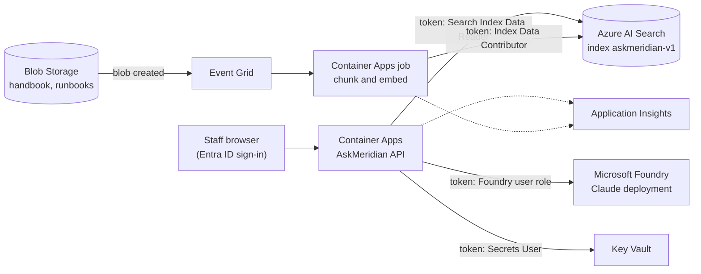

Many organisations do not choose their cloud for a RAG project: they already have one, with its identity system, network rules, procurement contracts and security team attached. For a large share of enterprises that cloud is Microsoft Azure, because their staff already sign in with Microsoft Entra ID (the identity service formerly called Azure Active Directory) and their documents already live in Microsoft 365. This lesson shows how a RAG service maps onto Azure: where the container runs, where the vectors live, how the service reaches Claude, and, above all, how every component proves its identity to every other without a single stored password.

The previous lesson, [Cloud deployment](/learn/deployment/cloud-deployment), set out the provider-neutral decisions (which compute model, managed or self-hosted state, regions). [AWS](/learn/deployment/aws) applied them to one provider. Here we apply them to Azure, and the code builds the exact JSON that Azure AI Search expects for a vector index, so you can see what the service stores and why it rejects the most common first attempt.

## Learning objectives

- Map each stage of a RAG system (ingestion, index, API, generation, secrets, monitoring) onto a named Azure service and justify the choice.
- Explain how managed identities and Microsoft Entra role assignments replace API keys, and diagnose a 403 caused by a missing role.
- Write an Azure AI Search index definition with a vector field and a hybrid query body, and explain each property.
- Call Claude through Microsoft Foundry with the Anthropic SDK using token-based authentication.
- Estimate vector storage for an index and reason about replicas, partitions and payload size.

## Prerequisites

- [Docker](/learn/deployment/docker): the service ships as a container image.
- [Cloud deployment](/learn/deployment/cloud-deployment): the provider-neutral choices this lesson specialises.
- [FastAPI](/learn/backend-engineering/fastapi): the service being deployed.
- [Reciprocal Rank Fusion](/learn/hybrid-search/reciprocal-rank-fusion): how Azure AI Search merges its keyword and vector results.
- [HNSW](/learn/vector-indexing-algorithms/hnsw): the index algorithm behind the vector field.

## Why this matters

A RAG system on Azure touches at least five services: somewhere to run the API, somewhere to keep raw documents, a search index, a model endpoint and a secret store. Each has its own authentication. The quickest way to get a demo working is to copy an API key from each service's portal page into an environment variable. That demo then becomes production, and the keys become a liability: they never expire unless someone rotates them, they grant full access to whoever holds them, they leak into logs, shell history and CI output, and when one leaks nobody can tell from the service's logs which caller used it.

The second problem is that Azure's services have opinions that only show up at deployment time. Azure AI Search rejects document keys containing characters that the chunk-ID scheme used throughout this course relies on. A vector field's dimension count is fixed when the index is created. Role assignments take time to propagate, so an identical deployment can fail and then succeed. Learning these in production costs days; knowing them in advance costs nothing.

## The intuition

Think of an Azure deployment as an office building in which each service is a room. In the key-based approach, every room has a keypad, and the codes are written on sticky notes handed to whoever might need them. Anyone who photographs a note can enter forever, and the door log only says "someone with the code came in".

The managed-identity approach is a staff badge. The building (Microsoft Entra ID) knows who each badge belongs to. Each room has a list saying which badges may enter and what they may do inside: the API's badge may read the search index but not change it; the ingestion job's badge may write to it. Badges are issued by the building itself, so nobody carries a code that could be copied, and the door log names the badge. When a badge is cancelled, every door stops opening for it at once.

The one surprise in this analogy is also real: when you add a badge to a room's list, the doors take a little while to learn about it. That delay is the source of a classic "it failed, then it worked" deployment bug.

## How it works

### The service map

The table maps each RAG component to the Azure service most teams choose, with the main alternative.

| RAG component | Typical Azure choice | Alternatives |
| --- | --- | --- |
| API container | Azure Container Apps | Azure Kubernetes Service (AKS), App Service |
| Ingestion workers | Container Apps jobs | Azure Functions, AKS jobs |
| Raw documents | Azure Blob Storage | SharePoint or OneDrive via connectors |
| Change events | Azure Event Grid | Storage queues, Service Bus |
| Search index | Azure AI Search | Qdrant on AKS or Qdrant Cloud, Azure Cosmos DB vector search, PostgreSQL Flexible Server with pgvector |
| Generation | Claude through Microsoft Foundry | Calling Anthropic's API directly over the internet |
| Secrets | Azure Key Vault | Container Apps secrets (for low-sensitivity values) |
| Identity | Managed identities and Microsoft Entra ID | Service principals with client secrets (avoid) |
| Telemetry | Azure Monitor and Application Insights | Any OpenTelemetry back end |

**Azure Container Apps** is a serverless container platform: you give it an image, a port and scaling rules, and it runs replicas for you. Under the hood it is built on Kubernetes and the KEDA autoscaler, but you never touch a cluster. It supports scale-to-zero, HTTP-concurrency scaling, revisions (immutable snapshots of a configuration, between which you can split traffic), managed identities and Key Vault secret references. For a stateless RAG API this is usually the right default. **AKS** is managed Kubernetes; choose it when you need what [Kubernetes fundamentals](/learn/deployment/kubernetes-fundamentals) describes in full (GPU node pools for self-hosted models, a self-hosted vector database with persistent volumes, custom networking) and you have people to operate it.

### Azure AI Search as a vector store

**Azure AI Search** (formerly Azure Cognitive Search) is a managed search service. For RAG, three of its features matter:

1. **Vector fields.** A field of type `Collection(Edm.Single)` holds one embedding. You declare its `dimensions` and attach a **vector search profile**, which names an algorithm configuration: HNSW for approximate search or exhaustive k-nearest-neighbour for exact search, with a metric such as `cosine`.
2. **Hybrid queries.** One request can carry a keyword query (`search`, scored with BM25) and one or more vector queries (`vectorQueries`). The service runs both and merges the two ranked lists with Reciprocal Rank Fusion, the method from [Reciprocal Rank Fusion](/learn/hybrid-search/reciprocal-rank-fusion). You get hybrid retrieval without writing the fusion yourself.
3. **Semantic ranker.** An optional second stage that re-scores the top results with a Microsoft-hosted ranking model, in the spirit of [cross-encoder reranking](/learn/reranking-fundamentals). It is billed separately and is not available in every region; check the documentation for your region.

Capacity is bought as a **tier** (Basic, several Standard levels and storage-optimised tiers) and then scaled in two directions. **Partitions** split the index's storage across more machines, adding storage and indexing throughput. **Replicas** are copies of the whole index, adding query throughput and availability. Microsoft's service-level agreement for reads has historically required at least two replicas, and for reads and writes at least three; confirm the current terms before relying on them. Each tier also caps how much vector data a partition may hold, and that vector quota, not total storage, is often the first limit a RAG index hits.

Azure AI Search can also chunk and embed documents itself (**integrated vectorisation**). That is convenient but harder to test locally, so many teams keep chunking and embedding in their own code and push finished chunks to the index, as shown here.

### Identity: managed identities and role assignments

A **managed identity** is an identity in Microsoft Entra ID that Azure creates for a resource, such as a container app. The platform holds its credentials and hands your code short-lived access tokens on request. There are two kinds:

- **System-assigned**: created with the resource and deleted with it. Simple, one per resource.
- **User-assigned**: a standalone resource you attach to one or more services. Useful when several apps share permissions, or when you want the identity (and its role assignments) to exist before the app is deployed.

Permissions are granted with **role assignments**: a triple of *who* (an identity), *what* (a role, which is a named set of permitted actions) and *where* (a scope: a subscription, a resource group or a single resource). For a RAG system the relevant built-in roles include *Search Index Data Reader* (query an index), *Search Index Data Contributor* (write documents), *Search Service Contributor* (create and manage indexes), *Storage Blob Data Reader* and *Key Vault Secrets User*. For Azure AI Search to accept tokens at all, its API access control must be set to allow role-based access; to forbid keys entirely, disable local (key) authentication on the service.

In code, the `azure-identity` library's `DefaultAzureCredential` tries a chain of sources in order: environment variables, workload identity, managed identity, then developer tools such as the Azure CLI login. The same code therefore runs on your laptop (using your `az login`) and in Container Apps (using the app's managed identity). That convenience hides a trap, which the real-world example below walks through: on your laptop the code runs with *your* permissions, not the app's.

The token flow for one request:

1. The application asks the credential for a token with a **scope**, a string naming the target service, such as `https://search.azure.com/.default` for Azure AI Search.
2. Inside Azure, the credential calls the platform's local identity endpoint, which returns an access token for the managed identity, valid for a limited period. The library caches it and refreshes it before it expires.
3. The application sends the token in an `Authorization: Bearer` header.
4. The target service validates the token's signature and audience, looks up the identity's role assignments at that scope, and allows or refuses the call (a refusal is HTTP 403).



The API can only read the index; only the ingestion job writes to it. If the API is compromised, for instance through a [prompt injection](/learn/rag-security-fundamentals/prompt-injection) that tricks a tool into acting, it cannot alter what other users retrieve.

### Generation: Claude through Microsoft Foundry

**Microsoft Foundry** (previously Azure AI Foundry) is Azure's platform for hosted models, and Anthropic's Claude models are available through it. This matters for procurement (billing goes through the Azure subscription) and authentication (Entra ID tokens instead of an Anthropic API key). Model availability and the regions that host each model change over time; check both the Foundry catalogue and Anthropic's documentation before you design around a particular model in a particular region.

The Anthropic Python SDK has an `AnthropicFoundry` client that speaks the same Messages API as the ordinary client. It needs your Foundry **resource** name (which forms the endpoint URL) and either an API key or a token provider. The token-provider form is the one to use in production, because it plugs straight into a managed identity. The code section shows it.

### Ingestion on Azure

Ingestion follows the event-driven pattern from [Streaming ingestion](/learn/understanding-document-ingestion/streaming-ingestion). HR uploads a new handbook PDF to a Blob Storage container. Blob Storage emits a *BlobCreated* event to Event Grid. A Container Apps job, triggered by that event (or by a queue that Event Grid feeds), downloads the blob, parses and chunks it, embeds the chunks and pushes them to the index with `mergeOrUpload` actions, which insert a document or overwrite the existing one with the same key. A job suits this work: it runs to completion, is sized for embedding rather than serving, and costs nothing between uploads.

## The mathematics

Vector storage dominates a RAG index's size, so you should be able to estimate it before choosing a tier.

**Intuition.** Each chunk's embedding is a list of numbers, each stored as a 4-byte float. Total size is simply count times length times four, plus the HNSW graph, which stores a list of neighbour IDs per vector.

$$
S_{\text{vectors}} = N \times d \times 4 \quad\text{bytes}, \qquad S_{\text{graph}} \approx N \times 2m \times 4 \quad\text{bytes}
$$

Here $N$ is the number of chunks, $d$ the embedding dimension, $4$ the bytes in one `float32`, and $m$ the HNSW parameter that sets how many neighbours each node keeps per layer (the bottom layer typically keeps up to $2m$). The graph term is a rough lower bound that ignores upper layers and implementation overhead.

**By hand.** Meridian's index, at an assumed 200,000 chunks with a 384-dimensional model: $200{,}000 \times 384 \times 4 = 307{,}200{,}000$ bytes, about 307 MB. With $m = 4$ the graph adds roughly $200{,}000 \times 8 \times 4 = 6.4$ MB. Switching to a 3,072-dimensional model multiplies the vector term by 8, to about 2.46 GB, which may move you up a tier on vector quota alone.

```python
n_chunks, dims, bytes_per_float = 200_000, 384, 4
raw = n_chunks * dims * bytes_per_float
print(f"raw vectors: {raw:,} bytes = {raw / 1e6:.1f} MB")
for d in (768, 1536, 3072):
    print(f"{d:>5} dims: {n_chunks * d * bytes_per_float / 1e6:,.1f} MB")
```

```output
raw vectors: 307,200,000 bytes = 307.2 MB
  768 dims: 614.4 MB
 1536 dims: 1,228.8 MB
 3072 dims: 2,457.6 MB
```

Compare these figures against the vector quota per partition for your tier, from the current Azure AI Search service-limits page. Quantisation (Azure AI Search supports scalar and binary compression of vector fields) shrinks the vector term; [Scalar quantisation](/learn/vector-indexing-algorithms/scalar-quantisation) explains the trade.

## In code

The main example builds, locally, everything AskMeridian sends to Azure AI Search: the index definition, the upload batches and a hybrid query. It runs without an Azure account, which lets you test the payloads in CI. The second block sends them to Azure and calls Claude through Foundry; it needs an Azure subscription and was not executed here.

### Building the payloads

**Problem.** Your chunk IDs look like `hb-leave#0`, your embedding model decides the vector length, and Azure AI Search has rules about both. You want the index schema to be derived from the model, not typed by hand, and every document checked before it is sent.

```bash
pip install sentence-transformers
```

```python
import base64
import json
import re

from sentence_transformers import SentenceTransformer

MODEL_NAME = "sentence-transformers/all-MiniLM-L6-v2"
INDEX_NAME = "askmeridian-v1"
MAX_DOCS_PER_BATCH = 1000          # assumption: check the current service limits
MAX_BYTES_PER_BATCH = 16_000_000   # assumption: check the current service limits

chunks = [
    ("hb-leave#0", "handbook", "Annual leave is 25 days. Up to 5 unused days carry over and must be used by 31 March."),
    ("hb-remote#0", "handbook", "Staff may work remotely up to 3 days a week. The home-office equipment budget is £400."),
    ("hb-expenses#0", "handbook", "Expenses must be submitted within 30 days. Anything over £75 needs a receipt."),
    ("rb-vpn#0", "runbook", "VPN is required on public Wi-Fi. Error E-4021 means the VPN client is out of date."),
    ("rb-passwords#0", "runbook", "Passwords must be rotated every 90 days."),
    ("rb-laptops#0", "runbook", "The laptop refresh cycle is 3 years. Report a lost laptop to the support desk at once."),
]

KEY_PATTERN = re.compile(r"^[A-Za-z0-9_\-=]+$")


def encode_key(chunk_id: str) -> str:
    """Azure AI Search keys allow only letters, digits, '_', '-' and '='; base64url fits."""
    return base64.urlsafe_b64encode(chunk_id.encode("utf-8")).decode("ascii")


def index_definition(name: str, dims: int) -> dict:
    return {
        "name": name,
        "fields": [
            {"name": "id", "type": "Edm.String", "key": True, "filterable": True},
            {"name": "chunk_id", "type": "Edm.String", "filterable": True, "retrievable": True},
            {"name": "source", "type": "Edm.String", "filterable": True, "facetable": True},
            {"name": "content", "type": "Edm.String", "searchable": True, "analyzer": "en.microsoft"},
            {
                "name": "embedding",
                "type": "Collection(Edm.Single)",
                "searchable": True,
                "retrievable": False,
                "dimensions": dims,
                "vectorSearchProfile": "default-profile",
            },
        ],
        "vectorSearch": {
            "algorithms": [
                {
                    "name": "hnsw-cosine",
                    "kind": "hnsw",
                    "hnswParameters": {"m": 4, "efConstruction": 400, "efSearch": 500, "metric": "cosine"},
                }
            ],
            "profiles": [{"name": "default-profile", "algorithm": "hnsw-cosine"}],
        },
    }


def batches(actions: list[dict]):
    batch, size = [], 2  # 2 bytes for the surrounding {"value":[...]} brackets, roughly
    for action in actions:
        n = len(json.dumps(action).encode("utf-8")) + 1
        if batch and (len(batch) == MAX_DOCS_PER_BATCH or size + n > MAX_BYTES_PER_BATCH):
            yield {"value": batch}
            batch, size = [], 2
        batch.append(action)
        size += n
    if batch:
        yield {"value": batch}


model = SentenceTransformer(MODEL_NAME)
dims = model.get_embedding_dimension()
index = index_definition(INDEX_NAME, dims)

vectors = model.encode([text for _, _, text in chunks], normalize_embeddings=True)
actions = []
for (chunk_id, source, text), vec in zip(chunks, vectors):
    assert len(vec) == dims, "vector length must equal the field's dimensions"
    actions.append({
        "@search.action": "mergeOrUpload",
        "id": encode_key(chunk_id),
        "chunk_id": chunk_id,
        "source": source,
        "content": text,
        "embedding": [round(float(x), 6) for x in vec],
    })

question = "How many days of holiday do I get?"
qvec = model.encode([question], normalize_embeddings=True)[0]
query = {
    "search": question,                         # BM25 leg of the hybrid query
    "vectorQueries": [{
        "kind": "vector",
        "vector": [round(float(x), 6) for x in qvec],
        "fields": "embedding",
        "k": 50,                                # candidates from the vector leg
    }],
    "filter": "source eq 'handbook'",
    "select": "chunk_id,source,content",
    "top": 3,
}

print(f"model dims         : {dims}")
print(f"index fields       : {[f['name'] for f in index['fields']]}")
for key in ["hb-leave#0", encode_key("hb-leave#0")]:
    print(f"key {key!r:20} valid: {bool(KEY_PATTERN.match(key))}")
for i, b in enumerate(batches(actions)):
    print(f"batch {i}: {len(b['value'])} docs, {len(json.dumps(b).encode()):,} bytes")
print(f"bytes per document : {len(json.dumps(actions[0]).encode()):,}")
print(f"query body bytes   : {len(json.dumps(query).encode()):,}")
print(json.dumps({k: v for k, v in query.items() if k != 'vectorQueries'}, indent=2))
```

```output
model dims         : 384
index fields       : ['id', 'chunk_id', 'source', 'content', 'embedding']
key 'hb-leave#0'         valid: False
key 'aGItbGVhdmUjMA=='   valid: True
batch 0: 6 docs, 25,204 bytes
bytes per document : 4,216
query body bytes   : 4,168
```

```output
{
  "search": "How many days of holiday do I get?",
  "filter": "source eq 'handbook'",
  "select": "chunk_id,source,content",
  "top": 3
}
```

**The important lines.**

- `dims = model.get_embedding_dimension()` derives the field's `dimensions` from the model actually loaded. (Older sentence-transformers releases call this `get_sentence_embedding_dimension`.) A hand-typed 384 that survives a model change to 768 produces an index that rejects every upload.
- `encode_key` exists because the document key may contain only letters, digits, underscores, dashes and equals signs. The `#` in `hb-leave#0` fails, as the first `valid: False` line shows. URL-safe base64 uses exactly that alphabet, so it encodes any ID losslessly. The readable `chunk_id` is stored in its own filterable field so you can still delete by document prefix or debug by eye.
- `"retrievable": False` on the embedding stops the service returning 384 floats with every hit, which you never need at query time.
- `hnswParameters` fixes the graph's shape. Larger `m` and `efConstruction` give a better graph at the cost of memory and build time; `efSearch` trades query latency for recall, as [Recall versus latency](/learn/vector-indexing-algorithms/recall-versus-latency) explains. The values here are a reasonable starting point, not tuned results.
- `mergeOrUpload` makes re-ingestion idempotent: sending the same chunk twice leaves one copy.
- In the query, `k` is how many candidates the vector leg contributes and `top` is how many fused results come back. Setting `k` well above `top` gives RRF material to work with.

**What the output means.** Each document costs about 4.2 KB of JSON, and almost all of that is the vector: 384 floats written as text at roughly ten characters each, compared with 1,536 bytes as binary `float32`. Uploads and queries therefore move about 2.7 times more bytes than the vectors' real size. At 200,000 chunks that is roughly 840 MB of JSON for a full re-index, spread over many batches, which is why bulk loads should run from inside the same Azure region.

**Common errors.** A key error means a forbidden character; a vector-length error means the model and the field disagree. A 403 means the identity lacks a role at that scope (or role-based access is not enabled on the service); a 401 means the token itself is wrong, often because it was requested for the wrong scope.

**Extending it.** Add a `group_ids` field and filter for [document-level permissions](/learn/access-control-and-privacy/document-level-permissions).

### Sending it to Azure and calling Claude

This block uses `azure-identity` for tokens, `httpx` for the AI Search REST API and the Anthropic SDK's Foundry client. It needs an Azure subscription, an AI Search service with role-based access enabled and a Claude deployment in Foundry, so it was **not executed**. The `api-version` value is one documented version that supports vector search; use the latest stable version from the REST reference.

```bash
pip install azure-identity httpx anthropic
```

```python
import os

import httpx
from anthropic import AnthropicFoundry
from azure.identity import DefaultAzureCredential, get_bearer_token_provider

credential = DefaultAzureCredential()  # managed identity in Azure, `az login` on a laptop
search_token = get_bearer_token_provider(credential, "https://search.azure.com/.default")

SEARCH = f"https://{os.environ['SEARCH_SERVICE']}.search.windows.net"
API_VERSION = "2024-07-01"


def search_call(method: str, path: str, body: dict) -> dict:
    response = httpx.request(
        method,
        f"{SEARCH}{path}",
        params={"api-version": API_VERSION},
        headers={"Authorization": f"Bearer {search_token()}"},
        json=body,
        timeout=30,
    )
    response.raise_for_status()
    return response.json() if response.content else {}


# Ingestion job identity: needs Search Service Contributor and Search Index Data Contributor.
search_call("PUT", f"/indexes/{INDEX_NAME}", index)
for batch in batches(actions):
    result = search_call("POST", f"/indexes/{INDEX_NAME}/docs/index", batch)
    failed = [r for r in result["value"] if not r["status"]]
    if failed:
        raise RuntimeError(f"{len(failed)} documents rejected: {failed[:3]}")

# API identity: needs only Search Index Data Reader.
hits = search_call("POST", f"/indexes/{INDEX_NAME}/docs/search", query)["value"]
context = "\n\n".join(f"[{h['chunk_id']}] {h['content']}" for h in hits)

client = AnthropicFoundry(
    resource=os.environ["ANTHROPIC_FOUNDRY_RESOURCE"],
    azure_ad_token_provider=get_bearer_token_provider(credential, "https://ai.azure.com/.default"),
)
response = client.messages.create(
    model="claude-opus-5-5",  # the model or deployment name as shown in your Foundry resource
    max_tokens=1024,
    system="Answer only from the provided context. If the answer is not there, say you don't know.",
    messages=[{"role": "user", "content": f"Context:\n{context}\n\nQuestion: {question}"}],
)
answer = "".join(block.text for block in response.content if block.type == "text")
print(answer)
```

Two details deserve attention. The index-documents endpoint reports each document separately: when some fail, it answers 207 Multi-Status, which `raise_for_status()` does not treat as an error, so the loop inspects each result's `status`. And `get_bearer_token_provider` returns a function, called on every request, that serves a cached token until shortly before it expires, so no request ever carries a stale one.

## A real-world example

Meridian's Customer Success team built a second assistant, for Meridian Reports customers on the Enterprise plan, on Azure because those customers' contracts asked for data to stay in a UK Azure region. The team followed the badge model: a user-assigned managed identity for the ingestion job, a system-assigned one for the API, and key authentication disabled on the search service.

Everything worked on the lead engineer's laptop. The first production ingestion run failed with 403 Forbidden on the index-creation call. The engineer had created the role assignments, but for the *wrong principal*: they had granted *Search Service Contributor* to their own user account while testing, which is why `DefaultAzureCredential`, picking up their Azure CLI login, had succeeded locally. The job's managed identity had only *Search Index Data Contributor*, which may write documents but not create indexes. The fix had two parts. The missing role was added for the job's identity at the scope of the search service, not the whole subscription. And the team added a smoke test to the deployment pipeline that runs the job in the real environment against a throwaway index, because no laptop test can tell you what a different identity may do.

The second deployment failed for a few minutes and then succeeded without any change: role assignments take time to propagate. The team now creates identities and role assignments in an earlier infrastructure stage and, during deployment only, retries authorisation failures with backoff for a bounded period.

## Common mistakes

- **Pasting service API keys into environment variables "for now".** They never expire, grant full access and cannot be attributed. Use managed identities and disable key authentication where the service allows it.
- **Testing permissions with your own login.** `DefaultAzureCredential` uses your Azure CLI identity locally, so the code inherits your broad permissions and hides missing role assignments until production.
- **Using raw chunk IDs as document keys.** Characters such as `#`, `/` and `.` are rejected. Encode keys with URL-safe base64 and keep the readable ID in a separate field.
- **Treating any 2xx from a batch upload as success.** A 207 response means some documents were rejected. Check every item's status.
- **Assigning roles at subscription scope.** It works and grants far more than needed. Scope roles to the single resource.
- **Changing the embedding model in place.** A vector field's dimensions are fixed at creation. Build a new index and switch the application to it, the pattern [Index versioning](/learn/ci-cd-and-mlops/index-versioning) covers.

## Best practices

- Give each workload its own identity and the narrowest role: readers read, the ingestion job writes, only the infrastructure pipeline manages indexes.
- Derive index schemas from code (the embedding model's dimension, the field list) and version the index name, such as `askmeridian-v1`, so a rebuild never touches the live index.
- Keep the search service, the API, the ingestion job and the Foundry resource in the same region, and choose that region for data-residency, model availability and semantic-ranker availability together.
- Put secrets that cannot be replaced by identities (a third-party webhook token, say) in Key Vault and reference them from Container Apps, rather than storing values in the app's configuration.
- Send OpenTelemetry traces to Application Insights so one trace spans API, search and model ([Distributed tracing](/learn/rag-observability/distributed-tracing)).
- Run a post-deployment smoke test as the deployed identity, in the deployed environment.

## Performance considerations

**Query latency.** Retrieval is usually small next to the model's generation time of seconds. The bigger risk is network distance: an API in one region calling a search service in another adds a cross-region round trip to every query. Co-locate first, then measure.

**Throughput.** Query throughput scales with replicas. If one replica sustains an assumed 50 queries per second for your query shape, a peak of 120 needs three replicas, and you want at least two for availability anyway. Measure that per-replica figure with your own queries.

**Payload size.** JSON vectors are about 2.7 times their binary size: harmless for a 4 KB query, significant for a full re-index. Run bulk loads inside Azure, in parallel batches, retrying throttling responses (HTTP 503 or 429) with backoff.

**Cold starts.** After scaling to zero, the next request waits for an image pull, Python start-up and model loading, which takes seconds. Keep a minimum of one replica for the interactive API.

**Cost.** AI Search is billed per search unit (replicas multiplied by partitions) per hour, queried or not, so an idle staging service costs as much as a busy one of the same size. Container Apps bills per use above a minimum-replica floor; model calls are billed per token through the Azure subscription.

## Security considerations

Disable key authentication on AI Search and use role assignments, so every call is made by a named identity and appears in the audit logs. Use private endpoints for AI Search, Blob Storage, Key Vault and Foundry so their traffic stays on Azure's private network, and restrict public network access on each. Never let the API's identity write to the index: the read-write split contains the damage from a compromised API. Retrieval must enforce who may see what; Azure AI Search does not know your users, so the API must add a security filter (for example on a group-ID field) to every query, as [Document-level permissions](/learn/access-control-and-privacy/document-level-permissions) explains. Treat uploaded documents as untrusted input that may carry [indirect prompt injection](/learn/rag-security-fundamentals/indirect-prompt-injection).

## Summary

- On Azure, a RAG system typically uses Container Apps for the API and ingestion jobs, Blob Storage and Event Grid for documents, Azure AI Search for the index, Claude through Microsoft Foundry for generation, Key Vault for remaining secrets and Application Insights for telemetry.
- Managed identities plus scoped role assignments replace API keys; the API reads, the ingestion job writes, and nothing holds a long-lived secret.
- Azure AI Search vector fields have fixed dimensions and an HNSW or exhaustive profile; hybrid queries fuse BM25 and vector results with RRF inside the service.
- Document keys allow only a restricted alphabet; URL-safe base64 encodes any chunk ID safely.
- Size the index with $N \times d \times 4$ bytes, scale queries with replicas and storage with partitions, and co-locate every component in one region.

## Exercises

**1.** A colleague's ingestion job uploads 10,000 chunks and reports success, but the index holds 9,412 documents. Name the most likely cause and how to detect it.

<details><summary>Show solution</summary>

The upload endpoint returns per-document results, and some documents were rejected (for example, keys with forbidden characters or vectors of the wrong length) while the request as a whole succeeded. Inspect each item's `status` and error message in the response, fail the job when any item fails, and log the rejected keys. Also compare the expected and actual document counts after ingestion.

</details>

**2.** Write a function that decodes an encoded key back to the original chunk ID, and show that `encode_key` and your function round-trip `"rb-vpn#0"`.

<details><summary>Show solution</summary>

```python
import base64

def encode_key(chunk_id: str) -> str:
    return base64.urlsafe_b64encode(chunk_id.encode("utf-8")).decode("ascii")

def decode_key(key: str) -> str:
    return base64.urlsafe_b64decode(key.encode("ascii")).decode("utf-8")

key = encode_key("rb-vpn#0")
print(key, decode_key(key))
```

```output
cmItdnBuIzA= rb-vpn#0
```

</details>

**3.** List the identities and role assignments you would create for AskMeridian on Azure: an API, an ingestion job, and a CI pipeline that creates indexes. State the scope of each.

<details><summary>Show solution</summary>

- API (system-assigned identity): *Search Index Data Reader* on the search service; the Foundry role that permits model inference on the Foundry resource; *Key Vault Secrets User* on the vault if it reads any secret.
- Ingestion job (user-assigned identity): *Storage Blob Data Reader* on the documents container or account; *Search Index Data Contributor* on the search service.
- CI pipeline (a workload identity federated with the CI system, so no client secret): *Search Service Contributor* on the search service to create and update indexes, plus whatever rights it needs to deploy the container apps, scoped to the resource group.

Every scope is the single resource or resource group, never the subscription.

</details>

**4.** Meridian plans to move from a 384-dimensional to a 1,024-dimensional embedding model with 200,000 chunks. Estimate the vector storage before and after, and describe a migration that never leaves users without search.

<details><summary>Show solution</summary>

Before: $200{,}000 \times 384 \times 4 \approx 307$ MB. After: $200{,}000 \times 1{,}024 \times 4 \approx 819$ MB, about 2.7 times more; check the tier's vector quota per partition. Migration: create `askmeridian-v2` with `dimensions: 1024`, run the ingestion job against it while `v1` keeps serving, evaluate retrieval quality on the golden set, then switch the API's configured index name (a new Container Apps revision, with traffic shifted gradually) and delete `v1` after a rollback window.

</details>

## Check your understanding

```quiz
[
  {"q": "Why does `DefaultAzureCredential` sometimes hide a missing role assignment until production?", "options": ["On a developer laptop it uses the developer's own Azure CLI identity, which may have broader permissions than the deployed managed identity", "It caches tokens for 24 hours", "It ignores role assignments in development regions", "It only works with API keys locally"], "answer": 0, "why": "The credential chain falls back to developer tools locally, so the code runs with the developer's permissions, not the app's."},
  {"q": "What does Azure AI Search do when a request contains both `search` text and a `vectorQueries` entry?", "options": ["It runs only the vector query", "It runs both and returns two separate result lists", "It runs both and merges the rankings with Reciprocal Rank Fusion", "It rejects the request"], "answer": 2, "why": "Hybrid queries execute the BM25 and vector legs and fuse their ranked lists with RRF."},
  {"q": "A chunk ID is `hb-leave#0`. Why encode it before using it as the document key?", "options": ["Keys must be numeric", "Base64 makes keys searchable", "Keys must be exactly 16 characters", "Keys allow only letters, digits, underscore, dash and equals sign, and `#` is not allowed"], "answer": 3, "why": "URL-safe base64 maps any string onto the permitted alphabet losslessly."},
  {"q": "You need more queries per second from an Azure AI Search index whose storage is well within limits. What do you add?", "options": ["Partitions", "Replicas", "A larger `dimensions` value", "A second vector profile"], "answer": 1, "why": "Replicas are full copies of the index that serve queries in parallel; partitions add storage and indexing capacity."},
  {"q": "Which role should the AskMeridian API's identity have on the search service?", "options": ["Owner", "Search Service Contributor", "Search Index Data Reader", "Search Index Data Contributor"], "answer": 2, "why": "The API only queries; read-only access means a compromised API cannot change what others retrieve."}
]
```

## Further reading

- Microsoft, [Azure AI Search documentation](https://learn.microsoft.com/azure/search/): vector search, hybrid queries, service limits and role-based access.
- Microsoft, [Azure Container Apps documentation](https://learn.microsoft.com/azure/container-apps/): scaling rules, revisions, jobs, managed identities and secrets.
- Microsoft, [Managed identities for Azure resources](https://learn.microsoft.com/entra/identity/managed-identities-azure-resources/overview): how the platform issues tokens to your code.
- Anthropic, *Claude in Microsoft Foundry* (Claude developer documentation): supported models, regions and authentication for the `AnthropicFoundry` client.
- Malkov, Y. A. and Yashunin, D. A. (2018), [Efficient and robust approximate nearest neighbor search using Hierarchical Navigable Small World graphs](https://arxiv.org/abs/1603.09320), IEEE TPAMI.
