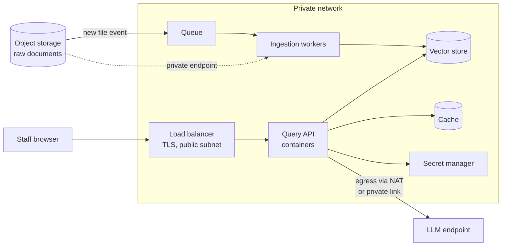

You now have an image, a Compose file and Kubernetes manifests. The next question is where they run. Every major cloud offers half a dozen ways to run a container, several ways to store vectors, and more than one route to a large language model, and the choices interact: the compute option decides how cold starts behave, the region decides which models you can call and where your documents live, and the network layout decides both your security posture and part of your bill.

This lesson is vendor-neutral. It gives you a framework for deploying a RAG system to any cloud: the spectrum of compute models from virtual machines to serverless, how to split a RAG system into components with different hosting needs, the network and identity layout that keeps documents private, region and availability choices, and a cost model that shows where the money actually goes. The next three lessons map the framework onto [AWS](/learn/deployment/aws), [Azure](/learn/deployment/azure) and [Google Cloud](/learn/deployment/google-cloud); vector stores get their own lesson in [Managed vector databases](/learn/deployment/managed-vector-databases).

## Learning objectives

- Compare virtual machines, managed Kubernetes, serverless containers and functions by what you manage, how they scale and how they fit each RAG component.
- Decompose a RAG system into deployable components and choose a hosting pattern for each.
- Design a network and identity layout that keeps the vector store and documents private and uses no long-lived credentials.
- Build a monthly cost model for a RAG service and identify which term dominates.
- Compute the query volume at which always-on compute becomes cheaper than pay-per-use.

## Prerequisites

- [Docker](/learn/deployment/docker): the image every option below runs.
- [Kubernetes fundamentals](/learn/deployment/kubernetes-fundamentals): Deployments, probes and autoscaling, which managed services reuse.
- [End-to-end RAG lifecycle](/learn/rag-architecture-fundamentals/end-to-end-rag-lifecycle): the components being deployed.

## Why this matters

Cloud choices are cheap to make and expensive to undo. Typical regrets in RAG projects:

- **Over-engineering.** A team runs a 400-person internal assistant on a self-managed Kubernetes cluster and spends more engineering time upgrading the cluster than improving retrieval.
- **Under-engineering.** A function-as-a-service deployment hits the platform's request timeout on long streamed answers, or reloads the embedding model on every cold start.
- **Data in the wrong place.** HR documents are embedded and stored in a region the company's data-protection commitments do not allow, or are sent to a model endpoint outside it.
- **A public vector database.** The vector store gets a public endpoint "temporarily" during development, and its contents (chunks of internal documents) are one leaked key away from anyone on the internet.
- **Surprise bills.** The team optimises compute that is a tenth of the bill while context size, which multiplies every LLM call, goes unexamined.

A deliberate deployment design avoids all five, and it is mostly the same design on every provider.

## The intuition

Think of the ways to feed a team at an office. You could build and staff your own kitchen: total control, but you maintain the ovens and pay the chef whether or not anyone is hungry. You could rent a fully equipped kitchen and bring your own cooks: someone else fixes the ovens. Or you could order from a caterer per meal: no kitchen at all, you pay only when people eat, but the food arrives when the caterer can make it and you cannot change the recipe.

Cloud compute is the same spectrum. **Virtual machines** are your own kitchen. **Managed Kubernetes** and **serverless containers** are increasingly well-equipped rented kitchens. **Functions** and fully managed AI services are the caterer. Moving along the spectrum trades control for less operational work and for paying per use instead of per hour. No position is right in general; each RAG component sits best at a different point.

## How it works

### The compute spectrum

| | Virtual machines | Managed Kubernetes | Serverless containers | Functions |
| --- | --- | --- | --- | --- |
| You manage | OS, runtime, scaling, patching | Workloads and node pools; provider runs the control plane | The container image and settings | Code and settings |
| Unit you deploy | A machine image or a container on it | Manifests | A container image | A function package or image |
| Scales to zero | No | Not by default | Usually yes | Yes |
| Billing | Per instance-hour | Nodes per hour, often plus a cluster fee | Per use (CPU and memory time while handling requests) | Per invocation and duration |
| Long-lived, streamed requests | Yes | Yes | Usually, within a request timeout | Limited by a maximum duration |
| GPUs | Yes | Yes, through GPU node pools | Offered by some providers | Rarely |
| Operational effort | High | Medium to high | Low | Lowest |

The industry terms for these layers, **infrastructure as a service** (IaaS), **platform as a service** (PaaS) and **functions as a service** (FaaS), come from the NIST definition of cloud computing and from common usage; the boundaries blur, so judge services by the rows above rather than by labels. The exact limits (maximum request duration, memory sizes, GPU availability) change often and differ between providers: read the current quotas page before relying on one.

Two properties decide most RAG choices:

1. **Cold starts.** A scale-to-zero platform must start a new instance when a request arrives and none is warm. For a RAG API that start includes pulling the image and loading the embedding model and reranker, which can take tens of seconds. Most serverless container platforms let you keep a minimum number of warm instances, which removes the problem at the price of paying for idle time.
2. **Request shape.** RAG answers are often streamed and can take many seconds. The platform must allow responses that long, must support streaming through its load balancer, and should allow many concurrent requests per instance, because an instance waiting on the LLM is mostly idle.

### Decomposing a RAG system

A RAG system is not one workload. Each component has a different shape, and they should not all be forced onto the same platform:

| Component | Shape | Usual hosting pattern |
| --- | --- | --- |
| Query API | Stateless, latency-sensitive, bursty | Serverless containers or a Kubernetes Deployment |
| Ingestion and re-indexing | Batch, CPU or GPU heavy, retriable | Queue plus workers, or batch jobs |
| Raw documents | Durable files, versioned | Object storage |
| Vector store | Stateful, memory-heavy, must be private | Managed vector service, or a self-run cluster on Kubernetes or VMs |
| Metadata and permissions | Relational, transactional | Managed relational database |
| Embedding model | CPU-friendly for small models | In-process in the API and workers, or a separate model service |
| LLM | External API, or GPU-hosted open-weight model | Provider API, a cloud platform's model service, or self-hosted on GPUs |
| Cache | Ephemeral key-value | Managed in-memory store |
| Secrets | Small, sensitive | The cloud's secret manager |
| Logs, metrics, traces | Append-only, high volume | Managed observability stack |

Two components deserve more thought because they dominate cost and risk.

**The LLM.** There are three routes. You can call the model vendor's own API, which is the simplest and gets new models first. You can call the same family of models through a cloud provider's model platform (Anthropic's Claude models, for example, are also offered through major clouds' AI platforms), which can mean consolidated billing, the cloud's identity and private-networking controls, and in-region processing; check which models and regions each route offers, because they differ and change. Or you can self-host an open-weight model on GPUs, which gives full control over data and model version but makes you responsible for capacity planning, GPU availability and serving software. For most teams, starting with an API and reconsidering only when volume, latency or data-control requirements demand it is the established pattern.

**The vector store.** It holds chunks of every indexed document, so it is as sensitive as the documents themselves, and it is the one stateful, memory-hungry piece of the query path. Whether to use a managed service or run it yourself is a trade-off of control, cost and operational effort that [Managed vector databases](/learn/deployment/managed-vector-databases) works through.

### A reference architecture



The shape is the same on every cloud: the only public entry point is the load balancer; compute and data live in private subnets; object-storage events feed a queue that drives ingestion; and the API's only outbound dependency is the LLM endpoint.

### Network layout

A **virtual private cloud** (VPC; Azure calls it a virtual network) is a private, isolated network inside the provider. It is divided into **subnets**, each in one availability zone:

- **Public subnets** hold only what must be reachable from the internet: the load balancer and, usually, the NAT gateway.
- **Private subnets** hold the API, workers and data stores. They have no public addresses and cannot be reached from the internet.
- A **NAT gateway** lets private resources make outbound connections (for example to an LLM API on the public internet) without accepting inbound ones. NAT gateways usually charge per hour and per gigabyte processed.
- **Private endpoints** (named differently on each provider) let private resources reach managed services such as object storage, the secret manager, or a cloud model platform over the provider's network instead of the internet. They improve security and can avoid NAT data-processing charges.

**Security groups** or **firewall rules** then restrict traffic between components: only the API and the workers may reach the vector store's port; only the load balancer may reach the API.

### Identity without keys

The safest credential is one that never exists as a string. Every major cloud lets a workload assume an **identity** (an IAM role, a managed identity or a service account) granted to the compute resource itself; the platform supplies short-lived credentials automatically, and the SDKs pick them up. With workload identity, the API can read its secrets, the workers can read the document bucket, and nothing in the image, environment or repository holds a long-lived cloud key. The only external secret left is the LLM provider's API key, if you call it directly, which lives in the secret manager and is read at start-up. Each role gets only the permissions it needs: the query API needs to read the vector store, not delete collections; the ingestion workers need to write, not to read user conversations.

### Regions, zones and data residency

A **region** is a geographic location (for example, a London or Frankfurt region); an **availability zone** is one of several isolated data-centre groups within a region. Three considerations decide placement:

1. **Data residency.** Where may the documents, embeddings, logs and prompts be stored and processed? Meridian's HR handbook contains personal-data policies, and the company may commit to keeping such data in the UK or EU. That constraint applies to every component that sees document text: object storage, vector store, logs, and the LLM endpoint, whose processing location you must confirm with the provider.
2. **Latency.** Users should be near the API, and the API near the vector store; the LLM call usually dominates end-to-end time anyway, so a few milliseconds of network distance rarely matter, but a cross-continent hop on every vector search does.
3. **Availability.** Spread API instances across at least two zones, and run the vector store with replicas in different zones. Multi-region deployment is a further step, covered in [Disaster recovery](/learn/production-architecture/disaster-recovery).

### Environments

Run at least development, staging and production as separate environments, ideally in separate cloud accounts or projects, so that a mistake in development cannot touch production data. Each environment gets its own vector store and its own index: never point a staging API at the production index. Describe all of it as code (Terraform, Pulumi or the provider's own tool) so environments are reproducible; [Infrastructure configuration](/learn/deployment/infrastructure-configuration) covers how.

## The mathematics

### Cost per query

**Intuition.** Each query costs a little compute, a share of the always-on infrastructure, and the LLM tokens it consumes. Writing it as one formula shows which term to optimise.

$$
c_{\text{query}} = \frac{T_{\text{in}} \, p_{\text{in}} + T_{\text{out}} \, p_{\text{out}}}{10^6} + \frac{C_{\text{fixed}}}{N} + c_{\text{var}}
$$

Here $T_{\text{in}}$ and $T_{\text{out}}$ are input and output tokens per query; $p_{\text{in}}$ and $p_{\text{out}}$ are LLM prices per million tokens; $C_{\text{fixed}}$ is the monthly cost of always-on resources (instances, vector store, cluster fees); $N$ is queries per month; and $c_{\text{var}}$ is any per-query compute charge from a pay-per-use platform.

**By hand.** Assume 3,000 input tokens (instructions, question and five retrieved chunks), 300 output tokens, and placeholder prices of 3 and 15 USD per million tokens:

- LLM term: $(3000 \times 3 + 300 \times 15)/10^6 = 13{,}500/10^6 = 0.0135$ USD, that is 13.50 USD per 1,000 queries.
- With 66,000 queries a month and 266 USD of fixed cost (two VMs at 146 USD and a vector store at 120 USD): $266/66{,}000 \approx 0.0040$ USD.

The LLM term is more than three times the fixed term. Halving the retrieved context saves more than eliminating all compute.

### Break-even between always-on and pay-per-use

**Intuition.** Pay-per-use costs a little per query; always-on costs the same every month regardless. Below some volume, pay-per-use is cheaper; above it, always-on wins.

$$
N^{*} = \frac{C_{\text{always-on}}}{c_{\text{var}}}
$$

$C_{\text{always-on}}$ is the monthly cost of the always-on option and $c_{\text{var}}$ the pay-per-use compute cost per query. With 146 USD a month for two VMs and a serverless compute cost of about 0.0000584 USD per query (from the model below), $N^{*} = 146 / 0.0000584 \approx 2.5$ million queries a month. AskMeridian's 66,000 is far below that. The break-even is only indicative: at high volume, instances pack requests more efficiently, and the always-on fleet would need to grow too.

## In code

The task: compare the monthly cost of running AskMeridian's API in four ways, with the LLM and vector store included so the comparison shows each term's real share. The script uses only the standard library. Every price is a **placeholder assumption**, chosen to be roughly the right order of magnitude; replace each with your provider's current published price before relying on any conclusion.

```python
"""Monthly cost model for AskMeridian under three ways of running its API.

Every price below is a placeholder assumption, not a quote. Replace each one with
your provider's current published price before using the result for a decision.
"""
from dataclasses import dataclass

HOURS_PER_MONTH = 730


@dataclass
class Workload:
    queries_per_month: int = 66_000      # assumed: 3,000 per working day x 22 days
    seconds_per_query: float = 4.0       # wall time, mostly waiting for the LLM
    input_tokens: int = 3_000            # question + retrieved context + instructions
    output_tokens: int = 300


@dataclass
class Prices:                             # ALL ASSUMED, in USD
    llm_input_per_mtok: float = 3.00
    llm_output_per_mtok: float = 15.00
    vm_per_hour: float = 0.10             # a 2 vCPU / 4 GiB instance, on demand
    k8s_control_plane_per_hour: float = 0.10
    serverless_vcpu_second: float = 0.000024
    serverless_gib_second: float = 0.0000025
    serverless_per_million_requests: float = 0.40
    vector_db_per_month: float = 120.0    # a small managed cluster or a self-run VM pair


def llm_cost(w: Workload, p: Prices) -> float:
    per_query = (w.input_tokens * p.llm_input_per_mtok + w.output_tokens * p.llm_output_per_mtok) / 1e6
    return per_query * w.queries_per_month


def vms(w: Workload, p: Prices, instances: int = 2) -> float:
    return instances * p.vm_per_hour * HOURS_PER_MONTH


def managed_k8s(w: Workload, p: Prices, nodes: int = 3) -> float:
    return p.k8s_control_plane_per_hour * HOURS_PER_MONTH + nodes * p.vm_per_hour * HOURS_PER_MONTH


def serverless(w: Workload, p: Prices, vcpu=1, gib=2, concurrency=2, min_instances=0) -> float:
    rate = vcpu * p.serverless_vcpu_second + gib * p.serverless_gib_second   # per instance-second
    busy_seconds = w.queries_per_month * w.seconds_per_query / concurrency
    idle_seconds = max(0.0, min_instances * HOURS_PER_MONTH * 3600 - busy_seconds)
    requests = w.queries_per_month / 1e6 * p.serverless_per_million_requests
    return (busy_seconds + idle_seconds) * rate + requests


w, p = Workload(), Prices()
llm, vdb = llm_cost(w, p), p.vector_db_per_month
options = {
    "2 VMs, always on": vms(w, p),
    "managed Kubernetes, 3 nodes": managed_k8s(w, p),
    "serverless, scale to zero": serverless(w, p),
    "serverless, 1 warm instance": serverless(w, p, min_instances=1),
}
print(f"LLM tokens: {llm:8.2f} USD/month  ({llm / w.queries_per_month * 1000:.2f} per 1,000 queries)")
print(f"Vector DB:  {vdb:8.2f} USD/month\n")
print(f"{'API compute option':30} {'compute':>9} {'total':>9} {'per 1k q':>9} {'compute share':>14}")
for name, compute in options.items():
    total = compute + llm + vdb
    print(f"{name:30} {compute:9.2f} {total:9.2f} {total / w.queries_per_month * 1000:9.2f} {compute / total:14.1%}")

# Break-even: at what monthly volume does always-on beat scale-to-zero for the API?
per_query_serverless = serverless(Workload(queries_per_month=1_000_000), p) / 1_000_000
print(f"\nServerless compute per query: {per_query_serverless * 1000:.4f} USD per 1,000 queries")
print(f"Break-even with 2 always-on VMs: {vms(w, p) / per_query_serverless:,.0f} queries/month")
```

```output
LLM tokens:   891.00 USD/month  (13.50 per 1,000 queries)
Vector DB:    120.00 USD/month

API compute option               compute     total  per 1k q  compute share
2 VMs, always on                  146.00   1157.00     17.53          12.6%
managed Kubernetes, 3 nodes       292.00   1303.00     19.74          22.4%
serverless, scale to zero           3.85   1014.85     15.38           0.4%
serverless, 1 warm instance        76.24   1087.24     16.47           7.0%

Serverless compute per query: 0.0584 USD per 1,000 queries
Break-even with 2 always-on VMs: 2,500,000 queries/month
```

The important lines:

- **`Workload`** separates what the system does from what it costs. `seconds_per_query` is wall time, because pay-per-use platforms bill instance time while a request is open, including time spent waiting for the LLM.
- **`concurrency=2`** in `serverless` says that, on average, two requests share an instance's billed time. An async API waiting on the LLM can handle many concurrent requests per instance, so this is conservative; at low traffic, requests rarely overlap and the effective figure approaches 1.
- **`min_instances`** models the warm instance that removes cold starts: its idle time is billed whether or not anyone asks a question.

What the output means. Under these assumptions the LLM accounts for 891 of roughly 1,000 to 1,300 USD a month whichever compute option is chosen. The spread between the cheapest and most expensive compute option, about 290 USD, is smaller than what trimming the retrieved context by a third would save. Scale-to-zero is cheapest in raw terms but brings cold starts with a model to load; one warm instance costs about 76 USD a month and removes them, which is the option most internal assistants of this size end up choosing. Managed Kubernetes is the most expensive here and buys capabilities (many services, fine-grained scheduling, GPUs) that a single API does not need, although it becomes reasonable when a team already runs a cluster for other services.

**Errors people commonly hit.** Forgetting that a serverless platform may bill for the whole time a streamed response is open; forgetting NAT and data-transfer charges, which this model omits; and comparing on-demand VM prices with discounted serverless prices or vice versa. Check whether each price in your model is on-demand, committed-use or free-tier.

**Extending it.** Add NAT gateway hours and per-gigabyte charges; add a GPU option for self-hosting an open-weight LLM and compute its break-even against token prices; add an embedding term for ingestion, using the corpus size and re-indexing frequency from [Reindexing](/learn/ci-cd-and-mlops/reindexing).

## A real-world example

When AskMeridian moved from a pilot on one virtual machine to a supported service, the Platform team's first proposal was a managed Kubernetes cluster, because the team knew Kubernetes. Running the cost model above with their own price sheet changed the conversation: the cluster's fixed cost would be several times the API's actual compute need, and the extra capabilities served no requirement they had. Meanwhile the LLM term dominated, and their prompt included eight retrieved chunks where evaluation showed five performed as well.

The final design put the API on a serverless container platform with one minimum instance in each of two zones, so neither a cold start nor a single zone failure would be visible to staff. Ingestion ran as a queue-driven job triggered by new files in the document bucket. The Qdrant cluster stayed private, in the same region, reachable only from the API and ingestion subnets. Because the HR team required that handbook content stay in the UK, the team chose a UK region and confirmed in writing where the LLM endpoint processed requests before going live. Every workload used a cloud identity; the only stored secret was the LLM key, in the secret manager. Cutting the context from eight chunks to five reduced the LLM term by roughly a third, which saved more than the whole compute bill.

## Common mistakes

- **Choosing the platform before understanding the workload.** Teams pick what they know rather than what fits each component's shape.
- **Scale-to-zero for a service that loads models.** The first user after an idle period waits for an image pull and model load.
- **Ignoring request-duration and streaming limits.** Long streamed answers are cut off by a platform timeout or a load balancer that buffers responses.
- **A public endpoint on the vector store.** Document chunks become reachable from the internet, protected only by a key.
- **Long-lived cloud keys in environment variables.** A leaked key grants access until someone notices and rotates it.
- **Picking a region without checking data-residency requirements for every component**, including logs and the LLM endpoint.
- **Optimising compute while ignoring tokens.** The largest term in a RAG bill is usually the LLM, multiplied by context size.
- **Sharing one index between staging and production.** A staging ingestion bug corrupts what users see.

## Best practices

- Decompose the system and host each component on the platform that fits its shape.
- Prefer managed services for undifferentiated work (databases, queues, secrets, observability) unless a requirement rules them out.
- Keep only the load balancer public; put compute and data in private subnets; use private endpoints for managed services.
- Use workload identity everywhere, with least-privilege roles per component.
- Spread the API and the vector store across at least two availability zones.
- Confirm data residency for storage, logs and model processing before indexing real documents.
- Build a cost model with explicit, labelled assumptions, and revisit it with real usage data after launch.
- Separate environments into separate accounts or projects, defined as code.

## Performance considerations

**Latency budget.** Reason about where time goes before choosing infrastructure. A typical AskMeridian request might spend tens of milliseconds embedding the query, tens more on vector search and reranking, and several seconds generating the answer (assumed figures; measure your own with [tracing](/learn/rag-observability/tracing)). Moving the API to a faster platform cannot improve the dominant term; streaming the answer improves perceived latency far more.

**Cold starts.** A cold start costs image pull plus process start plus model load. Using the [Docker](/learn/deployment/docker) arithmetic, a 1.5 GB image at an assumed 100 MB/s is about 15 seconds before the model even begins loading. Keep minimum instances warm for user-facing services; accept cold starts only for background work.

**Concurrency per instance.** An async API that spends most of each request waiting on the LLM can serve many requests per instance. On per-use platforms, raising the allowed concurrency per instance reduces both cost and cold starts, until CPU-bound work (embedding, reranking) saturates the instance. Measure that point with a load test and set the concurrency just below it.

**Network distance.** Keep the API, vector store and cache in the same region; cross-region round trips add latency to every search and incur data-transfer charges.

## Security considerations

- **Private by default.** Vector stores, caches and databases get no public endpoints. Access is by network path (private subnet, security group) *and* by identity.
- **No static cloud credentials.** Use workload identity; store the few unavoidable secrets in the secret manager, with access logged.
- **Encryption.** Enable encryption at rest for storage, databases and the vector store (usually on by default with provider-managed keys; customer-managed keys where policy requires), and TLS in transit, including inside the private network for sensitive data.
- **Egress control.** Restrict outbound traffic from the API to the endpoints it needs (the LLM provider, the vector store). If a prompt-injection attack ever tricks the system into fetching a URL, an egress allow-list limits where data can go; [Security](/learn/rag-security-fundamentals) covers the attacks.
- **Audit.** Turn on the provider's audit log for management actions and, where available, data-access logging for the document bucket and secret manager.

## Summary

- Cloud compute is a spectrum from virtual machines to functions, trading control for less operational work and pay-per-use billing; cold starts and request shape decide most RAG choices.
- A RAG system is several components with different shapes: stateless API, batch ingestion, stateful vector store, external LLM. Host each on what fits it.
- Keep only the load balancer public, use private subnets and private endpoints, and give every workload a least-privilege cloud identity instead of keys.
- Data residency applies to every component that sees document text, including logs and the LLM endpoint.
- In a typical RAG cost model the LLM term, driven by context size, dominates; compute choices matter less than they appear.

## Exercises

1. AskMeridian's API runs on a scale-to-zero platform. Staff complain that the first question each morning takes over 30 seconds. Explain the cause and give two fixes with their costs.

<details><summary>Show solution</summary>

Overnight the platform scaled to zero. The first request triggers a cold start: image pull, process start and loading the embedding model and reranker. Fix one: keep one minimum instance warm (about 76 USD a month in the model above), which removes the delay at the cost of paying for idle time. Fix two: make cold starts faster with a smaller image (CPU-only PyTorch, no build tools) and a smaller or quantised model, which costs engineering time but no ongoing money. A scheduled "warm-up" request before 08:00 is a cheaper but more fragile third option.

</details>

2. Using the formula for cost per query, compute the monthly LLM saving if AskMeridian cuts retrieved context from 3,000 to 2,000 input tokens at 66,000 queries a month, with the placeholder price of 3 USD per million input tokens.

<details><summary>Show solution</summary>

Saving per query: $1000 \times 3 / 10^6 = 0.003$ USD. Per month: $0.003 \times 66{,}000 = 198$ USD. That is more than the entire compute cost of the always-on VM option (146 USD) in the model. Check with an evaluation set that answer quality does not drop before taking the saving.

</details>

3. Extend the cost model with a self-hosted LLM option: a GPU instance at an assumed 1.20 USD per hour, run as two instances for availability. At what monthly query volume does it break even with the API token cost, and what does the comparison leave out?

<details><summary>Show solution</summary>

```python
gpu_monthly = 2 * 1.20 * HOURS_PER_MONTH            # 1,752 USD
llm_per_query = llm_cost(w, p) / w.queries_per_month  # 0.0135 USD
print(f"{gpu_monthly / llm_per_query:,.0f} queries/month")
```

This prints `129,778 queries/month`: about twice AskMeridian's volume. But the comparison leaves out a great deal: whether two GPUs can serve the peak load at acceptable latency, the quality difference between the models, engineering time to run the serving stack, GPU availability in the region, and upgrades. A break-even on raw cost alone is a starting point, not a decision.

</details>

4. Draw (as a list of components and connections) a deployment for AskMeridian that satisfies: UK-only data residency, no public endpoint except the load balancer, no stored cloud credentials, and survival of a single availability-zone failure.

<details><summary>Show solution</summary>

One UK region with two availability zones. Public subnets: a load balancer terminating TLS. Private subnets in both zones: API instances (at least one per zone), ingestion workers, a Qdrant cluster with replicas in both zones, and a managed cache. Object storage in the same region for raw documents, reached through a private endpoint; bucket events go to a queue that triggers ingestion. The API reaches the LLM through a private endpoint to an in-region model service, or through NAT to a provider whose processing location is confirmed as UK or acceptable under policy. Workloads use cloud identities: the API may read secrets and query Qdrant; workers may read the bucket and write to Qdrant. Logs go to a UK-region log store with retention set by policy.

</details>

## Check your understanding

```quiz
[
  {
    "q": "Which property of serverless containers matters most for a RAG API that loads a reranker at start-up?",
    "options": [
      "Billing per vCPU-second",
      "Support for custom domains",
      "Cold starts after scaling to zero, which include loading the model",
      "Automatic TLS certificates"
    ],
    "answer": 2,
    "why": "When no instance is warm, the first request waits for an image pull and model load. Minimum instances or smaller images address it."
  },
  {
    "q": "In the cost model, which change would most reduce AskMeridian's monthly bill?",
    "options": [
      "Reducing the number of input tokens per query",
      "Switching from two VMs to managed Kubernetes",
      "Moving from one warm instance to scale-to-zero",
      "Halving the vector store's memory"
    ],
    "answer": 0,
    "why": "The LLM term dominates, and input tokens are most of it. Fewer, better chunks save more than any compute change."
  },
  {
    "q": "What is the purpose of a NAT gateway in the reference architecture?",
    "options": [
      "It load-balances incoming user traffic.",
      "It lets resources in private subnets make outbound connections without being reachable from the internet.",
      "It encrypts data at rest.",
      "It stores secrets for the API."
    ],
    "answer": 1,
    "why": "NAT provides outbound-only internet access for private resources, such as calls to an LLM API."
  },
  {
    "q": "Always-on compute costs 146 USD a month; pay-per-use compute costs 0.0002 USD per query. Above what volume is always-on cheaper?",
    "options": [
      "7,300 queries a month",
      "73,000 queries a month",
      "1.46 million queries a month",
      "730,000 queries a month"
    ],
    "answer": 3,
    "why": "Break-even is 146 / 0.0002 = 730,000 queries a month."
  },
  {
    "q": "Why should the API use a workload identity rather than a cloud access key in an environment variable?",
    "options": [
      "Workload identities make requests faster.",
      "The platform issues short-lived credentials automatically, so there is no long-lived secret to leak or rotate.",
      "Environment variables cannot hold keys longer than 64 characters.",
      "Access keys do not work with private subnets."
    ],
    "answer": 1,
    "why": "Workload identity removes the static credential entirely; the SDK obtains temporary credentials from the platform."
  }
]
```

## Further reading

- Mell and Grance (2011), *The NIST Definition of Cloud Computing*, NIST Special Publication 800-145: the source of the IaaS, PaaS and SaaS service models.
- [AWS Well-Architected Framework](https://aws.amazon.com/architecture/well-architected/): reliability, security and cost pillars that apply on any cloud.
- [Google Cloud Architecture Framework](https://cloud.google.com/architecture/framework): Google's equivalent guidance.
- [Azure Well-Architected Framework](https://learn.microsoft.com/azure/well-architected/): Microsoft's equivalent guidance.
- [The Twelve-Factor App](https://12factor.net/): the configuration and process model that makes a service portable between platforms.
