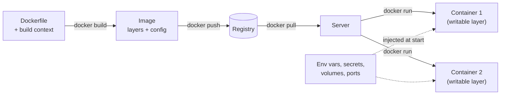

A RAG service that runs on your laptop has quietly collected a long list of things it depends on: a particular Python version, a few dozen packages with native code inside them, a PyTorch build, an embedding model's weights in a cache directory you have never looked at, and environment variables you set months ago. Move it to a server and any one of those can be different. **Docker** solves this by packaging the program together with everything it needs into a single artefact, an **image**, that runs the same way wherever a container runtime is installed.

This lesson explains what images and containers are, how a Dockerfile becomes layers, how the build cache decides what to rebuild, and the choices specific to RAG services: CPU-only PyTorch, where model weights live, and how many copies of a model a container holds. You will write a production-grade, multi-stage Dockerfile for the AskMeridian retrieval API. Running several containers together is the subject of [Docker Compose](/learn/deployment/docker-compose).

## Learning objectives

- Explain the difference between an image, a layer and a container, and what isolation a container does and does not provide.
- Predict which Dockerfile instructions will be rebuilt after a given change, and order instructions so that code edits do not reinstall dependencies.
- Write a multi-stage Dockerfile for a Python RAG service that runs as a non-root user, handles shutdown signals correctly and contains no secrets.
- Choose where embedding-model weights live (baked into the image, downloaded at start-up, or mounted) and justify the choice.
- Estimate an image's pull time and a container's memory footprint from first principles.

## Prerequisites

- [Virtual environments](/learn/python-for-rag-engineering/virtual-environments): isolating Python dependencies, which a container extends to the whole operating system.
- [FastAPI](/learn/backend-engineering/fastapi): the web framework the example service uses.
- [Embedding models](/learn/embedding-models): what the model files are and why they are large.

## Why this matters

The classic failure is "it works on my machine". For RAG systems it has some particularly nasty forms:

- **Native libraries.** FAISS, PyMuPDF, tokenizers and PyTorch ship compiled code. The macOS wheel is not the Linux one, and a missing system library shows up as an `ImportError` at start-up or a crash on the first request that needs it.
- **Silent model drift.** If each server downloads "the latest" embedding model when it starts, two servers started a week apart can embed queries differently. Query vectors then no longer live in the same space as the indexed document vectors, and retrieval quality drops with no error anywhere.
- **Enormous artefacts.** The default PyTorch wheel for Linux on x86-64 pulls in NVIDIA CUDA libraries. A service that only runs a small embedding model on CPU can end up with an image several gigabytes larger than it needs, which slows every deployment and every scale-up.

A container image fixes the operating-system user space, the interpreter, every package, the model files and the start command into one versioned object. Configuration and secrets are deliberately *not* in it; they are injected when the container starts. Getting that boundary right is most of the craft.

## The intuition

Think of how furniture is shipped. You could send a carpenter to each customer's house with a list of materials to buy locally; every house would end up with a slightly different table, depending on what the local shop had. Or you could build the table once in the factory, test it, and ship the finished piece in a standard box that fits every lorry.

A Dockerfile is the factory's build instructions. The image is the finished table in its box: identical every time you ship it. A container is that table in use in one particular house. The house supplies the electricity (CPU and memory), the address (network) and the household's own settings (environment variables), but the table is the same in every house.

The factory also keeps the table at each stage of assembly. Change only the varnish and it does not rebuild the legs; it resumes from the stage before varnishing. Those saved stages are **layers**, and the reuse is the **build cache**.

## How it works

### Images, layers and containers

An **image** is two things: an ordered stack of filesystem **layers**, and a small JSON configuration that says how to run it (the command, environment variables, the user to run as, the working directory, exposed ports). Each layer is an archive of the files added, changed or deleted relative to the layer below. Layers and images are **content-addressed**: each is identified by a SHA-256 digest of its contents, so two images that share a base layer store it once, and a digest always refers to exactly the same bytes. This format is standardised as the Open Container Initiative (OCI) image specification, which is why images built by Docker also run on other runtimes.

A **container** is a running process started from an image. The runtime stacks the image's read-only layers into one view of a filesystem, adds a thin writable layer on top for anything the process writes, and starts the configured command. Delete the container and the writable layer goes with it, which is why anything that must survive (an index, uploaded documents) belongs in a volume or an external service, not in the container's filesystem.

A container is **not a virtual machine**. On Linux it is an ordinary process that the kernel isolates with two mechanisms:

- **Namespaces** give the process its own view of process IDs, network interfaces, mount points and hostname, so it sees only its own processes and its own filesystem.
- **Control groups (cgroups)** cap the CPU and memory it may use. When a container exceeds its memory limit, the kernel's out-of-memory killer ends it.

All containers on a host share its kernel. They start in milliseconds and cost little beyond the process itself, but isolation is weaker than a virtual machine's: a kernel vulnerability can affect every container on the host. (On macOS and Windows, Docker Desktop runs a small Linux virtual machine and the containers run inside it.)



### From Dockerfile to layers

A **Dockerfile** is a list of instructions executed top to bottom. The ones that matter most:

| Instruction | What it does | Creates a filesystem layer? |
| --- | --- | --- |
| `FROM image AS name` | Starts a build stage from a base image | Uses the base's layers |
| `RUN command` | Runs a command in a temporary container and saves the changed files | Yes |
| `COPY src dest` | Copies files from the build context (or another stage) | Yes |
| `WORKDIR`, `ENV`, `USER`, `EXPOSE`, `CMD` | Record configuration | No, metadata only |

The **build context** is the directory you pass to `docker build` (usually `.`); `COPY` can only see files inside it. A `.dockerignore` file excludes paths from the context, which keeps builds fast and stops `.git`, local virtual environments and `.env` files from reaching an image.

Since Docker Engine 23.0 the default builder is **BuildKit**, which runs independent stages in parallel and supports cache mounts (a package cache that persists between builds but never enters the image) and secret mounts (a file visible to one `RUN` step, never written to a layer).

### The build cache

Rebuilding everything on every change would make a RAG image, with its gigabyte of dependencies, take minutes to rebuild after a one-line code edit. The build cache avoids that. For each instruction, the builder asks: "have I already run exactly this instruction, on top of exactly this parent layer?"

1. For `RUN`, the cache key is the parent layer plus the text of the command. The builder does not look at what the command would do: `RUN pip install -r requirements.txt` is a cache hit if the text and parent match, even if the package index has since changed.
2. For `COPY` and `ADD`, the key also includes the contents of the files being copied. Change one byte in a copied file and the cache misses.
3. **Once an instruction misses, every instruction after it in that stage is rebuilt**, because each layer's parent has changed.

Rule 3 dictates the order of a Dockerfile: things that change rarely go first, things that change often go last. Copy `requirements.txt` alone and install dependencies, *then* copy the source code. If you copy the whole project first, every code edit invalidates the dependency layer and reinstalls PyTorch. Rule 1 explains a classic trap: `RUN apt-get update` on its own line is cached forever, so a later `RUN apt-get install` can fail against a stale package list; put both in one `RUN`.

### Multi-stage builds

Building a Python environment often needs tools you do not want at run time: compilers, headers, caches. A **multi-stage build** builds in one stage and runs from a second, clean one, copying across only the result with `COPY --from=builder`. The final image contains only the last stage's layers. For Python, a robust pattern is a virtual environment at a fixed path such as `/opt/venv`, copied into a runtime stage built from the *same* base image so the interpreter paths inside it stay valid.

### PID 1 and graceful shutdown

When an orchestrator stops a container (a deployment, a scale-down, a node being drained), it sends `SIGTERM` to the container's main process, waits a grace period (10 seconds by default for `docker stop`), then sends `SIGKILL`. A RAG API that receives `SIGTERM` should stop accepting new requests and let in-flight ones finish, which may include a streaming answer from the LLM that takes several seconds.

Two details decide whether that works:

- **Exec form versus shell form.** `CMD ["uvicorn", "app.main:app"]` (exec form, a JSON array) runs Uvicorn directly as process 1. `CMD uvicorn app.main:app` (shell form) runs it under `/bin/sh -c`, and the shell may become process 1 and not pass the signal on. Then nothing shuts down gracefully, the grace period expires, and every in-flight request is killed. Use exec form.
- **Process 1 is special.** The Linux kernel does not apply default signal actions to process 1, so a program that never installs a `SIGTERM` handler simply ignores it. Uvicorn installs one; a bare Python script may not. If your main process is not designed to be process 1, `docker run --init` (or the equivalent in your orchestrator) runs a tiny init process that forwards signals and reaps zombie child processes.

### Where the model weights live

A RAG retrieval service needs the embedding model (and perhaps a reranker) at start-up. There are three places the weights can come from, and the choice has real consequences:

| Option | How | Strengths | Weaknesses |
| --- | --- | --- | --- |
| Bake into the image | Download during `docker build` | Reproducible; no network at start-up; image digest pins the model | Larger image; new model means new image |
| Download at start-up | Model hub call in the app's start-up code | Small image | Slow, rate-limited cold starts; start-up depends on an external service; version can drift unless pinned to a revision |
| Mount at run time | Volume or object-storage sync into a path | Shared across many images; good for very large models | More moving parts; the path must exist before the app starts |

For small and medium embedding models (tens to hundreds of megabytes), baking is the usual choice, because the image digest then identifies the code *and* the model together. That matters for RAG: the query encoder must be the model that embedded the index, and a digest is an auditable record of which one is running. Setting `HF_HUB_OFFLINE=1` at run time makes the Hugging Face libraries fail loudly instead of silently downloading something different. Very large models, such as a self-hosted LLM, are usually mounted or synced from object storage instead.

### Tags, digests and architectures

A **tag** such as `askmeridian-api:1.4.2` is a movable label: anyone can push a different image under it. A **digest** (`askmeridian-api@sha256:…`) is immutable. Deploy by digest, or by tags you never reuse, so that "what is running" has one answer. Images are also built for one CPU architecture: an Apple Silicon laptop builds `linux/arm64` by default, most cloud servers are `linux/amd64`, and the mismatch fails with `exec format error`. Build with `docker buildx build --platform linux/amd64`, or build a multi-architecture image.

## In code

The task: package the AskMeridian retrieval API (a FastAPI service that embeds queries with `all-MiniLM-L6-v2` and searches a small index) into an image that is small, reproducible, safe to run, and shuts down cleanly. The project layout is:

```text
askmeridian-api/
├── .dockerignore
├── Dockerfile
├── requirements.txt
└── app/
    ├── __init__.py
    └── main.py
```

### The application

The service exposes two health endpoints in addition to its real one. `/healthz` answers "is the process alive?" and must never touch a dependency. `/readyz` answers "can this instance serve a real request?" and returns 503 until the model is loaded. Orchestrators use the two differently, as [Kubernetes fundamentals](/learn/deployment/kubernetes-fundamentals) explains; it is cheap to build them in from the start. All configuration comes from environment variables through `pydantic-settings`, so the same image runs in every environment.

```python
"""AskMeridian retrieval API: the process that goes inside the container."""
import logging
from contextlib import asynccontextmanager

import numpy as np
from fastapi import FastAPI, HTTPException
from pydantic_settings import BaseSettings
from sentence_transformers import SentenceTransformer


class Settings(BaseSettings):
    # Every value can be overridden by an environment variable of the same name.
    model_name: str = "sentence-transformers/all-MiniLM-L6-v2"
    device: str = "cpu"  # containers usually have no GPU; be explicit
    top_k: int = 2
    log_level: str = "INFO"


settings = Settings()
logging.basicConfig(level=settings.log_level, format="%(levelname)s %(name)s %(message)s")
for noisy in ("httpx", "httpx2", "huggingface_hub", "sentence_transformers"):
    logging.getLogger(noisy).setLevel(logging.ERROR)
log = logging.getLogger("askmeridian")

DOCS = [
    "Annual leave is 25 days; up to 5 unused days carry over and must be used by 31 March.",
    "Staff may work remotely up to 3 days a week; the home-office equipment budget is £400.",
    "Passwords must be rotated every 90 days and the VPN is required on public Wi-Fi.",
    "Error E-4021 means the VPN client is out of date; update it from the IT portal.",
]
state: dict = {}


@asynccontextmanager
async def lifespan(app: FastAPI):
    log.info("loading model %s", settings.model_name)
    model = SentenceTransformer(settings.model_name, device=settings.device)
    state["model"] = model
    state["doc_vecs"] = model.encode(DOCS, normalize_embeddings=True, show_progress_bar=False)
    log.info("ready: %d documents indexed", len(DOCS))
    yield
    log.info("shutting down")
    state.clear()


app = FastAPI(title="AskMeridian retrieval", lifespan=lifespan)


@app.get("/healthz")
def healthz():
    # Liveness: the process is up and serving HTTP. Never touch dependencies here.
    return {"status": "ok"}


@app.get("/readyz")
def readyz():
    # Readiness: can this instance answer a real request right now?
    if "model" not in state:
        raise HTTPException(status_code=503, detail="model not loaded")
    return {"status": "ready", "model": settings.model_name}


@app.get("/search")
def search(q: str):
    if "model" not in state:
        raise HTTPException(status_code=503, detail="model not loaded")
    q_vec = state["model"].encode([q], normalize_embeddings=True, show_progress_bar=False)[0]
    scores = state["doc_vecs"] @ q_vec
    best = np.argsort(-scores)[: settings.top_k]
    return {"query": q, "hits": [{"doc": DOCS[i], "score": round(float(scores[i]), 3)} for i in best]}
```

In production the documents would live in a [Qdrant](/learn/vector-database-ecosystem/qdrant) collection; keeping them in memory lets the service run anywhere. `lifespan` loads the model once per process before the first request; code after the `yield` runs on shutdown, where you would close database clients.

Before containerising anything, test the application itself. This smoke test uses FastAPI's `TestClient`, which runs the app in-process:

```python
from fastapi.testclient import TestClient

from app.main import app

# Without the context manager the lifespan never runs: the model is not loaded.
cold = TestClient(app)
print("cold readyz:", cold.get("/readyz").status_code)

with TestClient(app) as client:  # entering the block runs the lifespan startup
    print("healthz:", client.get("/healthz").json())
    print("readyz: ", client.get("/readyz").json())
    r = client.get("/search", params={"q": "how many days of holiday do I get?"})
    for hit in r.json()["hits"]:
        print(f"  {hit['score']:.3f}  {hit['doc'][:60]}")
```

Run it with the same environment the image will set (`PYTHONUNBUFFERED=1 HF_HUB_OFFLINE=1 python smoke_test.py`):

```output
cold readyz: 503
INFO askmeridian loading model sentence-transformers/all-MiniLM-L6-v2
INFO askmeridian ready: 4 documents indexed
healthz: {'status': 'ok'}
readyz:  {'status': 'ready', 'model': 'sentence-transformers/all-MiniLM-L6-v2'}
  0.435  Annual leave is 25 days; up to 5 unused days carry over and 
  0.289  Staff may work remotely up to 3 days a week; the home-office
INFO askmeridian shutting down
```

The first line is the readiness gate working: before start-up has run, the instance reports that it cannot serve. The search finds the annual-leave document for a query that says "holiday", and the last line is the shutdown half of the lifespan, which a `SIGTERM` triggers in the container. `HF_HUB_OFFLINE=1` proved the model came from the local cache, the guarantee the image will enforce.

### The dependencies

```text
# requirements.txt: pin exact versions you have tested
fastapi==0.162.7
uvicorn==0.54.0
sentence-transformers==6.3.0
pydantic-settings==2.16.3
numpy==2.5.4
```

These are the versions the application code above was run against. PyTorch is deliberately *not* listed: it is installed separately from the CPU-only index so that pip does not choose the much larger CUDA build. For full reproducibility, generate a lock file with hashes (for example with `pip-compile --generate-hashes` or `uv pip compile`) so that every transitive dependency is pinned too.

### The Dockerfile

The image build was not executed for this lesson; the Dockerfile is written against Docker's documented Dockerfile syntax and BuildKit features.

```dockerfile
# syntax=docker/dockerfile:1

# ---------- Stage 1: build the virtual environment and fetch the model ----------
FROM python:3.13-slim AS builder

ENV PIP_DISABLE_PIP_VERSION_CHECK=1
RUN python -m venv /opt/venv
ENV PATH="/opt/venv/bin:$PATH"

# CPU-only PyTorch first: the default Linux wheel would pull in CUDA libraries.
RUN --mount=type=cache,target=/root/.cache/pip \
    pip install torch --index-url https://download.pytorch.org/whl/cpu

# Dependencies change rarely, so they come before the source code.
COPY requirements.txt .
RUN --mount=type=cache,target=/root/.cache/pip \
    pip install -r requirements.txt

# Bake the embedding model into the image at a known path.
ENV HF_HOME=/opt/hf
RUN python -c "from sentence_transformers import SentenceTransformer; \
SentenceTransformer('sentence-transformers/all-MiniLM-L6-v2')"

# ---------- Stage 2: the runtime image ----------
FROM python:3.13-slim AS runtime

ENV PYTHONDONTWRITEBYTECODE=1 \
    PYTHONUNBUFFERED=1 \
    PATH="/opt/venv/bin:$PATH" \
    HF_HOME=/opt/hf \
    HF_HUB_OFFLINE=1

RUN useradd --create-home --uid 10001 app
COPY --from=builder /opt/venv /opt/venv
COPY --from=builder /opt/hf /opt/hf

WORKDIR /srv
COPY app/ ./app/

USER app
EXPOSE 8000
HEALTHCHECK --interval=30s --timeout=3s --start-period=60s --retries=3 \
  CMD ["python", "-c", "import urllib.request; urllib.request.urlopen('http://127.0.0.1:8000/healthz', timeout=2)"]
CMD ["uvicorn", "app.main:app", "--host", "0.0.0.0", "--port", "8000"]
```

And the `.dockerignore`, which matters as much as the Dockerfile:

```text
.git
.venv
__pycache__/
*.pyc
.env
*.env
data/
notebooks/
tests/
```

The important lines:

- **`--mount=type=cache,target=/root/.cache/pip`** keeps pip's download cache between builds on the same builder, so a dependency change re-downloads only what changed. The cache never becomes part of a layer.
- **The two-step install** puts PyTorch and the requirements into separate layers. Changing `requirements.txt` reruns only the second install; changing code in `app/` reruns only the final `COPY`.
- **`HF_HOME=/opt/hf`** puts the model cache at a fixed path that the runtime stage copies across. In the runtime stage, `HF_HUB_OFFLINE=1` forbids any download, so a model name that is not in the image is an immediate start-up error rather than a silent fetch.
- **`useradd` and `USER app`** run the service as an unprivileged user. The copied files stay owned by root, so the application can read its code and model but not modify them.
- **`HEALTHCHECK`** lets plain Docker and Docker Compose mark the container healthy or unhealthy. The slim base image has no `curl`, so the check uses Python's standard library. Kubernetes ignores this instruction and uses its own probes.
- **Exec-form `CMD`** makes Uvicorn process 1, so it receives `SIGTERM` and runs the lifespan shutdown.
- **`PYTHONUNBUFFERED=1`** sends log lines to the container's output immediately rather than buffering them.

### Building and running

```bash
# Build for the architecture of your servers, tagged with a version you never reuse.
docker buildx build --platform linux/amd64 -t askmeridian-api:0.1.0 --load .

# Run it, injecting configuration through the environment.
docker run --rm -p 8000:8000 -e TOP_K=3 -e LOG_LEVEL=DEBUG \
  --memory 2g --cpus 2 --name askmeridian askmeridian-api:0.1.0

# In another terminal:
curl -s localhost:8000/readyz
docker inspect --format '{{.State.Health.Status}}' askmeridian
docker image history askmeridian-api:0.1.0    # one row per layer, with its size
```

When an image is unexpectedly large, `docker image history` lists each layer with its instruction and size, so an oversized `pip install` layer is easy to spot.

**Errors people commonly hit.** `exec format error` means the image was built for a different CPU architecture. `ModuleNotFoundError: No module named 'app'` usually means `WORKDIR` and the `COPY` destination disagree. An `OSError` mentioning offline mode means the runtime is asking for a model that was not baked into the image, often because `MODEL_NAME` was overridden. A container that exits with code 137 was killed with `SIGKILL`, most often by the out-of-memory killer; check `docker inspect` for `OOMKilled: true`.

**Extending it.** Bake a reranker alongside the embedder; pin the model to a Hub commit hash rather than a name; replace the in-memory documents with a Qdrant client whose URL comes from a `QDRANT_URL` setting, which the next lesson wires up.

## A real-world example

Meridian's Platform team first containerised AskMeridian in an afternoon with a ten-line Dockerfile: `FROM python`, `COPY . .`, `RUN pip install -r requirements.txt`, `CMD python main.py`. It worked. Three problems surfaced over the following month.

First, deployments were slow. `docker image history` showed that the image was dominated by a `pip install` layer containing NVIDIA libraries: `requirements.txt` listed `torch` with no index, so pip had fetched the CUDA build for a service that only ever ran on CPU nodes. And because `COPY . .` came before the install, every code change rebuilt that layer and pushed it again.

Second, after a routine redeploy, retrieval quality on the evaluation set fell noticeably, with no error in any log. The application downloaded the embedding model by name at start-up. The team had recently switched to a newer model in a branch, and a misconfigured environment variable in staging pointed one set of containers at it, while the index had been built with the old one. Query vectors and document vectors were from different models.

Third, during a node drain, users saw answers cut off mid-sentence. The shell-form `CMD` meant `SIGTERM` never reached the Python process, which was killed outright when the grace period ran out.

The rewrite is essentially the Dockerfile in this lesson. The team also added the image digest and model name to the start-up log line, so every answer in the [logs](/learn/rag-observability/logging) can be traced to the exact code and model that produced it. Rolling back a bad model now means redeploying the previous digest, the subject of [Rollbacks](/learn/ci-cd-and-mlops/rollbacks).

## Common mistakes

- **Copying the source before installing dependencies.** Every code edit invalidates the dependency layer, so builds take minutes and pushes upload gigabytes.
- **Installing the default PyTorch wheel on CPU-only servers.** The image grows by gigabytes of GPU libraries that are never used, slowing every pull and scale-up.
- **Downloading models at start-up without pinning a revision.** Different containers can run different models, and the query encoder silently stops matching the index.
- **Putting secrets in the image.** An `ENV ANTHROPIC_API_KEY=…` line, a copied `.env` file or a `--build-arg` token is recorded in the image for anyone who can pull it, even if a later layer deletes the file.
- **Shell-form `CMD` or a main process that ignores `SIGTERM`.** Shutdowns always wait out the grace period and then kill in-flight requests.
- **Running as root.** A vulnerability in a document parser then gives an attacker root inside the container, which makes escaping to the host easier.
- **Deploying the `latest` tag.** Two servers pulling it an hour apart can run different code.

## Best practices

- Order instructions from least to most frequently changed, keep a strict `.dockerignore`, and use a multi-stage build.
- Pin the base image (ideally by digest), every Python dependency (ideally with hashes) and the model revision.
- Bake small and medium models into the image with `HF_HUB_OFFLINE=1`; mount very large ones.
- Read all configuration from environment variables; inject secrets at run time from a secret store.
- Expose separate liveness and readiness endpoints, with readiness depending on the model being loaded.
- Log the image version and model name at start-up.

## Performance considerations

**Image size sets the cold-start floor.** A new server must pull the image before it can start a container. Pull time is roughly image size divided by effective download bandwidth. Assuming 100 MB/s from the registry (an assumption; it varies a lot by provider and region), a 6 GB image takes about 60 seconds to pull and a 1.2 GB image about 12 seconds, before decompression. When an autoscaler adds capacity during a traffic spike, those seconds are when users wait. Layers already on the node are not pulled again, which is another reason to keep heavy, rarely changing layers early and identical across releases.

**Memory multiplies with processes.** `all-MiniLM-L6-v2` has about 23 million parameters at 4 bytes each, roughly 90 MB, plus the PyTorch runtime's own overhead. With `uvicorn --workers 4` there are four processes, each with its own copy. Set the memory limit from one process's measured resident memory times the worker count, plus headroom, or run one worker per container and let the orchestrator scale containers.

**CPU threads.** PyTorch's default thread count may reflect the host's cores rather than the container's CPU limit, so many threads can compete for a small quota. Setting `OMP_NUM_THREADS` to match the allocation is a cheap safeguard; measure before and after.

## Security considerations

- **Secrets never enter layers.** If the build needs a credential (for example a token to download a gated model), pass it with a BuildKit secret mount: `RUN --mount=type=secret,id=hf_token …` and `docker build --secret id=hf_token,env=HF_TOKEN`. The secret is visible to that one step and is not written to the image. Run-time secrets come from the orchestrator's secret store as environment variables or files.
- **Least privilege.** Run as non-root; in production also make the root filesystem read-only and drop unneeded Linux capabilities. A RAG service parses untrusted documents and queries, so limit what an exploit could reach.
- **Small attack surface.** Slim base images contain fewer vulnerable packages. Scan images in CI and rebuild on a schedule so base-image fixes are picked up.
- **Supply chain.** Pin base images by digest and dependencies by hash so a compromised upstream tag cannot change what you ship. Prefer the safetensors weight format, which cannot carry executable code as Python pickle files can.

## Summary

- An image is a stack of content-addressed, read-only layers plus run configuration; a container is an isolated process running from it with a writable layer on top.
- Containers share the host kernel: they are fast and light, with weaker isolation than virtual machines.
- The build cache reuses a layer only if the instruction and everything above it are unchanged, so put dependencies before code.
- Multi-stage builds, CPU-only PyTorch and a strict `.dockerignore` keep RAG images small; baking the model in and enforcing offline mode keeps query and index encoders identical.
- Configuration and secrets are injected at run time, never built into the image; deploy by digest or immutable tag.
- Exec-form commands and a signal-aware server make shutdowns graceful.

## Exercises

1. A Dockerfile has these instructions in order: `FROM`, `COPY requirements.txt .`, `RUN pip install -r requirements.txt`, `COPY app/ ./app/`, `COPY prompts/ ./prompts/`. You edit one file in `prompts/`. Which instructions run again, and which come from the cache?

<details><summary>Show solution</summary>

Only `COPY prompts/ ./prompts/` runs again. Everything above it is unchanged and its inputs are unchanged, so the cache hits. If prompts change more often than code, swap the last two lines so a code change does not have to recopy prompts, though both layers are small either way.

</details>

2. Modify the Dockerfile so that a gated model, which requires a Hugging Face token to download, is baked into the image without the token appearing in any layer or in the image's history.

<details><summary>Show solution</summary>

Use a BuildKit secret mount for the one step that downloads:

```dockerfile
RUN --mount=type=secret,id=hf_token \
    HF_TOKEN="$(cat /run/secrets/hf_token)" \
    python -c "from sentence_transformers import SentenceTransformer; SentenceTransformer('your-org/your-gated-model')"
```

Build with `docker build --secret id=hf_token,env=HF_TOKEN .`. The secret is mounted at `/run/secrets/hf_token` only for that `RUN` step. Do not use `ARG` or `ENV` for the token: build arguments appear in the image history, and `ENV` values are stored in the image configuration.

</details>

3. AskMeridian's container has a 2 GB memory limit and runs `uvicorn --workers 4`. Under load it is repeatedly killed with exit code 137. Explain what is happening and propose two different fixes, with the trade-off of each.

<details><summary>Show solution</summary>

Exit code 137 is 128 + 9, meaning the process received `SIGKILL`; with `OOMKilled: true` in `docker inspect`, the kernel killed it for exceeding the memory limit. Four workers each load their own copy of PyTorch and the model, and each grows further with request batches, so together they exceed 2 GB. Fix one: measure one worker's resident memory under load and raise the limit to workers times that plus headroom; this keeps one container per server but makes each container larger and harder to schedule. Fix two: run one worker per container and scale the number of containers; memory per container is small and predictable and the orchestrator balances load, at the cost of more processes to manage and more copies of the base runtime overall.

</details>

## Check your understanding

```quiz
[
  {
    "q": "Which statement about a container is correct?",
    "options": [
      "It runs its own operating-system kernel, like a virtual machine.",
      "It is an isolated process that shares the host's kernel, with namespaces for isolation and cgroups for resource limits.",
      "It is a compressed copy of the image that runs in a sandboxed interpreter.",
      "It keeps every file it writes across restarts unless you delete the image."
    ],
    "answer": 1,
    "why": "Containers are ordinary processes isolated by kernel namespaces and limited by cgroups. They share the host kernel, and their writable layer is lost when the container is removed."
  },
  {
    "q": "A Dockerfile runs `COPY . .` and then `RUN pip install -r requirements.txt`. What happens when you change one line in `app/main.py`?",
    "options": [
      "Only the changed file is copied; pip install comes from the cache.",
      "Nothing is rebuilt, because RUN steps are always cached.",
      "The COPY layer misses the cache, so the pip install after it is rerun as well.",
      "Docker rebuilds the base image from scratch."
    ],
    "answer": 2,
    "why": "COPY's cache key includes the copied files' contents, and once a layer misses, every later instruction in the stage is rebuilt. Copy requirements.txt and install before copying the code."
  },
  {
    "q": "Why does the runtime stage set `HF_HUB_OFFLINE=1` after baking the model into the image?",
    "options": [
      "It makes the model load faster by skipping tokenisation.",
      "It is required for the model to run on CPU.",
      "It stops the application from silently downloading a different model, so the query encoder stays identical to the one used for the index.",
      "It disables telemetry, which is its only effect."
    ],
    "answer": 2,
    "why": "Offline mode turns any attempt to fetch a model that is not already present into an error, which guarantees the container uses exactly the baked-in model."
  },
  {
    "q": "A service uses `CMD uvicorn app.main:app --host 0.0.0.0` and in-flight requests are cut off on every deployment. What is the most likely cause?",
    "options": [
      "The shell form may leave /bin/sh as process 1, which does not forward SIGTERM, so the server is eventually killed with SIGKILL.",
      "Uvicorn cannot run in a container.",
      "The image is too large to stop quickly.",
      "The HEALTHCHECK instruction restarts the container during deployments."
    ],
    "answer": 0,
    "why": "With shell form the signal may never reach Uvicorn. The grace period expires and SIGKILL ends everything. Exec form makes Uvicorn process 1 so it can shut down gracefully."
  },
  {
    "q": "Which is the safe way to give a build step a token it needs, without leaking it?",
    "options": [
      "ARG HF_TOKEN and pass --build-arg at build time",
      "ENV HF_TOKEN=... and unset it in a later layer",
      "COPY a .env file, use it, then delete it in the next RUN",
      "A BuildKit secret mount on the one RUN step that needs it"
    ],
    "answer": 3,
    "why": "Secret mounts expose the value only during that step and never write it to a layer. Build arguments appear in image history, ENV is stored in the config, and files deleted in a later layer remain in the earlier one."
  }
]
```

## Further reading

- [Dockerfile reference](https://docs.docker.com/reference/dockerfile/): every instruction, exec versus shell form, `HEALTHCHECK` and `RUN --mount`.
- [Multi-stage builds](https://docs.docker.com/build/building/multi-stage/): the official guide to builder and runtime stages.
- [Docker build cache](https://docs.docker.com/build/cache/): how cache invalidation works and how to optimise for it.
- [OCI Image Format Specification](https://github.com/opencontainers/image-spec): the standard that defines layers, manifests and digests.
- [PyTorch: Get Started](https://pytorch.org/get-started/locally/): the official selector for CPU-only and CUDA installation commands.
