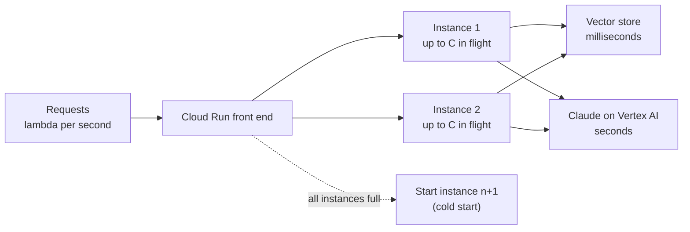

Google Cloud's strongest offer to a RAG team is **Cloud Run**: hand it a container image and it gives you an HTTPS endpoint that scales from zero to many instances and back, billed for what you use. Around it sit the pieces a RAG system needs: Vertex AI for models (including Claude), several databases that can hold vectors, Cloud Storage and Eventarc for ingestion, Secret Manager, and an identity system built on service accounts. This lesson maps AskMeridian onto those services and then concentrates on the one setting that most often decides whether a RAG service on Cloud Run is fast and cheap or slow and expensive: **request concurrency**, the number of requests one container instance may handle at the same time.

[Cloud deployment](/learn/deployment/cloud-deployment) covered the provider-neutral choices, and [AWS](/learn/deployment/aws) and [Azure](/learn/deployment/azure) applied them to two other providers. Rather than repeat the identity story from the Azure lesson in full, this lesson notes where Google differs and spends its depth on capacity: a little queueing theory, a simulation you can run, and a formula for choosing concurrency from measurements.

## Learning objectives

- Map the stages of a RAG system onto Google Cloud services and choose between Cloud Run and GKE for a stated workload.
- Configure a Cloud Run service's identity, secrets, concurrency, CPU billing mode and instance limits, and explain each choice.
- Apply Little's law to estimate requests in flight and the number of instances a RAG API needs.
- Derive a CPU-safe concurrency limit from a measured CPU cost per request.
- Call Claude on Vertex AI with the Anthropic SDK using Application Default Credentials.

## Prerequisites

- [Docker](/learn/deployment/docker): Cloud Run runs container images.
- [Cloud deployment](/learn/deployment/cloud-deployment): compute models and managed versus self-hosted state.
- [Azure](/learn/deployment/azure): the managed-identity model, which Google's service accounts mirror.
- [Async endpoints](/learn/backend-engineering/async-endpoints): why one Python process can hold many requests that are waiting on the network.
- [Cross-encoders](/learn/reranking-fundamentals/cross-encoders): the CPU-heavy stage that makes concurrency matter.

## Why this matters

A RAG request spends most of its life waiting. It waits a few milliseconds for the vector database, then several seconds for the language model to stream an answer. During that wait the instance's CPU is idle. A platform that gives each request its own instance (concurrency 1) pays for a whole container to sit idle for seconds, many times over; at a modest peak you would run dozens of instances, each loading its own copy of the embedding model, each paying its own cold start.

Set concurrency too high, and the opposite failure appears. If the service also does CPU-heavy work in process, such as embedding the query or reranking twenty passages with a cross-encoder, then eighty concurrent requests on two vCPUs compete for the processor. Each request's CPU stage slows down, latency grows, requests stay in flight longer, which raises the number in flight further. The service degrades under exactly the load it was meant to handle, and adding instances does not help, because the platform keeps packing eighty requests into each.

Cloud Run's default concurrency (80, at the time of writing) was chosen for typical web services. A RAG service is not typical: it combines long waits with bursts of heavy CPU. The right value has to be derived, and this lesson shows how.

## The intuition

Picture a restaurant where each waiter is an instance and each table is a request. Most of a meal is spent waiting for the kitchen (the language model). One waiter can easily look after many tables, because a table waiting for food needs nothing. Hiring one waiter per table would be absurd.

But each table also needs a few minutes of the waiter's full attention: taking the order, carving at the table (the reranker). If a waiter has eighty tables and ten want carving at the same moment, everyone waits. The right number of tables per waiter depends on how long meals take and how much hands-on work each needs, not on a number printed in the staff handbook.

Little's law, below, tells you how many tables are occupied on average. The CPU calculation tells you how many tables one waiter can serve without the carving queue growing.

## How it works

### The service map

| RAG component | Typical Google Cloud choice | Alternatives |
| --- | --- | --- |
| API container | Cloud Run service | Google Kubernetes Engine (GKE), Autopilot or Standard |
| Event-driven ingestion | Cloud Run service triggered by Eventarc | Cloud Run functions, Pub/Sub push subscription |
| Bulk re-indexing | Cloud Run jobs (parallel tasks) | GKE jobs, Dataflow |
| Raw documents | Cloud Storage | Google Drive via connectors |
| Vector store | AlloyDB or Cloud SQL for PostgreSQL with pgvector | Vertex AI Vector Search, Qdrant on GKE or Qdrant Cloud, BigQuery vector search, Firestore vector search |
| Generation | Claude on Vertex AI | Anthropic's API directly |
| Embeddings | Self-hosted model in the container, or Vertex AI embedding models | Any external embedding API |
| Secrets | Secret Manager | |
| Identity | Service accounts, Workload Identity Federation | Service-account key files (avoid) |
| Telemetry | Cloud Logging, Cloud Trace, Cloud Monitoring | Any OpenTelemetry back end |

**Cloud Run versus GKE.** Cloud Run suits a stateless API and short ingestion work: no cluster to run, per-request scaling, revisions with traffic splitting for gradual roll-outs. Cloud Run also offers GPU-equipped instances in some regions, which can host a small embedding or reranking model. Choose **GKE** when you need what [Kubernetes fundamentals](/learn/deployment/kubernetes-fundamentals) describes: a self-hosted vector database with persistent disks, long-running GPU inference servers, or custom networking. GKE Autopilot removes node management but keeps the Kubernetes API.

**Vector stores.** If the team already knows PostgreSQL, **AlloyDB** or **Cloud SQL** with the pgvector extension keeps vectors next to relational metadata, with the trade-offs from [PostgreSQL with pgvector](/learn/vector-database-ecosystem/postgresql-with-pgvector). AlloyDB additionally offers an index type based on Google's ScaNN algorithm. **Vertex AI Vector Search** is a dedicated, fully managed approximate-nearest-neighbour service designed for very large indexes; it is a separate system to operate, with its own index-building and deployment steps. [Managed vector databases](/learn/deployment/managed-vector-databases) discusses how to choose between such options. AskMeridian runs on Qdrant, so the Platform team's simplest path on Google Cloud would be Qdrant Cloud in the same region, or Qdrant on GKE.

Google also offers a managed retrieval service (Vertex AI RAG Engine) that chunks, embeds and retrieves for you. As with Azure's integrated vectorisation, it trades control and local testability for convenience.

### Service accounts and Application Default Credentials

Google's equivalent of a managed identity is the **service account**: an identity for software, to which you grant **IAM roles** on resources. Each Cloud Run service runs *as* a service account. If you do not choose one, it runs as the project's default compute service account, which in many projects carries the broad *Editor* role. Always create a dedicated account per service.

AskMeridian's API account needs, at minimum:

- `roles/aiplatform.user` to call models on Vertex AI;
- `roles/secretmanager.secretAccessor` on the specific secrets it reads;
- `roles/cloudsql.client` (or the AlloyDB equivalent) if it connects to a managed PostgreSQL.

Client libraries find credentials through **Application Default Credentials (ADC)**, a search order much like Azure's `DefaultAzureCredential`. On Cloud Run, the metadata server supplies short-lived tokens for the service's account. On a laptop, `gcloud auth application-default login` supplies yours, with the same "it works on my machine" trap the [Azure lesson](/learn/deployment/azure) described: locally the code has your permissions, not the service account's. For CI systems such as GitHub Actions, **Workload Identity Federation** lets the pipeline exchange its own signed token for a short-lived Google token, so no service-account key file ever exists.

Service-to-service calls are authenticated the same way. Deploy the API with `--no-allow-unauthenticated`, and Cloud Run rejects any request that does not carry a Google-signed ID token from an identity holding `roles/run.invoker`. Staff-facing traffic usually arrives through a load balancer with Identity-Aware Proxy or through your own sign-in, as [Authentication](/learn/backend-engineering/authentication) describes.

### How Cloud Run runs a request

1. A request reaches Google's front end, which routes it to an instance of the latest revision (or splits traffic between revisions if you configured that).
2. If an existing instance has fewer requests in flight than its **concurrency** limit, the request goes there.
3. Otherwise the autoscaler starts a new instance, up to `max-instances`. A new instance pulls the image, starts your process and waits until it listens on the port given by the `PORT` environment variable (8080 by default). Requests wait during this **cold start**.
4. Your code handles the request. In **request-based billing**, CPU is allocated only while a request is in flight; work you leave running after the response (flushing logs, writing to a cache) may be starved of CPU. In **instance-based billing**, CPU stays allocated for the instance's life, which suits background work and costs more when idle.
5. When traffic falls, idle instances are shut down, down to `min-instances` (zero by default). Before stopping an instance, Cloud Run sends `SIGTERM` and allows a short grace period for in-flight work.



The other settings to know: **request timeout** (5 minutes by default, configurable up to an hour at the time of writing), which must exceed your longest streamed answer; **startup CPU boost**, which gives extra CPU during start-up to shorten cold starts; and CPU and memory per instance, which bound both how many models you can load and how much CPU each request can get.

### Ingestion

A new handbook PDF lands in a Cloud Storage bucket. Eventarc delivers the object-finalised event to an ingestion service on Cloud Run, which parses, chunks, embeds and upserts that one document. For a full rebuild (a new embedding model, say) a **Cloud Run job** fans out: you start it with, for example, 20 tasks, each task reads `CLOUD_RUN_TASK_INDEX` and `CLOUD_RUN_TASK_COUNT` from its environment and processes its share of the documents. The pattern is the one in [Distributed ingestion](/learn/production-architecture/distributed-ingestion).

### Claude on Vertex AI

Claude models are offered through Vertex AI's Model Garden. Usage is billed to the Google Cloud project, and authentication uses the service account, so no Anthropic API key is stored. The Anthropic SDK's `AnthropicVertex` client takes a `region` and a `project_id` and finds credentials through ADC. Which models are available in which regions, and the exact model identifiers Vertex uses, change over time; take both from the Model Garden page and Anthropic's documentation for Vertex AI. The code section shows the call.

## The mathematics

### Little's law

**Intuition.** If requests arrive at a steady rate and each stays a while, the number present at any moment is the rate times the stay. Ten customers a minute who each stay three minutes means about thirty in the shop.

$$
L = \lambda W
$$

$L$ is the average number of requests in flight in the whole service, $\lambda$ the average arrival rate (requests per second) and $W$ the average time a request spends in the system (seconds). The law holds for any stable system, whatever the arrival pattern or the latency distribution, which makes it unusually trustworthy for capacity planning.

**By hand.** AskMeridian's assumed peak is $\lambda = 20$ requests per second with a mean latency of about $W = 3.46$ s (mostly waiting for Claude). Then $L = 20 \times 3.46 \approx 69$ requests in flight on average. With concurrency 1 you would need about 69 instances; with concurrency 23, about $\lceil 69 / 23 \rceil = 3$, more at peaks.

### The CPU ceiling on concurrency

**Intuition.** Each request in flight needs a little CPU spread over its lifetime. Fill an instance with $C$ requests and their combined demand must stay below what the instance's vCPUs can supply, with headroom.

A request that uses $c$ CPU-seconds over a lifetime of $W$ seconds needs, on average, $c / W$ of a CPU. With $C$ such requests on an instance with $V$ vCPUs and a target utilisation $u$:

$$
C \cdot \frac{c}{W} \le u V \quad\Longrightarrow\quad C^{*} = \left\lfloor \frac{u\,V\,W}{c} \right\rfloor
$$

$C$ is the concurrency setting, $c$ the CPU-seconds per request (measure it), $W$ the mean latency, $V$ the vCPUs per instance and $u$ the target utilisation, such as 0.6, leaving room for bursts. $C^{*}$ is the largest safe concurrency.

**By hand.** With $u = 0.6$, $V = 2$, $W = 3.46$ s and $c = 0.18$ CPU-seconds (an in-process embed plus a cross-encoder rerank of 20 passages): $C^{*} = \lfloor 0.6 \times 2 \times 3.46 / 0.18 \rfloor = \lfloor 23.07 \rfloor = 23$. At the default of 80, demand would be $80 \times 0.18 / 3.46 \approx 4.2$ vCPUs on a 2-vCPU instance: more than twice what exists.

Notice what the formula says. Long waits ($W$ large) *raise* the safe concurrency, because each request uses the CPU only briefly relative to its life. Heavy in-process work ($c$ large) lowers it. Moving the reranker to a separate service, or to a GPU, changes $c$ and therefore the right concurrency.

## In code

### Measuring the CPU cost per request

**Problem.** The formula needs $c$, and guessing it is how services end up overloaded. Measure it with the models you will actually run. `time.process_time()` counts CPU time used by the process, not wall-clock time, and limiting PyTorch to one thread approximates one vCPU.

```bash
pip install sentence-transformers numpy
```

```python
import time

import torch
from sentence_transformers import CrossEncoder, SentenceTransformer

torch.set_num_threads(1)  # one vCPU's worth of work, as on a small instance
embedder = SentenceTransformer("sentence-transformers/all-MiniLM-L6-v2", device="cpu")
reranker = CrossEncoder("BAAI/bge-reranker-base", device="cpu")

query = "How many days of annual leave can I carry over?"
passages = [f"Meridian handbook section {i}: annual leave is 25 days and up to 5 unused days carry over." for i in range(20)]

embedder.encode([query]); reranker.predict([(query, p) for p in passages])  # warm up
runs = 20
t0 = time.process_time()
for _ in range(runs):
    embedder.encode([query], normalize_embeddings=True)
    reranker.predict([(query, p) for p in passages])
cpu_per_request = (time.process_time() - t0) / runs
print(f"CPU-seconds per request (embed + rerank 20): {cpu_per_request:.3f}")
```

Measured on a recent laptop CPU; yours will differ:

```output
CPU-seconds per request (embed + rerank 20): 0.178
```

A cloud vCPU is usually one hyperthread of a server core, often slower than a laptop core, and real passages are several times longer than these one-line ones, so treat this figure as a lower bound and repeat the measurement inside a Cloud Run instance. Swapping in the smaller `cross-encoder/ms-marco-MiniLM-L-6-v2` cut the figure several-fold on the same machine, which is itself a capacity decision.

### Simulating the service

**Problem.** Little's law gives the average; the instance count must cover peaks. The simulation draws Poisson arrivals (requests arriving independently at a steady rate) and log-normal latencies (most answers near the median, a long tail of slow ones, as with real model calls), counts requests in flight every 10 ms, and compares concurrency settings.

```python
import math

import numpy as np

rng = np.random.default_rng(42)

ARRIVALS_PER_S = 20.0      # assumption: peak request rate
DURATION_S = 600           # simulate ten minutes of peak
MEDIAN_LATENCY_S = 3.0     # assumption: end-to-end, dominated by waiting for the model
CPU_S_PER_REQUEST = 0.18   # measured above; a cloud vCPU may well be slower
VCPUS = 2                  # per instance
TARGET_UTIL = 0.6          # leave headroom for bursts and garbage collection

# 1. Poisson arrivals and log-normal latencies (a long right tail, like real LLM calls).
gaps = rng.exponential(1 / ARRIVALS_PER_S, size=int(ARRIVALS_PER_S * DURATION_S * 1.2))
starts = np.cumsum(gaps)
starts = starts[starts < DURATION_S]
latency = rng.lognormal(mean=math.log(MEDIAN_LATENCY_S), sigma=0.5, size=starts.size)
ends = starts + latency

# 2. Count requests in flight every 10 ms (a +1 at each start, a -1 at each end).
grid = np.arange(0, DURATION_S, 0.01)
in_flight = np.searchsorted(starts, grid, side="right") - np.searchsorted(np.sort(ends), grid, side="right")
steady = in_flight[grid > 30]  # ignore the warm-up period

lam = starts.size / DURATION_S
w = latency.mean()
print(f"requests             : {starts.size}")
print(f"arrival rate (lambda): {lam:.2f} /s")
print(f"mean latency (W)     : {w:.2f} s")
print(f"Little's law L = lW  : {lam * w:.1f}")
print(f"simulated mean L     : {steady.mean():.1f}")
print(f"simulated p99 L      : {np.percentile(steady, 99):.0f}")

# 3. The CPU ceiling on concurrency: requests in flight per instance x CPU share per request.
c_star = math.floor(VCPUS * TARGET_UTIL * w / CPU_S_PER_REQUEST)
print(f"CPU-safe concurrency : {c_star}")

print("\nconcurrency  instances(p99)  CPU per instance when full")
p99 = np.percentile(steady, 99)
for concurrency in (1, 10, c_star, 80):
    instances = math.ceil(p99 / concurrency)
    cpu_when_full = concurrency * CPU_S_PER_REQUEST / w
    flag = "  overloaded" if cpu_when_full > VCPUS * TARGET_UTIL else ""
    print(f"{concurrency:>11}  {instances:>14}  {cpu_when_full:>5.2f} of {VCPUS} vCPU{flag}")
```

```output
requests             : 12040
arrival rate (lambda): 20.07 /s
mean latency (W)     : 3.46 s
Little's law L = lW  : 69.4
simulated mean L     : 69.4
simulated p99 L      : 89
CPU-safe concurrency : 23

concurrency  instances(p99)  CPU per instance when full
          1              89   0.05 of 2 vCPU
         10               9   0.52 of 2 vCPU
         23               4   1.20 of 2 vCPU
         80               2   4.17 of 2 vCPU  overloaded
```

**The important lines.** The two `searchsorted` calls count, for each instant on the grid, how many requests have started and how many have ended; the difference is the number in flight. Sorting `ends` is necessary because a fast request that starts later can finish earlier. The median latency is 3 s, but the log-normal tail lifts the mean to 3.46 s, a reminder that capacity depends on the mean and the tail, not the median.

**What the output means.** The simulated mean in flight (69.4) matches Little's law exactly, which is a good check that the simulation is sound. The 99th percentile is 89: at peak moments about 20 more requests are in flight than on average, and the instance count must cover them. Concurrency 1 would need 89 instances, each holding its own copy of two models in memory. Concurrency 80 needs only 2 instances on paper, but each would need about 4.2 vCPUs of reranking capacity and has 2, so in practice CPU queues form, $W$ grows, $L$ grows with it, and the service spirals. Concurrency 23 needs 4 instances running at about 60% CPU when full: the efficient, stable point.

**Common errors.** Measuring $c$ with a multi-threaded PyTorch on a large laptop and deploying on one vCPU; forgetting that instance-level CPU also serves JSON parsing, logging and the event loop; and using median latency instead of mean in Little's law.

**Extending it.** Make latency depend on load: when CPU demand exceeds supply, stretch the CPU portion of each request by the overload ratio and watch the overloaded configuration diverge. Add cold starts by delaying requests that arrive when every instance is full.

### Deploying and calling Claude

The following was **not executed**: it needs a Google Cloud project with Vertex AI enabled and access to a Claude model. The deploy command reflects the calculation above.

```bash
gcloud run deploy askmeridian-api \
  --image europe-west2-docker.pkg.dev/meridian-prod/apps/askmeridian-api:1.4.2 \
  --region europe-west2 \
  --service-account askmeridian-api@meridian-prod.iam.gserviceaccount.com \
  --no-allow-unauthenticated \
  --cpu 2 --memory 4Gi \
  --concurrency 23 --min-instances 1 --max-instances 30 \
  --timeout 300 --cpu-boost \
  --set-env-vars VERTEX_REGION=europe-west1,GOOGLE_CLOUD_PROJECT=meridian-prod \
  --set-secrets QDRANT_API_KEY=qdrant-api-key:latest
```

`--set-secrets` mounts a Secret Manager secret as an environment variable; pin a version number rather than `latest` if you want each revision to be reproducible. The Vertex region need not equal the Cloud Run region, since model availability differs by region; keep them close.

```bash
pip install "anthropic[vertex]"
```

```python
import os

from anthropic import AnthropicVertex

client = AnthropicVertex(
    region=os.environ["VERTEX_REGION"],          # a region where your Claude model is offered
    project_id=os.environ["GOOGLE_CLOUD_PROJECT"],
)  # credentials come from Application Default Credentials: the service account on Cloud Run

context = "[hb-leave#0] Annual leave is 25 days. Up to 5 unused days carry over and must be used by 31 March."
response = client.messages.create(
    model="claude-opus-5-5",  # use the model ID exactly as listed in Vertex AI Model Garden
    max_tokens=1024,
    system="Answer only from the provided context. If the answer is not there, say you don't know.",
    messages=[{"role": "user", "content": f"Context:\n{context}\n\nQuestion: How much leave can I carry over?"}],
)
answer = "".join(block.text for block in response.content if block.type == "text")
print(answer)
```

## A real-world example

Meridian's Sync team built a support assistant for Meridian Sync customers on Cloud Run, alongside the rest of their Google Cloud estate. The first version called a hosted embedding API and Claude on Vertex AI and did no heavy work in process; the default concurrency of 80 served it well, because each request used almost no CPU while it waited.

Then the team added a cross-encoder reranker inside the same container, to improve answer quality. Evaluation offline looked excellent. In production, at the morning peak, p95 latency climbed from a few seconds to tens of seconds, and the dashboard showed only a couple of instances, each pinned at full CPU. The autoscaler was not the problem: each instance was accepting up to 80 requests, as configured, and the reranking stages of those requests were queueing for two vCPUs.

The fix began with measurement, not guessing: the team ran the CPU-cost script inside a Cloud Run instance, plugged the result into $C^{*} = \lfloor uVW/c \rfloor$, and set concurrency to the result. Instance count rose, cost per hour rose a little, and p95 returned to normal. A later change moved the reranker to its own Cloud Run service with a GPU, which cut $c$ in the API so far that concurrency could go back up. They also added an alert on instance CPU utilisation, because the next model change will alter $c$ again.

## Common mistakes

- **Leaving concurrency at the default when the service does in-process ML.** CPU-heavy stages queue, latency spirals and the autoscaler cannot fix it. Derive concurrency from a measured $c$.
- **Setting concurrency to 1 "to be safe".** It multiplies instances, memory (one model copy each), cold starts and cost, for a workload that mostly waits.
- **Running as the default compute service account.** It often holds *Editor* on the whole project. Create one service account per service with only the roles it needs.
- **Doing work after sending the response under request-based billing.** CPU can be throttled once no request is in flight, so background flushes stall. Finish work before responding or use instance-based billing.
- **A request timeout shorter than the longest streamed answer.** Long answers are cut off mid-stream. Set the timeout above your worst-case generation time.
- **Ignoring `SIGTERM`.** Instances are stopped on scale-in and redeploys; a process that does not drain in-flight requests on `SIGTERM` drops them.
- **Committing a service-account key file.** Keys are long-lived secrets. Use ADC on Google Cloud and Workload Identity Federation from CI.

## Best practices

- Measure CPU cost per request inside the real platform and recompute concurrency whenever models change.
- Keep `min-instances` at 1 or more for interactive services; leave ingestion services at 0.
- Deploy each change as a new revision and shift traffic gradually; roll back by moving traffic, a pattern [Blue-green deployments](/learn/ci-cd-and-mlops/blue-green-deployments) develops.
- Put the API, vector store and Vertex region close together, and choose the region for data residency and model availability at the same time.
- Read secrets from Secret Manager with pinned versions; never bake them into images.
- Export OpenTelemetry traces to Cloud Trace so one trace covers retrieval, reranking and generation ([Distributed tracing](/learn/rag-observability/distributed-tracing)).

## Performance considerations

**Cold starts.** A new instance pays for image pull, interpreter start and model loading. Small images, loading models once at start-up (the `lifespan` pattern from [FastAPI](/learn/backend-engineering/fastapi)), startup CPU boost and `min-instances` all help. Because the p99 load in the simulation was about 30% above the mean, size `min-instances` to cover normal load and let the autoscaler absorb bursts.

**Memory.** Each instance holds every model it loads. If an embedding model and a reranker need an assumed 1.5 GB together, an instance with 2 GiB has little left for request buffers; 4 GiB is safer. Higher concurrency does not multiply model memory (requests share the loaded model), which is another reason not to choose concurrency 1.

**Cost.** In request-based billing you pay for instance time while requests are in flight. Using the simulation's figures, concurrency 23 runs about 4 instances at peak against 89 at concurrency 1: roughly a twentieth of the instance time for the same traffic, before per-request fees and model tokens. Token costs for generation usually dominate a RAG bill anyway; [Cost engineering](/learn/cost-engineering) deals with them.

**Database connections.** Each instance opens its own connection pool. With 30 instances and a pool of 10, a PostgreSQL vector store sees up to 300 connections. Cap `max-instances` and pool size together, or put a connection pooler in front of the database.

## Security considerations

Run each service as its own service account with the narrowest roles, and grant Secret Manager access per secret, not per project. Require authentication on the service (`--no-allow-unauthenticated`) and put staff traffic behind Identity-Aware Proxy or your own sign-in. Use Workload Identity Federation for CI so no key file exists to leak. For data that must not leave a perimeter, VPC Service Controls can restrict which networks may reach Cloud Storage, Vertex AI and other Google APIs. Retrieval must still enforce who may read what, through filters on every query ([Document-level permissions](/learn/access-control-and-privacy/document-level-permissions)), and every uploaded document is untrusted input that may carry [indirect prompt injection](/learn/rag-security-fundamentals/indirect-prompt-injection).

## Summary

- On Google Cloud, a RAG system typically uses Cloud Run for the API and ingestion, Cloud Storage and Eventarc for documents, AlloyDB, Cloud SQL or a dedicated vector service for the index, Claude on Vertex AI for generation and Secret Manager for secrets.
- Service accounts with narrow IAM roles and Application Default Credentials replace keys; Workload Identity Federation does the same for CI.
- Little's law, $L = \lambda W$, gives requests in flight; long model waits make it large, so per-request instances are wasteful.
- In-process CPU work limits safe concurrency to $C^{*} = \lfloor uVW/c \rfloor$; the default can overload a service that reranks or embeds in process.
- Measure $c$ on the real platform, size for the tail rather than the mean, and keep at least one warm instance for interactive traffic.

## Exercises

**1.** Traffic doubles to 40 requests per second with the same latency. Using Little's law, how many requests are in flight on average, and how many instances at concurrency 23?

<details><summary>Show solution</summary>

$L = 40 \times 3.46 \approx 138$ on average, so $\lceil 138 / 23 \rceil = 7$ instances on average; size for the tail, which will be somewhat higher. Concurrency itself does not change, because $C^{*}$ depends on $W$ and $c$, not on $\lambda$.

</details>

**2.** The team moves reranking to a separate GPU service, and the API's measured $c$ drops to 0.02 CPU-seconds, while $W$ rises to 3.6 s because of the extra network hop. With $V = 2$ and $u = 0.6$, what is the new CPU-safe concurrency, and what would you set?

<details><summary>Show solution</summary>

$C^{*} = \lfloor 0.6 \times 2 \times 3.6 / 0.02 \rfloor = 216$. CPU is no longer the binding limit, so other limits take over: memory per request, connection pools and the event loop. A sensible setting is the platform default of 80 or somewhat higher, confirmed with a load test.

</details>

**3.** Extend the simulation so that a configuration whose CPU demand exceeds supply has its latency stretched. A simple model: multiply each request's CPU portion by the ratio of demand to supply. Show that concurrency 80 now produces a larger mean latency than concurrency 23.

<details><summary>Show solution</summary>

```python
def effective_latency(w0, c, concurrency, vcpus, iterations=100):
    """Fixed point: CPU stages stretch when demand exceeds supply; demand depends on latency."""
    w = w0
    for _ in range(iterations):
        demand = concurrency * c / w              # vCPUs wanted when the instance is full
        stretch = max(1.0, demand / vcpus)        # perfect time-sharing of the vCPUs
        w = (w0 - c) + c * stretch                # waiting part unchanged, CPU part stretched
    return w

for conc in (23, 80):
    print(conc, round(effective_latency(3.46, 0.18, conc, 2), 2))
```

```output
23 3.46
80 3.64
```

Even this optimistic model, which assumes perfect time-sharing, shows latency rising at concurrency 80; in reality queueing makes the tail far worse than the mean. The point of the exercise is the direction: overload feeds back into $W$.

</details>

**4.** Design question: AskMeridian's Platform team wants to move to Google Cloud and keep Qdrant. Compare Qdrant Cloud in the same region with Qdrant on GKE, listing two advantages of each.

<details><summary>Show solution</summary>

Qdrant Cloud: no cluster, storage or upgrades to operate; backups and scaling handled by the vendor. Qdrant on GKE: full control of version, configuration and network placement; possibly lower cost at steady large scale, and data stays entirely within Meridian's own project. Without existing Kubernetes skills, Qdrant Cloud is usually the better start; [Managed vector databases](/learn/deployment/managed-vector-databases) works through the decision.

</details>

## Check your understanding

```quiz
[
  {"q": "A RAG API averages 15 requests per second with a mean latency of 4 seconds. About how many requests are in flight on average?", "options": ["4", "15", "60", "3.75"], "answer": 2, "why": "Little's law: L = lambda x W = 15 x 4 = 60."},
  {"q": "Why can raising Cloud Run concurrency make a service with an in-process reranker slower?", "options": ["Cloud Run charges more per request", "More requests share the same vCPUs, so CPU-heavy stages queue and latency grows", "Higher concurrency disables startup CPU boost", "Concurrency above 1 is not supported for Python"], "answer": 1, "why": "Combined CPU demand C x c / W can exceed the instance's vCPUs, so CPU stages queue, W rises and the number in flight rises with it."},
  {"q": "What identity does a Cloud Run service use if you do not specify one?", "options": ["None; it cannot call other Google APIs", "The deploying user's account", "A new service account created automatically with no roles", "The project's default compute service account, which may hold broad roles"], "answer": 3, "why": "Services run as the default compute service account unless configured otherwise, which is why a dedicated, narrowly scoped account is best practice."},
  {"q": "Under request-based billing, what may happen to work your code does after it has sent the response?", "options": ["It may be starved of CPU because CPU is allocated only while requests are in flight", "It is guaranteed full CPU until it finishes", "It is moved to a Cloud Run job", "It is retried on another instance"], "answer": 0, "why": "With request-based billing, CPU is allocated during request processing; background work after the response may be throttled."},
  {"q": "Which change raises the CPU-safe concurrency for a RAG API?", "options": ["Using fewer vCPUs per instance", "Moving reranking to a separate service, lowering CPU-seconds per request", "Lowering the target utilisation", "Shortening request latency while keeping CPU work the same"], "answer": 1, "why": "C* = floor(uVW/c): reducing c raises it; fewer vCPUs, lower u or a shorter W all lower it."}
]
```

## Further reading

- Google Cloud, [Cloud Run documentation](https://cloud.google.com/run/docs): concurrency, autoscaling, billing modes, jobs and service identity.
- Google Cloud, [Vertex AI documentation](https://cloud.google.com/vertex-ai/docs): Model Garden, embedding models and Vector Search.
- Anthropic, *Claude on Vertex AI* (Claude developer documentation): available models, regions and the `AnthropicVertex` client.
- Little, J. D. C. (1961), "A Proof for the Queuing Formula: L = λW", *Operations Research* 9(3).
- Google Cloud, [Application Default Credentials](https://cloud.google.com/docs/authentication/application-default-credentials): how client libraries find credentials.
