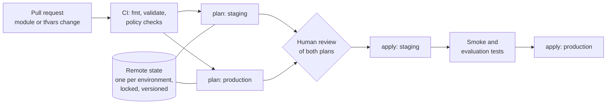

The lessons so far in this module deployed AskMeridian by running commands: build an image, create a container app, set a scaling rule, grant a role. Commands are a fine way to learn a platform and a poor way to run one. Six months later nobody remembers which flags were passed, staging no longer matches production, and the only record of why the API has 30 maximum instances is a chat message. **Infrastructure configuration** is the discipline of writing all of that down as reviewed, versioned files: the cloud resources that must exist, and the settings the running service reads when it starts.

This lesson covers both layers. The first is **infrastructure as code (IaC)**: declaring resources such as services, databases, buckets, identities and permissions in files that a tool such as Terraform compares with reality and then makes true. The second is **application configuration**: the values (index name, embedding model, top-k, model name, secrets) that tell one image how to behave in one environment. The code shows the mechanism of a declarative plan, then builds a typed, validated settings object that refuses to start AskMeridian with a configuration that would quietly ruin retrieval.

## Learning objectives

- Explain how a declarative IaC tool computes a plan from desired state, recorded state and the real resources, and why state needs remote storage and locking.
- Structure IaC for several environments so that they differ only in reviewed variables.
- Separate configuration from secrets and from code, and choose where each value lives.
- Write a typed settings class that validates cross-field consistency (embedding model, collection, top-k) at start-up and fails fast.
- Detect and correct configuration drift.

## Prerequisites

- [Docker](/learn/deployment/docker): one image, many environments.
- [Kubernetes fundamentals](/learn/deployment/kubernetes-fundamentals): ConfigMaps, Secrets and declarative manifests.
- [Google Cloud](/learn/deployment/google-cloud): the Cloud Run settings the Terraform example declares.
- [Dataclasses and Pydantic](/learn/python-for-rag-engineering/dataclasses-and-pydantic): validation with type annotations.
- [Embeddings](/learn/understanding-large-language-models/embeddings): why vectors from different models cannot be mixed.

## Why this matters

A RAG system has unusually many settings that must agree with one another. The embedding model at query time must be the model that built the index. The collection name must point to that index. The vector dimension in the database must match the model. The reranker's `top_n` must not exceed the retriever's `top_k`. The prompt version must match the evaluation results you approved. None of these mismatches crashes the service. A query embedded with one model and searched against vectors from another returns the "nearest" chunks, with ordinary-looking scores, and they are nonsense. Users see confident wrong answers, and nothing in the logs says why.

Infrastructure has the same problem at a larger scale. Resources created by hand differ between environments in ways nobody recorded, so a change that passed in staging fails in production. A permission granted in the console during an incident is never removed. A bucket from an experiment lingers, public. Rebuilding an environment after a disaster depends on someone's memory. Writing infrastructure and configuration as code turns each of these into a diff that can be reviewed, tested, applied and reverted.

## The intuition

Think of a thermostat. You do not tell the heating system "run for twelve minutes"; you state the temperature you want, and the thermostat compares it with the temperature it measures and does whatever closes the gap. If someone opens a window, the thermostat notices and corrects. Declarative IaC works the same way: you describe the resources you want, and the tool measures what exists and computes the actions that close the gap. It is the idea behind the Kubernetes reconciliation loop from [Kubernetes fundamentals](/learn/deployment/kubernetes-fundamentals), applied to cloud resources, except that Terraform-style tools reconcile only when you run them.

Application configuration is the label on a medicine bottle. The same pills (the container image) are given to different patients (environments) with different instructions (configuration). The instructions must be written down, checked by a second person and impossible to misread, because a wrong dose looks exactly like a right one until it causes harm.

## How it works

### Declarative infrastructure as code

**Imperative** configuration is a list of steps: create this, then set that. **Declarative** configuration is a description of the end state: this service exists with these settings. Declarative tools dominate for infrastructure because a description can be compared with reality at any time, while a list of steps only tells you what happened once.

The widely used tools:

| Tool | Language | Scope |
| --- | --- | --- |
| Terraform, and its open-source fork OpenTofu | HCL, a declarative configuration language | Any provider with a plugin: AWS, Azure, Google Cloud, Kubernetes, Qdrant Cloud, Pinecone and many more |
| Pulumi | General-purpose languages (Python, TypeScript, Go and others) | Many providers |
| AWS CloudFormation and CDK | YAML or JSON; CDK generates it from code | AWS |
| Azure Bicep (compiles to ARM templates) | Bicep | Azure |
| Kubernetes manifests with Helm or Kustomize | YAML with templating or overlays | Resources inside a cluster |

Terraform-style tools work in a cycle. Each step is worth understanding, because most IaC incidents come from misunderstanding one of them.

1. **Configuration.** You write resources in files: `resource "google_cloud_run_v2_service" "api" { ... }`. Each resource has a type, a local name and arguments.
2. **State.** The tool keeps a **state file** that maps each resource in your configuration to the real object it created, with that object's ID and last known attributes. Resources the tool did not create are not in state, and the tool ignores them unless you import them.
3. **Refresh.** On each run the tool asks the provider's API for the current attributes of every resource in state.
4. **Plan.** It compares desired (configuration) with actual (refreshed state) and produces a plan: create, update in place, replace (destroy and recreate, for arguments that cannot change in place), or destroy.
5. **Review.** A person reads the plan. This is the most important control in the cycle: a plan that destroys a database is visible before it happens.
6. **Apply.** The tool executes the plan in dependency order (the service account before the role binding that refers to it) and writes the new state.

The core of steps 3 and 4 fits in a few lines. This toy version, which runs as shown, compares desired and actual resources and prints the plan:

```python
desired = {   # what the code says should exist
    "service/askmeridian-api": {"min_instances": 1, "max_instances": 30, "concurrency": 23},
    "secret/qdrant-api-key": {"replication": "automatic"},
    "bucket/meridian-docs": {"location": "europe-west2", "versioning": True},
}
actual = {    # what the provider reports today
    "service/askmeridian-api": {"min_instances": 0, "max_instances": 30, "concurrency": 80},
    "bucket/meridian-docs": {"location": "europe-west2", "versioning": True},
    "bucket/old-test-bucket": {"location": "us-central1", "versioning": False},
}

def plan(desired: dict, actual: dict) -> list[str]:
    steps = []
    for name in sorted(desired.keys() | actual.keys()):
        want, have = desired.get(name), actual.get(name)
        if have is None:
            steps.append(f"+ create  {name}")
        elif want is None:
            steps.append(f"- destroy {name}")
        elif want != have:
            diff = {k: f"{have.get(k)} -> {v}" for k, v in want.items() if have.get(k) != v}
            steps.append(f"~ update  {name} {diff}")
    return steps

for step in plan(desired, actual):
    print(step)
```

```output
- destroy bucket/old-test-bucket
+ create  secret/qdrant-api-key
~ update  service/askmeridian-api {'min_instances': '0 -> 1', 'concurrency': '80 -> 23'}
```

The output reads like a real plan: the hand-made test bucket is in state but no longer in configuration, so it will be destroyed; the secret is new; the service drifted (someone set minimum instances to 0 and concurrency back to 80 in the console), and the plan restores the declared values. A real tool adds dependency ordering, replacement rules and the provider's API calls, but the reasoning is this.

### State: remote, locked and sensitive

The state file is the tool's memory, and three rules follow from that.

- **Store it remotely**, in a bucket or a managed back end (Terraform supports Google Cloud Storage, Amazon S3, Azure Blob Storage and others), never on a laptop. Two engineers with two local state files will each think they own the resources.
- **Lock it.** If two applies run at once they can corrupt state or make conflicting changes. Remote back ends provide locking, natively or through a companion service, so the second run waits or fails.
- **Treat it as secret.** State records resource attributes, which can include generated passwords and connection strings. Restrict access to the state bucket as tightly as the production secrets, and enable versioning on it so a corrupted state can be recovered.

### Environments: same code, different variables

Development, staging and production should be built from the *same* modules with *different* variable files, each environment with its own state. The differences between environments are then exactly the variables, reviewed in one place: instance counts, machine sizes, the data region, the domain name. A difference you cannot find in a variable file is a defect.

Changes flow one way. A pull request changes a module or a variable; CI runs `plan` for each environment and posts it on the pull request; after review, the change is applied to staging, tested, then applied to production with the same code. [CI/CD pipelines](/learn/ci-cd-and-mlops/ci-cd-pipelines) builds that pipeline.



### Drift

**Drift** is any difference between the declared configuration and reality, usually from a change made outside the tool: a console click during an incident, a script, another team's automation. Detect it by running `plan` on a schedule; `terraform plan -detailed-exitcode` exits with code 2 when changes are pending, which a scheduled job can turn into an alert. Then either revert the drift by applying, or, if the manual change was right, put it into code. Never leave drift in place: the next apply will silently undo it, possibly at the worst moment.

### Application configuration

Infrastructure decides which resources exist. Application configuration decides how the code inside them behaves. The widely adopted principle, from the Twelve-Factor App methodology, is to **keep configuration in the environment**: the same image runs everywhere, and whatever differs between deployments arrives as environment variables (or mounted files) set by the platform. Three kinds of value need different homes.

| Kind | Examples | Where it lives |
| --- | --- | --- |
| Code constants | Prompt templates, chunking algorithm, retry logic | The repository, changed by pull request and released with the image |
| Configuration | Index name, embedding model, top-k, model name, timeouts, feature flags | Environment variables set by IaC, from reviewed variable files |
| Secrets | Vector-database API key, webhook tokens | A secret manager; IaC refers to them by name and version, never by value |

The service should load configuration **once, at start-up, into a typed and validated object**, and refuse to start if it is wrong. A crash on deployment, caught by the platform's health check before any traffic arrives, is far cheaper than a service that runs with a bad value. Validation has three levels: each value's type and range (`top_k` is an integer from 1 to 200); cross-field consistency (the collection was built with this embedding model); and environment rules (production requires TLS and an API key).

Finally, log a **configuration fingerprint**, a short hash of every non-secret setting, with each request's trace. When an answer is questioned weeks later, the fingerprint tells you exactly which index, model and parameters produced it, which [Logging](/learn/rag-observability/logging) and [Data lineage](/learn/enterprise-rag-governance/data-lineage) both depend on.

### Coupled settings in RAG

Some settings are not independent and must change together, as one unit:

- **Embedding model, collection and dimension.** Changing the model requires a new collection built with it. Encode the model in the collection's name (for example `askmeridian-minilm-v1`) and check the pairing at start-up.
- **Retriever `top_k` and reranker `top_n`.** `top_n` cannot exceed `top_k`, and both affect latency and cost.
- **Prompt version and evaluation baseline.** An approved evaluation applies to one prompt, model and retrieval configuration; changing any of them without re-running the evaluation removes the evidence that the system works.

Coupled settings are where typed validation pays for itself, as the code shows.

## In code

### A typed, validated settings object

**Problem.** AskMeridian reads its configuration from environment variables set by the platform. You want wrong values to stop the service at start-up with a clear message, secrets never to appear in logs, and a fingerprint to attach to every request.

```bash
pip install pydantic pydantic-settings
```

```python
import hashlib
import json
import os
from typing import Literal

from pydantic import Field, SecretStr, ValidationError, model_validator
from pydantic_settings import BaseSettings, SettingsConfigDict

# Embedding models this service knows, with their output dimensions and a short slug.
EMBEDDING_MODELS = {
    "sentence-transformers/all-MiniLM-L6-v2": (384, "minilm"),
    "BAAI/bge-small-en-v1.5": (384, "bgesmall"),
    "intfloat/e5-small-v2": (384, "e5small"),
}


class Settings(BaseSettings):
    model_config = SettingsConfigDict(env_prefix="ASKMERIDIAN_", extra="forbid", frozen=True)

    environment: Literal["dev", "staging", "production"] = "dev"
    qdrant_url: str = "http://localhost:6333"
    qdrant_api_key: SecretStr | None = None
    collection: str = "askmeridian-minilm-v1"
    embedding_model: str = "sentence-transformers/all-MiniLM-L6-v2"
    top_k: int = Field(default=20, ge=1, le=200)
    rerank_top_n: int = Field(default=5, ge=1)
    llm_model: str = "claude-opus-5-5"
    max_tokens: int = Field(default=1024, ge=64, le=8192)

    @model_validator(mode="after")
    def check_consistency(self) -> "Settings":
        problems = []
        if self.embedding_model not in EMBEDDING_MODELS:
            problems.append(f"unknown embedding model {self.embedding_model!r}")
        else:
            _, slug = EMBEDDING_MODELS[self.embedding_model]
            if not self.collection.startswith(f"askmeridian-{slug}-v"):
                problems.append(f"collection {self.collection!r} was not built with {self.embedding_model}")
        if self.rerank_top_n > self.top_k:
            problems.append("rerank_top_n cannot exceed top_k")
        if self.environment == "production":
            if not self.qdrant_url.startswith("https://"):
                problems.append("production must reach Qdrant over https")
            if self.qdrant_api_key is None:
                problems.append("production needs ASKMERIDIAN_QDRANT_API_KEY")
        if problems:
            raise ValueError("; ".join(problems))
        return self

    @property
    def embedding_dims(self) -> int:
        return EMBEDDING_MODELS[self.embedding_model][0]

    def fingerprint(self) -> str:
        """A short hash of every non-secret setting, to log with each request."""
        public = self.model_dump(exclude={"qdrant_api_key"})
        return hashlib.sha256(json.dumps(public, sort_keys=True).encode()).hexdigest()[:12]


def unknown_variables() -> list[str]:
    """pydantic-settings ignores unrecognised variables, so a typo would pass silently."""
    known = {f"ASKMERIDIAN_{name.upper()}" for name in Settings.model_fields}
    return sorted(k for k in os.environ if k.startswith("ASKMERIDIAN_") and k not in known)


def load(env: dict[str, str]) -> None:
    for key in [k for k in os.environ if k.startswith("ASKMERIDIAN_")]:
        del os.environ[key]
    os.environ.update(env)
    for name in unknown_variables():
        print(f"ERR unknown variable {name}")
    try:
        s = Settings()
        print(f"OK  env={s.environment} collection={s.collection} dims={s.embedding_dims} "
              f"key={s.qdrant_api_key!r} fingerprint={s.fingerprint()}")
    except ValidationError as exc:
        for err in exc.errors():
            where = ".".join(str(p) for p in err["loc"]) or "settings"
            print(f"ERR {where}: {err['msg']}")


print("1. developer laptop, defaults only")
load({})

print("2. production, correctly configured")
load({
    "ASKMERIDIAN_ENVIRONMENT": "production",
    "ASKMERIDIAN_QDRANT_URL": "https://qdrant.internal.meridian.example:6333",
    "ASKMERIDIAN_QDRANT_API_KEY": "s3cr3t-from-secret-manager",
    "ASKMERIDIAN_TOP_K": "30",
})

print("3. staging, model switched but collection not rebuilt")
load({
    "ASKMERIDIAN_ENVIRONMENT": "staging",
    "ASKMERIDIAN_EMBEDDING_MODEL": "BAAI/bge-small-en-v1.5",
})

print("4. production, several mistakes at once")
load({"ASKMERIDIAN_ENVIRONMENT": "production", "ASKMERIDIAN_TOP_K": "3"})

print("5. a value of the wrong type")
load({"ASKMERIDIAN_MAX_TOKENS": "lots"})

print("6. a typo in a variable name")
load({"ASKMERIDIAN_TOPK": "50"})
```

```output
1. developer laptop, defaults only
OK  env=dev collection=askmeridian-minilm-v1 dims=384 key=None fingerprint=3972b77671a6
2. production, correctly configured
OK  env=production collection=askmeridian-minilm-v1 dims=384 key=SecretStr('**********') fingerprint=a00441691c1c
3. staging, model switched but collection not rebuilt
ERR settings: Value error, collection 'askmeridian-minilm-v1' was not built with BAAI/bge-small-en-v1.5
4. production, several mistakes at once
ERR settings: Value error, rerank_top_n cannot exceed top_k; production must reach Qdrant over https; production needs ASKMERIDIAN_QDRANT_API_KEY
5. a value of the wrong type
ERR max_tokens: Input should be a valid integer, unable to parse string as an integer
6. a typo in a variable name
ERR unknown variable ASKMERIDIAN_TOPK
OK  env=dev collection=askmeridian-minilm-v1 dims=384 key=None fingerprint=3972b77671a6
```

**The important lines.**

- `BaseSettings` with `env_prefix="ASKMERIDIAN_"` fills each field from the matching environment variable (`top_k` from `ASKMERIDIAN_TOP_K`), converting the text to the declared type. The defaults suit a developer laptop; every environment overrides what differs.
- `frozen=True` makes the object immutable, so no code path can change a setting mid-flight. `extra="forbid"` rejects unknown keys passed to the constructor or found in a `.env` file.
- `Field(ge=1, le=200)` is a range check; `Literal[...]` restricts `environment` to three spellings, so `prod` or `Production` fails instead of silently skipping the production rules.
- `SecretStr` stores the API key but prints as asterisks, so the settings object can be logged safely. The value is read with `get_secret_value()` at the single place that needs it.
- `check_consistency` runs after every field has parsed and enforces the coupled settings: the collection must have been built with the configured embedding model, `rerank_top_n` must not exceed `top_k`, and production must use TLS and a key. It collects every problem before raising, so one failed deployment shows all of them.
- `fingerprint()` hashes the non-secret settings with sorted keys, so the same configuration always gives the same 12 characters.
- `unknown_variables()` exists because pydantic-settings ignores environment variables it does not recognise, even with `extra="forbid"`. Without it, the typo in case 6 would deploy, and `top_k` would quietly stay at its default.

**What the output means.** Case 3 is the dangerous one. MiniLM and bge-small both produce 384-dimensional vectors, so no dimension check catches the switch: the database would accept the query vector and return wrong neighbours. Only binding the collection to the model, by name or by stored metadata, catches it. Case 4 shows three independent mistakes reported together. Case 5 shows type conversion failing on a value that is not a number. In case 6 the service still loaded, with the default `top_k`, which is exactly why the unknown-variable check should fail the start-up in production rather than merely print. The fingerprints differ between cases 1 and 2 because the settings differ; two replicas with the same configuration log the same fingerprint.

**Common errors.** Forgetting that environment variables are always strings (pydantic converts them, so `"true"`, `"1"` and `"yes"` all become `True` for a boolean field); reading `os.environ` directly in many places instead of from one settings object; and putting secrets in a `.env` file that ends up in the image.

**Extending it.** Store the embedding model's name in the vector collection's metadata at build time and compare it at start-up against the settings, which catches mismatches that naming alone cannot. Add a `prompt_version` field and refuse to start if no evaluation report exists for the combination of prompt, model and collection.

### Declaring the infrastructure

The following Terraform declares AskMeridian's API on Cloud Run with its own service account and a secret reference, matching the [Google Cloud](/learn/deployment/google-cloud) lesson. It was **not executed**: it needs a Google Cloud project and credentials. The same structure applies to Azure or AWS with their providers.

```hcl
terraform {
  required_providers {
    google = { source = "hashicorp/google", version = "~> 6.0" }
  }
  backend "gcs" {
    bucket = "meridian-terraform-state"   # versioned, access-restricted bucket
    # prefix is supplied per environment: terraform init -backend-config="prefix=askmeridian/prod"
  }
}

variable "environment"   { type = string }
variable "region"        { type = string }
variable "image"         { type = string }
variable "concurrency"   { type = number }
variable "min_instances" { type = number }
variable "max_instances" { type = number }
variable "collection"    { type = string }

resource "google_service_account" "api" {
  account_id   = "askmeridian-api-${var.environment}"
  display_name = "AskMeridian API (${var.environment})"
}

resource "google_secret_manager_secret_iam_member" "qdrant_key" {
  secret_id = "qdrant-api-key-${var.environment}"
  role      = "roles/secretmanager.secretAccessor"
  member    = "serviceAccount:${google_service_account.api.email}"
}

resource "google_cloud_run_v2_service" "api" {
  name     = "askmeridian-api-${var.environment}"
  location = var.region

  template {
    service_account                  = google_service_account.api.email
    max_instance_request_concurrency = var.concurrency
    scaling {
      min_instance_count = var.min_instances
      max_instance_count = var.max_instances
    }
    containers {
      image = var.image
      resources {
        limits = { cpu = "2", memory = "4Gi" }
      }
      env {
        name  = "ASKMERIDIAN_ENVIRONMENT"
        value = var.environment
      }
      env {
        name  = "ASKMERIDIAN_COLLECTION"
        value = var.collection
      }
      env {
        name = "ASKMERIDIAN_QDRANT_API_KEY"
        value_source {
          secret_key_ref {
            secret  = "qdrant-api-key-${var.environment}"
            version = "3"   # pinned: a new key version is a reviewed change
          }
        }
      }
    }
  }
  depends_on = [google_secret_manager_secret_iam_member.qdrant_key]
}
```

And the production variable file, the only place production differs from staging:

```hcl
# production.tfvars
environment   = "production"
region        = "europe-west2"
image         = "europe-west2-docker.pkg.dev/meridian-prod/apps/askmeridian-api:1.4.2"
concurrency   = 23
min_instances = 1
max_instances = 30
collection    = "askmeridian-minilm-v1"
```

```bash
terraform init -backend-config="prefix=askmeridian/production"
terraform plan -var-file=production.tfvars -out=production.plan
terraform apply production.plan
```

Saving the plan with `-out` and applying that file guarantees that what is applied is exactly what was reviewed. Note what is *not* in the variable file: the Qdrant API key. Terraform refers to the secret by name and version, the platform injects its value at run time, and the value never appears in the repository or in Terraform's variables. The image is referenced by an immutable version tag; in stricter setups, by digest.

## A real-world example

Meridian's Platform team was preparing to switch AskMeridian from MiniLM to bge-small, which their evaluation had shown retrieved better on the handbook. The plan was to build a new collection, then switch. An engineer changed the embedding-model variable in staging first, intending to change the collection variable in a second pull request once the new collection was built.

Staging kept running. Health checks passed, latency was normal, and every query returned five chunks with ordinary-looking scores. It took a tester asking about annual leave and receiving the VPN runbook to notice: queries were now embedded with bge-small and searched against MiniLM vectors. Both models produce 384 dimensions, so Qdrant accepted every query, and nothing anywhere raised an error.

The fix was in three parts. The settings class gained the consistency check you saw, binding collection names to model slugs. The index-building job began writing the model name into the collection's metadata, and the API started comparing it at start-up. And the team changed its process: the embedding model and collection are now one variable, chosen from a reviewed map of approved pairs, so they cannot be changed separately. The incident never reached production, because staging was built from the same modules and caught it, which is the point of having a staging environment that matches.

## Common mistakes

- **Making changes in the console "just this once".** It creates drift the next apply will silently undo. Change the code, or import the manual change into it.
- **Local or unlocked state.** Two engineers apply at once, or state lives on one laptop. Use a remote, locked, versioned back end.
- **Secrets in variable files or state.** They end up in the repository or in a state bucket too many people can read. Reference secrets by name and version; restrict and version the state bucket.
- **Environments that differ outside variable files.** Hand-made exceptions mean staging tests something production is not. Every difference belongs in a reviewed variable.
- **Reading `os.environ` throughout the code.** Values are parsed inconsistently and never validated. Load one typed settings object at start-up.
- **Validating fields but not their combinations.** Each value is valid and the combination is wrong, as with model and collection. Validate coupled settings together.
- **Applying a plan you did not read.** `apply` without reviewing a saved plan is how databases get replaced. Review, save with `-out`, apply the saved plan.

## Best practices

- Declare every long-lived resource (services, databases, buckets, identities, role bindings, alerts) in IaC, and build every environment from the same modules.
- Keep one state per environment in a remote, locked, versioned back end with restricted access.
- Run `plan` in CI on every pull request and on a schedule to detect drift.
- Add policy checks to CI (tools such as Open Policy Agent with Conftest, or Checkov) to reject, for example, public buckets or services without authentication.
- Load application settings once into a frozen, typed object; validate types, ranges, coupled settings and environment rules; fail start-up on any error.
- Keep secrets in a secret manager, pinned by version, injected at run time; never in images, variable files or logs.
- Log a configuration fingerprint with every request.

## Performance considerations

Configuration choices are performance choices, and keeping them in code makes their effect traceable. Concurrency, instance limits, CPU and memory set the capacity of every instance, as the [Google Cloud](/learn/deployment/google-cloud) lesson computed; `top_k`, `rerank_top_n` and `max_tokens` set the work and the token cost of every request. Because each is a variable, a performance change is a reviewed diff with a fingerprint, and a regression can be traced to the commit that caused it.

Loading and validating settings costs microseconds once at start-up; reading `os.environ` on every request costs little more, but parsing and validating repeatedly wastes work and invites inconsistency. Terraform runs themselves get slow as a single configuration grows to hundreds of resources, because every plan refreshes every resource; split large estates into separate configurations (network, data, services) with separate states, so a routine service change does not refresh the whole network.

## Security considerations

IaC and configuration concentrate power: whoever can merge to the infrastructure repository or apply its plans can change production. Protect the main branch, require review for infrastructure changes, and run applies from CI with a dedicated identity rather than from laptops. Give that CI identity short-lived credentials through workload identity federation instead of stored keys. Restrict the state back end, because state can contain sensitive attributes. Keep secrets out of variable files, images and logs, and use `SecretStr` or an equivalent so that dumping configuration cannot leak them. Use policy checks to enforce security baselines automatically: no public buckets, no unauthenticated services, encryption enabled, no role grants at organisation scope.

## Summary

- Infrastructure as code declares resources; a tool refreshes state, plans the difference from reality, and applies it after review.
- State must be remote, locked, versioned and protected; environments share modules and differ only in variable files.
- Configuration lives in the environment, secrets in a secret manager referenced by version, and code constants in the repository.
- Load settings once into a typed, frozen object that validates types, ranges, coupled settings and environment rules, and fail start-up on error.
- In RAG, the embedding model and collection must change together; dimension checks alone cannot catch a model mismatch.

## Exercises

**1.** Your scheduled `plan` reports that the production API's maximum instances changed from 30 to 60, and nobody has merged a change. What happened, and what are your two options?

<details><summary>Show solution</summary>

Someone changed the setting outside Terraform, probably in the console during a traffic spike: drift. Either apply, which restores 30, or, if 60 was the right call, change `max_instances` in `production.tfvars` through a reviewed pull request so code and reality agree. Leaving it is not an option: the next unrelated apply would revert it without anyone noticing.

</details>

**2.** Extend the settings class with a `request_timeout_s` field (a float, default 60) and a rule that it must be at least 30 seconds greater than an assumed worst-case generation time computed as `max_tokens / 50` seconds. Show that `max_tokens=4096` with the default timeout fails.

<details><summary>Show solution</summary>

```python
# inside Settings
request_timeout_s: float = 60.0

# inside check_consistency
worst_case = self.max_tokens / 50  # assumption: 50 output tokens per second
if self.request_timeout_s < worst_case + 30:
    problems.append(f"request_timeout_s {self.request_timeout_s} is too short for "
                    f"max_tokens {self.max_tokens} (needs >= {worst_case + 30:.0f})")
```

With `ASKMERIDIAN_MAX_TOKENS=4096`, the worst case is about 82 seconds, so the timeout must be at least 112, and the default of 60 fails with that message. With the default `max_tokens` of 1024 the requirement is about 50 seconds, which 60 satisfies.

</details>

**3.** Extend the toy planner so that a change to `location` is shown as a replacement (`-/+ replace`) rather than an update, because a bucket's location cannot change in place.

<details><summary>Show solution</summary>

```python
FORCES_REPLACEMENT = {"location"}

# in plan(), replacing the update branch
elif want != have:
    diff = {k: f"{have.get(k)} -> {v}" for k, v in want.items() if have.get(k) != v}
    verb = "-/+ replace" if diff.keys() & FORCES_REPLACEMENT else "~ update "
    steps.append(f"{verb} {name} {diff}")
```

Real providers declare, per argument, whether a change forces replacement, and the plan marks it. Replacement of a stateful resource such as a bucket or database means data loss unless handled, which is why reviewers look for it first.

</details>

**4.** Design question: Meridian wants a weekly job that re-embeds changed documents into the current collection. Which values does the job need, where should each come from, and how do you guarantee it uses the same model as the API?

<details><summary>Show solution</summary>

The job needs the Qdrant URL and API key, the collection name, the embedding model, the document source location and batch sizes. URL, collection, model and batch sizes are configuration from the same reviewed variables as the API; the API key comes from the secret manager by pinned version. To guarantee the same model, both the job and the API should read the model and collection from one variable (a single approved pair), both should use the same settings class, and the job should check the model name stored in the collection's metadata before writing, refusing to write if it differs.

</details>

## Check your understanding

```quiz
[
  {"q": "What does a Terraform-style tool compare to produce a plan?", "options": ["The configuration with the previous configuration in Git", "The desired configuration with the refreshed state of the resources it manages", "The state file with the provider's price list", "The variable file with the environment variables"], "answer": 1, "why": "It refreshes the recorded state from the provider and diffs it against the declared configuration."},
  {"q": "Why must the state back end support locking?", "options": ["To encrypt the state", "To hide secrets from reviewers", "To make plans faster", "To stop two concurrent applies from making conflicting changes or corrupting state"], "answer": 3, "why": "Locking serialises runs so only one apply changes resources and state at a time."},
  {"q": "AskMeridian switches from MiniLM to bge-small (both 384 dimensions) without rebuilding the collection. What happens?", "options": ["Qdrant rejects every query with a dimension error", "The service fails to start", "Queries run and return plausible-looking but wrong neighbours", "Qdrant re-embeds the collection automatically"], "answer": 2, "why": "Dimensions match, so nothing fails; the vectors live in different spaces and the results are meaningless."},
  {"q": "Where should the vector database's API key live?", "options": ["In a secret manager, referenced by name and version and injected at run time", "Baked into the container image", "In production.tfvars", "In the settings class as a default value"], "answer": 0, "why": "Secrets are kept out of code, images and variable files; IaC references them and the platform injects the value."},
  {"q": "With pydantic-settings and env_prefix ASKMERIDIAN_, what happens to an environment variable named ASKMERIDIAN_TOPK when the field is top_k?", "options": ["It is stored as an extra attribute", "It sets top_k", "It raises a validation error because extra is forbidden", "It is ignored, so top_k keeps its default"], "answer": 3, "why": "Unrecognised environment variables are ignored, which is why the lesson adds an explicit unknown-variable check."}
]
```

## Further reading

- HashiCorp, [Terraform documentation](https://developer.hashicorp.com/terraform/docs): configuration language, state, back ends and the plan and apply workflow.
- OpenTofu, [OpenTofu documentation](https://opentofu.org/docs/): the open-source fork of Terraform.
- Pydantic, [Settings management](https://docs.pydantic.dev/latest/concepts/pydantic_settings/): `BaseSettings`, sources and precedence.
- Wiggins, A., [The Twelve-Factor App](https://12factor.net/): the "config in the environment" principle and its rationale.
- Morris, K. (2020), *Infrastructure as Code: Dynamic Systems for the Cloud Age*, 2nd edition, O'Reilly.
