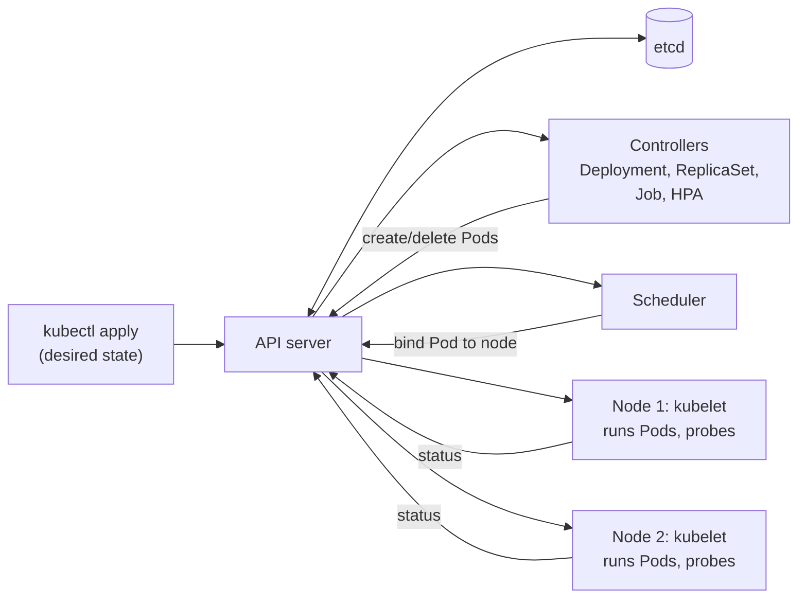

[Docker Compose](/learn/deployment/docker-compose) runs a RAG stack on one machine. When that machine fails, AskMeridian is down; when Monday morning brings ten times the usual traffic, nothing adds capacity; when a new version ships, users see errors while containers are replaced. **Kubernetes** is a system for running containers across a group of machines that handles exactly these problems: it keeps a declared number of copies running, spreads them across machines, replaces failed ones, routes traffic only to copies that are ready, rolls out new versions gradually, and adds or removes copies as load changes.

This lesson teaches the core of Kubernetes from the point of view of someone deploying a RAG service: the control loop at its heart, the handful of objects you actually write (Pods, Deployments, Services, ConfigMaps, Secrets, Jobs, StatefulSets), health probes and graceful shutdown, resource requests and limits, and the Horizontal Pod Autoscaler, whose scaling rule you will simulate. It is not a cluster-administration course: how clusters are created and operated is left to managed services, which [Cloud deployment](/learn/deployment/cloud-deployment) introduces.

## Learning objectives

- Explain the reconciliation loop and the roles of the control plane, nodes and kubelet.
- Write a Deployment, Service, ConfigMap, Horizontal Pod Autoscaler and Job for a RAG API and its ingestion job.
- Configure startup, readiness and liveness probes for a service that loads a model, and explain what each failure causes.
- Set CPU and memory requests and limits and predict the effect of exceeding each.
- Compute the replica count the Horizontal Pod Autoscaler will choose for a given load.

## Prerequisites

- [Docker](/learn/deployment/docker): images, health endpoints and signal handling.
- [Docker Compose](/learn/deployment/docker-compose): services, networks, volumes and health-gated start-up.
- [Replication](/learn/advanced-vector-database-engineering/replication): how a vector database keeps copies of its data.

## Why this matters

A production RAG service has requirements that a single host cannot meet:

- **Availability.** A hardware failure, kernel patch or maintenance event on one machine must not take AskMeridian down.
- **Variable load.** Queries arrive in bursts (the start of the day, an IT incident), and each costs CPU-heavy embedding, search and reranking. Provisioning for the peak all day wastes money; provisioning for the average fails at the peak.
- **Safe change.** Weekly releases must replace containers without dropping in-flight requests, and a bad release must be reversible in seconds.
- **Mixed workloads.** The API is stateless; the vector database owns data on disk and needs a stable identity; ingestion is a batch job that should run to completion and stop.

Without an orchestrator, each becomes custom scripts and runbooks. Kubernetes provides them as standard, declarative building blocks.

## The intuition

Picture a thermostat. You do not tell the heating "turn on for 20 minutes". You set the *desired* temperature, 21 °C, and a simple loop runs forever: measure the room, compare with 21, switch the heating on or off. Open a window and the loop compensates without anyone giving a new instruction.

Kubernetes is a building full of thermostats. You declare "three copies of the AskMeridian API, image version 1.4.2, each with 1 GB of memory". Controllers measure the cluster, compare it with what you declared, and act on the difference. A machine dies and two copies remain: the controller notices the gap and starts a third elsewhere. You change the declared version to 1.4.3: the controller notices the difference and replaces copies gradually. You never issue "start" or "stop"; you edit the desired state.

## How it works

### The cluster and the reconciliation loop

A Kubernetes **cluster** has two parts:

- The **control plane**: the **API server** (the single front door; every tool, including `kubectl`, talks to it), **etcd** (a consistent key-value store holding the desired and observed state of every object), the **scheduler** (decides which node each new Pod runs on, based on the resources it requests and the constraints it declares) and the **controller manager** (runs the controllers that reconcile state).
- The **nodes**: the machines that run your containers. Each runs a **kubelet**, an agent that starts the containers assigned to its node through a container runtime, runs their health probes, and reports their status back.

Every object you write has a `spec` (what you want) and a `status` (what is). A **controller** is a loop that watches objects of one kind and acts to move status towards spec:

1. You `kubectl apply` a manifest; the API server validates it and stores it in etcd.
2. The relevant controller sees the new or changed object and creates or deletes lower-level objects (for a Deployment, a ReplicaSet; for a ReplicaSet, Pods).
3. The scheduler assigns each unscheduled Pod to a node with enough unreserved CPU and memory.
4. That node's kubelet pulls the image, starts the containers and begins probing them.
5. Status flows back to the API server. If anything diverges later (a container crashes, a node disappears), the controllers act again.



### The objects you will write

| Object | What it is | AskMeridian use |
| --- | --- | --- |
| **Pod** | One or more containers scheduled together, sharing a network address | One API instance |
| **Deployment** | Keeps N identical, interchangeable Pods running; manages rolling updates through ReplicaSets | The stateless API |
| **Service** | A stable virtual address and DNS name that load-balances to Pods matching a label selector | `askmeridian-api`, `qdrant` |
| **ConfigMap** | Non-secret configuration as key-value pairs | `QDRANT_URL`, `TOP_K` |
| **Secret** | Sensitive values, injected as environment variables or files | The Anthropic API key |
| **StatefulSet** | Pods with stable names and one persistent volume each | Qdrant |
| **Job** / **CronJob** | Pods that run to completion, once or on a schedule | Ingestion, nightly re-index |
| **HorizontalPodAutoscaler** | Adjusts a Deployment's replica count from metrics | API scaling |
| **PodDisruptionBudget** | Limits how many Pods voluntary disruptions may take down at once | Keeps two API Pods during node maintenance |

You rarely create Pods directly: a Pod is disposable, and controllers create and replace them. **Labels and selectors** tie objects together. The Pod template carries the label `app: askmeridian-api`, the Service selects Pods with that label, and the HPA targets the Deployment by name. Nothing refers to a Pod by name, because names change whenever one is replaced.

A **Namespace** groups related objects and scopes names, access rules and quotas. Inside the cluster, a Service named `qdrant` in namespace `askmeridian` is reachable at `qdrant.askmeridian.svc.cluster.local`, or simply `qdrant` from Pods in the same namespace: the same service-name idea as in Compose, now cluster-wide.

### Stateless API, stateful vector database

A Deployment's Pods are interchangeable, which suits the API: any instance can answer any query. A vector database is different. A Qdrant cluster node owns particular shards on its disk and must come back with the same identity and the same data after a restart. A **StatefulSet** provides that: Pods are named `qdrant-0`, `qdrant-1`, `qdrant-2`; each gets its own **PersistentVolumeClaim** (a request for durable storage, satisfied by a cloud disk or similar), which follows the Pod if it is rescheduled; and Pods are created and updated in order. Qdrant publishes an official Helm chart (a packaged set of Kubernetes manifests) that sets this up, and the [Managed vector databases](/learn/deployment/managed-vector-databases) lesson weighs running it yourself against paying someone else to.

### Probes: three different questions

The kubelet runs **probes** against each container. They answer different questions and trigger different actions, and confusing them causes outages:

| Probe | Question | On failure |
| --- | --- | --- |
| **Startup** | Has the application finished starting? | Keep waiting until `failureThreshold × periodSeconds`, then restart. Liveness and readiness are not run until it succeeds. |
| **Liveness** | Is the process healthy, or wedged and in need of a restart? | Restart the container. |
| **Readiness** | Should this Pod receive traffic right now? | Remove the Pod from the Service's endpoints; do not restart. |

For a RAG API that spends tens of seconds loading models, the **startup probe** prevents a classic crash loop in which liveness fails during loading, the container is restarted, and loading begins again.

The **liveness** probe must check only the process itself. If it checks Qdrant and Qdrant has a brief hiccup, every API Pod fails liveness at once and Kubernetes restarts all of them, turning a short dependency blip into a full outage with cold model loads. Dependency checks belong in **readiness**, if anywhere, because readiness only stops traffic.

### Requests, limits and what happens when they are exceeded

Each container declares **requests** (what the scheduler reserves for it) and optionally **limits** (a hard ceiling enforced on the node):

- **CPU** is compressible. A container that tries to exceed its CPU limit is **throttled**: it is slowed, not killed. Latency rises.
- **Memory** is not compressible. A container that exceeds its memory limit is **killed** by the kernel (status `OOMKilled`) and restarted.
- The scheduler places Pods by **requests**, not by actual usage. Requests set too low pack too many Pods onto a node; requests too high waste capacity you pay for.

For a model-serving API, set the memory request equal to the limit, from a measurement of real usage under load; this gives predictable placement and avoids being evicted first when the node runs short. Practice on CPU limits varies: some teams omit them so a Pod can burst into idle CPU, others set them for predictability. Whichever you choose, set `OMP_NUM_THREADS` to match the CPU request, for the reason given in [Docker](/learn/deployment/docker).

### Rolling updates and graceful termination

Changing the image in a Deployment starts a **rolling update**: a new ReplicaSet scales up while the old one scales down. `maxSurge` is how many extra Pods may exist during the rollout and `maxUnavailable` how many may be missing; both default to 25%. Setting `maxUnavailable: 0` and `maxSurge: 1` means capacity never drops: one new Pod is started, and only when it passes readiness is an old one removed. `kubectl rollout undo` returns to the previous ReplicaSet.

When a Pod is removed, two things happen **in parallel**: it is taken out of the Service's endpoints, and its containers are told to stop. The stop sequence is:

1. The Pod is marked as terminating.
2. Any `preStop` hook runs.
3. The container receives `SIGTERM`.
4. After `terminationGracePeriodSeconds` (default 30 s, counted from the start of termination), any remaining process receives `SIGKILL`.

Because endpoint removal propagates asynchronously, requests can still arrive just after `SIGTERM`; a short `preStop` sleep keeps the Pod serving while the cluster catches up. Set the grace period longer than the slowest in-flight request, which for a streamed answer can be tens of seconds.

### The Horizontal Pod Autoscaler

The **HorizontalPodAutoscaler** (HPA) is a controller that periodically (by default every 15 seconds) reads a metric for the Pods of a target Deployment, computes a desired replica count, and updates the Deployment. With a CPU target, utilisation is measured as a percentage of each Pod's CPU **request**, which is another reason requests must be realistic. Its rule is the subject of the next section. Two behaviours matter in practice:

- **Scale-up is fast**, limited by default policies that allow roughly doubling, or adding four Pods, per 15-second period, whichever is larger.
- **Scale-down is deliberately slow.** By default the HPA uses the *highest* recommendation from the last 300 seconds, so a brief lull does not remove Pods that will be needed again a minute later.

The HPA cannot help if new Pods take two minutes to become ready. Image pull plus model load is the floor on how fast capacity can arrive, which links autoscaling directly to the image-size arithmetic in the [Docker](/learn/deployment/docker) lesson. A cluster autoscaler (or a managed equivalent) adds *nodes* when Pods cannot be scheduled; that is slower still, typically minutes.

## The mathematics

### The HPA scaling rule

**Intuition.** If the current Pods are running at 90% of their CPU request and you want 60%, you need 90/60 = 1.5 times as many Pods to share the same load. Round up, because you cannot run half a Pod.

$$
\text{desired} = \left\lceil \text{current} \times \frac{\text{currentMetric}}{\text{targetMetric}} \right\rceil
$$

Here $\text{current}$ is the current number of replicas, $\text{currentMetric}$ is the observed value averaged across Pods (for CPU, average utilisation as a fraction of the request), $\text{targetMetric}$ is the target you configured, and $\lceil \cdot \rceil$ rounds up. The result is then clamped between `minReplicas` and `maxReplicas`. If the ratio $\text{currentMetric}/\text{targetMetric}$ is within a **tolerance** of 1 (default 0.1), the HPA does nothing, which prevents flapping on noise.

**By hand.** Four API Pods run at an average of 90% CPU against a 60% target:

- Ratio: $0.90 / 0.60 = 1.5$, outside the tolerance band of 0.9 to 1.1.
- Desired: $\lceil 4 \times 1.5 \rceil = 6$ replicas.

If utilisation were 64% instead, the ratio would be $0.64/0.60 \approx 1.067$, inside the band, so the HPA would keep four.

The rule assumes load spreads evenly and utilisation scales inversely with replicas. That holds well for a stateless API behind a Service. It holds poorly when the bottleneck is elsewhere: if Qdrant or the LLM provider's rate limit is saturated, adding API Pods raises nothing but cost.

**In Python.** The script below applies the rule once a minute to a simulated morning of AskMeridian traffic, including the tolerance, the min and max bounds, the default scale-up policy and a five-minute scale-down window. It is a simplification (the real controller acts every 15 seconds, on metrics that lag by tens of seconds), but it reproduces the shape of real behaviour. Each query is assumed to rerank 50 candidates with a cross-encoder on CPU, so one Pod saturates its 1-CPU request at 0.4 requests per second. That figure is an assumption for illustration; measure yours with a load test.

```python
"""Simulate the Kubernetes HPA algorithm for the AskMeridian API over one morning."""
import math

import numpy as np

TARGET = 0.60            # target average CPU utilisation (fraction of the CPU request)
TOLERANCE = 0.10         # HPA default: ignore ratios within 10% of 1.0
MIN_R, MAX_R = 3, 12
WINDOW = 5               # scale-down stabilisation window, in 1-minute steps (300 s)
RPS_PER_POD_AT_100 = 0.4 # requests/s that saturate one pod's CPU request (assumed: CPU reranking)


def desired(current: int, utilisation: float) -> int:
    ratio = utilisation / TARGET
    if abs(ratio - 1.0) <= TOLERANCE:
        return current
    return math.ceil(current * ratio)


rng = np.random.default_rng(7)
minutes = np.arange(0, 120)
# Requests per second: quiet at 08:00, a peak around 08:45, then a decline.
load = 0.3 + 2.5 * np.exp(-((minutes - 45) / 18) ** 2) + rng.normal(0, 0.08, minutes.size).clip(-0.2, 0.2)

replicas, history = MIN_R, []
for t, rps in zip(minutes, load):
    util = rps / (replicas * RPS_PER_POD_AT_100)            # average utilisation across pods
    rec = min(MAX_R, max(MIN_R, desired(replicas, util)))
    history.append(rec)
    if rec > replicas:
        new = min(rec, max(2 * replicas, replicas + 4))      # default scale-up policy, per step
    else:
        new = max(history[-WINDOW:])                         # highest recommendation in the window
    if t % 10 == 0 or new != replicas:
        flag = "" if new == replicas else f"  -> {new}"
        print(f"08:{t:02d}" if t < 60 else f"09:{t-60:02d}", f"rps={rps:4.2f} replicas={replicas:2d} util={util:4.0%}{flag}")
    replicas = new
```

```output
08:00 rps=0.30 replicas= 3 util= 25%
08:10 rps=0.40 replicas= 3 util= 33%
08:20 rps=0.52 replicas= 3 util= 43%
08:23 rps=0.88 replicas= 3 util= 74%  -> 4
08:27 rps=1.18 replicas= 4 util= 74%  -> 5
08:28 rps=1.32 replicas= 5 util= 66%  -> 6
08:30 rps=1.43 replicas= 6 util= 59%
08:31 rps=1.63 replicas= 6 util= 68%  -> 7
08:34 rps=2.11 replicas= 7 util= 75%  -> 9
08:37 rps=2.42 replicas= 9 util= 67%  -> 11
08:40 rps=2.62 replicas=11 util= 60%
08:50 rps=2.68 replicas=11 util= 61%
08:58 rps=1.90 replicas=11 util= 43%  -> 10
09:00 rps=1.56 replicas=10 util= 39%  -> 9
09:02 rps=1.33 replicas= 9 util= 37%  -> 8
09:03 rps=1.12 replicas= 8 util= 35%  -> 7
09:05 rps=1.01 replicas= 7 util= 36%  -> 6
09:07 rps=0.95 replicas= 6 util= 40%  -> 5
09:10 rps=0.71 replicas= 5 util= 36%
09:11 rps=0.45 replicas= 5 util= 23%  -> 4
09:12 rps=0.53 replicas= 4 util= 33%  -> 3
09:20 rps=0.32 replicas= 3 util= 27%
09:30 rps=0.30 replicas= 3 util= 25%
09:40 rps=0.28 replicas= 3 util= 23%
09:50 rps=0.36 replicas= 3 util= 30%
```

Three things stand out. At 08:20, 43% utilisation triggers nothing: the floor of three replicas is already enough. During the ramp, utilisation sits *above* target (66 to 75%) because each step reacts to load that has already arrived; real Pods also need time to start, so the real lag is longer. And scale-down trails the decline because the stabilisation window remembers higher recommendations. To protect the 08:23 ramp, raise `minReplicas` before the known peak or lower the target for more headroom.

## In code

The task: deploy the AskMeridian API (the image from the [Docker](/learn/deployment/docker) lesson) as a resilient, autoscaled service, and run ingestion as a Job. No cluster was available while writing this lesson, so the manifests were not applied; they were checked to parse as YAML and are written against the stable `apps/v1`, `autoscaling/v2`, `policy/v1` and `batch/v1` APIs. To try them, any local cluster tool (kind, minikube or the one built into Docker Desktop) works, with the HPA additionally needing the metrics-server add-on installed.

```yaml
apiVersion: v1
kind: ConfigMap
metadata:
  name: askmeridian-config
  namespace: askmeridian
data:
  QDRANT_URL: "http://qdrant.askmeridian.svc.cluster.local:6333"
  TOP_K: "4"
  LOG_LEVEL: "INFO"
---
apiVersion: apps/v1
kind: Deployment
metadata:
  name: askmeridian-api
  namespace: askmeridian
  labels:
    app: askmeridian-api
spec:
  replicas: 3
  selector:
    matchLabels:
      app: askmeridian-api
  strategy:
    type: RollingUpdate
    rollingUpdate:
      maxSurge: 1          # at most one extra pod during a rollout
      maxUnavailable: 0    # never drop below the desired count of ready pods
  template:
    metadata:
      labels:
        app: askmeridian-api
    spec:
      terminationGracePeriodSeconds: 60   # long enough for a streamed answer to finish
      securityContext:
        runAsNonRoot: true
        runAsUser: 10001
      containers:
        - name: api
          image: registry.example.com/askmeridian-api:1.4.2   # immutable tag, or pin a digest
          ports:
            - name: http
              containerPort: 8000
          envFrom:
            - configMapRef:
                name: askmeridian-config
          env:
            - name: ANTHROPIC_API_KEY
              valueFrom:
                secretKeyRef:
                  name: askmeridian-secrets
                  key: anthropic-api-key
            - name: OMP_NUM_THREADS
              value: "1"
          resources:
            requests:
              cpu: "1"
              memory: 1Gi
            limits:
              memory: 1Gi
          startupProbe:            # allow up to 24 x 5 s = 120 s for the model to load
            httpGet:
              path: /healthz
              port: http
            periodSeconds: 5
            failureThreshold: 24
          livenessProbe:           # restart the container if the process is wedged
            httpGet:
              path: /healthz
              port: http
            periodSeconds: 10
            failureThreshold: 3
          readinessProbe:          # remove from the Service while not ready
            httpGet:
              path: /readyz
              port: http
            periodSeconds: 5
            failureThreshold: 2
          lifecycle:
            preStop:               # give endpoint removal time to propagate before SIGTERM
              exec:
                command: ["sleep", "5"]
          securityContext:
            allowPrivilegeEscalation: false
            readOnlyRootFilesystem: true
          volumeMounts:
            - name: tmp
              mountPath: /tmp
      volumes:
        - name: tmp
          emptyDir: {}
---
apiVersion: v1
kind: Service
metadata:
  name: askmeridian-api
  namespace: askmeridian
spec:
  selector:
    app: askmeridian-api
  ports:
    - name: http
      port: 80
      targetPort: http
---
apiVersion: autoscaling/v2
kind: HorizontalPodAutoscaler
metadata:
  name: askmeridian-api
  namespace: askmeridian
spec:
  scaleTargetRef:
    apiVersion: apps/v1
    kind: Deployment
    name: askmeridian-api
  minReplicas: 3
  maxReplicas: 12
  metrics:
    - type: Resource
      resource:
        name: cpu
        target:
          type: Utilization
          averageUtilization: 60
  behavior:
    scaleDown:
      stabilizationWindowSeconds: 300
---
apiVersion: policy/v1
kind: PodDisruptionBudget
metadata:
  name: askmeridian-api
  namespace: askmeridian
spec:
  minAvailable: 2
  selector:
    matchLabels:
      app: askmeridian-api
---
apiVersion: batch/v1
kind: Job
metadata:
  name: askmeridian-ingest-handbook-v7
  namespace: askmeridian
spec:
  backoffLimit: 2
  ttlSecondsAfterFinished: 86400
  template:
    spec:
      restartPolicy: Never
      containers:
        - name: ingest
          image: registry.example.com/askmeridian-api:1.4.2
          command: ["python", "-m", "app.ingest"]
          envFrom:
            - configMapRef:
                name: askmeridian-config
          resources:
            requests:
              cpu: "2"
              memory: 2Gi
            limits:
              memory: 2Gi
```

The important lines:

- **The startup probe uses `/healthz`.** Uvicorn does not accept connections until the FastAPI lifespan, which loads the model, has finished, so this probe fails until the model is loaded, for up to 120 seconds, without triggering restarts.
- **Readiness uses `/readyz`**, liveness uses `/healthz`, and neither checks Qdrant: a vector-database blip must never restart every API Pod.
- **`maxUnavailable: 0`** plus readiness means a broken new version never receives traffic and never displaces a working Pod; the rollout simply stalls, visible in `kubectl rollout status`.
- **Memory request equals limit**, sized from measurement; CPU has a request but no limit, so Pods can use idle CPU. `OMP_NUM_THREADS` keeps PyTorch from starting more threads than the Pod's CPU share.
- **`readOnlyRootFilesystem: true`** with an `emptyDir` at `/tmp` blocks writes everywhere except scratch space. If a library needs to write elsewhere (some model libraries write cache or lock files), mount another `emptyDir` at that path rather than dropping the protection.
- **The Job** has `restartPolicy: Never` and `backoffLimit: 2`, so a failing ingestion is retried twice with new Pods and then reported as failed instead of looping forever. Its name includes the corpus version, so each run is a distinct, inspectable object.

Applying and operating it:

```bash
kubectl create namespace askmeridian
kubectl -n askmeridian create secret generic askmeridian-secrets \
  --from-file=anthropic-api-key=./secrets/anthropic_api_key.txt
kubectl apply -f api.yaml

kubectl -n askmeridian rollout status deployment/askmeridian-api
kubectl -n askmeridian get pods -l app=askmeridian-api
kubectl -n askmeridian describe pod <pod-name>     # events: probe failures, OOMKilled, scheduling
kubectl -n askmeridian logs deployment/askmeridian-api --tail=50
kubectl -n askmeridian get hpa askmeridian-api --watch
kubectl -n askmeridian rollout undo deployment/askmeridian-api
```

**Errors people commonly hit.** `ImagePullBackOff`: a wrong image name or tag, or no registry credentials. `CrashLoopBackOff`: the container keeps exiting; `kubectl logs --previous` shows the last crash. `Pending`: no node has room for the Pod's requests (see `kubectl describe pod`). An HPA metric of `<unknown>`: metrics-server is missing or the Pods have no CPU request. `OOMKilled`: the memory limit is below real usage.

**Extending it.** Add an Ingress or Gateway API route with TLS in front of the Service; turn the Job into a CronJob for a nightly re-index; scale on a custom metric such as in-flight requests per Pod, which tracks a RAG API's real bottleneck better than CPU when much of each request is spent waiting for the LLM.

## A real-world example

AskMeridian's first Kubernetes deployment worked in testing and failed on its first Monday. The team had given the API a single liveness probe that called `/readyz`, which checked the model *and* pinged Qdrant. At 08:40, under the heaviest load of the week, the Qdrant StatefulSet's leader Pod was moved by routine node maintenance and the cluster spent a few seconds re-electing. Every API Pod's liveness check failed at once, Kubernetes restarted all of them, and each spent around a minute reloading the embedding model and reranker. A few seconds of degraded search became several minutes of total outage, followed by a thundering herd of retries as all Pods came back together.

The review produced three changes. Probes were split as in this lesson, with Qdrant errors handled in the request path by a short retry. PodDisruptionBudgets were added for the API and Qdrant. And `minReplicas` was raised before 08:30 on weekdays, because the HPA simulation showed that on a cold Monday the autoscaler always arrived a few minutes behind the ramp. [Tracing](/learn/rag-observability/tracing) later showed most request time was spent waiting on the LLM, which led the team to try scaling on concurrent requests instead of CPU.

## Common mistakes

- **Checking dependencies in the liveness probe.** A brief vector-database problem restarts every API Pod at once.
- **No startup probe for a slow-loading model.** Liveness kills the container mid-load and it crash-loops.
- **Requests that do not match reality.** Too low and nodes are overcommitted and Pods are OOM-killed or throttled; too high and you pay for idle capacity. The HPA's utilisation figures are also wrong, because they are relative to requests.
- **No memory limit, or a limit below real peak usage.** One Pod can starve its neighbours, or Pods are repeatedly OOM-killed under load.
- **Running the vector database as a Deployment.** Replicas lose identity and data when rescheduled.
- **A grace period shorter than the slowest request.** Streamed answers are cut off at every rollout.
- **Treating Secrets as encrypted.** Base64 is an encoding, not encryption.

## Best practices

- Keep manifests (or Helm charts) in version control and apply them from CI, not by hand.
- Give every long-running service startup, readiness and liveness probes with distinct meanings.
- Size memory requests and limits from load-test measurements; set `OMP_NUM_THREADS` to the CPU allocation.
- Use `maxUnavailable: 0` for user-facing services, and keep `kubectl rollout undo` in the runbook.
- Run stateful services as StatefulSets, preferably from the vendor's maintained Helm chart or operator.
- Add PodDisruptionBudgets for anything that must survive node maintenance.
- Run ingestion and re-indexing as Jobs with bounded retries, versioned names and resource requests sized for batch work.

## Performance considerations

**Time to capacity** is the sum of scheduling, image pull, container start and model load, and the HPA cannot shorten any of it. With an assumed 15 s pull for a 1.5 GB image on a node that does not have it cached, plus 40 s of model loading, a new Pod takes about a minute to become ready. If traffic can double within a minute, keep enough headroom in `minReplicas` or the utilisation target to absorb it. If the node pool itself must grow, add the node's own provisioning time, usually minutes.

**Cost of replicas.** Each API Pod reserves 1 CPU and 1 GiB, so the HPA range of 3 to 12 Pods reserves 3 to 12 of each. Since replicas scale with $1/\text{target}$, a cautious 40% target runs about 50% more Pods than a 60% target at the same load.

**Where the bottleneck is.** CPU-based scaling helps when embedding and reranking are the constraint. When requests mostly await the LLM, an async API uses little CPU, so the HPA will not scale even as latency climbs; scale on concurrency instead, and remember external rate limits do not grow with replicas.

## Security considerations

- **Secrets.** Kubernetes Secrets are base64-encoded and, unless encryption at rest is enabled for etcd, stored unencrypted there. Enable encryption at rest, restrict who can read Secrets with role-based access control, and prefer syncing from an external secret manager.
- **Pod security.** Run as non-root, forbid privilege escalation, use a read-only root filesystem, and drop capabilities. A RAG service parses untrusted documents; these settings limit what a parser exploit can do.
- **Network policies.** By default every Pod can reach every other Pod. A NetworkPolicy that lets only the API (and the ingestion Job) reach Qdrant on port 6333 stops a compromised Pod elsewhere in the cluster from reading or deleting the index. NetworkPolicies are enforced only if the cluster's network plugin supports them.
- **Service accounts.** Give the API a service account with no Kubernetes API permissions; binding cloud identities to it is covered in [AWS](/learn/deployment/aws).

## Summary

- Kubernetes runs controllers that continuously reconcile the declared desired state with the observed state of the cluster.
- Deployments run interchangeable API Pods behind a Service; StatefulSets give vector-database Pods stable identities and volumes; Jobs run ingestion to completion.
- Startup, readiness and liveness probes answer different questions; liveness must never depend on other services.
- Requests drive scheduling and HPA utilisation; exceeding a CPU limit throttles, exceeding a memory limit kills.
- The HPA computes the ceiling of current replicas times the ratio of observed to target metric, within a tolerance, scaling up quickly and down slowly; it cannot make new Pods ready faster than image pull plus model load.

## Exercises

1. A Deployment has 8 replicas at an average of 45% CPU utilisation against a 60% target, with `minReplicas: 3`. What will the HPA recommend, and how soon will it act on that recommendation by default?

<details><summary>Show solution</summary>

Ratio $0.45/0.60 = 0.75$, outside the tolerance band. Desired $\lceil 8 \times 0.75 \rceil = 6$. Because this is a scale-down, the default 300-second stabilisation window applies: the HPA uses the highest recommendation of the last five minutes, so it reduces to 6 only after the recommendation has stayed at or below 6 for that long.

</details>

2. An API Pod's model takes up to 100 seconds to load on the slowest nodes. Its startup probe has `periodSeconds: 10` and `failureThreshold: 6`. What happens, and what would you change?

<details><summary>Show solution</summary>

The startup probe allows $10 \times 6 = 60$ seconds. On slow nodes the probe exhausts its failures before loading finishes, the kubelet restarts the container, and it starts loading again: a crash loop that only affects some nodes, which makes it confusing to diagnose. Raise `failureThreshold` to at least 12 (120 s, with margin), and consider why loading is slow: a cold image pull, model download at start-up, or CPU throttling.

</details>

3. Modify the simulation so the API scales on in-flight requests per Pod instead of CPU, with a target of 2 in-flight requests per Pod. Assume each request takes 6 seconds end to end (mostly streaming the LLM's answer), so in-flight requests equal `rps * 6` by Little's law. What is the peak replica count, and why is this metric a better fit for an LLM-bound API?

<details><summary>Show solution</summary>

Replace the utilisation line with `util = rps * 6.0 / replicas` and set `TARGET = 2.0` (the tolerance stays a ratio). With the same seed the run peaks at 8 replicas from 08:40: at about 2.6 requests per second there are about 16 requests in flight, and $\lceil 16/2 \rceil = 8$. In-flight requests directly measure what an LLM-bound API runs out of (concurrent connections, memory for streaming responses, worker slots), whereas CPU stays low while requests wait on the network, so a CPU target would under-scale.

</details>

4. Design how AskMeridian should run its nightly re-index on Kubernetes so that a failed or half-finished run never affects live answers.

<details><summary>Show solution</summary>

Run a CronJob that writes into a new, versioned Qdrant collection (for example `handbook_v8`) rather than the live one, with `concurrencyPolicy: Forbid` so runs never overlap and a bounded `backoffLimit`. When the Job finishes, a validation step runs a retrieval evaluation set against the new collection. Only if it passes is the alias the API queries switched from `handbook_v7` to `handbook_v8`, which is atomic in Qdrant. A failed run leaves the old collection serving. Keep the previous collection for a rollback window, then delete it. [Index versioning](/learn/ci-cd-and-mlops/index-versioning) covers this pattern in depth.

</details>

## Check your understanding

```quiz
[
  {
    "q": "What does a Kubernetes controller do?",
    "options": [
      "It runs containers directly on each node.",
      "It stores cluster state on disk.",
      "It continuously compares the declared desired state with the observed state and acts to close the gap.",
      "It load-balances HTTP traffic between Pods."
    ],
    "answer": 2,
    "why": "Controllers are reconciliation loops. The kubelet runs containers, etcd stores state and Services route traffic."
  },
  {
    "q": "An API Pod's readiness probe fails for 20 seconds. What happens?",
    "options": [
      "The Pod is removed from the Service's endpoints and receives no new traffic, but is not restarted.",
      "The container is restarted immediately.",
      "The Pod is deleted and rescheduled on another node.",
      "The Deployment rolls back to the previous version."
    ],
    "answer": 0,
    "why": "Readiness controls traffic only. Liveness failures cause restarts."
  },
  {
    "q": "A container exceeds its memory limit. A different container exceeds its CPU limit. What happens to each?",
    "options": [
      "Both are throttled.",
      "Both are killed and restarted.",
      "The memory one is throttled; the CPU one is killed.",
      "The memory one is killed (OOMKilled); the CPU one is throttled."
    ],
    "answer": 3,
    "why": "CPU is compressible and is throttled at the limit. Memory cannot be reclaimed that way, so the kernel kills the process."
  },
  {
    "q": "Six replicas run at 80% average CPU against a 60% target. What does the HPA recommend?",
    "options": [
      "6, because the ratio is within tolerance",
      "8",
      "7",
      "12"
    ],
    "answer": 1,
    "why": "The ratio is 0.80 / 0.60, about 1.33, outside the 0.1 tolerance. Six times 1.33 is 8 after rounding up."
  },
  {
    "q": "Why should Qdrant run as a StatefulSet rather than a Deployment?",
    "options": [
      "StatefulSets start faster.",
      "Each replica needs a stable identity and its own persistent volume that follows it across rescheduling.",
      "Deployments cannot use container images from private registries.",
      "The HPA only works with StatefulSets."
    ],
    "answer": 1,
    "why": "Vector database nodes own specific data on disk. StatefulSets give stable names and per-Pod persistent volume claims; Deployment Pods are interchangeable and disposable."
  }
]
```

## Further reading

- [Kubernetes documentation: Concepts](https://kubernetes.io/docs/concepts/): the official explanation of Pods, workloads, Services and configuration.
- [Configure liveness, readiness and startup probes](https://kubernetes.io/docs/tasks/configure-pod-container/configure-liveness-readiness-startup-probes/): probe fields and behaviour.
- [Horizontal Pod Autoscaling](https://kubernetes.io/docs/tasks/run-application/horizontal-pod-autoscale/): the algorithm, tolerance and scaling behaviour.
- [Resource management for Pods and containers](https://kubernetes.io/docs/concepts/configuration/manage-resources-containers/): requests, limits and what enforcement means.
- Burns, Beda and Hightower (2019), *Kubernetes: Up and Running*, 2nd edition, O'Reilly: a practical introduction to the core objects.
