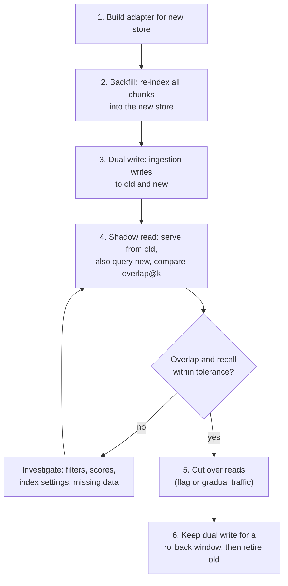

Phase 4 taught you how individual vector databases work: [Pinecone](/learn/vector-database-ecosystem/pinecone), [Qdrant](/learn/vector-database-ecosystem/qdrant), [Milvus](/learn/vector-database-ecosystem/milvus), [Weaviate](/learn/vector-database-ecosystem/weaviate), [pgvector](/learn/vector-database-ecosystem/postgresql-with-pgvector) and others. This lesson asks a different question: **who runs it?** A vector database in production is a stateful, memory-hungry, latency-sensitive service that must be patched, backed up, scaled and watched. You can do that yourself, on virtual machines or Kubernetes, or pay a provider to do it. That choice shapes cost, reliability, security reviews and how hard it will be to change your mind later.

The lesson is not a product catalogue (prices and features change every quarter). It gives you the shape of the market, a precise account of what "managed" does and does not take off your hands, a way to compare usage-based and provisioned pricing, and the engineering pattern that keeps you free to switch: a thin storage interface plus a shadow comparison you can run before any migration. The code builds that harness and runs it on a real retrieval benchmark.

## Learning objectives

- Place a vector store on the spectrum from embedded library to serverless service, and state what the operator is responsible for at each point.
- Evaluate a managed vector database against a written checklist covering data model, consistency, scaling, limits, security, recovery and portability.
- Compute the break-even query volume between usage-based and provisioned pricing.
- Build a backend-neutral storage interface and use overlap@k against exact search to compare two backends before a migration.
- Plan a migration between vector stores with dual writes, shadow reads and a reversible cut-over.

## Prerequisites

- [What is a vector database?](/learn/vector-database-fundamentals/what-is-a-vector-database): the core operations every store provides.
- [Pinecone](/learn/vector-database-ecosystem/pinecone) and [Qdrant](/learn/vector-database-ecosystem/qdrant): one serverless and one self-hostable store in depth.
- [Recall versus latency](/learn/vector-indexing-algorithms/recall-versus-latency): why approximate indexes return slightly different results.
- [Cloud deployment](/learn/deployment/cloud-deployment): the managed-versus-self-hosted trade-off in general.
- [Backup and recovery](/learn/advanced-vector-database-engineering/backup-and-recovery): what must be recoverable, whoever runs the database.

## Why this matters

Self-hosting a vector database looks cheap on the first day: one container, one volume. The costs arrive later. Someone must size memory so the index fits, upgrade the database without downtime, rotate certificates, take backups and prove they restore, add replicas before a launch, and be woken at night when a node fails. For a small team whose product is the RAG application, not the database, that work competes with everything else they should be doing.

Buying a managed service moves that work to a vendor, but it is not free of engineering. You still choose the plan and its capacity, design the schema and filters, secure the network path and credentials, enforce who may read what, and pay a bill whose shape (per query, per node-hour, per gigabyte) decides whether success is affordable. And every managed service has quirks: different score conventions, limits on metadata size or namespace count, eventual consistency on writes, regional availability. Teams that pick by benchmark headline or by whoever sent the friendliest sales engineer discover those quirks after the migration, when they are expensive to undo.

## The intuition

Think about where you keep your car. You can build a garage at home: total control, nobody else's rules, but you fix the door, clear the snow and pay for it whether you drive or not. You can rent a space in a managed car park: someone else maintains it, you pay monthly for your reserved space, and you follow their opening hours. Or you can pay per hour at a public car park: perfect for occasional use, ruinous if you park there every day.

None is best in general. The right answer depends on how often you drive, how much the car is worth to you, and whether you have time to maintain a garage. The one universal rule is to keep your car keys: if you must ever move car parks, you want to drive out, not discover the car is welded to the floor. In vector-database terms, the keys are your source documents, your chunking code and the ability to re-embed and re-index anywhere.

## How it works

### The spectrum of operating models

| Model | Examples | You operate | Vendor operates |
| --- | --- | --- | --- |
| Embedded library | FAISS, Chroma or Qdrant in local mode, LanceDB | Everything, inside your process | Nothing |
| Self-hosted server | Qdrant, Milvus, Weaviate, OpenSearch on VMs or Kubernetes | Machines, storage, upgrades, backups, scaling, monitoring | Nothing (you may buy support) |
| Managed cluster | Qdrant Cloud, Zilliz Cloud (Milvus), Weaviate Cloud, Elastic Cloud | Capacity choice, schema, access, client-side retries | Machines, upgrades, backups, failover |
| Serverless | Pinecone serverless, Zilliz serverless, Amazon OpenSearch Serverless | Schema, access, cost control | Capacity as well: it scales with usage |
| Vector features of a database you already run | pgvector on RDS, Cloud SQL, AlloyDB or Azure Database for PostgreSQL; MongoDB Atlas Vector Search; Azure AI Search; Vertex AI Vector Search | The same as for that database | The same as for that database |

Two hybrid arrangements are worth knowing. Some vendors run the **control plane** (provisioning, upgrades, monitoring) while the **data plane** (the nodes that hold your vectors) runs inside your own cloud account or Kubernetes cluster; Qdrant's Hybrid Cloud is one example. That suits organisations whose data may not leave their network but who do not want to operate the database alone. And the last row of the table is often the most pragmatic: if Meridian already runs a managed PostgreSQL with backups, monitoring and an on-call rota, adding pgvector costs almost no new operational work, at the price of fewer vector-specific features.

Each major cloud also has native options, which keep billing, identity and private networking inside one provider. On **AWS**: Amazon OpenSearch Service and OpenSearch Serverless vector collections, and Aurora or RDS for PostgreSQL with pgvector; Amazon Bedrock Knowledge Bases can manage the whole retrieval pipeline on top of such stores. On **Azure**: Azure AI Search (see [Azure](/learn/deployment/azure)), Azure Cosmos DB vector search, and Azure Database for PostgreSQL with pgvector. On **Google Cloud**: Vertex AI Vector Search, AlloyDB and Cloud SQL with pgvector, and BigQuery vector search (see [Google Cloud](/learn/deployment/google-cloud)). Several third-party services, including Qdrant Cloud, Pinecone and Zilliz Cloud, can also be bought through the clouds' marketplaces and run in a chosen provider's region.

### What "managed" covers, and what it never covers

A managed service takes on the undifferentiated work: hardware, operating system, database upgrades, replication, failover, backups to the vendor's storage, and usually encryption at rest. It **never** takes on:

1. **Correctness of your data.** If your ingestion pipeline writes the wrong chunks, the vendor stores them faithfully.
2. **Access control between your users.** The service authenticates *your application*. Which employee may see which chunk is a filter your application must apply on every query ([Document-level permissions](/learn/access-control-and-privacy/document-level-permissions)).
3. **Recovering from your own mistakes.** A `delete` your code issued is a valid instruction. Vendor backups may help, but check whether you can restore a single collection to a point in time, how far back, and how long it takes; then test it.
4. **Capacity decisions on provisioned plans.** You choose the node size and count. If the index outgrows memory, latency degrades or writes fail until you resize.
5. **Cost control.** On usage-based plans, a runaway loop or a scraper hammering your API turns directly into a bill.
6. **Portability.** Nothing obliges a vendor to make leaving easy.

This split is often called the **shared-responsibility model**. Write down your side of it before choosing a vendor, because it defines the work you still need to staff.

### An evaluation checklist

When Meridian's Platform team compares candidates, they score each against the following. Every item is something a test or a document can answer, not an impression.

- **Data model fit.** Payload filters with the operators you need, hybrid dense and sparse search, multiple vectors per record, and namespaces or tenants ([Multi-tenancy](/learn/advanced-vector-database-engineering/multi-tenancy)).
- **Score semantics.** Does a search return a similarity (higher is better) or a distance (lower is better)? Chroma and pgvector's `<=>` operator return cosine *distance*; Qdrant and Pinecone return similarity scores. Any threshold in your code, such as "refuse to answer if the best score is below 0.3", silently inverts if you miss this.
- **Consistency.** How long until a write is searchable? Serverless designs are often eventually consistent; [Index updates](/learn/advanced-vector-database-engineering/index-updates) explains why this matters for deletions.
- **Limits.** Maximum dimensions, metadata size per record, records per namespace, namespaces per index, request size, rate limits.
- **Scaling model.** Provisioned (you choose nodes; cost is flat; capacity is a ceiling) or usage-based (cost follows traffic; capacity is the vendor's problem, within rate limits).
- **Availability and recovery.** The SLA's actual terms and exclusions, replica options, backup frequency, point-in-time restore, cross-region recovery.
- **Security and compliance.** Private networking (AWS PrivateLink, Azure Private Link, Google Private Service Connect, or VPC peering), customer-managed encryption keys, audit logs, single sign-on for the console, and the certifications your security team requires.
- **Region and residency.** Is the service offered in the region where your data must live, next to your API?
- **Portability.** Can you export vectors and payloads in bulk? Does the client API resemble anything else? Is there an open-source version you could self-host?
- **Recall control.** Can you tune the index (for HNSW, `ef` at query time), or is recall whatever the vendor decides?

### Keeping the exit open

Lock-in is not avoided by refusing to use vendor features; it is managed by keeping three things under your control:

1. **The source of truth lives outside the vector store.** Raw documents, extracted text, chunk boundaries and metadata are stored in your own object storage or database. The vector store is a derived index you can rebuild.
2. **A thin storage interface.** Application code calls `upsert` and `search` on an interface you own; one adapter per backend translates. The interface is also where you normalise score conventions and error types.
3. **A comparison harness.** Before any switch, you can index the same data in both backends and measure how much the results differ. That is the code in this lesson.

With those in place, a migration follows a standard sequence:



Step 3 must start before step 2 finishes, or documents changed during the backfill are missing from the new store. Step 6 is what makes the cut-over reversible: while the old store still receives writes, switching back is a configuration change. The versioning side of this is developed in [Index versioning](/learn/ci-cd-and-mlops/index-versioning) and [Rollbacks](/learn/ci-cd-and-mlops/rollbacks).

## The mathematics

### Usage-based versus provisioned cost

**Intuition.** A usage-based plan charges a small fixed amount (storage) plus a price per operation. A provisioned plan charges a flat amount per hour whether queried or not. At low traffic the usage-based line sits below the flat line; as traffic grows, it crosses it. The crossing point is the break-even volume, the same reasoning [Cloud deployment](/learn/deployment/cloud-deployment) applied to compute, here with a storage term added.

$$
C_{\text{usage}}(Q) = S\,p_s + W\,p_w + Q\,p_q, \qquad C_{\text{prov}} = n\,p_h\,H, \qquad Q^{*} = \frac{n\,p_h\,H - S\,p_s - W\,p_w}{p_q}
$$

$Q$ is queries per month; $S$ stored gigabytes and $p_s$ the price per gigabyte-month; $W$ writes per month and $p_w$ the price per write; $p_q$ the price per query; $n$ the number of provisioned nodes, $p_h$ the price per node-hour and $H$ the hours in a month (about 730). $Q^{*}$ is the volume at which the two cost the same.

Real usage-based pricing is rarely a flat price per query. Pinecone serverless, for example, meters "read units" whose number per query grows with the size of the namespace searched (see [Pinecone](/learn/vector-database-ecosystem/pinecone)). Treat $p_q$ as the *average* cost of one of your queries, measured from a bill or a vendor calculator.

**By hand**, with illustrative assumptions that are not any vendor's prices: provisioned at 2 nodes times 0.25 USD per hour times 730 hours is 365 USD a month. The usage-based fixed part is 2 GB at 0.33 USD (0.66 USD) plus a million writes at 2 USD per million (2 USD), so 2.66 USD. With queries at 4 USD per million, $Q^{*} = (365 - 2.66) / 0.000004 \approx 90.6$ million queries a month, an average of about 34.5 per second.

```python
HOURS_PER_MONTH = 730

# Illustrative assumptions, not any vendor's prices.
storage_gb, price_gb_month = 2.0, 0.33         # usage-based storage
writes_per_month, price_per_m_writes = 1_000_000, 2.0
price_per_m_queries = 4.0                      # usage-based reads
nodes, price_node_hour = 2, 0.25               # provisioned cluster

provisioned = nodes * price_node_hour * HOURS_PER_MONTH
fixed_usage = storage_gb * price_gb_month + writes_per_month / 1e6 * price_per_m_writes
q_star = (provisioned - fixed_usage) / (price_per_m_queries / 1e6)

print(f"provisioned per month : USD {provisioned:,.2f}")
print(f"usage-based fixed part: USD {fixed_usage:,.2f}")
print(f"break-even queries    : {q_star:,.0f} per month")
print(f"                      = {q_star / (HOURS_PER_MONTH * 3600):.1f} queries per second on average")
for q in (5e6, 50e6, 200e6):
    usage = fixed_usage + q / 1e6 * price_per_m_queries
    print(f"{q / 1e6:>5.0f}M queries: usage-based USD {usage:>8,.2f}  provisioned USD {provisioned:,.2f}")
```

```output
provisioned per month : USD 365.00
usage-based fixed part: USD 2.66
break-even queries    : 90,585,000 per month
                      = 34.5 queries per second on average
    5M queries: usage-based USD    22.66  provisioned USD 365.00
   50M queries: usage-based USD   202.66  provisioned USD 365.00
  200M queries: usage-based USD   802.66  provisioned USD 365.00
```

An internal assistant for 400 staff, like AskMeridian, sits far to the left of this break-even: a few thousand queries a day is well under 5 million a month. A public product with steady heavy traffic may sit to the right. Two caveats keep the comparison honest. A provisioned cluster's capacity is a ceiling, so you must buy for peak, not for the average; and the provisioned figure excludes the engineering time of running it, which for a self-hosted cluster is usually the largest cost of all.

### Overlap@k

**Intuition.** When you compare two stores, you first want to know how much their answers *differ*, before asking whether either is *right*. Overlap@k is the fraction of one store's top $k$ that also appears in the other's.

$$
\text{overlap@}k(q) = \frac{\lvert A_k(q) \cap B_k(q) \rvert}{k}
$$

$A_k(q)$ and $B_k(q)$ are the sets of top-$k$ IDs returned for query $q$ by the reference and the candidate. Averaged over a query set, a value of 1.0 means identical result sets. When the reference is exact search, overlap@k is the candidate's **ANN recall**: how much of the true nearest neighbours the approximate index found. If the reference returns IDs {3, 7, 9, 12} and the candidate returns {3, 7, 12, 40} at $k = 4$, overlap@4 is $3/4 = 0.75$. Overlap needs no relevance labels, so you can compute it on live production queries during a shadow read. Recall against labelled relevant documents, from [Recall@K](/learn/retrieval-evaluation/recall-k), then tells you whether the differences matter.

## In code

**Problem.** Meridian's Platform team runs AskMeridian on Qdrant and wants to evaluate an alternative without rewriting the application. The code defines a storage interface, implements it for two backends, and compares them on BEIR SciFact (5,183 scientific abstracts with 300 labelled test queries) against exact search. Locally, Qdrant runs in its in-process mode and FAISS stands in for "another vendor"; against a managed service you would pass a different client to the same adapter.

```bash
pip install qdrant-client faiss-cpu sentence-transformers datasets numpy
```

```python
import time
from typing import Protocol

import faiss
import numpy as np
from datasets import load_dataset
from qdrant_client import QdrantClient, models
from sentence_transformers import SentenceTransformer


class VectorStore(Protocol):
    """The only surface the application sees. Scores are similarities: higher is better."""
    def upsert(self, ids: list[int], vectors: np.ndarray, payloads: list[dict]) -> None: ...
    def search(self, vector: np.ndarray, k: int) -> list[tuple[int, float]]: ...


class QdrantStore:
    def __init__(self, client: QdrantClient, collection: str, dims: int):
        self.client, self.collection = client, collection
        client.create_collection(
            collection, vectors_config=models.VectorParams(size=dims, distance=models.Distance.COSINE)
        )

    def upsert(self, ids, vectors, payloads):
        for start in range(0, len(ids), 512):  # batch writes, as against a remote service
            end = start + 512
            self.client.upsert(self.collection, points=[
                models.PointStruct(id=i, vector=v.tolist(), payload=p)
                for i, v, p in zip(ids[start:end], vectors[start:end], payloads[start:end])
            ])

    def search(self, vector, k):
        hits = self.client.query_points(self.collection, query=vector.tolist(), limit=k).points
        return [(h.id, h.score) for h in hits]  # Qdrant's cosine score is already a similarity


class FaissHnswStore:
    def __init__(self, dims: int, m: int = 16, ef_search: int = 16):
        self.index = faiss.IndexIDMap(faiss.IndexHNSWFlat(dims, m, faiss.METRIC_INNER_PRODUCT))
        faiss.downcast_index(self.index.index).hnsw.efSearch = ef_search

    def upsert(self, ids, vectors, payloads):
        self.index.add_with_ids(vectors.astype("float32"), np.asarray(ids, dtype="int64"))

    def search(self, vector, k):
        scores, ids = self.index.search(vector.reshape(1, -1).astype("float32"), k)
        return [(int(i), float(s)) for i, s in zip(ids[0], scores[0]) if i != -1]


# --- Data: BEIR SciFact, embedded once ------------------------------------------
corpus = load_dataset("BeIR/scifact", "corpus", split="corpus")
queries = {str(r["_id"]): r["text"] for r in load_dataset("BeIR/scifact", "queries", split="queries")}
qrels: dict[str, set[int]] = {}
for r in load_dataset("BeIR/scifact-qrels", split="test"):
    qrels.setdefault(str(r["query-id"]), set()).add(int(r["corpus-id"]))

model = SentenceTransformer("sentence-transformers/all-MiniLM-L6-v2")
doc_ids = [int(d) for d in corpus["_id"]]
doc_vecs = model.encode([f"{t} {x}" for t, x in zip(corpus["title"], corpus["text"])],
                        normalize_embeddings=True, batch_size=64)
test_ids = sorted(qrels)
q_vecs = model.encode([queries[q] for q in test_ids], normalize_embeddings=True)
print(f"corpus: {len(doc_ids)} docs, {doc_vecs.shape[1]} dims; test queries: {len(test_ids)}")

# --- Reference: exact search, the yardstick for "did the new store change results?" --
K = 10
exact = np.argsort(-(q_vecs @ doc_vecs.T), axis=1)[:, :K]
exact_ids = [[doc_ids[j] for j in row] for row in exact]

stores: dict[str, VectorStore] = {
    "qdrant (local mode)": QdrantStore(QdrantClient(":memory:"), "scifact", doc_vecs.shape[1]),
    "faiss hnsw ef=16": FaissHnswStore(doc_vecs.shape[1], ef_search=16),
    "faiss hnsw ef=128": FaissHnswStore(doc_vecs.shape[1], ef_search=128),
}
payloads = [{"source": "scifact"} for _ in doc_ids]

print(f"\n{'store':<20} {'overlap@10':>10} {'recall@10':>9} {'ms/query':>8}")
for name, store in stores.items():
    store.upsert(doc_ids, doc_vecs, payloads)
    t0 = time.perf_counter()
    results = [store.search(v, K) for v in q_vecs]
    ms = (time.perf_counter() - t0) * 1000 / len(q_vecs)
    overlap, recall = [], []
    for qid, hits, ref in zip(test_ids, results, exact_ids):
        got = [i for i, _ in hits]
        overlap.append(len(set(got) & set(ref)) / K)
        recall.append(len(set(got) & qrels[qid]) / len(qrels[qid]))
    print(f"{name:<20} {np.mean(overlap):>10.3f} {np.mean(recall):>9.3f} {ms:>8.2f}")
```

The overlap and recall figures are deterministic for this data and model; the timings are from one laptop run and will differ on your machine:

```output
corpus: 5183 docs, 384 dims; test queries: 300

store                overlap@10 recall@10 ms/query
qdrant (local mode)       1.000     0.783     2.57
faiss hnsw ef=16          0.907     0.738     0.12
faiss hnsw ef=128         0.995     0.777     0.28
```

**The important lines.**

- `class VectorStore(Protocol)` is the seam. The application depends only on `upsert` and `search`, and the docstring fixes the contract that scores are similarities. An adapter for a store that returns distances would convert them (for cosine distance, `1 - distance`) so that thresholds elsewhere keep working.
- `QdrantStore` takes a `QdrantClient` rather than building one. Locally it gets `QdrantClient(":memory:")`; against Qdrant Cloud it would get `QdrantClient(url=..., api_key=...)` with the key read from the environment. Nothing else changes, which is the point.
- The upsert batches 512 points per call. Against a remote managed service, one call per point would spend most of its time on network round trips; one call for everything would hit request-size limits.
- `exact` computes true nearest neighbours by brute force, the yardstick for every backend. With 5,183 documents this takes milliseconds; with millions you would sample queries.
- `FaissHnswStore` exposes `ef_search`, the HNSW query-time breadth from [HNSW](/learn/vector-indexing-algorithms/hnsw), to make the recall trade visible.

**What the output means.** Three lessons sit in those rows.

First, Qdrant's local mode scored an overlap of exactly 1.000: in the client version used here it compares the query with every stored vector, so it *is* exact search. A Qdrant server or Qdrant Cloud builds an HNSW index and is approximate. Tests run against local mode therefore overstate the recall you will see in production; the comparison that matters is against the deployed configuration.

Second, the approximate index with a small search breadth (`ef=16`) agrees with exact search on about 91% of the top 10, and its recall against the human relevance labels falls from 0.783 to 0.738: roughly one relevant document lost for every twenty or so the exact search finds. Raising `ef` to 128 recovers almost all of it (0.995 overlap, 0.777 recall) for a little more query time. A managed service that hides this setting has made the choice for you; the harness tells you which choice.

Third, overlap and recall answer different questions. Overlap shows *whether* results changed, needs no labels and works on live traffic. Recall shows whether the change *hurt*. In a shadow read, use overlap to find the queries that differ and labelled evaluation to judge them.

**Common errors.** Qdrant point IDs must be unsigned integers or UUIDs, so string chunk IDs such as `hb-leave#0` need mapping (store the readable ID in the payload). FAISS's `IndexHNSWFlat` cannot take your own IDs directly, hence the `IndexIDMap` wrapper. Forgetting `normalize_embeddings=True` makes inner product differ from cosine and the backends disagree for reasons unrelated to the stores.

**Extending it.** Add a third adapter for a managed service you are evaluating, run it on your own golden set, and record overlap per query so you can read the worst cases. Add a payload filter to `search` and check that every adapter returns the same filtered results; filter semantics (missing fields, array matching) are where backends most often disagree.

## A real-world example

Meridian's Platform team had run AskMeridian's Qdrant cluster on Kubernetes for two years. After a weekend outage caused by a full disk on one node, and with the team's only Qdrant specialist moving to another project, they evaluated moving the same engine to a managed offering and, for comparison, two other managed stores.

They wrote the evaluation as code: an adapter per candidate, a backfill job, and a shadow-read flag in the API that sent each production query to the candidate as well, logged overlap@10 and discarded the candidate's answer. Two findings changed the decision. One candidate returned cosine *distance*, and its first adapter version passed it through unchanged; the shadow logs showed AskMeridian's "no good match, say I don't know" rule would have fired on almost every *good* match. The adapter now converts scores, and the team added a unit test that checks the best-matching document for a known query has the highest score in every adapter. A second candidate's filter on a missing metadata field excluded the record where Qdrant included it, so documents ingested before the `department` field existed vanished from filtered queries; the backfill was changed to write the field explicitly.

The team chose managed Qdrant in the same cloud region: the lowest migration risk (same API, same filters, same score semantics) and the cost of a small managed cluster was well below the engineering time the self-hosted cluster consumed. They kept dual writes for two weeks after cut-over, then retired the old cluster, and kept the adapter layer, because the next evaluation will come.

## Common mistakes

- **Choosing by published benchmark.** Vendor benchmarks use their own data, filters and settings. Run your own queries through your own harness.
- **Ignoring score conventions.** A distance read as a similarity inverts every threshold. Normalise in the adapter and test it.
- **Making the vector store the only copy of your data.** If the source documents and chunks live nowhere else, you cannot re-embed, re-chunk or leave. Keep the source of truth in your own storage.
- **Assuming managed means backed up the way you need.** Check restore granularity, retention and time to restore; run a restore drill.
- **Sizing a provisioned plan for the average.** Capacity is a ceiling; peak traffic and index growth must fit.
- **Testing against local or embedded mode only.** Local modes are often exact and in-process; production is approximate and remote, with different recall and latency.
- **Starting dual writes after the backfill.** Documents changed during the backfill are lost from the new store.

## Best practices

- Write the shared-responsibility split down and staff your side of it.
- Keep a thin storage interface with adapters, normalised scores and a common error type.
- Evaluate with overlap@k against exact search and recall on a golden set, on your own data and filters.
- Migrate with backfill, dual write, shadow read, gradual cut-over and a rollback window.
- Put the managed store in the same region as the API, reached over private networking.
- Watch the bill as a metric: alert on query and write volume, not just on latency.
- Prefer the database you already operate (pgvector on managed PostgreSQL, say) when its vector features are sufficient.

## Performance considerations

**Network round trips.** An embedded index answers in microseconds to milliseconds; a managed service adds a network round trip on every call: often around a millisecond within one region and tens of milliseconds across regions. A RAG request that issues several searches (hybrid legs, query decomposition) pays it several times, so co-locate, batch, and issue independent searches in parallel ([Parallel retrieval](/learn/performance-optimisation/parallel-retrieval)).

**Cold data.** Serverless stores that cache index files from object storage can be slow on the first query to rarely used data. Test cold-namespace latency, not only warm benchmarks.

**Recall versus latency.** In the harness, raising `ef` from 16 to 128 cost a fraction of a millisecond per query on 5,000 documents and recovered most of the lost recall. On a large index the cost is larger, but the principle holds: measure the curve and pick a point, rather than accept a default you have not seen.

**Write throughput.** Bulk backfills are limited by request size and rate limits. At 512 vectors of 384 floats per batch, each request carries about 0.8 MB of float data before encoding overhead; a backfill of a million vectors is about 2,000 such requests, so parallelise within the rate limit and make the job resumable.

**Cost scaling.** Usage-based cost grows linearly with traffic, and with namespace size on stores that meter reads that way. Provisioned cost grows in steps as you add nodes. Recompute the break-even when traffic changes by an order of magnitude.

## Security considerations

Managed vector stores hold derived copies of your documents, and vectors can leak information about the text they encode, so treat the store with the same classification as the source documents. Use private networking where offered and restrict public endpoints to known addresses. Keep API keys in a secret manager, scope them to the minimum (read-only keys for the query path where the vendor supports them) and rotate them. Confirm encryption at rest and, where required, customer-managed keys. Check the vendor's data-processing terms and region for residency obligations. Enforce per-user access with filters on every query, because the vendor only knows your application. Finally, verify that deletes propagate to backups within your retention obligations, a point [Secure deletion](/learn/enterprise-rag-governance/secure-deletion) develops.

## Summary

- Vector stores range from embedded libraries through self-hosted servers and managed clusters to serverless services and vector features of databases you already run.
- Managed services take on hardware, upgrades, replication and backups; they never take on your data's correctness, per-user access control, capacity choices on provisioned plans, cost control or portability.
- Usage-based pricing wins below the break-even volume $Q^{*}$ and provisioned above it; include peak sizing and engineering time in the comparison.
- Keep the exit open with an external source of truth, a thin storage interface and a comparison harness.
- Overlap@k against exact search measures how much a backend changes results; recall on labelled queries measures whether the change matters; local or embedded modes may be exact and overstate production recall.

## Exercises

**1.** A store returns cosine distance. Your application refuses to answer when the best similarity is below 0.35. What must the adapter return for a hit with distance 0.58, and does that hit pass the threshold?

<details><summary>Show solution</summary>

Similarity is $1 - 0.58 = 0.42$, which is above 0.35, so the hit passes. Passed through unconverted, 0.58 would also pass here by coincidence, but a strong match (distance 0.1) would then read as 0.1 and be refused, which is exactly the inversion the adapter prevents.

</details>

**2.** Using the cost model and the same illustrative prices, what is the break-even query volume if the provisioned option needs three nodes for availability?

<details><summary>Show solution</summary>

$C_{\text{prov}} = 3 \times 0.25 \times 730 = 547.5$ USD. $Q^{*} = (547.5 - 2.66) / 0.000004 \approx 136.2$ million queries a month, about 51.8 per second on average.

</details>

**3.** Add a `search_filtered(vector, k, source)` method to both adapters. For FAISS, which has no payload filtering in this setup, implement it by over-fetching and filtering. Explain why over-fetching can return fewer than `k` results.

<details><summary>Show solution</summary>

```python
# Qdrant: the filter is applied inside the search.
def search_filtered(self, vector, k, source):
    flt = models.Filter(must=[models.FieldCondition(key="source", match=models.MatchValue(value=source))])
    hits = self.client.query_points(self.collection, query=vector.tolist(), limit=k, query_filter=flt).points
    return [(h.id, h.score) for h in hits]

# FAISS: keep payloads in a dict and post-filter an over-fetched candidate list.
def search_filtered(self, vector, k, source, overfetch=10):
    hits = self.search(vector, k * overfetch)
    return [(i, s) for i, s in hits if self.payloads[i]["source"] == source][:k]
```

For FAISS, the adapter's `upsert` must also store `self.payloads = dict(zip(ids, payloads))`. Post-filtering returns fewer than `k` results when fewer than `k` of the `k * overfetch` nearest neighbours match the filter, which happens whenever the filter is selective. Stores that filter during the search, as [Filtering](/learn/vector-database-fundamentals/filtering) explains, avoid this.

</details>

**4.** Design question: a 15-person start-up expects 50,000 queries a day for a year, then possibly a hundred times more. Which operating model would you start with, and what would you build now to keep the later decision open?

<details><summary>Show solution</summary>

50,000 queries a day is about 1.5 million a month, far below any plausible break-even, and a small team should not operate a database: start on a serverless or small managed plan in the same region as the API. Build now: the storage interface with normalised scores; source documents and chunks in your own object storage; a re-index job that can target any adapter; the overlap harness and a golden set. At a hundred times the traffic, about 150 million queries a month, rerun the cost comparison with real billing data and, if a provisioned or self-hosted option wins, migrate with dual writes and shadow reads.

</details>

## Check your understanding

```quiz
[
  {"q": "Which responsibility stays with you even on a fully managed vector database?", "options": ["Applying operating-system patches to the nodes", "Ensuring each user only retrieves chunks they are allowed to read", "Replicating data between availability zones", "Upgrading the database engine"], "answer": 1, "why": "The service authenticates your application; per-user authorisation is a filter your application must apply."},
  {"q": "In the harness, Qdrant local mode scored overlap@10 of 1.000 against exact search. What should you conclude?", "options": ["Qdrant Cloud will also have perfect recall", "Overlap is not a useful metric", "FAISS has a bug", "Local mode compares against every vector, so it is exact; a deployed HNSW index will be approximate"], "answer": 3, "why": "Local mode is exhaustive in the version used, so its results equal exact search; production servers use approximate indexes."},
  {"q": "A provisioned plan costs 500 USD a month. A usage-based plan costs 10 USD a month plus 5 USD per million queries. What is the break-even volume?", "options": ["98 million queries a month", "100 million queries a month", "50 million queries a month", "2 million queries a month"], "answer": 0, "why": "(500 - 10) / 5 = 98 million queries."},
  {"q": "During a migration, when should dual writes begin?", "options": ["After the cut-over", "After the backfill completes", "Before or at the start of the backfill", "Only if the shadow read fails"], "answer": 2, "why": "Otherwise documents changed during the backfill are missing from the new store."},
  {"q": "Why can overlap@k be measured on live production queries while recall@k usually cannot?", "options": ["Overlap needs no relevance labels, only the two result lists", "Recall is too slow to compute", "Overlap is always higher", "Production queries have no top-k"], "answer": 0, "why": "Overlap compares two systems' outputs; recall needs labelled relevant documents per query."}
]
```

## Further reading

- Qdrant, [Qdrant Cloud documentation](https://qdrant.tech/documentation/cloud/): managed and hybrid deployment of the engine used by AskMeridian.
- Pinecone, [Pinecone documentation](https://docs.pinecone.io/): serverless architecture, read and write units, and limits.
- pgvector, [pgvector on GitHub](https://github.com/pgvector/pgvector): the extension behind most managed PostgreSQL vector offerings.
- Thakur, N., Reimers, N., Rücklé, A., Srivastava, A. and Gurevych, I. (2021), [BEIR: A Heterogeneous Benchmark for Zero-shot Evaluation of Information Retrieval Models](https://arxiv.org/abs/2104.08663): the benchmark the harness uses.
- Aumüller, M., Bernhardsson, E. and Faithfull, A. (2020), "ANN-Benchmarks: A benchmarking tool for approximate nearest neighbor algorithms", *Information Systems* 87: how to compare ANN indexes fairly.
