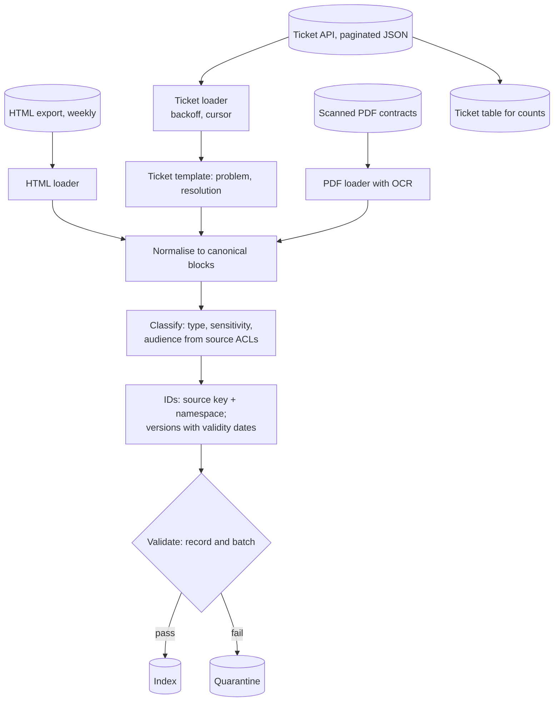

This assessment covers all eight lessons of **Document Engineering**: loaders, metadata, normalisation, classification, versioning, identifiers, validation and the ingestion of structured records. Answer the 20 multiple-choice questions first; the pass mark is 70% (14 of 20). Then work through the open questions, the coding exercises, the design challenge and the troubleshooting scenarios, writing your own answer to each before opening the model answer. The written parts are not scored, but they are where you find out whether you can apply the ideas and not merely recognise them.

```quiz
[
  {
    "q": "What is the contract every document loader in a pipeline should honour?",
    "options": [
      "Return the raw bytes of each file so that later stages can decide what to do",
      "Turn a source into an iterable of documents, each with extracted text and provenance metadata, and report failures instead of raising on the first one",
      "Split each file into chunks of a fixed size",
      "Embed each file and write the vector to the store"
    ],
    "answer": 1,
    "why": "A shared loader contract (documents with text and provenance, isolated per-document failures) lets the rest of the pipeline treat every source the same way. Chunking and embedding are later stages."
  },
  {
    "q": "A file named `budget.pdf` begins with the bytes `PK\\x03\\x04`. What should a loader conclude?",
    "options": [
      "It is a PDF, because the extension says so",
      "It is corrupt and should be deleted",
      "It is a ZIP container (for example a DOCX or XLSX), so the extension is wrong and the leading bytes should decide the parser",
      "It is plain text"
    ],
    "answer": 2,
    "why": "Leading bytes (magic numbers) are more reliable than extensions. A PDF starts with `%PDF`; `PK` marks a ZIP archive, which is the container for Office Open XML files."
  },
  {
    "q": "What does this code print?\n```python\ndef lazy():\n    for i in range(3):\n        print(\"read\", i)\n        yield i\n\ng = lazy()\nprint(\"created\")\nprint(next(g))\n```",
    "options": [
      "read 0, read 1, read 2, created, 0",
      "created, 0",
      "read 0, created, 0",
      "created, read 0, 0"
    ],
    "answer": 3,
    "why": "Calling a generator function runs none of its body. The body runs only when next() asks for a value, and then only as far as the first yield. This is what lets a lazy loader read just the files that are consumed."
  },
  {
    "q": "Which metadata field should be taken only from the source system of record, never inferred from the document's content?",
    "options": [
      "The access-control list (who may read the document)",
      "The document's language",
      "The heading path of a section",
      "The word count"
    ],
    "answer": 0,
    "why": "Permissions decide who may retrieve the text. A guess from content can make a restricted document visible; access fields must come from the system that enforces them, and fail closed when missing."
  },
  {
    "q": "A metadata field `department` holds \"HR\", \"Human Resources\", \"hr\" and \"People Team\" for documents owned by the same team. What is the consequence, and the fix?",
    "options": [
      "No consequence; embedding models treat them as synonyms",
      "A filter on department = HR silently misses most of the team's documents; use a controlled vocabulary and reject or map other values at ingestion",
      "The vector store rejects the documents",
      "The documents are de-duplicated together"
    ],
    "answer": 1,
    "why": "Metadata filters match exact values. Free-text values split one category into many, and the miss is silent. A controlled vocabulary turns the inconsistency into an ingestion error that can be fixed."
  },
  {
    "q": "Why is document normalisation built around one intermediate representation (typed blocks) rather than a converter for every pair of formats?",
    "options": [
      "Because embedding models require blocks",
      "Because it makes documents shorter",
      "Because the block model is required by the Markdown specification",
      "With m input formats and n consumers, adapters into one representation need m + n pieces of code instead of m × n, and every later stage understands a single structure"
    ],
    "answer": 3,
    "why": "Adapters map each format into the shared representation once, and each consumer (renderer, chunker, hasher) reads that representation once. Pairwise converters multiply."
  },
  {
    "q": "Three sources give a policy's effective date as \"03/04/2025\", \"2025-04-03\" and \"3 April 2025\". What is the right normalisation?",
    "options": [
      "Keep each as written; dates are only for display",
      "Parse each with the date convention known for its source, store ISO 8601 (2025-04-03), and reject values that do not parse rather than guessing",
      "Always parse slash dates as month first",
      "Store the year only"
    ],
    "answer": 1,
    "why": "\"03/04/2025\" is 3 April in the UK and 4 March in the US, so the convention must come from the source. ISO 8601 strings sort and compare correctly, which date filters need."
  },
  {
    "q": "A document classifier is evaluated on 200 documents, of which 190 are policies. It labels every document as a policy. What does this show?",
    "options": [
      "The classifier is excellent: 95% accuracy",
      "The classifier needs a larger model",
      "Accuracy hides the failure; per-class recall for the minority classes is 0, which a confusion matrix shows at once",
      "The test set is too large"
    ],
    "answer": 2,
    "why": "With imbalanced classes, predicting the majority class scores high accuracy while being useless for every other class. Evaluate with a confusion matrix and per-class precision, recall and F1."
  },
  {
    "q": "In a classification cascade for incoming documents, what usually comes first?",
    "options": [
      "Deterministic rules on the source or location (for example, every file in the runbook repository is a runbook), because they are cheap, exact and explainable",
      "A large language model call for every document",
      "Human review of every document",
      "Random assignment, corrected later"
    ],
    "answer": 0,
    "why": "Many documents can be labelled with certainty from where they came from. Rules handle those at no cost; a trained model, an optional language model and finally a review queue handle what remains."
  },
  {
    "q": "A version is valid on the half-open interval from 2023-01-01 (inclusive) to 2025-01-01 (exclusive). Is it returned for a query as of 2025-01-01?",
    "options": [
      "Yes, because the interval includes both ends",
      "Yes, but only if it is the latest version",
      "It depends on the time zone of the vector store",
      "No; on 2025-01-01 the next version applies, and half-open intervals guarantee exactly one version per date with no overlap"
    ],
    "answer": 3,
    "why": "With `valid_from <= date < valid_to`, consecutive versions share a boundary without both being valid on it, so every date maps to exactly one version."
  },
  {
    "q": "A pipeline sets `is_current = true` on the newest version of each document at ingestion time. A policy version with an effective date of next month is ingested today. What goes wrong?",
    "options": [
      "Nothing; newest is always current",
      "The future version is marked current today, so the assistant answers with a policy that is not yet in force; currency should be decided at query time from validity dates",
      "The vector store rejects future dates",
      "The old version is deleted"
    ],
    "answer": 1,
    "why": "A flag computed at ingestion goes stale as dates pass. Comparing the query date with the validity interval at query time keeps the answer correct before and after the effective date."
  },
  {
    "q": "A source listing fails halfway and returns 300 of the usual 4,000 documents. A sync treats every document not in the listing as deleted. What is the right behaviour?",
    "options": [
      "Delete the 3,700 missing documents; the source is the truth",
      "Delete them, then re-ingest tomorrow",
      "Never infer deletions from a failed or incomplete listing: abort or hold the sync, and only tombstone a document when its absence is confirmed",
      "Ignore deletions entirely"
    ],
    "answer": 2,
    "why": "An incomplete listing looks exactly like mass deletion. Tombstones should come from explicit delete events or from a complete, healthy listing, and a sudden drop should stop the run."
  },
  {
    "q": "What does this code print?\n```python\nimport uuid\nNS = uuid.UUID(\"0b6f2a8e-5c1d-4e7a-9f3b-2d8c6e1a4b70\")\nprint(uuid.uuid5(NS, \"runbook:NET-114\") == uuid.uuid5(NS, \"runbook:NET-114\"),\n      uuid.uuid4() == uuid.uuid4())\n```",
    "options": [
      "True False",
      "True True",
      "False False",
      "False True"
    ],
    "answer": 0,
    "why": "uuid5 hashes a namespace and a name, so the same inputs always give the same UUID. uuid4 is random, so two calls (practically) never match. Deterministic IDs are what make re-runs idempotent."
  },
  {
    "q": "Runbooks are sometimes moved between folders in the Git repository, but each has a runbook ID such as NET-114 in its front matter. Which document ID scheme survives a move?",
    "options": [
      "A hash of the file path",
      "A hash of the file's content",
      "A random UUID stored in a local cache",
      "uuid5 of a namespace and \"runbook:NET-114\", with the path kept as metadata"
    ],
    "answer": 3,
    "why": "A stable natural key from the source survives moves; a path-derived ID changes on a move, and a content-derived ID changes on every edit. Keep the path as metadata for citations."
  },
  {
    "q": "An engineer proposes truncating SHA-256 to 32 bits for chunk IDs in a store expected to hold 10 million chunks. Using the birthday bound, is that safe?",
    "options": [
      "Yes; 32 bits give about 4.3 billion values, far more than 10 million",
      "No; a b-bit ID is safe for roughly 2^(b/2) items, here about 65,000, so collisions among 10 million chunks are practically certain",
      "Yes, because SHA-256 never collides",
      "It depends on the length of the chunks"
    ],
    "answer": 1,
    "why": "The chance of some pair colliding grows with the number of pairs, about n squared over 2. With n = 10 million and 2^32 values the expected number of colliding pairs is about 11,600."
  },
  {
    "q": "What does this code print?\n```python\nfrom typing import Literal\nfrom pydantic import BaseModel, ConfigDict, ValidationError\n\nclass Rec(BaseModel):\n    model_config = ConfigDict(extra=\"forbid\")\n    doc_type: Literal[\"policy\", \"runbook\"]\n    year: int\n\ntry:\n    Rec(doc_type=\"Policy\", year=\"2025\", owner=\"HR\")\nexcept ValidationError as e:\n    print(e.error_count(), [err[\"loc\"][0] for err in e.errors()])\n```",
    "options": [
      "3 ['doc_type', 'year', 'owner']",
      "1 ['doc_type']",
      "2 ['doc_type', 'owner']",
      "Nothing; the record is valid"
    ],
    "answer": 2,
    "why": "\"Policy\" is not one of the literal values (the check is case-sensitive) and `owner` is an extra field, which `extra=\"forbid\"` rejects. \"2025\" is coerced to the integer 2025 in lax mode. Pydantic reports all errors at once."
  },
  {
    "q": "A record fails validation because its extracted text is mostly symbols. Where should it go?",
    "options": [
      "To a quarantine store with the original input, the stage and the reasons, so it can be fixed and replayed through the full validation gate",
      "Into the index with a warning flag",
      "Nowhere: delete it to keep the pipeline fast",
      "Back to the loader in an infinite retry loop"
    ],
    "answer": 0,
    "why": "Quarantine keeps the evidence and a path back. Dropping silently creates unexplained gaps; indexing garbage pollutes retrieval; blind retries of a deterministic failure never succeed."
  },
  {
    "q": "Which check can only be done at batch level, not record by record?",
    "options": [
      "The text is not empty",
      "The document type is in the controlled vocabulary",
      "The effective date is a valid date",
      "Tonight's document count from the wiki is less than half of the last good run's"
    ],
    "answer": 3,
    "why": "Each record can be perfectly valid while the batch as a whole is broken, for example because a connector returned only part of the source. Comparing with previous runs per source catches it."
  },
  {
    "q": "A row of the Atlas error-code catalogue is `E-4021,VPN,2,Update client`. Which document text serves retrieval best?",
    "options": [
      "`E-4021,VPN,2,Update client`",
      "`Atlas error E-4021 (component: VPN, severity: 2 of 4). Fix: update the VPN client.`",
      "`{\"code\": \"E-4021\", \"component\": \"VPN\", \"severity\": 2, \"fix\": \"Update client\"}`",
      "`E-4021`"
    ],
    "answer": 1,
    "why": "A template keeps each value's label and meaning, decodes codes into words and makes the document self-contained. A bare CSV row or a JSON dump shares little vocabulary with real questions."
  },
  {
    "q": "A user asks AskMeridian \"list every laptop due for replacement this year\", over a laptop register ingested one document per row. What is the right design?",
    "options": [
      "Raise top-k to 1,000",
      "Re-embed the register with a larger model",
      "Answer from the top 5 rows and add \"and others\"",
      "Route the question to a structured query over the register (a filter on purchase date), because top-k retrieval returns a sample of similar rows, not every matching row"
    ],
    "answer": 3,
    "why": "Exhaustive lists, counts and sums need every matching record. Retrieval is built to return a few similar items, so the source must stay queryable and such questions must go to a structured query."
  }
]
```

## Conceptual questions

**1.** A loader, a normaliser and a validator all look at the same document. Explain what each one is responsible for, where the boundaries between them sit, and what goes wrong if the boundaries blur (for example, if the loader starts cleaning text or the validator starts fixing records).

<details><summary>Show model answer</summary>

The **loader** gets content out of a source and into the pipeline's document shape: it detects the type, picks a parser, extracts text and structure, and attaches provenance (source system, URI, file properties). Its output is faithful to the source, warts and all, and it reports what it could not read.

The **normaliser** removes the accident of format: it maps every source's structure into one canonical representation (headings with levels, paragraphs, list items, tables), tidies it with pure, deterministic passes (whitespace, empty blocks, table shape), puts field values such as dates into canonical forms, and renders one canonical text. Identical content from HTML, DOCX and Markdown should leave it identical.

The **validator** decides whether a record may go further. It checks the schema, the plausibility of the content and the health of the batch, and it either passes, warns or quarantines with reasons. It does not change the record.

When the boundaries blur, failures become hard to locate and to fix once. A loader that "cleans" text applies rules only to that one format, so the same content from another source ends up different and hashes differently. A validator that silently repairs records hides the upstream fault that produced them, so it is never fixed, and the repair itself is an untested transformation. Keeping each stage to one job means a bad chunk can be traced to the stage that made it, and a rule changes in one place.

</details>

**2.** Meridian's handbook exists in a superseded 2023 version (4-year laptop cycle, £250 equipment budget, support hours 09:00 to 17:00) and the current version (3 years, £400, 08:00 to 18:00). Describe two different indexing strategies for these versions, say what each costs, and say which you would choose for AskMeridian and why.

<details><summary>Show model answer</summary>

**Latest-only.** Index only the version currently in force; when a new version takes effect, delete the old version's chunks and index the new ones. Retrieval needs no extra filter and stale answers are impossible once the swap is done. The costs: no "what was the rule in 2023?" questions, and a future-dated version cannot be loaded early, so the swap must happen on the effective date (a scheduled job, and a short window of risk around it).

**All versions with validity intervals.** Index every version and tag each chunk with `valid_from` and `valid_to`; at query time filter on `valid_from <= date < valid_to`, with the date defaulting to today. History and future-dated versions both work, and the switch on the effective date happens automatically. The costs: every query depends on the filter (forget it once and two contradictory answers compete), the index grows with each version, and redaction or erasure must cover every version.

For AskMeridian, whose users ask "what is the rule?" and almost never "what was the rule?", **latest-only** is the safer default, perhaps with the archive kept outside the main index for HR's occasional historical lookup. If HR needs to load policies ahead of their effective date, the validity-interval approach becomes worth its cost, provided the date filter is applied in one shared retrieval function rather than at each call site.

</details>

**3.** Compare three ways to form a document ID (from the location, from a source-system key, from the content). For each, say what event changes the ID and what that does to an index.

<details><summary>Show model answer</summary>

- **Location-derived** (canonicalised URL or path, then hashed or put through uuid5). The ID changes when the document **moves or is renamed**. The index then sees a deletion and a new document: the content is re-embedded, and anything that referred to the old ID (evaluation labels, feedback, cached answers, citations) breaks unless an alias table maps old to new. Edits keep the ID, which is what change detection wants.
- **Source-system key** (a wiki page ID, a library item ID, a runbook number such as NET-114). The ID changes only if the source **reissues** the key, for example when content is migrated to a new system. It survives moves and edits. It is the best choice when a stable key exists, prefixed with the source so that keys from different systems cannot clash.
- **Content-derived** (a hash of the normalised text). The ID changes on **every edit**, so an edited document looks like a deletion plus a new document, and nothing can follow a document across time. Two copies of the same text get the same ID, which is useful for de-duplication but wrong when both copies matter (two policies with an identical paragraph). A content hash is best kept alongside the ID as a fingerprint for change detection, not used as the ID.

</details>

**4.** Why must document classification for *sensitivity* be designed differently from classification for *document type*? Cover the cost of each kind of error and where the label should come from.

<details><summary>Show model answer</summary>

The two errors have very different costs. A wrong **type** label sends a document down the wrong route (a different chunker, a wrong filter), which degrades retrieval quality and is usually noticed and fixed. A wrong **sensitivity** label can expose confidential text to people who must not see it, which is a security incident; the opposite error (marking public text confidential) only hides it from some users.

So sensitivity classification is asymmetric and must **fail closed**: when the label cannot be determined with confidence, treat the document as restricted or quarantine it, never default to public. Its labels should come first from the **system of record**: the permissions on the SharePoint site, the repository or the folder. A content-based classifier (rules for keywords such as salary data, a trained model, a language model) is at most a second signal that can raise sensitivity, for example to flag a confidential spreadsheet uploaded to a public folder, not lower it. Type, by contrast, can reasonably be predicted from content with a confidence threshold and an `unknown` class, because its errors are recoverable.

</details>

**5.** The Atlas error-code catalogue arrives as JSON records. Explain how you would decide which fields go into the embedded text, which become metadata, and which go in both, and give an example of each.

<details><summary>Show model answer</summary>

Ask of each field: will users **say** it in a question (embed it), will the system need to **filter or sort** on it exactly (metadata), or both?

- **Embedded text only:** descriptive prose that users paraphrase, such as the symptom description and the fix ("the VPN client is out of date; update it from the IT portal"). Filtering on it makes no sense.
- **Metadata only:** values used for exact filtering, sorting or display that users never phrase as words, such as the record's last-updated timestamp, its numeric internal ID and the owning team's identifier.
- **Both:** values users mention *and* filter on. The error code itself ("E-4021") must be in the text so lexical and semantic matching can find it, and in metadata so an exact lookup or filter works. The component ("VPN") belongs in the text for meaning and in metadata for "only VPN errors" filters. Severity is useful in the text when decoded into words ("severity 2 of 4") and in metadata as an integer for range filters.

Anything sensitive that no answer needs (an internal escalation contact, say) goes in neither. Empty fields are omitted from the template, rather than rendered as "Fix: None".

</details>

## Coding exercises

**1. Identifiers that survive spelling differences.** Wiki pages reach the pipeline under different spellings of the same URL: with and without tracking parameters, a default port, a trailing slash, a fragment or a doubled slash. Write `canonical_url(url)` and `doc_id(url)` (uuid5 over a fixed namespace) so that equivalent spellings get the same ID, and `content_hash(text)` that ignores differences in whitespace only. Decide, and justify, whether path case should be folded.

<details><summary>Show solution</summary>

```python
import hashlib
import re
import uuid
from urllib.parse import parse_qsl, urlencode, urlsplit, urlunsplit

MERIDIAN_NS = uuid.UUID("0b6f2a8e-5c1d-4e7a-9f3b-2d8c6e1a4b70")  # generated once, never changed
TRACKING = {"utm_source", "utm_medium", "utm_campaign", "ref"}


def canonical_url(url: str) -> str:
    parts = urlsplit(url.strip())
    scheme = parts.scheme.lower()
    host = parts.hostname.lower() if parts.hostname else ""
    if parts.port and not ((scheme == "https" and parts.port == 443) or (scheme == "http" and parts.port == 80)):
        host = f"{host}:{parts.port}"
    path = re.sub(r"/{2,}", "/", parts.path) or "/"
    if len(path) > 1:
        path = path.rstrip("/")
    query = urlencode(sorted((k, v) for k, v in parse_qsl(parts.query) if k not in TRACKING))
    return urlunsplit((scheme, host, path, query, ""))  # fragment dropped


def doc_id(url: str) -> str:
    return str(uuid.uuid5(MERIDIAN_NS, "wiki:" + canonical_url(url)))


def content_hash(text: str) -> str:
    canonical = " ".join(text.split())  # whitespace-insensitive fingerprint
    return hashlib.sha256(canonical.encode("utf-8")).hexdigest()[:16]


spellings = [
    "https://wiki.meridian.example/HR/Leave?page=2&utm_source=slack",
    "HTTPS://Wiki.Meridian.example:443/HR/Leave/?page=2#carry-over",
    "https://wiki.meridian.example/HR//Leave?page=2",
    "https://wiki.meridian.example/hr/leave?page=2",
]
for s in spellings:
    print(f"{doc_id(s)[:13]}  {canonical_url(s)}")

print(content_hash("Annual leave is 25 days.") == content_hash("Annual  leave is\n25 days. "))
print(content_hash("Annual leave is 25 days.") == content_hash("Annual leave is 26 days."))
```

```output
0c0a6967-dd27  https://wiki.meridian.example/HR/Leave?page=2
0c0a6967-dd27  https://wiki.meridian.example/HR/Leave?page=2
0c0a6967-dd27  https://wiki.meridian.example/HR/Leave?page=2
1fc7dcf4-8c73  https://wiki.meridian.example/hr/leave?page=2
True
False
```

The first three spellings collapse to one canonical URL and one ID. Scheme and host are case-insensitive by definition, port 443 is the default for HTTPS, fragments never reach the server, tracking parameters do not change the page, and the query parameters are sorted so their order does not matter.

The fourth spelling keeps a different ID **on purpose**. The path of a URL is case-sensitive by specification, and some servers really do serve different pages at `/HR/Leave` and `/hr/leave`. Fold case only if you have confirmed that the wiki treats paths case-insensitively; merging two genuinely different pages under one ID would make one of them overwrite the other in the index, which is worse than a duplicate. The same caution applies to the doubled-slash rule, which is safe for this wiki but not for every server.

The truncated 16-hex-character hash (64 bits) is ample for change detection on one document, because it is compared only with that document's previous hash, never with the whole corpus.

</details>

**2. A validation gate.** Write a Pydantic v2 model for AskMeridian document records (`doc_id`, `text`, `doc_type` from a fixed vocabulary, `owner_team` from a fixed vocabulary, `effective_from` as a date, `allowed_groups` with at least one entry, no extra fields) with a check that the text is at least 20 characters and at least half letters. Then write `gate(raw_records, previous_count)` that returns accepted records, quarantined records with every reason, and whether the batch may be published (not if it is less than half the previous run). Run it on a batch that exercises every rule.

<details><summary>Show solution</summary>

```python
from datetime import date
from typing import Literal

from pydantic import BaseModel, ConfigDict, Field, ValidationError, field_validator


class DocumentRecord(BaseModel):
    model_config = ConfigDict(extra="forbid")

    doc_id: str = Field(min_length=1)
    text: str
    doc_type: Literal["policy", "runbook", "product_doc", "faq"]
    owner_team: Literal["HR", "Platform", "Finance", "IT"]
    effective_from: date
    allowed_groups: list[str] = Field(min_length=1)  # fail closed: no groups, no index

    @field_validator("text")
    @classmethod
    def text_is_plausible(cls, v: str) -> str:
        stripped = v.strip()
        if len(stripped) < 20:
            raise ValueError(f"text too short ({len(stripped)} characters)")
        letters = sum(c.isalpha() for c in stripped)
        if letters / len(stripped) < 0.5:
            raise ValueError(f"letter ratio {letters / len(stripped):.2f} below 0.5")
        return stripped


def gate(raw_records, previous_count, max_drop=0.5):
    accepted, quarantine = [], []
    seen = set()
    for raw in raw_records:
        try:
            rec = DocumentRecord.model_validate(raw)
        except ValidationError as e:
            reasons = [f"{'.'.join(map(str, err['loc']))}: {err['msg']}" for err in e.errors()]
            quarantine.append((raw.get("doc_id", "?"), reasons))
            continue
        if rec.doc_id in seen:
            quarantine.append((rec.doc_id, ["doc_id: duplicate within batch"]))
            continue
        seen.add(rec.doc_id)
        accepted.append(rec)
    publish = len(accepted) >= (1 - max_drop) * previous_count
    return accepted, quarantine, publish


batch = [
    {"doc_id": "hb-leave", "text": "Annual leave is 25 days. Up to 5 unused days carry over.",
     "doc_type": "policy", "owner_team": "HR", "effective_from": "2025-01-01", "allowed_groups": ["all-staff"]},
    {"doc_id": "hb-remote", "text": "Staff may work remotely up to 3 days a week.",
     "doc_type": "policy", "owner_team": "HR", "effective_from": "2025-01-01", "allowed_groups": []},
    {"doc_id": "rb-net-114", "text": "%%%% 0x3F 0x00 0x00 0x7E ####",
     "doc_type": "runbook", "owner_team": "Platform", "effective_from": "2025-02-30", "allowed_groups": ["it"]},
    {"doc_id": "hb-leave", "text": "Annual leave is 25 days. Up to 5 unused days carry over.",
     "doc_type": "policy", "owner_team": "HR", "effective_from": "2025-01-01", "allowed_groups": ["all-staff"]},
    {"doc_id": "faq-vpn", "text": "VPN is required whenever you use public Wi-Fi.",
     "doc_type": "FAQ", "owner_team": "IT", "effective_from": "2025-03-01", "allowed_groups": ["all-staff"],
     "colour": "blue"},
]

accepted, quarantine, publish = gate(batch, previous_count=5)
print("accepted:", [r.doc_id for r in accepted])
for doc_id, reasons in quarantine:
    print("quarantined", doc_id)
    for r in reasons:
        print("   ", r)
print("publish:", publish)
```

```output
accepted: ['hb-leave']
quarantined hb-remote
    allowed_groups: List should have at least 1 item after validation, not 0
quarantined rb-net-114
    text: Value error, letter ratio 0.21 below 0.5
    effective_from: Input should be a valid date or datetime, day value is outside expected range
quarantined hb-leave
    doc_id: duplicate within batch
quarantined faq-vpn
    doc_type: Input should be 'policy', 'runbook', 'product_doc' or 'faq'
    colour: Extra inputs are not permitted
publish: False
```

Points worth noticing:

- Pydantic collects **every** error in a record, so `rb-net-114` reports both its garbled text and its impossible date (30 February) in one pass. Whoever fixes it fixes both at once.
- An empty `allowed_groups` is rejected. Treating "no permissions recorded" as "visible to everyone" is the failure that leaks documents; the gate fails closed.
- "FAQ" fails because `Literal` matching is exact. Whether to map it to "faq" is a deliberate normalisation decision that belongs in the normaliser, not a reason to loosen the validator.
- The duplicate check runs after schema validation, on the validated `doc_id`.
- `publish` is false: one accepted record against five last time is a drop of 80%, so the batch is held even though one record is perfectly valid. In a real pipeline the quarantine entries would also store the raw input and the stage, so they can be replayed through the same gate after a fix.

</details>

**3. As-of retrieval over versions.** Given chunks tagged with `valid_from` and `valid_to` (half-open intervals, with a far-future date for "still in force"), write `as_of(chunks, when)` and `check_intervals(chunks)`, which reports overlapping or gapped versions of the same document. Use the 2023 and current handbook facts, include a future-dated document, and test dates before, on and after the 2025-01-01 switch.

<details><summary>Show solution</summary>

```python
from datetime import date

FOREVER = date(9999, 12, 31)

CHUNKS = [
    {"doc": "hb-it", "v": 1, "valid_from": date(2023, 1, 1), "valid_to": date(2025, 1, 1),
     "text": "Laptops are refreshed every 4 years."},
    {"doc": "hb-it", "v": 2, "valid_from": date(2025, 1, 1), "valid_to": FOREVER,
     "text": "Laptops are refreshed every 3 years."},
    {"doc": "hb-support", "v": 1, "valid_from": date(2023, 1, 1), "valid_to": date(2025, 1, 1),
     "text": "The support desk is open 09:00 to 17:00."},
    {"doc": "hb-support", "v": 2, "valid_from": date(2025, 1, 1), "valid_to": FOREVER,
     "text": "The support desk is open 08:00 to 18:00 UK time."},
    {"doc": "hb-finance-portal", "v": 1, "valid_from": date(2027, 1, 1), "valid_to": FOREVER,
     "text": "Expenses are submitted in the new finance portal, within 30 days."},
]


def as_of(chunks, when):
    """Chunks whose half-open interval [valid_from, valid_to) contains `when`."""
    return [c for c in chunks if c["valid_from"] <= when < c["valid_to"]]


def check_intervals(chunks):
    """Each document's versions must not overlap and must not leave gaps."""
    problems = []
    by_doc = {}
    for c in chunks:
        by_doc.setdefault(c["doc"], []).append(c)
    for doc, versions in by_doc.items():
        versions.sort(key=lambda c: c["valid_from"])
        for a, b in zip(versions, versions[1:]):
            if a["valid_to"] > b["valid_from"]:
                problems.append(f"{doc}: v{a['v']} overlaps v{b['v']}")
            elif a["valid_to"] < b["valid_from"]:
                problems.append(f"{doc}: gap between v{a['v']} and v{b['v']}")
    return problems


for when in [date(2024, 6, 30), date(2025, 1, 1), date(2026, 11, 14), date(2027, 2, 1)]:
    print(when, [f"{c['doc']} v{c['v']}" for c in as_of(CHUNKS, when)])

CHUNKS.append({"doc": "hb-it", "v": 3, "valid_from": date(2026, 6, 1), "valid_to": FOREVER,
               "text": "Laptops are refreshed every 3 years; request one in the IT portal."})
print(check_intervals(CHUNKS))
```

```output
2024-06-30 ['hb-it v1', 'hb-support v1']
2025-01-01 ['hb-it v2', 'hb-support v2']
2026-11-14 ['hb-it v2', 'hb-support v2']
2027-02-01 ['hb-it v2', 'hb-support v2', 'hb-finance-portal v1']
['hb-it: v2 overlaps v3']
```

On 2024-06-30 the 2023 versions apply (4-year cycle, 09:00 to 17:00). On 2025-01-01 itself only the new versions are returned: the half-open interval excludes the old version's end date, so there is never a day with two answers. The future-dated finance-portal document exists in the index from the start but is invisible until 2027, which is what a flag set at ingestion time cannot do.

The appended version 3 of `hb-it` was loaded without closing version 2, so from 2026-06-01 two versions of the same document would both be valid. `check_intervals` catches this. The fix is to set version 2's `valid_to` to 2026-06-01 in the same write that adds version 3; run the check as a batch-level validation rule before publishing.

In a vector store, `as_of` becomes a range filter on two payload fields, applied inside the search rather than after it, so that top-k is computed only over versions in force.

</details>

## Architecture design challenge

Meridian is acquiring a 60-person company whose knowledge lives in a different stack: about 5,000 Google-Docs-style documents exported weekly as HTML, a ticketing system with 40,000 resolved support tickets available as JSON through a paginated API, and a folder of scanned PDF contracts. Leadership wants AskMeridian to answer questions over the acquired content within a quarter, with three constraints: acquired staff and Meridian staff see different subsets until the legal merger completes; the acquired company's policies are superseded by Meridian's on a published date, but some remain in force until then; and nobody may be able to retrieve the scanned contracts except the legal team.

Design the document engineering layer for the acquired content: loaders, the canonical model and metadata schema, identifiers, classification, versioning, validation, and the treatment of the ticket data. Show the flow in a diagram and state the main trade-offs.

<details><summary>Show reference design</summary>

**Principle.** The acquired content joins Meridian's existing pipeline through new loaders and a few new metadata values, not through a parallel system. Everything after the loaders (normalise, classify, identify, validate) is shared, so the acquired documents get the same guarantees as Meridian's own.



**Loaders.** An HTML loader for the weekly export (main-content extraction, headings kept), a ticket loader using an async client with pagination, a resume cursor and backoff on 429 and 503, and a PDF loader that detects pages without a text layer and sends them to OCR (the details belong to the later parsing modules). Every loader yields the shared document model and a load report.

**Metadata schema additions.** `origin_company` (`meridian` or the acquired company's code), `audience` groups taken from the source system's sharing settings, `effective_from` and `effective_to`, `superseded_by` (the Meridian document that replaces an acquired policy, where known), and for tickets `ticket_id`, `product`, `resolved_at`. Controlled vocabularies are extended, not loosened: the acquired company's department names are mapped to Meridian's list in the normaliser, and unmapped values are quarantined.

**Access.** Three audience groups during the transition: Meridian staff, acquired staff, and legal. Each chunk carries its `allowed_groups`, copied from the document, and every query filters on the user's groups. The scanned contracts are classified **by source**, not by content: everything from the contracts folder is `confidential` with `allowed_groups = ["legal"]`, and a contract whose permissions cannot be read is quarantined. When the merger completes, the audience change is a metadata rewrite on the affected chunks, not a re-embedding.

**Identifiers.** A separate uuid5 namespace prefix per source (`acq-doc:`, `acq-ticket:`, `acq-contract:`) and the source's own keys (document ID from the export, ticket number), so the acquired company's IDs cannot collide with Meridian's and survive the weekly re-export. A content hash per document decides whether re-chunking and re-embedding are needed, so an unchanged weekly export costs almost nothing.

**Versioning.** Each acquired policy gets `effective_to` set to the published supersession date once it is announced, and the Meridian policy that replaces it is linked through `superseded_by`. Retrieval decides currency at query time from the validity dates, so on the switch date the acquired policy disappears from answers without a deployment. Until then, both companies' policies may be in force for different audiences, which the audience filter handles.

**Classification.** Rules from the source first (contracts folder, ticket system, export folder), a trained type classifier for the exported documents (policy, how-to, meeting notes and so on) with an `unknown` class sent to review, and sensitivity always from source permissions, failing closed.

**Tickets.** Each resolved ticket becomes one document from a template that keeps the problem, the product and the resolution in words, omitting agent names and customer details that no answer needs. Tickets are not authoritative documentation, so they carry `doc_type = ticket` and a lower priority in context construction. The ticket data also stays in a table, because "how many tickets about Meridian Sync last quarter?" is a count that top-k retrieval cannot answer.

**Validation.** Record checks (schema, text plausibility, which catches failed OCR), and batch checks per source against the last good run, so a broken weekly export does not tombstone 5,000 documents.

**Trade-offs.**

- Sharing one pipeline means the acquired content must fit Meridian's schema and vocabularies; mapping departments and document types takes effort up front but avoids two sets of filters forever.
- Indexing the acquired policies with validity intervals adds a date filter to every query; the alternative (delete them on the switch date) is simpler but needs a scheduled job and loses the "which policy applied to me last month?" answer during the transition.
- Ticket text is plentiful and close to real questions, but it is informal and can be wrong; demoting it below policies limits harm, and a later evaluation decides whether it helps at all.
- Classifying contracts by folder is crude, but it is the only approach that cannot be fooled by a contract that happens not to look like one.

</details>

## Troubleshooting scenarios

**1.** After the weekly sync, AskMeridian's index has grown from 48,000 to 96,000 chunks, although the wiki has not grown. Every search now returns pairs of identical passages. The sync code was refactored last week "to tidy up identifier generation". What happened, how do you confirm it, and what is the fix?

<details><summary>Show diagnosis and fix</summary>

**Diagnosis.** The chunk count doubled exactly, and every passage appears twice: the second sync wrote a new copy of every chunk instead of overwriting. That happens when the IDs changed, so the upsert found no existing point to overwrite. The refactor is the obvious suspect. Likely variants: switching from `uuid5` to `uuid4`, generating a new namespace UUID at start-up instead of using the fixed one, changing the name string (for example from `"wiki:" + url` to the bare URL), or changing URL canonicalisation so that every URL is now spelt differently.

**Confirming it.** Pick one wiki page and compute its ID with the old and the new code; they will differ. In the store, look up the page's chunks by their source URI in the payload: there will be two sets with different IDs and different ingestion times. If the new IDs change from run to run, the IDs are random (or the namespace is regenerated); if they are stable but different from last week's, the scheme changed.

**Fix.** Restore the original ID scheme (the same namespace and the same name format) or, if the change was intentional, migrate deliberately: compute an old-to-new mapping, rewrite the points under their new IDs, and delete the old ones in one controlled run. Then remove the duplicate set (delete every point whose ID does not match the current scheme for its document). To prevent recurrence, add a unit test that pins the ID of a known URL to a known value, and a batch check that halts publishing when the chunk count grows beyond a set fraction with no corresponding growth in source documents.

</details>

**2.** HR reports that, since Monday, staff asking about the equipment budget are told it is £250. The current handbook says £400. Monday was the day a new revision of the expenses policy (an unrelated section) was published with an effective date of next month. Diagnose and fix.

<details><summary>Show diagnosis and fix</summary>

**Diagnosis.** £250 is the figure from the superseded 2023 handbook, so 2023 chunks are being retrieved. The trigger is a future-dated revision, which points at the versioning logic. A plausible chain: the pipeline computes `is_current` at ingestion as "the version with the latest effective date is current; every other version is not". Monday's run ingested the expenses revision dated next month, and a bug in how "latest" was computed across the handbook (for example, computing it per handbook file rather than per section, or comparing dates as strings in different formats so that "03/12/2026" sorted wrongly) flipped the flags. The current section lost `is_current`, and either the 2023 version gained it or the filter fell back to "all versions", where the 2023 chunk scored well.

**Confirming it.** Query the store for chunks about the equipment budget and print `doc_id`, version, `effective_from`, `effective_to` and `is_current`. Compare with the values before Monday (from the run log or a backup). Check the format of every stored date: mixed formats are a sign that normalisation did not put them into ISO 8601.

**Fix.** Short term: correct the flags or the validity dates for the affected sections and re-run retrieval tests on the equipment budget, laptop cycle and support hours, the three facts that differ between the 2023 and current handbooks. Long term: stop deciding currency at ingestion; store half-open validity intervals per section version and filter `valid_from <= today < valid_to` at query time, so a future-dated version is simply invisible until its date. Normalise every date to ISO 8601 at ingestion and reject unparseable ones. Add the interval check (no overlaps or gaps per document) as a batch-level validation rule. If nobody needs the 2023 handbook in everyday answers, remove it from the main index altogether.

</details>

**3.** The nightly ingestion reports success every night, but over a month the number of indexed runbooks has fallen from 900 to 640. No runbooks were deleted from the Git repository. The load report shows `failed: 0` and `skipped: 260`. What is going on and what should change?

<details><summary>Show diagnosis and fix</summary>

**Diagnosis.** The documents are not failing; they are being **skipped**, and nothing treats a growing skip count as a problem. Look at the skip reasons in the report. Likely causes for runbooks: a size limit that newer runbooks (with embedded diagrams or long logs) exceed; type detection that no longer recognises them (for example, runbooks recently renamed from `.md` to `.markdown`, or files with front matter that the sniffing rule does not expect); or a "skip unchanged" rule keyed on something wrong, so that runbooks whose IDs changed after a move are skipped as already indexed while their old IDs are tombstoned.

**Confirming it.** Group the skipped paths by reason and by date first skipped; correlate with repository commits. A step change on one date points at a commit (a rename or a reorganisation); a slow drift points at a limit that more files cross over time.

**Fix.** Correct the specific cause (raise or remove the size limit and handle large files properly, add the extension or make detection content-based, key runbook IDs on the runbook number in front matter rather than the path). More importantly, change the policy: skips must be classified as **expected** (an image in a docs folder) or **unexpected** (a runbook-shaped file the loader declined), and unexpected skips count against the run like failures. Add a batch-level check per source comparing the indexed count with the source's own count (900 Markdown files in the repository) and with the last good run, which would have halted publishing on the first night the count dropped.

</details>
