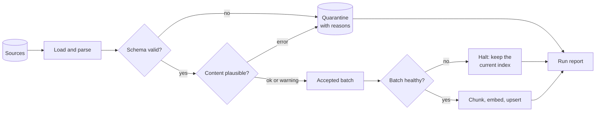

Every stage of an ingestion pipeline makes assumptions about its input. The chunker assumes there is text to chunk. The access filter assumes every document says who may read it. The [versioning](/learn/document-engineering/document-versioning) logic assumes every document has a date it can trust. When an assumption is false, the stage rarely fails loudly; it does something plausible with bad input, and the result lands in the index. **Data validation** is the practice of stating those assumptions as explicit, executable checks and running them at the boundaries of the pipeline, so that a bad record is stopped, explained and set aside instead of being indexed.

This lesson treats validation as an engineering mechanism rather than a list of tips. You will build a validation gate with three layers (the shape of each record, the plausibility of its content, and the health of the batch as a whole), give each check a severity, send rejected records to a quarantine with machine-readable reasons, and decide when a whole run should stop. The schema layer uses Pydantic v2; the other two are plain Python.

## Learning objectives

- Distinguish schema, content and batch-level validation, and give an example failure that only each layer can catch.
- Write a Pydantic v2 model with field constraints, a field validator and a model validator, and read the structured errors it raises.
- Assign a severity (reject or warn) to a check by reasoning about the cost of a false positive and a false negative.
- Implement a validation gate that quarantines failing records with reasons and produces a run report.
- Design batch-level checks that halt a run when a source has silently broken.

## Prerequisites

- [Indexing pipeline](/learn/rag-architecture-fundamentals/indexing-pipeline): the stages a document passes through, and why they must be idempotent.
- [Dataclasses and Pydantic](/learn/python-for-rag-engineering/dataclasses-and-pydantic): defining typed models. This lesson assumes you can declare a `BaseModel`.
- [Exception handling](/learn/python-for-rag-engineering/exception-handling): catching an exception per item without aborting a loop.
- [Document metadata](/learn/document-engineering/document-metadata) and [Document identifiers](/learn/document-engineering/document-identifiers): the fields being validated here.

## Why this matters

A RAG system is only as trustworthy as the worst document it will retrieve, and an ingestion pipeline sees a great many documents it was never tested on. Consider what reaches the index when nothing checks:

- A scanned PDF yields an empty string. The chunker produces no chunks, or one empty chunk, and the document silently vanishes from search. Nobody notices until someone asks about it.
- A PDF with a broken font map yields `| | 3 | 4 | -- |` and fragments of symbols. It is embedded, it sits in some odd corner of the vector space, and now and then it is retrieved and pasted into a prompt as "context".
- A connector bug drops the `allowed_groups` field. If the access filter treats "no groups" as "no restriction", a confidential HR document becomes readable by every employee. This is the most dangerous kind of failure, because it looks like success.
- Two exports of the same page arrive with the same `doc_id` and different text. With [upserts](/learn/rag-architecture-fundamentals/indexing-pipeline), whichever is written second wins, and that order can change from run to run.
- An authentication token expires, the runbook source returns zero documents, and a pipeline that "deletes documents that are no longer in the source" removes every runbook from the index.

None of these raises an exception in a pipeline without validation. Each produces an index that is wrong in a way that shows up weeks later as a strange answer, far from its cause. Validation moves the failure to the moment it happens and attaches a reason to it.

## The intuition

Think of the goods-in bay of a warehouse. Pallets arrive from many suppliers. Before anything goes onto the shelves, an inspector does three kinds of check.

First, **the paperwork**: does each pallet have a delivery note with a product code, a quantity and a destination? A pallet with no destination cannot be shelved, whatever is on it. That is schema validation.

Second, **the contents**: open a box and look. The note says forty jars of honey; the box holds broken glass. The paperwork was perfect and the goods are useless. That is content validation.

Third, **the delivery as a whole**: the usual Tuesday delivery is thirty pallets and today there are two. Each of the two is fine, but something has gone wrong upstream, and the warehouse should not conclude that its customers no longer want the other twenty-eight products. That is batch validation.

Rejected pallets are not thrown in a skip. They go to a holding area with a label saying why, so that someone can fix the paperwork and send them through again. That holding area is a **quarantine**.

## How it works

### Where the gate sits

Validation belongs at **trust boundaries**: the points where data enters from a system you do not control, and the points just before an expensive or irreversible step. In an indexing pipeline that means two places.

1. **After load and parse, before anything else.** This is where external data becomes your internal `Document` type. Everything downstream relies on the guarantees made here.
2. **Before publishing to the index.** Embedding costs money and writing to the index changes what users see. A batch-level check here can stop a broken run before it does damage.



The record-level checks route individual records; the batch-level check decides whether the run as a whole may publish. Note that a quarantined record never stops the run by itself: one bad page should not block the other ten thousand.

### Layer 1: schema validation

A **schema** is a declaration of what a valid record looks like: which fields exist, their types, which are required, and the allowed values. Schema validation answers "is this record well formed?" and nothing more.

With Pydantic, the schema is a class. When you call `Model.model_validate(data)`, Pydantic checks every field, collects every failure rather than stopping at the first, and either returns a typed object or raises a `ValidationError`. The error is structured: `exc.errors()` returns a list of dictionaries, each with a `type` (a stable machine-readable code such as `string_too_short`), a `loc` (the path to the field, such as `('metadata', 'title')`), a human-readable `msg` and the offending `input`. That structure is what makes a quarantine queryable: you can count failures by type across a whole run.

The tools you will use, in increasing order of power:

- **Types**: `effective_date: date`, `allowed_groups: list[str]`.
- **Constraints** with `Field(...)`: `min_length`, `max_length`, `pattern` for strings and lists; `ge`, `le` for numbers.
- **Closed vocabularies** with `Literal["handbook", "runbook", "product_doc"]`: any other value is an error. This is how a [classification](/learn/document-engineering/document-classification) label is kept to the agreed set.
- **`extra="forbid"`** in the model config: unknown keys are an error. Without it, Pydantic ignores them by default, so a misspelt key such as `allowed_group` disappears without trace and the real field is missing.
- **`@field_validator`**: arbitrary Python for one field, after its type has been checked.
- **`@model_validator(mode="after")`**: rules that involve several fields at once, run on the fully constructed object.

> [!WARNING]
> Pydantic's default **lax mode** converts compatible input: the string `"25"` becomes the integer `25`, and `"2025-01-01"` becomes a `date`. That is usually what you want for data that arrives as JSON or CSV text. It also means a validated model does not prove the source sent the right type. Where that matters, pass `strict=True` to `model_validate`, or use `model_validate_json`, which in strict mode still accepts ISO date strings because JSON has no date type.

### Layer 2: content validation

A record can be perfectly well formed and still be rubbish: the `text` field is a string, as required, and the string is a page of table borders. Content checks ask whether the values are **plausible**, which needs domain knowledge and usually thresholds. Typical document checks:

1. **Empty or near-empty text.** Zero characters is almost always an extraction failure (a scanned PDF, a page rendered by JavaScript). Very short text may be a legitimate stub ("See the IT page") or a partial failure.
2. **Low letter ratio.** The share of non-whitespace characters that are letters. Prose in most languages sits well above one half; extraction garbage, broken tables and binary noise sit far below it.
3. **Decode damage.** The Unicode replacement character U+FFFD (`�`) is what a decoder inserts for bytes it could not interpret. A few may be harmless; many mean the text was decoded with the wrong encoding ([Encoding and Unicode](/learn/data-processing/encoding-and-unicode) covers why).
4. **Implausible dates.** An effective date in 1970 is probably a default timestamp; a date two years in the future may be a typo or a genuine forthcoming policy.
5. **Unexpected language.** A corpus that should be English receiving a German page may be a misrouted source. Language detectors are unreliable on short text, so this is usually a warning, and [Language detection](/learn/document-preprocessing/language-detection) treats it properly.

These are cheap heuristics, not a quality model. Scoring text quality in depth (boilerplate ratios, repetition, readability, model-based scoring) belongs to [Data quality validation](/learn/document-preprocessing/data-quality-validation) in Phase 3. Here the aim is a gate that catches the gross failures every pipeline meets.

Some checks need more than one record. **Duplicate IDs within a batch** is the important one: two records claiming the same `doc_id` means either a connector bug or two sources that disagree about identity ([Document identifiers](/learn/document-engineering/document-identifiers) explains how IDs should be built). You must choose a policy, such as "first wins and the rest are quarantined", and apply it deterministically.

### Layer 3: batch validation

Batch checks look at the run as a whole and compare it with history. They catch the failures in which **every individual record is valid but the set is wrong**:

- **Volume drop**: the number of accepted documents fell sharply compared with the last successful run. The classic cause is an expired credential or a changed API that returns an empty page instead of an error.
- **Reject share**: an unusually large fraction of records failed. One bad PDF is noise; forty percent bad is a broken parser or a schema change upstream.
- **Per-source and per-type counts**: an overall count can look healthy while one whole source has gone to zero, because the others grew slightly.

When a batch check fails, the right response is usually to **halt the publish step and keep serving the current index**. Stale but correct beats fresh but gutted. This is the same reasoning as a circuit breaker: stop, report, let a person decide.

### Severity: reject or warn

Every check needs a severity, and choosing it is a judgement about the two ways a check can be wrong:

- A **false positive** blocks a good document. Cost: that document is missing from search until someone looks at the quarantine.
- A **false negative** lets a bad document through. Cost: whatever that bad document does in the index.

Where a false negative is dangerous or expensive (missing access-control fields, decode damage that would be embedded and retrieved), make the check an **error**: reject and quarantine. Where a false positive would be common and a false negative mild (short text, a future date, an unexpected language), make it a **warning**: accept, record it, and review the warnings in bulk. A check you are not sure about can start as a warning, and be promoted once you have seen how often it fires on real data.

> [!KEY]
> Access-control fields **fail closed**. A document whose permissions are missing or unparseable is rejected, never indexed as public. Every other check can be tuned; this one cannot be relaxed.

### Quarantine and the run report

A **quarantine** (in messaging systems, a **dead-letter queue**) is a store of rejected records together with why each was rejected. It needs four properties:

1. **The original input**, not the half-parsed version, so the record can be replayed after a fix.
2. **Machine-readable reasons**: the check name and the field, so that failures can be counted and grouped.
3. **Run identity**: which run, which source, when.
4. **A replay path**: once the parser or the source is fixed, the record goes through the whole gate again. It is never written to the index directly from quarantine, which would bypass the very checks it failed.

The **run report** summarises a run: counts accepted, quarantined and warned, failures by check, and the batch decision. Comparing reports across runs is how you spot drift, such as a warning that used to fire twice a night and now fires two hundred times.

What happens to a document that was in the index yesterday and fails validation today? Usually the safest choice is to **keep the last good version** and flag it, rather than deleting it, because a parser regression should not remove content. [Document versioning](/learn/document-engineering/document-versioning) discusses version history in detail.

## The mathematics

The content and batch checks are ratios compared with thresholds. They are simple, but writing them down exactly avoids two common bugs: dividing by the wrong length, and applying a ratio to text too short for it to mean anything.

**Letter ratio.** Intuition: what fraction of the visible characters are letters?

$$
r_{\text{letter}} = \frac{\#\{\text{letters}\}}{\#\{\text{non-whitespace characters}\}}
$$

Whitespace is excluded from the denominator so that a text's spacing does not change its score. By hand, for `Pay £75 by 30/04.`: the non-whitespace characters are `Pay` (3), `£75` (3), `by` (2) and `30/04.` (6), so 14 in all, of which 5 are letters. $r_{\text{letter}} = 5/14 \approx 0.357$. That is below a threshold of 0.6, yet the sentence is a perfectly good policy line. Ratios are unstable on short strings, which is why a production gate either applies the ratio only above a minimum length or computes it over the whole document rather than a single line. For a normal sentence such as "Expenses must be submitted within 30 days." the ratio is $33/36 \approx 0.917$.

**Replacement ratio.** Intuition: what share of the text is decode damage?

$$
r_{\text{repl}} = \frac{\#\{\text{U+FFFD characters}\}}{\#\{\text{characters}\}}
$$

For the damaged product document in the code below, 6 replacement characters in 61 characters give $6/61 \approx 0.098$, almost ten times the 1% threshold.

**Volume drop and reject share.** With $n_{\text{prev}}$ documents accepted in the last good run, $n_{\text{acc}}$ accepted now and $n_{\text{rej}}$ rejected now:

$$
\text{drop} = 1 - \frac{n_{\text{acc}}}{n_{\text{prev}}}, \qquad
\text{reject share} = \frac{n_{\text{rej}}}{n_{\text{acc}} + n_{\text{rej}}}
$$

In the example run, $n_{\text{prev}} = 7$, $n_{\text{acc}} = 4$ and $n_{\text{rej}} = 4$. The drop is $1 - 4/7 \approx 0.429$, under a 0.5 threshold. The reject share is $4/8 = 0.5$, over a 0.25 threshold, so the run halts.

The same numbers in Python:

```python
def letter_ratio(text: str) -> float:
    non_space = [c for c in text if not c.isspace()]
    return sum(c.isalpha() for c in non_space) / len(non_space)


def replacement_ratio(text: str) -> float:
    return text.count("�") / len(text)


print(f"letter ratio, short policy line: {letter_ratio('Pay £75 by 30/04.'):.3f}")
print(f"letter ratio, normal sentence:   {letter_ratio('Expenses must be submitted within 30 days.'):.3f}")
damaged = "Meridian Reports exports to PDF and CSV. See ������ attached."
print(f"replacement ratio, damaged text: {replacement_ratio(damaged):.4f}")
print(f"volume drop 7 -> 4:  {1 - 4 / 7:.3f}")
print(f"reject share 4 of 8: {4 / 8:.3f}")
```

```output
letter ratio, short policy line: 0.357
letter ratio, normal sentence:   0.917
replacement ratio, damaged text: 0.0984
volume drop 7 -> 4:  0.429
reject share 4 of 8: 0.500
```

## In code

Two programs. The first defines the schema and shows exactly what Pydantic reports. The second builds the full gate on top of it: content checks, a duplicate-ID rule, a quarantine, a batch check and a run report.

**Dependencies.** Pydantic v2 only. No model download and no API key.

```bash
pip install "pydantic>=2"
```

### The schema

**The problem.** Declare what a valid AskMeridian document record is, so that a malformed record is rejected with every reason at once rather than failing somewhere downstream. Save this as `schema.py`; the second program imports from it.

```python
from datetime import date
from typing import Literal

from pydantic import BaseModel, ConfigDict, Field, ValidationError, field_validator, model_validator


class DocMetadata(BaseModel):
    model_config = ConfigDict(extra="forbid")          # unknown keys are an error, not silently kept

    source_uri: str = Field(min_length=1)
    title: str = Field(min_length=1, max_length=200)
    doc_type: Literal["handbook", "runbook", "product_doc"]
    owner: str = Field(min_length=1)
    effective_date: date
    allowed_groups: list[str] = Field(min_length=1)   # fail closed: no groups, no indexing

    @field_validator("allowed_groups")
    @classmethod
    def groups_are_lower_case(cls, groups: list[str]) -> list[str]:
        bad = [g for g in groups if g != g.strip().lower() or not g]
        if bad:
            raise ValueError(f"group names must be lower-case with no surrounding spaces: {bad}")
        return groups


class DocumentRecord(BaseModel):
    model_config = ConfigDict(extra="forbid", str_strip_whitespace=True)

    doc_id: str = Field(pattern=r"^[a-z0-9][a-z0-9-]*$")
    text: str
    metadata: DocMetadata

    @model_validator(mode="after")
    def runbooks_live_in_the_runbook_repo(self) -> "DocumentRecord":
        if self.metadata.doc_type == "runbook" and not self.metadata.source_uri.startswith("git://runbooks/"):
            raise ValueError("doc_type 'runbook' must come from git://runbooks/")
        return self


if __name__ == "__main__":
    good = {
        "doc_id": "hb-annual-leave",
        "text": "  Annual leave is 25 days per year. Up to 5 unused days carry over.  ",
        "metadata": {
            "source_uri": "wiki://handbook/annual-leave",
            "title": "Annual leave",
            "doc_type": "handbook",
            "owner": "hr",
            "effective_date": "2025-01-01",          # a string: Pydantic converts it to a date
            "allowed_groups": ["all-staff"],
        },
    }
    record = DocumentRecord.model_validate(good)
    print(repr(record.text))
    print(type(record.metadata.effective_date).__name__, record.metadata.effective_date)

    bad = {
        "doc_id": "NET 114",
        "text": "Restart the VPN concentrator.",
        "metadata": {
            "source_uri": "wiki://it/net-114",
            "title": "",
            "doc_type": "runbook",
            "owner": "it",
            "effective_date": "2025-02-30",
            "allowed_groups": [],
            "confidential": True,
        },
    }
    try:
        DocumentRecord.model_validate(bad)
    except ValidationError as exc:
        print(f"\n{exc.error_count()} errors")
        for err in exc.errors(include_url=False):
            print(f"  {'.'.join(map(str, err['loc'])):<28} {err['type']:<27} {err['msg']}")

    # The model-level rule only runs once every field is valid:
    bad_fixed = {**bad, "doc_id": "net-114",
                 "metadata": {**bad["metadata"], "title": "VPN restart", "effective_date": "2025-02-28",
                              "allowed_groups": ["it-staff"]}}
    del bad_fixed["metadata"]["confidential"]
    try:
        DocumentRecord.model_validate(bad_fixed)
    except ValidationError as exc:
        err = exc.errors(include_url=False)[0]
        print(f"\n{err['type']}: {err['msg']}")
```

```output
'Annual leave is 25 days per year. Up to 5 unused days carry over.'
date 2025-01-01

5 errors
  doc_id                       string_pattern_mismatch     String should match pattern '^[a-z0-9][a-z0-9-]*$'
  metadata.title               string_too_short            String should have at least 1 character
  metadata.effective_date      date_from_datetime_parsing  Input should be a valid date or datetime, day value is outside expected range
  metadata.allowed_groups      too_short                   List should have at least 1 item after validation, not 0
  metadata.confidential        extra_forbidden             Extra inputs are not permitted

value_error: Value error, doc_type 'runbook' must come from git://runbooks/
```

**The important lines.**

- `ConfigDict(extra="forbid")` on both models turns the unexpected `confidential` key into an `extra_forbidden` error. Without it the key would be silently dropped, and whoever added it would believe it was being stored.
- `str_strip_whitespace=True` strips leading and trailing whitespace from every string field, which is why the first record's text comes back without its surrounding spaces. Note that this is a transformation, not a check: validation in Pydantic also normalises.
- `Literal[...]` keeps `doc_type` to the agreed vocabulary. `Field(min_length=1)` on `allowed_groups` makes an empty permission list an error: the model fails closed.
- `@field_validator("allowed_groups")` runs after the type check, so `groups` is already a `list[str]` when it arrives. Raising `ValueError` inside it becomes a `value_error` entry in the error list.
- `@model_validator(mode="after")` receives the constructed object and can check rules that span fields, here that a runbook must come from the runbook repository.

**What the output means.**

- The good record's `effective_date` arrived as the string `"2025-01-01"` and came out as a `date`. Lax mode converted it.
- The bad record produced **five** errors from one call. Each has a dotted path (`metadata.allowed_groups`) and a stable `type`, which is what the quarantine will store. `"2025-02-30"` is caught because the 30th of February does not exist.
- The model-level rule did not appear in the first error list. An after-validator runs only once every field has validated, so it surfaced only when the field errors were fixed, as the last line shows. Expect this: fixing one batch of errors can reveal the next.

### The gate

**The problem.** Run eight Meridian records, some deliberately broken, through schema checks, content checks and a duplicate-ID rule; quarantine the failures with reasons; decide whether the batch may publish; print a report.

```python
import json
from dataclasses import dataclass, field
from datetime import date

from pydantic import ValidationError

from schema import DocumentRecord

TODAY = date(2026, 11, 14)          # fixed so the example is reproducible
MIN_CHARS = 40                      # below this, warn: probably a stub or a failed extraction
MIN_LETTER_RATIO = 0.6              # below this, reject: probably extraction garbage
MAX_REPLACEMENT_RATIO = 0.01        # U+FFFD marks bytes that could not be decoded
MAX_REJECT_SHARE = 0.25             # batch check: halt if more than this share is rejected
MAX_VOLUME_DROP = 0.5               # batch check: halt if accepted count falls by more than this


@dataclass
class Issue:
    severity: str                   # "error" (reject) or "warning" (accept, but report)
    check: str
    detail: str


@dataclass
class Outcome:
    accepted: list = field(default_factory=list)       # (DocumentRecord, [warnings])
    quarantined: list = field(default_factory=list)    # (raw dict, [errors])


def content_issues(rec: DocumentRecord) -> list[Issue]:
    """Checks that need the parsed record: is the text plausible?"""
    issues, text = [], rec.text
    if not text:
        return [Issue("error", "empty_text", "no text extracted")]
    non_space = [c for c in text if not c.isspace()]
    letter_ratio = sum(c.isalpha() for c in non_space) / len(non_space)
    if letter_ratio < MIN_LETTER_RATIO:
        issues.append(Issue("error", "low_letter_ratio", f"{letter_ratio:.2f} < {MIN_LETTER_RATIO}"))
    replacement_ratio = text.count("�") / len(text)
    if replacement_ratio > MAX_REPLACEMENT_RATIO:
        issues.append(Issue("error", "decode_errors", f"{replacement_ratio:.1%} replacement characters"))
    if len(text) < MIN_CHARS:
        issues.append(Issue("warning", "short_text", f"{len(text)} chars < {MIN_CHARS}"))
    if rec.metadata.effective_date > TODAY:
        issues.append(Issue("warning", "future_effective_date", str(rec.metadata.effective_date)))
    return issues


def validate_batch(raw_records: list[dict]) -> Outcome:
    out, seen = Outcome(), {}
    for n, raw in enumerate(raw_records, start=1):
        try:
            rec = DocumentRecord.model_validate(raw)
        except ValidationError as exc:
            errors = [Issue("error", e["type"], ".".join(map(str, e["loc"]))) for e in exc.errors()]
            out.quarantined.append((raw, errors))
            continue
        issues = content_issues(rec)
        if rec.doc_id in seen:                                   # batch-scoped rule: first wins
            issues.append(Issue("error", "duplicate_id", f"already used by record {seen[rec.doc_id]}"))
        seen.setdefault(rec.doc_id, n)
        errors = [i for i in issues if i.severity == "error"]
        if errors:
            out.quarantined.append((raw, errors))
        else:
            out.accepted.append((rec, issues))
    return out


def batch_issues(out: Outcome, previous_accepted: int) -> list[str]:
    total = len(out.accepted) + len(out.quarantined)
    problems = []
    reject_share = len(out.quarantined) / total
    if reject_share > MAX_REJECT_SHARE:
        problems.append(f"reject share {reject_share:.0%} > {MAX_REJECT_SHARE:.0%}")
    drop = 1 - len(out.accepted) / previous_accepted
    if drop > MAX_VOLUME_DROP:
        problems.append(f"accepted volume fell {drop:.0%} (from {previous_accepted} to {len(out.accepted)})")
    return problems


def meta(doc_type="handbook", uri="wiki://handbook/x", groups=("all-staff",), eff="2025-01-01", **kw):
    return {"source_uri": uri, "title": kw.get("title", "Untitled policy"), "doc_type": doc_type,
            "owner": kw.get("owner", "hr"), "effective_date": eff, "allowed_groups": list(groups)}


batch = [
    {"doc_id": "hb-annual-leave", "metadata": meta(title="Annual leave"),
     "text": "Annual leave is 25 days. Up to 5 unused days carry over and must be used by 31 March."},
    {"doc_id": "hb-remote-work", "metadata": meta(title="Remote work", groups=()),
     "text": "Staff may work remotely up to 3 days a week. The equipment budget is £400."},
    {"doc_id": "hb-expenses", "metadata": meta(title="Expenses", owner="finance", eff="2027-01-01"),
     "text": "Expenses must be submitted within 30 days. Anything over £75 needs a receipt."},
    {"doc_id": "rb-net-114", "metadata": meta("runbook", "git://runbooks/net-114.md", ["it-staff"], owner="it"),
     "text": "| | | 3 | 4 | 5 |\n|---|---|---|---|---|\n| 0.1 | 0.2 | -- | -- | 12 |"},
    {"doc_id": "rb-vpn-errors", "metadata": meta("runbook", "git://runbooks/vpn.md", ["it-staff"], owner="it"),
     "text": "VPN error E-4021: the client is out of date. Update it from the IT portal."},
    {"doc_id": "hb-annual-leave", "metadata": meta(title="Annual leave (copy)"),
     "text": "Annual leave is 25 days per year."},
    {"doc_id": "pd-reports-export", "metadata": meta("product_doc", owner="product"),
     "text": "Meridian Reports exports to PDF and CSV. See ������ attached."},
    {"doc_id": "hb-laptops", "metadata": meta(title="Laptops", owner="it"), "text": "See IT page."},
]

out = validate_batch(batch)
print(f"accepted {len(out.accepted)}, quarantined {len(out.quarantined)}\n")
for rec, warnings in out.accepted:
    print(f"ACCEPT     {rec.doc_id:<18}" + "; ".join(f"{w.check} ({w.detail})" for w in warnings))
for raw, errors in out.quarantined:
    print(f"QUARANTINE {raw['doc_id']:<18}" + "; ".join(f"{e.check} ({e.detail})" for e in errors))

problems = batch_issues(out, previous_accepted=7)
print("\nbatch:", "HALT, " + "; ".join(problems) if problems else "OK, publish")

report = {"run_date": str(TODAY), "accepted": len(out.accepted), "quarantined": len(out.quarantined),
          "by_check": {}}
for _, errors in out.quarantined:
    for e in errors:
        report["by_check"][e.check] = report["by_check"].get(e.check, 0) + 1
print(json.dumps(report, indent=2))
```

```output
accepted 4, quarantined 4

ACCEPT     hb-annual-leave   
ACCEPT     hb-expenses       future_effective_date (2027-01-01)
ACCEPT     rb-vpn-errors     
ACCEPT     hb-laptops        short_text (12 chars < 40)
QUARANTINE hb-remote-work    too_short (metadata.allowed_groups)
QUARANTINE rb-net-114        low_letter_ratio (0.00 < 0.6)
QUARANTINE hb-annual-leave   duplicate_id (already used by record 1)
QUARANTINE pd-reports-export decode_errors (9.8% replacement characters)

batch: HALT, reject share 50% > 25%
{
  "run_date": "2026-11-14",
  "accepted": 4,
  "quarantined": 4,
  "by_check": {
    "too_short": 1,
    "low_letter_ratio": 1,
    "duplicate_id": 1,
    "decode_errors": 1
  }
}
```

**The important lines.**

- `validate_batch` catches `ValidationError` **per record** and continues. One malformed record must not abort the run; that is the per-item error handling pattern from [Exception handling](/learn/python-for-rag-engineering/exception-handling).
- Schema failures skip the content checks (`continue`): there is no point checking the letter ratio of a record whose structure is wrong, and the content checks rely on the schema's guarantees (they can assume `rec.text` is a string and `effective_date` is a `date`).
- `content_issues` returns a list of `Issue` objects with a severity. The gate only rejects on `"error"`; warnings ride along with the accepted record.
- The duplicate check uses a `seen` dictionary that lives for the whole batch, with an explicit "first wins" policy. The order of records then decides which copy survives, so the loader must produce them in a deterministic order.
- `batch_issues` compares this run with the previous one. It needs history, so in production `previous_accepted` comes from the last successful run's report, not from a constant.

**What the output means.**

- **Four accepted.** Two carry warnings: the expenses policy has an effective date in 2027, and the laptop page is only 12 characters long. Both are indexed, and both appear in the report for someone to look at.
- **`hb-remote-work`** failed the schema: its permission list was empty. The error type is Pydantic's generic `too_short`; the location `metadata.allowed_groups` is what tells you it is a permissions failure. In a real system you would map that combination to a clearer check name.
- **`rb-net-114`** is a table extracted as borders and digits, with a letter ratio of 0.00. It would have embedded without complaint.
- The second **`hb-annual-leave`** was quarantined as a duplicate. The first copy was indexed.
- **`pd-reports-export`** has decode damage, about 9.8% replacement characters.
- **The batch halts.** Each rejection was handled correctly, but half the batch failing is itself a signal. The volume drop (7 to 4, about 43%) stayed under its 50% threshold; the reject share did not.

**Errors people commonly hit.**

- Calling the model constructor with a dictionary (`DocumentRecord(raw)`) instead of keyword arguments or `model_validate(raw)`. The constructor takes fields as keyword arguments, so this raises `TypeError: BaseModel.__init__() takes 1 positional argument but 2 were given` rather than validating anything.
- Expecting a `@model_validator(mode="after")` to report alongside field errors. As the first program shows, it only runs once the fields are valid.
- Forgetting the `return` at the end of a `@field_validator`. The validator's return value replaces the field's value, so a validator that only raises on bad input and otherwise falls off the end sets the field to `None` on every good record, silently.
- Comparing `effective_date` with `date.today()` inside a test. The result changes every day; inject the date, as `TODAY` does here.

**Extending it.** Write each quarantined record to a JSON Lines file with the run ID and its reasons; add a per-source count to `batch_issues` (exercise 3); add a language check with a detector, as a warning only; and store the report so that the next run can read `previous_accepted` from it.

## A real-world example

Meridian's Platform team runs AskMeridian's nightly ingestion over three sources: the HR wiki export, the Git repository of Markdown runbooks, and the product documentation site. For its first months the pipeline had no gate beyond "did the parser raise an exception?"

Two incidents changed that. In the first, a change to the wiki export moved page permissions from a field called `allowed_groups` into a nested `access` object. The loader looked up `allowed_groups`, found nothing, and defaulted to an empty list, and the index's filter treated an empty list as "visible to everyone". For two days, draft pages from the HR team's restricted space were retrievable by any employee. Nothing failed; every run reported success.

In the second, the token the pipeline used for the runbook repository expired. The Git client returned an empty listing rather than an error, the pipeline's sync step concluded that every runbook had been deleted, and it removed them from the index. The support desk's questions about error codes started getting "I don't know".

The team's response was the three-layer gate in this lesson. The schema model forbids extra keys and requires a non-empty `allowed_groups`, so the export change would now have quarantined every wiki page on the first night with a clear `too_short` at `metadata.allowed_groups` and an `extra_forbidden` at `access`. The batch layer compares accepted counts **per source** with the last successful run and halts the publish step if any source drops by more than half, so the empty runbook listing would have stopped the run and left yesterday's runbooks in place. The run report goes to the team's channel each morning, and warnings are reviewed weekly. The lesson they wrote down: success means "the checks passed", not "nothing crashed".

## Common mistakes

- **Equating "no exception" with "valid".** Parsers return empty strings and connectors return empty lists without raising anything. Consequence: bad data is indexed and the run reports success.
- **Letting unknown fields through.** Pydantic ignores extra keys by default. Consequence: a renamed or misspelt field upstream silently becomes a missing field downstream.
- **Treating missing permissions as public.** A default of "no restriction" turns any connector bug into a data leak. Consequence: confidential documents become retrievable by everyone.
- **Aborting the whole run on one bad record.** One corrupt PDF should not stop ten thousand good documents. Consequence: a single file blocks every update until someone intervenes.
- **Discarding rejected records.** Logging "1 record failed" and moving on. Consequence: no way to replay after a fix, and no way to count failures by cause.
- **Only checking records, never the batch.** Every record can be valid while a whole source is missing. Consequence: sync logic deletes good content from the index because the source "has no documents".
- **Thresholds copied rather than measured.** A letter-ratio threshold that suits English prose will reject tables of figures and short numeric lines. Consequence: a quarantine full of good documents that people learn to ignore.

## Best practices

- Validate at trust boundaries: once where external data becomes your `Document` type, and once more before publishing to the index.
- Make the schema strict about shape (`extra="forbid"`, closed vocabularies, required fields) and fail closed on every access-control field.
- Give every check a name, a severity and a message. Start uncertain checks as warnings and promote them once you have measured how often they fire.
- Store rejected records with their original input, structured reasons and run ID, and replay them through the full gate after a fix.
- Compare each run with the last successful one, per source and per document type, and halt publishing rather than shrink the index on a sudden drop.
- Keep the last good version of a document that fails validation instead of deleting it.
- Unit-test the validator itself with a fixture of known-bad records, one per check, so that a refactor cannot quietly disable a check.

## Performance considerations

Validation is cheap compared with the stages it protects, and the arithmetic shows it. Schema validation and the character-level checks above are linear in the text length: each looks at every character a small, constant number of times. For a document of 20,000 characters that is on the order of $10^5$ simple operations, which takes microseconds to a few milliseconds in Python (Pydantic's core is written in Rust and is fast; the character loops in plain Python are the slower part). Embedding the same document means splitting it into perhaps a dozen chunks and running each through a neural model, which costs milliseconds to tens of milliseconds per chunk locally, or a network round trip and a per-token charge for a hosted model.

So the useful question is not "can we afford validation?" but "what does validation save?" Every rejected document is a document not chunked, not embedded and not stored. If 2% of a 100,000-document corpus is extraction garbage, that is 2,000 documents and perhaps 20,000 chunks of embedding cost avoided per full re-index, and 20,000 junk vectors kept out of every search.

Two things can make validation expensive. Checks that call a model (language detection with a neural model, an LLM judging quality) cost as much as embedding; reserve them for samples or for documents that pass the cheap checks. And batch checks that need history should read one small report from the previous run, not rescan the index.

## Security considerations

Ingested documents are untrusted input, and validation is the first line of defence against several problems:

- **Access control.** Permission fields must be required, parsed and checked against known groups, and a document that fails must be rejected, not published as public. [Document-level permissions](/learn/access-control-and-privacy/document-level-permissions) covers how those fields are used at query time.
- **Resource exhaustion.** Set maximum lengths. A single 500 MB "document" can exhaust memory in the chunker or run up an embedding bill. `max_length` constraints and file-size limits at the loader stop it early.
- **Injection payloads.** Validation can flag suspicious content (instructions addressed to an AI model, hidden text), but it cannot reliably detect every malicious document. Treat it as one layer; [Malicious documents](/learn/rag-security-fundamentals/malicious-documents) and [Data poisoning](/learn/rag-security-fundamentals/data-poisoning) cover the rest.
- **The quarantine is sensitive.** It holds exactly the records your pipeline did not understand, which may include confidential documents whose permissions failed to parse. Apply the same access control to the quarantine as to the source, and give it a retention period.
- **Error messages leak data.** Pydantic includes the offending `input` in each error. Logging full errors can write document text or personal data into logs; log the type and location and keep the input in the access-controlled quarantine.

## Summary

- Validation states a pipeline's assumptions as executable checks and runs them at trust boundaries, so bad records are stopped and explained instead of indexed.
- Three layers catch different failures: schema (is the record well formed?), content (is it plausible?) and batch (is the run as a whole healthy?).
- Pydantic v2 provides the schema layer: types, `Field` constraints, `Literal` vocabularies, `extra="forbid"`, field and model validators, and structured errors with a `type` and `loc`.
- Each check has a severity chosen by weighing false positives against false negatives; access-control fields always fail closed.
- Rejected records go to a quarantine with their original input and reasons, and are replayed through the full gate after a fix.
- Batch checks compare with the last good run, per source, and halt publishing rather than let a broken source empty the index.

## Exercises

**1.** Compute by hand the letter ratio and the replacement ratio of the string `Reset VPN: E-4021 ��`, and say whether the gate in this lesson would reject it, warn about it, or both.

<details><summary>Show solution</summary>

Non-whitespace characters: `Reset` (5), `VPN:` (4), `E-4021` (6), `��` (2), so 17. Letters: R, e, s, e, t, V, P, N, E = 9. The replacement character is not a letter. Letter ratio $9/17 \approx 0.529$, below 0.6, so `low_letter_ratio` is an error.

The string has 20 characters in total (17 plus 3 spaces), 2 of them U+FFFD, so the replacement ratio is $2/20 = 0.10$, far above 0.01, so `decode_errors` is also an error. And it has 20 characters, fewer than 40, so `short_text` is a warning. The record is quarantined with two errors; the warning is irrelevant once it is rejected.

The deeper point: on a string this short, the letter ratio would have failed even without the damage (compare the `Pay £75 by 30/04.` example). The replacement check is the one that identifies the real problem.

</details>

**2.** Assign a severity (error or warning) to each check and justify it: (a) `owner` is not one of the known team names; (b) the text is in Welsh in a corpus expected to be English; (c) `effective_date` is before 1990; (d) `source_uri` points to a host that is not one of the three known sources.

<details><summary>Show solution</summary>

(a) **Warning, at first.** An unknown owner does not make the document dangerous to index; it breaks routing of feedback. If ownership drives access or retention decisions in your system, promote it to an error.

(b) **Warning.** Language detectors are unreliable on short or mixed text, so false positives would be common, and a correctly labelled Welsh document is legitimate content. Record it and review.

(c) **Warning, possibly error.** A date before 1990 for a software company founded later is almost certainly a default timestamp (such as the Unix epoch, 1970-01-01). It matters because versioning logic trusts dates: if this date would make an old version look current, or a current one look old, make it an error.

(d) **Error.** A document from an unknown host means either a misconfigured connector or something injected into the pipeline. Its permissions and provenance cannot be trusted, and the cost of a false negative (indexing an unvetted document) is higher than the cost of a false positive (a person checks and adds the host to the allow-list).

</details>

**3.** The Meridian incident was a single source dropping to zero while the overall count looked healthy. Write a function that compares accepted counts **per document type** with the previous run and reports any type whose count fell by more than half. Show that it catches a case the overall check misses.

<details><summary>Show solution</summary>

```python
from collections import Counter


def source_drop_issues(current: Counter, previous: Counter, max_drop: float = 0.5) -> list[str]:
    """Compare accepted counts per doc_type with the last successful run."""
    problems = []
    for doc_type, before in sorted(previous.items()):
        now = current.get(doc_type, 0)
        if before and 1 - now / before > max_drop:
            problems.append(f"{doc_type}: {before} -> {now}")
    return problems


previous = Counter({"handbook": 120, "runbook": 85, "product_doc": 300})
current = Counter({"handbook": 119, "product_doc": 302})          # the runbook repo returned nothing
print("overall drop:", f"{1 - sum(current.values()) / sum(previous.values()):.0%}")
print("per-type problems:", source_drop_issues(current, previous))
```

```output
overall drop: 17%
per-type problems: ['runbook: 85 -> 0']
```

The overall count fell from 505 to 421, a 17% drop, which passes a 50% threshold. The per-type check sees that runbooks went from 85 to 0. In the gate, call this from `batch_issues` with counts built from `Counter(rec.metadata.doc_type for rec, _ in out.accepted)` and the previous run's stored counts, and halt if it returns anything. A type that is new this run (present now, absent before) is not flagged, which is correct: growth is not a failure.

</details>

**4.** Design decision. Yesterday the document `hb-annual-leave` was indexed. Tonight's export of the same page fails validation because a parser upgrade mangles its tables. Should the pipeline (a) delete the old version from the index, (b) keep the old version and flag it, or (c) index the new version anyway with a warning? Justify your choice and say what the run report should show.

<details><summary>Show solution</summary>

**(b) Keep the old version and flag it.** The failure is in the pipeline, not in the source: the page itself was probably edited only slightly, or not at all. Deleting (a) turns a parser regression into missing content, which users experience as the assistant forgetting a policy. Indexing the bad version (c) puts mangled tables into search results and the prompt, which is worse than slightly stale text.

The trade-off is staleness: if the page did change (say, the carry-over rule), the index now serves the old rule until the parser is fixed. So the report must make the situation visible: the document ID, the failed check, the fact that an older version is still being served, and how old that version is. If many documents fall into this state in one run, as they would after a parser upgrade, the batch reject-share check should halt the run anyway, and the right fix is to roll back the parser. Policies for how long a stale version may be served belong with [Document versioning](/learn/document-engineering/document-versioning).

</details>

## Check your understanding

```quiz
[
  {
    "q": "Every record in tonight's run passes schema and content checks, but the runbook source returned 0 documents instead of the usual 85. Which layer of validation is designed to catch this?",
    "options": [
      "Schema validation",
      "Content validation",
      "Batch validation, comparing per-source counts with the last good run",
      "None: if every record is valid, the run is valid"
    ],
    "answer": 2,
    "why": "Each record is individually fine; what is wrong is the set. Only a check that compares the batch with history can see that a source has disappeared."
  },
  {
    "q": "A Pydantic model has the default configuration. The input contains the key `allowed_group` (singular) instead of `allowed_groups`, and `allowed_groups` has a default of an empty list. What happens?",
    "options": [
      "Pydantic raises an error for the misspelt key",
      "The misspelt key is ignored and `allowed_groups` silently takes its default",
      "Pydantic renames the key automatically",
      "The record is stored with both keys"
    ],
    "answer": 1,
    "why": "By default Pydantic ignores extra keys. With `extra=\"forbid\"` it would raise `extra_forbidden`, and with no default on `allowed_groups` it would also raise a missing-field error."
  },
  {
    "q": "Which check should be an error (reject) rather than a warning?",
    "options": [
      "The document's permission list is empty",
      "The text is shorter than 40 characters",
      "The effective date is next year",
      "The detected language differs from the expected one"
    ],
    "answer": 0,
    "why": "A false negative on permissions leaks confidential content, so the check fails closed. The others have common legitimate causes and mild consequences, so they are warnings."
  },
  {
    "q": "A record has three invalid fields and also breaks a rule enforced by a `@model_validator(mode=\"after\")`. How many errors does the first call to `model_validate` report?",
    "options": [
      "One: Pydantic stops at the first error",
      "Four: all field errors plus the model rule",
      "Three: the after-validator only runs once every field is valid",
      "Zero: errors are only reported when `strict=True`"
    ],
    "answer": 2,
    "why": "Pydantic collects every field error in one pass, but an after-validator receives the constructed model, which cannot be built while fields are invalid."
  },
  {
    "q": "Why should a quarantined record be stored with its original input rather than only an error message?",
    "options": [
      "So that it can be indexed directly from the quarantine",
      "Because Pydantic requires it",
      "To keep the index smaller",
      "So that it can be replayed through the full gate once the parser or source is fixed"
    ],
    "answer": 3,
    "why": "A quarantine exists for diagnosis and replay. The record must go back through every check after a fix, never straight into the index."
  }
]
```

## Further reading

- Pydantic documentation, [docs.pydantic.dev](https://docs.pydantic.dev/latest/): the sections on models, validators, strict mode and error handling.
- Breck, Polyzotis, Roy, Whang and Zinkevich (2019), "Data Validation for Machine Learning", *Proceedings of SysML (MLSys) 2019*: the schema-plus-batch-statistics approach used for Google's production ML pipelines.
- Sculley et al. (2015), "Hidden Technical Debt in Machine Learning Systems", *Advances in Neural Information Processing Systems 28*: why data dependencies are harder to test than code, and why they need explicit checks.
- Great Expectations documentation, [docs.greatexpectations.io](https://docs.greatexpectations.io/): a widely used library for declaring batch-level expectations on tabular data.
- The Unicode Standard, the definition of U+FFFD REPLACEMENT CHARACTER in the Specials block, [unicode.org](https://www.unicode.org/charts/PDF/UFFF0.pdf).
