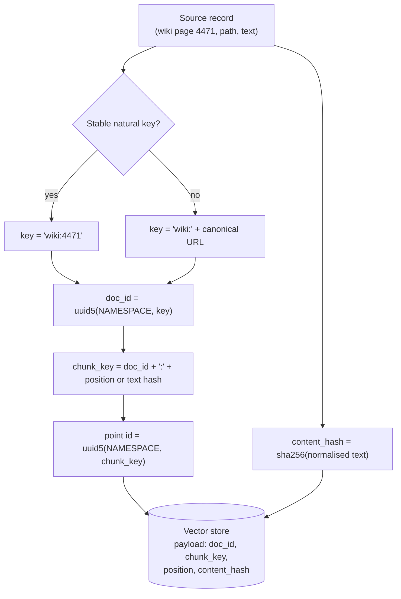

An identifier is the shortest piece of text in a RAG system and one of the most consequential. The [indexing pipeline](/learn/rag-architecture-fundamentals/indexing-pipeline) lesson introduced two of them, the document ID and the chunk ID, and showed that stable IDs plus upserts are what make a pipeline safe to re-run. It used one scheme, a hash of the document's location with `doc_id:position` for chunks, and moved on. This lesson asks the questions that scheme leaves open. What exactly makes two documents "the same document"? What happens when a page is renamed, moved to a new server, or copied into a second folder? How short can a hashed ID be before two documents share one by accident? And how do you fit your IDs into a vector database that accepts only certain formats?

By the end you will be able to choose an identity rule for each source, canonicalise locations before hashing them, generate deterministic UUIDs, pick a chunk ID scheme for the way your documents change, and calculate the collision risk of any ID length you are offered.

## Learning objectives

- Distinguish location identity, content identity and source-assigned identity, and predict how each behaves when a document is edited, moved, renamed or copied.
- Canonicalise a URL or path so that equivalent spellings produce one document ID.
- Generate deterministic identifiers with `uuid.uuid5` and explain why `uuid.uuid4` breaks idempotent indexing.
- Compare positional and content-addressed chunk IDs by how much re-embedding each causes after an edit.
- Calculate the probability of an ID collision with the birthday bound and choose a safe ID length.

## Prerequisites

- [Indexing pipeline](/learn/rag-architecture-fundamentals/indexing-pipeline): document IDs, chunk IDs, content hashes, upserts and idempotency.
- [Document loaders](/learn/document-engineering/document-loaders): where a document's location and source-system metadata are first captured.
- [Document versioning](/learn/document-engineering/document-versioning): how one document's versions relate to each other, which this lesson's IDs must support.
- [Dataclasses and Pydantic](/learn/python-for-rag-engineering/dataclasses-and-pydantic): the `Document` records used in the code.

## Why this matters

Every operation a RAG system performs on stored content is addressed by an identifier. Upserts overwrite by ID. Deletions find their targets by ID. Citations point the user at a source by ID. Feedback ("this answer was wrong") is logged against the IDs of the chunks that produced it. Evaluation datasets, which you will build in [Golden datasets](/learn/testing-and-benchmarking/golden-datasets), record which chunks are the correct answers to each test question, again by ID. Caches key embeddings by ID or by content hash.

So an ID scheme is a promise that several systems rely on at once, and breaking it does damage in all of them simultaneously. Suppose the IDs of every handbook page change overnight because the wiki moved to a new hostname. The nightly pipeline sees hundreds of "new" documents and hundreds of "missing" ones, deletes and re-embeds everything (paying for every embedding again), and the index ends up correct. But the evaluation set now points at IDs that no longer exist, so retrieval recall drops to zero on the dashboard although nothing about retrieval changed. The feedback log can no longer be joined to the current index. Any user who bookmarked a citation link gets a "not found" page.

The opposite failure is quieter. If two different documents end up with the same ID, the second write silently overwrites the first. Nothing errors; one document simply vanishes from search. Whether that happens to you is a matter of arithmetic, which this lesson does.

## The intuition

Think about how a library identifies a book. There are three quite different answers.

The **shelf mark** says where the book lives: "Floor 2, bay 14, shelf C". It is easy to compute from the building, and two books can never share one at the same moment. But if the library reorganises its shelves, every book's shelf mark changes, although no book has changed at all.

The **ISBN** is assigned by the publisher and printed in the book. It survives any reshelving, and it is the same in every library. But only the publisher can assign it, a new edition gets a new ISBN, and a library's own pamphlets have none.

A **fingerprint of the text** (imagine photographing every page and comparing photographs) identifies the content itself. Two copies of the same edition match even if they sit in different libraries, and any change to the text, even a corrected typo, produces a new fingerprint.

None of the three is "the" identity of a book. Each answers a different question: *where is it?*, *what did the publisher call it?*, *what does it say?* Document IDs have exactly the same three options, and choosing between them is choosing which question your pipeline needs to answer.

## How it works

### What an identifier must guarantee

A document ID in a RAG pipeline needs five properties. They pull against each other, which is why no single scheme is right everywhere.

1. **Unique.** Two different documents never share an ID. A collision silently overwrites one with the other.
2. **Stable.** The same document keeps the same ID across runs and across the changes you want to treat as "an edit", not "a new document". What counts as the same document is a decision, not a fact; the three identity rules below are three different decisions.
3. **Deterministic.** The ID is computed from the input, so any run, on any machine, at any time, computes the same ID. This is what lets an upsert find the record to overwrite without first looking it up.
4. **Valid in every store it enters.** Some vector databases accept any string; Qdrant accepts only unsigned integers and UUIDs; some systems limit length or characters.
5. **Safe to expose.** IDs travel into logs, URLs and API responses. An ID built from a path like `hr/redundancy-plan-2026.docx` leaks a document title to anyone who sees it.

### Three rules for "the same document"

**Location identity** derives the ID from where the document lives: a file path, a URL, a bucket key. This is the rule the indexing pipeline lesson used. An edit keeps the ID, which is what makes "replace the old chunks" possible. A move or rename changes it, and the pipeline sees a deletion plus an unrelated new document.

**Source-assigned identity** uses the key the source system already gives the document: a wiki page ID, a database primary key, a ticket number, a runbook number such as NET-114. These are **natural keys**: identifiers that exist in the domain before your system does. They usually survive renames and moves, because the source system was designed to track the document through them. They are the best option when they exist, with two caveats. They are only unique within one system, so wiki page 42 and ticket 42 must not collide, and some natural keys are reused (a ticket number recycled after a migration, an employee number reassigned).

**Content identity** derives the ID from the document's text, usually a cryptographic hash of the normalised content. Two copies of the same text get the same ID wherever they live, which gives you deduplication for free. But every edit, even a single comma, produces a different ID, so content identity on its own cannot say "this is a new version of that document". Content hashes are therefore usually a **fingerprint** stored next to a location or natural-key ID, as the indexing pipeline lesson did, rather than the ID itself.

The opposite of a natural key is a **surrogate key**: an ID your own system invents, such as an auto-increment number or a random UUID, with no meaning in the domain. Surrogate keys are fine in a database that also stores a mapping from natural key to surrogate key. On their own, in a pipeline that recomputes everything each run, a random surrogate is the classic idempotency bug: every run invents new IDs, so every run inserts duplicates.

| Event | Location ID | Natural key | Content ID |
| --- | --- | --- | --- |
| Text edited in place | Same | Same | **Changes** |
| File renamed or moved | **Changes** | Same | Same |
| Server or hostname migrated | **Changes** | Usually same | Same |
| Same text copied to a second place | Two IDs | Two IDs | **One ID** |
| Re-run with no changes | Same | Same | Same |

Read each column as a set of consequences. Where the ID changes, the pipeline will delete and re-insert, and anything keyed by the old ID (feedback, evaluation labels, citations) is orphaned. Where two documents share an ID, something must decide which one wins.

> [!KEY]
> Pick the identity rule per source, by asking which events you want to count as "the same document changed". For most sources that means: the source system's own key if it has a stable one, otherwise the canonicalised location; and a content hash alongside, for change detection, never instead.

### Namespacing by source

Natural keys and relative paths are unique only inside their own system. Meridian's wiki has a page 42, and so does its ticket system; the Git repository of runbooks has a `README.md`, and so does the product-documentation repository. Prefix every key with its source before using it: `wiki:42`, `tickets:42`, `git-runbooks:README.md`. This costs nothing and removes a whole class of cross-source collisions. It also tells a human reading a log line where to look.

### Canonicalising locations before hashing

The same location can be written many ways. To a web server, these four strings all mean the same page:

- `https://wiki.meridian.example/hr/Annual-Leave`
- `HTTPS://Wiki.Meridian.example:443/hr/Annual-Leave/`
- `https://wiki.meridian.example/hr/Annual-Leave#carry-over`
- `https://wiki.meridian.example/hr/Annual-Leave?utm_source=slack`

Hash them as they are and you get four document IDs for one page, and four copies of its chunks in the index. **Canonicalisation** rewrites each equivalent spelling to one agreed form before hashing. For URLs the safe, standard steps (RFC 3986, section 6, describes the general idea) are:

1. Lower-case the scheme and the host name. Both are case-insensitive by definition.
2. Remove the port when it is the scheme's default (443 for HTTPS, 80 for HTTP).
3. Drop the fragment (everything after `#`). It is never sent to the server; it only scrolls the browser.
4. Remove query parameters you know are irrelevant (campaign tracking such as `utm_source`) and sort the rest, so that `?a=1&b=2` and `?b=2&a=1` agree.
5. Apply one rule for trailing slashes, if your source treats `/a/b` and `/a/b/` as the same page.

Two cautions. First, **do not lower-case the path** unless you know the server ignores case: on many servers `/hr/Leave` and `/hr/leave` are different resources. Second, **do not drop query parameters you do not understand**: `?page=2` or `?id=17` may be the very thing that distinguishes two documents. Canonicalisation should merge spellings you are certain are equivalent and nothing else. File paths need the same treatment: one path separator, no `./` segments, a path relative to a declared root (so the ID does not depend on which machine or mount point ran the pipeline), and a consistent rule for case on case-insensitive file systems.

### From key to ID: hashing and UUIDs

A canonical key such as `wiki:https://wiki.meridian.example/hr/Annual-Leave` is unique and stable, but long, possibly sensitive, and not accepted by every store. Hashing turns it into a fixed-size, opaque value.

Use a **cryptographic hash** such as SHA-256 from Python's `hashlib`. Do not use Python's built-in `hash()` for identifiers: for strings it is randomised per process (controlled by `PYTHONHASHSEED`), so the same string hashes differently on the next run, which destroys determinism. A cryptographic hash also spreads inputs evenly over its output, which the collision maths below relies on.

A **UUID** (universally unique identifier, standardised in RFC 9562) is a 128-bit value written as 32 hexadecimal digits in five groups, such as `dceafb6c-3731-5966-b51f-9fed292dbab8`. The digit after the second hyphen is the version, and the versions behave very differently:

- **Version 4** is random. `uuid.uuid4()` returns a new value every call. Ideal for things that are created once and stored, such as a request ID; wrong for anything a pipeline recomputes.
- **Version 7** (in Python's standard library from version 3.14) starts with a timestamp followed by random bits, so values sort roughly by creation time, which databases like for their indexes. It is still random, so it is still not deterministic.
- **Version 5** is deterministic. `uuid.uuid5(namespace, name)` hashes a namespace UUID together with a name string (using SHA-1) and formats the result as a UUID. The same namespace and name always give the same UUID. Version 3 is the same idea with MD5; prefer version 5.

UUIDv5 is the standard way to get a deterministic ID in a store that demands UUIDs. The **namespace** is itself a UUID that you generate once (with `uuid4`), write into your code or configuration, and never change. Changing it changes every ID in the system. Using your own namespace rather than one of the predefined ones in the `uuid` module (`NAMESPACE_URL`, `NAMESPACE_DNS`) keeps your IDs separate from anyone else's that happen to hash the same names.

### Chunk identifiers

A chunk ID must be unique across the whole index, deterministic, and must lead back to its document. The indexing pipeline lesson used `doc_id:position`, and one of its exercises raised the alternative of hashing the chunk's text. Here is the full comparison.

**Positional** (`doc_id:position`). Simple, preserves order, and makes "fetch the neighbouring chunk" a matter of adding one. Its weakness is edits near the top of a document. Insert one paragraph at the start and every later chunk shifts down by one position: chunk 1 now holds what chunk 0 used to hold, and so on. The IDs all still exist, but nearly all of their content has changed, so nearly all must be re-embedded.

**Content-addressed** (`doc_id:hash(chunk_text)`). An unchanged chunk keeps its ID wherever it moves within the document, so an insertion costs one new embedding instead of many. The document ID is mixed in so that identical text in two documents does not collide. Two complications follow. The ID no longer encodes order, so position must be stored as metadata. And the same text can appear twice in one document (a repeated "Contact HR with questions."), which would give two chunks one ID; append an occurrence counter to make them distinct.

Either scheme still needs the indexing pipeline's rule of deleting a document's old chunks before writing the new ones: with content addressing, an edited chunk produces a new ID, and the record under the old ID must be removed explicitly.

Whichever scheme you use, the store might not accept the result as a key. In that case compute the store's ID from your readable key (for Qdrant, `uuid5(namespace, chunk_key)`) and keep the readable key in the payload, where it is useful for filtering, deleting and debugging.



### Moves, renames and the alias table

Even with good choices, some sources only offer location identity, and locations change. When a document's ID changes, the pipeline's view is "one document disappeared and an unrelated one appeared". To preserve the history attached to the old ID, keep an **alias table**: a mapping from old IDs to current IDs, written whenever you detect a move. Detection is possible precisely because you store a content hash: a "new" document whose content hash matches a document that vanished in the same run is very probably the same document, moved. Downstream joins (feedback, evaluation labels, citation links) then look up the alias table before reporting a miss.

The alias table is also where you record deliberate merges and splits, for example when two policy pages are combined into one. It is a small amount of bookkeeping that saves the evaluation set every time someone reorganises the wiki.

### Content identity and deduplication, carefully

Because a content hash gives identical text the same value, it is tempting to use it to merge duplicates: index the text once, however many places it appears in. That is often right; [Duplicate detection](/learn/data-processing/duplicate-detection) covers it, including near-duplicates that hashing cannot catch. But two copies of the same text are not always interchangeable. They may have different owners, different effective dates, and, most importantly, **different permissions**. A policy copied from a restricted HR folder into a public one should be retrievable by everyone via the public copy; one copied from the public folder into a restricted folder must not make the public copy disappear. Merge by content only when the metadata that matters for access and citation is merged correctly too; otherwise keep separate IDs and deduplicate at query time.

## The mathematics

### The birthday bound

**Intuition.** Hashed and random IDs are unique only probabilistically. If an ID has $b$ bits, there are $N = 2^b$ possible values, and you might think trouble starts when the number of documents approaches $N$. It starts far earlier. In a room of 23 people there is a better than even chance that two share a birthday, although there are 365 possible birthdays, because what matters is the number of *pairs* of people, and 23 people form 253 pairs. In the same way, $n$ IDs form about $n^2/2$ pairs, and each pair collides with probability $1/N$.

**The formula.** The probability that $n$ IDs drawn uniformly at random from $N$ values contain at least one repeat is approximately

$$
P(\text{collision}) \approx 1 - \exp\!\left(-\frac{n(n-1)}{2N}\right), \qquad N = 2^b
$$

- $n$ is the number of IDs (documents or chunks) in the system.
- $b$ is the number of bits in the ID; $N = 2^b$ is the number of possible values.
- $n(n-1)/2$ is the number of pairs of IDs.
- $1/N$ is the chance that one particular pair is equal.

When the exponent is small, $1 - e^{-x} \approx x$, so the probability is roughly $n^2 / 2N$: **doubling the number of documents quadruples the risk**, and the risk reaches about 50% when $n \approx 1.18\sqrt{N}$. A $b$-bit ID is therefore good for only about $2^{b/2}$ items, not $2^b$.

The formula assumes the IDs behave like random values, which holds for cryptographic hashes of distinct inputs and for UUIDs. For a UUIDv5, $b$ is 122, not 128: six bits are fixed to mark the version and variant.

**By hand.** Take 32-bit IDs (8 hexadecimal characters) for $n = 10{,}000$ documents.

- $N = 2^{32} = 4{,}294{,}967{,}296$, so $2N = 8{,}589{,}934{,}592$.
- $n(n-1) = 10{,}000 \times 9{,}999 = 99{,}990{,}000$.
- The exponent is $99{,}990{,}000 / 8{,}589{,}934{,}592 \approx 0.01164$.
- $1 - e^{-0.01164} \approx 0.01164 - 0.01164^2/2 \approx 0.0116$.

About a 1.2% chance that a 10,000-document corpus contains a silent overwrite. Now the indexing pipeline lesson's own scheme, which kept 12 hexadecimal characters of a SHA-256 hash, is 48 bits. For a million chunks the exponent is $10^{12} / (2 \times 2.81 \times 10^{14}) \approx 0.0018$, so about 0.18%. For ten million chunks it is a hundred times larger, about 0.178, giving $1 - e^{-0.178} \approx 16\%$. The scheme that was perfectly safe for a demo is not safe at enterprise scale.

**In Python.** The function below computes the approximation (using `math.expm1`, which stays accurate when the exponent is tiny), then checks it against a simulation on a space small enough to produce collisions often.

```python
import math

import numpy as np


def p_collision(n: int, bits: int) -> float:
    """Approximate probability that n random b-bit IDs contain at least one repeat."""
    N = 2.0 ** bits
    return -math.expm1(-n * (n - 1) / (2 * N))   # 1 - exp(-x), accurate for tiny x


print(f"{'bits':>5} {'n':>12} {'P(any collision)':>18}")
for bits, n in [(32, 10_000), (48, 1_000_000), (48, 10_000_000), (64, 10_000_000), (122, 10**9)]:
    print(f"{bits:>5} {n:>12,} {p_collision(n, bits):>18.3g}")

print(f"\nn for a 50% chance with 48-bit IDs: {1.1774 * math.sqrt(2.0**48):,.0f}")

# Check the approximation by simulation on a small space: 20-bit IDs, 500 of them.
rng = np.random.default_rng(42)
bits, n, trials = 20, 500, 20_000
hits = sum(len(np.unique(rng.integers(0, 2**bits, size=n))) < n for _ in range(trials))
print(f"\n20-bit IDs, n=500: formula {p_collision(n, bits):.4f}, simulated {hits / trials:.4f}")

```

```output
 bits            n   P(any collision)
   32       10,000             0.0116
   48    1,000,000            0.00177
   48   10,000,000              0.163
   64   10,000,000           2.71e-06
  122 1,000,000,000            9.4e-20

n for a 50% chance with 48-bit IDs: 19,753,494

20-bit IDs, n=500: formula 0.1122, simulated 0.1138
```

The first row matches the hand calculation. The simulation agrees with the formula to within sampling noise (20,000 trials give a standard error of about 0.002). The last row is the reassuring one: a full UUIDv5 has a collision probability around $10^{-19}$ even with a billion chunks, which is why nobody truncates UUIDs. If you truncate a hash to save space, use this calculation to decide by how much, with your largest plausible corpus, not today's.

> [!NOTE]
> The birthday bound covers accidental collisions. Deliberate ones are a different matter: an attacker who can choose document content can search for two inputs that collide under a short or weak hash. MD5 and SHA-1 have known practical collision attacks. Where document content is untrusted, use full-length SHA-256 for content identity.

## In code

**The problem.** Build Meridian's identifier functions and test them on the cases that break naive schemes: four spellings of one URL, the same natural key in two systems, an insertion near the top of a document, and repeated pipeline runs against a real vector store.

**Dependencies.** The first two examples use only the standard library. The third uses Qdrant's Python client in its in-process `:memory:` mode, which needs no server, and NumPy.

```bash
pip install qdrant-client numpy
```

### Canonical locations and deterministic document IDs

```python
import hashlib
import uuid
from urllib.parse import parse_qsl, urlencode, urlsplit, urlunsplit

# A namespace UUID for Meridian's indexing pipeline. Generated once with
# uuid.uuid4(), then written down and never changed again.
MERIDIAN_NS = uuid.UUID("6f1c2a52-3a8e-4f0b-9d7e-2b5c1e0a9f44")

TRACKING_PARAMS = {"utm_source", "utm_medium", "utm_campaign", "ref"}


def canonical_url(url: str) -> str:
    """Rewrite equivalent spellings of a URL to one canonical string."""
    parts = urlsplit(url.strip())
    scheme = parts.scheme.lower()
    host = (parts.hostname or "").lower()
    port = parts.port
    if port and not ((scheme == "http" and port == 80) or (scheme == "https" and port == 443)):
        host = f"{host}:{port}"                     # keep only non-default ports
    path = parts.path or "/"
    if len(path) > 1:
        path = path.rstrip("/")                     # /a/b/ and /a/b are one page here
    query = sorted((k, v) for k, v in parse_qsl(parts.query, keep_blank_values=True)
                   if k not in TRACKING_PARAMS)     # drop tracking, fix the order
    return urlunsplit((scheme, host, path, urlencode(query), ""))  # fragment dropped


def doc_id_from_location(source: str, location: str) -> str:
    """Location identity: same place, same ID, whatever the content."""
    return str(uuid.uuid5(MERIDIAN_NS, f"{source}:{location}"))


def doc_id_from_content(normalised_text: str) -> str:
    """Content identity: same bytes, same ID, wherever they live."""
    return hashlib.sha256(normalised_text.encode("utf-8")).hexdigest()


spellings = [
    "https://wiki.meridian.example/hr/Annual-Leave",
    "HTTPS://Wiki.Meridian.example:443/hr/Annual-Leave/",
    "https://wiki.meridian.example/hr/Annual-Leave#carry-over",
    "https://wiki.meridian.example/hr/Annual-Leave?utm_source=slack",
]
print("Location IDs after canonicalisation:")
for s in spellings:
    c = canonical_url(s)
    print(f"  {doc_id_from_location('wiki', c)}  <- {s}")

print("\nWithout canonicalisation:")
print(f"  {len({doc_id_from_location('wiki', s) for s in spellings})} distinct IDs for one page")

print("\nThe same natural key in two source systems:")
print(f"  wiki page 42      -> {doc_id_from_location('wiki', '42')}")
print(f"  ticket system 42  -> {doc_id_from_location('tickets', '42')}")

text = "Annual leave is 25 days per year."
print("\nContent IDs:")
print(f"  {doc_id_from_content(text)[:16]}...  original")
print(f"  {doc_id_from_content(text + ' ')[:16]}...  one trailing space added")

```

```output
Location IDs after canonicalisation:
  dceafb6c-3731-5966-b51f-9fed292dbab8  <- https://wiki.meridian.example/hr/Annual-Leave
  dceafb6c-3731-5966-b51f-9fed292dbab8  <- HTTPS://Wiki.Meridian.example:443/hr/Annual-Leave/
  dceafb6c-3731-5966-b51f-9fed292dbab8  <- https://wiki.meridian.example/hr/Annual-Leave#carry-over
  dceafb6c-3731-5966-b51f-9fed292dbab8  <- https://wiki.meridian.example/hr/Annual-Leave?utm_source=slack

Without canonicalisation:
  4 distinct IDs for one page

The same natural key in two source systems:
  wiki page 42      -> 6db3c423-1ce0-5805-a04b-3f3937942518
  ticket system 42  -> 09150344-2c69-5bc6-9c1b-d4f8b9736e69

Content IDs:
  2667e9bd0f79eadb...  original
  d02be0bdf80fb78c...  one trailing space added
```

**The important lines.**

- `MERIDIAN_NS` is fixed in source code. Every ID below depends on it, so it is configuration of the most permanent kind: changing it is equivalent to renaming every document at once.
- `parts.hostname` is already lower-cased by `urlsplit`, and it excludes the port, which is why the port is re-attached only when it is not the default. The path keeps its case (`Annual-Leave`), deliberately.
- `sorted(...)` over the parsed query, minus tracking parameters, makes parameter order and campaign tags irrelevant while keeping every parameter that could select different content.
- `f"{source}:{location}"` namespaces the key by source system before hashing, which is why wiki page 42 and ticket 42 get unrelated IDs.
- `uuid.uuid5` returns the same UUID for the same namespace and name on every machine and every run. The `5` after the second hyphen of each ID is its version digit.

**What the output means.** All four spellings collapse to one ID once canonicalised; hashed raw, they would have created four documents. The content IDs show the opposite sensitivity: one trailing space produces a completely different hash. That is correct behaviour for a fingerprint, and it is why content must be normalised consistently before hashing (the subject of [Document normalization](/learn/document-engineering/document-normalization)); otherwise harmless formatting differences look like edits.

**Errors people commonly hit.**

- Canonicalising at indexing time but not at lookup time. A citation link or a deletion request that arrives with the raw URL then computes a different ID and finds nothing. Put canonicalisation inside the ID function, as here, so it cannot be skipped.
- Generating the namespace with `uuid.uuid4()` at import time instead of pasting a fixed value. The code looks deterministic and is not: every process gets a new namespace.
- Using `str(hash(key))`. It works in a single test run and gives different values in the next process.

**Extending it.** Add a `canonical_path(root, path)` for file sources using `pathlib.PurePosixPath`, and a `doc_id_from_natural_key(source, key)` for the wiki's page IDs; then choose between them per source in configuration.

### Positional versus content-addressed chunk IDs

The next example measures what each chunk ID scheme costs when one paragraph is inserted near the top of a five-chunk page. "Rewritten" means the ID already existed but its text changed, so its vector must be recomputed.

```python
import hashlib
from collections import Counter

DOC_ID = "dceafb6c-3731-5966-b51f-9fed292dbab8"   # the leave page, from the previous example


def positional_ids(doc_id: str, chunks: list[str]) -> dict[str, str]:
    return {f"{doc_id}:{i}": text for i, text in enumerate(chunks)}


def content_ids(doc_id: str, chunks: list[str]) -> dict[str, str]:
    seen = Counter()
    ids = {}
    for text in chunks:
        digest = hashlib.sha256(text.encode("utf-8")).hexdigest()[:16]
        seen[digest] += 1                      # repeated text in one document
        ids[f"{doc_id}:{digest}:{seen[digest]}"] = text
    return ids


def diff(old: dict[str, str], new: dict[str, str]) -> dict[str, int]:
    """What an upsert-based pipeline must do to go from old to new."""
    return {
        "unchanged": sum(1 for k in new if k in old and old[k] == new[k]),
        "rewritten": sum(1 for k in new if k in old and old[k] != new[k]),
        "added": sum(1 for k in new if k not in old),
        "deleted": sum(1 for k in old if k not in new),
    }


v1 = [
    "Annual leave is 25 days per year.",
    "Up to 5 unused days carry over.",
    "Carried-over days must be used by 31 March.",
    "Book leave through the HR portal.",
    "Contact HR with questions.",
]
# v2: one new paragraph inserted near the top; nothing else changes.
v2 = v1[:1] + ["Part-time staff receive leave pro rata."] + v1[1:]

for name, scheme in [("positional", positional_ids), ("content-addressed", content_ids)]:
    d = diff(scheme(DOC_ID, v1), scheme(DOC_ID, v2))
    to_embed = d["rewritten"] + d["added"]
    print(f"{name:<18} {d}  -> chunks to embed: {to_embed} of {len(v2)}")

print()
for cid in list(content_ids(DOC_ID, ["Contact HR with questions."] * 2)):
    print(cid)

```

```output
positional         {'unchanged': 1, 'rewritten': 4, 'added': 1, 'deleted': 0}  -> chunks to embed: 5 of 6
content-addressed  {'unchanged': 5, 'rewritten': 0, 'added': 1, 'deleted': 0}  -> chunks to embed: 1 of 6

dceafb6c-3731-5966-b51f-9fed292dbab8:35a27d26269a1900:1
dceafb6c-3731-5966-b51f-9fed292dbab8:35a27d26269a1900:2
```

**What the output means.** With positional IDs, the insertion at position 1 shifts four chunks, each of which keeps an ID but receives different text: five of six chunks need new embeddings. With content-addressed IDs only the genuinely new chunk does. On a 200-chunk policy document with an edit near the top, that is the difference between 200 embedding calls and one. The second block shows the occurrence counter at work: two identical sentences in one document get distinct IDs ending `:1` and `:2`.

The truncation to 16 hexadecimal characters (64 bits) is safe here because the hash only has to be unique *within one document*, and the document ID in front supplies global uniqueness. By the birthday bound, even a 10,000-chunk document has a collision probability of about $3 \times 10^{-12}$.

**Errors people commonly hit.** Content addressing makes it easy to forget order. Store `position` in the payload, or neighbour expansion and "show the surrounding text" break. And content addressing does not remove the need to delete: when a chunk is edited, the old ID must be deleted explicitly or the stale text stays searchable.

### Deterministic IDs in a real vector store

The last example indexes three chunks into Qdrant three times, once with deterministic UUIDv5 point IDs and once with random UUIDv4 IDs. The vectors are a deterministic toy stand-in for an embedding model (four numbers derived from a hash of the text), because the subject here is the IDs, not the vectors.

```python
import hashlib
import uuid

import numpy as np
from qdrant_client import QdrantClient, models

MERIDIAN_NS = uuid.UUID("6f1c2a52-3a8e-4f0b-9d7e-2b5c1e0a9f44")

chunks = [  # (doc_key, position, text)
    ("wiki:hr/annual-leave", 0, "Annual leave is 25 days per year."),
    ("wiki:hr/annual-leave", 1, "Up to 5 unused days carry over and must be used by 31 March."),
    ("git:runbooks/NET-114.md", 0, "VPN is required on public Wi-Fi."),
]


def toy_vector(text: str) -> list[float]:
    """Deterministic 4-number stand-in for an embedding model."""
    seed = int.from_bytes(hashlib.sha256(text.encode()).digest()[:4], "big")
    v = np.random.default_rng(seed).normal(size=4)
    return (v / np.linalg.norm(v)).tolist()


def point_id(doc_key: str, position: int) -> str:
    return str(uuid.uuid5(MERIDIAN_NS, f"{doc_key}:{position}"))


def index_run(client, collection, make_id):
    client.upsert(collection, points=[
        models.PointStruct(
            id=make_id(doc_key, pos),
            vector=toy_vector(text),
            payload={"doc_key": doc_key, "chunk_key": f"{doc_key}:{pos}", "position": pos, "text": text},
        )
        for doc_key, pos, text in chunks
    ])
    return client.count(collection, exact=True).count


client = QdrantClient(":memory:")
for name, make_id in [("uuid5", point_id), ("uuid4", lambda d, p: str(uuid.uuid4()))]:
    client.create_collection(name, vectors_config=models.VectorParams(size=4, distance=models.Distance.COSINE))
    counts = [index_run(client, name, make_id) for _ in range(3)]
    print(f"{name}: points after runs 1, 2, 3 -> {counts}")

# Qdrant point IDs must be unsigned integers or UUIDs.
try:
    client.upsert("uuid5", points=[models.PointStruct(id="wiki:hr/annual-leave:0", vector=[1, 0, 0, 0], payload={})])
except Exception as e:
    print(f"\nString ID rejected: {type(e).__name__}")

# Delete one document's chunks by its readable key in the payload.
client.delete("uuid5", points_selector=models.FilterSelector(filter=models.Filter(
    must=[models.FieldCondition(key="doc_key", match=models.MatchValue(value="wiki:hr/annual-leave"))])))
print("after deleting the leave page:", client.count("uuid5", exact=True).count, "point(s) left")
print("recomputed ID for NET-114 chunk 0:", point_id("git:runbooks/NET-114.md", 0))
print("retrieved by that ID:", client.retrieve("uuid5", ids=[point_id("git:runbooks/NET-114.md", 0)])[0].payload["chunk_key"])

```

```output
uuid5: points after runs 1, 2, 3 -> [3, 3, 3]
uuid4: points after runs 1, 2, 3 -> [3, 6, 9]

String ID rejected: ValueError
after deleting the leave page: 1 point(s) left
recomputed ID for NET-114 chunk 0: d71bb6d3-2020-526f-b1b8-0001449bc081
retrieved by that ID: git:runbooks/NET-114.md:0
```

**The important lines.**

- `point_id` turns the readable chunk key into a UUIDv5, the form Qdrant accepts. The readable key goes into the payload as `chunk_key`, so nothing is lost.
- `client.upsert` overwrites any point whose ID already exists. With UUIDv5 the second and third runs overwrite; with UUIDv4 they insert.
- `client.delete` with a `FilterSelector` removes every point whose payload `doc_key` matches. This replaces the prefix match the indexing pipeline lesson used on string IDs, which a UUID cannot support (a UUID has no readable prefix).
- `client.retrieve` by a recomputed ID shows the practical benefit of determinism: any component can find a chunk's record from its key without a lookup table.

**What the output means.** The deterministic run stays at 3 points no matter how often it runs: it is idempotent. The random run grows by 3 every time, and after a month of nightly runs every chunk would be present 30 times, crowding everything else out of the top-k. The `ValueError` (its message is "Point id wiki:hr/annual-leave:0 is not a valid UUID") is what you get if you hand Qdrant a readable string; a hosted Qdrant server rejects such IDs too.

**Errors people commonly hit.** Building the UUID from a key that is not quite canonical (a trailing slash, a different case) produces a valid but different UUID, and the upsert inserts a duplicate rather than failing. Unit-test the key functions with equivalent spellings, as the first example did. For large collections, create a payload index on `doc_key` so that filtered deletes do not scan every point; [Payload indexes](/learn/advanced-vector-database-engineering/payload-indexes) covers this.

**Extending it.** Switch `point_id` to hash `doc_key` plus the chunk's text hash instead of its position, store `position` in the payload, and re-run the insertion experiment from the previous example against Qdrant, counting how many points actually change.

## A real-world example

Meridian's Platform team launched AskMeridian with document IDs built from each wiki page's full URL, hashed with SHA-256 and truncated to 12 hexadecimal characters, the scheme from their prototype. Chunk IDs were `doc_id:position`, mapped to UUIDv5 for Qdrant.

Six months later IT moved the wiki to a new hostname as part of a single-sign-on project. Old URLs redirected to new ones, so for staff nothing changed. For the pipeline, every URL changed. The nightly run reported every handbook page and runbook as deleted and an equal number of new documents as added. It re-embedded the entire corpus, which was expensive but harmless. The harm appeared the next morning: the retrieval evaluation, which compared retrieved chunk IDs against a hand-labelled set of 300 question-and-answer pairs, reported recall near zero. Every label pointed at an ID that no longer existed. The feedback dashboard, which grouped thumbs-down reports by document, showed every document as brand new with no history.

The team made three changes. First, they switched wiki documents to source-assigned identity: the wiki exposes a numeric page ID that survives renames, moves and hostname changes, so the key became `wiki:<page id>`. Second, they kept the content hash as a separate fingerprint and used it to build an alias table, matching each vanished old ID to the new ID with the same content hash, which repaired the evaluation labels and feedback history in one pass. Third, they replaced the 12-character truncation with full UUIDv5 values. Their corpus was small enough that the 48-bit IDs had never collided, but the planned addition of support-ticket history would have taken the chunk count into the millions, where (as the mathematics section showed) the risk stops being negligible.

The lesson they wrote down was not about hashing. It was that an identifier is an interface between the pipeline and every system that stores references into the index, and its identity rule has to be chosen for the changes the source will actually undergo.

## Common mistakes

- **Random IDs in a re-runnable pipeline.** `uuid4()`, auto-increment numbers or timestamps as primary IDs make every run insert duplicates.
- **Python's `hash()` as an ID.** String hashing is randomised per process, so IDs change on restart.
- **Hashing raw, uncanonicalised locations.** One page reachable by several spellings becomes several documents, with duplicate chunks in the top-k.
- **Over-canonicalising.** Lower-casing case-sensitive paths or stripping meaningful query parameters merges different documents into one ID, and one silently overwrites the other.
- **Using a content hash as the document ID.** Every edit then looks like a deletion plus a new document, so old versions are not replaced and history keyed by ID is lost.
- **Natural keys without a source prefix.** Page 42 in the wiki and ticket 42 overwrite each other.
- **Truncating hashes without doing the arithmetic.** A length that is safe for 10,000 documents can be unsafe for 10 million chunks.
- **Changing the ID scheme without a migration plan.** Evaluation labels, feedback logs, caches and citation links all hold old IDs; switching schemes orphans them all unless an alias mapping is built at the same time.
- **Merging documents by content hash across permission boundaries.** Two copies with different access rules collapse into one record, and one set of permissions is lost.

## Best practices

- Write down the identity rule for each source: natural key, canonical location or (rarely) content, and which events count as "the same document changed".
- Prefer the source system's stable key when it exists, prefixed with the source name.
- Put canonicalisation inside the ID function, and unit-test it with equivalent spellings and with spellings that must stay distinct.
- Derive IDs deterministically: SHA-256 for hex IDs, `uuid5` with a fixed, project-specific namespace for UUIDs.
- Store a content hash next to every document ID, and use it for change detection and for detecting moves.
- Keep the human-readable key (source, natural key or canonical location, position) in the payload even when the store's ID is an opaque UUID.
- Store chunk position as metadata whatever the chunk ID scheme, so order and neighbours are always recoverable.
- Keep an alias table from retired IDs to current ones and consult it in every join against historical data.
- Treat the namespace UUID and ID scheme as versioned configuration; a change to either is a re-index plus an ID migration, planned like a database migration.

## Performance considerations

**Computing IDs is cheap.** SHA-256 and UUIDv5 hash a few dozen bytes of key per document or chunk. Even for millions of chunks this is a vanishing fraction of the cost of parsing, let alone embedding. The content hash is computed over the full text, but hashing is still far cheaper than one embedding call per chunk, which is exactly why it is used to skip unchanged documents.

**IDs decide how much you re-embed.** The chunk ID scheme is a cost decision. With positional IDs, an edit at the top of a document of $c$ chunks forces up to $c$ re-embeddings; with content-addressed IDs, it forces one per changed chunk. If Meridian's handbook has 2,000 chunks and receives edits mostly near the tops of pages, positional IDs multiply that source's embedding work by the number of chunks below each edit; work out the ratio for your own edit patterns. Measure where edits happen in your sources before choosing.

**Storage.** A UUID is 16 bytes in binary form but 36 characters as a string. A 64-character SHA-256 hex string used as an ID, stored once as the ID and again in payload fields, is around 130 bytes per chunk before any index overhead. Across 10 million chunks that is about 1.3 GB, which is small next to the vectors themselves ($10^7 \times 384 \times 4$ bytes is about 15 GB for 384-dimensional float32 vectors) but not nothing in memory-resident indexes. Use the store's native UUID or integer type for the primary ID and keep long readable keys only where they are needed.

**Deletes.** Deleting by ID prefix is cheap in a store that sorts string keys; deleting by payload filter needs a payload index on the document ID field, or it becomes a scan of the whole collection for every changed document.

## Security considerations

- **IDs leak information.** A readable ID such as `hr/redundancy-plan-2026` appears in logs, URLs and API responses, and reveals that the document exists to people who cannot read it. Use opaque, hashed IDs in anything user-facing, and keep readable keys in access-controlled payload fields.
- **Predictable IDs are not access control.** If a citation endpoint returns a document's text given its ID, and the endpoint checks only that the ID exists, then anyone who can guess or compute an ID can read the document. This is an insecure direct object reference. UUIDv5 values are computable by anyone who knows the namespace and the key scheme, so every lookup by ID must still check the caller's permissions; see [Document-level permissions](/learn/access-control-and-privacy/document-level-permissions).
- **Deliberate collisions.** If an attacker can submit documents (a shared drive, a ticket system) and your content IDs use a short or broken hash, they may be able to craft a document whose ID equals a legitimate one and overwrite it. Use full-length SHA-256 for anything derived from untrusted content.
- **Deletion depends on IDs.** When a document must be erased, for example under a data-protection request, every chunk, vector, cache entry and log reference derived from it must be found. That is only possible if every derived record carries the document ID; see [Secure deletion](/learn/enterprise-rag-governance/secure-deletion).

## Summary

- A document ID encodes a decision about what "the same document" means: same location, same source-system key, or same content. Each behaves differently under edits, moves and copies.
- Prefer a stable natural key prefixed with its source; otherwise use a canonicalised location. Keep a content hash alongside as a fingerprint, not as the ID.
- Canonicalise locations before hashing, merging only spellings you are sure are equivalent, and make IDs deterministic with SHA-256 or UUIDv5 and a fixed namespace; random IDs break idempotency.
- Positional chunk IDs preserve order but cause re-embedding after insertions; content-addressed chunk IDs re-embed only what changed but need position stored as metadata and an occurrence counter for repeated text.
- By the birthday bound, a $b$-bit ID is safe for roughly $2^{b/2}$ items, not $2^b$; do the arithmetic before truncating any hash.
- IDs are an interface: evaluation sets, feedback, caches and citations depend on them, so changing a scheme needs an alias table and a migration plan.

## Exercises

**1.** A team uses the first 10 hexadecimal characters of SHA-256 as chunk IDs. Their index holds 2 million chunks. Estimate by hand the probability that at least two chunks share an ID, and say what the symptom would be.

<details><summary>Show solution</summary>

Ten hex characters are 40 bits, so $N = 2^{40} \approx 1.0995 \times 10^{12}$ and $2N \approx 2.199 \times 10^{12}$. With $n = 2 \times 10^6$, $n(n-1) \approx 4 \times 10^{12}$. The exponent is $4 \times 10^{12} / 2.199 \times 10^{12} \approx 1.82$, and $1 - e^{-1.82} \approx 1 - 0.162 = 0.84$.

There is roughly an 84% chance of at least one collision. The symptom is silent: when the second chunk is upserted it overwrites the first, so one chunk disappears from search with no error. The first sign is usually a user reporting that a passage they know exists is never found. The fix is to use full-length hashes or UUIDv5, and to re-index.

</details>

**2.** For each source, choose an identity rule (natural key, canonical location or content) and justify it: (a) Meridian's wiki, which assigns every page a numeric ID that survives renames; (b) a folder of PDF policies on a shared drive with no document IDs, where files are sometimes renamed; (c) an inbox of supplier invoices, where the same PDF is often emailed several times.

<details><summary>Show solution</summary>

(a) **Natural key**, `wiki:<page id>`. It is stable across renames, moves and hostname changes, which are the changes this source actually undergoes, and edits keep the ID so old chunks are replaced.

(b) **Canonical location** (a path relative to the drive root, with a consistent separator and case rule), because there is nothing better. Renames will look like delete plus add, so store a content hash and use it to detect moves (a vanished file and a new file with the same hash in one run) and write an alias table entry.

(c) **Content identity** is reasonable here. An invoice is not edited after it is sent; a resent copy is a duplicate, not a new version, and should collapse to one record. A hash of the normalised extracted text (or of the file bytes, if attachments are byte-identical) achieves that. Keep the list of emails it arrived in as metadata rather than discarding it.

</details>

**3.** Write a function `canonical_path(root: str, path: str) -> str` that turns file paths into canonical keys: relative to `root`, forward slashes only, no `.` or `..` segments, and no trailing slash. Test it with `"/srv/docs/hr/./leave.md"`, `"/srv/docs/hr/policies/../leave.md"` and `"/srv/docs//hr/leave.md"` under the root `"/srv/docs"`; all three should give `hr/leave.md`. Explain why it should not lower-case the result by default.

<details><summary>Show solution</summary>

```python
import posixpath


def canonical_path(root: str, path: str) -> str:
    root = posixpath.normpath(root.replace("\\", "/"))
    full = posixpath.normpath(path.replace("\\", "/"))   # removes '.', '..', '//'
    rel = posixpath.relpath(full, root)
    if rel == ".." or rel.startswith("../"):
        raise ValueError(f"{path!r} is outside {root!r}")
    return rel.rstrip("/")


for p in ["/srv/docs/hr/./leave.md", "/srv/docs/hr/policies/../leave.md", "/srv/docs//hr/leave.md"]:
    print(canonical_path("/srv/docs", p))

```

```output
hr/leave.md
hr/leave.md
hr/leave.md
```

`posixpath.normpath` collapses repeated separators and resolves `.` and `..` purely textually, and `relpath` makes the key independent of where the drive is mounted. The check against `..` rejects paths that escape the root. One caveat: `normpath` resolves `..` without consulting the file system, so if `policies` were a symbolic link the result could differ from the real file; resolve links first with `os.path.realpath` if your sources contain them.

It should not lower-case by default because many file systems (most Linux ones, for example) are case-sensitive: `Leave.md` and `leave.md` can be two different files, and lower-casing would give them one ID, so one would overwrite the other. Lower-case only for a source you know is case-insensitive.

</details>

**4.** Design decision. Meridian's product documentation is a Git repository of Markdown files. Pages are long (often 100 or more chunks), edits are frequent and usually add a paragraph somewhere in the middle, and the docs team regularly moves files between folders when reorganising. Design the document ID, chunk ID and Qdrant point ID scheme, and say what metadata you store to support citations, neighbour expansion and move detection.

<details><summary>Show solution</summary>

A defensible design:

- **Document ID.** Git has no stable per-file ID across moves, so the base is the canonical path: `docs-git:` plus the path relative to the repository root. To survive the frequent reorganisations, add front matter with a permanent `doc_key` field to each page (a one-off migration, enforced by a check in the docs repository's CI) and use `docs-git:<doc_key>` when present, falling back to the path. This turns location identity into source-assigned identity under the team's control.
- **Chunk ID.** Content-addressed: `doc_id:sha256(chunk text)[:16]:occurrence`. Edits that insert paragraphs mid-page would otherwise shift dozens of positional IDs and force dozens of re-embeddings per edit.
- **Point ID.** `uuid5(NAMESPACE, chunk_id)`, because Qdrant requires UUIDs or integers.
- **Payload.** `doc_id`, `chunk_key` (the readable chunk ID), `position` (for ordering and neighbour expansion), `path` and `title` (for citations, refreshed on every run so moves update the citation link), `content_hash` of the whole document (for change and move detection), and a payload index on `doc_id` for filtered deletes.
- **Moves.** With `doc_key` in front matter, moves do not change IDs at all; only the `path` payload field is updated. For pages that still lack a `doc_key`, detect moves by matching content hashes of vanished and new paths within one run and record them in an alias table.

The trade-off accepted is the extra work of maintaining `doc_key` in front matter, in exchange for IDs that survive the docs team's reorganisations.

</details>

## Check your understanding

```quiz
[
  {
    "q": "A pipeline assigns each chunk `str(uuid.uuid4())` and upserts nightly. The corpus has 800 chunks and never changes. How many points are in the collection after 5 runs?",
    "options": [
      "800, because upserts overwrite",
      "4,000, because each run generates new IDs, so every upsert is an insert",
      "800 after the first run and 0 after the rest",
      "It depends on whether the text changed"
    ],
    "answer": 1,
    "why": "An upsert overwrites only when the ID already exists. Random UUIDs are new on every run, so each run inserts 800 more points: 5 x 800 = 4,000."
  },
  {
    "q": "Which change will alter a location-derived document ID but leave a content-derived ID unchanged?",
    "options": [
      "Correcting a typo in the page",
      "Re-running the pipeline with no changes",
      "Moving the file to a different folder without editing it",
      "Adding a new paragraph to the page"
    ],
    "answer": 2,
    "why": "A move changes the location but not the text. Edits do the reverse: they keep the location and change the content hash."
  },
  {
    "q": "What makes `uuid.uuid5(namespace, name)` suitable for point IDs in an idempotent pipeline?",
    "options": [
      "It is random, so collisions are impossible",
      "It encodes the creation time, so newer chunks sort last",
      "It is shorter than a SHA-256 hex digest, so it is faster to compare",
      "The same namespace and name always produce the same UUID"
    ],
    "answer": 3,
    "why": "UUIDv5 is a hash of the namespace and name, so it is deterministic: every run computes the same ID for the same chunk key, and upserts overwrite instead of inserting."
  },
  {
    "q": "A team truncates SHA-256 to 48 bits for chunk IDs. Roughly how does the collision probability change when the index grows from 1 million to 10 million chunks (while it is still small)?",
    "options": [
      "It grows about 100 times, because it scales with the square of the number of chunks",
      "It grows about 10 times, in proportion to the number of chunks",
      "It does not change; collisions depend only on the hash function",
      "It falls, because more chunks spread the hash values more evenly"
    ],
    "answer": 0,
    "why": "By the birthday bound the probability is about n squared over 2N while small, so ten times the chunks gives about a hundred times the risk (0.18% becomes about 16%, where the approximation starts to bend)."
  },
  {
    "q": "Why should a canonicalisation function not lower-case the path part of a URL by default?",
    "options": [
      "Lower-casing is slow for long URLs",
      "Paths may be case-sensitive, so lower-casing could merge two different documents into one ID",
      "Hash functions ignore case anyway",
      "RFC 3986 forbids lower-case paths"
    ],
    "answer": 1,
    "why": "Scheme and host are case-insensitive, but many servers treat path case as significant. Merging distinct documents under one ID makes one silently overwrite the other."
  }
]
```

## Further reading

- Davis, Peabody and Leach (2024), RFC 9562, "Universally Unique IDentifiers (UUIDs)", [rfc-editor.org/rfc/rfc9562](https://www.rfc-editor.org/rfc/rfc9562): the UUID versions, including v5 and v7.
- Berners-Lee, Fielding and Masinter (2005), RFC 3986, "Uniform Resource Identifier (URI): Generic Syntax", section 6 on normalisation and comparison, [rfc-editor.org/rfc/rfc3986](https://www.rfc-editor.org/rfc/rfc3986).
- Python documentation, [`uuid`](https://docs.python.org/3/library/uuid.html) and [`hashlib`](https://docs.python.org/3/library/hashlib.html).
- Qdrant documentation, "Points" (point IDs, upserts and deletion by filter), [qdrant.tech/documentation](https://qdrant.tech/documentation/).
- Kleppmann (2017), *Designing Data-Intensive Applications*, O'Reilly, chapter 11 on stream processing, for idempotence and deterministic identifiers in data pipelines.
