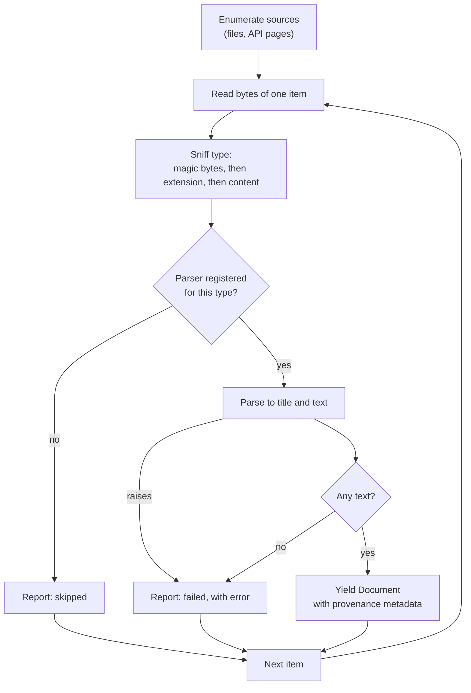
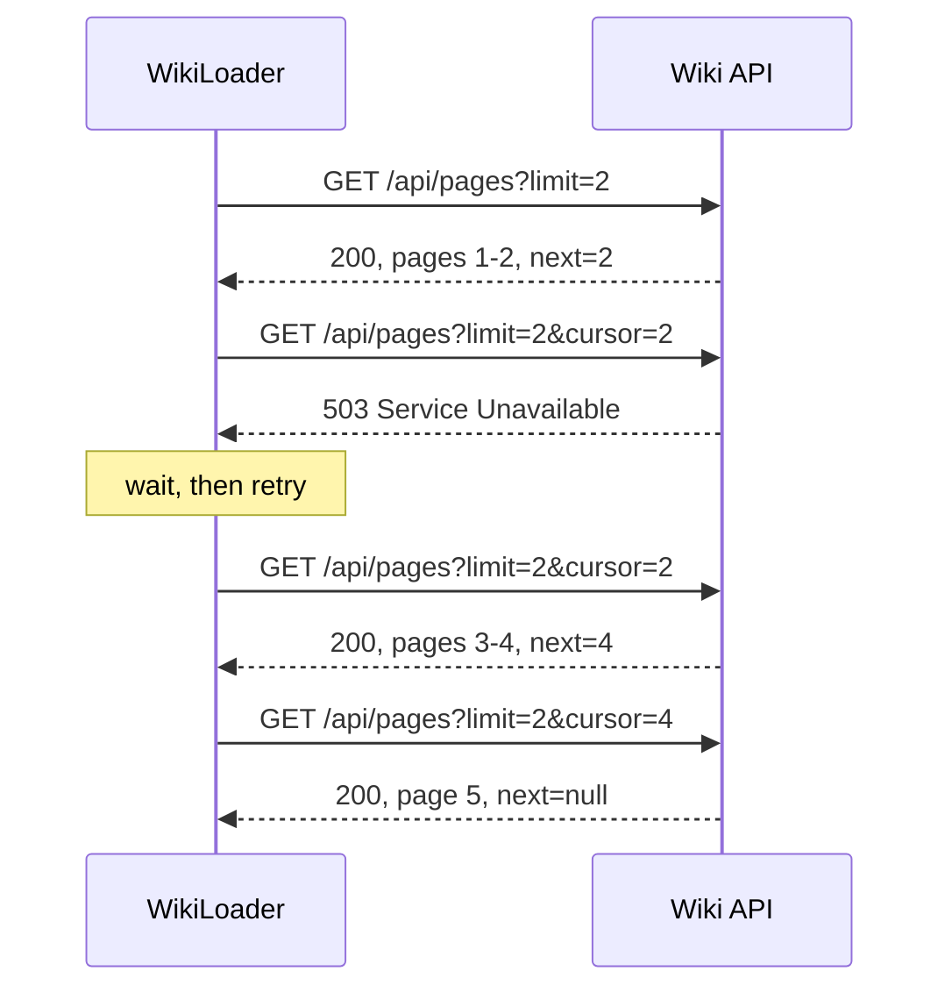

Every RAG system starts with the same unglamorous step: getting documents out of wherever they live and into the program as text. The [indexing pipeline](/learn/rag-architecture-fundamentals/indexing-pipeline) called this stage *load* and drew it as one box. In practice it is a component with a surprising amount of engineering in it. Files lie about their type, some are corrupt, some are too large, some sources are not files at all but paginated APIs that fail now and then, and the whole corpus may not fit in memory at once.

A **document loader** is the component that hides all of that behind one small interface: give it a source, get back a stream of documents, each carrying its text and a record of where it came from. This lesson builds a loader from first principles: type detection, a registry of parsers, lazy iteration, per-file error isolation and a load report, then a loader for a paginated API, and finally the same loader wrapped in LangChain's interface. The rest of this module builds on the `Document` objects it produces.

## Learning objectives

- Define the loader contract (source in, iterator of documents with text and provenance out) and explain why every loader in a system should honour the same one.
- Detect a file's real type from its leading bytes and fall back to its extension only when the bytes are inconclusive.
- Implement a loader that isolates per-file failures and separates "skipped" from "failed" in a load report.
- Compare lazy and eager loading and estimate the memory each needs for a given corpus.
- Build a loader for a paginated HTTP source that retries transient errors and records a resume point.

## Prerequisites

- [Indexing pipeline](/learn/rag-architecture-fundamentals/indexing-pipeline): the seven stages, and the document ID and content hash introduced there.
- [Functions and classes](/learn/python-for-rag-engineering/functions-and-classes) and [Exception handling](/learn/python-for-rag-engineering/exception-handling): the code uses classes, decorators, generators and `try`/`except`.
- [Working with APIs](/learn/python-for-rag-engineering/working-with-apis): HTTP requests and status codes, used in the API loader.
- Helpful but not required: [PDF extraction](/learn/data-processing/pdf-extraction), [DOCX extraction](/learn/data-processing/docx-extraction) and [XML and HTML](/learn/data-processing/xml-and-html), which explain the parsers this lesson plugs in.

## Why this matters

The loader is the only part of the system that sees the corpus as it really is. Everything downstream (chunking, embedding, retrieval) sees only what the loader chose to hand over. That makes loader faults unusually hard to notice:

- A file that fails to load does not produce a wrong answer. It produces **no answer**, or an answer from some other document, and nobody is told that the right document was never indexed.
- A loader that crashes on the first corrupt PDF stops the whole run. Someone then wraps the call in a broad `try`/`except: pass`, and from that day on every failure is silent.
- A loader that reads the whole corpus into a list works on a laptop with 50 files and runs out of memory in production with 500,000.
- A loader that forgets to record the source path makes every later step blind: there is nothing to cite, nothing to filter on, and no way to delete a document's chunks when the document is removed.

A good loader therefore reports what it did and did not load, never lets one bad input stop the others, and attaches provenance to everything it emits.

## The intuition

Think of the post room in Meridian's London office. Every morning, sacks arrive: letters, parcels, the odd box with no label. The post-room clerk does not read the letters. She does four things. She works out what each item is by looking at it, not by trusting what the sender wrote on the outside (a "letter" that rattles is a parcel). She sends each kind to the right desk. She sets aside, in a labelled tray, anything she cannot deliver, with a note saying why: "addressed to a department that no longer exists", "packaging torn, contents damaged". And she stamps every item with the date and the sack it came from.

Crucially, she works through the sacks one item at a time. She does not tip every sack onto the floor first.

A loader is that clerk. Looking at the item rather than the label is **type sniffing**. Sending it to the right desk is the **parser registry**. The labelled tray is the **load report**. The stamp is **provenance metadata**. Working one item at a time is **lazy loading**.

## How it works

### The loader contract

Strip away the details and every loader, whatever its source, has the same shape:

```text
loader(source configuration) -> iterator of Document(doc_id, text, metadata)
```

(That line is pseudocode.) The `Document` type is the one shared across this module:

- `doc_id`: a stable identifier. Here it is a hash of the source location, as in the indexing pipeline lesson; [Document identifiers](/learn/document-engineering/document-identifiers) examines the choices properly.
- `text`: the extracted text.
- `metadata`: a dictionary that, at minimum, records **provenance**: the source location, the detected media type, the loader that produced it and a fingerprint of the original bytes. [Document metadata](/learn/document-engineering/document-metadata) designs the full schema.

The contract matters more than any single loader. Meridian reads a Git repository of Markdown runbooks, a wiki and a folder of Word policies: three loaders, and the code after them should not care which one a document came from. The indexing pipeline lesson split *load* (fetch bytes) from *parse* (bytes to text); frameworks usually put both behind the loader interface, because the caller wants text. The loader below keeps them separable inside but exposes only documents.

### Detecting the type

To parse a file you must know what it is. There are three sources of evidence, in decreasing order of trustworthiness:

1. **The leading bytes.** Most binary formats begin with a fixed signature, often called *magic bytes*. A PDF starts with `%PDF-`. A PNG starts with the eight bytes `\x89PNG\r\n\x1a\n`. A DOCX file is a ZIP archive, so it starts with `PK\x03\x04`, and inside it there is a part named `word/document.xml`.
2. **The name.** The extension (`.pdf`, `.md`) is a convention, not a guarantee. Files get renamed, exported without extensions, or saved with the wrong one.
3. **A look at the text.** If the bytes decode as UTF-8 and begin with `<!doctype html` or `<html`, it is almost certainly HTML. If they begin with `#`, Markdown is a reasonable guess.

Text formats have no magic bytes, so for them the extension is the best evidence and content heuristics are a fallback. Hence the order: signatures first, extension second, heuristics last. Python's standard `mimetypes` module guesses only from the name; browsers follow a published algorithm, the WHATWG MIME Sniffing Standard (see Further reading).

### The parser registry

Rather than a chain of `if mime == ...` branches, keep a dictionary from media type to parser function, every parser sharing one signature: bytes in, `(title, text)` out. Adding a format means registering one function; the main loop never changes. A type with no parser is a policy decision ("we do not index images yet"), recorded as **skipped**. The parsers are thin wrappers over libraries covered in [Data Processing](/learn/data-processing) (BeautifulSoup, `python-docx`, `pypdf`), treated here as black boxes that return text or raise.

### Isolating failures

A loader that processes 10,000 files will meet broken ones: truncated uploads, password-protected PDFs, mislabelled files. The rule: **a failure in one document must not stop the others, and must not disappear.** So each document's parse runs inside its own `try`/`except`, and the exception is recorded in the report with the source and the error type.

Two outcomes are worth keeping apart:

- **Skipped**: the loader deliberately did not process the item (unsupported type, excluded by a rule, over a size limit). Expected; worth counting, not worth an alert.
- **Failed**: the loader tried and could not (parse error, no text extracted). Unexpected; each one is a document users will not find, and someone should look.

A third case hides between them: the parser succeeds but returns no text. A scanned PDF with no text layer does exactly that. It parses without error and yields an empty string. Treat "parsed but empty" as a failure, or it will be indexed as nothing and never noticed. (Scanned documents need [OCR](/learn/advanced-document-parsing/ocr), a later topic.)

### Lazy and eager loading

An **eager** loader returns a list: everything is read before anything is returned. A **lazy** loader is a generator: it yields one document and reads the next only when asked. A lazy loader can always be made eager with `list(...)`, but not the other way round, so the convention (in LangChain and below) is to implement `lazy_load()` and derive `load()` from it. One consequence: **the report is complete only when the iterator is exhausted.**

### The whole flow



Step by step, for each item:

1. Enumerate the next item from the source: a file path from a directory walk, or a record from an API page.
2. Read its bytes and note its location; the location becomes the `source` field and the basis of the `doc_id`.
3. Sniff the media type from the bytes, the name and, if needed, the content.
4. Look up a parser. If there is none, record a skip and move on.
5. Parse inside a `try`. On an exception, record a failure with its type and message and move on.
6. If the text is empty, record a failure and move on.
7. Otherwise yield a `Document` whose metadata records the source, media type, title, loader name and version, size and a hash of the raw bytes.

### Sources that are not files

Much knowledge lives behind APIs: wikis, ticketing systems, document-management platforms. A loader for such a source, often called a **connector**, adds three concerns:

- **Pagination.** The API returns results in pages, with a *cursor* (an opaque token) or an offset pointing to the next page. The loader requests pages until there is no next cursor.
- **Transient failures.** Servers return `429 Too Many Requests` or `503 Service Unavailable` under load. These are worth retrying after a pause that grows with each attempt (**exponential backoff**). A `404` or `401` is not: retrying will not change the answer.
- **Resumability.** A connector that pages through 200,000 records will sometimes be interrupted. If it remembers the cursor of the last page it finished, a restart can continue from there instead of from the beginning.



Deciding *which* records to fetch on each run (everything, or only what changed since last time) is a scheduling question owned by [Incremental ingestion](/learn/understanding-document-ingestion/incremental-ingestion). The loader's job is to fetch what it is asked for, reliably.

> [!KEY]
> A loader's output is a promise to the rest of the pipeline: every document it yields has text and provenance, and every document it did not yield is accounted for in the report. Type detection, the parser registry, lazy iteration and the report all exist to keep that promise.

## In code

### A directory loader with sniffing, a registry and a report

**The problem.** Load a folder of Meridian documents in four formats, including three awkward files that every real corpus eventually contains: a Markdown runbook saved without an extension, a truncated PDF, and an image. Every good document should come out as a `Document`; every other file should appear in the report with a reason.

**Dependencies.** BeautifulSoup, pypdf and python-docx for parsing; PyMuPDF only to *create* the sample PDF. No API key, no model download.

```bash
pip install beautifulsoup4 pypdf python-docx pymupdf
```

First, a script that builds the sample folder:

```python
from pathlib import Path

import docx      # python-docx
import pymupdf   # PyMuPDF, used here only to *create* a PDF for the demo

root = Path("meridian_docs")
(root / "handbook").mkdir(parents=True, exist_ok=True)
(root / "it").mkdir(exist_ok=True)

(root / "handbook/leave.md").write_text(
    "# Annual leave\n\nAnnual leave is 25 days per year. Up to 5 unused days "
    "carry over and must be used by 31 March.\n", encoding="utf-8")

(root / "handbook/remote-work.html").write_text(
    "<html><head><title>Remote work</title></head><body><nav>Home | HR</nav>"
    "<h1>Remote work</h1><p>Staff may work remotely up to 3 days a week.</p>"
    "<p>The home-office equipment budget is £400.</p></body></html>", encoding="utf-8")

d = docx.Document()
d.add_heading("Expenses", level=1)
d.add_paragraph("Expenses must be submitted within 30 days.")
d.add_paragraph("Anything over £75 needs a receipt.")
d.save(root / "handbook/expenses.docx")

pdf = pymupdf.open()
page = pdf.new_page()
page.insert_text((72, 72), "Security basics", fontsize=16)
page.insert_text((72, 100), "Passwords must be rotated every 90 days.")
page.insert_text((72, 116), "VPN is required on public Wi-Fi.")
pdf.save(root / "it/security.pdf")

# Three awkward files that every real corpus contains sooner or later:
(root / "it/NET-114").write_text(            # no extension, but it is Markdown
    "# NET-114: VPN will not connect\n\nUpdate the VPN client, then reboot.\n", encoding="utf-8")
(root / "it/laptops.pdf").write_bytes(b"%PDF-1.7\n this file was truncated during upload")
(root / "it/org-chart.png").write_bytes(b"\x89PNG\r\n\x1a\n" + b"\x00" * 32)
print(sorted(str(p.relative_to(root)) for p in root.rglob("*") if p.is_file()))
```

```output
['handbook/expenses.docx', 'handbook/leave.md', 'handbook/remote-work.html', 'it/NET-114', 'it/laptops.pdf', 'it/org-chart.png', 'it/security.pdf']
```

Now the loader itself, in a file named `loaders.py` so the later examples can import it:

```python
import hashlib
import io
import zipfile
from dataclasses import dataclass, field
from pathlib import Path
from typing import Callable, Iterator

import docx                      # python-docx
from bs4 import BeautifulSoup
from pypdf import PdfReader


@dataclass
class Document:
    doc_id: str
    text: str
    metadata: dict


@dataclass
class LoadReport:
    loaded: int = 0
    skipped: list[tuple[str, str]] = field(default_factory=list)   # unsupported: expected
    failed: list[tuple[str, str]] = field(default_factory=list)    # supported but broken: investigate


# ---------- 1. detect the type from the bytes first, the name second ----------
DOCX = "application/vnd.openxmlformats-officedocument.wordprocessingml.document"
BY_EXTENSION = {".md": "text/markdown", ".html": "text/html", ".htm": "text/html",
                ".txt": "text/plain", ".pdf": "application/pdf", ".docx": DOCX}


def sniff(name: str, data: bytes) -> str:
    if data.startswith(b"%PDF-"):
        return "application/pdf"
    if data.startswith(b"\x89PNG\r\n\x1a\n"):
        return "image/png"
    if data.startswith(b"PK\x03\x04"):                       # a ZIP container
        with zipfile.ZipFile(io.BytesIO(data)) as z:
            return DOCX if "word/document.xml" in z.namelist() else "application/zip"
    if Path(name).suffix.lower() in BY_EXTENSION:
        return BY_EXTENSION[Path(name).suffix.lower()]
    try:
        head = data[:512].decode("utf-8").lstrip().lower()
    except UnicodeDecodeError:
        return "application/octet-stream"
    if head.startswith(("<!doctype html", "<html")):
        return "text/html"
    return "text/markdown" if head.startswith("#") else "text/plain"


# ---------- 2. one parser per media type, all with the same signature ----------
Parser = Callable[[bytes], tuple[str, str]]          # bytes -> (title, text)
PARSERS: dict[str, Parser] = {}


def parser(mime: str):
    def register(fn: Parser) -> Parser:
        PARSERS[mime] = fn
        return fn
    return register


@parser("text/markdown")
def parse_markdown(data: bytes) -> tuple[str, str]:
    text = data.decode("utf-8")
    title = next((l[2:].strip() for l in text.splitlines() if l.startswith("# ")), "")
    return title, text


@parser("text/plain")
def parse_text(data: bytes) -> tuple[str, str]:
    return "", data.decode("utf-8")


@parser("text/html")
def parse_html(data: bytes) -> tuple[str, str]:
    soup = BeautifulSoup(data, "html.parser")
    for tag in soup(["nav", "script", "style", "footer"]):
        tag.decompose()
    title = soup.title.get_text(strip=True) if soup.title else ""
    body = soup.body or soup
    return title, body.get_text("\n", strip=True)


@parser(DOCX)
def parse_docx(data: bytes) -> tuple[str, str]:
    paragraphs = docx.Document(io.BytesIO(data)).paragraphs
    title = next((p.text for p in paragraphs if p.style.name.startswith("Heading")), "")
    return title, "\n".join(p.text for p in paragraphs if p.text.strip())


@parser("application/pdf")
def parse_pdf(data: bytes) -> tuple[str, str]:
    reader = PdfReader(io.BytesIO(data))
    text = "\n".join(page.extract_text() or "" for page in reader.pages)
    return text.strip().split("\n", 1)[0], text


# ---------- 3. the loader: a source in, an iterator of Documents out ----------
class DirectoryLoader:
    name = "DirectoryLoader/1.0"

    def __init__(self, root: str | Path, report: LoadReport):
        self.root, self.report = Path(root), report
        self.files_read = 0

    def files(self) -> Iterator[Path]:
        return iter(sorted(p for p in self.root.rglob("*") if p.is_file()))

    def lazy_load(self) -> Iterator[Document]:
        for path in self.files():
            uri = path.relative_to(self.root).as_posix()
            data = path.read_bytes()
            self.files_read += 1
            mime = sniff(path.name, data)
            parse = PARSERS.get(mime)
            if parse is None:
                self.report.skipped.append((uri, f"no parser for {mime}"))
                continue
            try:
                title, text = parse(data)
            except Exception as exc:                       # isolate: one bad file must not stop the run
                self.report.failed.append((uri, f"{type(exc).__name__}: {exc}"))
                continue
            if not text.strip():
                self.report.failed.append((uri, "parsed, but no text was extracted"))
                continue
            self.report.loaded += 1
            yield Document(
                doc_id=hashlib.sha256(f"file:{uri}".encode()).hexdigest()[:16],
                text=text,
                metadata={
                    "source": uri,
                    "mime_type": mime,
                    "title": title or path.stem,
                    "loader": self.name,
                    "size_bytes": len(data),
                    "bytes_sha256": hashlib.sha256(data).hexdigest()[:12],
                },
            )

    def load(self) -> list[Document]:
        return list(self.lazy_load())


if __name__ == "__main__":
    report = LoadReport()
    for doc in DirectoryLoader("meridian_docs", report).lazy_load():
        m = doc.metadata
        print(f"{doc.doc_id}  {m['source']:<26} {m['mime_type'][:24]:<24} title={m['title']!r}")
        print(f"{'':18}text={doc.text[:60].replace(chr(10), ' / ')!r}")
    print(f"\nloaded={report.loaded}")
    for uri, why in report.skipped:
        print(f"skipped  {uri:<20} {why}")
    for uri, why in report.failed:
        print(f"FAILED   {uri:<20} {why}")
```

Run it with `python loaders.py`:

```output
4548f47a8e410044  handbook/expenses.docx     application/vnd.openxmlf title='Expenses'
                  text='Expenses / Expenses must be submitted within 30 days. / Anything'
5d2c6bb3c237bebc  handbook/leave.md          text/markdown            title='Annual leave'
                  text='# Annual leave /  / Annual leave is 25 days per year. Up to 5 un'
43357fd245ca4f1f  handbook/remote-work.html  text/html                title='Remote work'
                  text='Remote work / Staff may work remotely up to 3 days a week. / The'
ffe763cf571cb3a0  it/NET-114                 text/markdown            title='NET-114: VPN will not connect'
                  text='# NET-114: VPN will not connect /  / Update the VPN client, then'
be8d9fd75d84fcab  it/security.pdf            application/pdf          title='Security basics'
                  text='Security basics / Passwords must be rotated every 90 days. / VPN'

loaded=5
skipped  it/org-chart.png     no parser for image/png
FAILED   it/laptops.pdf       PdfStreamError: Stream has ended unexpectedly
```

**The important lines.**

- `sniff()` checks signatures before the extension, so a `report.pdf` that is really a Word file goes to the DOCX parser. `it/NET-114`, with no extension, decodes as text starting with `#` and is treated as Markdown.
- The ZIP branch looks for `word/document.xml`, because DOCX, XLSX, PPTX and EPUB are all ZIP containers.
- `PARSERS` and the `@parser(...)` decorator form the registry. Supporting a new format means writing one function with the `bytes -> (title, text)` signature; `lazy_load()` does not change.
- The `try`/`except Exception` wraps the parse of one file. It catches broadly because third-party parsers raise many exception types, but it *records* every exception.
- `bytes_sha256` fingerprints the raw file (unlike the indexing pipeline's content hash, computed later on cleaned text). `loader` records name and version, so after a parser fix you can find every document the old version produced.

**What the output means.** Five documents loaded across four formats, each with a title and a stable `doc_id`. The PNG was *skipped* (policy, not fault). The truncated PDF has a PDF signature, so it reached the PDF parser, which raised `PdfStreamError`: *failed*. Nothing stopped the run, and both problems carry a reason. The DOCX text begins "Expenses / Expenses" because the title is a heading paragraph; how headings are represented is [Document normalization](/learn/document-engineering/document-normalization)'s job.

**Errors people commonly hit.**

- pypdf also logs a warning, `EOF marker not found`, to standard error for the truncated file. It is a log message, not an exception; the exception comes a moment later. Configure logging so such warnings reach your logs with the file name attached.
- Opening the DOCX with `docx.Document(path)` works, but passing raw bytes requires wrapping them in `io.BytesIO` first, as here.
- `path.read_text()` without `encoding="utf-8"` uses the platform default encoding, which differs between machines. Read bytes, then decode explicitly; [Encoding and Unicode](/learn/data-processing/encoding-and-unicode) explains why.
- Forgetting `if not text.strip()`. A PDF that is only scanned images parses "successfully" into an empty string.

**Extending it.** Register a function per new type, and send the `LoadReport` to monitoring: a rise in failures after a source-system upgrade is something to hear about the same day.

### Lazy loading and LangChain interoperability

**The problem.** Show that `lazy_load()` really reads only what is consumed, then put the same loader behind LangChain's `BaseLoader` interface so that framework code can use it. The script imports `loaders.py` from the previous example.

```bash
pip install langchain-core
```

```python
from itertools import islice
from typing import Iterator

from langchain_core.document_loaders import BaseLoader
from langchain_core.documents import Document as LCDocument

from loaders import DirectoryLoader, LoadReport

# Lazy: ask for two documents, and only as many files as needed are read.
loader = DirectoryLoader("meridian_docs", LoadReport())
first_two = list(islice(loader.lazy_load(), 2))
print("documents taken:", len(first_two), "| files read so far:", loader.files_read)

# Eager: load() reads everything before returning anything.
loader = DirectoryLoader("meridian_docs", LoadReport())
everything = loader.load()
print("documents taken:", len(everything), "| files read so far:", loader.files_read)


# Interop: the same loader behind LangChain's interface.
class MeridianLangChainLoader(BaseLoader):
    def __init__(self, root: str):
        self.inner = DirectoryLoader(root, LoadReport())

    def lazy_load(self) -> Iterator[LCDocument]:
        for doc in self.inner.lazy_load():
            yield LCDocument(page_content=doc.text, metadata={**doc.metadata, "doc_id": doc.doc_id})


lc_docs = MeridianLangChainLoader("meridian_docs").load()   # load() is inherited from BaseLoader
print(type(lc_docs[0]).__name__, len(lc_docs), lc_docs[1].metadata["source"], lc_docs[1].metadata["doc_id"])
```

```output
documents taken: 2 | files read so far: 2
documents taken: 5 | files read so far: 7
Document 5 handbook/leave.md 5d2c6bb3c237bebc
```

**What the output means.** `islice` took two documents and the generator stopped after the second `yield`: two files read. `load()` read all seven before returning. The LangChain subclass implements only `lazy_load()` and inherits `load()`; the adapter maps `text` to `page_content` and moves `doc_id` into metadata. A clear contract makes framework integration a few lines; the frameworks themselves are covered in [LangChain document loaders](/learn/langchain-for-rag/document-loaders) and [LlamaIndex document ingestion](/learn/llamaindex/document-ingestion).

**Errors people commonly hit.** Iterating a generator twice (the second loop yields nothing; call `lazy_load()` again), and reading the report before the iterator is exhausted.

### A paginated API loader with retries

**The problem.** Load pages from a wiki that serves them through a paginated JSON API and occasionally answers `503`. The example uses `httpx.MockTransport`, which lets an `httpx.Client` call a Python function instead of the network, so it runs with no server. The fake API fails exactly once, on its second request.

```bash
pip install httpx beautifulsoup4
```

```python
import hashlib
import time
from typing import Iterator

import httpx
from bs4 import BeautifulSoup

from loaders import Document, LoadReport

# ---------- a fake wiki API, so the example runs with no server ----------
PAGES = [
    {"id": "1001", "title": "Support desk", "space": "IT", "updated": "2025-01-10",
     "body": "<p>The support desk is open 08:00 to 18:00 UK time.</p>"},
    {"id": "1002", "title": "Lost laptops", "space": "IT", "updated": "2025-02-03",
     "body": "<p>Report a lost laptop to the support desk at once.</p>"},
    {"id": "1003", "title": "Laptop refresh", "space": "IT", "updated": "2025-02-20",
     "body": "<p>Laptops are refreshed every 3 years.</p>"},
    {"id": "1004", "title": "Public Wi-Fi", "space": "IT", "updated": "2025-03-01",
     "body": "<p>VPN is required on public Wi-Fi.</p>"},
    {"id": "1005", "title": "Passwords", "space": "IT", "updated": "2025-03-15",
     "body": "<p>Passwords are rotated every 90 days.</p>"},
]
calls = {"n": 0}


def fake_wiki(request: httpx.Request) -> httpx.Response:
    calls["n"] += 1
    if calls["n"] == 2:                                   # one transient failure
        return httpx.Response(503, json={"error": "try again"})
    start = int(request.url.params.get("cursor", "0"))
    limit = int(request.url.params["limit"])
    batch = PAGES[start:start + limit]
    nxt = str(start + limit) if start + limit < len(PAGES) else None
    return httpx.Response(200, json={"results": batch, "next": nxt})


# ---------- the loader ----------
class WikiLoader:
    name = "WikiLoader/1.0"

    def __init__(self, client: httpx.Client, report: LoadReport, page_size: int = 2, max_retries: int = 3):
        self.client, self.report = client, report
        self.page_size, self.max_retries = page_size, max_retries
        self.cursor: str | None = None          # last page fully yielded: a resume point

    def _get(self, params: dict) -> dict:
        for attempt in range(self.max_retries + 1):
            r = self.client.get("/api/pages", params=params)
            if r.status_code in (429, 500, 502, 503, 504) and attempt < self.max_retries:
                print(f"  HTTP {r.status_code}, retry {attempt + 1}")
                time.sleep(0.01 * 2 ** attempt)   # exponential backoff (tiny for the demo)
                continue
            r.raise_for_status()                  # anything else is not worth retrying
            return r.json()
        raise RuntimeError("unreachable")

    def lazy_load(self, start_cursor: str | None = None) -> Iterator[Document]:
        cursor = start_cursor
        while True:
            params = {"limit": self.page_size, **({"cursor": cursor} if cursor else {})}
            payload = self._get(params)
            for page in payload["results"]:
                text = BeautifulSoup(page["body"], "html.parser").get_text(" ", strip=True)
                uri = f"wiki://{page['space']}/{page['id']}"
                self.report.loaded += 1
                yield Document(
                    doc_id=hashlib.sha256(uri.encode()).hexdigest()[:16],
                    text=text,
                    metadata={"source": uri, "title": page["title"], "mime_type": "text/html",
                              "source_updated": page["updated"], "loader": self.name},
                )
            self.cursor = payload["next"]
            if self.cursor is None:
                return
            cursor = self.cursor


client = httpx.Client(base_url="https://wiki.meridian.example", transport=httpx.MockTransport(fake_wiki))
report = LoadReport()
for doc in WikiLoader(client, report).lazy_load():
    print(doc.metadata["source"], doc.metadata["source_updated"], "|", doc.text)
print(f"loaded={report.loaded}, HTTP requests={calls['n']}")
```

```output
wiki://IT/1001 2025-01-10 | The support desk is open 08:00 to 18:00 UK time.
wiki://IT/1002 2025-02-03 | Report a lost laptop to the support desk at once.
  HTTP 503, retry 1
wiki://IT/1003 2025-02-20 | Laptops are refreshed every 3 years.
wiki://IT/1004 2025-03-01 | VPN is required on public Wi-Fi.
wiki://IT/1005 2025-03-15 | Passwords are rotated every 90 days.
loaded=5, HTTP requests=4
```

**The important lines.**

- `_get()` retries only status codes where retrying can help (429 and the 5xx family) and only up to `max_retries`. For anything else, `raise_for_status()` raises immediately: a `401 Unauthorized` will not fix itself.
- `time.sleep(0.01 * 2 ** attempt)` is exponential backoff, tiny for the demo. Real connectors start nearer a second, cap the delay, add random jitter so clients do not retry in lockstep, and honour a `Retry-After` header.
- `self.cursor` is updated only after every record on a page has been yielded. A restart with `lazy_load(start_cursor=...)` may repeat part of a page but never skips one; repeating is safe in an idempotent pipeline, skipping loses documents silently.
- The `doc_id` hashes a URI built from the wiki's page ID (`wiki://IT/1003`), not the title, which can change. `source_updated` keeps the source's own modification date, which [Document versioning](/learn/document-engineering/document-versioning) relies on.

**What the output means.** Five documents from three pages, in four HTTP requests: three successes plus the `503` that was retried, invisibly to the caller.

**Errors people commonly hit.** Paginating by offset while the source is being edited (records are skipped or repeated); retrying without a limit; hardcoding an API token instead of reading it from the environment.

**Extending it.** Persist `self.cursor` to disk after each page, and set a request timeout (`httpx.Client(timeout=...)`) so a hung connection cannot stall the run.

## A real-world example

Meridian's Platform team runs AskMeridian's ingestion nightly. For its first months the policy-library loader was a twelve-line function: walk the folder, choose a parser by extension, append text to a list, with one `try`/`except` around the whole loop that logged "ingestion error".

When someone asked why AskMeridian knew nothing about expenses, the investigating engineer found the expenses policy had been re-exported with a `.pdf` extension, but the export tool had produced a Word file. The PDF parser raised, the exception was caught around the *whole loop*, and every file alphabetically after `expenses`, including the IT runbooks, had not loaded for three weeks. "ingestion error" had been logged every night; nobody connected it with missing answers, because most questions were still answered from the documents that had loaded.

The fix matched this lesson section by section: signature-first type detection, a `try`/`except` per file, and a load report after every run, with an alert when the loaded count fell sharply against the previous night. The loader version went into each document's metadata, so a later parser fix could be applied to exactly the documents the old version had produced.

## Common mistakes

- **Trusting the extension.** Mislabelled and extensionless files are routed to the wrong parser, which then either fails or, worse, produces garbage that is indexed.
- **One `try`/`except` around the whole loop.** The first bad file ends the run and everything after it is silently missing.
- **`except: pass`.** Failures vanish. The corpus shrinks over time and the only symptom is answers that get gradually worse.
- **Treating "parsed without error" as success.** Scanned PDFs and image-only pages yield empty text that passes every exception check.
- **Returning a list from a large source.** Memory grows with the corpus, and nothing reaches the next stage until everything is read.
- **Dropping provenance.** Without the source location there is nothing to cite, no way to filter by source, and no way to delete a removed document's chunks.
- **Different loaders, different contracts.** One loader puts the title in `title`, another in `name`; downstream code fills up with special cases and breaks when a new source is added.
- **Retrying everything, or nothing.** Retrying a `401` wastes time; not retrying a `503` loses a whole page of records to a momentary blip.

## Best practices

- Implement `lazy_load()` as a generator and derive `load()` from it.
- Detect types from bytes, then extension, then content; log when extension and bytes disagree.
- Keep a registry from media type to parser with one shared signature.
- Report skipped and failed separately, and alert on failures and on sudden drops in the loaded count.
- Record provenance on every document: source, media type, loader name and version, size, raw-bytes hash.
- In connectors, retry only transient errors with capped backoff, and keep a cursor to resume from.
- Test every loader against a small folder of deliberately awkward files like the one built above.

## Performance considerations

**Memory.** An eager loader holds every document's text at once. Suppose AskMeridian's sources total 50,000 documents averaging 40 KB of extracted text. That is $50{,}000 \times 40\ \text{KB} = 2\ \text{GB}$ of text. A Python string stores 1, 2 or 4 bytes per character depending on the widest character it contains, so a single emoji or CJK character can double or quadruple a document's footprint. A lazy loader holds one document at a time, plus whatever the next stage buffers: with embedding batches of 64 documents, roughly $64 \times 40\ \text{KB} \approx 2.6\ \text{MB}$. The directory listing in `files()` is sorted, which materialises the list of *paths*, but a path is a few hundred bytes, not 40 KB.

**Throughput.** Text formats are usually I/O-bound; PDF and Office parsing is CPU-bound. For an API connector, request latency dominates: at 200 ms per page of 100 records, 200,000 records need 2,000 requests, about 400 seconds sequentially. A few concurrent requests cut that proportionally, up to the rate limit ([Async programming](/learn/python-for-rag-engineering/async-programming) shows how). For CPU-bound parsing, CPython threads do not run Python code in parallel, so a process pool is the usual tool.

**Avoiding work.** Comparing size and modification time, or a source's `updated` field, with the previous run lets the loader skip unchanged items before reading their bytes.

**Retries cost time.** With a base delay of 1 second doubling each attempt, three retries wait $1 + 2 + 4 = 7$ seconds. Cap the delay and the number of attempts so one bad endpoint cannot dominate a nightly run.

## Security considerations

The loader is where untrusted bytes first enter your system, and document parsers are large, complex programs.

- **Resource exhaustion.** A DOCX is a ZIP archive and can be a decompression bomb; a PDF can hold thousands of pages or deeply nested objects. Enforce size limits before reading (exercise 3), and run heavy parsers in a worker process with memory and time limits.
- **Symbolic links.** A directory walk can reach a file outside the intended folder through a link. Resolve each path and check it is still inside the root.
- **Credentials.** Read connector tokens from environment variables or a secrets manager; never copy them into metadata or logs.
- **Permissions are captured at load time or lost.** If a wiki page is visible only to finance, the loader is the last place that knows. Record access information in metadata; [Document-level permissions](/learn/access-control-and-privacy/document-level-permissions) covers enforcement.
- **Content is untrusted.** A document can contain instructions aimed at the model. Recording provenance here is what the defences in [Indirect prompt injection](/learn/rag-security-fundamentals/indirect-prompt-injection) and [Malicious documents](/learn/rag-security-fundamentals/malicious-documents) build on.

## Summary

- A document loader turns a source into an iterator of documents, each with text and provenance metadata. Every loader in a system should honour the same contract.
- Detect a file's type from its leading bytes first, the extension second and content heuristics last; extensions are often wrong or missing.
- A registry from media type to parser keeps the loader's main loop fixed as formats are added.
- Isolate each document's failure, separate "skipped" from "failed" in a load report, and treat empty extracted text as a failure.
- Implement lazy loading with a generator; it keeps memory flat and lets downstream stages start immediately.
- API connectors add pagination, retries of transient errors with backoff, and a cursor to resume from.

## Exercises

**1.** For each file, say whether the loader above will load it, skip it or fail it, and why: (a) `notes.txt` containing `<!DOCTYPE html><html>...` (b) `budget.xlsx` (c) a PDF exported from a scanner, containing only page images (d) `policy.pdf` that is really a valid DOCX.

<details><summary>Show solution</summary>

(a) **Loaded as plain text.** There is no signature, and the `.txt` extension maps to `text/plain` before the content heuristic is reached, so the HTML parser is never used and the tags stay in the text. This is the cost of trusting the extension for text formats; you could check for an HTML prefix before the extension lookup if your sources mislabel HTML often.

(b) **Skipped.** It starts with `PK\x03\x04`, but the archive has no `word/document.xml` (spreadsheets keep their content under `xl/`), so it is sniffed as `application/zip`, for which no parser is registered.

(c) **Failed** with "parsed, but no text was extracted". pypdf opens it without error but finds no text layer. It needs OCR.

(d) **Loaded.** The signature check finds `PK\x03\x04` and `word/document.xml` before the extension is consulted, so it goes to the DOCX parser. A loader that trusted the extension would have failed it.

</details>

**2.** The Platform team moves the folder `handbook/` to `hr/handbook/` in the repository. What happens to every handbook document's `doc_id` with the loader above, and what will the index contain after the next run if nothing else changes? Suggest one remedy.

<details><summary>Show solution</summary>

The `doc_id` is a hash of `file:<relative path>`, so every moved document gets a **new** `doc_id`. The pipeline sees them as new documents and indexes them; the old IDs are no longer produced, so unless the pipeline deletes documents that have disappeared from the source, their chunks stay in the index. The index then holds two copies of every handbook chunk, and duplicates crowd other results out of the top-k.

Remedies: make the pipeline delete documents whose IDs are absent from a complete run (this is needed anyway for genuinely deleted files); or base the ID on something that survives moves, such as an identifier stored in the document's front matter; or keep an alias table mapping old IDs to new ones. [Document identifiers](/learn/document-engineering/document-identifiers) compares these options.

</details>

**3.** Add a size limit and exclusion patterns to the directory loader without changing `lazy_load()`. Files larger than `max_bytes` must be reported as skipped *before their bytes are read*; files matching an exclusion pattern must be ignored entirely. Test it with `max_bytes=10_000` and `exclude=("*.png",)`.

<details><summary>Show solution</summary>

`loaders.py` enumerates files through a separate `files()` method, so a subclass can override enumeration alone:

```python
from pathlib import Path
from typing import Iterator

from loaders import DirectoryLoader, LoadReport


class GuardedDirectoryLoader(DirectoryLoader):
    def __init__(self, root, report, max_bytes: int, exclude: tuple[str, ...] = ()):
        super().__init__(root, report)
        self.max_bytes, self.exclude = max_bytes, exclude

    def files(self) -> Iterator[Path]:
        for path in super().files():
            uri = path.relative_to(self.root).as_posix()
            if any(Path(uri).match(pattern) for pattern in self.exclude):
                continue                                    # excluded by policy
            size = path.stat().st_size                      # checked before reading any bytes
            if size > self.max_bytes:
                self.report.skipped.append((uri, f"{size} bytes exceeds limit of {self.max_bytes}"))
                continue
            yield path


report = LoadReport()
loader = GuardedDirectoryLoader("meridian_docs", report, max_bytes=10_000, exclude=("*.png",))
print([d.metadata["source"] for d in loader.lazy_load()])
print("files read:", loader.files_read)
print("skipped:", report.skipped)
print("failed:", report.failed)
```

```output
['handbook/leave.md', 'handbook/remote-work.html', 'it/NET-114', 'it/security.pdf']
files read: 5
skipped: [('handbook/expenses.docx', '36671 bytes exceeds limit of 10000')]
failed: [('it/laptops.pdf', 'PdfStreamError: Stream has ended unexpectedly')]
```

The 36 KB DOCX is skipped using `stat()` alone (`files read: 5` confirms it was never opened), the PNG is excluded silently, and the truncated PDF still fails. Silent exclusion suits files you never want; a size skip should be reported, because it may hide a document someone expects to find.

</details>

**4.** Design decision. Meridian's IT team wants AskMeridian to index its ticketing system's knowledge-base articles: about 30,000 articles, served by an API that returns 50 per page, allows 5 requests per second, and occasionally times out. The nightly window is two hours. Sketch the connector: paging, retries, concurrency, resumption, and what goes into each document's metadata.

<details><summary>Show solution</summary>

A full load needs $30{,}000 / 50 = 600$ requests. At the rate limit of 5 per second that is 120 seconds of requests at minimum, comfortably inside two hours, so a simple sequential or lightly concurrent connector is enough; there is no need for aggressive parallelism that risks the limit.

- **Paging.** Follow the API's cursor rather than offsets, so edits during the run cause no skips.
- **Retries.** Retry timeouts, 429 and 5xx with capped backoff and jitter, honouring `Retry-After`; fail fast on 401, 403, 404. Set a request timeout.
- **Concurrency.** Cursor paging is sequential (page *n* gives the cursor for *n+1*). If the API filters by category, categories can be paged in parallel under a shared rate limiter.
- **Resumption.** Persist the cursor after each processed page; if the API supports "updated since", fetch only changes nightly and reconcile fully weekly to catch deletions.
- **Metadata.** URI from the article's own ID, title, last-updated timestamp, category, owning team, permission fields, citation URL, loader name and version.
- **Reporting.** Loaded and failed counts (with article IDs), requests and retries, compared with the previous night.

</details>

## Check your understanding

```quiz
[
  {
    "q": "A file named `handbook.pdf` begins with the bytes `PK\\x03\\x04`. What should a well-built loader conclude first?",
    "options": [
      "It is a PDF, because the extension says so",
      "It is a ZIP container, so it should look inside to see which format it is",
      "It is corrupt and should be reported as failed",
      "It is plain text and should be decoded as UTF-8"
    ],
    "answer": 1,
    "why": "`PK\\x03\\x04` is the ZIP signature. DOCX, XLSX and PPTX are all ZIP containers, so the loader must inspect the archive's contents (for example `word/document.xml`) to decide."
  },
  {
    "q": "What does this print?\n```python\ndef gen():\n    for i in range(3):\n        print('read', i)\n        yield i\n\ng = gen()\nnext(g)\n```",
    "options": [
      "read 0, read 1 and read 2",
      "Nothing, because generators run only when converted to a list",
      "read 0",
      "read 0 and read 1"
    ],
    "answer": 2,
    "why": "A generator runs until its first `yield` when `next()` is called, then suspends. Only one item has been read, which is exactly what lazy loading relies on."
  },
  {
    "q": "A PDF of scanned pages parses without raising an exception and returns an empty string. How should the loader treat it?",
    "options": [
      "As a failure, because a document with no text cannot be found by any query",
      "As a success, because the parser did not raise",
      "As skipped, because PDFs are not supported",
      "As a duplicate of the previous document"
    ],
    "answer": 0,
    "why": "Indexing an empty document makes it silently unfindable. Treating empty text as a failure puts it in the report, where someone can route it to OCR."
  },
  {
    "q": "An API connector receives `401 Unauthorized`. What should it do?",
    "options": [
      "Retry with exponential backoff, up to a limit",
      "Skip that page and continue with the next cursor",
      "Retry immediately until it succeeds",
      "Stop and report the error, because retrying will not change the answer"
    ],
    "answer": 3,
    "why": "Backoff and retry suit transient errors such as 429 and 503. An authentication failure needs a human or a credential fix; retrying only delays the report."
  },
  {
    "q": "Why does the API loader update its stored cursor only after every record on a page has been yielded?",
    "options": [
      "Because the API rejects cursors that are reused",
      "So that a restart may repeat part of a page but can never skip one",
      "To reduce the number of HTTP requests",
      "Because generators cannot store state between pages"
    ],
    "answer": 1,
    "why": "Repeating records is harmless in an idempotent pipeline; skipping them loses documents silently. Committing the cursor late chooses the safe failure."
  }
]
```

## Further reading

- WHATWG, *MIME Sniffing Standard*, [mimesniff.spec.whatwg.org](https://mimesniff.spec.whatwg.org/): how browsers determine a resource's type from its bytes, including signature tables.
- Python documentation, [`mimetypes`](https://docs.python.org/3/library/mimetypes.html) and [generators in the functional programming HOWTO](https://docs.python.org/3/howto/functional.html).
- [pypdf documentation](https://pypdf.readthedocs.io/) and [python-docx documentation](https://python-docx.readthedocs.io/).
- [HTTPX documentation](https://www.python-httpx.org/), including its transports and the mock transport used above.
- LangChain documentation, "Document loaders" (the `BaseLoader` interface with `lazy_load` and `load`), and LlamaIndex documentation, "SimpleDirectoryReader", for the framework conventions this lesson's loader is compatible with.
