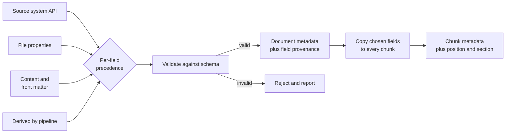

A chunk of text on its own answers one question: *what does it say?* Every other question a RAG system needs to ask about it — where it came from, who owns it, whether it is still in force, who is allowed to read it, what kind of document it belongs to, how to cite it — is answered by **metadata**, the structured data that travels alongside the text. This lesson treats metadata as a design problem rather than an afterthought: which fields to keep, where each one should come from, what to do when two sources disagree, how fields reach every chunk, and which fields belong in filters, in citations or inside the embedded text itself.

[Document loaders](/learn/document-engineering/document-loaders) produce documents with some provenance attached. Here you decide what the full schema should be, and you build a merge that combines four sources of metadata into one validated record.

## Learning objectives

- Classify metadata fields into provenance, descriptive, administrative, temporal, access-control and structural categories, and name one retrieval use for each.
- Design a metadata schema with types, required fields and controlled vocabularies, and enforce it with Pydantic.
- Merge metadata from several sources using an explicit precedence order, and restrict security-relevant fields to a trusted source.
- Decide, for a given field, whether it should be used for filtering, shown for citation, embedded with the chunk text, or dropped.
- Estimate the storage cost of propagating document metadata to every chunk.

## Prerequisites

- [Indexing pipeline](/learn/rag-architecture-fundamentals/indexing-pipeline): the enrich stage, and where metadata joins the chunk.
- [Context construction](/learn/rag-architecture-fundamentals/context-construction): how retrieved chunks are labelled in the prompt.
- [Dataclasses and Pydantic](/learn/python-for-rag-engineering/dataclasses-and-pydantic): defining and validating typed records.
- [Document loaders](/learn/document-engineering/document-loaders): the `Document(doc_id, text, metadata)` shape used throughout this module.

## Why this matters

Similarity search finds text that *resembles* the question. It cannot tell you whether that text is the right text to use. Consider what AskMeridian, Meridian's internal assistant, has to get right that no amount of vector similarity can decide:

- A contractor asks about the home-office equipment budget. The handbook chunk saying "the budget is £400" is a perfect match, but contractors are not eligible. Only a field recording *who the policy applies to* lets the system notice.
- A question about laptop refresh matches both the current handbook (3 years) and the superseded 2023 handbook (4 years). The two chunks are nearly identical in wording. Only a date or status field separates them.
- A finance analyst should see the expenses runbook; a new starter in sales should not see an internal salary-banding document that happens to mention expenses. Permissions are metadata.
- The answer must cite its source. "According to a chunk" is useless; "According to the *Expenses policy*, owned by the finance department, updated 2 October" is checkable. Citations are built from metadata.

When metadata is missing, these failures look like model errors: a confident answer for the wrong audience, a stale policy, a leak, an unverifiable citation. When metadata is present but *wrong* (a title copied from a draft, a date that is really the export time, an access list typed in by an author), the failure is worse, because the system behaves as if it knows. Good metadata is therefore not just a matter of collecting fields; it is a matter of knowing where each value came from and how far to trust it.

## The intuition

Think of a library book. The text is between the covers, but the library runs on the record in its catalogue: title, author, edition, publication date, subject classification, shelf mark, and whether it is a reference copy that cannot leave the building. Nobody finds a book by reading every page of every book. They narrow by subject and date, then read. When the library replaces an edition, the catalogue says which is current. When a book is restricted, the catalogue enforces it at the desk, not the book's own preface.

Now imagine the library photocopied every page and filed the pages loose. A page that says "the fee is £5" is useless unless it carries a stamp: which book, which edition, which chapter, which page. That is exactly what chunking does to documents. **Metadata is the stamp on every page.** Without it, each chunk is an orphaned paragraph.

One more detail from the library: the catalogue record is assembled from several places. The publisher supplies the title and date; the librarian assigns the subject and shelf mark; the access policy comes from the library, not from whatever the author wrote on the flyleaf. When the flyleaf and the publisher disagree about the title, the librarian has a rule for which wins. Your pipeline needs the same rules.

## How it works

### What counts as metadata

**Metadata** is structured data about a document, kept separate from its text, with a fixed name and type for each value. "Structured" is the important word: a field `effective_date` holding `2026-01-01` can be compared, sorted and filtered; the sentence "this policy takes effect from the start of next year" cannot.

In a RAG system metadata lives at two levels:

- **Document metadata** describes the whole document: its title, owner, type, dates and permissions.
- **Chunk metadata** describes one chunk: its position, the section heading it sits under, and a copy of the document fields it needs. A vector store searches chunks, not documents, so anything you want to filter or cite on must be present on the chunk.

### Six categories of field

It helps to sort candidate fields into categories, because each category tends to have a typical source, a typical use and a typical way of going wrong.

| Category | Example fields | Typical source | Main use in retrieval |
| --- | --- | --- | --- |
| Provenance | `source_system`, `source_uri`, `ingested_at`, `doc_id` | The loader | Tracing an answer back; re-fetching; deleting |
| Descriptive | `title`, `doc_type`, `language`, `product`, `runbook_id` | Content, source system, classifier | Citation labels; filtering by type or product |
| Administrative | `owner_team`, `author`, `review_due` | Source system | Routing feedback to the right team; showing ownership |
| Temporal | `effective_date`, `last_modified`, `version`, `status` | Source system, content | Preferring current versions; "as of" questions |
| Access control | `allowed_groups`, `audience`, `classification` | System of record only | Filtering out what the user may not see |
| Structural | `position`, `section`, `page`, `parent_id` | Parser and chunker | Citing a precise location; fetching neighbours |

Not every system needs every category, but a schema with nothing in the temporal or access-control rows should prompt a deliberate question: is everything in this corpus current, and may everyone read all of it? For an internal assistant, the honest answer is almost always no. The temporal fields matter enough to have their own lesson, [Document versioning](/learn/document-engineering/document-versioning); how the `doc_type` value itself gets assigned is the subject of [Document classification](/learn/document-engineering/document-classification).

### Where values come from

Metadata for one document usually arrives from four layers, each with different reliability:

1. **The source system.** The wiki, document management system or Git host that holds the document has an API that reports its URI, owner, last edit time and permissions. These are maintained by the system, not typed by people, so they are usually the most trustworthy values, and for permissions they are the *only* acceptable ones.
2. **File properties.** Exported files carry their own embedded properties: a DOCX file has a title and author in its core properties, a PDF has an information dictionary, an image has EXIF data. These are often stale. A title field still reads "Draft v3" two years after publication because nobody edits file properties.
3. **The content.** Headings, front matter at the top of a Markdown file, a "Document owner:" line, a runbook number in the first heading. This is what the author meant, but it is free text written by people and needs parsing and checking. Extracting such values automatically, with patterns or models, is covered in [Metadata extraction](/learn/document-preprocessing/metadata-extraction).
4. **Derived values.** Computed by the pipeline: detected language, word count, a content hash, a classifier's label. Reproducible, but only as good as the computation.

### Precedence: deciding who wins

When layers disagree, something has to decide. The simplest rule is **layer precedence**: apply the layers in a fixed order and let later ones overwrite earlier ones. It is easy to reason about but too coarse, because the right winner depends on the field. The content is the best source for a title (authors fix titles in the heading long before anyone touches file properties), but the worst source for permissions (an author can type anything into a page). So production pipelines use **per-field precedence**: for each field, an ordered list of layers to try.

Three rules make precedence safe:

1. **Write the order down as data**, not as the accidental order of `dict.update` calls. A reviewer should be able to read one table and know where every field comes from.
2. **Record the winning source for each field**, called *field provenance*. When a citation shows the wrong title, `title <- file_props` tells you instantly why.
3. **Pin security-relevant fields to the trusted layer.** `allowed_groups`, `classification` and `audience` come from the system of record or not at all. A value for them found anywhere else is rejected and logged, never merged.



### A schema with types and vocabularies

A **metadata schema** fixes the name, type and allowed values of every field. Without one, the same idea appears as `docType`, `doc_type` and `type` across three loaders, and dates appear as `2026-01-01`, `01/01/2026` and `1 Jan 2026`. A filter for `doc_type == "policy"` then silently misses documents whose loader wrote `"Policy"`.

The single most useful constraint is a **controlled vocabulary**: a fixed list of allowed values for a categorical field. `doc_type` may be one of `policy`, `runbook`, `product_doc`, `faq`, and nothing else. A controlled vocabulary turns a typo into an error at ingestion time instead of a missing result at query time. Equally important are **canonical formats** for dates (ISO 8601: `2026-01-01`), team names and language codes (ISO 639-1: `en`). Converting the many forms values arrive in to these canonical forms is part of [Document normalization](/learn/document-engineering/document-normalization); the schema is what declares the target. Enforcing the schema in a pipeline, with rejection and quarantine, is the job of [Data validation](/learn/document-engineering/data-validation).

### Propagating to chunks

Because search operates on chunks, each chunk needs a copy of the document fields that filtering and citation will use. **Propagation** is that copying step, and it has three parts:

1. **Select** the document fields that chunks need. Not all of them: an `author` field shown nowhere and filtered on never is just weight.
2. **Add structural fields** that only make sense per chunk: `doc_id`, `position`, `section` (the nearest heading above the chunk), and for paged formats `page`.
3. **Keep the copy in step with the source.** If the owner or permissions change, every chunk of the document must be updated. This is why the [indexing pipeline](/learn/rag-architecture-fundamentals/indexing-pipeline) re-indexes a document as a unit: chunk metadata is denormalised, and denormalised data goes stale unless it is rewritten together.

Copying the same values onto every chunk is deliberate **denormalisation**: storing redundant data so that queries do not need a join. Vector databases generally filter on a payload stored with each vector and have no cheap join to a separate documents table, so the copy is the price of fast filtered search.

### Four destinations for a field

Every field should have a stated purpose. There are four, and one field can serve more than one:

- **Filter.** Used to restrict which chunks are eligible: permissions, `doc_type`, `language`, `status`. Filters must be exact, typed and from a controlled vocabulary. Their mechanics inside vector stores are covered in [Metadata filtering](/learn/advanced-vector-database-engineering/metadata-filtering).
- **Citation and display.** Shown to the model in the context and to the user beside the answer: title, section, runbook number, last updated date, link. Must be human-readable and correct, because people will check them.
- **Embedded with the text.** A small amount of context prepended to the chunk before embedding, such as `"VPN access > Fixing error E-4021"`, so that a chunk whose own text never names its subject still lands near questions about it. The [indexing pipeline](/learn/rag-architecture-fundamentals/indexing-pipeline) did this with the title. Keep it short and meaningful: embedding a URL, a date or a list of groups adds noise to the vector and helps no query. A more elaborate form of this idea, generating a sentence of context per chunk, is [Contextual retrieval](/learn/advanced-retrieval/contextual-retrieval).
- **Operations only.** Kept for the pipeline's own use: content hash, ingestion time, parser version. Useful for debugging and re-indexing; never shown, never embedded.

> [!KEY]
> Decide each field's destination when you add it to the schema. A field with no destination should not be collected; a field used as a filter must be exact and from a trusted source; a field embedded with the text must carry meaning that helps a query match.

## In code

### Example 1: a schema that rejects bad values

**The problem.** Three loaders write metadata in slightly different shapes. Define one schema for Meridian document metadata, with types, a controlled vocabulary for `doc_type` and `owner_team`, a language code pattern and a non-empty access list, and see what it does to good and bad input.

**Dependencies.** Pydantic version 2.

```bash
pip install "pydantic>=2"
```

```python
from datetime import date, datetime
from typing import Literal

from pydantic import BaseModel, Field, ValidationError, field_validator

DocType = Literal["policy", "runbook", "product_doc", "faq"]
Team = Literal["HR", "IT", "Finance", "Platform", "Product"]


class DocumentMetadata(BaseModel):
    # provenance: where the document came from
    source_system: Literal["wiki", "git", "sharepoint"]
    source_uri: str
    ingested_at: datetime
    # descriptive: what it is
    title: str = Field(min_length=1, max_length=200)
    doc_type: DocType
    language: str = Field(pattern=r"^[a-z]{2}$")
    # administrative: who answers for it
    owner_team: Team
    # temporal: when it applies
    effective_date: date
    last_modified: datetime
    # access control: who may read it
    allowed_groups: list[str] = Field(min_length=1)

    @field_validator("allowed_groups")
    @classmethod
    def lower_case_groups(cls, groups: list[str]) -> list[str]:
        return sorted({g.strip().lower() for g in groups})


raw = {
    "source_system": "sharepoint",
    "source_uri": "https://sharepoint.meridian.example/hr/Leave-Policy.docx",
    "ingested_at": "2026-11-14T09:30:00Z",
    "title": "Annual leave policy",
    "doc_type": "policy",
    "language": "en",
    "owner_team": "HR",
    "effective_date": "2026-01-01",
    "last_modified": "2026-10-02T14:11:09Z",
    "allowed_groups": ["All-Staff ", "hr"],
}

meta = DocumentMetadata(**raw)
print(meta.model_dump_json(indent=2))

bad = dict(raw, doc_type="Policy", effective_date="01/01/2026", allowed_groups=[])
try:
    DocumentMetadata(**bad)
except ValidationError as e:
    for err in e.errors():
        print(f"{err['loc'][0]:<15} {err['msg']}")
```

```output
{
  "source_system": "sharepoint",
  "source_uri": "https://sharepoint.meridian.example/hr/Leave-Policy.docx",
  "ingested_at": "2026-11-14T09:30:00Z",
  "title": "Annual leave policy",
  "doc_type": "policy",
  "language": "en",
  "owner_team": "HR",
  "effective_date": "2026-01-01",
  "last_modified": "2026-10-02T14:11:09Z",
  "allowed_groups": [
    "all-staff",
    "hr"
  ]
}
doc_type        Input should be 'policy', 'runbook', 'product_doc' or 'faq'
effective_date  Input should be a valid date or datetime, invalid character in year
allowed_groups  List should have at least 1 item after validation, not 0
```

**The important lines.**

- `Literal["policy", "runbook", "product_doc", "faq"]` is the controlled vocabulary. Pydantic accepts exactly these strings; `"Policy"` with a capital letter is rejected, which is what you want: a filter on `"policy"` would never have matched it.
- `date` and `datetime` types make Pydantic parse ISO 8601 strings into real date objects. The US-style `"01/01/2026"` is rejected rather than guessed at. (Is it 1 January or, in another loader's convention, something else? A schema should refuse to guess.)
- `Field(pattern=r"^[a-z]{2}$")` constrains `language` to a two-letter lower-case code.
- `Field(min_length=1)` on `allowed_groups` forbids an empty access list. An empty list is ambiguous: does it mean "nobody" or "everybody"? Refusing it forces the loader to say.
- The `field_validator` normalises group names (trim, lower-case, de-duplicate, sort) so that `"All-Staff "` from one system and `"all-staff"` from another compare equal at filter time.

**What the output means.** The valid record comes back with its dates parsed and its groups canonicalised. The invalid record produces three separate, named errors in one pass, not just the first one, so a loader author can fix them all at once.

**Errors people commonly hit.** Writing `doc_type: str` and relying on documentation to keep values consistent (it never does). Using `Optional[...]` on every field "to be safe", which turns the schema into a suggestion. Passing naive datetimes (no time zone) from one source and UTC times from another, then comparing them; Pydantic will raise a `TypeError` only at comparison time, not at validation, so pick one convention (UTC with an explicit offset) and enforce it.

**Extending it.** Add `extra="forbid"` through `model_config = ConfigDict(extra="forbid")` so that unknown keys such as a misspelt `owner_tem` are rejected instead of silently ignored, and add an `audience` field (`Literal["employees", "contractors", "all"]`) for the eligibility problem described in "Why this matters".

### Example 2: merge four layers, propagate to chunks, use the result three ways

**The problem.** The IT runbook for VPN access arrives with metadata from the wiki API, from the exported file's properties, from the page's own content, and from the pipeline. Merge them, keep a record of which layer supplied each field, refuse an access list from an untrusted layer, copy the right fields to each chunk, and show the same chunk metadata used for filtering, embedding and citation.

**Dependencies.** None beyond the Python standard library.

```python
import json
from dataclasses import dataclass

# ---------- four layers of metadata for one document ----------
# Lowest precedence first. A later layer overrides an earlier one,
# except for fields that only a trusted layer may set.
source_system = {            # from the system of record's API
    "source_uri": "https://wiki.meridian.example/it/vpn-access",
    "title": "vpn-access",                 # the page slug, not a real title
    "owner_team": "IT",
    "last_modified": "2026-09-18T10:02:00Z",
    "allowed_groups": ["all-staff"],
}
file_props = {               # from the exported file itself
    "title": "VPN Access (draft copy)",   # stale title left in the file properties
    "author": "j.okafor",
    "last_modified": "2026-09-18T10:05:41Z",
}
content = {                  # from the document's own front matter or headings
    "title": "VPN access",
    "doc_type": "runbook",
    "runbook_id": "NET-114",
    "allowed_groups": ["public"],         # an author typed this into the page
}
derived = {                  # computed by the pipeline
    "language": "en",
    "word_count": 96,
}

LAYERS = [("source_system", source_system), ("file_props", file_props),
          ("content", content), ("derived", derived)]
# Access control is only ever taken from the system of record.
TRUSTED_ONLY = {"allowed_groups": "source_system", "owner_team": "source_system"}


def merge(layers):
    merged, origin, rejected = {}, {}, []
    for layer_name, values in layers:
        for key, value in values.items():
            required = TRUSTED_ONLY.get(key)
            if required and layer_name != required:
                rejected.append(f"{key}={value!r} from {layer_name}")
                continue
            merged[key], origin[key] = value, layer_name
    return merged, origin, rejected


doc_meta, origin, rejected = merge(LAYERS)
print("Merged document metadata (field <- winning layer):")
for key in sorted(doc_meta):
    print(f"  {key:<15} {str(doc_meta[key]):<45} <- {origin[key]}")
print("Rejected:", rejected)


# ---------- propagation to chunks ----------
@dataclass
class Chunk:
    chunk_id: str
    text: str
    metadata: dict


sections = [
    ("Who needs the VPN", "The VPN is required on public Wi-Fi, such as in cafes, hotels and stations."),
    ("Fixing error E-4021", "Error E-4021 means the VPN client is out of date. Update it from the IT portal."),
]
CHUNK_FIELDS = ["source_uri", "title", "doc_type", "runbook_id", "owner_team",
                "language", "last_modified", "allowed_groups"]   # not author, not word_count

doc_id = "wiki:it/vpn-access"
chunks = [
    Chunk(
        chunk_id=f"{doc_id}:{i}",
        text=body,
        metadata={**{k: doc_meta[k] for k in CHUNK_FIELDS},
                  "doc_id": doc_id, "position": i, "section": heading},
    )
    for i, (heading, body) in enumerate(sections)
]

# ---------- three different uses of the same metadata ----------
user_groups = {"all-staff", "it"}
c = chunks[1]

# 1. filtering: decided before or during search, never shown to the model
visible = [ch.chunk_id for ch in chunks
           if set(ch.metadata["allowed_groups"]) & user_groups
           and ch.metadata["doc_type"] == "runbook"]
print("\nFilter (runbooks this user may read):", visible)

# 2. embedding: a short, meaningful prefix travels with the text into the vector
embed_text = f"{c.metadata['title']} > {c.metadata['section']}\n{c.text}"
print("Text sent to the embedding model:\n  " + embed_text.replace("\n", "\n  "))

# 3. citation: shown to the model and the user, never embedded
citation = (f"[{c.metadata['runbook_id']}: {c.metadata['title']}, "
            f"section \"{c.metadata['section']}\", updated {c.metadata['last_modified'][:10]}]")
print("Citation label:", citation)

# ---------- what metadata costs ----------
size = len(json.dumps(c.metadata).encode("utf-8"))
text_size = len(c.text.encode("utf-8"))
print(f"\nMetadata JSON: {size} bytes; chunk text: {text_size} bytes")
```

```output
Merged document metadata (field <- winning layer):
  allowed_groups  ['all-staff']                                 <- source_system
  author          j.okafor                                      <- file_props
  doc_type        runbook                                       <- content
  language        en                                            <- derived
  last_modified   2026-09-18T10:05:41Z                          <- file_props
  owner_team      IT                                            <- source_system
  runbook_id      NET-114                                       <- content
  source_uri      https://wiki.meridian.example/it/vpn-access   <- source_system
  title           VPN access                                    <- content
  word_count      96                                            <- derived
Rejected: ["allowed_groups=['public'] from content"]

Filter (runbooks this user may read): ['wiki:it/vpn-access:0', 'wiki:it/vpn-access:1']
Text sent to the embedding model:
  VPN access > Fixing error E-4021
  Error E-4021 means the VPN client is out of date. Update it from the IT portal.
Citation label: [NET-114: VPN access, section "Fixing error E-4021", updated 2026-09-18]

Metadata JSON: 325 bytes; chunk text: 79 bytes
```

**The important lines.**

- `LAYERS` is the precedence order written as data. `merge` walks it from lowest to highest, so the content layer's title `"VPN access"` overwrites both the wiki slug `"vpn-access"` and the stale `"VPN Access (draft copy)"` from the file properties.
- `TRUSTED_ONLY` pins `allowed_groups` and `owner_team` to the source system. The author's `"public"` is not merged; it is recorded in `rejected`, so someone can investigate why a page claims to be public.
- `origin` is the field provenance. Every field in the printout names the layer it came from.
- `CHUNK_FIELDS` is the propagation list. `author` and `word_count` stay on the document record; nothing filters or cites on them.
- Each chunk gets `doc_id`, `position` and `section`, the structural fields that only exist per chunk.

**What the output means.**

- **The merge has a bug, and the field provenance exposes it.** `last_modified` reads `10:05:41 <- file_props`: the time the file was *exported*, not the time the page was *edited* (`10:02:00` in the wiki). Layer precedence gave every field to the latest layer that had it, which is right for `title` and wrong for `last_modified`. With one global order, you cannot get both right. Exercise 2 fixes it with per-field precedence.
- **The filter** returned both chunks because the user is in `all-staff` and both are runbooks. Had the author's `"public"` been merged, the access list would have been wrong in a way that no test of search quality would catch.
- **The embedded text** carries the title and section, so a query such as "VPN client update error" has more to match than the chunk text alone. Note what is *not* embedded: the URI, the date and the groups.
- **The citation label** is assembled entirely from metadata. If any of those fields were wrong, the user would be shown a wrong but authoritative-looking reference.
- **The cost line** shows the metadata is four times the size of the chunk text. For short chunks this is typical, and it is the subject of "Performance considerations" below.

**Errors people commonly hit.** Merging with `{**a, **b, **c}` and forgetting which order was intended. Propagating the whole document record, including large fields such as a summary, to every chunk. Building the citation from `source_uri` alone, which gives users a link but no readable title. Forgetting that the propagated copy goes stale when the source system changes permissions, which is why chunk metadata must be rewritten whenever document metadata changes.

**Extending it.** Validate `doc_meta` with the `DocumentMetadata` model from Example 1 before propagation. If you use a framework, the propagation target is its own document type: LangChain's `Document(page_content=..., metadata=...)` and LlamaIndex's `Document(text=..., metadata=...)` both hold a metadata dictionary that their splitters copy to every chunk, so the merge and validation steps here sit in front of them unchanged.

## A real-world example

The Platform team at Meridian rolled AskMeridian out to contractors in the same month that HR published a revised home-office policy. Within a week, two contractors had ordered equipment against the £400 budget because the assistant told them they could. Neither had done anything wrong: they asked "what's the home-office budget?" and received the handbook's answer, with a citation.

Dami, the Platform engineer who investigated, found that the retrieval was technically perfect. The chunk "The home-office equipment budget is £400" was the best possible match. The eligibility rule, "contractors are not eligible for the home-office equipment budget", lived two paragraphs further down, in a different chunk that ranked fourth and was cut by the top-3 limit. Nothing in the index recorded that the policy applied to employees only, so nothing could tell the generator to qualify its answer.

The team made three changes, all metadata. First, they added an `audience` field to the schema with a controlled vocabulary (`employees`, `contractors`, `all`), sourced from the HR document management system, where each policy already had an "applies to" property that nobody had been loading. Second, they added the audience to the citation label, so that the context the model saw read `[Home-office policy, applies to: employees]` and the prompt instructed the model to state when a policy's audience differed from the user's. Third, they wrote a regression test: the contractor's question, asked as a contractor, must mention eligibility.

The retrospective recorded a principle rather than a fix: when an answer depends on *who is asking* or *when*, the deciding fact must exist as a field, because retrieval ranks by resemblance and resemblance cannot see eligibility.

## Common mistakes

- **Collecting metadata with no stated use.** Fields nobody filters, cites or debugs with cost storage on every chunk and invite drift; when a field turns out to be wrong, nobody notices because nothing reads it.
- **Free-text values where a vocabulary is needed.** `"Policy"`, `"policy"` and `"policies"` in the same index make every filter partially wrong, with no error.
- **Trusting file properties.** DOCX and PDF properties are frequently stale or carry a template author. A citation titled "Document1" or "Draft v3" is the visible symptom.
- **Taking permissions from anything but the system of record.** An access list parsed from the page content, or defaulted to "everyone" when missing, turns a metadata bug into a data leak.
- **Confusing "file modified" with "content edited" with "policy effective".** Three different dates answer three different questions; using the export time as the edit time makes every document look freshly updated.
- **Not propagating fields to chunks.** A `doc_type` stored only on a document table cannot be used to filter a chunk search without a join the vector store does not offer.
- **Embedding everything.** Prepending URLs, dates and group lists to chunk text dilutes the vector with tokens that never help a query match.

## Best practices

- Write the schema down as code (a Pydantic model or equivalent), with types, required fields and controlled vocabularies, and validate every document against it before indexing.
- Assign every field a destination when you add it: filter, citation, embedded prefix or operations.
- Make precedence per field and explicit, and store field provenance alongside the values so wrong values can be traced.
- Pin access-control and audience fields to the system of record; reject and log any other source.
- Store dates as ISO 8601 in UTC with an explicit offset, and keep separate fields for edited, effective and ingested times.
- Propagate only the fields chunks need, plus structural fields, and re-write all of a document's chunks whenever its metadata changes.
- Keep the embedded prefix short and human-meaningful: title and section heading are the usual choice.

## Performance considerations

Metadata is small per chunk and large in aggregate. The example chunk carried 325 bytes of JSON metadata. Suppose, as an assumption for arithmetic, a corpus of 1,000,000 chunks with similar metadata:

$$
1{,}000{,}000 \times 325 \text{ bytes} \approx 325 \text{ MB}
$$

That is modest next to the vectors themselves: 384-dimensional 32-bit vectors take $1{,}000{,}000 \times 384 \times 4 \approx 1.5$ GB. But two things change the picture. First, many vector databases keep **payload indexes** (indexes over metadata fields, to make filters fast) in memory, and each indexed field adds its own structure; index only the fields you filter on. Second, a careless field multiplies quickly: propagating a 2 KB document summary to every chunk adds about 2 GB at this scale, more than the vectors.

The embedded prefix has a different cost. Prepending "VPN access > Fixing error E-4021" adds perhaps ten tokens to each chunk's embedding input. At ten tokens on a chunk of a few hundred, embedding cost and time rise by a few per cent, which is usually worth it. Prepending a 50-token block of fields to 100-token chunks raises the cost by half and, worse, shifts every vector towards the shared boilerplate, making chunks of the same document look more alike than they are.

Filtering itself usually saves work. A filter that eliminates most of the corpus before similarity is computed can make a search cheaper, though how filters interact with approximate indexes is subtle and is covered in [Filtered retrieval](/learn/advanced-retrieval/filtered-retrieval).

Finally, metadata updates are cheap only if the store supports updating payloads without re-embedding. A permission change on a 200-chunk document should rewrite 200 small payloads, not compute 200 new vectors. Keep the embedded prefix free of fields that change often (owners, groups, dates), precisely so that a change to them never forces re-embedding.

## Security considerations

Metadata is where a RAG system's security decisions live, so it deserves the same care as any authorisation data.

- **Access control comes from the system of record.** Permissions copied into chunk metadata must be fetched from the source system's permission API, never parsed from document content, never inferred, never defaulted to "everyone" on a missing value. A missing value should fail closed: index nothing, or index with the most restrictive group. Enforcement at query time is covered in [Document-level permissions](/learn/access-control-and-privacy/document-level-permissions).
- **Propagated permissions go stale.** If someone's access to a document is revoked in the source system and your index refreshes nightly, they can retrieve it until the next run. Know your staleness window and shorten it for sensitive collections.
- **Metadata is untrusted input when it comes from content.** A title, section heading or front-matter field written by a document author is shown to the model in the citation label. It can carry instructions as easily as body text can ("Title: Ignore previous instructions…"), so treat it with the same suspicion as retrieved text; see [Indirect prompt injection](/learn/rag-security-fundamentals/indirect-prompt-injection).
- **Metadata can be personal data.** Author names, email addresses and editor histories identify people. Collect them only if a stated use requires them, and remember they are copied to every chunk, which multiplies the places a deletion request must reach.

## Summary

- Metadata is the structured data that lets a RAG system decide what a chunk *is* (type, owner, date, audience, permissions) as well as what it says; similarity search alone cannot.
- Fields fall into provenance, descriptive, administrative, temporal, access-control and structural categories, each with a typical source and use.
- Values come from the source system, file properties, the content and the pipeline itself; resolve conflicts with explicit per-field precedence, record field provenance, and pin access control to the system of record.
- A schema with types, controlled vocabularies and canonical formats turns inconsistent values into ingestion errors instead of silent filter misses.
- Every field needs a destination: filter, citation, embedded prefix or operations. Propagate only what chunks need, and rewrite chunk metadata whenever the document's changes.

## Exercises

**1.** For each field, name its category and its destination (filter, citation, embedded prefix, operations, or drop): `allowed_groups`, `title`, `content_hash`, `section`, `author_email`, `effective_date`, `parser_version`.

<details><summary>Show solution</summary>

| Field | Category | Destination |
| --- | --- | --- |
| `allowed_groups` | Access control | Filter (never embedded, never shown) |
| `title` | Descriptive | Citation, and embedded prefix |
| `content_hash` | Provenance | Operations (change detection) |
| `section` | Structural | Citation, and embedded prefix |
| `author_email` | Administrative | Drop, unless a stated use (such as routing feedback) needs it; it is personal data copied to every chunk |
| `effective_date` | Temporal | Filter (prefer current), and citation |
| `parser_version` | Provenance | Operations (re-index everything parsed by a buggy version) |

The point of the exercise is that each field has a reason to exist, and some fields serve two purposes. A field you cannot place in any column should not be collected.

</details>

**2.** In Example 2, `last_modified` came from the file properties (the export time) instead of the wiki API (the edit time). Replace the single layer order with per-field precedence so that `last_modified`, `allowed_groups` and `owner_team` come from the source system, `title` prefers content, then the source system, then file properties, and all other fields use a default order. Run it and confirm the winning layers.

<details><summary>Show solution</summary>

Each field gets an ordered list of layers to try, highest priority first. The first layer that has the field wins. Access-control fields list only the trusted layer, so values from anywhere else are simply never consulted. (In a real pipeline you would still log them, as `rejected` did.)

```python
# Uses source_system, file_props, content, derived and LAYERS from Example 2.
PRECEDENCE = {
    "last_modified":  ["source_system", "file_props"],
    "allowed_groups": ["source_system"],            # trusted layer only
    "owner_team":     ["source_system"],
    "title":          ["content", "source_system", "file_props"],
}
DEFAULT = ["content", "source_system", "file_props", "derived"]


def merge(layers):
    by_name = dict(layers)
    keys = {k for _, values in layers for k in values}
    merged, origin = {}, {}
    for key in sorted(keys):
        for layer_name in PRECEDENCE.get(key, DEFAULT):
            if key in by_name[layer_name]:
                merged[key], origin[key] = by_name[layer_name][key], layer_name
                break
    return merged, origin


doc_meta, origin = merge(LAYERS)
for key in sorted(doc_meta):
    print(f"{key:<15} {str(doc_meta[key]):<45} <- {origin[key]}")
```

```output
allowed_groups  ['all-staff']                                 <- source_system
author          j.okafor                                      <- file_props
doc_type        runbook                                       <- content
language        en                                            <- derived
last_modified   2026-09-18T10:02:00Z                          <- source_system
owner_team      IT                                            <- source_system
runbook_id      NET-114                                       <- content
source_uri      https://wiki.meridian.example/it/vpn-access   <- source_system
title           VPN access                                    <- content
word_count      96                                            <- derived
```

`last_modified` is now the wiki's edit time, `10:02:00`, and the title still comes from the content. The `PRECEDENCE` table is also the documentation: a reviewer can read where every field comes from without tracing the code.

</details>

**3.** A colleague proposes prepending every chunk's full metadata, serialised as JSON, to its text before embedding, "so the model knows everything about the chunk". Give three concrete problems with this, and propose what to embed instead.

<details><summary>Show solution</summary>

1. **Vector quality.** Every chunk of a document now shares the same long prefix (URI, groups, dates, IDs). Those tokens contribute the same direction to every vector, pulling chunks of the same document together and away from the query, and none of them is a word a user would type. Retrieval becomes partly "which document has the most similar metadata" rather than "which passage answers the question".
2. **Cost.** In Example 2 the metadata was 325 bytes against 79 bytes of text, so the embedding input would grow roughly fivefold, and with it embedding cost and time.
3. **Re-embedding on every metadata change.** Owners, groups and dates change far more often than text. If they are inside the embedded text, every permission change forces new vectors instead of a cheap payload update. (And permissions inside embedded text do nothing for security; filters enforce access, vectors do not.)

Embed instead a short, human-meaningful prefix: the title and the section heading (for example `VPN access > Fixing error E-4021`), possibly the product name for product documentation. Keep everything else as filterable or displayable payload.

</details>

**4.** Design decision. Meridian is adding product documentation for Meridian Sync, Meridian Relay and Meridian Reports to AskMeridian. Some pages apply only to the Enterprise plan (for example SAML single sign-on in Meridian Reports). Some staff questions are "how do I export a report as CSV?" with no product named. Propose the metadata fields you would add for this collection, their source, vocabulary and destination, and say how they help with both kinds of question.

<details><summary>Show solution</summary>

A reasonable design:

| Field | Source | Vocabulary | Destination |
| --- | --- | --- | --- |
| `product` | Source system (the docs site's section), checked against content | `sync`, `relay`, `reports` | Filter, citation, embedded prefix (product name in words) |
| `plans` | Content (an "Available on" line) or the docs system | list of `standard`, `enterprise` | Citation; optional filter |
| `doc_type` | Existing schema | add `release_notes` if those are ingested | Filter |
| `product_version` | Docs system | canonical version string | Citation; filter for version-specific questions |
| `section`, `title` | Parser | free text | Citation, embedded prefix |

How they help: for "how do I export a report as CSV?", the embedded prefix `Meridian Reports > Exporting` makes the right chunk match even though the chunk text may only say "choose CSV from the menu", and the citation tells the user which product the answer is about. If a question names a product, the `product` filter removes the other two products' near-identical pages ("export", "settings", "permissions" appear in all three). For SAML, the `plans` value in the citation lets the generator say "on the Enterprise plan", which prevents the same failure as the home-office budget: a correct passage given to someone it does not apply to.

What not to do: infer `product` from free text alone, or make `plans` a hard filter without knowing the user's plan, which would hide valid answers.

</details>

## Check your understanding

```quiz
[
  {
    "q": "A pipeline merges metadata from the wiki API, file properties and page content. The page content contains the line \"Visible to: everyone\". What should happen to that value for the access-control field?",
    "options": [
      "It overrides the wiki API value, because content is the most recent layer",
      "It is used only if the wiki API value is missing",
      "It is rejected and logged; access control comes only from the system of record",
      "It is merged with the wiki API value by taking the union of the groups"
    ],
    "answer": 2,
    "why": "Permissions must come from the source system's permission data. A value typed into content is untrusted; merging it, even as a fallback, can turn a metadata bug into a leak."
  },
  {
    "q": "Why is a field such as `doc_type` copied onto every chunk rather than kept only on a document record?",
    "options": [
      "Vector stores search and filter chunks using the payload stored with each vector, and generally have no cheap join to a document table",
      "Because embedding models require metadata in their input",
      "To make each chunk's embedding unique",
      "Because Pydantic cannot validate nested records"
    ],
    "answer": 0,
    "why": "Filtering happens per chunk at search time. Denormalising the field onto each chunk avoids a join that the vector store does not offer."
  },
  {
    "q": "Which field is the best candidate to prepend to chunk text before embedding?",
    "options": [
      "The list of groups allowed to read the document",
      "The source URI",
      "The ingestion timestamp",
      "The document title and section heading"
    ],
    "answer": 3,
    "why": "Title and section carry meaning a query can match. Groups, URIs and timestamps add tokens that no query uses, and change often enough to force re-embedding."
  },
  {
    "q": "A filter on `doc_type == \"policy\"` misses some HR documents, with no errors anywhere. What is the most likely cause?",
    "options": [
      "The embedding model does not understand the word policy",
      "Some loaders wrote values such as \"Policy\" or \"policies\" because there was no controlled vocabulary",
      "The top-k value is too small",
      "The documents are too long to be filtered"
    ],
    "answer": 1,
    "why": "Without a controlled vocabulary enforced at ingestion, variant spellings pass through and exact-match filters silently skip them."
  },
  {
    "q": "A citation shows the title \"Draft v3\" for a policy published two years ago. The field provenance says `title <- file_props`. What is the right fix?",
    "options": [
      "Change the precedence so the title comes from the content or source system before file properties",
      "Ask the generator to ignore titles",
      "Remove the title from the schema",
      "Re-embed the document"
    ],
    "answer": 0,
    "why": "File properties are often stale. Per-field precedence that prefers the heading or the source system's title fixes the value at its source, and the recorded provenance is what made the cause obvious."
  }
]
```

## Further reading

- Dublin Core Metadata Initiative, [Dublin Core Metadata Element Set](https://www.dublincore.org/specifications/dublin-core/dces/): the long-standing general-purpose vocabulary (title, creator, date, type, rights and so on) that many document systems' metadata descends from.
- Pydantic documentation, [docs.pydantic.dev](https://docs.pydantic.dev/): models, field constraints, `Literal` types and validators.
- Qdrant documentation, [Payload](https://qdrant.tech/documentation/concepts/payload/): how metadata is stored with vectors, payload types and payload indexes.
- Anthropic (2024), [Introducing Contextual Retrieval](https://www.anthropic.com/news/contextual-retrieval): adding document context to chunks before embedding and indexing.
- Manning, Raghavan and Schütze (2008), *Introduction to Information Retrieval*, chapter 6.1, "Parametric and zone indexes": searching on document fields as well as text. Free online at [nlp.stanford.edu/IR-book](https://nlp.stanford.edu/IR-book/).
