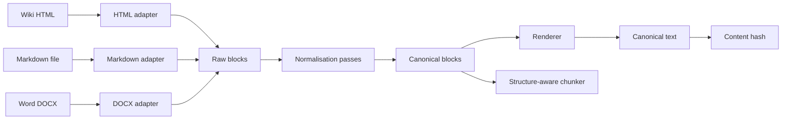

Meridian's remote-work policy exists in three places: as a page in the HR wiki, as a Word document on the policy site, and as a Markdown file that the Platform team copied into a repository. The words are the same. The bytes are not, and neither is the text that three different extractors pull out of them. If each copy goes into the index in whatever shape its extractor produced, the pipeline treats them as three unrelated documents, chunks them in three different places, and fingerprints them with three different hashes.

**Document normalisation** is the step that removes this accident of format. Every document, whatever it arrived as, is translated into one internal structure (a list of typed blocks: headings with levels, paragraphs, list items, tables) and then rendered into one canonical text form. This lesson builds that structure, writes adapters for HTML, Markdown and DOCX, shows the same policy collapsing to a single canonical text and hash, and covers the second half of the job: putting field values such as dates and document types into one canonical form.

## Learning objectives

- Explain why a RAG pipeline needs a canonical intermediate representation, and name the stages downstream that depend on it.
- Design a block-based document model and write format adapters that map HTML, Markdown and DOCX into it.
- Apply structural normalisation passes (whitespace, empty blocks, heading-level ranking, table shape) and justify each one.
- Render the canonical model to one deterministic text form and verify that equivalent sources produce the same hash.
- Normalise field values (dates to ISO 8601, document types to a controlled vocabulary) and reject values that cannot be interpreted safely.

## Prerequisites

- [Indexing pipeline](/learn/rag-architecture-fundamentals/indexing-pipeline): the seven stages, the content hash and idempotency.
- [Document loaders](/learn/document-engineering/document-loaders): how bytes become `Document` objects with provenance.
- [XML and HTML](/learn/data-processing/xml-and-html), [DOCX extraction](/learn/data-processing/docx-extraction) and [Markdown parsing](/learn/data-processing/markdown-parsing): the format-specific extraction this lesson builds on.
- [Dataclasses and Pydantic](/learn/python-for-rag-engineering/dataclasses-and-pydantic): the `@dataclass` syntax used for the block model.

## Why this matters

The [indexing pipeline](/learn/rag-architecture-fundamentals/indexing-pipeline) lesson said that the clean stage "normalises the text so that the same content always produces the same string, then computes a hash of it". That sentence carries a lot of weight. Several later stages quietly assume it is true:

- **Change detection.** The content hash decides whether a document is re-chunked and re-embedded. If an unchanged policy produces a different string because the wiki changed its theme, every page looks edited, and the pipeline pays to re-embed the whole wiki.
- **Duplicate detection.** Two copies of the same policy in two formats should be recognised as the same content. If their extracted text differs in whitespace, list markers and heading syntax, exact-match deduplication misses them, and both copies end up in the top-k, crowding out other results. [Duplicate detection](/learn/data-processing/duplicate-detection) has better tools for near-duplicates, but it works best on text that is already canonical.
- **Chunking.** [Structure-aware chunking](/learn/advanced-chunking-strategies/structure-aware-chunking) splits at headings and keeps tables whole. It can only do that if it knows where headings and tables are. A chunker that receives the HTML extractor's flat text and the DOCX extractor's paragraph list must be written twice, and will behave differently on each.
- **Context and citation.** When retrieved chunks are placed in the prompt, a consistent form ("## Equipment" then a table) reads better to the model and to the user than a mixture of `<h3>`, Word paragraph text and `**bold**` markers.

Without normalisation, these failures are silent. Nothing raises an error when two copies of a policy hash differently. You notice later, as a surprising embedding bill or as the same paragraph appearing twice in an answer's sources.

## The intuition

Think of a translation agency that receives contracts in French, German and Spanish and must store them for lawyers who only read English. One poor approach is to file each contract in its original language and let every lawyer cope. Another is to translate each one, but let each translator choose their own headings, numbering and spelling conventions. The good approach has two parts: every translator writes into the *same template* (same section numbering, same date style, same names for the parties), and the template is then typeset in *one house style*. Two contracts with the same content now look identical on paper, whatever language they started in.

Normalisation does the same for document formats. The format adapters are the translators. The block model is the template. The renderer is the house style.

A tiny example. Here is one heading in three sources:

| Source | What the extractor sees |
| --- | --- |
| Wiki HTML | `<h2>Remote work   policy</h2>` (level 2, because the wiki uses `<h1>` for its own banner) |
| Markdown | `# Remote work policy` (level 1) |
| Word | a paragraph in the style "Title" |

After normalisation all three become `Block(kind="heading", text="Remote work policy", level=1)`, which renders as `# Remote work policy`.

## How it works

### Scope: structure, not characters

Normalisation is a word used for several different jobs, so it is worth being precise about which one this lesson covers.

- **Character-level normalisation** (Unicode forms such as NFC and NFKC, fixing mis-decoded text, unifying quotation marks) belongs to [Encoding and Unicode](/learn/data-processing/encoding-and-unicode).
- **Noise removal** (navigation menus, cookie banners, repeated headers and footers) belongs to [Data cleaning](/learn/data-processing/data-cleaning) and, in more depth, [Header and footer removal](/learn/document-preprocessing/header-and-footer-removal).
- **Text-level normalisation for retrieval** (case folding, punctuation, number formats inside running text) is examined in [Normalisation](/learn/document-preprocessing/normalisation).
- **Structural normalisation**, the subject here, puts every document into one shape so that the rest of the pipeline only has to understand one format. It also includes **value normalisation**: putting the fields that describe a document (dates, types, departments) into canonical forms.

### The canonical intermediate representation

An **intermediate representation** (IR) is a format that sits between many inputs and many outputs. Instead of writing a converter from every input format to every consumer, you write one adapter per input (into the IR) and one consumer per output (from the IR). With $m$ formats and $n$ consumers that is $m + n$ pieces of code rather than $m \times n$. Compilers work this way, and so does the document converter Pandoc, whose readers produce an abstract syntax tree that its writers consume. The Unstructured library, covered in [Unstructured](/learn/advanced-document-parsing/unstructured), similarly partitions documents into typed elements such as titles, narrative text, list items and tables.

For a RAG pipeline, a deliberately small IR works well. A document is an ordered list of **blocks**, each with a kind:

| Kind | Carries | Why it is kept |
| --- | --- | --- |
| `heading` | text, level (1 = top) | Section boundaries for chunking; section titles for chunk context and citations |
| `paragraph` | text | The main body |
| `list_item` | text | Items should not be merged into one run-on sentence |
| `table` | rows of cells, first row the header | Values must stay attached to their column names |

You can add `code` (preformatted text that must not have its whitespace collapsed) and `quote` when your corpus needs them. Resist adding every feature of every format. Font sizes, colours and page positions are not in the IR: if a later stage needs layout, that is a job for [Layout-aware parsing](/learn/advanced-document-parsing/layout-aware-parsing), not for the canonical text.

Inline formatting deserves a decision of its own. **Bold** and *italic* rarely change what a sentence means for retrieval, and the markers add tokens and break exact matching ("**up to 3 days**" versus "up to 3 days"). The model in this lesson drops them. If your documents use bold for something meaningful, such as the term being defined in a glossary, keep it, but keep it the same way for every source.

### The pipeline, step by step



1. **Adapt.** A format adapter walks the parsed source and emits raw blocks. It knows one format's conventions: in HTML, `<li>` is a list item; in Word, a paragraph whose style name starts with "List" is; in Markdown, a paragraph nested inside a list is. The adapter maps faithfully and does not tidy. Each adapter is small because the hard parsing was done by a library ([Beautiful Soup](/learn/data-processing/xml-and-html), [python-docx](/learn/data-processing/docx-extraction), [markdown-it-py](/learn/data-processing/markdown-parsing)).
2. **Normalise.** A fixed sequence of passes, each a pure function from a list of blocks to a list of blocks, runs on every document regardless of source:
   - collapse whitespace inside every text and cell, including line breaks and non-breaking spaces;
   - drop blocks whose text is empty after that;
   - re-rank heading levels so the shallowest heading becomes 1 and gaps close;
   - make tables rectangular and strip their cells.
3. **Render.** One function writes the canonical blocks as text: Markdown headings with `#`, list items with `- `, tables as pipe tables, exactly one blank line between blocks. Rendering is deterministic: the same blocks always give the same string, byte for byte.
4. **Hash and hand on.** The content hash is computed over the canonical text, so it changes only when the content does. The chunker receives the canonical blocks (or the canonical text, whose structure is now predictable).

Keeping the passes separate from the adapters is the point of the design. A rule such as "collapse whitespace" written once, after adaptation, is applied identically to every format. Written inside each adapter, it will drift.

### Heading-level ranking

Heading levels are the least obvious normalisation, and the one with the most effect on chunking. Sources disagree about absolute levels for reasons that have nothing to do with content: the wiki reserves `<h1>` for its banner, so page titles are `<h2>`; Word users pick "Heading 2" because they prefer how it looks; a Markdown author skips from `#` to `###`.

**Ranking** replaces each level with its position among the distinct levels the document uses. Watch it work on a wiki page that uses levels 2 and 4 and nothing in between:

```trace
{
  "title": "Ranking heading levels",
  "code": [
    "levels_in = [2, 4, 4, 2]",
    "distinct = sorted(set(levels_in))",
    "rank = {lvl: i + 1 for i, lvl in enumerate(distinct)}",
    "levels_out = [rank[lvl] for lvl in levels_in]",
    "print(levels_out)"
  ],
  "steps": [
    {"line": 1, "vars": {"levels_in": "[2, 4, 4, 2]"}, "note": "The page title and a second section are h2; two subsections are h4. There is no h1 or h3."},
    {"line": 2, "vars": {"distinct": "[2, 4]"}, "note": "Only two levels are in use, so the document has a two-level outline."},
    {"line": 3, "vars": {"rank": "{2: 1, 4: 2}"}, "note": "The shallowest level used becomes 1, the next becomes 2. The missing h3 leaves no gap."},
    {"line": 4, "vars": {"levels_out": "[1, 2, 2, 1]"}, "note": "Every heading is mapped through the table."},
    {"line": 5, "vars": {"levels_out": "[1, 2, 2, 1]"}, "out": ["[1, 2, 2, 1]"], "note": "The outline is the same shape, now expressed in canonical levels."}
  ]
}
```

Ranking preserves the *order* of levels, which is what defines the outline, and discards the absolute numbers, which carry no meaning across sources. It has a limitation you should know: it is computed per document, so a document whose only headings are subsections will have them promoted to level 1. If you chunk on "every level-2 heading", that is usually harmless. If you need absolute levels to mean the same thing across a whole site, take them from the source system's own hierarchy instead.

### Canonical field values

The same discipline applies to the values that describe a document. Meridian's sources write the same date as "31 March 2025", "31/03/2025", "2025-03-31T09:15:00+01:00" and, in one vendor's export, "03/31/2025". They write the document type as "Policy", "HR policy", "policies". If these go into metadata as they arrive, a filter for `effective_date >= "2025-01-01"` compares strings that are not dates, and a filter for `doc_type == "policy"` misses most policies. [Document metadata](/learn/document-engineering/document-metadata) designs the schema; normalisation is what makes values fit it.

Three rules cover most cases:

1. **Dates become ISO 8601** (`2025-03-31`, or a full timestamp with an explicit UTC offset such as `2025-03-31T09:15:00+01:00`). ISO dates sort correctly as strings, which is why so many systems store them that way.
2. **Parse with the source's known convention, never by guessing.** The string "04/03/2025" is 4 March in the UK and 3 April in the US. A parser that tries several formats in turn will accept whichever matches first and be wrong half the time without complaint. Attach a format to each *source*, not to each value.
3. **Map categorical values through a controlled vocabulary** (a fixed list of allowed values with known variants), and reject anything not on the list rather than inventing a new category.

Rejecting is the important part. A value you cannot interpret confidently should go to [data validation](/learn/document-engineering/data-validation) as a failure with a reason, not into the index as a guess.

> [!KEY]
> Normalisation has two outputs: one canonical structure for the text, and one canonical form for every field value. Both exist for the same reason, which is that every later stage (hashing, deduplication, chunking, filtering, citation) should only ever have to understand one format.

## In code

### Three formats, one canonical text

**The problem.** Meridian's remote-work policy exists as wiki HTML, a Markdown file and a Word document. Show that naive extraction gives three different texts and hashes, then build the block model, three adapters, the normalisation passes and the renderer, and show all three sources reduce to the same canonical text and hash.

**Dependencies.** Beautiful Soup, markdown-it-py and python-docx. No API key and no model download. The Word document is created in memory by the script itself, so there are no files to fetch.

```bash
pip install beautifulsoup4 markdown-it-py python-docx
```

```python
import hashlib
import io
from dataclasses import dataclass

import docx                                   # python-docx
from bs4 import BeautifulSoup
from markdown_it import MarkdownIt


# ---------- the canonical representation ----------
@dataclass(frozen=True)
class Block:
    kind: str                 # "heading" | "paragraph" | "list_item" | "table"
    text: str = ""
    level: int = 0            # heading level (1 = top); unused for other kinds
    rows: tuple = ()          # for tables: tuple of tuples of cell strings


# ---------- three versions of the same policy ----------
HTML = """<html><body><div class="wiki-chrome"><h1>Meridian Wiki</h1></div>
<div class="page"><h2>Remote work   policy</h2>
<p>Staff may work remotely <strong>up to 3 days</strong> a week.</p>
<h3>Eligibility</h3>
<ul><li>Agree your remote days with your manager.</li>
<li>Use the VPN on public&nbsp;Wi-Fi.</li></ul>
<h3>Equipment</h3>
<p>The home-office equipment budget is £400.
Contractors are not eligible.</p>
<table><tr><th>Item</th><th>Limit</th></tr>
<tr><td>Equipment budget</td><td> £400 </td></tr>
<tr><td>Remote days per week</td><td>3</td></tr></table>
</div></body></html>"""

MARKDOWN = """# Remote work policy

Staff may work remotely **up to 3 days** a week.

## Eligibility

* Agree your remote days with your manager.
* Use the VPN on public Wi-Fi.

## Equipment

The home-office equipment budget is £400.
Contractors are not eligible.

| Item | Limit |
|:-----|------:|
| Equipment budget | £400 |
| Remote days per week | 3 |
"""


def make_docx() -> bytes:
    d = docx.Document()
    d.add_heading("Remote work policy", level=0)          # style "Title"
    d.add_paragraph("Staff may work remotely up to 3 days a week.")
    d.add_heading("Eligibility", level=1)                 # style "Heading 1"
    d.add_paragraph("Agree your remote days with your manager.", style="List Bullet")
    d.add_paragraph("Use the VPN on public Wi-Fi.", style="List Bullet")
    d.add_heading("Equipment", level=1)
    d.add_paragraph("The home-office equipment budget is £400.  Contractors are not eligible.")
    t = d.add_table(rows=3, cols=2)
    for r, row in enumerate([("Item", "Limit"), ("Equipment budget", "£400"),
                             ("Remote days per week", "3")]):
        for c, value in enumerate(row):
            t.cell(r, c).text = value
    buf = io.BytesIO()
    d.save(buf)
    return buf.getvalue()


# ---------- adapters: one per format, each emits Blocks ----------
def from_html(html: str) -> list[Block]:
    page = BeautifulSoup(html, "html.parser").select_one("div.page")  # skip site chrome
    blocks = []
    for el in page.find_all(["h1", "h2", "h3", "h4", "h5", "h6", "p", "li", "table"]):
        if el.name == "table":
            rows = tuple(tuple(c.get_text() for c in tr.find_all(["th", "td"]))
                         for tr in el.find_all("tr"))
            blocks.append(Block("table", rows=rows))
        elif el.name.startswith("h"):
            blocks.append(Block("heading", el.get_text(), level=int(el.name[1])))
        elif el.name == "li":
            blocks.append(Block("list_item", el.get_text()))
        else:
            blocks.append(Block("paragraph", el.get_text()))
    return blocks


def _inline_text(token) -> str:
    # Keep the words, drop the Markdown markup (** ** around bold, etc.)
    parts = []
    for child in token.children or []:
        if child.type in ("text", "code_inline"):
            parts.append(child.content)
        elif child.type in ("softbreak", "hardbreak"):
            parts.append(" ")
    return "".join(parts)


def from_markdown(md_text: str) -> list[Block]:
    tokens = MarkdownIt("commonmark").enable("table").parse(md_text)
    blocks, in_list, rows, row = [], 0, None, None
    for i, tok in enumerate(tokens):
        if tok.type == "heading_open":
            blocks.append(Block("heading", _inline_text(tokens[i + 1]), level=int(tok.tag[1])))
        elif tok.type in ("bullet_list_open", "ordered_list_open"):
            in_list += 1
        elif tok.type in ("bullet_list_close", "ordered_list_close"):
            in_list -= 1
        elif tok.type == "paragraph_open":
            kind = "list_item" if in_list else "paragraph"
            blocks.append(Block(kind, _inline_text(tokens[i + 1])))
        elif tok.type == "table_open":
            rows = []
        elif tok.type == "tr_open":
            row = []
        elif tok.type in ("th_open", "td_open"):
            row.append(_inline_text(tokens[i + 1]))
        elif tok.type == "tr_close":
            rows.append(tuple(row))
        elif tok.type == "table_close":
            blocks.append(Block("table", rows=tuple(rows)))
    return blocks


def from_docx(data: bytes) -> list[Block]:
    d = docx.Document(io.BytesIO(data))
    blocks = []
    for item in d.iter_inner_content():                  # paragraphs and tables, in order
        if isinstance(item, docx.table.Table):
            rows = tuple(tuple(cell.text for cell in r.cells) for r in item.rows)
            blocks.append(Block("table", rows=rows))
            continue
        style = item.style.name
        if style == "Title":
            blocks.append(Block("heading", item.text, level=1))
        elif style.startswith("Heading "):
            blocks.append(Block("heading", item.text, level=int(style.split()[1]) + 1))
        elif style.startswith("List"):
            blocks.append(Block("list_item", item.text))
        else:
            blocks.append(Block("paragraph", item.text))
    return blocks


# ---------- normalisation passes over Blocks ----------
def squash(s: str) -> str:
    return " ".join(s.split())        # collapses runs of whitespace, incl. newlines and NBSP


def normalise(blocks: list[Block]) -> list[Block]:
    # 1. whitespace inside every text and cell; drop blocks left empty
    cleaned = []
    for b in blocks:
        if b.kind == "table":
            rows = tuple(tuple(squash(c) for c in r) for r in b.rows)
            if any(any(r) for r in rows):
                cleaned.append(Block("table", rows=rows))
        elif squash(b.text):
            cleaned.append(Block(b.kind, squash(b.text), b.level))
    # 2. heading levels: rank them, so the shallowest becomes 1 and gaps close
    levels = sorted({b.level for b in cleaned if b.kind == "heading"})
    rank = {lvl: i + 1 for i, lvl in enumerate(levels)}
    return [Block(b.kind, b.text, rank[b.level], b.rows) if b.kind == "heading" else b
            for b in cleaned]


# ---------- one canonical text rendering ----------
def render(blocks: list[Block]) -> str:
    out, prev = [], None
    for b in blocks:
        if b.kind == "heading":
            piece = "#" * b.level + " " + b.text
        elif b.kind == "list_item":
            piece = "- " + b.text
        elif b.kind == "table":
            header, *body = b.rows
            lines = ["| " + " | ".join(header) + " |",
                     "| " + " | ".join("---" for _ in header) + " |"]
            lines += ["| " + " | ".join(r) + " |" for r in body]
            piece = "\n".join(lines)
        else:
            piece = b.text
        sep = "\n" if (prev == "list_item" and b.kind == "list_item") else "\n\n"
        out.append(piece if not out else sep + piece)
        prev = b.kind
    return "".join(out) + "\n"


def sha(text: str) -> str:
    return hashlib.sha256(text.encode("utf-8")).hexdigest()[:12]


DOCX = make_docx()

# What a naive pipeline would hash: whatever text each extractor happens to give
naive = {
    "html": BeautifulSoup(HTML, "html.parser").get_text(),
    "markdown": MARKDOWN,
    "docx": "\n".join(p.text for p in docx.Document(io.BytesIO(DOCX)).paragraphs),
}
print("Naive extraction hashes:")
for fmt, text in naive.items():
    print(f"  {fmt:<9}{sha(text)}  ({len(text)} chars)")

canonical = {
    "html": render(normalise(from_html(HTML))),
    "markdown": render(normalise(from_markdown(MARKDOWN))),
    "docx": render(normalise(from_docx(DOCX))),
}
print("\nCanonical hashes:")
for fmt, text in canonical.items():
    print(f"  {fmt:<9}{sha(text)}  ({len(text)} chars)")

print("\nRaw heading levels before normalisation:")
for fmt, blocks in [("html", from_html(HTML)), ("markdown", from_markdown(MARKDOWN)),
                    ("docx", from_docx(DOCX))]:
    print(f"  {fmt:<9}{[b.level for b in blocks if b.kind == 'heading']}")

print("\nCanonical text (identical for all three):\n")
print(canonical["docx"])
```

```output
Naive extraction hashes:
  html     af5204127caa  (300 chars)
  markdown 0a203335d382  (342 chars)
  docx     f40314fed2e1  (229 chars)

Canonical hashes:
  html     e4e93876e62e  (335 chars)
  markdown e4e93876e62e  (335 chars)
  docx     e4e93876e62e  (335 chars)

Raw heading levels before normalisation:
  html     [2, 3, 3]
  markdown [1, 2, 2]
  docx     [1, 2, 2]

Canonical text (identical for all three):

# Remote work policy

Staff may work remotely up to 3 days a week.

## Eligibility

- Agree your remote days with your manager.
- Use the VPN on public Wi-Fi.

## Equipment

The home-office equipment budget is £400. Contractors are not eligible.

| Item | Limit |
| --- | --- |
| Equipment budget | £400 |
| Remote days per week | 3 |
```

**The important lines.**

- `Block` is the whole IR: four kinds, a text, a level and table rows. It is a frozen dataclass, so a pass cannot modify a block in place; it must return a new one, which keeps passes pure and easy to test.
- `select_one("div.page")` in the HTML adapter skips the wiki's banner. Choosing the content region is source-specific knowledge and belongs in the adapter; generic noise removal is the job of [data cleaning](/learn/data-processing/data-cleaning).
- `_inline_text` reads markdown-it's inline child tokens and keeps only text, so `**up to 3 days**` becomes "up to 3 days". Taking `token.content` instead would keep the asterisks.
- `MarkdownIt("commonmark").enable("table")` turns on pipe tables, which are a GitHub Flavored Markdown extension and not part of CommonMark itself. Without it the table would arrive as a paragraph of pipes.
- `d.iter_inner_content()` yields paragraphs and tables in document order (it is available in recent python-docx releases; this was run with 1.2.0). The older `d.paragraphs` skips tables entirely.
- In `from_docx`, "Title" maps to level 1 and "Heading N" to N + 1. This is a choice about this source's conventions; ranking would fix it anyway, but mapping sensibly at the adapter keeps raw levels readable when you debug.
- `squash` uses `str.split()` with no argument, which splits on any run of Unicode whitespace, so the `&nbsp;` (decoded by Beautiful Soup to U+00A0) and the line break inside the HTML paragraph both become single spaces.
- `render` is the only place that decides the output syntax. A blank line separates blocks, a single newline separates consecutive list items, and the table separator row is always `| --- |`, whatever alignment the source requested.

**What the output means.**

- The naive hashes all differ, and not only because of markup. The HTML text includes "Meridian Wiki" from the banner. The DOCX text is 229 characters because `paragraphs` silently omits the table, so the naive pipeline would have indexed a policy without its limits. The Markdown is the raw file, asterisks and all.
- The canonical hashes are identical. To the rest of the pipeline these three files are now one piece of content: exact deduplication will catch them, and a theme change in the wiki that alters markup but not content will not change the hash.
- The raw heading levels show why ranking is needed: the wiki starts at 2, the others at 1. After ranking, all three outlines are `[1, 2, 2]`.
- The Markdown table's `:-----` and `------:` alignment markers are gone. Column alignment is presentation, not content.

**Errors people commonly hit.**

- `AttributeError: 'NoneType' object has no attribute 'find_all'` when `select_one` finds no content region. A different page template is the usual cause; make the adapter fail loudly with the URI, and send the document to validation rather than indexing an empty page.
- `KeyError` from `rank[b.level]` if you rank before dropping empty headings. Collect levels after cleaning, as the code does.
- Tables that come back as a single paragraph of `|` characters: the table rule was not enabled in markdown-it.
- In Word, a document that uses custom styles ("Policy Heading") instead of the built-in ones. The adapter sees them as paragraphs. Map custom style names in a per-source table, and log unknown styles so you notice them.

**Extending it.** Add a `code` kind whose whitespace is preserved (do not run `squash` on it), handle ordered lists by storing the list type on the block, and add a pass that makes tables rectangular by padding short rows with empty cells. Then point the adapters at a few real exports from your own sources and diff their canonical text: the differences that remain are your next normalisation rules, or genuine differences in content.

### Canonical field values

**The problem.** The same metadata arrives in different spellings from different source systems. Convert effective dates to ISO 8601 using each source's known convention and map document types onto a controlled vocabulary, rejecting values that cannot be interpreted.

**Dependencies.** The Python standard library only.

```python
from datetime import datetime

# Date formats each source system is known to use. Order matters only within a source.
DATE_FORMATS = {
    "wiki":       ["%d %B %Y"],             # "31 March 2025"
    "sharepoint": ["%d/%m/%Y"],             # UK day-first: "31/03/2025"
    "git":        ["%Y-%m-%dT%H:%M:%S%z"],  # "2025-03-31T09:15:00+01:00"
    "vendor_us":  ["%m/%d/%Y"],             # US month-first: "03/31/2025"
}

DOC_TYPES = {                                # controlled vocabulary: variant -> canonical
    "policy": "policy", "policies": "policy", "hr policy": "policy",
    "runbook": "runbook", "run book": "runbook", "it runbook": "runbook",
    "product doc": "product_doc", "product documentation": "product_doc",
}


def to_iso_date(value: str, source: str) -> str:
    for fmt in DATE_FORMATS[source]:
        try:
            parsed = datetime.strptime(value.strip(), fmt)
        except ValueError:
            continue
        return parsed.date().isoformat()
    raise ValueError(f"unrecognised date {value!r} from {source}")


def to_doc_type(value: str) -> str:
    key = " ".join(value.lower().replace("-", " ").replace("_", " ").split())
    if key not in DOC_TYPES:
        raise ValueError(f"unknown doc_type {value!r}")
    return DOC_TYPES[key]


records = [
    {"source": "wiki",       "effective": "31 March 2025",             "doc_type": "Policy"},
    {"source": "sharepoint", "effective": "31/03/2025",                "doc_type": "HR  Policy"},
    {"source": "git",        "effective": "2025-03-31T09:15:00+01:00", "doc_type": "run-book"},
    {"source": "vendor_us",  "effective": "03/31/2025",                "doc_type": "Product Documentation"},
    {"source": "sharepoint", "effective": "04/03/2025",                "doc_type": "policies"},
    {"source": "wiki",       "effective": "March 31st, 2025",          "doc_type": "Policy"},
    {"source": "wiki",       "effective": "1 April 2025",              "doc_type": "Guideline"},
]

for r in records:
    try:
        print(f"{r['source']:<11}{r['effective']!r:<29}-> {to_iso_date(r['effective'], r['source'])}"
              f"  {r['doc_type']!r:<24}-> {to_doc_type(r['doc_type'])}")
    except ValueError as err:
        print(f"{r['source']:<11}{r['effective']!r:<29}-> REJECTED: {err}")

# The same string means two different days depending on the source's convention
print("\n'04/03/2025' read day-first:  ", datetime.strptime("04/03/2025", "%d/%m/%Y").date())
print("'04/03/2025' read month-first:", datetime.strptime("04/03/2025", "%m/%d/%Y").date())
```

```output
wiki       '31 March 2025'              -> 2025-03-31  'Policy'                -> policy
sharepoint '31/03/2025'                 -> 2025-03-31  'HR  Policy'            -> policy
git        '2025-03-31T09:15:00+01:00'  -> 2025-03-31  'run-book'              -> runbook
vendor_us  '03/31/2025'                 -> 2025-03-31  'Product Documentation' -> product_doc
sharepoint '04/03/2025'                 -> 2025-03-04  'policies'              -> policy
wiki       'March 31st, 2025'           -> REJECTED: unrecognised date 'March 31st, 2025' from wiki
wiki       '1 April 2025'               -> REJECTED: unknown doc_type 'Guideline'

'04/03/2025' read day-first:   2025-03-04
'04/03/2025' read month-first: 2025-04-03
```

**The important lines.**

- `DATE_FORMATS` is keyed by *source*, not tried as a global list. The SharePoint "04/03/2025" is read day-first because that is how that system writes dates, and the result is 4 March.
- `to_doc_type` builds a lookup key (lower case, hyphens and underscores to spaces, whitespace collapsed) and then requires an exact entry. It normalises spelling, not meaning: "Guideline" is not silently mapped to "policy".
- Both functions raise `ValueError` on failure. The caller turns that into a rejection with a reason, which is what [data validation](/learn/document-engineering/data-validation) will collect.

**What the output means.** Five different spellings of a date became four identical ISO strings and one correct different one. The last two records were rejected, each with a specific reason: "March 31st, 2025" is not the wiki's usual format (perhaps someone typed it by hand), and "Guideline" is not in the vocabulary. Both are questions for a human, not guesses for a program. The final two lines show the trap the per-source table avoids: the same string is a month apart depending on the convention.

**Errors people commonly hit.**

- `%B` (full month name) depends on the process locale. Under a non-English locale "March" will not parse. Pin the locale for ingestion jobs, or map month names yourself.
- Dropping the time zone. `.date()` on the Git timestamp returns the date *in its own offset*. Converting to UTC first can move a timestamp near midnight onto the previous or next day. Decide which you mean (the author's local date or the UTC date), and do it the same way everywhere.
- Reaching for a "parse anything" date function. It is convenient and makes the day-first versus month-first decision for you, per value, without telling you.

**Extending it.** Add departments ("HR", "People", "Human Resources" all to `hr`), move the vocabularies into a configuration file owned by the team that owns the metadata schema, and count rejections per source so that a new export format shows up as a spike rather than as a slow leak of missing metadata.

## A real-world example

Meridian's Platform team runs the nightly indexing job for AskMeridian. One Monday the job took most of the night instead of its usual few minutes, and the embedding bill for the night was many times the usual amount. Every one of the HR wiki's pages had been re-embedded, although HR said nobody had edited anything.

Tomás, the engineer on call, compared the stored extracted text of one page from Friday with Monday's. The words were identical. The differences were a new `<span class="anchor">` before every heading, which the extractor turned into an extra blank line, and a theme change that wrapped each paragraph in a `<div>` and changed the whitespace around it. The pipeline hashed extracted text, so every page had a new hash, and every page was "changed".

The fix was the structure in this lesson. The team added an HTML adapter that emitted blocks, ran the shared normalisation passes, and hashed the rendered canonical text. They then made two process changes that mattered as much as the code. First, a set of **golden files**: a handful of real exports from each source, checked into the repository with their expected canonical text, so any change to an adapter or pass that alters output fails a test before it reaches production. Second, a **normaliser version** stored with each document's hash. When the team deliberately changes a normalisation rule, they bump the version and schedule the resulting re-embedding at a quiet time, instead of discovering it from the bill.

A month later the policy team began publishing the same handbook pages as Word documents as well as wiki pages. Because both formats now reduced to the same canonical text, exact deduplication caught the copies on the first run.

## Common mistakes

- **Hashing extracted text instead of canonical text.** Cosmetic changes in the source (a new theme, a different exporter version) then look like content changes and trigger expensive re-embedding.
- **Normalising inside each adapter.** Each adapter implements "collapse whitespace" slightly differently, and the same content from two formats still produces two texts.
- **Flattening structure too early.** Turning a document into one plain string before chunking throws away headings, list boundaries and table rows that the chunker and the citation step need.
- **Losing tables.** Using an API that skips tables (python-docx's `paragraphs`, or an HTML extractor that ignores `<table>`) indexes a policy without its numbers, and the assistant then cannot answer the questions people most often ask.
- **Not escaping the renderer's own syntax.** A table cell containing `|` breaks a pipe table, and the text after it disappears when the table is parsed again.
- **Guessing ambiguous values.** Parsing "04/03/2025" with a try-every-format function, or mapping an unknown document type to the nearest known one, produces metadata that is confidently wrong and makes filters return the wrong documents.
- **Changing normalisation rules without a version.** Every rule change alters canonical text for some documents, and therefore their hashes. Unversioned, the change is invisible until re-embedding happens.

## Best practices

- Keep the IR small: the block kinds that chunking, citation and the prompt actually use. Add a kind only when a stage needs it.
- Write adapters that map faithfully and passes that tidy. Adapters know formats; passes know nothing about formats.
- Make every pass a pure function from blocks to blocks, and test each one on its own.
- Make rendering deterministic and the only place that decides output syntax.
- Keep golden files per source: real exports and their expected canonical text, compared in automated tests.
- Store a normaliser version alongside each document's content hash, and treat a version bump as a planned re-indexing.
- Normalise field values with per-source conventions and controlled vocabularies, and reject what you cannot interpret.
- Keep the original bytes (or a pointer to them) so you can re-normalise everything when the rules change, without re-fetching from the source systems.

## Performance considerations

Normalisation is cheap compared with what it protects. Parsing and walking a document is linear in its size, and the passes in this lesson are each a single linear scan over the blocks. For a typical handbook page of a few kilobytes, the work is far smaller than the network call to fetch it.

The real performance effect is on the expensive stages downstream. Suppose Meridian's wiki has 4,000 pages averaging 1,500 tokens each (assumed figures for the arithmetic). That is $4{,}000 \times 1{,}500 = 6$ million tokens to embed. If a cosmetic theme change alters every page's hash, the pipeline re-embeds all 6 million tokens; with canonical hashing, it re-embeds only the pages whose content changed, which on a typical night is a handful. Embedding prices vary by provider and change often, so check your provider's current pricing, but the ratio is what matters: a single unstable hash multiplies nightly embedding work by the size of the corpus.

Canonical text can also be shorter than raw extraction. Removing markup characters, redundant whitespace and formatting markers reduces token counts slightly, which reduces embedding cost and leaves more room in the context window. Do not overstate this: on prose-heavy documents the saving is small. The cost of the canonical form is storage, since you keep the canonical text (and ideally the original bytes) alongside the chunks.

Memory matters only for very large documents. Building the full block list holds the whole document in memory; for a multi-hundred-page export, an adapter that yields blocks one at a time keeps memory flat, although heading ranking then needs either a first pass to collect levels or levels taken from the source's own hierarchy.

## Security considerations

Normalisation sits on the path of untrusted content into your index, and its choices decide what text the model will later read.

- **Hidden text survives naive extraction.** In a test for this lesson, python-docx's `paragraph.text` returned text from a run formatted as hidden, and Beautiful Soup's `get_text()` returned the contents of an element styled `display:none`. Neither is shown to a human reader, but both reach the index, which makes them a vehicle for [indirect prompt injection](/learn/rag-security-fundamentals/indirect-prompt-injection). Decide explicitly whether adapters drop hidden content, and log when they find it.
- **Normalisation should not create markup.** Decoding entities and then rendering to Markdown can turn harmless-looking text into active syntax (a link, an image reference) in the canonical form. Escape the renderer's syntax characters in text, as the table exercise below does for `|`.
- **Hostile files.** DOCX files are ZIP archives and can be crafted to expand to enormous sizes; very deeply nested HTML can exhaust a parser. Limit input size and parsing time per document, and run adapters in a process that can be killed without taking down the pipeline.
- **Do not normalise away access information.** If a source marks sections as restricted, the adapter must carry that onto the blocks, or the permission is lost the moment structure is flattened. [Document-level permissions](/learn/access-control-and-privacy/document-level-permissions) covers how such information is enforced.

## Summary

- Document normalisation removes the accident of format: every source is mapped into one canonical structure and rendered into one canonical text.
- A small block-based IR (headings with levels, paragraphs, list items, tables) gives $m + n$ pieces of code instead of $m \times n$, and lets chunking, hashing and citation understand one format.
- Adapters map formats faithfully; shared, pure normalisation passes tidy (whitespace, empty blocks, heading ranking, table shape); a single deterministic renderer writes the text.
- Hashing canonical text makes change detection and exact deduplication depend on content rather than on markup, which can save re-embedding an entire corpus.
- Field values need canonical forms too: ISO 8601 dates parsed with each source's known convention, and controlled vocabularies, with rejection rather than guessing.
- Version your normalisation rules and test them against golden files, because every rule change alters hashes.

## Exercises

**1.** A Word document uses the heading styles in this order: "Heading 2", "Heading 4", "Heading 4", "Heading 3", "Heading 2". Using `from_docx`'s mapping and then ranking, what canonical levels do the five headings get? Is the outline the author intended preserved?

<details><summary>Show solution</summary>

`from_docx` maps "Heading N" to N + 1, so the raw levels are `[3, 5, 5, 4, 3]`. The distinct levels are `[3, 4, 5]`, giving the rank table `{3: 1, 4: 2, 5: 3}`, so the canonical levels are `[1, 3, 3, 2, 1]`.

The relative order is preserved: the "Heading 4" sections are still deeper than the "Heading 3" one. Whether that matches the author's intent is doubtful. The two "Heading 4" sections come *before* the "Heading 3", so they sit directly under a level-1 heading at level 3, with no level-2 parent. Ranking cannot repair an outline that was malformed in the source; it only makes well-formed outlines consistent. A stricter pass could clamp each heading to at most one level deeper than the previous heading (giving `[1, 2, 2, 2, 1]`), which is a reasonable choice for chunking but changes what the author wrote, so it should be a deliberate, documented rule.

</details>

**2.** In the code output, the naive DOCX text is 229 characters and the canonical text is 335. Explain the difference, and describe what AskMeridian would have answered to "How much is the home-office equipment budget?" and to "How many remote days can I take?" if the naive DOCX text had been indexed.

<details><summary>Show solution</summary>

`Document.paragraphs` in python-docx returns only body paragraphs; tables are separate objects, so the table's three rows are missing from the naive text. The naive text also lacks the Markdown syntax the renderer adds (`#`, `- `, pipes).

For these two questions the damage happens to be limited, because both values also appear in prose ("up to 3 days a week", "budget is £400"), so retrieval would still find a chunk that answers. The real risk is documents where the table is the *only* place a value appears, such as a table of allowances by grade. There, the naive pipeline indexes the policy without its numbers, and the assistant either says it does not know or, worse, answers from another document that does contain a number. The general lesson is to check that every adapter extracts every block kind, and to include a table-only fact in your golden files.

</details>

**3.** Coding. A table cell contains the text `VPN | public Wi-Fi`. Render a table containing it with `render`, parse the rendered text again with `from_markdown`, and print the rows. What happens? Then write a fix so that the round trip preserves the cell.

<details><summary>Show solution</summary>

The problem is that `|` is the renderer's own syntax. Unescaped, it splits the cell in two, and when the row then has more cells than the header, the extra cell is dropped by the table parser. The fix is to escape backslashes and pipes in every cell before rendering. GFM tables accept `\|` as a literal pipe inside a cell.

```python
# Run after the definitions from the main example (Block, render, from_markdown).
def cell(s: str) -> str:
    return s.replace("\\", "\\\\").replace("|", "\\|")

def render_table(b: Block) -> str:
    header, *body = b.rows
    lines = ["| " + " | ".join(cell(c) for c in header) + " |",
             "| " + " | ".join("---" for _ in header) + " |"]
    lines += ["| " + " | ".join(cell(c) for c in r) + " |" for r in body]
    return "\n".join(lines)

t = Block("table", rows=(("Setting", "Value"), ("Network", "VPN | public Wi-Fi")))
print("Before:")
print(render([t]))
print(from_markdown(render([t]))[0].rows)
print("After:")
text = render_table(t)
print(text)
print(from_markdown(text)[0].rows)
```

```output
Before:
| Setting | Value |
| --- | --- |
| Network | VPN | public Wi-Fi |

(('Setting', 'Value'), ('Network', 'VPN'))
After:
| Setting | Value |
| --- | --- |
| Network | VPN \| public Wi-Fi |
(('Setting', 'Value'), ('Network', 'VPN | public Wi-Fi'))
```

Before the fix, "public Wi-Fi" silently vanished on re-parsing: no error, just lost text. After escaping, the round trip is exact. To finish the job, use `render_table` inside `render` and apply similar escaping to paragraph text whose leading characters could be read as Markdown syntax (a line starting with `#` or `- `). A round-trip test, render then parse then compare blocks, is a cheap way to catch this whole class of bug.

</details>

**4.** Design. Meridian's policy team wants to change one normalisation rule: they want bold text kept as `**...**` because the glossary uses bold for defined terms. Changing the rule will alter the canonical text, and so the hash, of every document containing bold. Describe how you would roll this change out, and what you would check before and after.

<details><summary>Show solution</summary>

A sound plan:

1. **Decide the scope.** Keeping bold everywhere changes many documents for the benefit of one. A narrower rule (keep bold only in documents of type `glossary`, or only for the first phrase of a list item) changes fewer hashes. Make the decision with the policy team and write it down.
2. **Update golden files first.** Add a glossary page to the golden set, change the expected canonical text, and implement the rule until the tests pass. The diff of the golden files is the reviewable record of exactly what changes.
3. **Bump the normaliser version.** Every document stores the version with its hash, so the pipeline can tell "content changed" from "rules changed".
4. **Measure the blast radius before running it.** Re-normalise the stored originals offline and count how many canonical hashes change. Multiply the changed documents' token counts by the current embedding price to estimate the cost.
5. **Schedule the re-embedding** of affected documents in a quiet period, or rebuild into a new index and switch over (the approach in [Index versioning](/learn/ci-cd-and-mlops/index-versioning)).
6. **Check afterwards** that the number of re-embedded documents matched the estimate, and run the retrieval test set on glossary questions to confirm the change helped.

The essential point is that a normalisation rule is part of the index's definition. Changing it is a planned migration, not a refactor.

</details>

## Check your understanding

```quiz
[
  {
    "q": "A wiki theme change adds wrapper elements around every paragraph but changes no words. The next indexing run re-embeds every page. What is the most likely root cause?",
    "options": [
      "The embedding model was updated",
      "The content hash is computed over extracted text rather than over a canonical normalised form",
      "The vector database lost its data",
      "The chunk size is too small"
    ],
    "answer": 1,
    "why": "If the hash is taken over text whose shape depends on markup, a cosmetic change alters every hash and every page looks edited. Hashing canonical text makes the hash depend on content only."
  },
  {
    "q": "A pipeline supports 5 input formats and has 3 consumers of document structure (chunker, citation builder, prompt formatter). How many converters does a canonical intermediate representation require, compared with direct conversion?",
    "options": [
      "15 with an IR, 8 without",
      "5 with an IR, 3 without",
      "8 with an IR, 15 without",
      "3 with an IR, 5 without"
    ],
    "answer": 2,
    "why": "With an IR you write one adapter per format and one consumer per output, 5 + 3 = 8. Without one, every format must be converted for every consumer, 5 x 3 = 15."
  },
  {
    "q": "What does heading-level ranking do to a document whose headings are at levels [2, 4, 4, 2]?",
    "options": [
      "Leaves them unchanged",
      "Produces [1, 3, 3, 1]",
      "Produces [1, 1, 1, 1]",
      "Produces [1, 2, 2, 1]"
    ],
    "answer": 3,
    "why": "The distinct levels are 2 and 4, which rank as 1 and 2. Ranking keeps the order of levels and closes the gap left by the unused level 3."
  },
  {
    "q": "Two source systems send the date \"04/03/2025\". One writes dates day-first, the other month-first. What is the correct way to normalise them?",
    "options": [
      "Use the date format known for each source system, giving 2025-03-04 and 2025-04-03",
      "Try day-first and then month-first, and keep whichever parses",
      "Store the string unchanged so no information is lost",
      "Use a general-purpose parser and accept its interpretation"
    ],
    "answer": 0,
    "why": "The string is ambiguous on its own; only the source's convention resolves it. Trying formats in turn accepts the first that parses, which is wrong for one of the two sources without any error."
  },
  {
    "q": "Which of these belongs in a structural normalisation pass shared by all formats, rather than in a format adapter?",
    "options": [
      "Mapping Word's \"List Bullet\" style to a list item",
      "Collapsing runs of whitespace inside every block's text",
      "Selecting the wiki page's main content region",
      "Reading table cells from markdown-it's tokens"
    ],
    "answer": 1,
    "why": "Whitespace collapsing applies identically to every format, so it is written once as a pass. The other three depend on one format's conventions and belong in that format's adapter."
  }
]
```

## Further reading

- John MacFarlane et al., *CommonMark Spec*, at [spec.commonmark.org](https://spec.commonmark.org/), and the *GitHub Flavored Markdown Spec* (which defines pipe tables and the `\|` escape) at [github.github.com/gfm](https://github.github.com/gfm/).
- markdown-it-py documentation, [markdown-it-py.readthedocs.io](https://markdown-it-py.readthedocs.io/): the token stream used by the Markdown adapter.
- python-docx documentation, [python-docx.readthedocs.io](https://python-docx.readthedocs.io/): paragraphs, styles, tables and block-item iteration.
- Beautiful Soup documentation, [crummy.com/software/BeautifulSoup/bs4/doc](https://www.crummy.com/software/BeautifulSoup/bs4/doc/).
- Pandoc user's guide, [pandoc.org](https://pandoc.org/): a mature example of the readers, abstract syntax tree and writers design.
- Klyne and Newman (2002), RFC 3339, "Date and Time on the Internet: Timestamps", [rfc-editor.org/rfc/rfc3339](https://www.rfc-editor.org/rfc/rfc3339): the ISO 8601 profile most systems use for timestamps.
