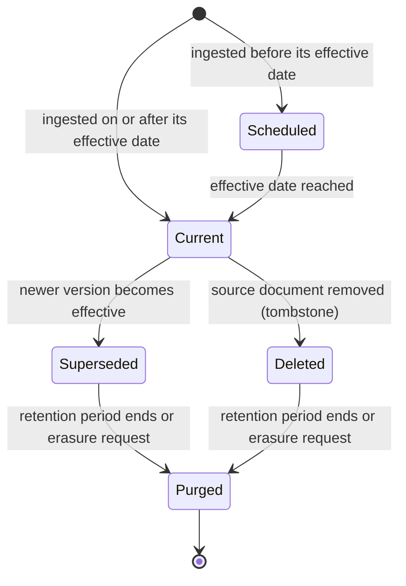

Documents are not fixed objects. A policy is revised, a runbook gains a step, a product page is rewritten for a new release, and a page that was true last year is now wrong. A RAG system that treats each document as a single, timeless piece of text will sooner or later hold two versions of the same rule and answer from whichever scores higher. This lesson treats change as part of the data model: what a version is, which dates describe it, which versions belong in the index, and how retrieval chooses between them.

You will build a small version store that records each version with a validity interval, closes the old interval when a new version arrives, records deletions as tombstones, and answers the question "which version applied on this date?". Then you will run retrieval over an index that holds two editions of Meridian's handbook and see four different answers to the same query, depending only on how versions are filtered.

## Learning objectives

- Distinguish a document's effective date, its modification date and its ingestion time, and say which one each versioning decision depends on.
- Choose between latest-only indexing, all-versions indexing with validity intervals and a split current/archive design for a given set of requirements.
- Implement a version store that detects real changes with a content hash, closes validity intervals and records deletions as tombstones.
- Filter retrieval to the versions valid on a given date, and explain why a flag computed at ingestion time can be wrong at query time.
- Diagnose answers that come from superseded documents, including documents that are new files rather than new versions of the same file.

## Prerequisites

- [Indexing pipeline](/learn/rag-architecture-fundamentals/indexing-pipeline): document IDs, content hashes, upserts and delete-then-write. This lesson assumes all four.
- [Document metadata](/learn/document-engineering/document-metadata): the metadata schema in which version fields live.
- [Query-document matching](/learn/rag-architecture-fundamentals/query-document-matching): how a retriever scores chunks, which explains why two near-identical versions tie.

## Why this matters

The indexing-pipeline lesson made one kind of change safe. When a document's content hash changes, the pipeline deletes that document's old chunks and writes new ones, so the index never holds two copies of the same document. That handles the simplest case: one file, edited in place, where only the newest text matters. Real collections break each part of that assumption.

- **The new version is a new file.** Meridian's 2025 handbook was published as a new document alongside the 2023 one, which was moved into an "Archive" folder instead of being deleted. To the pipeline these are two unrelated documents with two different IDs. Both are indexed, both are retrieved, and the 2023 one says laptops are replaced every 4 years.
- **The new version is not in force yet.** A policy published in December that takes effect in January is, for three weeks, the right answer to "what will the rule be?" and the wrong answer to "what is the rule?".
- **Someone needs the old version.** An employee disputing an expense claim from 2024 needs the rule that applied in 2024, not today's. An auditor asks what the assistant would have told staff on a given date.
- **The document was deleted.** If the pipeline only processes files that exist, a deleted file's chunks are never touched again and stay searchable indefinitely.

Each produces the same symptom: a confident, cited, wrong answer, whose citation points at a real document. Two versions that differ in one number are nearly the same text to a retriever, so nothing in the scores warns you. Versioning decides which of them the model is allowed to see.

## The intuition

Think of a railway timetable. Each December the operator publishes a new timetable that takes effect in the following week. For a few days, two timetables exist and both are correct about something: the old one about trains running this week, the new one about trains running next week. A station that pinned the new timetable up the day it arrived would send people to trains that do not run yet. A station that forgot to take the old timetable down would do the opposite, for months.

The operator also keeps every old timetable. Nobody uses them to catch a train, but if a passenger claims compensation for a delay last March, the clerk pulls out the March timetable to see when the train was due.

Three ideas are in that picture. A version has a **period during which it applies**, which is not the same as the day it was printed. **Which version you want depends on the date you are asking about**, and usually that date is today. And **old versions are kept, but not on the platform**: they are available to someone who deliberately asks for history, not to everyone looking for the next train.

## How it works

### What counts as a new version

A version is a state of a document's content that you want to treat as distinct. Deciding what counts is the first design choice.

- **Content change.** The text a reader sees has changed. This is always a new version.
- **Formatting-only change.** The same text with different whitespace, a different font or a re-saved file. This should not be a new version, which is why the hash is computed over **normalised** text, not raw bytes. A re-saved DOCX file usually has different bytes even when nothing visible changed. [Document normalization](/learn/document-engineering/document-normalization) is what makes "same content, same hash" true across formats.
- **Metadata-only change.** The owner, title or access list changed but the body did not. Usually this is not a new content version (nothing needs re-embedding) but the metadata on the existing chunks must still be updated. Treat it as a separate, cheaper path; access-list changes in particular must take effect promptly.

The content hash answers "did the content change?". It does not answer "which came first?" or "when does it apply?". Those need dates.

### Three clocks

A version has at least three timestamps, and confusing them causes most versioning bugs.

| Clock | Meaning | Typical source | Used for |
| --- | --- | --- | --- |
| **Effective date** (valid time) | When the content starts to apply in the real world | Written in the document, or set by its owner | Deciding which version answers a question |
| **Modified or published date** | When the file was last saved or released | Source system (file system, wiki, Git) | Change detection; a weak proxy for effective date |
| **Recorded time** (transaction time) | When your pipeline learnt about this version | Your pipeline's clock | Audit: what did the index contain at a given moment? |

The first and third are the two axes of what database textbooks call **bitemporal** data: valid time (when a fact is true in the world) and transaction time (when the database recorded it); SQL:2011 added both kinds of period to the SQL standard. You rarely need full bitemporal querying in a RAG system, but you must know which axis a question is about. "What is the laptop policy?" is a valid-time question. "Why did the assistant say 4 years on 20 December?" is a transaction-time question.

The modified date is the tempting shortcut and the usual mistake. A typo fixed in March 2025 in the 2023 handbook gives that superseded document a newer modification date than the current handbook. If "newest modified date wins", the old policy now wins.

### Where version information comes from

Most source systems track versions for you, and you should use what they provide rather than reinventing it:

- **Git** gives every change a commit hash and a timestamp; Meridian's Markdown runbooks live in a Git repository, so a runbook's version is the commit that last touched its file.
- **Wikis and document-management systems** keep a page version number or version history; Meridian's DOCX policies live in a document library with version history.
- **Web servers** expose `ETag` and `Last-Modified` HTTP headers, defined in RFC 9110, which let a loader ask "has this changed since I last saw it?" without downloading the body.
- **The document itself** often states an edition or an effective date ("Employee Handbook, 2025 edition, effective 1 January 2025"). Extracting that reliably is a [metadata extraction](/learn/document-preprocessing/metadata-extraction) problem.

When none of these exists, your own content hash plus your own counter is a perfectly good version identifier. What no source system gives you is **lineage across documents**: the fact that `handbook-2025.docx` supersedes `handbook-2023.docx`. That relation has to be recorded explicitly, either by assigning both files the same **document family** identifier (so they are versions of one logical document) or by a `supersedes` field on the newer one. It can be set by a rule ("files named `handbook-YYYY` form one family"), by the document's owner, or by a reviewer when the pipeline detects two documents with the same title. Without it, no amount of date filtering helps, because each file is the only version of itself.

### Three ways to index versions

| Strategy | What the index holds | Strengths | Weaknesses |
| --- | --- | --- | --- |
| **Latest only** | One version per document; new versions replace old ones (delete-then-write) | Simplest; smallest index; nothing stale can be retrieved | Cannot answer historical questions; a future-dated version replaces the current one on arrival |
| **All versions with validity intervals** | Every version's chunks, each tagged with `valid_from` and `valid_to` | As-of questions; audit; future-dated versions handled correctly | Every query must filter, and forgetting the filter mixes versions; larger index |
| **Split current and archive** | Current versions in the main index, older ones in a separate archive index or collection | Default searches cannot see history; history available to those who ask | Two indexes to keep consistent; moving versions between them is a job that can fail |

Latest-only is the right default for most internal assistants, and it is what the indexing-pipeline lesson built. Note that "latest only" refers to the **index**: the old text can still be kept in a document store or archive, outside retrieval, which is cheap and keeps your options open. Move to intervals or a split design when a requirement demands history or future-dated content, not before.

### Validity intervals

Each version gets an interval $[\text{valid\_from}, \text{valid\_to})$: it applies from its effective date up to, but not including, the effective date of whatever replaced it. The current version's interval is open-ended, represented by a sentinel far in the future (Python's `date.max` is 9999-12-31). The interval is **half-open**, closed at the start and open at the end, so that at the boundary exactly one version is valid: on 1 January 2025 the 2025 edition applies and the 2023 edition does not, with no gap and no overlap.

Ingesting a new version of a document then works like this:

1. Load the document and compute its content hash over the normalised text.
2. Look up the document's latest stored version. If its hash is identical, stop: nothing changed.
3. Determine the new version's effective date: from the source system or the document if available, otherwise the ingestion date.
4. Close the previous version's interval by setting its `valid_to` to the new effective date.
5. Store the new version with `valid_from` set to its effective date and `valid_to` open-ended, and record the ingestion time separately.
6. Chunk, embed and write the new version's chunks, each carrying the document ID, version number and both interval ends as metadata.
7. Update the interval metadata on the previous version's chunks (or, in a latest-only index, delete them).

At query time, the filter is a simple comparison: a chunk is eligible on date $d$ when $\text{valid\_from} \le d < \text{valid\_to}$. For ordinary questions $d$ is today. For historical questions $d$ comes from the user or is extracted from the query ("in 2024"); extracting such constraints is covered in [Self-query retrieval](/learn/advanced-retrieval/self-query-retrieval), and applying them inside a vector database in [Filtered retrieval](/learn/advanced-retrieval/filtered-retrieval).

Step 4 assumes versions arrive in effective-date order. Usually they do. A back-dated correction does not: a fix to the 2023 handbook that should apply from July 2024 arrives after the 2025 edition. Then "close the latest interval" is wrong, and the safe approach is to recompute every interval of that document from the sorted list of effective dates. Exercise 3 asks you to write that.

### The life cycle of a version



A **scheduled** version exists but does not apply yet. A **superseded** version applied once and might be wanted for history. A **deleted** document is represented by a **tombstone**: a record that says "this document stopped existing on this date". A **purged** version is gone from every store.

Notice that the move from scheduled to current happens because time passes, not because anything is ingested. That is why a status stored on each chunk at ingestion time goes stale, and why the interval comparison at query time is the more robust design. If you do want a cheap boolean `is_current` field for filtering speed, it needs a scheduled job that recomputes it whenever an effective date is reached.

### Deletions and tombstones

A pipeline that iterates over the files in a source can only notice a deletion by comparing this run's list of document IDs with the previous run's. The IDs that disappeared are candidates for deletion. Recording them as tombstones, rather than simply removing their chunks, keeps the information that the document existed and when it stopped, which matters for audit and for as-of queries.

There is a trap here. A document can be missing from this run's list because it was deleted, or because the loader failed, the source system timed out, or a permissions change hid a folder from the service account. Treating every disappearance as a deletion means a single bad run can empty the index. Guard against it: do not tombstone anything if the listing itself reported errors, and refuse to apply a run in which an unusually large share of documents disappeared at once without a person confirming it. [Data validation](/learn/document-engineering/data-validation) builds this kind of batch-level check. Where the source can send explicit deletion events, prefer them to inference by absence; event-driven designs are covered in [Event-driven ingestion](/learn/understanding-document-ingestion/event-driven-ingestion).

### Versions and identifiers

A latest-only index can use chunk IDs of the form `doc_id:position`, because overwriting the old version is exactly what you want. An all-versions index needs the version in the ID, for example `hb-it@v2:0`, or version 2's chunk 0 would overwrite version 1's. The versioning strategy and the ID scheme must be chosen together; [Document identifiers](/learn/document-engineering/document-identifiers) covers ID schemes in depth.

### What the model should see

Putting the edition and effective date next to each chunk in the prompt ("Source: Employee Handbook, 2025 edition, effective 1 January 2025") lets the model and the reader of the citation see which version an answer came from, and on a deliberate historical question lets the model say "until December 2024 the cycle was 4 years; since January 2025 it is 3". [Context construction](/learn/rag-architecture-fundamentals/context-construction) covers how such labels are assembled. Labels help but do not replace the filter: a model shown two contradictory passages may still blend them.

> [!KEY]
> Versioning in a RAG system comes down to one question asked on every search: which version of this document applies on the date the user is asking about? Record an effective date and a validity interval for every version, link versions that live in different files, and filter by interval at query time.

Versioning the documents is distinct from versioning the index itself ([Index versioning](/learn/ci-cd-and-mlops/index-versioning)), from scheduling re-processing ([Incremental ingestion](/learn/understanding-document-ingestion/incremental-ingestion)) and from organisational policy on document history ([Version control](/learn/enterprise-rag-governance/version-control)).

## In code

### A version store with validity intervals

**The problem.** Record every version of every document with its effective interval, skip re-ingestion when only formatting changed, record deletions, and answer "which version applied on date $d$?".

**Dependencies.** Only the Python standard library (`hashlib`, `dataclasses`, `datetime`). Python 3.10 or later for the `date | None` annotation.

```python
import hashlib
from dataclasses import dataclass
from datetime import date

FOREVER = date.max  # "still valid": an open-ended interval


@dataclass
class Document:
    doc_id: str
    text: str
    metadata: dict


@dataclass
class Version:
    doc_id: str
    version: int
    content_hash: str
    text: str
    valid_from: date            # effective date: when the content starts to apply
    valid_to: date = FOREVER    # set when a later version (or a deletion) takes over
    recorded_on: date | None = None   # when *we* learnt about it (ingestion time)
    deleted: bool = False       # True for a tombstone


def content_hash(text: str) -> str:
    normalised = " ".join(text.split())
    return hashlib.sha256(normalised.encode("utf-8")).hexdigest()[:12]


class VersionStore:
    def __init__(self):
        self.history: dict[str, list[Version]] = {}

    def ingest(self, doc: Document, effective: date, today: date) -> str:
        versions = self.history.setdefault(doc.doc_id, [])
        h = content_hash(doc.text)
        if versions and not versions[-1].deleted and versions[-1].content_hash == h:
            return f"{doc.doc_id}: unchanged (hash {h}), nothing to do"
        if versions:
            versions[-1].valid_to = min(versions[-1].valid_to, effective)
        new = Version(doc.doc_id, len(versions) + 1, h, doc.text,
                      valid_from=effective, recorded_on=today)
        versions.append(new)
        return f"{doc.doc_id}: stored v{new.version} (hash {h}), effective {effective}"

    def delete(self, doc_id: str, effective: date, today: date) -> str:
        versions = self.history[doc_id]
        versions[-1].valid_to = effective
        versions.append(Version(doc_id, len(versions) + 1, "-", "", effective,
                                recorded_on=today, deleted=True))
        return f"{doc_id}: tombstone v{len(versions)}, deleted from {effective}"

    def as_of(self, doc_id: str, when: date):
        for v in self.history.get(doc_id, []):
            if v.valid_from <= when < v.valid_to:
                return None if v.deleted else v
        return None


store = VersionStore()
it_2023 = "Laptops are replaced every 4 years. Support desk hours are 09:00 to 17:00."
it_2025 = "Laptops are replaced every 3 years. Support desk hours are 08:00 to 18:00 UK time."

print(store.ingest(Document("hb-it-equipment", it_2023, {}), date(2023, 1, 1), today=date(2023, 1, 3)))
print(store.ingest(Document("hb-it-equipment", it_2023 + "  ", {}), date(2023, 1, 1), today=date(2023, 6, 1)))
print(store.ingest(Document("hb-it-equipment", it_2025, {}), date(2025, 1, 1), today=date(2024, 12, 10)))
print(store.ingest(Document("hb-expense-fax", "Expense claims may be faxed to the finance department.", {}), date(2023, 1, 1), today=date(2023, 1, 3)))
print(store.delete("hb-expense-fax", date(2025, 1, 1), today=date(2024, 12, 10)))

print("\nHistory of hb-it-equipment:")
for v in store.history["hb-it-equipment"]:
    print(f"  v{v.version}  {v.content_hash}  valid {v.valid_from} -> {v.valid_to}  recorded {v.recorded_on}")

print("\nWhat applied when?")
for when in [date(2024, 6, 30), date(2024, 12, 20), date(2025, 3, 1)]:
    it = store.as_of("hb-it-equipment", when)
    fax = store.as_of("hb-expense-fax", when)
    fax_text = f"v{fax.version}" if fax else "no such document"
    print(f"  {when}: it-equipment v{it.version} | expense-fax: {fax_text}")
```

```output
hb-it-equipment: stored v1 (hash 9b691648bf8f), effective 2023-01-01
hb-it-equipment: unchanged (hash 9b691648bf8f), nothing to do
hb-it-equipment: stored v2 (hash ee6f856e06a2), effective 2025-01-01
hb-expense-fax: stored v1 (hash 19ed71bcbea1), effective 2023-01-01
hb-expense-fax: tombstone v2, deleted from 2025-01-01

History of hb-it-equipment:
  v1  9b691648bf8f  valid 2023-01-01 -> 2025-01-01  recorded 2023-01-03
  v2  ee6f856e06a2  valid 2025-01-01 -> 9999-12-31  recorded 2024-12-10

What applied when?
  2024-06-30: it-equipment v1 | expense-fax: v1
  2024-12-20: it-equipment v1 | expense-fax: v1
  2025-03-01: it-equipment v2 | expense-fax: no such document
```

**The important lines.**

- `content_hash` collapses every run of whitespace before hashing, so the second ingest (the same text with two trailing spaces) is recognised as unchanged. In a real pipeline this normalisation is the whole of [Document normalization](/learn/document-engineering/document-normalization), not one line.
- `ingest` takes two dates: `effective`, when the content applies, and `today`, when the pipeline recorded it. They are stored in different fields and never substituted for each other.
- `versions[-1].valid_to = min(versions[-1].valid_to, effective)` closes the previous interval at the new version's effective date. The `min` stops a later call from reopening an interval that was already closed.
- `delete` does not remove anything. It closes the last interval and appends a tombstone, a version with `deleted=True` and no text.
- `as_of` uses the half-open test `valid_from <= when < valid_to`, so exactly one version matches any date inside the document's life.

**What the output means.**

- The 2025 edition was recorded on 10 December 2024 but is effective from 1 January 2025. On 20 December 2024, `as_of` still returns v1: the new edition exists in the store but does not apply yet. A latest-only index would already have replaced v1.
- Version 1's interval ends exactly where version 2's begins, with no gap and no overlap.
- The `9999-12-31` end date is `date.max`, the sentinel for "still valid".
- The expense-fax policy was withdrawn from 1 January 2025. Before that date it is returned; after it, `as_of` returns `None`, which is different from "never existed": the history still shows v1 and the tombstone.

**Errors people commonly hit.**

- Hashing raw bytes instead of normalised text, so every re-save creates a new version and every version triggers a re-embed.
- Using the file's modification time as the effective date. It is a fine change detector and a poor statement of when a policy applies.
- Closing intervals with `<=` at both ends, which makes two versions valid on the boundary date.

**Extending it.** Persist the history in a database table with columns `(doc_id, version, content_hash, valid_from, valid_to, recorded_on, deleted)`; add a `family_id` so that separate files can be versions of one logical document; and add an `as_recorded(doc_id, when)` method that filters on `recorded_on` to answer transaction-time questions.

### Retrieval with and without a version filter

**The problem.** The index holds chunks of both handbook editions. Run the same query four ways and see which edition each filter lets through.

**Dependencies.** scikit-learn. No model download and no API key.

```bash
pip install scikit-learn
```

```python
from datetime import date

from sklearn.feature_extraction.text import TfidfVectorizer

FOREVER = "9999-12-31"   # ISO date strings compare correctly as plain strings

# One record per chunk *per version*. The 2023 handbook has been superseded by the
# 2025 edition, which was ingested on 10 December 2024 but takes effect on 1 January 2025.
chunks = [
    {"chunk_id": "hb-it@v1:0", "doc_id": "hb-it", "version": 1,
     "valid_from": "2023-01-01", "valid_to": "2025-01-01",
     "text": "Laptops are replaced every 4 years on a fixed refresh cycle."},
    {"chunk_id": "hb-it@v1:1", "doc_id": "hb-it", "version": 1,
     "valid_from": "2023-01-01", "valid_to": "2025-01-01",
     "text": "The support desk is open from 09:00 to 17:00."},
    {"chunk_id": "hb-it@v2:0", "doc_id": "hb-it", "version": 2,
     "valid_from": "2025-01-01", "valid_to": FOREVER,
     "text": "Laptops are replaced every 3 years on a fixed refresh cycle."},
    {"chunk_id": "hb-it@v2:1", "doc_id": "hb-it", "version": 2,
     "valid_from": "2025-01-01", "valid_to": FOREVER,
     "text": "The support desk is open from 08:00 to 18:00 UK time."},
    {"chunk_id": "hb-remote@v1:0", "doc_id": "hb-remote", "version": 1,
     "valid_from": "2023-01-01", "valid_to": "2025-01-01",
     "text": "The home-office equipment budget is £250."},
    {"chunk_id": "hb-remote@v2:0", "doc_id": "hb-remote", "version": 2,
     "valid_from": "2025-01-01", "valid_to": FOREVER,
     "text": "The home-office equipment budget is £400. Contractors are not eligible."},
]

vectoriser = TfidfVectorizer()
matrix = vectoriser.fit_transform(c["text"] for c in chunks)


def search(query, k=2, allowed=lambda c: True):
    scores = (matrix @ vectoriser.transform([query]).T).toarray().ravel()
    ranked = sorted(range(len(chunks)), key=lambda i: -scores[i])
    hits = [i for i in ranked if allowed(chunks[i])][:k]
    return [(chunks[i]["chunk_id"], round(float(scores[i]), 3), chunks[i]["text"]) for i in hits]


def valid_on(day: date):
    d = day.isoformat()
    return lambda c: c["valid_from"] <= d < c["valid_to"]


# A flag computed once, at ingestion time (10 Dec 2024): "the newest version is current".
latest = {}
for c in chunks:
    latest[c["doc_id"]] = max(latest.get(c["doc_id"], 0), c["version"])
is_current_flag = lambda c: c["version"] == latest[c["doc_id"]]

query = "How often are laptops replaced?"
print("1. No version filter:")
for hit in search(query):
    print("  ", hit)

print("\n2. Flag set at ingestion ('newest is current'), queried on 2024-12-20:")
for hit in search(query, allowed=is_current_flag):
    print("  ", hit)

print("\n3. Validity interval checked at query time, 2024-12-20:")
for hit in search(query, allowed=valid_on(date(2024, 12, 20))):
    print("  ", hit)

print("\n4. Validity interval checked at query time, 2025-03-01:")
for hit in search(query, allowed=valid_on(date(2025, 3, 1))):
    print("  ", hit)
```

```output
1. No version filter:
   ('hb-it@v1:0', 0.558, 'Laptops are replaced every 4 years on a fixed refresh cycle.')
   ('hb-it@v2:0', 0.558, 'Laptops are replaced every 3 years on a fixed refresh cycle.')

2. Flag set at ingestion ('newest is current'), queried on 2024-12-20:
   ('hb-it@v2:0', 0.558, 'Laptops are replaced every 3 years on a fixed refresh cycle.')
   ('hb-remote@v2:0', 0.126, 'The home-office equipment budget is £400. Contractors are not eligible.')

3. Validity interval checked at query time, 2024-12-20:
   ('hb-it@v1:0', 0.558, 'Laptops are replaced every 4 years on a fixed refresh cycle.')
   ('hb-it@v1:1', 0.0, 'The support desk is open from 09:00 to 17:00.')

4. Validity interval checked at query time, 2025-03-01:
   ('hb-it@v2:0', 0.558, 'Laptops are replaced every 3 years on a fixed refresh cycle.')
   ('hb-remote@v2:0', 0.126, 'The home-office equipment budget is £400. Contractors are not eligible.')
```

**The important lines.**

- Each record carries `version`, `valid_from` and `valid_to`, and its `chunk_id` includes the version (`hb-it@v2:0`) so the two editions do not overwrite each other.
- Dates are stored as ISO 8601 strings (`YYYY-MM-DD`), which sort in the same order as the dates they represent, so plain string comparison is a correct date comparison. Many vector databases filter on numbers more naturally than on strings; storing dates as integers such as `20250101` or as Unix timestamps keeps the same property.
- `search` scores every chunk and then drops the ones the filter rejects. That is **post-filtering**, fine for a demonstration; at scale, vector databases apply the filter during the search, which [Filtered retrieval](/learn/advanced-retrieval/filtered-retrieval) explains.
- `is_current_flag` mimics a boolean computed once at ingestion: "the newest version of each document is current".

**What the output means.**

1. **No filter.** Both editions come back with exactly the same score, 0.558. The default TF-IDF tokeniser drops single characters, so "4" and "3" vanish and the two sentences are identical as far as the retriever is concerned. Even with an embedding model the two would score almost the same. Which one ranks first is decided by list order, which is to say by accident. The model receives "every 4 years" and "every 3 years" side by side.
2. **Ingestion-time flag, asked on 20 December 2024.** Only the 2025 edition is visible, so the answer is 3 years, eleven days before that rule takes effect. The flag was correct about which version is newest, but that is not the question being asked.
3. **Interval filter on 20 December 2024.** The 2023 edition, correctly: it is the rule in force that day. The second hit, the support-desk hours with a score of 0.0, shows that top-k fills its slots whether or not anything relevant is left.
4. **Interval filter on 1 March 2025.** The 2025 edition, with no re-ingestion needed. The same index and the same filter give the right answer on both dates because the comparison happens at query time.

**Errors people commonly hit.**

- Applying the version filter in one code path (the chat endpoint) and forgetting it in another (an export or an evaluation script), so the evaluation silently measures a different system from the one users see.
- Mixing date formats across sources (`01/02/2025` from one system, `2025-02-01` from another), which breaks string comparison without any error. Normalise to one format at ingestion.

**Extending it.** Swap in `SentenceTransformer("sentence-transformers/all-MiniLM-L6-v2").encode(texts, normalize_embeddings=True)` and check that the two editions still score almost identically; then give the 2023 records a different `doc_id` with no version link to reproduce the case where intervals cannot help.

## A real-world example

Meridian's Platform team runs AskMeridian over the employee handbook and the IT runbooks, with a latest-only index: each document's chunks are replaced when its content hash changes. In early 2025 the support desk forwarded a cluster of complaints. Staff were being told that laptops are replaced every 4 years and that the home-office budget is £250. Both answers cited "Employee Handbook" and both citations opened a real document.

Chen, the engineer on rotation, started from the citations rather than from the prompt. The cited chunks belonged to `handbook-2023.docx`, which HR had moved into an "Archive" folder when the 2025 edition was published, not deleted. The pipeline's loader walked the whole library, archive included. The 2025 handbook had arrived as a new file with a new path, therefore a new document ID, therefore an unrelated document. Nothing in the pipeline was malfunctioning. Each file was a single, correctly indexed version of itself, and the retriever, given two near-identical passages, picked between them by fractions of a point.

The team rejected two quick fixes. Excluding the Archive folder encoded HR's filing habits into the pipeline; boosting documents by modification date would fail the first time someone fixed a typo in an archived file.

What they built instead had three parts. First, a `family_id` and an `effective_from` field in the handbook's metadata, set by HR when publishing, so that the 2023 and 2025 handbooks became two versions of one family. Second, interval metadata on every chunk and an interval filter on every query, with today's date by default. Third, a daily check that reports any two documents with the same normalised title and no family link, so that the next unlinked edition is caught by a report rather than by a confused employee. Historical questions ("what was the laptop policy in 2024?") were deliberately left out of the first release; the archived versions were kept in the index with closed intervals, so supporting them later needs only a date parameter, not a re-ingest.

## Common mistakes

- **Treating a new edition as a new, unrelated document.** Both versions are indexed and the retriever chooses between them by chance. Record family or `supersedes` links explicitly.
- **Using the modification date as the effective date.** A typo fix makes an old document "newest", and a policy published early is treated as already in force.
- **Computing "current" once at ingestion.** The flag is right on the day it is set and wrong on the day the next version takes effect. Compare against intervals at query time, or recompute the flag on a schedule.
- **Inferring deletions from absence without safeguards.** One failed listing deletes most of the index. Tombstone only from a complete, error-free listing, and alarm on unusually large deletions.
- **Removing old chunks without keeping old text anywhere.** When an auditor or an employee asks what applied last year, nobody can answer. Keep superseded text in an archive store even if it is out of the index.
- **Forgetting the filter in secondary code paths.** Evaluation, export or admin search tools see a different index from the one users see.

## Best practices

- Store three dates per version: effective from, modified in source, and recorded by your pipeline. Name the fields so nobody confuses them.
- Use half-open intervals and a single sentinel for "open-ended", and test the boundary date explicitly.
- Default every query to "valid today"; make historical search an explicit, separately authorised option.
- Take version numbers and change signals from the source system (commit hashes, page versions, `ETag`) where they exist, and fall back to your own content hash.
- Give logical documents a family identifier that survives new files, renames and moves, and report documents that look like unlinked editions.
- Show the edition and effective date in citations, so a reader can see which version an answer came from.

## Performance considerations

**Index size.** Keeping every version multiplies storage by the average number of versions. As an illustrative assumption, take 2,000 documents of 20 chunks each, embedded with a 384-dimensional model as 32-bit floats: $2{,}000 \times 20 \times 384 \times 4$ bytes is about 61 MB of vectors. If documents average five versions, all-versions indexing needs about 307 MB, before text, metadata and index overhead. That is small in absolute terms for a company of Meridian's size, but the ratio is what matters: a collection that changes weekly accumulates versions quickly, and every search scans a larger graph for results most queries will filter out.

**Filtering cost.** A filter that excludes most of the index (all superseded versions) can slow approximate nearest-neighbour search, because the index must examine more candidates to find $k$ that pass. Indexing the filtered fields (a range index on the date fields, or a keyword index on a boolean) helps; see [Payload indexes](/learn/advanced-vector-database-engineering/payload-indexes). This is a practical argument for the split current/archive design when history is large and rarely queried.

**Embedding cost.** Embedding is usually the most expensive stage, so only real content changes should reach it. A normalised content hash prevents re-embedding on formatting changes; a metadata-only change should update chunk metadata in place without re-embedding. Embedding only the *chunks* that changed within a changed document is a further optimisation that depends on stable chunk boundaries, discussed in [Incremental ingestion](/learn/understanding-document-ingestion/incremental-ingestion).

## Security considerations

- **Old versions can contain what was removed on purpose.** A runbook revised to remove a leaked credential, or a page edited to remove personal data, still holds that content in its earlier versions. All-versions indexing makes it searchable again. Redaction must be applied to every retained version, and genuine erasure must purge all versions from the index, the archive and backups; see [Secure deletion](/learn/enterprise-rag-governance/secure-deletion).
- **A tombstone is not erasure.** It records that a document stopped applying; the earlier versions are still stored. Legal or contractual deletion obligations need a purge.
- **Permissions change between versions.** If access to a document is narrowed, the narrower access list must apply to its older versions too, or the old version becomes a way around the new rule. Treat access-control metadata as belonging to the document family, not frozen into each version; see [Document-level permissions](/learn/access-control-and-privacy/document-level-permissions).
- **Historical search is a privilege.** Restrict as-of queries to the roles that need them (HR, audit, legal) rather than offering them to everyone.
- **Effective dates are input.** If document authors can set an effective date far in the future or past, they can control which version wins. Validate that dates fall in a plausible range and that only owners can set them.

## Summary

- A version has three dates: when it applies (effective), when it was saved (modified) and when you recorded it (ingested). Versioning decisions depend mainly on the effective date.
- A content hash over normalised text detects real changes; the source system or the document supplies version numbers and dates; links between separate files must be recorded explicitly.
- Index the latest version only unless requirements need history or future-dated content; then tag chunks with half-open validity intervals, or split current and archive indexes.
- Decide "current" at query time with `valid_from <= date < valid_to`; a flag computed at ingestion goes stale when an effective date passes.
- Record deletions as tombstones, but never infer them from a failed or incomplete listing.
- Old versions carry old secrets and old permissions; redaction, access control and erasure must cover every version.

## Exercises

**1.** For each question, say whether it is about valid time or transaction time, and which date your filter should compare against: (a) "What is the home-office equipment budget?", (b) "Why did AskMeridian tell me on 20 December 2024 that laptops last 3 years?", (c) "What was the support desk's opening time in mid-2024?"

<details><summary>Show solution</summary>

(a) **Valid time**, compared against today: the user wants the rule in force now. Only versions with `valid_from <= today < valid_to` are eligible.

(b) **Transaction time.** The question is about what the index contained and how it was filtered on 20 December 2024, not about which policy applied. You answer it from `recorded_on` (what had been ingested by then) together with the query logs. In the lesson's code, a system using the ingestion-time flag would have shown the 2025 edition on that date, which is exactly the bug the question uncovers.

(c) **Valid time**, compared against a date in mid-2024, say 2024-07-01. The 2023 edition applies, so the answer is 09:00 to 17:00. A latest-only index cannot answer this at all.

</details>

**2.** Meridian's IT runbooks live in Git and are edited in place; the handbook is published as a new DOCX edition every two years with an effective date on its cover page; product documentation is a website that changes with each release. Choose a versioning strategy (latest only, all versions with intervals, or split current/archive) for each source and justify it in two or three sentences.

<details><summary>Show solution</summary>

**Runbooks: latest only.** A runbook describes how to do something now; the old procedure is never the right answer, and edits take effect immediately, so effective date equals commit date. Git already keeps full history outside the index, so nothing is lost.

**Handbook: all versions with intervals, or split current/archive.** Editions are published ahead of their effective dates, and HR and staff do ask what applied in earlier periods (expense disputes, carry-over of leave). Intervals let future-dated editions be ingested early and become current on the right day. With only a few editions, the size cost is negligible; a family link between editions is essential because each edition is a new file.

**Product documentation: latest only per product version, or intervals keyed by release.** This one depends on the customers: if staff support customers on several releases at once, the relevant axis is the *product* version rather than time, and the filter should be on a `product_version` field the user selects. If everyone is on the latest release, latest only is enough. The point of the exercise is that "version" can mean time, release or edition, and the filter must match the question users ask.

</details>

**3.** The version store in the lesson assumes versions arrive in effective-date order. Write a function `rebuild_intervals(versions)` that takes a document's versions (each a dict with `version` and `valid_from`) in any order and sets every `valid_to` correctly. Test it with v1 effective 2023-01-01, v2 effective 2025-01-01 and a back-dated v3 effective 2024-07-01 that arrives last.

<details><summary>Show solution</summary>

Sort by effective date, then close each interval at the next version's start; the last one stays open. Breaking ties on the version number keeps the result deterministic if two versions share an effective date (in which case the earlier one's interval is empty and the later one wins, which is usually what you want for a same-day correction).

```python
from datetime import date

FOREVER = date.max


def rebuild_intervals(versions):
    """versions: list of dicts with 'version' and 'valid_from'. Returns them
    ordered by effective date, each closed by the next one's effective date."""
    ordered = sorted(versions, key=lambda v: (v["valid_from"], v["version"]))
    for current, nxt in zip(ordered, ordered[1:]):
        current["valid_to"] = nxt["valid_from"]
    ordered[-1]["valid_to"] = FOREVER
    return ordered


# v3 arrives last but is a back-dated correction effective in mid-2024
history = [
    {"version": 1, "valid_from": date(2023, 1, 1)},
    {"version": 2, "valid_from": date(2025, 1, 1)},
    {"version": 3, "valid_from": date(2024, 7, 1)},
]
for v in rebuild_intervals(history):
    print(f"v{v['version']}: {v['valid_from']} -> {v['valid_to']}")
```

```output
v1: 2023-01-01 -> 2024-07-01
v3: 2024-07-01 -> 2025-01-01
v2: 2025-01-01 -> 9999-12-31
```

The back-dated correction now sits between the two editions, and v1's interval has been shortened from 2025-01-01 to 2024-07-01. In a real system, recomputing intervals must also update the interval metadata on every affected chunk, not only on the newest version's.

</details>

**4.** Design decision. A deletion detector compares this run's document IDs with last run's. Tonight's run lists 1,140 documents; last night's listed 2,310. Nothing in the logs shows an error. What should the pipeline do, and what rule would you write so that it decides this without a person in most cases?

<details><summary>Show solution</summary>

It should **not** tombstone the 1,170 missing documents. Losing roughly half the corpus in one day is far more likely to be a fault (a permissions change on the service account, a folder moved, an API returning a partial page without an error) than a real deletion. The pipeline should apply additions and updates as normal, hold the deletions, and alert the owner.

A workable rule has three parts. First, tombstone only from a listing that completed without errors, treating a paginated listing whose final page was not reached as incomplete. Second, hold deletions for confirmation when a run would delete more than a threshold share or number of documents, with the threshold set from your own history of normal deletion rates. Third, where the source reports deletions explicitly (a delete event, a recycle bin, a change feed), apply those without the threshold, because they are positive evidence rather than absence.

</details>

## Check your understanding

```quiz
[
  {
    "q": "A policy is published on 10 December 2024 with an effective date of 1 January 2025. A user asks on 20 December 2024 what the current policy is. Which version should retrieval use?",
    "options": [
      "The new version, because it was published most recently",
      "Both versions, so the model can choose",
      "The previous version, because the new one does not apply until 1 January",
      "Neither, because the policy is in transition"
    ],
    "answer": 2,
    "why": "Which version applies depends on the effective date, not the publication date. Until 1 January 2025 the previous version is in force."
  },
  {
    "q": "Why is a validity interval checked at query time more robust than an is_current flag set at ingestion?",
    "options": [
      "Interval comparisons are faster than boolean filters",
      "A version can become current or stop being current when a date passes, without any new ingestion to update the flag",
      "Flags cannot be stored as vector database metadata",
      "Intervals remove the need for a content hash"
    ],
    "answer": 1,
    "why": "Time passing changes which version applies. A flag only changes when something rewrites it, so it is stale between the effective date and the next job that recomputes it."
  },
  {
    "q": "The 2025 handbook is uploaded as a new file and the 2023 handbook is moved to an archive folder. The pipeline uses path-based document IDs and a latest-only index. What happens?",
    "options": [
      "Both handbooks are indexed as unrelated documents, so either can be retrieved",
      "The 2025 handbook replaces the 2023 one, because it is newer",
      "The pipeline detects that the content hash changed and creates version 2",
      "The 2023 handbook is deleted from the index because it moved"
    ],
    "answer": 0,
    "why": "Different paths give different IDs, so the pipeline sees two independent documents, each the only version of itself. Only an explicit family or supersedes link connects them. (The move also gives the 2023 file a new path, so it is indexed under a new ID; the chunks under its old ID are removed only if the pipeline handles deletions.)"
  },
  {
    "q": "A versioned record has valid_from = 2023-01-01 and valid_to = 2025-01-01, using half-open intervals. Is it valid on 2025-01-01?",
    "options": [
      "Yes, because both end dates are included",
      "Only until midday",
      "It depends on the content hash",
      "No, because the end of a half-open interval is excluded"
    ],
    "answer": 3,
    "why": "A half-open interval includes its start and excludes its end, so on 2025-01-01 the next version is valid and this one is not. That guarantees exactly one valid version on the boundary."
  },
  {
    "q": "Which statement about tombstones is correct?",
    "options": [
      "A tombstone permanently erases all versions of a document",
      "A tombstone should be written for every document missing from a listing, even if the listing failed",
      "A tombstone records that a document stopped existing on a date, while earlier versions may still be stored",
      "Tombstones are only needed in latest-only indexes"
    ],
    "answer": 2,
    "why": "A tombstone marks the end of a document's life for retrieval and audit. It is not erasure, and it must not be inferred from an incomplete or failed listing."
  }
]
```

## Further reading

- Snodgrass, R. T. (1999), *Developing Time-Oriented Database Applications in SQL*, Morgan Kaufmann. The standard treatment of valid time, transaction time and bitemporal tables.
- Kulkarni, K. and Michels, J.-E. (2012), "Temporal features in SQL:2011", *SIGMOD Record* 41(3). How application-time and system-time periods were added to the SQL standard.
- Fowler, M. (2021), "Bitemporal History", [martinfowler.com/articles/bitemporal-history.html](https://martinfowler.com/articles/bitemporal-history.html). A short, readable explanation of the two time axes.
- Fielding, R., Nottingham, M. and Reschke, J. (2022), RFC 9110, *HTTP Semantics*, sections on `ETag` and `Last-Modified`: [rfc-editor.org/rfc/rfc9110](https://www.rfc-editor.org/rfc/rfc9110).
- Kleppmann, M. (2017), *Designing Data-Intensive Applications*, O'Reilly, chapter 11 ("Stream Processing"), on change data capture and event logs as a record of how data changed over time.
