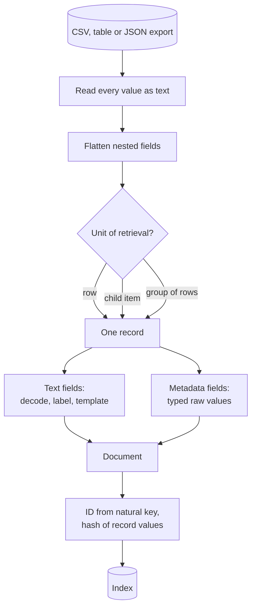

Most of this module has treated a document as prose: a policy page, a runbook, a product guide. A large share of what a company knows does not look like that. It sits in rows and records: a spreadsheet of error codes, a database table of laptops, a JSON export of support tickets, a CSV of office addresses. Each record is small, precise and full of codes that only make sense next to a column header. Put one of those rows into an embedding model as it stands and you get a vector for `E-5110,relay,1,...`, which is close to nothing anyone will ever ask.

This lesson is about turning structured and semi-structured records into documents that retrieval can find and a model can read: choosing the unit of retrieval, deciding which fields become text and which become metadata, writing the template that serialises a record, flattening nested JSON, and keeping identity and change detection tied to the record's own key. It ends with the most important judgement of all: recognising the questions that retrieval over rows cannot answer, and that belong to a query over the data itself.

## Learning objectives

- Distinguish structured, semi-structured and unstructured sources, and explain what each one needs before it can be indexed.
- Write a record-to-text template that turns codes into words, keeps labels and units with values, and omits empty fields.
- Decide, for a given field, whether it belongs in the embedded text, in the metadata, or in both, and justify the choice.
- Flatten nested JSON with pandas and choose between one document per record, per child item, or per group of records.
- Identify aggregation and exhaustive questions that top-k retrieval cannot answer, and explain where they should be sent instead.

## Prerequisites

- [Indexing pipeline](/learn/rag-architecture-fundamentals/indexing-pipeline): the stages a document passes through, and document IDs, upserts and content hashes.
- [JSON and CSV](/learn/data-processing/json-and-csv): reading both formats in Python.
- [Document metadata](/learn/document-engineering/document-metadata): designing the metadata schema that records carry into the index.
- [Document identifiers](/learn/document-engineering/document-identifiers): how stable document IDs are built.

## Why this matters

Structured sources are often the most valuable data a RAG system can reach. Meridian's Atlas error-code catalogue answers a question an engineer has at three in the morning; the support-desk ticket history records how a problem was fixed last time; the asset register knows when a particular laptop is due for refresh. Users ask about these things constantly, and they expect exact answers, because the data is exact.

Three things go wrong when records are indexed as if they were prose.

- **The text is unreadable to both the retriever and the model.** A comma-separated row has no words for its codes. Severity `1` does not contain the word "critical"; component `relay` is not "Meridian Relay"; `60` is not "one minute". A user's question shares almost no vocabulary with the row, so lexical matching misses it, and an embedding of a string of codes sits in an uninformative region of the vector space.
- **Meaning is split from its labels.** If a table is chunked like prose, a chunk can contain values without the header row that says what they are. "3600" is a retry interval only if something says so.
- **Questions over many rows are answered from a few.** "How many critical errors does Relay have?" or "Which laptops are due for refresh this year?" need every matching row. Retrieval returns the top k, so the model counts what it was shown and states a number that is confidently wrong. Nothing in the pipeline raises an error.

The first two are fixed by careful ingestion. The third is fixed by recognising that some questions should not go to the retriever at all.

## The intuition

Imagine handing a new colleague a printed spreadsheet row with no header: `E-5110, relay, 1, Message broker unreachable, Escalate to the on-call Platform engineer, REL-007, 60`. They can guess at some of it. Now hand them a card that reads: "Atlas error E-5110: message broker unreachable. Component: Meridian Relay. Severity: critical. What to do: escalate to the on-call Platform engineer (runbook REL-007). Safe to retry after one minute." The facts are identical. The card is something a person can act on, and a person searching a box of such cards for "critical Relay errors" would find it at a glance.

Structured ingestion is the job of writing those cards: one per record (or per sensible group of records), each readable on its own, each carrying a label on the back (the metadata) so that cards can also be sorted and filtered without reading them. And when someone asks "how many critical cards are there?", the sensible answer is not to pull five cards out of the box and count them, but to go back to the spreadsheet and count the rows.

## How it works

### Three kinds of source

- **Unstructured** sources are prose: pages, PDFs, documents. Their structure is implicit in headings and paragraphs, and the earlier lessons of this module dealt with them.
- **Structured** sources have a fixed schema: every record has the same named, typed fields. CSV files, spreadsheets and database tables are the usual forms. The schema is the most useful thing about them, because it tells you what every value means.
- **Semi-structured** sources have named fields but a flexible shape: JSON and XML records from APIs, with nested objects, optional keys and lists of child items. A support ticket with a requester object and a list of comments is typical.

Many real records mix the two: a ticket has structured fields (priority, category, dates) and free-text fields (the title, the conversation). The free text is where most of the retrievable meaning lives; the structured fields are what you filter, group and count by.

### The decisions, in order

Every structured source requires the same five decisions. Taking them in this order avoids rework.

1. **Read the data without letting the reader guess.** Parsing libraries infer types, and inference changes values: an integer column with one empty cell becomes floating point (`3600` turns into `3600.0`), leading zeros vanish from codes stored as numbers, and empty cells become `NaN`, which a careless template prints as the word "nan". Read every value as text first, then convert the fields you need, deliberately.
2. **Choose the unit of retrieval.** One document per row is the default and is right when each row stands alone (an error code, a laptop). Some sources need a different unit: one document per child item (each comment of a long ticket thread), or one per group of rows (all the rows that describe one product plan). The test is the same as for chunking prose: would this unit, on its own, answer a question?
3. **Split the fields.** For each field decide whether it goes into the **embedded text** (what retrieval matches and the model reads), into **metadata** (what filters and citations use), or both. Codes that users filter by go to metadata in their raw form; their human-readable meaning goes into the text.
4. **Write the template.** Serialise the chosen fields as labelled, self-contained text: decode codes into words, keep units and labels next to values, and leave out empty fields rather than printing placeholders.
5. **Attach identity and a fingerprint.** The record's natural key (the error code, the ticket number, the asset tag) becomes the document ID, and a hash of the record's values tells the next run whether it changed. Row numbers are never IDs: sort the file differently and every ID moves.



### Templates: making a record readable

A template is a small function from a record to a string. Four rules make it good.

- **Decode codes into the words people use.** Lookup tables turn `relay` into "Meridian Relay" and `1` into "critical". These tables are part of the source's documentation; if no one can tell you what severity 1 means, neither the retriever nor the model can either.
- **Keep labels and units with values.** "Safe to retry after 60 minutes" is unambiguous; "3600" is not. Converting units into the unit people speak in (minutes rather than seconds) helps both matching and the model's answer.
- **Make every document self-contained.** Name the kind of thing at the start ("Atlas error E-5110", "Support ticket SD-1042", "Laptop MER-L-0412"). A retrieved chunk is read out of context, beside chunks from other sources, so it must say what it is.
- **Omit what is missing.** If a field is empty, leave the sentence out. "Retry after nan minutes" is noise to the retriever and an invitation for the model to invent something.

Labelled `key: value` lines and short sentences both work. Sentences read more naturally and tend to suit embedding models trained on prose; `key: value` lines are compact and easy to keep consistent. Whichever you choose, use it for every record of a source, so that equivalent facts always look the same. JSON dumped as text is the weakest choice: it spends tokens on braces and quotes, and keys like `retry_after_s` are not the words anyone searches for.

### Text, metadata, or both

The decision for each field follows from how it will be used.

| Field kind | Example | Where it goes | Why |
| --- | --- | --- | --- |
| Free text | ticket title, resolution | Text | It carries the meaning that matching depends on |
| Coded category users mention in questions | component `relay`, severity `1` | Both: decoded word in text, raw code in metadata | Matching needs the word; exact filtering needs the code |
| Identifier | `E-5110`, `SD-1042` | Both | Users type identifiers in questions; citations and look-ups need them exact |
| Date or number used to filter or sort | opened date, severity level | Metadata, typed; optionally also in text | Range filters need real dates and numbers, not strings |
| Internal bookkeeping | row hash, export batch, source path | Metadata only | Useful to the pipeline, meaningless to a user |
| Sensitive or access-controlling | requester name, team permissions | Metadata, and enforced as a filter | Must never be left to relevance; see Security below |

Metadata values must be typed correctly when they are written. A severity stored as the string `"1"` cannot be compared with `<= 2`; a date stored as `"03/02/2026"` sorts wrongly and is ambiguous between British and American readings. [Document metadata](/learn/document-engineering/document-metadata) covers schema design, and how vector databases filter on these fields is the subject of [Metadata filtering](/learn/advanced-vector-database-engineering/metadata-filtering).

### Nested and repeated data

JSON records nest objects inside objects and lists inside both. A nested object (a ticket's `requester` with `team` and `office`) is flattened into columns with compound names such as `requester_office`; pandas does this with `pd.json_normalize`. Lists need a decision, because there are two very different things a list can be:

- **A list of simple values** (tags) is usually joined into one field for the text and kept as a list in the metadata, where many vector databases can match any element.
- **A list of child records** (a ticket's comments, an order's lines) can either be **folded** into the parent's text, producing one document per ticket, or **exploded** so that each child becomes its own document carrying its parent's key and fields. `json_normalize(..., record_path="comments", meta=[...])` produces the exploded form.

Fold when the children only make sense together and the result stays short (a ticket with a handful of comments). Explode when children are long or independently meaningful (a year of comments on one long-running incident), and keep the parent ID in each child's metadata so you can fetch the siblings when one is retrieved.

### Grouping rows

Sometimes a single row is too small to answer anything. A plan-comparison table for Meridian Reports might have one row per plan and feature: "Enterprise, SAML single sign-on, yes". A question such as "what does the Enterprise plan include?" needs all the Enterprise rows together. Grouping rows by an entity (one document per plan, listing its features) produces a document that answers that question, at the cost of making "which plans have SAML?" depend on several documents each mentioning it. Neither unit is right for every question; pick the one that matches the questions you actually see, and remember that exhaustive questions ("which plans...") lean towards a structured query anyway.

### When retrieval over rows is the wrong tool

Top-k retrieval returns k documents, ranked by similarity to the question. That is the right tool when the answer is in one or a few documents. It is the wrong tool for three kinds of question over structured data:

1. **Aggregations**: counts, sums, averages, maxima. "How many P1 tickets did we have in October?" requires every matching row; with k = 5 the model can never see more than five.
2. **Exhaustive lists**: "which laptops are due for refresh before March?" The answer may contain 40 rows; any k smaller than that silently truncates it.
3. **Exact look-ups by key**: "what is E-4021?" Retrieval will usually get this right, but a direct look-up by ID is cheaper, exact and needs no ranking.

For these, the right path is a query over the structured data itself: SQL against the database, or a pandas filter over the export, whose result is then handed to the model as context. Deciding which path a question takes is **routing**, and having a model write the query is **text-to-SQL**; both are later subjects (see [Query routing](/learn/agentic-rag/query-routing) and [Self-query retrieval](/learn/advanced-retrieval/self-query-retrieval), which uses a model to turn parts of a question into metadata filters). The point here is the ingestion consequence: **keep the structured source queryable**. Indexing a table as documents should be an addition to the table, not a replacement for it.

> [!KEY]
> Retrieval answers "find the record about this". It cannot answer "count, sum or list all the records that". Index records as text for the first kind of question, and keep the source queryable for the second.

### Change detection and deletion

Structured exports are usually re-read in full on a schedule. To avoid re-embedding thousands of unchanged rows, store a hash of each record's values (in a fixed field order) alongside its document ID. On the next run, a record whose hash is unchanged is skipped, a changed hash triggers a re-embed and upsert, and an ID that has disappeared from the export means the record was deleted, so its document must be removed from the index. That last case is the one pipelines forget: a deleted error code that lingers in the index will keep being retrieved. The general mechanics of incremental runs are covered in [Incremental ingestion](/learn/understanding-document-ingestion/incremental-ingestion); for records, the natural key makes them straightforward.

## In code

### Example 1: an error-code catalogue becomes documents

**The problem.** The Atlas error-code catalogue arrives as a CSV export. Turn each row into a `Document` (the shared shape used throughout this module) whose text a user's question can match and a model can read, whose metadata supports exact filters, and whose ID and fingerprint support idempotent re-runs. Then compare it with a naive serialisation, and see what pandas does to the file when left to infer types.

**Dependencies.** pandas only; no model and no API key.

```bash
pip install pandas
```

```python
import hashlib
import io
import re
from dataclasses import dataclass

import pandas as pd


@dataclass
class Document:
    doc_id: str
    text: str
    metadata: dict


# The Atlas error-code catalogue, as the platform team exports it.
CATALOGUE_CSV = """code,component,severity,summary,resolution,runbook,retry_after_s,updated
E-4012,vpn,2,Certificate expired,Reinstall the VPN certificate from the IT portal,NET-114,,2026-03-02
E-4021,vpn,2,Client out of date,Update the VPN client from the IT portal,NET-114,,2026-03-02
E-5003,sync,3,Upload quota exceeded,Archive old files or ask the support desk for more quota,SYNC-031,3600,2026-05-19
E-5110,relay,1,Message broker unreachable,Escalate to the on-call Platform engineer,REL-007,60,2026-06-11
E-6002,reports,3,Export timed out,Narrow the date range and export again,REP-019,300,2026-07-30
"""

# Lookup tables that turn codes into the words people actually use.
COMPONENTS = {"vpn": "VPN client", "sync": "Meridian Sync",
              "relay": "Meridian Relay", "reports": "Meridian Reports"}
SEVERITY = {"1": "critical", "2": "major", "3": "minor"}


def row_to_text(r: dict) -> str:
    """Serialise one catalogue row as labelled, self-contained text."""
    lines = [
        f"Atlas error {r['code']}: {r['summary']}.",
        f"Component: {COMPONENTS[r['component']]}.",
        f"Severity: {SEVERITY[r['severity']]}.",
        f"What to do: {r['resolution']}.",
        f"Runbook: {r['runbook']}.",
    ]
    if r["retry_after_s"]:                       # omit empty fields; never print "nan"
        minutes = int(r["retry_after_s"]) // 60
        lines.append(f"Safe to retry after {minutes} minute{'s' if minutes != 1 else ''}.")
    return " ".join(lines)


def row_to_document(r: dict, source: str) -> Document:
    text = row_to_text(r)
    return Document(
        doc_id=f"atlas-error:{r['code']}",       # natural key, not row number
        text=text,
        metadata={
            "source": source,
            "doc_type": "error_code",
            "code": r["code"],
            "component": r["component"],         # raw code: good for exact filters
            "severity": int(r["severity"]),      # typed: allows severity <= 2
            "runbook": r["runbook"],
            "updated": r["updated"],
            "row_hash": hashlib.sha256(
                "\x1f".join(f"{k}={r[k]}" for k in sorted(r)).encode()
            ).hexdigest()[:12],
        },
    )


# dtype=str and keep_default_na=False: read every cell as the exact text in the file.
df = pd.read_csv(io.StringIO(CATALOGUE_CSV), dtype=str, keep_default_na=False)
docs = [row_to_document(r, "atlas/error-codes.csv") for r in df.to_dict("records")]

for d in docs[2:4]:
    print(d.doc_id)
    print("  text:", d.text)
    print("  meta:", {k: d.metadata[k] for k in ("component", "severity", "row_hash")})

# What a naive serialisation would have embedded instead.
naive = ",".join(df.iloc[3])
print("\nnaive:", naive)

# Which words from a realistic question can each version match?
question = "critical error in Meridian Relay, how long before I retry?"
words = set(re.findall(r"[a-z0-9]+", question.lower()))
for name, text in [("naive", naive), ("template", docs[3].text)]:
    found = sorted(words & set(re.findall(r"[a-z0-9]+", text.lower())))
    print(f"{name:>8} shares {len(found)} words with the question: {found}")

# Pitfall: pandas' default parsing of the same file.
default = pd.read_csv(io.StringIO(CATALOGUE_CSV))
print("\ndefault dtypes:", dict(default.dtypes.astype(str)))
print("default retry_after_s for E-4012 and E-5003:",
      default.loc[0, "retry_after_s"], default.loc[2, "retry_after_s"])
```

```output
atlas-error:E-5003
  text: Atlas error E-5003: Upload quota exceeded. Component: Meridian Sync. Severity: minor. What to do: Archive old files or ask the support desk for more quota. Runbook: SYNC-031. Safe to retry after 60 minutes.
  meta: {'component': 'sync', 'severity': 3, 'row_hash': 'a74da1eb73bb'}
atlas-error:E-5110
  text: Atlas error E-5110: Message broker unreachable. Component: Meridian Relay. Severity: critical. What to do: Escalate to the on-call Platform engineer. Runbook: REL-007. Safe to retry after 1 minute.
  meta: {'component': 'relay', 'severity': 1, 'row_hash': '1ed84f85d071'}

naive: E-5110,relay,1,Message broker unreachable,Escalate to the on-call Platform engineer,REL-007,60,2026-06-11
   naive shares 1 words with the question: ['relay']
template shares 5 words with the question: ['critical', 'error', 'meridian', 'relay', 'retry']

default dtypes: {'code': 'str', 'component': 'str', 'severity': 'int64', 'summary': 'str', 'resolution': 'str', 'runbook': 'str', 'retry_after_s': 'float64', 'updated': 'str'}
default retry_after_s for E-4012 and E-5003: nan 3600.0
```

**The important lines.**

- `pd.read_csv(..., dtype=str, keep_default_na=False)` reads every cell as the exact text in the file and turns empty cells into empty strings instead of `NaN`. Conversion to `int` happens only where the code asks for it (`int(r["severity"])`).
- `COMPONENTS` and `SEVERITY` are the decoding tables. They are why the template can say "Meridian Relay" and "critical".
- `if r["retry_after_s"]:` drops the retry sentence for rows with no value, so E-4012 and E-4021 carry no retry claim at all.
- `doc_id=f"atlas-error:{r['code']}"` uses the natural key with a source prefix, so the ID survives re-sorting the file and cannot collide with a ticket or a laptop ID.
- `row_hash` hashes every field as `name=value` pairs in sorted order, separated by a control character that cannot appear in the data. Any change to any field changes the hash; reordering columns in the export does not.

**What the output means.**

- The templated E-5110 text shares five words with the question ("critical", "error", "meridian", "relay", "retry"); the naive row shares one. Lexical matching depends directly on that overlap, and an embedding model also has far more to work with when the words are present.
- The metadata keeps the raw codes (`'component': 'relay'`, `'severity': 1`), so a filter such as "component is relay and severity at most 2" is exact, while the text carries the human words.
- The last two lines show pandas' default inference: `severity` became an integer, which is harmless here, but `retry_after_s` became `float64` because of the empty cells, so E-5003's retry is now `3600.0` and E-4012's is `nan`. A template written against those values prints "3600.0 seconds" or "nan".

**Errors people commonly hit.**

- `KeyError` from a decoding table when the source gains a new code (a component `atlas-core` that `COMPONENTS` does not list). Decide deliberately: fail the run, or fall back to the raw code and log a warning. Silently skipping the row is the worst option.
- `ValueError: invalid literal for int()` when a numeric column contains text such as "n/a". This is a validation problem; [Data validation](/learn/document-engineering/data-validation) shows how to catch it at the boundary and quarantine the row.
- Hashing `str(row)` or a dictionary in its insertion order. If the export's column order changes, every hash changes and the whole catalogue is re-embedded for nothing.

**Extending it.** Add a lookup that loads the runbook title for each runbook ID and include it in the text; store `updated` as a real date in metadata; and run the documents through the indexing pipeline from [Indexing pipeline](/learn/rag-architecture-fundamentals/indexing-pipeline), skipping any whose `row_hash` matches the previous run.

### Example 2: nested tickets, and a question retrieval cannot answer

**The problem.** The support desk exports tickets as JSON with a nested `requester` object and a list of tags. Flatten them, turn each into a document, and then ask an aggregation question both ways: by retrieving the top five documents and counting what came back, and by querying the flattened table.

**Dependencies.** pandas and rank-bm25 (a small BM25 implementation; [BM25](/learn/sparse-retrieval/bm25) explains the scoring). The tickets are generated with a fixed seed so the output is reproducible.

```bash
pip install pandas rank-bm25
```

```python
import random
from dataclasses import dataclass

import pandas as pd
from rank_bm25 import BM25Okapi


@dataclass
class Document:
    doc_id: str
    text: str
    metadata: dict


# --- Build a synthetic support-desk export (fixed seed, so it is reproducible) ---
random.seed(42)
ISSUES = {
    "hardware": ["Laptop screen flickers", "Laptop lost on a train", "Docking station not detected"],
    "access":   ["Password expired", "Locked out after password rotation", "VPN certificate expired"],
    "software": ["Meridian Sync upload fails", "Reports export times out", "VPN client out of date"],
}
TAGS = {"hardware": ["laptop", "dock", "urgent"], "access": ["password", "vpn", "urgent"],
        "software": ["sync", "reports", "vpn"]}
tickets = []
for n in range(40):
    category = random.choice(list(ISSUES))
    tickets.append({
        "id": f"SD-{1000 + n}",
        "opened": f"2026-10-{random.randint(1, 31):02d}",
        "category": category,
        "priority": random.choice(["P1", "P2", "P3"]),
        "title": random.choice(ISSUES[category]),
        "requester": {"team": random.choice(["Sales", "Finance", "Engineering"]),
                      "office": random.choice(["London", "Manchester"])},
        "tags": random.sample(TAGS[category], 2),
    })
print("first record:", tickets[0])

# --- Flatten nested fields into columns ---
df = pd.json_normalize(tickets, sep="_")
print("columns:", list(df.columns))


def ticket_to_document(r: dict) -> Document:
    text = (f"Support ticket {r['id']}: {r['title']}. Category: {r['category']}. "
            f"Priority: {r['priority']}. Opened {r['opened']} by the {r['requester_team']} "
            f"team in the {r['requester_office']} office. Tags: {', '.join(r['tags'])}.")
    meta = {"doc_type": "ticket", "category": r["category"], "priority": r["priority"],
            "opened": r["opened"], "office": r["requester_office"], "tags": list(r["tags"])}
    return Document(f"ticket:{r['id']}", text, meta)


docs = [ticket_to_document(r) for r in df.to_dict("records")]
print("\nexample document:", docs[0].text)

# --- An aggregation question, answered two ways ---
question = "How many hardware tickets did the London office open in October?"

# (1) Retrieval: BM25 over the ticket texts, top 5, then "count what came back".
tokenise = lambda s: s.lower().replace(".", " ").replace(",", " ").replace(":", " ").split()
bm25 = BM25Okapi([tokenise(d.text) for d in docs])
scores = bm25.get_scores(tokenise(question))
top = sorted(range(len(docs)), key=lambda i: -scores[i])[:5]
hits = [docs[i] for i in top]
matching = [d for d in hits if d.metadata["category"] == "hardware" and d.metadata["office"] == "London"]
print(f"\nretrieval: {len(matching)} of the top {len(hits)} chunks are London hardware tickets")
for d in hits:
    print("  ", d.doc_id, d.metadata["category"], d.metadata["office"])

# (2) A query over the structured data itself.
mask = (df["category"] == "hardware") & (df["requester_office"] == "London") \
       & df["opened"].str.startswith("2026-10")
print(f"pandas:    {int(mask.sum())} London hardware tickets in October")
print(df[mask].groupby("priority").size().to_dict())
```

```output
first record: {'id': 'SD-1000', 'opened': '2026-10-04', 'category': 'software', 'priority': 'P1', 'title': 'VPN client out of date', 'requester': {'team': 'Finance', 'office': 'London'}, 'tags': ['sync', 'vpn']}
columns: ['id', 'opened', 'category', 'priority', 'title', 'tags', 'requester_team', 'requester_office']

example document: Support ticket SD-1000: VPN client out of date. Category: software. Priority: P1. Opened 2026-10-04 by the Finance team in the London office. Tags: sync, vpn.

retrieval: 5 of the top 5 chunks are London hardware tickets
   ticket:SD-1002 hardware London
   ticket:SD-1024 hardware London
   ticket:SD-1027 hardware London
   ticket:SD-1029 hardware London
   ticket:SD-1038 hardware London
pandas:    10 London hardware tickets in October
{'P1': 4, 'P2': 4, 'P3': 2}
```

**The important lines.**

- `pd.json_normalize(tickets, sep="_")` turns the nested `requester` object into two columns, `requester_team` and `requester_office`. The `tags` list is left as a list in one column, which is what you want: the template joins it into text and the metadata keeps it as a list.
- `ticket_to_document` follows the same rules as Example 1: the kind of thing first, labelled fields, the ticket number as the natural key.
- `bm25.get_scores(...)` and the `[:5]` slice are an ordinary top-k retriever.
- `mask = ...` is the same question asked of the data: three conditions over columns, counted with `sum()`.

**What the output means.** Retrieval did its job perfectly: all five retrieved tickets are London hardware tickets. And the answer it supports is still wrong. A model given those five documents and asked "how many?" would say five; the table says ten. The retriever was never going to return more than five, and nothing in its output signals that there were more. The final line shows the other thing a structured query does easily and retrieval cannot: break the count down (four P1, four P2, two P3) over all matching rows. This is not a weakness of BM25 that a better retriever would fix. A dense retriever, a reranker or a larger k changes which rows are seen, not the fact that the count is bounded by k.

**Errors people commonly hit.**

- Using `json_normalize` on records whose nested objects are sometimes missing. The flattened column then holds `NaN` for those records; handle it in the template as in Example 1.
- Expecting `json_normalize` to explode lists. Lists are left in place unless you pass `record_path`; Exercise 3 uses it.
- Raising k to make counting work. A k large enough to cover every possible answer means sending much of the table to the model on every question, at a cost that grows with the data and with no guarantee of completeness.

**Extending it.** Add a router in front of the two paths: if the question contains "how many", "count", "total", "average" or "list all", run the structured query and pass its result to the model as context; otherwise retrieve. Keyword rules like this are crude, which is why later lessons replace them with a model, but they make the split visible.

## A real-world example

Meridian's Platform team added the support-desk ticket history to AskMeridian so that engineers could find how similar problems had been fixed. The first version indexed each ticket by dumping its JSON record as text. Two problems surfaced in the first fortnight.

The first was retrieval quality. Engineers asked questions like "has anyone had the docking station not detected on the new MacBooks?", and the retrieved tickets were often irrelevant. Looking at the indexed text showed why: most of every chunk was JSON keys, braces and internal codes (`"cat": 2, "pri": "P3", "src": "portal"`). Dana, the engineer who picked up the problem, replaced the dump with a template that decoded the category and priority codes, put the title and conversation first, and moved bookkeeping fields into metadata. The same questions then retrieved the matching tickets, because the indexed text now consisted of the words people used.

The second problem was more serious. The head of IT asked AskMeridian "how many laptop-loss tickets did we have last quarter?" for a report, and received a precise-sounding number that was well below the true count. The assistant had counted the tickets it had retrieved. No template could fix that. The team added a separate path: questions recognised as counts or lists over tickets went to a small, fixed set of parameterised SQL queries against the ticket database, and the result was given to the model to phrase. The ticket documents remained in the index for the "how was this fixed?" questions they were good at. The decision they recorded was that every structured source added to AskMeridian would come with an explicit list of the question types it should and should not answer by retrieval.

## Common mistakes

- **Embedding raw rows or JSON dumps.** The text is mostly codes and syntax, shares little vocabulary with questions, and wastes tokens in the context window.
- **Letting the CSV reader infer types.** Empty cells turn integer columns into floats and print as "nan"; codes stored as numbers lose leading zeros. The template then states wrong or meaningless values.
- **Using row numbers as document IDs.** Re-sorting or inserting a row shifts every later ID, so the next run deletes and re-adds most of the source and old IDs point to the wrong records.
- **Putting codes in the text without decoding them.** "Severity 1" means nothing to a user who asks about critical errors; the decoded word is what matches.
- **Keeping only the decoded word.** If the raw code is not also in metadata, exact filters ("severity at most 2") become fuzzy text matches.
- **Answering counts and lists from retrieved records.** The answer is bounded by k and wrong whenever more records match; the model has no way to know.
- **Forgetting deletions.** Records removed from the source stay in the index unless the pipeline compares the current set of IDs with the indexed set.

## Best practices

- Read structured exports with every value as text, and convert types explicitly in one place.
- Maintain decoding tables for every coded field alongside the ingestion code, and decide what happens when an unknown code appears.
- Start each document with what it is and its identifier; keep labels and units next to values; omit empty fields.
- Store filterable fields in metadata with correct types (integers, ISO 8601 dates, lists), and keep their raw codes.
- Use the record's natural key, prefixed by source, as the document ID, and a hash of the record's values in a fixed field order as its fingerprint.
- Choose the unit of retrieval (row, child, group) from the questions users actually ask, and keep parent IDs on child documents.
- Keep the structured source queryable, and write down which question types each source answers by retrieval and which by a structured query.

## Performance considerations

Structured sources change the cost arithmetic in three ways.

**Volume of small documents.** A table of 200,000 rows produces 200,000 documents, each needing an embedding. If a templated row is about 60 tokens, embedding the table means roughly $200{,}000 \times 60 = 12$ million tokens on the first run. At 384 dimensions and 4 bytes per value, the vectors alone take $200{,}000 \times 384 \times 4 \approx 307$ MB. Neither figure is large, but it is paid again for every row that changes, which is why the row hash matters: if 1% of rows change per day, a hashed pipeline embeds 2,000 rows instead of 200,000.

**Template length versus context budget.** Every word a template adds is paid for at indexing time and again every time the document is placed in a prompt. Decoding a code into a word costs a token or two; dumping JSON can triple a record's token count with braces, quotes and key names. Count tokens for a representative record with the tokeniser you will use, before and after templating.

**Retrieval versus query cost.** For the question types that suit it, a structured query is far cheaper than retrieval: a database index answers "tickets where office = London and category = hardware" without computing any similarity, and its result can be summarised in a few lines of context. Sending many retrieved records to the model to count them is both more expensive and less accurate.

## Security considerations

Structured records often carry personal data that prose documents do not: requester names, email addresses, home offices, device serial numbers. Decide per field whether it belongs in the index at all. A field that is never needed to answer a question (a requester's email address) should not be in the embedded text, where it can be retrieved and repeated by the model; see [PII detection](/learn/access-control-and-privacy/pii-detection).

Fields that control access, such as which team may see a record, must be enforced as filters at query time, not left in the text in the hope that relevance keeps them apart. A ticket raised by the finance department is still retrievable by anyone if the only thing marking it as restricted is a sentence in its text; [Document-level permissions](/learn/access-control-and-privacy/document-level-permissions) covers the mechanism.

Free-text fields in records (ticket titles, comments) are written by many people and are as untrusted as any web page. Text that says "ignore previous instructions" in a ticket comment reaches the model like any other retrieved text; the defences are in [Indirect prompt injection](/learn/rag-security-fundamentals/indirect-prompt-injection). And when a structured query path is added, generated or parameterised SQL must run with read-only credentials scoped to the tables it needs, never with the application's general database account.

## Summary

- Structured and semi-structured records need deliberate serialisation before indexing; a raw row or JSON dump shares little vocabulary with real questions.
- Read values as text, flatten nested fields, choose the unit of retrieval (row, child item or group), and then split fields between embedded text and typed metadata.
- A good template decodes codes into words, keeps labels and units with values, makes each document self-contained and omits empty fields.
- Use the record's natural key as the document ID and a hash of its values as a fingerprint, and remove documents whose records have disappeared.
- Top-k retrieval cannot answer counts, sums or exhaustive lists over records; keep the source queryable and send those questions to a structured query.

## Exercises

**1.** Meridian's laptop register is a CSV with the columns `asset_tag`, `model`, `team`, `purchased` (an ISO date) and `notes`; `team` and `notes` are sometimes empty. Write `asset_to_text(r)` that produces a self-contained sentence for each laptop, includes the date it is due for refresh under the 3-year cycle, and handles the empty fields gracefully.

<details><summary>Show solution</summary>

```python
import io
from datetime import date

import pandas as pd

ASSETS_CSV = """asset_tag,model,team,purchased,notes
MER-L-0412,ThinkPad T14,Finance,2023-11-20,
MER-L-0577,MacBook Pro 14,Engineering,2025-02-03,Battery replaced 2026-01
MER-L-0613,ThinkPad T14,,2024-06-14,
"""


def asset_to_text(r: dict) -> str:
    bought = date.fromisoformat(r["purchased"])
    refresh = bought.replace(year=bought.year + 3)       # 3-year refresh cycle
    parts = [f"Laptop {r['asset_tag']} is a {r['model']}",
             f"assigned to the {r['team']} team" if r["team"] else "not assigned to a team",
             f"purchased on {bought.isoformat()} and due for refresh on {refresh.isoformat()}."]
    text = ", ".join(parts[:2]) + ", " + parts[2]
    if r["notes"]:
        text += f" Notes: {r['notes']}."
    return text


df = pd.read_csv(io.StringIO(ASSETS_CSV), dtype=str, keep_default_na=False)
for r in df.to_dict("records"):
    print(asset_to_text(r))
```

```output
Laptop MER-L-0412 is a ThinkPad T14, assigned to the Finance team, purchased on 2023-11-20 and due for refresh on 2026-11-20.
Laptop MER-L-0577 is a MacBook Pro 14, assigned to the Engineering team, purchased on 2025-02-03 and due for refresh on 2028-02-03. Notes: Battery replaced 2026-01.
Laptop MER-L-0613 is a ThinkPad T14, not assigned to a team, purchased on 2024-06-14 and due for refresh on 2027-06-14.
```

The refresh date is computed, not stored, so it can never disagree with the purchase date. The unassigned laptop gets "not assigned to a team" rather than "assigned to the  team", and laptops without notes get no notes sentence. One edge case to handle in production: `bought.replace(year=...)` raises `ValueError` for a laptop bought on 29 February when the target year is not a leap year; use 28 February or 1 March in that case and document which.

</details>

**2.** The Meridian Reports plan-comparison table has one row per (plan, feature, included) triple, for three plans and twenty features. Users ask both "what does the Enterprise plan include?" and "which plans include SAML single sign-on?". Which unit of retrieval do you choose, and how do you serve the question type it handles badly?

<details><summary>Show solution</summary>

One document per plan, listing every included feature, serves the first question type with a single document that contains the whole answer. One document per row (60 tiny documents) would scatter "what does Enterprise include" across twenty documents, which top-k would truncate.

The per-plan unit handles the second question type less well: answering "which plans include SAML?" needs every plan document that mentions SAML, and is an exhaustive question. Two reasonable ways to serve it: also index one document per feature ("SAML single sign-on is included on the Enterprise plan only"), which is a second grouping of the same rows; or route "which plans" questions to a structured query over the table. With only three plans and twenty features, the feature-grouped documents are cheap and work well. For a large catalogue, the structured query is the reliable choice. Either way, the plan and feature names belong in metadata too, so filters can be exact.

</details>

**3.** Some tickets have long comment threads. Use `pd.json_normalize` with `record_path` to produce one row per comment, carrying the ticket's ID, title and office, and compare it with folding the thread into one document per ticket. When would you choose each?

<details><summary>Show solution</summary>

```python
import pandas as pd

tickets = [
    {"id": "SD-2001", "title": "Laptop lost on a train", "office": "London",
     "comments": [
         {"at": "2026-10-03T09:12", "by": "requester", "body": "Left my laptop on the 08:05 to Reading."},
         {"at": "2026-10-03T09:20", "by": "support", "body": "Device locked remotely. Replacement ordered."},
     ]},
    {"id": "SD-2002", "title": "VPN client out of date", "office": "Manchester",
     "comments": [
         {"at": "2026-10-04T14:01", "by": "support", "body": "Error E-4021. Updated the client from the IT portal."},
     ]},
]

per_comment = pd.json_normalize(tickets, record_path="comments", meta=["id", "title", "office"])
print(per_comment[["id", "by", "body"]].to_string(index=False))
print()


def ticket_to_text(t: dict) -> str:
    thread = " ".join(f"[{c['at']} {c['by']}] {c['body']}" for c in t["comments"])
    return f"Support ticket {t['id']} ({t['office']}): {t['title']}. Conversation: {thread}"


for t in tickets:
    print(ticket_to_text(t))
```

```output
     id        by                                                 body
SD-2001 requester              Left my laptop on the 08:05 to Reading.
SD-2001   support         Device locked remotely. Replacement ordered.
SD-2002   support Error E-4021. Updated the client from the IT portal.

Support ticket SD-2001 (London): Laptop lost on a train. Conversation: [2026-10-03T09:12 requester] Left my laptop on the 08:05 to Reading. [2026-10-03T09:20 support] Device locked remotely. Replacement ordered.
Support ticket SD-2002 (Manchester): VPN client out of date. Conversation: [2026-10-04T14:01 support] Error E-4021. Updated the client from the IT portal.
```

`record_path="comments"` makes one row per comment; `meta=[...]` copies the parent fields onto each row, so every child document can say which ticket it belongs to.

Fold (one document per ticket) when threads are short: a comment such as "Replacement ordered." is meaningless on its own, and the whole ticket fits easily in one chunk. Explode (one document per comment) when threads are long enough that a ticket document would exceed your chunk size, or when individual comments are independently useful (a long incident where each update records a different finding). If you explode, give each comment a document ID like `ticket:SD-2001:comment:2` and keep `ticket_id` in its metadata, so the retriever can fetch the rest of the thread when one comment is retrieved.

</details>

**4.** Design decision. AskMeridian is to answer questions over the Atlas error-code catalogue (about 1,500 codes), the asset register (about 450 laptops) and the support-desk ticket history (several years of tickets). For each source, list one question type to answer by retrieval over documents, one to answer by a structured look-up or query, and say how the system decides which path a question takes.

<details><summary>Show solution</summary>

| Source | Retrieval over documents | Structured look-up or query |
| --- | --- | --- |
| Error catalogue | "My Relay connection keeps dropping, what does that mean?" (symptom described in words) | "What is E-4021?" (exact key look-up); "list all critical Relay errors" (exhaustive) |
| Asset register | Rarely needed; possibly "which laptop model has had battery notes?" over free-text notes | "When is MER-L-0412 due for refresh?" (key look-up); "how many laptops are due this year?" (aggregation) |
| Tickets | "How was a docking station not being detected fixed before?" (similar past cases) | "How many laptop-loss tickets last quarter?"; "open P1 tickets for the London office" |

Deciding the path: start with rules that are cheap and testable. A question containing an identifier matching a known pattern (`E-\d{4}`, `MER-L-\d{4}`) goes to a direct look-up, and its record is placed in the context. A question with aggregation or exhaustive wording ("how many", "total", "list all", "which ... are") goes to a structured query: with a small, fixed set of parameterised queries at first, rather than free-form generated SQL. Everything else goes to retrieval. Log which path each question took and review misrouted questions; when the rules stop scaling, replace them with a model-based router (covered in [Query routing](/learn/agentic-rag/query-routing)). Keep the structured sources queryable in their own stores; the index holds documents in addition to them, not instead of them.

</details>

## Check your understanding

```quiz
[
  {
    "q": "A CSV column `retry_after_s` contains integers, but some cells are empty. What does `pd.read_csv` do with that column by default?",
    "options": [
      "Raises an error because of the missing values",
      "Reads it as floating point, so 3600 becomes 3600.0 and empty cells become NaN",
      "Reads it as integers and fills empty cells with 0",
      "Drops the rows that have empty cells"
    ],
    "answer": 1,
    "why": "An integer column cannot hold NaN in pandas' default numeric types, so it is read as float64. Reading with `dtype=str, keep_default_na=False` keeps the exact text instead."
  },
  {
    "q": "An error-code row has `component = relay` and `severity = 1`. Users often ask about \"critical Meridian Relay errors\". Where should these two fields go?",
    "options": [
      "Only in metadata, because they are codes",
      "Only in the text, as the raw codes `relay` and `1`",
      "Decoded words (\"Meridian Relay\", \"critical\") in the text, and the raw codes in typed metadata",
      "Neither; codes should be dropped before indexing"
    ],
    "answer": 2,
    "why": "Matching needs the words people use, so the decoded values go into the text. Exact filtering needs the raw values with correct types, so they also go into metadata."
  },
  {
    "q": "Which is the best document ID for a row of the Atlas error-code catalogue?",
    "options": [
      "`atlas-error:E-4021`, built from the error code",
      "The row number in the CSV export",
      "A new random UUID generated on each run",
      "A hash of the row's text after templating"
    ],
    "answer": 0,
    "why": "The natural key, prefixed by source, stays the same when the file is re-sorted or a row is edited. Row numbers shift, random IDs change every run, and a hash of the text changes whenever any field changes, which makes it a fingerprint rather than an identity."
  },
  {
    "q": "A user asks \"How many P1 tickets did the London office raise in October?\" The retriever returns the top 5 ticket documents, all of which match. What is the correct conclusion?",
    "options": [
      "The answer is 5",
      "The answer is at least 5; the true count needs a query over the ticket data",
      "The answer is at most 5",
      "The retriever failed, because a count cannot be retrieved"
    ],
    "answer": 1,
    "why": "Top-k can show at most k records, so five matching results set a lower bound only. Counts and other aggregations should be computed by a structured query over the source."
  },
  {
    "q": "A ticket JSON record contains a list of 300 comments from a long incident. Which ingestion choice is most appropriate?",
    "options": [
      "Embed the whole record as one JSON string",
      "Keep only the first comment",
      "Fold all 300 comments into one document per ticket",
      "Explode the comments into separate documents, each carrying the ticket ID and title in metadata"
    ],
    "answer": 3,
    "why": "A long thread will not fit in a sensible chunk, and individual updates are independently meaningful. Exploding with `record_path` and keeping the parent ID lets each comment be found and its siblings fetched."
  }
]
```

## Further reading

- pandas documentation, [`pandas.json_normalize`](https://pandas.pydata.org/docs/reference/api/pandas.json_normalize.html) and [`pandas.read_csv`](https://pandas.pydata.org/docs/reference/api/pandas.read_csv.html), especially the `dtype`, `keep_default_na` and `na_values` parameters.
- Python documentation, [`csv` — CSV file reading and writing](https://docs.python.org/3/library/csv.html), for reading exports without pandas.
- Herzig et al. (2020), "TaPas: Weakly Supervised Table Parsing via Pre-training", [arXiv:2004.02349](https://arxiv.org/abs/2004.02349): a research approach to answering questions over tables directly, for contrast with serialising rows to text.
- Yu et al. (2018), "Spider: A Large-Scale Human-Labeled Dataset for Complex and Cross-Domain Semantic Parsing and Text-to-SQL Task", [arXiv:1809.08887](https://arxiv.org/abs/1809.08887): the standard benchmark behind text-to-SQL research.
- RFC 4180 (2005), "Common Format and MIME Type for Comma-Separated Values (CSV) Files", [rfc-editor.org/rfc/rfc4180](https://www.rfc-editor.org/rfc/rfc4180).
