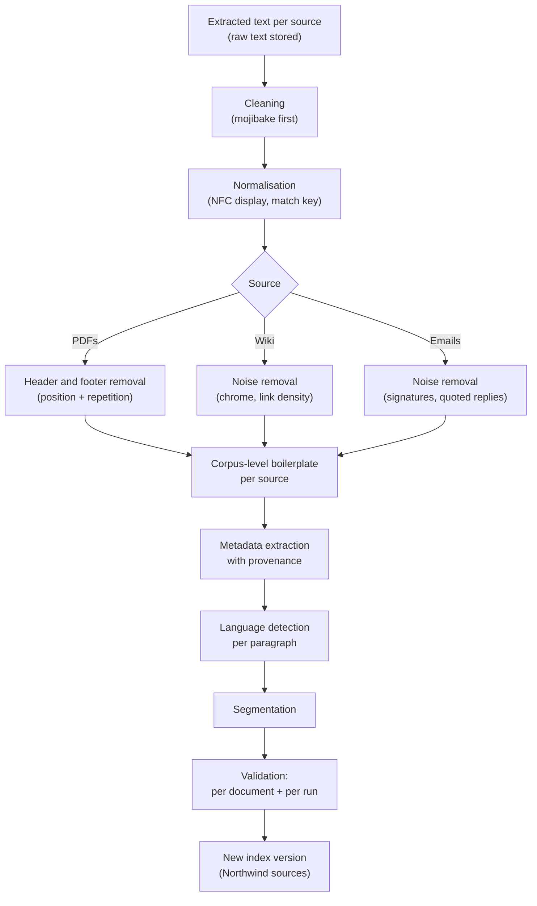

This assessment covers all eight lessons of **Document Preprocessing**: cleaning, normalisation, header and footer removal, noise removal, metadata extraction, language detection, document segmentation and data quality validation. Answer the 20 multiple-choice questions first; the pass mark is 70% (14 of 20). Then work through the conceptual questions, the coding exercises, the design challenge and the troubleshooting scenarios, writing your own answer to each before opening the model answer. The written parts are not scored, but they test whether you can apply the ideas to a pipeline you have not seen before.

```quiz
[
  {
    "q": "Which statement best describes the job of the cleaning stage?",
    "options": [
      "Removing every character outside ASCII so that all text is uniform",
      "Repairing text damaged during extraction, such as mojibake, line-break hyphenation and invisible characters, without changing what the author wrote",
      "Removing navigation menus and cookie banners",
      "Splitting documents into sections by heading"
    ],
    "answer": 1,
    "why": "Cleaning restores the author's text. Removing chrome is noise removal, segmenting is segmentation, and deleting non-ASCII characters is an edit that destroys information."
  },
  {
    "q": "What does this print?\n```python\nprint(repr(\"a   b\".replace(\"  \", \" \")))\n```",
    "options": [
      "'a b'",
      "'a   b'",
      "'a  b'",
      "'ab'"
    ],
    "answer": 2,
    "why": "replace works left to right without overlapping: the first two of the three spaces become one, and the third survives, leaving two spaces. That is why this rule is not idempotent."
  },
  {
    "q": "Why must mojibake repair run before other character-level cleaning steps?",
    "options": [
      "Because it is the cheapest step",
      "Because later filters can delete or change the characters that the repair needs to reverse the wrong decoding",
      "Because ftfy only accepts text with line breaks",
      "Because Unicode normalisation requires it"
    ],
    "answer": 1,
    "why": "Mojibake is repaired by re-encoding with the wrong codec and decoding correctly; removing any of the garbled characters first can make that impossible."
  },
  {
    "q": "What does this print?\n```python\nimport unicodedata\nprint(len(unicodedata.normalize(\"NFD\", \"\\u00e9\")), unicodedata.normalize(\"NFKC\", \"\\ufb01\") == \"fi\")\n```",
    "options": [
      "1 False",
      "2 False",
      "1 True",
      "2 True"
    ],
    "answer": 3,
    "why": "NFD decomposes the precomposed e-acute into e plus a combining accent (two code points), and NFKC turns the fi ligature into the two letters f and i."
  },
  {
    "q": "A team stores and displays text in its match-key form (NFKC, case-folded, punctuation folded). What is the main problem?",
    "options": [
      "Keyword search stops working",
      "Content hashes become unstable",
      "Users and the model see altered text: lost capitals, straightened quotes, and changed symbols such as x2 for a squared x",
      "Embedding becomes impossible"
    ],
    "answer": 2,
    "why": "The match key is for comparison only. Stored, embedded and quoted text should be the NFC display form so it says what the author wrote."
  },
  {
    "q": "Documents are indexed for keyword search under a match key that applies NFKC, but the query service only lower-cases queries. Which query is most likely to fail?",
    "options": [
      "a query typed with full-width letters, such as `ＳＳＯ`",
      "`sso`",
      "`SSO`",
      "`single sign-on`"
    ],
    "answer": 0,
    "why": "Lower-casing does not convert full-width letters to ASCII, so the query term does not match the folded index term. Normalisation must be applied identically on both sides."
  },
  {
    "q": "Which pair of signals does the recommended header and footer detector combine?",
    "options": [
      "Font colour and font family",
      "Position in the top or bottom margin band, and repetition of a digit-insensitive signature across pages",
      "A list of known footer phrases and page-number regular expressions",
      "Line length and punctuation"
    ],
    "answer": 1,
    "why": "Position alone would delete footnotes; repetition alone would delete repeated body text. Together they are reliable."
  },
  {
    "q": "What does this print?\n```python\nimport re\nsig = lambda s: re.sub(r\"\\d+\", \"#\", s.casefold()).strip()\nprint(sig(\"Page 12 of 40\") == sig(\"PAGE 3 OF 40 \"))\n```",
    "options": [
      "True",
      "False",
      "An error, because casefold does not exist",
      "None"
    ],
    "answer": 0,
    "why": "Both become 'page # of #' after case folding, digit replacement and stripping, so they match as the same footer."
  },
  {
    "q": "Text-only extraction yields header lines such as 'Meridian Handbook 2025 Expenses' and 'Meridian Handbook 2025 Remote work'. Why might whole-line frequency detection miss this header?",
    "options": [
      "Because it contains a year",
      "Because the extractor merged a constant title with a varying section name, so no full line repeats on enough pages",
      "Because headers are always in the last line of a page",
      "Because case folding changes the section names"
    ],
    "answer": 1,
    "why": "Merging makes each line variant appear on only a few pages; coordinates or repeated-prefix matching solve it."
  },
  {
    "q": "A noise filter is evaluated on 300 labelled blocks: 80 noise, 220 content. It removes 70 blocks, 60 of them noise. What is its content loss rate?",
    "options": [
      "60/80 = 0.75",
      "60/70, about 0.857",
      "20/80 = 0.25",
      "10/220, about 0.045"
    ],
    "answer": 3,
    "why": "False positives are 70 - 60 = 10 content blocks out of 220 content blocks: 10/220."
  },
  {
    "q": "Why are pretraining-corpus heuristics such as 'drop lines without terminal punctuation' risky in a RAG corpus?",
    "options": [
      "They are too slow",
      "They only work for English",
      "They remove headings, table rows and list items that users ask about, because they were designed where losing good text is nearly free",
      "They cannot run on HTML"
    ],
    "answer": 2,
    "why": "A RAG corpus contains documents people need; the cost of removing content is much higher than in web-scale pretraining."
  },
  {
    "q": "A safety warning appears in 25 of 300 runbooks. What is the best treatment?",
    "options": [
      "Remove it from all of them as boilerplate",
      "Keep at least one canonical copy so it stays retrievable, and avoid 25 identical chunks crowding results",
      "Leave all copies, since duplicates never matter",
      "Move it into every chunk's metadata"
    ],
    "answer": 1,
    "why": "Repeated content is not necessarily noise; one canonical copy keeps it answerable."
  },
  {
    "q": "A Word document's core properties give title 'Policy template' and a last-modified date of 2013; its first heading is 'Remote Work Policy' and its text says 'Effective from 1 April 2025'. Which metadata should the pipeline use?",
    "options": [
      "Title 'Policy template', date 2013",
      "Title 'Remote Work Policy', effective date 2025-04-01, with the file's modified date stored only as a labelled fallback",
      "Title from the file name, no date",
      "Title 'Remote Work Policy', effective date 2013"
    ],
    "answer": 1,
    "why": "Template-inherited properties are often stale; the author's heading and explicit effective date are better evidence."
  },
  {
    "q": "Where must permission metadata for chunks come from?",
    "options": [
      "A 'Confidential' marking extracted from the document header",
      "A language model's sensitivity classification",
      "The folder name",
      "The source system's access-control lists"
    ],
    "answer": 3,
    "why": "Content and inference can be wrong or manipulated; only the system that enforces access knows who may read a document."
  },
  {
    "q": "`langdetect` labels the string 'VPN required' as Catalan with probability above 0.9999. What is the best explanation and response?",
    "options": [
      "The detector is broken; replace it",
      "Naive Bayes over few, overlapping character n-grams is overconfident on short text; require a minimum number of letters and return 'und' below it",
      "The phrase is in fact Catalan",
      "The seed was not set; set it to 0"
    ],
    "answer": 1,
    "why": "Treating correlated n-grams as independent evidence pushes the posterior towards 1. Length thresholds matter more than probability thresholds on short text."
  },
  {
    "q": "An English-only embedding model scores a relevant French paragraph below an unrelated English sentence for an English query. What should the pipeline do?",
    "options": [
      "Nothing; cosine scores are not probabilities",
      "Strip accents from French text",
      "Detect language per chunk and either use a multilingual embedding model or route non-English text to suitable handling",
      "Increase top-k"
    ],
    "answer": 2,
    "why": "The model cannot align French with English. Detecting language makes the problem visible and drives model choice or routing."
  },
  {
    "q": "Given headings `h1 Handbook`, `h2 Leave`, `h3 Carry-over`, `h2 Expenses`, what is the heading path of Expenses?",
    "options": [
      "[Handbook, Leave, Carry-over, Expenses]",
      "[Handbook, Leave, Expenses]",
      "[Expenses]",
      "[Handbook, Expenses]"
    ],
    "answer": 3,
    "why": "A level-2 heading closes the open level-3 and level-2 sections, leaving the level-1 Handbook as its parent."
  },
  {
    "q": "In a PDF, body text is 11 point, headings are 18, 14 and 12 point, and a bold 11-point line reads 'Note: hotel networks block VPN ports.' How does a size-ranking segmenter treat the bold line?",
    "options": [
      "As body text, because its size equals the body size",
      "As a level-1 heading, because it is bold",
      "As a level-4 heading",
      "It removes the line as noise"
    ],
    "answer": 0,
    "why": "Heading candidates must be clearly larger than the body size; bold text at body size is a callout, not a heading."
  },
  {
    "q": "A parser upgrade causes most PDFs to lose every page after the first. Each document still has metadata and a few hundred characters of good text. Which check catches this?",
    "options": [
      "The empty-text check",
      "The exact-duplicate check",
      "A batch-level check comparing each source's mean document length with the previous run",
      "The language check"
    ],
    "answer": 2,
    "why": "Each document looks plausible on its own; only the run-level distribution reveals the collapse."
  },
  {
    "q": "Which severity fits a document whose noise filter removed 85% of its text?",
    "options": [
      "Reject: it is certainly broken",
      "Warn: index it and report",
      "Pass: noise removal is supposed to remove text",
      "Quarantine: hold it for review, because it may be a navigation-heavy page or a filter that destroyed content"
    ],
    "answer": 3,
    "why": "Quarantine is for probable problems where a false alarm would hide a real document; only review can tell which this is."
  }
]
```

## Conceptual questions

1. Explain the difference between *repairing* and *editing* text, and give two examples of each that a careless cleaning stage might do. Why does the distinction matter more for a RAG corpus than for a corpus used to pretrain a language model?

<details><summary>Show model answer</summary>

A repair restores what the author wrote after extraction damaged it: rejoining `un-\nused` into `unused`, reversing mojibake (`team’s` to `team’s`), converting a form feed to a newline, removing a soft hyphen inside a word. An edit changes what the author wrote: deleting non-ASCII characters (losing `£` and accented names), removing stop words (dropping "not" inverts a policy), lower-casing stored text (losing the difference between the product "Sync" and the verb), stripping all punctuation (destroying `E-4021` and `08:00`).

The distinction matters more for RAG because the corpus is small relative to its importance: each document is there because someone needs its specific facts, and the answers are often exactly the details an edit destroys (numbers, codes, names). A pretraining corpus has far more text than needed, so losing some is cheap, and aggressive normalisation can even help. In RAG, an edit can make a question permanently unanswerable, and the loss is silent.

</details>

2. Describe the "two views" design for normalisation. Which operations use each view, and what goes wrong if the query service and the ingestion pipeline normalise differently?

<details><summary>Show model answer</summary>

The **display form** is the text in NFC: canonically equivalent sequences merged, nothing a reader could notice changed. It is stored, shown to users, quoted by the model and embedded (optionally with NFKC applied to the embedding input when the corpus has many compatibility characters). The **match key** is an aggressively folded form: NFKC, case folding, typographic dashes and quotes mapped to ASCII, whitespace collapsed, perhaps a small spelling-variant table. It is used for content hashes, de-duplication and keyword index terms.

If the query side normalises differently from the index side, the two representations no longer meet. A full-width or ligature query term remains unfolded while the index holds the folded term, so keyword matching scores zero for exactly the characters normalisation was meant to handle. The same applies to embeddings if NFKC is applied to documents but not queries. The failure is silent and appears only for some users (for example, those using a particular input method). The remedy is one shared, versioned normalisation module used by both services, with its version recorded in index metadata.

</details>

3. Header and footer removal, noise removal and data quality validation all remove or hold back text. For each, state what kind of text it targets, the main signal it uses, and the main way it can go wrong.

<details><summary>Show model answer</summary>

- **Header and footer removal** targets page furniture: running headers, footers and page numbers repeated on every page. Its signals are repetition across a document's pages (with digit-insensitive signatures) and position in the margin bands. It goes wrong by removing repeated body text in the margin (a table header on every page), by missing furniture merged with varying text, and by misfiring on short documents.
- **Noise removal** targets intact but content-free text not tied to pages: navigation, cookie banners, related links, disclaimers repeated across documents, tables of contents. Its signals are markup structure, shallow block features (link density, patterns) and document frequency across a source. It goes wrong by removing real content (a "contact the finance team" line, a safety warning repeated across runbooks), which is why it is measured with content loss and its removals are logged.
- **Data quality validation** targets whole documents (and whole runs) that are unusable or suspicious: empty, garbled, truncated, over-filtered, duplicated, or with implausible metadata. Its signals are per-document checks and batch-level statistics compared with previous runs. It goes wrong by being too strict (rejecting real documents, flooding reviewers) or too loose (passing systematic failures), and by having no owner for its quarantine.

</details>

4. Why is "last modified" a poor proxy for "current policy", and what should a pipeline extract instead? How should it handle a document whose content gives no date at all?

<details><summary>Show model answer</summary>

"Last modified" records when a file was last touched: a migration, a re-save, a typo fix or a template change all update it without changing the policy's validity. Conversely, a policy can take effect long after its last edit. File-property dates are even less reliable, since they are often inherited from templates. A freshness ranker that uses them can prefer a superseded document that was re-saved recently.

The pipeline should extract the date the author states the content is valid from ("Effective from 1 April 2025"), plus any explicit supersession ("Superseded by the 2025 Employee Handbook"), and base freshness and exclusion on those. When the content gives no date, the field should be left empty, not filled with the modified date under the same name. A missing effective date for a source that requires one (such as HR policies) is a data-quality warning sent to the source owner, so the fix happens in the document. If some ordering signal is still needed, use the source system's modified time explicitly labelled as such, with lower weight.

</details>

5. What is the difference between document segmentation and chunking, and why does running segmentation first improve retrieval?

<details><summary>Show model answer</summary>

Segmentation recovers the structure the author created: sections with their heading hierarchy and typed elements (paragraphs, lists, tables, code). Chunking decides how to cut text into pieces of a retrievable size. Segmentation finds boundaries; chunking chooses cuts.

Running segmentation first improves retrieval in several ways. Chunks no longer straddle sections, so each embedding reflects one topic rather than an average of two. The heading path can be prepended to each chunk before embedding, so "Up to 5 unused days carry over" carries "Annual leave > Carry-over" and matches queries about holiday carry-over. Element types let tables keep their header rows and lists stay with their lead-in sentences. Citations can name the section. And hierarchical techniques such as parent-child retrieval have a parent to expand to.

</details>

## Coding exercises

### Exercise 1: de-duplication with and without normalisation

Write a function `dedupe(paragraphs, key)` that keeps the first occurrence of each paragraph, comparing SHA-256 digests of `key(paragraph)`. Apply it to the six paragraphs below, first comparing raw text and then comparing a match key (NFKC, case folding, dash and quote folding, whitespace collapsing). Report how many duplicates each approach removes.

<details><summary>Show solution</summary>

```python
import hashlib
import re
import unicodedata

DASHES = dict.fromkeys(map(ord, "\u2010\u2011\u2012\u2013\u2014\u2212"), "-")
QUOTES = {ord("\u2018"): "'", ord("\u2019"): "'", ord("\u201c"): '"', ord("\u201d"): '"'}


def match_key(text: str) -> str:
    text = unicodedata.normalize("NFKC", text).casefold()
    text = text.translate(DASHES).translate(QUOTES)
    return re.sub(r"\s+", " ", text).strip()


def digest(text: str) -> str:
    return hashlib.sha256(text.encode("utf-8")).hexdigest()


def dedupe(paragraphs: list[str], key=lambda s: s) -> tuple[list[str], int]:
    seen, kept = set(), []
    for p in paragraphs:
        h = digest(key(p))
        if h not in seen:
            seen.add(h)
            kept.append(p)
    return kept, len(paragraphs) - len(kept)


paragraphs = [
    "VPN is required on public Wi-Fi.",
    "VPN is required on public Wi\u2011Fi.",          # non-breaking hyphen
    "VPN  is required on public  Wi-Fi.",             # doubled spaces
    "\uff36\uff30\uff2e is required on public Wi-Fi.",  # full-width VPN
    "Laptops are refreshed every 3 years.",
    "Laptops are refreshed every 3 years.",
]
for label, key in [("raw bytes", lambda s: s), ("match key", match_key)]:
    kept, removed = dedupe(paragraphs, key)
    print(f"{label:<10} removed {removed}, kept {len(kept)}")
print(dedupe(paragraphs, match_key)[0])
```

```output
raw bytes  removed 1, kept 5
match key  removed 4, kept 2
['VPN is required on public Wi-Fi.', 'Laptops are refreshed every 3 years.']
```

Comparing raw bytes catches only the exact repeat of the laptop sentence. The match key also merges the three variants of the VPN sentence (non-breaking hyphen, doubled spaces, full-width letters), which look identical to a reader. The function keeps the first occurrence, so the kept text is the display form of the first copy, not the match key itself.

</details>

### Exercise 2: a miniature preprocessing pipeline

The three strings below are pages of a runbook as a text-only extractor produced them: each has a running header and a footer with a page number, there is a soft hyphen, a word hyphenated across a line, a sentence split across a page break, and numbered headings. Write `preprocess(pages)` that repairs the text, removes the furniture by frequency, rejoins the text across pages, segments it by numbered headings, and returns `(heading, text)` pairs with each section's lines unwrapped.

```python
PAGES = [
    "Meridian IT Runbooks\n1 Client errors\nError E-4021 means the VPN client is out of date. Update it from the\nIT por\u00adtal. If the error\nMeridian internal \u00b7 Page 1",
    "Meridian IT Runbooks\npersists, check the laptop clock.\n2 Public networks\nVPN is required on public Wi-Fi. Hotel net-\nworks often block VPN ports.\nMeridian internal \u00b7 Page 2",
    "Meridian IT Runbooks\n3 Lost laptops\nReport a lost laptop to the support desk at once. The\ndesk is open 08:00 to 18:00 UK time.\nMeridian internal \u00b7 Page 3",
]
```

<details><summary>Show solution</summary>

```python
import re
from collections import Counter

import ftfy

PAGES = [
    "Meridian IT Runbooks\n1 Client errors\nError E-4021 means the VPN client is out of date. Update it from the\nIT por\u00adtal. If the error\nMeridian internal \u00b7 Page 1",
    "Meridian IT Runbooks\npersists, check the laptop clock.\n2 Public networks\nVPN is required on public Wi-Fi. Hotel net-\nworks often block VPN ports.\nMeridian internal \u00b7 Page 2",
    "Meridian IT Runbooks\n3 Lost laptops\nReport a lost laptop to the support desk at once. The\ndesk is open 08:00 to 18:00 UK time.\nMeridian internal \u00b7 Page 3",
]
HEADING = re.compile(r"^(\d+(?:\.\d+)*)\s+([A-Z][^.]{0,60})$")


def signature(line: str) -> str:
    return re.sub(r"\d+", "#", line.casefold()).strip()


def preprocess(pages: list[str]) -> list[tuple[str, str]]:
    # 1. Repair: mojibake first, then soft hyphens.
    pages = [ftfy.fix_encoding(p).replace("\u00ad", "") for p in pages]
    lines = [p.splitlines() for p in pages]
    # 2. Furniture: first/last line signatures repeated on at least half of the pages.
    counts = Counter()
    for ls in lines:
        counts.update({signature(ls[0]), signature(ls[-1])})
    furniture = {s for s, n in counts.items() if n >= 0.5 * len(pages)}
    body = []
    for ls in lines:
        body.extend(l for i, l in enumerate(ls)
                    if not ((i == 0 or i == len(ls) - 1) and signature(l) in furniture))
    # 3. Segment by numbered headings; unwrap and de-hyphenate within each section.
    sections, title, buf = [], None, []
    for line in body + ["0 End"]:                     # sentinel heading flushes the last section
        m = HEADING.match(line.strip())
        if m:
            if title:
                text = re.sub(r"([a-z])-\n([a-z])", r"\1\2", "\n".join(buf))
                sections.append((title, " ".join(text.split())))
            title, buf = m.group(2), []
        else:
            buf.append(line)
    return sections


for title, text in preprocess(PAGES):
    print(f"[{title}] {text}")
```

```output
[Client errors] Error E-4021 means the VPN client is out of date. Update it from the IT portal. If the error persists, check the laptop clock.
[Public networks] VPN is required on public Wi-Fi. Hotel networks often block VPN ports.
[Lost laptops] Report a lost laptop to the support desk at once. The desk is open 08:00 to 18:00 UK time.
```

Points to check in your own solution. The order follows the module: repair before anything else, furniture removal before rejoining pages, segmentation before (and instead of) blind unwrapping. Because the furniture is removed while page boundaries are still known, the sentence "If the error persists, check the laptop clock" is rejoined across pages 1 and 2. De-hyphenation only joins lower-case letters on both sides, so `E-4021` and `Wi-Fi` survive while `net-\nworks` becomes `networks`. The sentinel heading `"0 End"` is a small trick to flush the last section; a production version would flush explicitly after the loop. With only three pages, the 0.5 threshold means a signature needs two pages, which is as low as frequency detection should go.

</details>

### Exercise 3: effective dates and supersession

Write `extract(text)` that returns `effective_date` (a `datetime.date`) from "Effective from <day> <Month> <year>" and `superseded_by` from "Superseded by ...", and `is_current(meta, today)` that returns `False` for superseded documents, `True` or `False` by effective date otherwise, and `None` when the document says nothing. Test on three Meridian documents including the superseded 2023 handbook.

<details><summary>Show solution</summary>

```python
import datetime as dt
import re

DATE = r"(\d{1,2} (?:January|February|March|April|May|June|July|August|September|October|November|December) \d{4})"
EFFECTIVE = re.compile(r"\bEffective from " + DATE)
SUPERSEDED = re.compile(r"\bSuperseded by (?:the )?(.+?)\.")

docs = {
    "handbook-2023": "Employee Handbook 2023. Effective from 1 January 2023. Superseded by the 2025 Employee Handbook. "
                     "The home-office equipment budget is £250.",
    "handbook-2025": "Employee Handbook 2025. Effective from 1 April 2025. The home-office equipment budget is £400.",
    "remote-note": "Remote work: up to 3 days a week.",
}


def extract(text: str) -> dict:
    meta = {}
    if m := EFFECTIVE.search(text):
        meta["effective_date"] = dt.datetime.strptime(m.group(1), "%d %B %Y").date()
    if m := SUPERSEDED.search(text):
        meta["superseded_by"] = m.group(1)
    return meta


def is_current(meta: dict, today: dt.date) -> bool | None:
    """True/False when we can tell; None when the document does not say."""
    if "superseded_by" in meta:
        return False
    if "effective_date" in meta:
        return meta["effective_date"] <= today
    return None


today = dt.date(2025, 6, 1)
for doc_id, text in docs.items():
    meta = extract(text)
    print(f"{doc_id:<14} current={is_current(meta, today)!s:<5} {meta}")
```

```output
handbook-2023  current=False {'effective_date': datetime.date(2023, 1, 1), 'superseded_by': '2025 Employee Handbook'}
handbook-2025  current=True  {'effective_date': datetime.date(2025, 4, 1)}
remote-note    current=None  {}
```

The three-valued result matters. `None` means "unknown", which retrieval should treat differently from `False`: an undated note should not be excluded as if it were superseded, but it is a candidate for a data-quality warning if its source requires dates. Supersession is checked first because a superseded document stays superseded whatever its effective date. Note that `today` is a parameter, which keeps the function deterministic and testable.

</details>

## Architecture design challenge

Meridian is acquiring a 120-person company, Northwind Analytics, whose knowledge lives in three places: about 6,000 PDFs exported from an old document-management system (some scanned, many with encoding problems), a Confluence-style wiki of about 4,000 HTML pages with heavy navigation chrome, and a shared mailbox of about 30,000 support emails in English and German. AskMeridian must index all of it within six weeks, alongside the existing Meridian sources, without degrading answers for current users.

Design the preprocessing stage for these sources: which steps run for each source and in what order, what metadata is extracted and from where, how languages are handled, what is validated and with what severity, and how the new sources are introduced without risking the live index. State the main trade-offs.

<details><summary>Show reference design</summary>

**Shared skeleton, per-source configuration.** All three sources go through the same ordered stages, each configured per source, with raw extracted text stored before any preprocessing so that rules can be changed and re-applied without re-extraction.



**Per source.**

- *PDFs*: mojibake repair is essential given the known encoding problems; check `ftfy.is_bad` rates on a sample first. Scanned PDFs need OCR (in the parsing stage); their furniture detection uses similarity rather than exact signatures. Header and footer removal uses coordinates, with running headers captured as section metadata. Segmentation by font size, cross-checked with numbering and PDF outlines.
- *Wiki*: structural removal of chrome, then link-density classification, then per-source document-frequency boilerplate detection (wiki templates repeat). Segmentation from HTML headings is reliable and cheap.
- *Emails*: strip quoted replies and signatures (keep the quoted text when the earlier message is not indexed), and treat each thread, not each message, as the document. Segment by message within the thread. Personal data is heavy here: run PII detection (see the access-control lessons) before indexing, and confirm with the acquiring business whether support emails should be indexed at all.

**Metadata.** Permissions from each source system only (document-management ACLs, wiki space permissions, mailbox access), mapped to Meridian's groups; documents whose permissions cannot be mapped are not indexed. Titles from headings or subjects; effective dates and versions by content patterns for policy-like PDFs; `source`, `company: northwind`, `language` per chunk, heading paths per chunk. Every field stores its provenance. Northwind policies that conflict with Meridian ones get a `company` field so retrieval can filter by the user's employer during the transition.

**Language.** Paragraph-level detection with a minimum letter count and `und` fallback. The German emails mean the English-only embedding model is inadequate; evaluate a multilingual model on a bilingual test set before indexing them, or index German emails separately until then. Keyword search uses a German analyser for German chunks.

**Validation.** Per document: empty (reject), exact duplicate (reject, but only within the same permission scope), replacement characters, low letter ratio, over-removal above a per-source threshold, implausible dates (quarantine), missing required metadata and unexpected language (warn). Per run and per source: document counts, length distribution, quarantine rate, language shares, compared with the previous accepted run. Quarantine owners: a named person from Northwind's former documentation team for each source, during the transition.

**Introduction without risk.** Build the Northwind sources into a separate index version (or separate collections), evaluate on a test set of Northwind questions plus the existing Meridian regression set, and only then include them in what users query, initially behind a filter or for Northwind staff only. Nothing touches the live Meridian index until the evaluation passes.

**Trade-offs.** Per-source configuration costs more engineering than one generic pipeline but avoids the most common failure (a rule tuned for one source damaging another). A multilingual embedding model may slightly change English results for existing users, which is why the regression set must run against it. Indexing emails adds valuable support knowledge but brings personal data and permission complexity; excluding them is a legitimate choice if the privacy review is not complete in six weeks. Strict validation will quarantine many scanned PDFs, which costs reviewer time but is far cheaper than indexing OCR garbage.

</details>

## Troubleshooting scenarios

### Scenario 1: the vanishing expense limit

After a release that updated the noise-removal rules, users report that AskMeridian answers "I don't know" to "do I need a receipt for a £60 taxi?". The expenses policy is in the index, and its title and metadata look correct. The ingestion run passed all validation.

<details><summary>Show diagnosis and fix</summary>

**Likely cause.** The new noise rules removed the paragraph that states the £75 receipt threshold, so the policy is indexed without its key fact. A plausible mechanism: the paragraph on the intranet page contains a link to the expense form, and a lowered link-density threshold, or a new pattern, classified it as navigation. The per-document checks passed because the document still had plenty of text and all its metadata; the batch checks passed because one shortened document does not move the source's averages much.

**How to confirm.** Compare the stored raw and preprocessed text for the expenses policy and look for the missing paragraph; check the noise-removal log for that document, which should record the rule that dropped each block; diff the new rules against the previous release.

**Fix.** Restore the paragraph by correcting the rule (for example, exempt blocks with link density below a stricter threshold or that contain numbers and currency), re-run preprocessing for the affected source, and republish. **Prevent recurrence**: evaluate every noise-rule change on a labelled sample and read its false positives; add a per-document check that warns when numbers present in the raw text disappear after preprocessing (most policy answers are numbers); and add "do I need a receipt for a £60 taxi?" to the retrieval regression set.

</details>

### Scenario 2: duplicates everywhere

The Platform team notices that many queries about VPN errors return three or four near-identical chunks in the top five. The runbooks were recently migrated from one wiki to another, and both exports were ingested during the migration window. The pipeline de-duplicates by SHA-256 of the cleaned text, and the duplicate check shows almost no hits.

<details><summary>Show diagnosis and fix</summary>

**Likely cause.** The two exports differ in representation, not content: one system wrote typographic punctuation (non-breaking hyphens, curly quotes) or decomposed accents, the other did not; or whitespace and line wrapping differ; or one export added a different footer or template text. The SHA-256 of the cleaned text is computed on the display form, so any byte difference makes the hashes differ, and the exact-duplicate check sees nothing.

**How to confirm.** Take two chunks that look identical and compare their code points (for example, print `[hex(ord(c)) for c in text if ord(c) > 127]` for each) and their whitespace.

**Fix.** Compute the de-duplication hash over the match key (NFKC, case folding, punctuation and whitespace folding) rather than the display form; add near-duplicate detection (MinHash) for documents that differ by template text; and resolve the migration properly: decide which system is authoritative, record a stable document identifier that survives the migration, and delete the old export's documents from the index. Re-run de-duplication across the source and republish. Add a batch check on document count per source, which would have flagged the near-doubling of runbooks when the second export arrived.

</details>

### Scenario 3: the French policy nobody finds

Paris staff complain that AskMeridian answers their French questions from UK policies, even though French versions of the Paris policies were added a month ago. The language-detection stage is running, and the documents carry `language: fr`.

<details><summary>Show diagnosis and fix</summary>

**Likely cause.** Detection is working, but nothing downstream uses its result. The index still uses the English-only embedding model, so French chunks and French queries embed poorly and retrieval is driven by shared numbers and names, which the UK documents contain in abundance. The keyword index uses an English analyser for all text, so French terms are stemmed incorrectly.

**How to confirm.** Embed a French query and compare cosine similarities against the French policy chunk and some unrelated English chunks; if the French chunk does not stand out, the model cannot handle French. Check which analyser the keyword index applies to French chunks.

**Fix.** Use the language label: evaluate and adopt a multilingual embedding model (testing English, French and cross-language question pairs, and the English regression set), or route French chunks and French queries to a French-capable index; configure a French analyser for keyword search on `language: fr` chunks; and consider a metadata boost or filter so that Paris staff see the Paris policy first when one exists. Add French questions with French answers to the regression set. The general lesson: a metadata field that no stage reads is not a fix.

</details>
