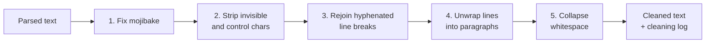

A parser hands you text, but not the text the author wrote. It hands you the author's words plus everything the file format, the extraction library and the document's journey through other systems did to them: words split across line breaks, sentences chopped into 70-character lines, characters decoded with the wrong codec, invisible characters that look like nothing but break every string comparison. **Cleaning** is the stage that repairs this damage. This lesson treats cleaning as engineering: a catalogue of the defects extraction produces, an ordered pipeline of small transformations that repair them, and the discipline (idempotence, logging, measurement) that keeps a cleaning stage from quietly destroying the content it was meant to protect.

This is the first lesson of the Document Preprocessing module, and it is deliberately narrow. Making equivalent text byte-for-byte identical is [Normalisation](/learn/document-preprocessing/normalisation). Removing repeated page furniture is [Header and footer removal](/learn/document-preprocessing/header-and-footer-removal). Removing content that is intact but worthless, such as navigation menus and cookie banners, is [Noise removal](/learn/document-preprocessing/noise-removal). Cleaning, as used here, means **repairing text that was damaged on the way out of its file**.

## Learning objectives

- Identify the common extraction defects (mojibake, line-break hyphenation, hard wrapping, invisible and control characters, broken whitespace) in a sample of extracted text.
- Build an ordered cleaning pipeline from small, single-purpose functions and justify the order of its steps.
- Verify that a cleaning function is idempotent and explain why idempotence matters for re-ingestion.
- Measure the effect of cleaning on lexical matching and on embedding similarity for a real query.
- Decide, for a proposed cleaning rule, whether it repairs damage or destroys information.

## Prerequisites

- [Indexing pipeline](/learn/rag-architecture-fundamentals/indexing-pipeline): where the clean stage sits between parse and chunk.
- [Data cleaning](/learn/data-processing/data-cleaning): general-purpose text tidying in Python.
- [Encoding and Unicode](/learn/data-processing/encoding-and-unicode): code points, UTF-8 and what happens when bytes are decoded with the wrong codec.
- [Regular expressions](/learn/data-processing/regular-expressions): the pattern syntax used throughout the code below.

## Why this matters

Every later stage of a RAG system trusts the text it receives. The chunker decides boundaries by looking for paragraph breaks and sentence ends. The lexical index splits text into terms and matches them literally. The embedding model turns each chunk into a vector. The language model quotes chunks back to the user as evidence. None of them can tell the difference between what the author wrote and what the extractor broke.

Consider what a single defect does as it flows downstream. A PDF of Meridian's employee handbook wraps the word "unused" across two lines, so the extractor emits `un-\nused`. The keyword index now contains the terms `un` and `used`, not `unused`, so a search for "unused leave days" misses the one paragraph that answers it. The chunker sees a newline and may choose it as a boundary, cutting the sentence in half. The embedding model sees a fragment rather than a word. And if the chunk is retrieved anyway, the model quotes "Up to 5 un- used days carry over" back to an employee, which looks careless even when the answer is right.

None of this raises an error. Dirty text indexes, embeds and retrieves without complaint; it just retrieves worse. The failures show up weeks later as "the assistant could not find the carry-over rule", and by then nobody connects the complaint to a hyphen. Cleaning is cheap insurance against an expensive, invisible class of retrieval failures.

There is a second reason. Everything you clean once, at indexing time, is clean for every query that ever touches it. A defect left in the index costs you on every retrieval forever, and the only fix is to clean and re-index. So it pays to get cleaning right before the corpus grows.

## The intuition

Imagine a library receives a box of photocopied pages from another branch. Before shelving them, a librarian goes through and fixes what the photocopier did: pages fed in crooked, a smudge across a word, a sheet where the toner ran out halfway. She does not rewrite the text, correct the author's grammar or remove chapters she finds dull. She restores what the original page said, as faithfully as she can, and nothing else.

That is the attitude of a good cleaning stage: **restore, do not edit**. A rule like "join `un-` and `used` back into `unused`" restores the original. A rule like "remove all numbers" edits it, and in a handbook where "25 days" and "£75" are the answers, it destroys exactly what users ask about.

A small worked example makes the defects concrete. Here is the expenses paragraph of the handbook as a PDF extractor might emit it, with the invisible characters made visible:

```text
Expenses<ZERO WIDTH SPACE>
Claims must be submitted within 30 days; anything over £75 needs a re<SOFT HYPHEN>ceipt.
The finance team’s self-service portal handles reimbursement.
```

Four separate things went wrong: an invisible character after the heading, `£` decoded as `£`, an invisible soft hyphen inside "receipt", and an apostrophe turned into three characters of mojibake. A human reading the rendered PDF sees none of them. A string comparison sees all of them: `"receipt" in text` is `False`.

## How it works

### Where the damage comes from

Extraction defects are not random. Each has a cause, and knowing the cause tells you what the repair should be.

| Defect | Example | Cause |
| --- | --- | --- |
| Mojibake | `team’s`, `£75` | UTF-8 bytes decoded as Windows-1252 or Latin-1 somewhere upstream |
| Line-break hyphenation | `un-\nused` | The typesetter hyphenated a word to fit the line; the PDF stores the two halves as separate text |
| Hard wrapping | one sentence over three lines | PDFs store positioned lines, not paragraphs; the extractor emits a newline per line |
| Soft hyphens | `re­ceipt` | An invisible "hyphenate here if needed" hint (U+00AD) from the authoring tool |
| Zero-width characters | `Expenses​` | Copy and paste from web pages, word processors and chat tools |
| Control characters | `\x0c` (form feed), `\x00` | Page breaks, binary debris, terminal escape codes in logs |
| Whitespace runs | `March.  Requests` | No-break spaces, tab-aligned columns, justified text |

**Mojibake** (Japanese for "character transformation") deserves a word of explanation, because it is the most common defect in corporate corpora and the most confusing. The curly apostrophe `’` is one code point, U+2019, which UTF-8 stores as three bytes: `E2 80 99`. If any system along the way reads those bytes as Windows-1252, where each byte is a whole character, it produces three characters: `â`, `€` and `™`. Write that string back out as UTF-8 and the damage is permanent in the file. The repair is to reverse the mistake: encode the text back to bytes with the wrong codec, then decode the bytes correctly. Doing this safely, only where the result is clearly better, is hard; the `ftfy` library ("fixes text for you") does it using a model of which character sequences are plausible mojibake, and it is the standard tool. The encoding background is in [Encoding and Unicode](/learn/data-processing/encoding-and-unicode).

**Line-break hyphenation** is subtler, because two different things look identical in extracted text. `un-\nused` is a word the typesetter split; the hyphen should vanish. `self-\nservice` is a hyphenated compound that happened to break at its own hyphen; the hyphen must stay. No character-level rule can tell them apart. A practical approach uses the document itself as a dictionary: if `self-service` appears with a hyphen elsewhere in the document, keep the hyphen; otherwise, join the halves. A larger dictionary (a word list for the language, or the vocabulary of the whole corpus) makes the decision more reliable.

**Hard wrapping** matters because newlines carry meaning downstream. Chunkers such as the [recursive character splitter](/learn/advanced-chunking-strategies/recursive-character-splitting) treat a double newline as a paragraph break and a single newline as the next-best place to cut. If every line of a PDF ends in a newline, the chunker sees hundreds of equally good cut points and splits mid-sentence. Unwrapping rebuilds paragraphs by joining lines that continue each other, while keeping lines that genuinely start something new: headings, list items, table rows.

### The pipeline: small steps in a fixed order

A cleaning stage should be a list of small functions, each repairing one kind of defect, applied in a fixed order. Small functions can be tested one at a time, switched off individually when one misbehaves on a new source, and logged separately so you can see which one changed what.



The order is not arbitrary. Each step relies on the steps before it:

1. **Fix mojibake first.** Every later step uses patterns over characters. A pattern that looks for letters will not recognise `’` as an apostrophe, and stripping "odd" characters before repairing mojibake can delete bytes that the repair needed, making the damage permanent.
2. **Strip invisible and control characters second.** A soft hyphen inside "re­ceipt" would stop the de-hyphenation pattern from seeing a word, and a form feed would confuse the unwrapping step's idea of where lines end. Convert form feeds (page breaks) to newlines rather than deleting them, so the page boundary still separates text.
3. **Rejoin hyphenated line breaks third**, while the newlines are still there. The pattern "letters, hyphen, newline, lower-case letters" is precise only because the newline is present; once lines have been joined, `un- used` looks like any other hyphen.
4. **Unwrap lines fourth**, now that broken words are whole again.
5. **Collapse whitespace last**, because every earlier step can leave behind doubled spaces and stray blank lines.

### Idempotence: clean twice, get the same text

A function $f$ is **idempotent** if applying it twice gives the same result as applying it once: $f(f(x)) = f(x)$. For a cleaning stage this is not a mathematical nicety; it is a production requirement, for three reasons.

- **Re-ingestion.** Documents are processed again whenever they change, the pipeline is upgraded or an index is rebuilt. Sometimes the input to the pipeline is text that an earlier version already cleaned (a cached extraction, a document that was exported from another RAG system). If cleaning is not idempotent, the text drifts a little further on every pass.
- **Change detection.** The [indexing pipeline](/learn/rag-architecture-fundamentals/indexing-pipeline) computes a content hash of the cleaned text to decide whether a document changed. A non-idempotent cleaner can make an unchanged document hash differently on the next run, which triggers needless re-embedding.
- **A test you can always run.** Idempotence is a property you can check on every document without knowing the right answer: clean it, clean the result, compare. Any difference points at a rule that is still finding things to change in its own output, which usually means the rule is wrong.

The classic idempotence bug is a rule that consumes its own output. "Replace two spaces with one" is not idempotent on three spaces (one pass leaves two); "replace any run of spaces with one" is.

### Restore, do not edit

The hardest judgement in cleaning is where to stop. Some rules that look like cleaning destroy information that users ask about:

- **Removing all punctuation or symbols** deletes `£75`, `E-4021`, `08:00` and `v2.3`.
- **Lower-casing everything** loses the difference between "Sync" the product and "sync" the verb, and between `SAML` and a typo. Lower-casing belongs, if anywhere, in the keys used for matching, not in the text you store and show; [Normalisation](/learn/document-preprocessing/normalisation) covers that split.
- **Removing stop words** ("the", "is", "not") is a technique from older search engines. Embedding models were trained on natural sentences and do worse on stop-word-stripped text, and dropping "not" can invert a policy.
- **Deleting non-ASCII characters** destroys names, currency symbols and every non-English document in the corpus.
- **Collapsing all newlines into spaces** throws away the paragraph structure that the chunker and [Document segmentation](/learn/document-preprocessing/document-segmentation) rely on.

A useful test for any proposed rule: *would the author agree that the output says what they wrote?* If yes, it is a repair. If the author would object, it is an edit, and it needs a much stronger justification than tidiness.

> [!KEY]
> Cleaning restores the text the author wrote. It never improves on it. Every rule should repair a specific, named defect with a known cause, and it should be safe to run twice.

### Keep a log

A cleaning stage that silently rewrites text is impossible to debug. At minimum, record for each document which steps changed it and by how much. Two numbers per step (characters before and after) are enough to notice a step that suddenly removes 40% of a document, which almost always means a rule has met a source it was not designed for. When something goes wrong in retrieval, the log tells you whether cleaning was involved without re-running anything. Store the raw extracted text as well, so that a cleaning bug can be fixed and the corpus re-cleaned without re-parsing every file.

## In code

The program below implements the five-step pipeline from the diagram on the damaged Meridian handbook excerpt, logs what each step did, prints the result and checks idempotence. It runs with no API key.

```bash
pip install ftfy
```

```python
import re
import unicodedata
from collections import Counter

import ftfy

RAW = (
    "Annual leave\n"
    "Every employee’s entitlement is 25 days a year. Up to 5 un-\n"
    "used days carry over and must be used by 31 March.  Requests\n"
    "go through the HR self-\n"
    "service portal.\x0c\n"
    "\n"
    "Expenses​\n"
    "Claims must be submitted within 30 days; anything over £75 needs a re­ceipt.\n"
    "The finance team’s self-service portal handles reimbursement.\n"
)

ZERO_WIDTH = {"​", "‌", "‍", "⁠", "", "­"}  # zero-width and soft hyphen


def fix_mojibake(text: str) -> str:
    """Undo UTF-8 text that was decoded with the wrong codec (e.g. '£' -> '£')."""
    return ftfy.fix_encoding(text)


def strip_invisible(text: str) -> str:
    """Drop zero-width characters, soft hyphens and control characters, keeping \\n and \\t."""
    out = []
    for ch in text:
        if ch in ZERO_WIDTH:
            continue
        if ch == "\x0c":                      # form feed = page break from the extractor
            out.append("\n")
            continue
        if unicodedata.category(ch) == "Cc" and ch not in "\n\t":
            continue
        out.append(ch)
    return "".join(out)


WORD = re.compile(r"[A-Za-z]+(?:-[A-Za-z]+)*")
HYPHEN_BREAK = re.compile(r"([A-Za-z]+)-\n([a-z]+)")


def dehyphenate(text: str) -> str:
    """Rejoin words split across lines, keeping the hyphen only for real compounds."""
    vocab = Counter(w.lower() for w in WORD.findall(text.replace("-\n", "")))

    def join(m: re.Match) -> str:
        left, right = m.group(1), m.group(2)
        hyphenated = f"{left}-{right}".lower()
        # The document itself is the dictionary: if the hyphenated form occurs
        # elsewhere and the closed form does not, the hyphen is real.
        if vocab[hyphenated] > 0:
            return f"{left}-{right}"
        return left + right

    return HYPHEN_BREAK.sub(join, text)


def unwrap_lines(text: str) -> str:
    """Join hard-wrapped lines into paragraphs; blank lines and short title lines stay breaks."""
    paragraphs = []
    for block in re.split(r"\n\s*\n", text):
        lines = [ln.strip() for ln in block.split("\n") if ln.strip()]
        merged: list[str] = []
        for ln in lines:
            starts_new = (
                not merged
                or len(merged[-1]) < 40 and not merged[-1].endswith((",", ";"))  # a short line is a title
                or re.match(r"^([-•*]|\d+[.)])\s", ln)                       # a list item
            )
            if starts_new:
                merged.append(ln)
            else:
                merged[-1] = merged[-1] + " " + ln
        paragraphs.append("\n".join(merged))
    return "\n\n".join(p for p in paragraphs if p)


def collapse_whitespace(text: str) -> str:
    text = re.sub(r"[ \t ]+", " ", text)          # runs of spaces, tabs, no-break spaces
    text = re.sub(r" *\n *", "\n", text)               # spaces around newlines
    text = re.sub(r"\n{3,}", "\n\n", text)             # at most one blank line
    return text.strip()


STEPS = [fix_mojibake, strip_invisible, dehyphenate, unwrap_lines, collapse_whitespace]


def clean(text: str, log: list | None = None) -> str:
    for step in STEPS:
        before = text
        text = step(text)
        if log is not None:
            log.append((step.__name__, len(before), len(text), before != text))
    return text


if __name__ == "__main__":
    log: list = []
    cleaned = clean(RAW, log)
    for name, n_before, n_after, changed in log:
        print(f"{name:<20} {n_before:>4} -> {n_after:>4} chars  changed={changed}")
    print()
    print(cleaned)
    print()
    print("idempotent:", clean(cleaned) == cleaned)
```

```output
fix_mojibake          328 ->  325 chars  changed=True
strip_invisible       325 ->  323 chars  changed=True
dehyphenate           323 ->  320 chars  changed=True
unwrap_lines          320 ->  318 chars  changed=True
collapse_whitespace   318 ->  317 chars  changed=True

Annual leave
Every employee’s entitlement is 25 days a year. Up to 5 unused days carry over and must be used by 31 March. Requests go through the HR self-service portal.

Expenses
Claims must be submitted within 30 days; anything over £75 needs a receipt. The finance team’s self-service portal handles reimbursement.

idempotent: True
```

The important lines:

- `ftfy.fix_encoding` is used rather than the broader `ftfy.fix_text`. `fix_text` also straightens curly quotes, replaces ligatures, converts full-width characters and applies Unicode normalisation by default. Those are normalisation decisions with trade-offs of their own, and keeping them out of the cleaning stage means each decision is made once, in one place. Notice that the cleaned text keeps the curly apostrophe in "employee’s": repairing mojibake restored the character the author typed.
- `unicodedata.category(ch) == "Cc"` selects the Unicode "control" category, which covers the C0 and C1 control characters such as `\x00` and `\x0c`. Zero-width spaces and soft hyphens are in a different category ("Cf", format characters), which is why they need the explicit `ZERO_WIDTH` set. Deleting the whole Cf category is tempting but wrong: it also contains characters that some scripts need, such as the zero-width joiner used in several Indic scripts and in emoji sequences. Remove specific characters you have a reason to remove.
- In `dehyphenate`, the vocabulary is built from the text with the line-break hyphens removed, so `self-service` in the last line is counted. When the pattern later meets `self-\nservice`, the hyphenated form is in the vocabulary and the hyphen is kept. `un-\nused` has no hyphenated twin, so it becomes `unused`.
- `unwrap_lines` treats a short line (under 40 characters, not ending in a comma or semicolon) as a title and starts a new line after it. This is a heuristic, and its threshold is a guess you should tune per source. It works on this excerpt because "Annual leave" and "Expenses" are short; it would wrongly merge a long heading into the paragraph below.
- The log stores the character counts before and after each step. Every step changed something here, by a few characters each, which is what a healthy run on a lightly damaged document looks like.

Now measure what the cleaning bought. The next program checks three words that an employee might search for, then embeds the raw and cleaned expenses sections with the local MiniLM model and compares each to a query.

```bash
pip install sentence-transformers
```

```python
from sentence_transformers import SentenceTransformer

from clean import RAW, clean   # the program above, saved as clean.py

cleaned = clean(RAW)
for word in ["receipt", "unused", "team’s"]:
    print(f"{word!r:<10} found in raw: {word in RAW!s:<5}  found in cleaned: {word in cleaned}")

model = SentenceTransformer("sentence-transformers/all-MiniLM-L6-v2")
dirty_section = RAW.split("\n\n")[1]        # the expenses section as extracted
clean_section = cleaned.split("\n\n")[1]    # the same section after cleaning
query = "Do I need a receipt for an expense over £75?"
q, d, c = model.encode([query, dirty_section, clean_section], normalize_embeddings=True)
print(f"\ncosine(query, raw section):     {q @ d:.3f}")
print(f"cosine(query, cleaned section): {q @ c:.3f}")
```

```output
'receipt'  found in raw: False  found in cleaned: True
'unused'   found in raw: False  found in cleaned: True
'team’s'   found in raw: False  found in cleaned: True

cosine(query, raw section):     0.547
cosine(query, cleaned section): 0.619
```

What the output means. All three words are invisible to exact matching in the raw text, so a keyword index would never match them; after cleaning they match. The embedding comparison is subtler. MiniLM's tokeniser already discards some invisible characters on its own, so the soft hyphen in "receipt" does little harm to the vector, but the mojibake does: `£75` reaches the model as extra junk tokens. The cleaned section scores about 0.07 higher against the query. On its own that number means little (cosine scores are not probabilities, as [Query-document matching](/learn/rag-architecture-fundamentals/query-document-matching) explained), but in a corpus where the right chunk competes with dozens of near-misses, a consistent gain of that size can decide whether it reaches the top five.

Errors people commonly hit:

- **`ftfy` appears to do nothing.** It only changes text it is confident is mojibake. If the damage happened twice (UTF-8 decoded as Windows-1252, re-encoded, decoded wrongly again), `fix_encoding` usually still repairs it, but heavily damaged or truncated sequences may be left alone. Check the input with `ftfy.fix_and_explain(text)`, which returns the repaired text and the steps it applied.
- **The de-hyphenation pattern eats real hyphens at line ends**, such as a line ending in "COVID-" followed by "19". The pattern requires lower-case letters after the newline, which protects digits and capitals, but no rule is perfect; log every join if your documents are full of compound terms.
- **Unwrapping merges table rows into one line.** Tables need their own handling before generic cleaning; see [Tables and structured content](/learn/advanced-document-parsing/tables-and-structured-content).

How to extend it: add a step that records the offset mapping between raw and cleaned text if you need to highlight citations in the original PDF; replace the document-level vocabulary in `dehyphenate` with a corpus-wide one built in a first pass; and make the step list configurable per source, because a scanned PDF, a web page and an exported Confluence space damage text in different ways.

## A real-world example

The Platform team at Meridian rebuilt AskMeridian's ingestion for the IT runbooks, which are stored as PDFs exported from a documentation tool. Within a week the support desk reported that the assistant "could not find" the VPN troubleshooting runbook for error E-4021, even though the runbook was in the index.

An engineer pulled the indexed chunks for that runbook and searched them for `E-4021`. There were no hits. The extracted text contained `E-\n4021` in two places, where the code had fallen at a line end, and the pipeline's de-hyphenation step, written for English prose, had happily joined it into `E4021`. A third occurrence, mid-line, was intact, but it sat in a chunk about a different error. The keyword half of their hybrid search matched nothing for the code, and the embedding half, which has never been good at exact identifiers, ranked a chunk about E-4012 higher.

The team made three changes. They narrowed the de-hyphenation pattern to require lower-case letters on both sides, so identifiers with digits and capitals are never joined. They added an idempotence check and a "per-step change ratio" alert to the ingestion job, so a step that changes more than a few per cent of a document gets flagged for review. And they wrote a small regression test from real damaged runbook text: a dozen lines with known defects and the exact expected output, run in CI on every change to the cleaning code. The lesson they wrote up for the rest of the team was short: a cleaning rule is a guess about what the damage looks like, and every guess needs a test made from real damaged text.

## Common mistakes

- **Using one aggressive "clean everything" function from a blog post.** Rules such as stripping punctuation or non-ASCII characters delete prices, codes and non-English text, and the loss is invisible until users ask about exactly those things.
- **Repairing mojibake after other steps.** Character filters run first can delete the bytes the repair needed, turning a reversible defect into permanent corruption.
- **Deleting form feeds instead of converting them.** The last word of one page and the first word of the next are glued together ("portal.Expenses"), creating terms that match nothing.
- **Removing every Unicode format character.** This breaks scripts and emoji sequences that rely on joiners; remove the specific characters you have a reason to remove.
- **Writing cleaning rules that are not idempotent.** Re-ingested documents drift, content hashes change without the document changing, and the pipeline re-embeds unchanged content.
- **Overwriting the raw extracted text.** When a cleaning bug is found, the only way back is to re-parse every source file, which may be slow, costly or impossible if the source has since changed.
- **Never measuring.** A rule that "obviously" helps can hurt a particular source; without before-and-after checks on real queries you will not know.

## Best practices

- Keep cleaning as a list of small, named, single-purpose functions applied in a deliberate order, with mojibake repair first and whitespace collapse last.
- Store the raw extracted text alongside the cleaned text so the corpus can be re-cleaned without re-parsing.
- Assert idempotence (`clean(clean(x)) == clean(x)`) in tests and, cheaply, on a sample of documents in production.
- Log per-step change sizes for each document and alert when a step removes an unusual fraction of a document.
- Build regression tests from real damaged text taken from each source, with the exact expected output.
- Configure cleaning per source type; a scanned PDF, a web page and an exported wiki need different rules.
- Check every proposed rule against "would the author agree this says what they wrote?"

## Performance considerations

Cleaning is cheap compared with the stages around it, but corpora are large, so it is worth reasoning about.

Every step in the pipeline is a linear pass over the text, so cleaning cost grows in proportion to corpus size. Pure-Python character loops like `strip_invisible` run at very roughly a few million to tens of millions of characters per second on a single core; compiled regular expressions are usually faster. Take a corpus of 50,000 documents averaging 20,000 characters, one billion characters in total. At an assumed 10 million characters per second per step, five steps take about 500 seconds on one core, under ten minutes, and the work is trivially parallel across documents. Compare that with embedding the same corpus: a billion characters is roughly 250 million tokens (assuming about four characters per token for English), which takes far longer on local hardware and costs real money through a hosted API. Cleaning will rarely be your bottleneck.

Two things can make it one. First, `ftfy` does more work than a simple regex, because it evaluates candidate repairs; run it only on text that `ftfy.is_bad(text)` flags, or on documents from sources known to have encoding trouble, if profiling shows it matters. Second, a badly written regular expression can backtrack catastrophically on long lines without newlines, taking seconds or minutes on one document. Prefer simple, anchored patterns, and set a per-document time limit in the ingestion worker so one pathological file cannot stall a batch.

Memory is rarely an issue: cleaning works one document at a time. Storing both raw and cleaned text roughly doubles text storage, which is small next to the vectors (a 384-dimensional float32 vector is 1,536 bytes, about the size of a 1,500-character chunk of text).

## Security considerations

Documents in a RAG corpus are untrusted input, even internal ones, and cleaning is the first stage that looks at them character by character.

- **Invisible characters can hide instructions.** Zero-width characters and the Unicode "tag" characters (U+E0000 to U+E007F) render as nothing in most interfaces but are still text to a language model. Text hidden this way can carry an [indirect prompt injection](/learn/rag-security-fundamentals/indirect-prompt-injection) that a human reviewer never sees. Removing such characters at cleaning time closes one route, but it is not a complete defence.
- **Bidirectional control characters** (such as U+202E, right-to-left override) can make text display in a different order from how it is stored, so what a reviewer reads is not what the model reads. This class of attack on source code was described by Boucher and Anderson as "Trojan Source". Unless your corpus needs right-to-left scripts, flag documents that contain these characters for review rather than silently stripping them, because their presence is itself a signal.
- **Pathological input can exhaust resources.** A file containing a single multi-megabyte line, or text crafted to trigger regex backtracking, can stall a worker. Enforce size and time limits per document.
- Cleaning does not remove personal data. That is a separate, deliberate step; see [PII detection](/learn/access-control-and-privacy/pii-detection).

## Summary

- Cleaning repairs text damaged during extraction: mojibake, line-break hyphenation, hard wrapping, invisible and control characters, and broken whitespace. Each defect has a known cause and a matching repair.
- Dirty text fails silently: exact matching misses terms, chunkers cut in the wrong places and embeddings shift, with no error to warn you.
- Build cleaning as small single-purpose steps in a fixed order: mojibake first (other steps destroy what it needs), whitespace last.
- Cleaning must be idempotent and logged, and the raw extracted text must be kept, so that re-ingestion is stable and bugs are fixable.
- Restore, do not edit: a rule that removes information the author wrote is not cleaning, however tidy the output looks.

## Exercises

1. Classify each of these proposed rules as a *repair* or an *edit*, and give a one-line reason: (a) replace `—` with `—`; (b) delete every character outside ASCII; (c) convert `\x0c` to a newline; (d) remove the word "not" as a stop word; (e) join `pay-\nment` into `payment`.

<details><summary>Show solution</summary>

(a) Repair: `—` is the mojibake of an em dash, so restoring `—` gives back what the author typed. (b) Edit: it deletes `£`, `’`, accented names and all non-Latin text, all of which the author wrote. (c) Repair: a form feed is the extractor's page-break marker, and a newline keeps the page boundary without the control character. (d) Edit, and a dangerous one: "Contractors are not eligible for the equipment budget" becomes a statement that they are. (e) Repair: the hyphen was inserted by the typesetter to fit the line; the author wrote "payment".

</details>

2. The rule `text.replace("  ", " ")` is meant to collapse runs of spaces. Show an input on which it is not idempotent, and write an idempotent replacement.

<details><summary>Show solution</summary>

Three spaces: `"a   b"` becomes `"a  b"` after one pass (the first two spaces are replaced and the third survives) and `"a b"` after a second, so `f(f(x)) != f(x)`. An idempotent version replaces every run at once:

```python
import re

def collapse_spaces(text: str) -> str:
    return re.sub(r" {2,}", " ", text)

s = "a   b    c"
print(collapse_spaces(s), collapse_spaces(collapse_spaces(s)) == collapse_spaces(s))
```

```output
a b c True
```

</details>

3. Extend the pipeline with a step `rejoin_page_breaks` that runs after `strip_invisible` and handles a sentence split across a page break: when a line ends without terminal punctuation (`.`, `?`, `!`, `:`) and is followed by one or more blank lines and then a line starting with a lower-case letter, join them with a single space. Test it on `"must be used\n\nby 31 March."` and on `"Expenses\n\nClaims must be submitted"`, and explain why the second must not be joined.

<details><summary>Show solution</summary>

```python
import re

PAGE_SPLIT = re.compile(r"([^\s.?!:])\n\s*\n([a-z])")

def rejoin_page_breaks(text: str) -> str:
    return PAGE_SPLIT.sub(r"\1 \2", text)

print(repr(rejoin_page_breaks("must be used\n\nby 31 March.")))
print(repr(rejoin_page_breaks("Expenses\n\nClaims must be submitted")))
```

```output
'must be used by 31 March.'
'Expenses\n\nClaims must be submitted'
```

The second input is a heading followed by a paragraph. The next line starts with a capital letter, so the pattern does not match, and the paragraph break survives. The rule relies on a convention of English prose (a sentence continuing after a break starts lower-case); a continuation that starts with a proper noun ("by Meridian HR") would not be rejoined, which is the safer failure. The step must run before `unwrap_lines`, which treats the blank line as a paragraph boundary.

</details>

4. Design question. Meridian is adding 30,000 PDFs from an acquired company whose files passed through an old document-management system with known encoding problems. You have one day before ingestion starts. Describe how you would decide which cleaning steps to enable for this source and how you would know whether they help.

<details><summary>Show solution</summary>

A good plan is driven by measurement on a sample, not by intuition:

1. **Sample and inspect.** Extract a random sample of a few hundred documents. Compute simple defect indicators per document: share of text `ftfy.is_bad` flags, count of `-\n` patterns, mean line length (short lines suggest hard wrapping), counts of control and zero-width characters. This shows which defects are actually present and how common they are.
2. **Enable steps that match observed defects.** If mojibake is common, mojibake repair is essential, and it must run first. Leave out rules for defects you did not see.
3. **Build a small labelled set.** Take 20 to 30 real damaged passages and write the expected cleaned output by hand. Run them as regression tests.
4. **Measure retrieval, not just text.** Write 30 to 50 realistic questions whose answers are in the sample, index the sample with and without cleaning, and compare whether the right document appears in the top results (the [Recall@K](/learn/retrieval-fundamentals/recall-k) idea).
5. **Guard the run.** Turn on per-step change logging and an idempotence check, keep the raw text, and quarantine documents where cleaning changed an unusually large fraction of the text for manual review.

The trade-off to name: every extra rule adds a risk of damaging documents it was not designed for, so the default is to enable the fewest rules that fix the defects you measured.

</details>

## Check your understanding

```quiz
[
  {"q": "Why should mojibake repair run before other cleaning steps?", "options": ["Later character-level steps can delete or alter the bytes that the repair needs, making the damage permanent", "It is the slowest step, so it should run while the text is shortest", "Unicode normalisation must always be the first operation on text", "ftfy refuses to process text that contains newlines"], "answer": 0, "why": "Mojibake is repaired by reversing a wrong decoding. If a filter removes or changes characters first, the original byte sequence can no longer be reconstructed."},
  {"q": "A cleaning function f satisfies f(f(x)) == f(x) for every document x. What practical benefit does this give?", "options": ["It guarantees the cleaned text is grammatically correct", "It makes the function run in constant time", "Re-processing already-cleaned text does not change it, so content hashes stay stable across re-ingestion", "It removes the need to keep the raw extracted text"], "answer": 2, "why": "Idempotence means a second pass is a no-op, so documents do not drift and unchanged documents keep the same content hash."},
  {"q": "The extracted text contains `self-\\nservice` and, elsewhere in the same document, `self-service`. What should a de-hyphenation step produce for the first occurrence?", "options": ["`selfservice`, because line-end hyphens are always typesetting artefacts", "`self service`, because hyphens should become spaces", "`self-\\nservice` unchanged, because hyphens must never be touched", "`self-service`, because the hyphenated form exists in the document"], "answer": 3, "why": "The hyphenated compound appears elsewhere, which is evidence that the hyphen is part of the word rather than inserted by the typesetter."},
  {"q": "Which proposed cleaning rule is an edit rather than a repair?", "options": ["Converting a form feed character to a newline", "Removing all characters outside the ASCII range", "Removing soft hyphens (U+00AD) inside words", "Joining `un-\\nused` into `unused`"], "answer": 1, "why": "Removing non-ASCII characters deletes things the author wrote, such as currency symbols, accented names and non-English text. The others restore the author's text."},
  {"q": "Why is it risky to delete every character in Unicode's format (Cf) category?", "options": ["The category includes the newline character", "Python cannot identify Cf characters reliably", "The category also contains characters some scripts and emoji sequences need, such as the zero-width joiner", "Deleting them changes the length of the text, which breaks embeddings"], "answer": 2, "why": "Cf mixes harmless-to-remove characters such as soft hyphens with joiners that change how some scripts render. Remove specific characters you have a reason to remove."}
]
```

## Further reading

- [ftfy documentation](https://ftfy.readthedocs.io/): how the library detects and reverses mojibake, and the options of `fix_text` and `fix_encoding`.
- [Python `unicodedata` module](https://docs.python.org/3/library/unicodedata.html): character categories and names, useful for writing and debugging character filters.
- [The Unicode Standard, Chapter 23: Special Areas and Format Characters](https://www.unicode.org/versions/latest/): the authoritative description of soft hyphens, zero-width characters and other format characters.
- Nicholas Boucher and Ross Anderson (2021), *Trojan Source: Invisible Vulnerabilities*: how bidirectional control characters make stored and displayed text differ.
