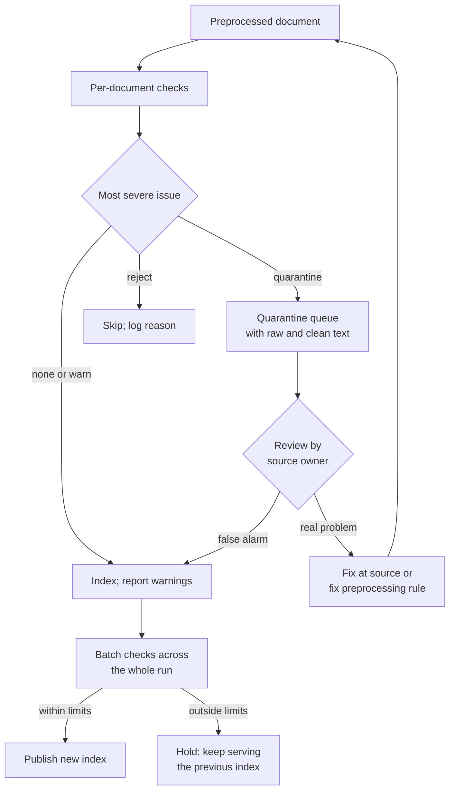

The preprocessing stages in this module each make a document better, and each can fail. A parser upgrade truncates every PDF after its first page. A noise filter meets a new template and removes the policy text along with the sidebar. A scanned form produces OCR soup. A source system starts exporting empty files. None of these raise an exception; each produces text that flows on through chunking and embedding and into the index, where it sits until a user notices that answers have got worse. **Data quality validation** is the gate at the end of preprocessing that checks documents, and whole ingestion runs, against explicit expectations, and stops bad data before it reaches the index.

This lesson covers what to check (per-document content, metadata, duplicates and the effect of preprocessing itself), how to act on failures with graded severities and a quarantine instead of a simple pass or fail, and how batch-level checks catch the failures that no single document reveals. Validating the *shape* of records with schemas is introduced in [Data validation](/learn/document-engineering/data-validation); this lesson is about validating the *quality of the text and metadata* that preprocessing produced.

## Learning objectives

- Design per-document quality checks for emptiness, length, character composition, encoding damage, language, required metadata, plausibility and duplication.
- Assign each check a severity (reject, quarantine, warn) and justify the choice by the cost of a false alarm versus a missed problem.
- Implement a validator that produces a per-document decision and a report.
- Compute batch-level metrics between ingestion runs and use them as a circuit breaker that stops a bad index from being published.
- Explain how a quarantine and a review loop turn validation failures into fixes at the source.

## Prerequisites

- [Cleaning](/learn/document-preprocessing/cleaning), [Noise removal](/learn/document-preprocessing/noise-removal), [Metadata extraction](/learn/document-preprocessing/metadata-extraction) and [Language detection](/learn/document-preprocessing/language-detection): the stages whose output is validated here.
- [Data validation](/learn/document-engineering/data-validation): schema validation with Pydantic.
- [Duplicate detection](/learn/data-processing/duplicate-detection): exact and near-duplicate detection.

## Why this matters

Ingestion pipelines fail quietly because every stage accepts whatever the previous stage produced. An empty string chunks into zero chunks, which is not an error. OCR garbage embeds into a perfectly valid 384-dimensional vector. A document whose policy text was removed by a misfiring noise filter still has a title, a source and an embedding. The retriever retrieves from what is there. So quality problems show up only downstream, as worse answers, long after the run that caused them, and usually reported by a user who does not know (and should not need to know) which stage failed.

Three properties make a validation gate worth building:

- **It is cheap compared with what it protects.** Checking a document costs microseconds to milliseconds. Re-embedding a corpus after discovering that a bad run polluted it costs hours and money, and the bad answers in between cost trust.
- **It makes failures specific.** "Retrieval got worse" is hard to debug. "142 documents from the IT runbook source lost more than 60% of their text in preprocessing today" points straight at a cause.
- **It enables safe automation.** Ingestion that runs every hour without a human watching is only safe if something will stop it publishing a broken index. Validation is that something.

## The intuition

Think of the quality checks at the end of a factory production line. Each item passes a few quick inspections: is it the right weight, the right size, is the label on? A clearly broken item is binned. A doubtful one goes to a side table where a person looks at it. One with a cosmetic flaw goes out with a note. And, separately, someone watches the totals: if this hour's batch is suddenly 60% lighter on average than last hour's, the line stops, even if each item individually passed, because something upstream has changed.

Data quality validation has the same three parts: **per-item checks**, **graded actions** (bin, set aside, note) and **batch monitoring** that can stop the line.

## How it works

### Per-document checks

Each check is a small function that looks at one document and returns zero or more issues. Useful checks fall into five groups.

**Content presence and size.**

- *Empty*: no text after preprocessing. Usually a parse failure, a scanned document with no OCR, or an over-eager filter.
- *Too short*: fewer than some minimum number of characters for this source. A policy document of 19 characters is not a policy.
- *Too long*: an implausibly large document may be a concatenation error or a data dump that will flood the index.

**Character composition.** These catch garbage that slipped through cleaning.

- *Letter ratio*: the share of characters that are letters. Prose is typically well over half letters; OCR debris, tables of numbers and binary junk are not. The threshold depends on the source (a runbook full of commands has more symbols than a policy).
- *Replacement characters*: U+FFFD, "�", is what decoders insert for bytes they could not decode. Its presence means information was lost, and cleaning cannot recover it.
- *Mojibake markers*: sequences like `’` that [Cleaning](/learn/document-preprocessing/cleaning) should have repaired. `ftfy.is_bad` flags text that still looks like mojibake.

**Preprocessing effect.** Compare the text before and after preprocessing.

- *Over-removal*: if furniture and noise removal deleted more than, say, 60% of a document's text, something probably went wrong, as a 5,200-character policy that ends up as "Expenses: see form." illustrates below. This check is the main defence against the "noise filter ate the content" failure from [Noise removal](/learn/document-preprocessing/noise-removal).

**Metadata.**

- *Required fields*: per source, which fields must exist (for HR policies, an effective date and an owner).
- *Plausibility*: an effective date more than a year in the future, a version of `0`, an owner not in the list of known teams.
- *Expected language*: a source that should be English producing another language suggests garbage or a mislabelled source, as [Language detection](/learn/document-preprocessing/language-detection) showed.

**Duplication.**

- *Exact duplicates*: the content hash (over the normalised text, as in [Normalisation](/learn/document-preprocessing/normalisation)) matches a document already seen.
- *Near duplicates*: above a similarity threshold with an existing document (MinHash, as covered in [Duplicate detection](/learn/data-processing/duplicate-detection)). Near duplicates are often legitimate (two versions of a policy), so they usually warn rather than reject.

### Severity: reject, quarantine, warn

A pass or fail decision is too blunt. Each check gets a **severity** that says what happens when it fires:

| Severity | Action | Use when | Example |
| --- | --- | --- | --- |
| Reject | Never index; record the reason | The document is certainly unusable, and a false alarm costs little | Empty text; exact duplicate of a document already indexed |
| Quarantine | Hold out of the index; queue for review | The document is probably broken, but a false alarm would hide a real document | Over-removal; low letter ratio; implausible dates; replacement characters |
| Warn | Index normally; report | The document is usable, but something should be fixed at the source | Missing optional metadata; unexpected language in a mixed source |

The choice is a judgement about two costs: indexing a bad document (bad answers, wasted context) versus withholding a good one (a question becomes unanswerable). Reject only when the first cost is high *and* false alarms are nearly impossible. Use quarantine when you are unsure; that is what it is for. A document's decision is the most severe of its issues.

### The quarantine and the review loop

Quarantine is not a bin. It is a queue with an owner, and it only works if items leave it.

1. Quarantined documents are stored with their issues, the raw extracted text and the preprocessed text, so a reviewer can see what went wrong without re-running anything.
2. Each source has an owner (the HR team for the handbook, the Platform team for runbooks) who is told when items arrive.
3. A reviewer either **releases** the document (a false alarm: index it, and consider loosening the check for this source), or **fixes the cause**: corrects the source file, repairs a preprocessing rule, or tells the source owner.
4. Fixes at the source are the goal. A missing effective date should be added to the policy document, not patched in the pipeline.



### Batch-level checks: the circuit breaker

Some failures are invisible document by document. If a parser upgrade starts dropping every page after the first, each document still has plenty of text, a good letter ratio and its metadata. What has changed is the *distribution*: the mean document length has collapsed. Batch-level checks compare each ingestion run's summary statistics with the previous run's:

- number of documents per source;
- mean and median document length per source;
- number of chunks;
- share of documents rejected, quarantined or warned;
- language distribution;
- share of documents with each required metadata field.

If any metric moves beyond its tolerance, the run is **held**: the new index is not published, the previous one keeps serving, and someone is alerted. This only works if the pipeline builds a new index version rather than modifying the live one in place, which is the practice described in [Index versioning](/learn/ci-cd-and-mlops/index-versioning) and [Blue-green deployments](/learn/ci-cd-and-mlops/blue-green-deployments). Validation decides; versioning makes "keep serving the old one" possible.

Tolerances need care. Too tight and every normal change (a new batch of documents, a deleted folder) stops publication, and people learn to ignore or override the alerts. Too loose and real failures pass. Start loose, look at how much each metric varies over a few weeks of normal runs, then tighten.

### Validation also needs testing

A check that never fires might mean the data is clean, or that the check is broken. Two practices keep validation honest. First, keep a small set of **known-bad documents** (an empty file, an OCR-garbage scan, a mojibake-ridden export, a duplicate) and assert in tests that each is caught with the expected severity. Second, track how often each check fires per source over time; a check whose rate suddenly drops to zero deserves as much attention as one whose rate spikes.

Libraries such as Great Expectations and pandera provide frameworks for declaring expectations about tabular data, and can hold the batch-level statistics described here. The per-document text checks are simple enough that plain Python, as below, is often clearer.

## The mathematics

Batch checks rest on one small formula: the **relative change** of a metric between runs,

$$
\Delta = \frac{x_{\text{now}} - x_{\text{prev}}}{x_{\text{prev}}}
$$

where $x_{\text{prev}}$ is the metric's value in the previous accepted run and $x_{\text{now}}$ its value in the current run. A run fails the check if $|\Delta| > \delta$, where $\delta$ is the tolerance for that metric.

Relative change rather than absolute change, because sources differ in scale: a drop of 300 documents is a catastrophe for a source of 400 and noise for one of 400,000.

**Worked example.** The handbook-and-runbooks source had 412 documents with a mean length of 5,830 characters in yesterday's run. Today it has 409 documents with a mean length of 2,140 characters. The tolerances are 10% for document count and 25% for mean length.

- Document count: $\Delta = (409 - 412)/412 = -3/412 \approx -0.007$, a 0.7% fall. Within 10%: pass.
- Mean length: $\Delta = (2140 - 5830)/5830 = -3690/5830 \approx -0.633$, a 63.3% fall. Far beyond 25%: fail.

Nearly every document is still present and each one individually looks fine, yet the average document has lost almost two-thirds of its text. That pattern (count stable, length collapsed) points at a parser or preprocessing change, not at the source. The same computation in Python, with a quarantine-rate ceiling added:

```python
previous = {"documents": 412, "mean_chars": 5830, "quarantine_rate": 0.012}
current = {"documents": 409, "mean_chars": 2140, "quarantine_rate": 0.015}

# Maximum allowed relative change per metric, and absolute ceilings.
MAX_CHANGE = {"documents": 0.10, "mean_chars": 0.25}
MAX_QUARANTINE_RATE = 0.05

failures = []
for metric, limit in MAX_CHANGE.items():
    change = (current[metric] - previous[metric]) / previous[metric]
    status = "ok" if abs(change) <= limit else "FAIL"
    print(f"{metric:<16} {previous[metric]:>6} -> {current[metric]:>6}  change {change:+.1%}  limit ±{limit:.0%}  {status}")
    if status == "FAIL":
        failures.append(metric)
q = current["quarantine_rate"]
print(f"{'quarantine_rate':<16} {q:.1%} (ceiling {MAX_QUARANTINE_RATE:.0%})  {'ok' if q <= MAX_QUARANTINE_RATE else 'FAIL'}")
if q > MAX_QUARANTINE_RATE:
    failures.append("quarantine_rate")

print("\npublish new index" if not failures else f"\nHOLD: keep serving the previous index; failed {failures}")
```

```output
documents           412 ->    409  change -0.7%  limit ±10%  ok
mean_chars         5830 ->   2140  change -63.3%  limit ±25%  FAIL
quarantine_rate  1.5% (ceiling 5%)  ok

HOLD: keep serving the previous index; failed ['mean_chars']
```

The quarantine rate uses an absolute ceiling rather than a relative change, because it is already a proportion and is often close to zero; a relative change from 0.1% to 0.3% is +200% and usually meaningless.

## In code

The program below implements per-document checks for the five groups above, assigns severities, and prints a report for seven Meridian documents, each built to trigger a different outcome. It runs locally with no API key.

```bash
pip install ftfy langdetect pandas
```

```python
import datetime as dt
import hashlib
from dataclasses import dataclass
from enum import Enum

import ftfy
import pandas as pd
from langdetect import DetectorFactory, LangDetectException, detect

DetectorFactory.seed = 0


class Severity(Enum):
    REJECT = 3        # never index; the document is unusable
    QUARANTINE = 2    # hold for human review; do not index yet
    WARN = 1          # index, but report


@dataclass
class Doc:
    doc_id: str
    source: str
    raw_chars: int                 # length of the text as extracted, before preprocessing
    text: str                      # text after cleaning, furniture and noise removal
    metadata: dict


@dataclass
class Issue:
    check: str
    severity: Severity
    detail: str


def check_doc(doc: Doc, seen_hashes: dict[str, str], today: dt.date) -> list[Issue]:
    issues, t = [], doc.text
    letters = sum(ch.isalpha() for ch in t)
    if len(t.strip()) == 0:
        return [Issue("empty", Severity.REJECT, "no text after preprocessing")]
    if len(t) < 50:
        issues.append(Issue("too_short", Severity.QUARANTINE, f"{len(t)} chars"))
    if letters / len(t) < 0.5:
        issues.append(Issue("low_letter_ratio", Severity.QUARANTINE, f"{letters / len(t):.2f}"))
    if "�" in t:
        issues.append(Issue("replacement_chars", Severity.QUARANTINE, f"{t.count(chr(0xFFFD))} x U+FFFD"))
    if ftfy.is_bad(t):
        issues.append(Issue("mojibake", Severity.QUARANTINE, "ftfy.is_bad"))
    removed = 1 - len(t) / doc.raw_chars
    if removed > 0.6:
        issues.append(Issue("over_removed", Severity.QUARANTINE, f"{removed:.0%} of text removed"))
    try:
        lang = detect(t) if letters >= 40 else "und"
    except LangDetectException:
        lang = "und"
    if lang not in ("en", "und"):
        issues.append(Issue("unexpected_language", Severity.WARN, lang))
    if doc.source == "hr" and "effective_date" not in doc.metadata:
        issues.append(Issue("missing_effective_date", Severity.WARN, "HR policy without date"))
    eff = doc.metadata.get("effective_date")
    if eff and eff > today + dt.timedelta(days=365):
        issues.append(Issue("implausible_date", Severity.QUARANTINE, str(eff)))
    h = hashlib.sha256(t.encode()).hexdigest()
    if h in seen_hashes:
        issues.append(Issue("duplicate", Severity.REJECT, f"same text as {seen_hashes[h]}"))
    else:
        seen_hashes[h] = doc.doc_id
    return issues


docs = [
    Doc("hr-leave", "hr", 160, "Every employee is entitled to 25 days of annual leave a year. "
        "Up to 5 unused days carry over and must be used by 31 March.", {"effective_date": dt.date(2025, 4, 1)}),
    Doc("hr-remote", "hr", 120, "Staff may work remotely up to 3 days a week. The home-office "
        "equipment budget is £400.", {}),
    Doc("it-vpn", "it", 95, "Error E-4021 means the VPN client is out of date. Update it from the IT portal.", {}),
    Doc("it-scan", "it", 75, "|| 0x3F 11 4 ;; E- 40 ~~ 2 1 ## 7 .. 9 �� 3 // 88 %% 1 0", {}),
    Doc("hr-leave-copy", "hr", 165, "Every employee is entitled to 25 days of annual leave a year. "
        "Up to 5 unused days carry over and must be used by 31 March.", {"effective_date": dt.date(2025, 4, 1)}),
    Doc("hr-expenses", "hr", 5200, "Expenses: see form.", {"effective_date": dt.date(2099, 1, 1)}),
    Doc("it-empty", "it", 120, "   ", {}),
]

seen: dict[str, str] = {}
rows = []
for d in docs:
    issues = check_doc(d, seen, today=dt.date(2025, 6, 1))
    worst = max((i.severity for i in issues), key=lambda s: s.value, default=None)
    rows.append({"doc": d.doc_id, "decision": worst.name if worst else "PASS",
                 "issues": ", ".join(i.check for i in issues) or "-"})
report = pd.DataFrame(rows)
print(report.to_string(index=False))
print("\n" + report["decision"].value_counts().to_string())
```

```output
          doc   decision                                        issues
     hr-leave       PASS                                             -
    hr-remote       WARN                        missing_effective_date
       it-vpn       PASS                                             -
      it-scan QUARANTINE low_letter_ratio, replacement_chars, mojibake
hr-leave-copy     REJECT                                     duplicate
  hr-expenses QUARANTINE     too_short, over_removed, implausible_date
     it-empty     REJECT                                         empty

decision
PASS          2
QUARANTINE    2
REJECT        2
WARN          1
```

The important lines:

- `Severity` is an enumeration with numeric values, so "the most severe issue" is a simple `max` by value. A document's decision is that maximum, or `PASS` if there are no issues.
- `check_doc` returns early for empty documents: every other check would divide by zero or report nonsense on them.
- `raw_chars` is the length *before* preprocessing, which the extraction stage must record. Without it, the over-removal check is impossible, which is one more reason to keep the raw text, as [Cleaning](/learn/document-preprocessing/cleaning) recommended.
- `seen_hashes` maps content hashes to the first document that had them, so the duplicate issue can say *which* document it duplicates. In production the map would be the set of hashes already in the index, not just this run.
- `today` is a parameter rather than `date.today()`, so the check is deterministic and testable.

What the output means. Two documents pass. The remote-work policy is indexed but reported, because HR policies should carry an effective date; the fix belongs in the source document. The scanned runbook is quarantined on three counts: under half its characters are letters, it contains replacement characters, and `ftfy` judges it to look like mojibake; it needs OCR re-run or human attention. The copy of the leave policy is rejected as an exact duplicate of `hr-leave`. The expenses policy shows why over-removal is worth checking: 5,200 extracted characters became 19, and its effective date of 2099 is implausible; a reviewer would find either a broken noise rule or a corrupted file. The empty runbook is rejected.

Errors people commonly hit:

- **Running `langdetect` on very short or empty text**, which either raises `LangDetectException` or returns nonsense; the guard on `letters >= 40` and the `try` block handle both.
- **Comparing timezone-aware and naive dates** in plausibility checks, which raises `TypeError`; normalise dates to `datetime.date` in metadata extraction.
- **Using one set of thresholds for every source.** Runbooks full of commands have a lower letter ratio than policies; set thresholds per source.

To extend this: add a near-duplicate check with MinHash, record each issue's `detail` in the report, persist the report per run, and feed the decision counts into the batch-level checks from the mathematics section.

## A real-world example

One Monday, AskMeridian's answers about the IT runbooks became noticeably vaguer. Nothing had failed: the hourly ingestion job had run green all weekend. The Platform team traced it to a dependency update on Friday: a new version of the PDF parsing library handled one of the runbook tool's PDF features differently, and for a subset of runbooks it extracted only the first page.

Every affected runbook still had a title, metadata, a healthy letter ratio and a few hundred characters of real text, so a per-document check would not have caught it. The batch-level statistic would have: the mean length of the runbook source fell by more than half in the first run after the update.

The team made three changes. They added batch-level checks per source (document count, mean and median length, chunk count, quarantine rate) with tolerances set from the previous month's variation, and wired them to hold publication of the new index version. They added a per-document over-removal check comparing extracted length with the *previous run's* extracted length for the same document, which catches a document that shrank sharply even when its new length looks normal. And they added a dozen real runbook PDFs, with their expected extracted lengths, to the test suite run on every dependency update. The next time a parsing change misbehaved, ingestion held, the old index kept serving, and the alert named the source and the metric.

## Common mistakes

- **Validating only the schema.** A record with all the right fields can contain an empty, garbled or truncated text, and schema validation passes it.
- **Pass or fail with no quarantine.** Either doubtful documents are dropped silently (and real content disappears) or they are indexed (and garbage enters); a review queue avoids both.
- **A quarantine with no owner.** Items accumulate, nobody reviews them, and the index slowly loses documents.
- **No batch-level checks.** Systematic failures that keep each document individually plausible, such as truncation, pass every per-document check.
- **Publishing in place.** Without index versions, a failed batch check has nothing to fall back to.
- **One set of thresholds for all sources.** Policies, runbooks and product docs have different normal ranges, so checks either flood with false alarms or miss real problems.
- **Never testing the checks.** A broken check looks exactly like clean data.

## Best practices

- Check every document for presence, size, character composition, encoding damage, preprocessing effect, metadata, plausibility and duplication.
- Give each check a severity, decide each document by its most severe issue, and record all issues.
- Quarantine when unsure, store raw and processed text with the issues, and give each source an owner who reviews and fixes at the source.
- Compute batch metrics per source for every run, compare them with the previous accepted run, and hold publication when they move beyond tolerance.
- Build each index as a new version so that a held run leaves the previous version serving.
- Keep a set of known-bad documents and test that each is caught; monitor how often each check fires.
- Set thresholds per source, starting loose and tightening from observed variation.

## Performance considerations

Per-document checks are cheap. Length, letter ratio and replacement-character counts are single linear passes; hashing with SHA-256 runs at hundreds of megabytes per second on one core; `ftfy.is_bad` is a regular-expression scan. Language detection is the slowest of the checks shown, so run it once in the language-detection stage and have validation read the stored label instead of detecting again. As a rough estimate, if the checks take 2 milliseconds per document, 100,000 documents take 200 seconds on one core, which is negligible next to embedding them.

Near-duplicate detection is the exception. Comparing every document with every other is quadratic: for 100,000 documents that is about 5 billion pairs. MinHash with locality-sensitive hashing reduces this to roughly linear work by comparing only documents that share hash buckets, which is why it is the standard approach at scale.

Batch-level checks cost almost nothing to compute, since they work on summary statistics. The cost is architectural: holding a run means storing a complete new index version alongside the live one until it is accepted, so plan for roughly double the index storage during publication. For a corpus of one million 384-dimensional float32 vectors, that is an extra 1.5 GB of raw vectors (plus index overhead) for the duration of the switch, which is usually an acceptable price for being able to refuse a bad run.

## Security considerations

- **Validation is a defence against poisoning at scale, not a complete one.** A sudden spike in documents from one source, a surge of near-duplicates, or many documents with unusual languages or scripts can indicate an attempt to flood the index, as discussed in [Data poisoning](/learn/rag-security-fundamentals/data-poisoning). Batch checks will often notice; a careful attacker who adds a few well-formed documents will not.
- **Quarantine stores untrusted and possibly sensitive text.** The review interface must apply the same access controls as the source: a reviewer from the Platform team should not see quarantined HR documents they could not open in the source system.
- **Reports and logs leak content.** Issue details that quote document text ("duplicate of: salary review for ...") expose it to whoever reads the logs. Log identifiers and check names, not content.
- **Do not let validation results grant access.** Passing validation means a document is well formed, not that it is safe or authorised; permissions still come from the source system.

## Summary

- Preprocessing failures are silent: empty, garbled, truncated or over-filtered documents flow into the index unless a gate stops them.
- Per-document checks cover content presence and size, character composition, encoding damage, preprocessing effect (over-removal), metadata completeness and plausibility, and duplication.
- Graded severities (reject, quarantine, warn) with a reviewed quarantine avoid both silently dropping good documents and indexing bad ones.
- Batch-level checks compare each run's per-source statistics with the previous run's, using relative change and tolerances, and hold publication when something systematic has changed.
- Validation needs index versioning to fall back on, owners to act on its findings, and tests to prove it still works.

## Exercises

1. Assign a severity to each check and justify it in one sentence: (a) document text is empty; (b) 3% of characters are U+FFFD; (c) the HR policy has no owner field; (d) the text is an exact duplicate of an indexed document; (e) the noise filter removed 85% of the text.

<details><summary>Show solution</summary>

(a) Reject: there is nothing to index, and a false alarm is impossible. (b) Quarantine: information was lost in decoding, but most of the text may still be useful; a reviewer should decide whether to re-extract. (c) Warn: the document is usable; the owner should be added at the source. (d) Reject, with a reference to the original, since an identical copy adds nothing but duplicate results; if the duplicate comes from a different source with different permissions, though, it may need to be indexed separately, so check that before rejecting. (e) Quarantine: it might be a page that really was mostly navigation, or a filter that destroyed content; only a human can tell.

</details>

2. Compute by hand whether each metric passes, with tolerances of 10% for documents and 25% for mean length and a quarantine ceiling of 5%: previous run 1,200 documents, mean 3,000 characters; current run 1,050 documents, mean 3,100 characters, quarantine rate 2%. What would you investigate?

<details><summary>Show solution</summary>

Documents: $\Delta = (1050 - 1200)/1200 = -0.125$, a 12.5% fall, beyond 10%: fail. Mean length: $\Delta = (3100 - 3000)/3000 \approx +0.033$: pass. Quarantine rate 2%: pass.

```python
for name, prev, now, limit in [("documents", 1200, 1050, 0.10), ("mean_chars", 3000, 3100, 0.25)]:
    change = (now - prev) / prev
    print(f"{name:<10} {change:+.1%} {'ok' if abs(change) <= limit else 'FAIL'}")
```

```output
documents  -12.5% FAIL
mean_chars +3.3% ok
```

The run is held. Investigate where 150 documents went: a source-system export or permission change (the crawler's service account lost access to a folder), a deliberate deletion of an archive (in which case the baseline should be updated and the run accepted), or a loader failing on a file type. The stable mean length suggests the remaining documents are processed normally, so the problem is in loading or the source, not in preprocessing.

</details>

3. Add a check `numbers_changed` that warns when the set of numbers in the preprocessed text differs from the set in the raw text, excluding page numbers. Explain why this is a valuable check for a RAG corpus like Meridian's.

<details><summary>Show solution</summary>

```python
import re

NUM = re.compile(r"£?\d+(?:[.:,]\d+)*")

def numbers_changed(raw: str, clean: str, page_numbers: set[str]) -> set[str]:
    """Numbers present in the raw text but missing after preprocessing."""
    raw_nums = set(NUM.findall(raw)) - page_numbers
    return raw_nums - set(NUM.findall(clean))

raw = "Page 3 of 9\nAnything over £75 needs a re-\nceipt. Submit within 30 days.\nSupport: 08:00 to 18:00"
clean = "Anything over £75 needs a receipt. Submit within days.\nSupport: 08:00 to 18:00"
print(numbers_changed(raw, clean, page_numbers={"3", "9"}))
```

```output
{'30'}
```

In a corpus like Meridian's, the answers users want are very often numbers: 25 days, £75, 30 days, 08:00. Any preprocessing rule that drops or alters a number (an over-eager noise rule, a bad de-hyphenation, a normalisation that mangles a time) directly changes an answer. Most numbers survive preprocessing unchanged, so this check fires rarely and each firing is worth a look. Page numbers and other furniture must be excluded, or every document warns.

</details>

4. Design question. AskMeridian's ingestion runs hourly across five sources. Describe where per-document checks, quarantine, batch checks and index versioning fit, who is alerted for what, and what happens when the batch check fails at 3 a.m.

<details><summary>Show solution</summary>

- **Per-document checks** run at the end of preprocessing for each document, after metadata extraction and language detection (whose outputs they read) and before chunking and embedding (so rejected and quarantined documents are never embedded, saving cost).
- **Quarantine** is a per-source queue; the source owner (HR for the handbook, Platform for runbooks, the docs team for product documentation) gets a daily digest, not an alert per document, because individual quarantines are routine.
- **Batch checks** run after all documents in the run are processed and the new index version is built, before it is published. They compare per-source statistics with the last *accepted* run (not the last run, which may itself have been held).
- **Index versioning**: each run builds a new version; publication is a pointer switch.
- **At 3 a.m.**: the batch check fails, the pointer is not switched, the previous version keeps serving, and the on-call engineer for the pipeline gets a single alert naming the source and metric. No human action is required to keep the service correct; the decision to accept the run (if the change was legitimate, such as a deliberate deletion) or fix the cause waits until morning. Subsequent hourly runs keep holding until someone accepts or fixes, so the alert must say that the index is now ageing.

</details>

## Check your understanding

```quiz
[
  {"q": "A parser change truncates most documents to their first page. Every document still has a title, metadata and a few hundred characters of good text. Which check is most likely to catch this?", "options": ["Empty-text check", "Letter-ratio check", "Exact-duplicate check", "A batch-level check on mean document length per source"], "answer": 3, "why": "Each document looks plausible on its own; only the distribution across the run reveals the collapse in length."},
  {"q": "Why quarantine, rather than reject, a document whose preprocessing removed 85% of its text?", "options": ["It might be a genuinely navigation-heavy page or a filter that destroyed content; only review can tell, and rejecting it could silently lose a real document", "Quarantine is faster", "Rejected documents are still indexed", "Quarantine automatically repairs the text"], "answer": 0, "why": "Quarantine is for probable problems where a false alarm would hide real content."},
  {"q": "Previous run: 500 documents. Current run: 430. Tolerance: 10%. What happens?", "options": ["Pass, because 70 documents is a small number", "Pass, because only increases are checked", "Fail: the relative change is -14%, beyond the 10% tolerance, so publication is held", "Fail, because any decrease fails"], "answer": 2, "why": "(430 - 500) / 500 = -0.14, whose magnitude exceeds 0.10."},
  {"q": "What does a U+FFFD replacement character in extracted text indicate?", "options": ["A soft hyphen that cleaning should remove", "Bytes that a decoder could not decode, so information has been lost", "A zero-width space", "A non-English character"], "answer": 1, "why": "Decoders insert U+FFFD for undecodable bytes; unlike mojibake, the original cannot be recovered from the text."},
  {"q": "What must the pipeline do for a failed batch check to leave users unaffected?", "options": ["Build each run as a new index version and keep serving the previous version when a run is held", "Delete the failed documents", "Re-run the ingestion immediately", "Lower the tolerance"], "answer": 0, "why": "Holding publication only protects users if there is a previous good version to keep serving."}
]
```

## Further reading

- [Great Expectations documentation](https://docs.greatexpectations.io/): a framework for declaring and testing expectations about data batches.
- [pandera documentation](https://pandera.readthedocs.io/): schema and statistical validation for pandas data frames.
- [ftfy documentation](https://ftfy.readthedocs.io/): `is_bad` and the detection of mojibake.
- Eric Breck, Neoklis Polyzotis, Sudip Roy, Steven Whang and Martin Zinkevich (2019), *Data Validation for Machine Learning*, SysML 2019: how Google validates data batches feeding production ML pipelines, including comparison against previous batches.
