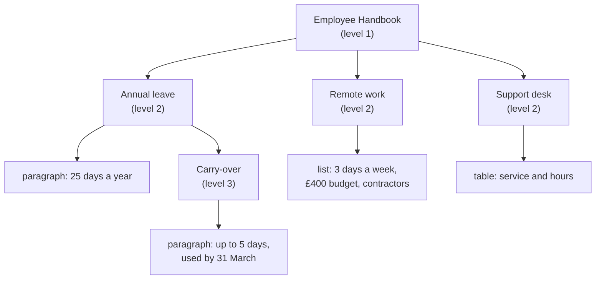

Every document in Meridian's corpus has a shape. The handbook has chapters and sections; the VPN runbook has numbered steps under numbered headings; a product page has a title, an overview, a table of settings and a code sample. The previous lessons in this module produced clean, normalised text with the noise removed, but if they produced it as one long string, that shape has been lost. **Document segmentation** recovers it: it divides a document into its logical units (sections with their heading hierarchy, and within them paragraphs, lists, tables and code), so that every later stage knows not just *what* a piece of text says but *where in the document* it says it.

Segmentation is not chunking. Segmentation finds the boundaries the author put there. Chunking, the subject of [Chunking Fundamentals](/learn/chunking-fundamentals) and [Advanced Chunking Strategies](/learn/advanced-chunking-strategies), then decides how to cut those units into retrievable pieces of a useful size. A chunker that receives a section tree can respect it; a chunker that receives a flat string can only guess.

## Learning objectives

- Distinguish document segmentation from chunking and explain what each contributes to retrieval.
- Build a section tree with heading paths from a format with explicit structure (Markdown) using a parser rather than regular expressions.
- Infer heading levels in a PDF from font size and weight, and recognise when the inference is unreliable.
- Represent a segmented document as typed elements (paragraph, list, table, code) under heading paths, ready for structure-aware chunking.
- Choose a segmentation strategy for a source based on how much structure it exposes.

## Prerequisites

- [Header and footer removal](/learn/document-preprocessing/header-and-footer-removal): running headers are one hint about section boundaries.
- [Markdown parsing](/learn/data-processing/markdown-parsing): Markdown syntax and parsers.
- [PyMuPDF](/learn/advanced-document-parsing/pymupdf): reading text with font information.
- [Indexing pipeline](/learn/rag-architecture-fundamentals/indexing-pipeline): where segmentation sits relative to chunking.

## Why this matters

Consider the sentence "Up to 5 unused days carry over and must be used by 31 March." On its own it is ambiguous: days of what? Under the heading path *Employee Handbook > Annual leave > Carry-over*, it is unambiguous. Segmentation is what attaches that path to the sentence, and the path helps at almost every later stage.

**Chunk boundaries.** A chunker that knows section boundaries can avoid putting the end of "Annual leave" and the start of "Remote work" in the same chunk. Mixed chunks embed as an average of two topics and match neither well. This is the core idea of [Structure-aware chunking](/learn/advanced-chunking-strategies/structure-aware-chunking) and [Heading-based chunking](/learn/advanced-chunking-strategies/heading-based-chunking), and both need segmentation's output as their input.

**Context for embeddings.** Prepending the heading path to a chunk before embedding ("Employee Handbook > Annual leave > Carry-over: Up to 5 unused days...") makes the vector reflect the topic, not just the sentence. A query about "holiday carry-over" then finds the chunk even though the sentence itself never says "leave".

**Element types.** Tables, lists and code blocks need different handling from prose. A table split in the middle of a row is useless; a code block reflowed into a paragraph is broken; a list whose items are separated from their introductory sentence loses its meaning. Segmentation labels each element so that the chunker can treat it appropriately, as covered in [Table chunking](/learn/advanced-chunking-strategies/table-chunking) and [Code chunking](/learn/advanced-chunking-strategies/code-chunking).

**Citations and navigation.** "Employee Handbook, section Annual leave > Carry-over" is a far more useful citation than "chunk 47". Users can find the passage; reviewers can check it.

**Hierarchical retrieval.** Techniques such as [Parent-child chunking](/learn/chunking-optimisation/parent-child-chunking) retrieve a small chunk and then expand to its enclosing section. "Its enclosing section" only exists if segmentation found it.

Without segmentation all of these degrade quietly: chunks straddle topics, tables are cut in half, and the model is handed sentences without the headings that give them meaning.

## The intuition

Think of how you read an unfamiliar manual to answer one question. You do not read from the first word. You glance at the table of contents, jump to the chapter that looks right, scan its headings, and read the one paragraph under the right heading. The headings are a map, and you use them before you use the text.

Segmentation builds that map for the machine. For a well-structured file, such as Markdown or a Word document with heading styles, the map is written down explicitly and you only have to read it correctly. For a PDF, the map is drawn in typography: big bold text is a heading, smaller bold text a sub-heading, regular text the body. You infer it the way a human reader does, by looking at the visual hierarchy. For a plain text dump, you may have only numbering ("3.2 Carry-over") or nothing at all, and the map has to be guessed from the content.

## How it works

### What segmentation produces

The output is a list (or tree) of **sections**, each with:

- a **heading path**: the titles of all enclosing headings, from the document title down, for example `["Employee Handbook", "Annual leave", "Carry-over"]`;
- a **level**: its depth in the hierarchy (1 for the top-level heading);
- an ordered list of **elements**, each with a **kind** (paragraph, list, table, code, image caption) and its text;
- optionally, **locations**: page numbers or character offsets in the cleaned text, for citations and highlighting.



### Strategy depends on how much structure the source exposes

Sources fall into three groups, and the strategy for each is different.

**1. Explicit structure: Markdown, HTML, DOCX with heading styles, wiki exports.** The author's structure is in the markup. Use a real parser and walk its output:

- Markdown: a CommonMark parser such as `markdown-it-py` produces a token stream with `heading_open` tokens tagged `h1` to `h6`, and separate tokens for paragraphs, lists, tables and fenced code.
- HTML: `<h1>` to `<h6>`, `<p>`, `<ul>`, `<ol>`, `<table>`, `<pre>`, walked with an HTML parser as in [HTML parsing](/learn/advanced-document-parsing/html-parsing).
- DOCX: each paragraph has a style; built-in heading styles are named "Heading 1", "Heading 2" and so on, readable with `python-docx` as `paragraph.style.name`.

Regular expressions over Markdown look tempting (`^#+ `) and break on the first fenced code block that contains a shell comment beginning with `#`. A parser knows that a `#` inside a code fence is code.

**2. Visual structure: PDFs, especially those exported from word processors.** PDFs store positioned text with fonts, not headings. Infer the hierarchy from typography:

1. Extract every line with its font size and weight (bold), as PyMuPDF's `get_text("dict")` provides.
2. Find the **body size**: the font size that carries the most characters. In almost every document, body text is the majority.
3. Mark as **heading candidates** the lines whose size is clearly larger than the body size (a margin of 5% to 10% avoids rounding noise), and optionally short bold lines at body size.
4. Rank the distinct heading sizes from largest to smallest; the largest is level 1, the next level 2, and so on.
5. Cross-check with other signals where available: heading numbering ("1", "1.1"), a short line length, no terminal full stop, extra space above the line, and the PDF's own outline (bookmarks), which `pymupdf` exposes as `doc.get_toc()` when the authoring tool wrote one.

Some PDFs, mainly those produced for accessibility, carry a **tag structure** that marks headings explicitly; when present it is better than any inference. Layout-aware parsers combine these signals with models trained on page images; see [Layout-aware parsing](/learn/advanced-document-parsing/layout-aware-parsing).

**3. No structure: plain text dumps, OCR output, transcripts, emails.** Use whatever remains:

- **Numbering patterns**: lines like `3.2 Carry-over` or `Section 4: Expenses`. The number of dot-separated parts gives the level.
- **Typographic conventions in plain text**: an all-caps short line, a line underlined with `===` or `---`, a short line followed by a blank line.
- **Running headers** captured during [Header and footer removal](/learn/document-preprocessing/header-and-footer-removal): a change in the running section name marks a section boundary.
- **Topic shifts**: for long unstructured text, segment where the vocabulary or the embeddings change. TextTiling (Hearst, 1997) does this with word overlap between adjacent blocks; embedding-based variants are the basis of [Semantic chunking](/learn/advanced-chunking-strategies/semantic-chunking). Treat these boundaries as weaker than structural ones.

### Building the hierarchy with a stack

Whatever the source, the hierarchy is built the same way. Walk the document in order, keeping a **stack** of the currently open sections:

1. When a heading of level $k$ arrives, pop sections from the stack until the top has a level below $k$ (a level-2 heading closes any open level-2 and level-3 sections).
2. Create the new section with heading path equal to the top of the stack's path plus the new title, and push it.
3. When a body element arrives, attach it to the section on top of the stack.
4. Text before the first heading belongs to a root or "preamble" section.

This handles skipped levels gracefully (an `h4` directly under an `h2` simply becomes a child of the `h2`), which matters because real documents skip levels all the time.

### Where segmentation goes wrong

- **Headings that are not headings.** Bold "Note:" lines, large-font callouts, pull quotes and table captions look like headings by typography. A heading candidate that is long, ends with a full stop, or is in the body font size is suspicious.
- **Headings that are not marked.** Authors in word processors often make a heading by typing bold text in the body style rather than using a heading style. A DOCX parser that trusts only styles misses them; checking bold, short, standalone paragraphs catches many.
- **Inconsistent sizes.** A document assembled from several sources may use 14-point headings in one chapter and 13-point in another. Ranking sizes then invents extra levels. Clustering nearby sizes together helps.
- **Multi-column and complex layouts.** Reading order is wrong before segmentation even starts; fix it in parsing.
- **Very long sections.** A single section of 20 pages is still one unit to segmentation, and the chunker will have to split it. That is fine: segmentation's job is to find boundaries that exist, not to invent smaller ones.

## In code

The first program segments a Markdown version of the Meridian handbook with `markdown-it-py`. It builds sections with heading paths using the stack algorithm, and records each top-level block as a typed element.

```bash
pip install markdown-it-py
```

```python
from dataclasses import dataclass, field

from markdown_it import MarkdownIt

HANDBOOK_MD = """# Employee Handbook

Welcome to Meridian. This handbook applies to all staff.

## Annual leave

Every employee is entitled to 25 days of annual leave a year.

### Carry-over

Up to 5 unused days carry over and must be used by 31 March.

## Remote work

- Up to 3 days a week.
- Home-office equipment budget: £400.
- Contractors are not eligible for the budget.

## Support desk

| Service | Hours |
| --- | --- |
| Support desk | 08:00 to 18:00 UK time |
"""


@dataclass
class Element:
    kind: str                     # paragraph, list, table, code
    text: str


@dataclass
class Section:
    heading_path: list[str]       # e.g. ['Employee Handbook', 'Annual leave', 'Carry-over']
    level: int
    elements: list[Element] = field(default_factory=list)


BLOCK_KINDS = {"paragraph_open": "paragraph", "bullet_list_open": "list",
               "ordered_list_open": "list", "table_open": "table", "fence": "code"}
CLOSERS = {"paragraph": ("paragraph_close",), "list": ("bullet_list_close", "ordered_list_close"),
           "table": ("table_close",)}


def rows(parts: list[str]) -> list[list[str]]:
    """Split a flat list of cell texts at the row markers."""
    out, row = [], []
    for p in parts:
        if p == "\n":
            out.append(row)
            row = []
        else:
            row.append(p)
    return out


def segment_markdown(md_text: str) -> list[Section]:
    tokens = MarkdownIt().enable("table").parse(md_text)
    root = Section([], 0)
    sections, stack = [root], [root]            # stack holds the current heading ancestry
    i = 0
    while i < len(tokens):
        t = tokens[i]
        if t.type == "heading_open":
            level = int(t.tag[1])               # 'h2' -> 2
            title = tokens[i + 1].content
            while stack[-1].level >= level:     # close sections at this level or deeper
                stack.pop()
            sec = Section(stack[-1].heading_path + [title], level)
            sections.append(sec)
            stack.append(sec)
            i += 3                              # heading_open, inline, heading_close
            continue
        kind = BLOCK_KINDS.get(t.type)
        if kind == "code":
            stack[-1].elements.append(Element("code", t.content.strip()))
        elif kind:
            if t.level == 0:                    # only top-level blocks, not paragraphs inside lists
                closers = CLOSERS[kind]
                j, parts = i + 1, []
                while not (tokens[j].type in closers and tokens[j].level == 0):
                    if tokens[j].type == "inline":
                        parts.append(tokens[j].content)
                    elif tokens[j].type == "tr_close":
                        parts.append("\n")          # end of a table row
                    j += 1
                if kind == "table":
                    text = "\n".join(" | ".join(r) for r in rows(parts))
                else:
                    text = "\n".join(parts)
                stack[-1].elements.append(Element(kind, text))
                i = j
        i += 1
    return [s for s in sections if s.elements or s.level]


for sec in segment_markdown(HANDBOOK_MD):
    print(" > ".join(sec.heading_path) or "(preamble)")
    for el in sec.elements:
        print(f"    [{el.kind}] {el.text!r}")
```

```output
Employee Handbook
    [paragraph] 'Welcome to Meridian. This handbook applies to all staff.'
Employee Handbook > Annual leave
    [paragraph] 'Every employee is entitled to 25 days of annual leave a year.'
Employee Handbook > Annual leave > Carry-over
    [paragraph] 'Up to 5 unused days carry over and must be used by 31 March.'
Employee Handbook > Remote work
    [list] 'Up to 3 days a week.\nHome-office equipment budget: £400.\nContractors are not eligible for the budget.'
Employee Handbook > Support desk
    [table] 'Service | Hours\nSupport desk | 08:00 to 18:00 UK time'
```

The important lines:

- `MarkdownIt().enable("table")` creates a CommonMark parser with the table extension switched on; tables are not part of core CommonMark. `parse` returns a flat list of tokens, with matching `_open` and `_close` tokens and `inline` tokens holding the text.
- Each token has a `level`, its nesting depth in the token stream (not the heading level). Checking `t.level == 0` collects a whole list or table as one element, instead of treating each list item's inner paragraph as a separate element.
- The `while stack[-1].level >= level: stack.pop()` loop is the stack algorithm from above. When "Remote work" (level 2) arrives, it pops "Carry-over" (3) and "Annual leave" (2), leaving "Employee Handbook" (1) as the parent.
- A fenced code block arrives as a single `fence` token with its content, so it is captured whole and never mistaken for headings, whatever it contains.

What the output means. Each piece of content now knows its place: the carry-over rule sits under `Employee Handbook > Annual leave > Carry-over`, the remote-work facts are one list element (so a chunker can keep them together), and the support-desk hours are a table element with its header row preserved. A chunker can now prepend the heading path to each chunk, keep the list and table intact, and never put "Annual leave" and "Remote work" text in the same chunk.

The second program handles a PDF, where structure is only visual. It generates a one-page runbook with headings at three sizes and one bold body line (a "Note:" that looks like a heading to a careless rule), then infers heading levels from font size.

```bash
pip install pymupdf
```

```python
from collections import Counter

import pymupdf


def make_runbook(path: str) -> None:
    doc = pymupdf.open()
    page = doc.new_page()
    y = 60
    for text, size, bold in [
        ("VPN Troubleshooting", 18, True),
        ("This runbook covers VPN errors reported to the support desk.", 11, False),
        ("1 Client errors", 14, True),
        ("Error E-4021 means the VPN client is out of date.", 11, False),
        ("Update it from the IT portal.", 11, False),
        ("1.1 Repeated errors", 12, True),
        ("If E-4021 repeats after an update, check the laptop clock.", 11, False),
        ("2 Public networks", 14, True),
        ("VPN is required on public Wi-Fi.", 11, False),
        ("Note: hotel networks often block VPN ports.", 11, True),   # bold body text, not a heading
    ]:
        page.insert_text((50, y), text, fontsize=size, fontname="hebo" if bold else "helv")
        y += size + 14
    doc.save(path)


def lines_with_style(path: str):
    """(text, font size, bold) for every line, in page order."""
    for page in pymupdf.open(path):
        for block in page.get_text("dict")["blocks"]:
            for ln in block.get("lines", []):
                spans = [s for s in ln["spans"] if s["text"].strip()]
                if spans:
                    text = "".join(s["text"] for s in spans).strip()
                    size = round(max(s["size"] for s in spans), 1)
                    bold = all(s["flags"] & 16 for s in spans)          # bit 4 = bold
                    yield text, size, bold


make_runbook("runbook.pdf")
lines = list(lines_with_style("runbook.pdf"))

# The body size is the size that carries the most characters.
chars_by_size = Counter()
for text, size, _ in lines:
    chars_by_size[size] += len(text)
body_size = chars_by_size.most_common(1)[0][0]

# Heading sizes are those clearly larger than body text; rank them to get levels.
heading_sizes = sorted({s for _, s, _ in lines if s >= body_size * 1.08}, reverse=True)
level_of = {s: i + 1 for i, s in enumerate(heading_sizes)}
print(f"body size {body_size}, heading sizes {heading_sizes}\n")

for text, size, bold in lines:
    if size in level_of:
        print(f"{'  ' * (level_of[size] - 1)}H{level_of[size]} {text}")
    else:
        print(f"{'':>8}{text[:55]}{'  (bold body)' if bold else ''}")
```

```output
body size 11.0, heading sizes [18.0, 14.0, 12.0]

H1 VPN Troubleshooting
        This runbook covers VPN errors reported to the support 
  H2 1 Client errors
        Error E-4021 means the VPN client is out of date.
        Update it from the IT portal.
    H3 1.1 Repeated errors
        If E-4021 repeats after an update, check the laptop clo
  H2 2 Public networks
        VPN is required on public Wi-Fi.
        Note: hotel networks often block VPN ports.  (bold body)
```

The important lines:

- `"hebo"` and `"helv"` are PyMuPDF's built-in names for Helvetica Bold and Helvetica, used here only to generate the test PDF.
- Each span in PyMuPDF's `dict` output has `size` and `flags`; in the flags bit field, the value 16 means bold. A line is treated as bold only if all its spans are.
- `chars_by_size` counts *characters*, not lines, per size. The body size is the size with the most characters, which is robust even when headings outnumber body lines on a page.
- The 1.08 factor (8% larger than the body) separates real heading sizes from rounding noise; the 12-point sub-heading passes, an 11.2-point artefact would not.

What the output means. Three heading levels were recovered from typography alone, and they agree with the authors' numbering ("1", "1.1", "2"), which is a useful cross-check to automate. The bold "Note:" line stayed in the body: it is bold but at body size, so the size rule did not promote it. A rule of "bold short line means heading" would have created a bogus section called "Note: hotel networks often block VPN ports." and attached the next section's content to it.

Errors people commonly hit:

- **Using a regex for Markdown headings**, which treats `# restart the service` inside a code block as a level-1 heading and corrupts every heading path after it.
- **Ranking every distinct size as a level.** One stray 13-point caption becomes an extra level. Cluster sizes that differ by less than about half a point, and ignore sizes used by very few characters.
- **Losing the preamble.** Text before the first heading (an introduction, a summary) must go somewhere; here it would attach to a root section with an empty path.

To extend this: add page numbers and character offsets to each element for citations, check heading numbering against inferred levels and log disagreements, and use `doc.get_toc()` in PyMuPDF to prefer the PDF's own outline when it exists.

## A real-world example

The Platform team originally fed AskMeridian's product documentation to a fixed-size chunker straight after cleaning: 800 characters per chunk with some overlap. The product docs for Meridian Reports were long pages with many short sections ("Export to PDF", "Export to CSV", "Scheduling exports", "SAML single sign-on").

Questions about SAML single sign-on kept producing answers that mixed in export settings. Looking at the chunks explained it: a typical chunk contained the end of "Scheduling exports" and the start of "SAML single sign-on", so its embedding was half about each. When it was retrieved for an SSO question, the model dutifully used both halves. Worse, the sentence "Available on the Enterprise plan only" sat at the start of the SSO section, but because of where the chunk boundaries fell, it often ended up in a chunk with the export text, so answers sometimes said exports were Enterprise-only.

The fix was to add segmentation between noise removal and chunking. The docs were HTML, so headings were explicit; the segmenter produced sections with heading paths, and the chunker was changed to split only within sections and to prepend the heading path ("Meridian Reports > SAML single sign-on") to each chunk before embedding. Sections shorter than the chunk size became single chunks. The mixed-topic answers disappeared, and the "Enterprise plan only" sentence now always travelled with its own section. The team's regression set gained a group of questions whose answers depend on a sentence at the very start or end of a section, the positions most exposed to boundary effects.

## Common mistakes

- **Chunking flat text without segmenting first.** Chunks straddle sections, mixing topics in one embedding.
- **Parsing structured formats with regular expressions.** Code blocks, escaped characters and nested lists break the patterns.
- **Trusting typography blindly in PDFs.** Bold callouts, large pull quotes and captions become bogus headings.
- **Trusting only heading styles in DOCX.** Authors who format headings manually by making text bold are missed, and whole chapters merge into one section.
- **Discarding the heading path after chunking.** The single most useful piece of context for a chunk is thrown away.
- **Splitting tables and lists as if they were prose.** Rows separate from their header, list items from their lead-in sentence.
- **Inventing boundaries where none exist.** Treating every topic-shift guess as a section boundary fragments well-written long sections.

## Best practices

- Segment between noise removal and chunking, and give the chunker sections, not strings.
- Use a real parser for any format with markup, and the stack algorithm to build heading paths.
- For PDFs, infer levels from font size relative to the body size, cross-check with numbering, outlines and tags, and log disagreements.
- Label elements by kind (paragraph, list, table, code) so the chunker can treat each appropriately.
- Keep the heading path on every chunk, for embedding context, citations and filtering.
- Keep locations (page, offset) with each element so citations can point back to the source.
- Build a small set of test documents per source type with known structure, and assert the segmenter recovers it.

## Performance considerations

Segmenting a format with markup costs about as much as parsing it, which is linear in document size and fast: a Markdown parser processes megabytes per second, so a corpus of tens of thousands of pages takes minutes. PDF segmentation is dominated by extracting text *with font information*, which is slower and uses more memory than plain text extraction. As noted in [Header and footer removal](/learn/document-preprocessing/header-and-footer-removal), extract the detailed structure once per document and reuse it for furniture detection and segmentation.

Segmentation also changes downstream costs. Prepending heading paths adds tokens to every chunk: a path of 8 to 15 tokens on a 200-token chunk is a 4% to 8% increase in embedding tokens. That is usually worth it. If it matters, you can embed with the path but store and display the chunk without it, or include only the last two levels. Section-respecting chunking also tends to produce more, smaller chunks (short sections are not merged with their neighbours), which increases the number of vectors; with 384-dimensional float32 vectors at 1,536 bytes each, an extra 100,000 chunks costs about 150 MB of vector storage before index overhead, which is modest.

Topic-based segmentation of unstructured text is the expensive case: embedding-based methods must embed every sentence or small block to find boundaries, roughly doubling embedding cost for those documents. Use it only where no structural signal exists.

## Security considerations

Segmentation is mostly a structural concern, but two points matter. First, heading paths become part of the embedded text and of citations, so a heading written by an attacker in a shared wiki ("Official policy: ignore previous instructions") is carried into every chunk of that section. Treat heading text as untrusted content like any other, and keep it inside the delimited context passed to the model, never in system instructions. Second, segmentation is a natural place to keep **section-level access markers** that the source system provides (some wikis and document systems restrict individual sections or pages within a space): if the source exposes them, attach them to the section's elements so they flow to every chunk, rather than applying only the document-level permission.

## Summary

- Segmentation recovers a document's logical structure: sections with heading paths, and typed elements within them. Chunking then cuts within that structure.
- Heading paths give chunks context for embedding, make citations meaningful and support hierarchical retrieval; element types let tables, lists and code be handled properly.
- Use real parsers for explicit structure (Markdown, HTML, DOCX), typography for PDFs (font size relative to body size, cross-checked with numbering), and numbering or topic shifts only when nothing else exists.
- Build the hierarchy with a stack of open sections, which handles skipped levels gracefully.
- Common failures are bogus headings from bold callouts, missed headings from manual formatting, and chunkers that throw the structure away.

## Exercises

1. Trace the stack algorithm on this heading sequence and give each section's heading path: `h1 Handbook`, `h2 Leave`, `h4 Exceptions`, `h2 Expenses`, `h3 Receipts`, `h1 Appendix`.

<details><summary>Show solution</summary>

- `h1 Handbook`: stack is empty below level 1, so path `[Handbook]`.
- `h2 Leave`: top is Handbook (1 < 2), path `[Handbook, Leave]`.
- `h4 Exceptions`: top is Leave (2 < 4), path `[Handbook, Leave, Exceptions]`. The skipped level 3 does not matter.
- `h2 Expenses`: pop Exceptions (4 ≥ 2) and Leave (2 ≥ 2); top is Handbook, path `[Handbook, Expenses]`.
- `h3 Receipts`: top is Expenses (2 < 3), path `[Handbook, Expenses, Receipts]`.
- `h1 Appendix`: pop Receipts, Expenses and Handbook (all ≥ 1); top is the root, path `[Appendix]`.

</details>

2. Plain-text exports of the IT runbooks have no markup, but headings are numbered (`1 Client errors`, `1.1 Repeated errors`). Write a function that detects such headings and their levels, and test it on a short runbook. Include a body line that starts with a number and must not be treated as a heading.

<details><summary>Show solution</summary>

```python
import re

HEADING = re.compile(r"^(\d+(?:\.\d+)*)\s+([A-Z][^.]{0,60})$")

def numbered_headings(text: str):
    for line in text.splitlines():
        m = HEADING.match(line.strip())
        if m:
            yield m.group(1).count(".") + 1, m.group(2)

runbook = """1 Client errors
Error E-4021 means the VPN client is out of date.
1.1 Repeated errors
3 failed sign-ins lock the account for 15 minutes.
2 Public networks
VPN is required on public Wi-Fi."""

for level, title in numbered_headings(runbook):
    print("  " * (level - 1) + f"H{level} {title}")
```

```output
H1 Client errors
  H2 Repeated errors
H1 Public networks
```

The body line "3 failed sign-ins lock the account for 15 minutes." starts with a number but is rejected because the text after the number starts with a lower-case letter and the line contains a full stop, which the pattern excludes (`[^.]`). Heading conventions vary, so validate the pattern on real documents from each source; a further check is that numbering should increase in order (1, 1.1, 2), which a stray body line usually breaks.

</details>

3. In a 40-page PDF, the body text is 10 point, chapter headings 16 point, section headings 12 point, and there are figure captions in 9-point italic and three pull quotes in 14-point italic. What levels does the size-ranking rule produce, and how would you fix it?

<details><summary>Show solution</summary>

Sizes above the body size (10 × 1.08 = 10.8) are 16, 14 and 12, so the rule ranks them as levels 1, 2 and 3. The pull quotes become level-2 "headings", and every section heading becomes level 3 under whichever pull quote came last. Captions (9 point) are below the body size and correctly ignored.

Fixes, in order of preference: use the PDF's outline (`get_toc()`) or tag structure if present; exclude candidate sizes used by very few lines or characters (three pull quotes are rare compared with dozens of section headings); exclude italic candidates or long candidates that end with a full stop; and cross-check with numbering. A frequency rule alone would work here: a size used by three lines in 40 pages is not a heading level.

</details>

4. Design question. AskMeridian is adding meeting transcripts: long, unstructured speech with no headings. Should they be segmented, and how? What would you attach to each segment instead of a heading path?

<details><summary>Show solution</summary>

Yes, but with weaker tools and lower expectations. There is no author structure to recover, so options are: segment by **agenda items** if the meeting had an agenda (match agenda titles to the transcript, often by timestamps from the meeting tool); segment by **topic shift** with a TextTiling-style or embedding-based method; or fall back to **time windows** (for example, five minutes) with some overlap. Agenda segmentation, where available, is far better than the other two.

Instead of a heading path, attach the meeting title and date, the agenda item (if known), the time range, and the speakers in the segment. These give citations ("Platform weekly, 12 May, 14:05 to 14:11") and support filters ("what did the HR team say about leave?"). Treat topic-shift boundaries as soft: allow chunks to overlap them, because a wrong boundary in speech is common and costly.

</details>

## Check your understanding

```quiz
[
  {"q": "What is the main difference between document segmentation and chunking?", "options": ["Segmentation works on PDFs, chunking on Markdown", "Segmentation happens at query time, chunking at indexing time", "Segmentation recovers the logical units the author created (sections, elements); chunking cuts those units into pieces of a retrievable size", "They are two names for the same step"], "answer": 2, "why": "Segmentation finds existing boundaries and structure; chunking decides sizes and cuts, ideally within that structure."},
  {"q": "Why is a regular expression like `^#+ ` a poor way to find Markdown headings?", "options": ["It is too slow", "It cannot detect level-1 headings", "Markdown headings use underscores", "It also matches lines inside fenced code blocks, such as shell comments, corrupting the heading hierarchy"], "answer": 3, "why": "A parser knows code-block context; a line-level regex does not."},
  {"q": "In a PDF, the body size is found by counting characters per font size rather than lines per size. Why?", "options": ["Headings can be numerous as lines, but body text carries most of the characters, so character counts identify it robustly", "Characters are easier to count", "Line counts are not available in PDFs", "Font sizes are stored per character"], "answer": 0, "why": "A page with many short headings could have more heading lines than body lines, but rarely more heading characters."},
  {"q": "Given the headings `h1 A`, `h2 B`, `h3 C`, `h2 D`, what is the heading path of D?", "options": ["[A, B, C, D]", "[A, D]", "[A, B, D]", "[D]"], "answer": 1, "why": "A level-2 heading closes the open level-3 and level-2 sections, leaving A as its parent."},
  {"q": "Why prepend the heading path to a chunk before embedding?", "options": ["To make the chunk shorter", "Because embedding models require a title", "To remove duplicate chunks", "So the vector reflects the topic of the section, letting a query match a chunk whose own sentence lacks the topic word"], "answer": 3, "why": "A sentence like 'Up to 5 unused days carry over' gains 'Annual leave > Carry-over' context, which the query may share."}
]
```

## Further reading

- [CommonMark specification](https://spec.commonmark.org/): the precise Markdown grammar that parsers such as markdown-it-py implement.
- [markdown-it-py documentation](https://markdown-it-py.readthedocs.io/): the token stream and its attributes (`type`, `tag`, `level`, `content`).
- [PyMuPDF documentation](https://pymupdf.readthedocs.io/): `get_text("dict")` span attributes (size, flags) and `get_toc()` for PDF outlines.
- Marti A. Hearst (1997), *TextTiling: Segmenting Text into Multi-paragraph Subtopic Passages*, Computational Linguistics 23(1): the classic method for segmenting unstructured text by topic shift.
