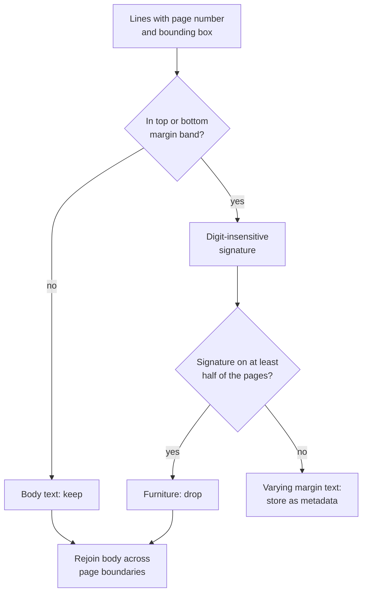

Paginated documents carry **page furniture**: text that the layout repeats on every page rather than text the author wrote once. A running header with the document title, a footer with "Meridian internal. Do not distribute.", a page number, sometimes a date or a confidentiality marking. On paper the eye skips it without effort. In extracted text it is interleaved with the body: a 40-page handbook yields 40 copies of the title and 40 page numbers, wedged between the last sentence of one page and the first sentence of the next.

This lesson is about finding and removing that furniture reliably. It covers why naive pattern matching fails, the two signals that do work (repetition across pages and position on the page), how to keep the information some headers carry, and the edge cases that catch production pipelines. Repairing damaged characters was [Cleaning](/learn/document-preprocessing/cleaning); removing unwanted content that is *not* tied to pages, such as web navigation and disclaimers, is [Noise removal](/learn/document-preprocessing/noise-removal).

## Learning objectives

- Explain how page furniture damages chunking, keyword statistics, embeddings and citations.
- Detect repeated headers and footers using cross-page frequency with digit-insensitive signatures.
- Use line coordinates from a PDF parser to restrict detection to the page margins.
- Preserve information carried by running headers (such as the current section title) as metadata instead of discarding it.
- Diagnose the common failure cases: merged margin lines, short documents, alternating odd and even headers, and body text that resembles furniture.

## Prerequisites

- [Cleaning](/learn/document-preprocessing/cleaning): the repair stage that runs before this one.
- [PyMuPDF](/learn/advanced-document-parsing/pymupdf): opening PDFs and reading text with positions.
- [pypdf](/learn/advanced-document-parsing/pypdf): plain-text extraction from PDFs.
- [Regular expressions](/learn/data-processing/regular-expressions): patterns used for signatures.

## Why this matters

Page furniture causes four distinct kinds of damage, each in a different stage.

**It breaks sentences and chunks.** A paragraph that runs across a page break comes out of the extractor as "...must be used by" + "Meridian internal. Do not distribute. Page 3 of 40" + "Meridian Employee Handbook 2025" + "31 March." The chunker sees a complete-looking sentence fragment, then two short unrelated lines, then a fragment. Whatever boundary it chooses, the carry-over rule ends up split, and one half of it carries a page footer.

**It distorts keyword statistics.** Keyword scoring such as [BM25](/learn/sparse-retrieval/bm25) gives weight to a term according to how rare it is across chunks. A footer repeated in every chunk makes "distribute" and "internal" appear everywhere, which is harmless, but it also makes every handbook chunk share the terms "Meridian", "Employee" and "Handbook". A query containing "handbook" now matches all of them equally, and term counts in short chunks are inflated by text that says nothing about the chunk's subject.

**It dilutes embeddings.** An embedding is a summary of all the text in a chunk. In a 200-token chunk, a 20-token header and footer is ten per cent of the input, and it is the *same* ten per cent in every chunk from that document. It pulls all of the document's chunk vectors towards one another and towards the header's meaning, making them harder to tell apart.

**It pollutes answers and citations.** A retrieved chunk that begins "Page 12 of 40 Meridian Employee Handbook 2025" gets quoted back to users, and models occasionally cite the footer's page number as if it were part of the content.

The first two are the serious ones, because they reduce what you find. And because furniture repeats, its damage is multiplied by the number of pages: one mistake in a 300-page document appears 300 times in the index.

## The intuition

Imagine being handed a stack of photocopied pages and asked to type up only the content. You would notice within three pages that the same line sits at the top of every page and a page number sits at the bottom, and you would stop typing them. You would use two clues without thinking about it: **the line repeats on page after page**, and **it sits in the same place, at the edge of the page**. Neither clue alone is enough. A sentence that happens to repeat in the body is not a header, and a one-off note at the bottom of one page is not a footer. Together they are very reliable.

You would also notice that some top-of-page text changes as you go: "Annual leave" for a few pages, then "Remote work", then "Expenses". That is not noise. It is the document telling you which section you are in, and it is worth writing down even though you would not type it into the body. That is the design this lesson builds: drop what repeats at the edges, keep what varies at the edges as metadata.

## How it works

### Why a regular expression is not enough

The obvious first attempt is a pattern: delete lines matching `^Page \d+`. It fails in both directions:

- **It removes real content.** A body sentence such as "Page 6 of the travel policy lists approved booking channels" starts the same way and is deleted.
- **It misses real furniture.** Extractors often merge text that sits on the same baseline, so the footer arrives as one line, "Meridian internal. Do not distribute. Page 6 of 6", which does not start with "Page".
- **It does not generalise.** Every document template has different furniture. A corpus of a few thousand documents from a dozen departments has dozens of templates, and a hand-maintained list of patterns falls behind the moment someone changes one.

Patterns still have a place as a backstop for very well-known furniture, but the primary method should learn the furniture from the document itself.

### Signal one: repetition across pages

Furniture repeats; body text, mostly, does not. So:

1. Split the extracted text by page. Most PDF libraries return text page by page, so keep that boundary rather than concatenating early.
2. From each page, take the **candidate lines**: the first few and the last few lines (two or three is typical), because furniture sits at the edges of the text stream.
3. Turn each candidate into a **signature**: case-folded, whitespace-trimmed, and with every run of digits replaced by `#`. Page numbers, dates and years then stop making otherwise identical lines different: "Page 3 of 40" and "Page 4 of 40" both become `page # of #`.
4. Count, for each signature, the number of **pages** on which it appears (not the number of occurrences, so a line repeated twice on one page counts once).
5. Mark as furniture every signature that appears on at least a chosen share of pages, often half.
6. Remove candidate lines whose signature is marked, and only candidate lines: a matching line in the middle of a page is left alone.

Writing $n_s$ for the number of pages on which signature $s$ appears among the candidates, $N$ for the number of pages and $\tau$ for the threshold share, the rule is

$$
\text{furniture}(s) \iff \frac{n_s}{N} \ge \tau \quad\text{and}\quad N \ge N_{\min}
$$

The second condition matters. With $N = 2$ pages and $\tau = 0.5$, any line that appears once is "furniture". A minimum page count $N_{\min}$ (say, 4) keeps short documents out of the frequency method; they are handled by position only, or not at all.

### Signal two: position on the page

Text-only extraction loses where the line was. Parsers that report coordinates, such as PyMuPDF's `page.get_text("dict")`, give each line a bounding box, so you can ask a much sharper question: *does this line sit in the top or bottom margin band of the page?*



Position alone is not enough either: a footnote or a closing paragraph can sit low on a page. Combining the signals gives the rule used in the code below: **a line is furniture if it is in the margin band and its signature repeats across pages**. Lines in the band that do *not* repeat are kept, but routed somewhere other than the body.

The margin band is a fraction of the page height (8% at top and bottom works for many office documents; an A4 page is 842 points tall, so 8% is about 67 points, a little under 2.5 cm). Tune it per template if you can identify templates, and check it against a sample, because some layouts put headers well inside the page.

### Keep what headers tell you

Running headers in long documents often name the current chapter or section. That is valuable: a chunk from page 5 of the handbook that reads "Anything over £75 needs a receipt" is far more useful when it carries `section: Expenses` in its metadata, which can be shown in citations, used for [metadata-aware retrieval](/learn/advanced-retrieval/metadata-aware-retrieval), or prepended to the chunk before embedding (the idea behind [Contextual retrieval](/learn/advanced-retrieval/contextual-retrieval)).

So the output of this stage is not just shorter text. It is body text per page plus a record of the varying margin text per page. [Document segmentation](/learn/document-preprocessing/document-segmentation) can use those records as hints about section boundaries, and [Metadata extraction](/learn/document-preprocessing/metadata-extraction) can turn a "Version 3.2, effective 1 April 2025" footer into structured fields before it is dropped.

### Rejoin across page boundaries

Once furniture is gone, the last line of one page and the first line of the next are adjacent again. If the page ended mid-sentence, join them with a space; if it ended a paragraph, keep the paragraph break. The heuristic from the [Cleaning](/learn/document-preprocessing/cleaning) exercises applies: a page ending without terminal punctuation, followed by a page starting with a lower-case letter, is one sentence. This step is the reason header removal must happen *before* line unwrapping and chunking, not after.

### Edge cases that matter in production

- **Merged margin lines.** Text-only extractors put items on the same baseline into one line, so a constant title and a varying section name become "Meridian Employee Handbook 2025 Expenses". The whole line no longer repeats, so the frequency method misses it. Coordinates avoid this (each item is its own line in PyMuPDF's output here); without them, look for repeated *prefixes* (one of the exercises builds this).
- **Odd and even pages.** Books and formal reports alternate: the document title on left-hand pages, the chapter title on right-hand pages, page numbers on the outer edge. Each variant appears on about half the pages, so a threshold of exactly 0.5 is borderline. Count odd and even pages separately, or lower the threshold to around 0.4 for long documents.
- **Different first pages.** Cover pages, title pages and tables of contents usually have no furniture or different furniture. They do not hurt the count much in a long document but can in a short one.
- **Furniture that changes partway through**, such as appendices with a different header. A global threshold may miss it; a sliding window over runs of consecutive pages catches it.
- **Body text in the margin band**: a short closing line, a footnote, a table that runs to the bottom of the page. The repetition requirement protects these, which is why position alone is never used to delete.
- **Repeated body text**: a table header row repeated on every page of a long table, or a warning box repeated on every page of a runbook. It may look like furniture to the frequency method. Position protects it when it is not in the margin band; if it is, you need template knowledge or [layout-aware parsing](/learn/advanced-document-parsing/layout-aware-parsing).
- **Formats without pages.** HTML and Markdown have no page furniture (their boilerplate is the subject of [Noise removal](/learn/document-preprocessing/noise-removal)). Word documents store headers and footers separately from the body, and `python-docx`'s `document.paragraphs` does not include them, so a DOCX converted directly usually has none; a DOCX that was *printed to PDF* does.
- **Scanned documents**, where text comes from [OCR](/learn/advanced-document-parsing/ocr), have small variations between pages ("Page 3 0f 40"). Exact signatures fail; compare signatures with a similarity measure (for example, a character-level ratio above 0.9) instead.

Layout-aware parsers can label elements as headers or footers using models trained on page images, which handles many of these cases; see [Layout-aware parsing](/learn/advanced-document-parsing/layout-aware-parsing). The frequency-and-position method remains a useful, cheap, explainable default and a check on what those parsers produce.

## In code

The first program generates a six-page Meridian handbook PDF with three kinds of furniture (a constant title at the top left, a running section name at the top right, a constant notice and a page number at the bottom), plus one body sentence that begins "Page 6 of the travel policy", which looks like a page number. Generating the test document yourself means you know exactly what the right answer is.

```bash
pip install pymupdf pypdf
```

```python
# make_handbook.py
import pymupdf

BODY = [
    ("Annual leave", "Every employee is entitled to 25 days of annual leave a year. Up to 5 unused days carry over and must be used by 31 March."),
    ("Annual leave", "Leave requests go through the HR self-service portal at least two weeks in advance for absences longer than a week."),
    ("Remote work", "Staff may work remotely up to 3 days a week. The home-office equipment budget is £400; contractors are not eligible."),
    ("Remote work", "VPN is required on public Wi-Fi. Report a lost laptop to the support desk at once."),
    ("Expenses", "Expenses must be submitted within 30 days. Anything over £75 needs a receipt. Expenses belong to the finance department."),
    ("Expenses", "Page 6 of the travel policy lists approved booking channels for rail and air travel."),
]


def make_handbook(path: str) -> None:
    doc = pymupdf.open()
    n = len(BODY)
    for i, (section, text) in enumerate(BODY, start=1):
        page = doc.new_page(width=595, height=842)            # A4 in points
        page.insert_text((50, 40), "Meridian Employee Handbook 2025", fontsize=9)
        page.insert_text((400, 40), section, fontsize=9)       # running section header
        page.insert_textbox(pymupdf.Rect(50, 100, 545, 400), text, fontsize=11)
        page.insert_text((50, 815), "Meridian internal. Do not distribute.", fontsize=8)
        page.insert_text((480, 815), f"Page {i} of {n}", fontsize=8)
    doc.save(path)
```

The second program reads the PDF with PyMuPDF, keeping each line's vertical position, and applies the combined rule: drop margin-band lines that repeat on at least half the pages, keep varying margin lines as metadata, keep everything else as body.

```python
import re
from collections import Counter
from dataclasses import dataclass

import pymupdf

from make_handbook import make_handbook


@dataclass
class Line:
    page: int
    y0: float          # top of the line, in points from the top of the page
    y1: float          # bottom of the line
    text: str


def extract_lines(path: str) -> tuple[list[list[Line]], float]:
    """Every text line on every page, with its vertical position."""
    pages, height = [], 0.0
    for page in pymupdf.open(path):
        height = page.rect.height
        lines = []
        for block in page.get_text("dict")["blocks"]:
            for ln in block.get("lines", []):
                text = "".join(span["text"] for span in ln["spans"]).strip()
                if text:
                    lines.append(Line(page.number, ln["bbox"][1], ln["bbox"][3], text))
        pages.append(sorted(lines, key=lambda l: (l.y0, l.text)))
    return pages, height


def signature(text: str) -> str:
    """Digit-insensitive form, so 'Page 3 of 6' and 'Page 4 of 6' look the same."""
    return re.sub(r"\d+", "#", text.casefold()).strip()


def find_furniture(pages, height, margin=0.08, min_share=0.5):
    """Lines in the top/bottom margin band that repeat on at least min_share of pages."""
    top, bottom = height * margin, height * (1 - margin)
    in_band = lambda l: l.y1 <= top or l.y0 >= bottom
    counts = Counter()
    for lines in pages:
        counts.update({signature(l.text) for l in lines if in_band(l)})   # once per page
    repeated = {sig for sig, n in counts.items() if n >= min_share * len(pages)}
    return in_band, repeated


make_handbook("handbook.pdf")
pages, height = extract_lines("handbook.pdf")
in_band, repeated = find_furniture(pages, height)
print("repeated furniture:", sorted(repeated))

body, running_headers = [], []
for lines in pages:
    keep = []
    for l in lines:
        if in_band(l) and signature(l.text) in repeated:
            continue                                   # header/footer: drop
        if in_band(l):
            running_headers.append((l.page + 1, l.text))  # margin text that varies: keep as metadata
            continue
        keep.append(l.text)
    body.append(" ".join(keep))

print("running headers:", running_headers)
for n, text in enumerate(body, start=1):
    print(f"page {n}: {text[:70]}")
```

```output
repeated furniture: ['meridian employee handbook #', 'meridian internal. do not distribute.', 'page # of #']
running headers: [(1, 'Annual leave'), (2, 'Annual leave'), (3, 'Remote work'), (4, 'Remote work'), (5, 'Expenses'), (6, 'Expenses')]
page 1: Every employee is entitled to 25 days of annual leave a year. Up to 5 
page 2: Leave requests go through the HR self-service portal at least two week
page 3: Staff may work remotely up to 3 days a week. The home-office equipment
page 4: VPN is required on public Wi-Fi. Report a lost laptop to the support d
page 5: Expenses must be submitted within 30 days. Anything over £75 needs a r
page 6: Page 6 of the travel policy lists approved booking channels for rail a
```

The important lines:

- `page.get_text("dict")` returns a nested structure of blocks, lines and spans, each line with a `bbox` of `(x0, y0, x1, y1)` in points, with y measured downwards from the top of the page. A line's text is the concatenation of its spans (a span is a run of text in one font).
- `signature` replaces digit runs with `#`, which is why the year in the title (`2025`) and the page numbers collapse into the same signature on every page.
- `counts.update({...})` uses a set, so each signature counts at most once per page. Counting raw occurrences would let a line repeated many times on one page look like furniture.
- `in_band` checks the line's *bottom* against the top band and its *top* against the bottom band, so only lines wholly inside a band count.
- Margin lines that do not repeat go to `running_headers` with their page number instead of being dropped.

What the output means. Three signatures were learned as furniture without a single hand-written pattern. The section names appeared in the margin band but only on two pages each (a third of the pages), so they were kept as per-page metadata, which is exactly the section structure of the document. The body sentence that begins "Page 6 of the travel policy" survived, because it is not in the margin band and its signature (`page # of the travel policy...`) does not repeat.

The third program shows what happens with text-only extraction, which is what you have when a parser does not give coordinates or when text arrives from another system already flattened. It compares a naive regex with the frequency method using the first and last two lines of each page.

```python
import re
from collections import Counter

from pypdf import PdfReader


def signature(text: str) -> str:
    return re.sub(r"\d+", "#", text.casefold()).strip()


pages = [p.extract_text().splitlines() for p in PdfReader("handbook.pdf").pages]
print("page 6 as extracted:", pages[5])

# Naive approach: a regex for page numbers, applied to every line.
naive = [[ln for ln in lines if not re.match(r"^Page \d+", ln)] for lines in pages]
print("naive regex, page 6:", naive[5])

# Frequency approach: only the first and last K lines of each page are candidates.
K = 2
counts = Counter()
for lines in pages:
    edges = lines[:K] + lines[-K:]
    counts.update({signature(ln) for ln in edges})
repeated = {s for s, n in counts.items() if n >= 0.5 * len(pages)}
freq = []
for lines in pages:
    n = len(lines)
    freq.append([ln for i, ln in enumerate(lines)
                 if not ((i < K or i >= n - K) and signature(ln) in repeated)])
print("frequency method, page 6:", freq[5])
```

```output
page 6 as extracted: ['Meridian Employee Handbook 2025 Expenses', 'Page 6 of the travel policy lists approved booking channels for rail and air travel.', 'Meridian internal. Do not distribute. Page 6 of 6']
naive regex, page 6: ['Meridian Employee Handbook 2025 Expenses', 'Meridian internal. Do not distribute. Page 6 of 6']
frequency method, page 6: ['Meridian Employee Handbook 2025 Expenses', 'Page 6 of the travel policy lists approved booking channels for rail and air travel.']
```

What the output means. `pypdf` merged items on the same baseline, so each page has one header line and one footer line. The naive regex got page 6 exactly backwards: it deleted the body sentence and kept both pieces of furniture. The frequency method removed the footer (whose signature is identical on every page) and kept the body sentence, but it missed the header, because merging the constant title with the varying section name made the line differ between sections. Each header variant appears on only two of six pages. Exercise 2 fixes this by looking for repeated *prefixes* instead of repeated whole lines.

Errors people commonly hit:

- **Concatenating pages before detection.** Once the page boundaries are gone, "first and last lines of each page" cannot be computed. Keep text per page until furniture is removed.
- **Assuming PyMuPDF's line order is reading order.** It follows the PDF's internal order, which is usually but not always top to bottom; sorting by `y0` (as `extract_lines` does) is a simple safeguard for single-column pages. Multi-column layouts need more care.
- **Thresholds that never fire on short documents.** With three pages and a threshold of 0.5, a signature needs two pages, which is fine; with a minimum-page guard of 4, three-page documents are skipped entirely. Decide deliberately and log which documents were skipped.

To extend this: count odd and even pages separately, add a similarity-based signature comparison for OCR output, and emit a per-document report (signatures removed, lines removed, pages skipped) into the ingestion log so that a template change shows up as a sudden change in the report.

## A real-world example

When Meridian's Platform team indexed the IT runbooks, every runbook PDF came from the same documentation tool, with a footer reading "Atlas Platform Runbook · Rev 14 · Printed 2025-05-02 · Page 3". The first ingestion used a hand-written regex for page numbers only.

The team noticed the problem through the keyword side of retrieval. A query for "Atlas platform" returned runbooks almost at random, because every chunk of every runbook contained the phrase in its footer, so the term carried no information about which runbook was relevant. Worse, chunk boundaries kept falling on footers, so the most important step of several procedures ("restart the token service, then...") was split across two chunks, with the footer in between.

They replaced the regex with the frequency-and-position method. Two details came out of testing on real runbooks. The revision number and print date changed between documents but not within one, so detection had to be per document, not per corpus; that is the natural design anyway. And the footer contained the revision number, which was useful: support engineers wanted to know which revision of a runbook an answer came from. So before the footer was dropped, a small extraction step captured `Rev 14` into the document's `revision` metadata field. The footer text disappeared from the chunks; the information it carried moved to where it belonged.

## Common mistakes

- **Deleting lines by pattern alone.** Body text that resembles furniture is deleted and furniture that does not match the pattern stays.
- **Detecting furniture across the whole corpus instead of per document.** Templates differ between document families, and per-corpus counts let one large document's furniture dominate.
- **Discarding running headers outright.** Section names and revision numbers in the margins are useful metadata; once dropped, they are expensive to recover.
- **Running header removal after chunking.** Chunk boundaries have already been chosen around the furniture, and sentences split across pages stay split.
- **Using a single exact-match signature on OCR output.** Small recognition errors make each page's footer unique, so nothing is detected.
- **Applying frequency detection to very short documents.** With two or three pages, coincidental repeats look like furniture; with one, nothing can be learned.

## Best practices

- Keep text per page, with coordinates where the parser provides them, until furniture has been removed.
- Combine both signals: a line must be in the margin band *and* repeat across pages to be dropped.
- Use digit-insensitive signatures and count pages, not occurrences.
- Store varying margin text (section names, revision numbers) as per-page metadata before dropping furniture.
- Rejoin sentences across page boundaries after removal.
- Log what was removed per document and review samples from each new source or template.
- Generate synthetic test documents with known furniture, and add real problem documents to a regression set.

## Performance considerations

Detection is cheap. It reads each line once to compute a signature and once more to filter, so its cost is linear in the number of lines; a 300-page document has perhaps 15,000 lines, which takes milliseconds of Python. The expensive part is extraction with coordinates: `get_text("dict")` returns far more structure than plain text extraction and is correspondingly slower and more memory-hungry per page. Two practical consequences follow. First, if you need coordinates for header detection, extract them once and reuse them for [Document segmentation](/learn/document-preprocessing/document-segmentation) (font sizes) rather than parsing twice. Second, detection needs the whole document before it can decide anything about page 1, so a streaming pipeline must buffer one document's pages; memory is bounded by the largest document, not the corpus.

The payoff is on the other side of the pipeline. Suppose a 300-page document has 25 tokens of furniture per page: that is 7,500 tokens. Removing them means 7,500 fewer tokens to embed, store and, more importantly, to place in prompts each time a chunk from that document is retrieved. At, say, 5 retrieved chunks per question and a few tokens of furniture each, the saving per question is small, but it is paid on every question for the life of the index.

## Summary

- Page furniture (running headers, footers, page numbers, notices) splits sentences, distorts keyword statistics, dilutes embeddings and leaks into answers, and its damage is multiplied by the page count.
- Naive patterns fail both ways: they delete body text that looks like furniture and miss furniture that does not match.
- Learn furniture from each document: take edge lines, make digit-insensitive signatures, and drop those that repeat on a large share of pages.
- Use position from a coordinate-aware parser to restrict removal to the margin bands; repetition plus position is far more reliable than either alone.
- Keep what varies in the margins (section names, revisions) as metadata, rejoin sentences across page breaks, and run all of this before chunking.

## Exercises

1. A 200-page report has the document title on even pages and the chapter title on odd pages, both in the top margin, and a page number at the bottom. With $\tau = 0.5$, which of these does the frequency method remove, and what would you change?

<details><summary>Show solution</summary>

The page number appears on all 200 pages and is removed. The document title appears on 100 pages, exactly half, so with $\tau = 0.5$ and the rule $n_s / N \ge \tau$ it is (just) removed; any page where it is missing, such as a blank even page, drops it below the threshold. Each chapter title appears on a fraction of the odd pages, well below half, so it is kept, which is the right outcome only if you then route it to metadata. A robust change is to count odd and even pages separately (each title then appears on nearly 100% of its parity class) or to use a lower threshold such as 0.3 combined with the margin-band requirement, which stops the lower threshold from catching body text.

</details>

2. The text-only method missed the merged header "Meridian Employee Handbook 2025 Expenses". Write a function that, for each edge line, finds the longest word prefix (at least three words) whose signature appears on at least half of the pages, removes it, and returns any remaining text as a per-page leftover. Run it on the generated handbook.

<details><summary>Show solution</summary>

```python
import re
from collections import Counter

from pypdf import PdfReader


def signature(text: str) -> str:
    return re.sub(r"\d+", "#", text.casefold()).strip()


def strip_repeated_prefixes(pages: list[list[str]], k: int = 2, min_share: float = 0.5, min_words: int = 3):
    """Remove the longest repeated word-prefix of each edge line; return body and leftovers."""
    counts = Counter()
    for lines in pages:
        seen = set()
        for ln in lines[:k] + lines[-k:]:
            words = ln.split()
            for j in range(min_words, len(words) + 1):
                seen.add(signature(" ".join(words[:j])))
        counts.update(seen)                                   # once per page
    threshold = min_share * len(pages)
    body, leftovers = [], []
    for p, lines in enumerate(pages):
        kept = []
        for i, ln in enumerate(lines):
            words = ln.split()
            if i < k or i >= len(lines) - k:
                cut = max((j for j in range(min_words, len(words) + 1)
                           if counts[signature(" ".join(words[:j]))] >= threshold), default=0)
                if cut:
                    rest = " ".join(words[cut:])
                    if rest:
                        leftovers.append((p + 1, rest))
                    continue
            kept.append(ln)
        body.append(kept)
    return body, leftovers


pages = [p.extract_text().splitlines() for p in PdfReader("handbook.pdf").pages]
body, leftovers = strip_repeated_prefixes(pages)
print("page 6 body:", body[5])
print("leftovers:", leftovers)
```

```output
page 6 body: ['Page 6 of the travel policy lists approved booking channels for rail and air travel.']
leftovers: [(1, 'Annual leave'), (2, 'Annual leave'), (3, 'Remote work'), (4, 'Remote work'), (5, 'Expenses'), (6, 'Expenses')]
```

The prefix "Meridian Employee Handbook 2025" (signature `meridian employee handbook #`) repeats on all six pages, so it is removed and the section names come back as leftovers, matching what the coordinate-based method found. The footer is a whole-line repeat, so it is removed with no leftover. The `min_words` guard stops very short prefixes (such as "The" or "Page 6") from being treated as furniture.

</details>

3. Design decision: the Meridian runbooks carry a footer with the revision number and print date. Decide what should happen to each part (dropped, stored as metadata, kept in the body), and where in the pipeline each decision is made.

<details><summary>Show solution</summary>

- **The constant parts** ("Atlas Platform Runbook", separators) are dropped by header and footer removal.
- **The revision number** is stored as document metadata (`revision: 14`). It must be extracted *before* or *during* furniture removal, because afterwards the text is gone. In practice, the furniture detector hands the removed lines of the first page (or all removed lines) to the metadata extractor, which applies a specific pattern such as `Rev (\d+)`.
- **The print date** is usually not worth keeping: it records when someone printed the PDF, not when the content changed. If the source system has a last-modified date, use that instead (see [Metadata extraction](/learn/document-preprocessing/metadata-extraction)). If no better date exists, store it with a name that says what it is (`printed_on`), never as `effective_date`.
- **Nothing** from the footer stays in the body text.

</details>

4. Your detector removes the column headings of a long table ("Error code | Meaning | Action") from every page of a runbook, because the table continues across 30 pages and the heading row sits near the top of each page. Explain why this happened and propose two fixes with their trade-offs.

<details><summary>Show solution</summary>

The heading row satisfies both signals: it repeats on most pages and sits close to the top. If it falls inside the margin band (for example, the band is too generous for this template), the method cannot tell it from a running header.

Fix 1: **tighten the margin band** for this template so that only the true header area is included. Cheap and explainable, but it needs per-template tuning and breaks when the template changes.

Fix 2: **detect tables before header removal** with a table-aware parser and exclude table regions from furniture detection (see [Tables and structured content](/learn/advanced-document-parsing/tables-and-structured-content)). More robust, and it also lets the table be chunked properly, but it adds a slower, more complex parsing step.

A complementary safeguard is to log removed lines and alert when a removed signature has a structure typical of content (for example, contains a pipe separator or several capitalised field names). In any case, a repeated table heading is arguably useful: table chunking often deliberately repeats the header row in every chunk, so removing it here would undo that later.

</details>

## Check your understanding

```quiz
[
  {"q": "Why does the signature function replace digit runs with `#`?", "options": ["To remove all numbers from the document", "So lines that differ only in page numbers, dates or years produce the same signature and can be counted as one repeated line", "Because hashing does not work on digits", "To make the signature shorter for storage"], "answer": 1, "why": "Footers like 'Page 3 of 40' and 'Page 4 of 40' differ only in digits; replacing them makes the repetition visible."},
  {"q": "A line sits in the bottom margin band of page 17 only. What should the combined method do with it?", "options": ["Drop it, because it is in the margin band", "Drop it only if it contains a digit", "Move it to the top of the page", "Keep it, routed as non-body margin text or kept as content, because it does not repeat across pages"], "answer": 3, "why": "Position alone is never enough to delete text; a one-off line near the bottom may be a footnote or closing remark."},
  {"q": "Text-only extraction produces 'Meridian Employee Handbook 2025 Expenses' on some pages and 'Meridian Employee Handbook 2025 Remote work' on others. Why does whole-line frequency detection miss this header?", "options": ["Because the extractor merged a constant title and a varying section name into one line, so the full line does not repeat often enough", "Because it contains digits", "Because headers are never in the first lines", "Because casefolding changes the section names"], "answer": 0, "why": "Merging makes each line variant appear on only a few pages; prefix-based matching or coordinates are needed."},
  {"q": "Why should header and footer removal run before chunking?", "options": ["Chunking is faster on longer text", "Embedding models require page numbers", "Furniture between pages splits sentences, so chunk boundaries chosen with furniture present fall in the wrong places", "Chunkers delete headers automatically"], "answer": 2, "why": "Once boundaries are chosen around furniture, sentences split across pages stay split even if the furniture is removed later."},
  {"q": "What is the main reason to keep varying running headers, such as section names, instead of discarding them?", "options": ["They tell you which section each page belongs to, useful as metadata for citations, filtering and segmentation", "They improve OCR accuracy", "They are needed to compute page numbers", "Keyword search requires them"], "answer": 0, "why": "A section name attached to a chunk makes citations clearer and supports metadata filtering and contextual embedding."}
]
```

## Further reading

- [PyMuPDF documentation: extracting text](https://pymupdf.readthedocs.io/): the `get_text` options, including the `dict` structure with blocks, lines, spans and bounding boxes.
- [pypdf documentation](https://pypdf.readthedocs.io/): text extraction from PDF pages, and its layout limitations.
- Christopher D. Manning, Prabhakar Raghavan and Hinrich Schütze (2008), *Introduction to Information Retrieval*, Chapter 6: term weighting, which explains why text repeated in every document distorts keyword scores.
- [Unstructured documentation](https://docs.unstructured.io/): an example of a parsing library that classifies document elements by type, including headers and footers, for comparison with the heuristic method here.
