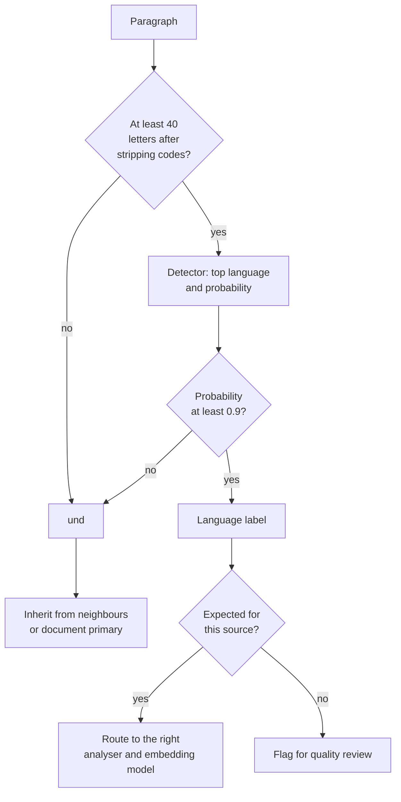

Meridian is a UK company, but its corpus is not entirely English. The Paris office has French versions of some HR policies, a few runbooks were written by engineers in Berlin, product documentation has been partly translated, and plenty of "documents" are mostly code, error messages or tables in no human language at all. A RAG system that does not know which language each piece of text is in will embed French policies with an English-only model, stem German words with English rules, and answer a French question from whichever chunk happens to share the most numbers with it.

**Language detection** is the preprocessing step that labels text with its language, so that later stages can route, filter and process it correctly. This lesson explains how statistical language detectors work, why they are reliable on paragraphs and unreliable on short strings, how to detect languages per paragraph in mixed documents, and what a RAG pipeline should do with the result.

## Learning objectives

- Explain why language matters to embedding, keyword indexing, filtering and generation in a RAG pipeline.
- Describe how a character n-gram naive Bayes detector scores text, and compute a posterior probability by hand.
- Explain why detectors are unreliable and overconfident on short or code-like text, and design thresholds that return "undetermined" instead of a guess.
- Implement paragraph-level detection that summarises a mixed-language document.
- Choose what the pipeline should do with each detected language: route, translate, filter or flag.

## Prerequisites

- [Normalisation](/learn/document-preprocessing/normalisation): the text should be normalised before detection.
- [Metadata extraction](/learn/document-preprocessing/metadata-extraction): language becomes a metadata field.
- [Embeddings](/learn/understanding-large-language-models/embeddings): what an embedding model can and cannot compare.
- [Tokens and tokenisation](/learn/understanding-large-language-models/tokens-and-tokenisation): why languages tokenise differently.

## Why this matters

Language affects almost every stage after preprocessing.

**Embedding.** Many popular embedding models were trained mostly or only on English. This module's examples use `all-MiniLM-L6-v2`, an English model. You will see below that it scores a French paragraph that answers the question *lower* than an English paragraph about something else entirely. If the corpus or the users are multilingual, you need a [multilingual embedding model](/learn/embedding-models/multilingual-embeddings), or separate indexes per language, and you can only make either choice if you know which text is in which language.

**Keyword indexing.** Keyword search tokenises, removes stop words and often stems words, and all three are language-specific. English stemming reduces "running" to "run"; applied to French it mangles words and fails to merge "travaille" and "travailler". Search engines such as Elasticsearch and OpenSearch provide a separate analyser per language precisely for this reason, and choosing one requires a language label.

**Filtering and answering.** A French-speaking employee in Paris may prefer French policies, or may need the Paris-specific policy that only exists in French. A filter on `language` makes that possible. The generator also needs to know: a prompt that says "answer in the user's language" works better when the system knows what that language is.

**Quality signals.** Language detection doubles as a cheap data-quality check. If a source is supposed to be English and a document comes back as "Catalan, 0.99", the document is probably garbage: OCR debris, a table of codes, mojibake that cleaning missed. [Data quality validation](/learn/document-preprocessing/data-quality-validation) uses exactly this signal.

Without detection, these failures are silent. The French policy is in the index; it just never ranks.

## The intuition

You can usually tell which language a paragraph is in without understanding a word of it. A paragraph full of "-tion", "les", "des" and "qu'" looks French; "sch", "ung" and "der" look German; "the", "ing" and "th" look English. You are not reading; you are recognising the *texture* of letter combinations, and you are good at it on a paragraph and bad at it on two words. Is "Meridian Sync" English? Latin? Indonesian? There is not enough texture to tell, and the honest answer is "I don't know".

Statistical language detectors do exactly this, with counted frequencies instead of instinct. Their weakness is that they rarely say "I don't know" by themselves. Asked about two words, they give a confident answer anyway. Much of this lesson is about adding that "I don't know" back.

## How it works

### Character n-gram models

A **character n-gram** is a sequence of $n$ consecutive characters. The word "jours" padded with spaces contains the trigrams " jo", "jou", "our", "urs" and "rs ". Each language has a characteristic distribution of n-grams: "the" is very frequent in English, rare in French; "our" is common in both.

The classic approach, described by Cavnar and Trenkle (1994), builds a profile of n-gram frequencies per language from training text and compares a document's profile to each. Most modern statistical detectors refine this into a probabilistic classifier:

1. **Training**: for each language $L$, estimate from a large corpus the probability $P(g \mid L)$ of each n-gram $g$, plus a prior $P(L)$.
2. **Feature extraction**: split the input text into n-grams (often of several lengths, from 1 to 3 characters).
3. **Scoring**: for each language, combine the probabilities of the input's n-grams, as below.
4. **Normalisation**: divide by the total over languages to get a probability per language.
5. **Decision**: return the language with the highest probability (or the full ranked list).

The `langdetect` package used below is a Python port of Nakatani Shuyo's language-detection library, which follows this approach with naive Bayes over character n-grams, and adds randomness: it samples n-grams repeatedly and averages the results, which is why it needs a fixed seed to be repeatable. Other common detectors use related ideas with different models: Google's CLD2 and CLD3, the fastText language-identification models (built on the classifier of Joulin et al., 2016) and Lingua, whose documentation emphasises accuracy on short text. They differ in speed, number of languages and short-text accuracy, so evaluate on your own data rather than trusting any one benchmark.

### Why short text fails, and why the confidence lies

Detectors need texture, and short strings have little. "VPN required" contains about a dozen trigrams, several of which ("VPN") occur in no particular language. Worse, the probability a naive Bayes detector reports is badly calibrated: it treats every n-gram as independent evidence, so the reported confidence grows with the *number* of n-grams that lean the same way, even when each leans only slightly. The mathematics section below makes this precise. The practical consequence, which you will see in the output below, is that `langdetect` labels "VPN required" as Catalan with probability above 0.9999.

Three kinds of input are especially unreliable:

- **Short strings**: titles, headings, table cells, labels, single sentences under roughly 40 letters.
- **Identifiers and code**: error codes, product names, URLs, email addresses, programming code.
- **Mixed text**: a sentence that quotes an English product name inside French prose.

The defences are simple: strip characters that carry no linguistic signal (digits, codes, URLs) before detecting, refuse to guess below a minimum number of letters, and treat a low top probability as undetermined. The code below uses the language tag `und` (undetermined), which is the standard code for this in BCP 47 language tags, the format used on the web and in most software.

### Granularity: documents, paragraphs, chunks

Detecting one language per document is the common default, and it is wrong for a significant share of real documents. Meridian's Paris remote-work policy has an English header block and a French body. A German runbook contains English error messages and code. An English email thread contains a French reply.

The more robust design detects per **paragraph**, then summarises:

- each paragraph gets a language or `und`;
- the document gets a **primary language** (the language with the most letters) and a **language distribution** (the share of letters per language);
- each chunk inherits the language of the paragraphs it contains, or is marked mixed.

Chunk-level language is what retrieval actually uses, because a filter or a routing decision applies to chunks. Document-level language is useful for reporting and for deciding which documents need translation.

### A cheap first pass: scripts

Before any statistics, Unicode tells you the **script** of each character: Latin, Cyrillic, Greek, Arabic, Han (Chinese characters), Hiragana, Katakana and so on. Script detection is exact and essentially free. It answers some questions outright (Hangul means Korean; Hiragana or Katakana means Japanese) and narrows others (Cyrillic could be Russian, Ukrainian or Bulgarian). It also catches garbage: text in an unexpected script, or a mixture of scripts inside single words, is often extraction debris or an attempt at spoofing, as discussed in [Normalisation](/learn/document-preprocessing/normalisation).

### What to do with the label



Common actions, by situation:

- **Monolingual corpus, monolingual users**: use detection as a quality check only; flag anything that is not the expected language.
- **Multilingual corpus, one multilingual embedding model**: store `language` on each chunk for filtering and for choosing the keyword analyser; embed everything with the same model.
- **Multilingual corpus, separate indexes**: route each chunk to the index for its language, and route each query by its own detected language (queries are short, so fall back to the user's interface language when the query is `und`).
- **Translation**: some systems translate documents into one pivot language at indexing time, or translate queries at search time. Both are possible, both cost money and introduce translation errors, and both need the language label to decide what to translate. Keep the original text for citation.

`und` paragraphs (headings, short labels, code) usually inherit the language of their neighbours or of the document, because a short heading in a French section is almost certainly French.

## The mathematics

A naive Bayes detector asks: given the n-grams $g_1, \dots, g_m$ in the text, which language $L$ is most probable? Bayes' rule, with the "naive" assumption that n-grams are independent given the language, gives

$$
P(L \mid g_1, \dots, g_m) = \frac{P(L) \prod_{i=1}^{m} P(g_i \mid L)}{\sum_{L'} P(L') \prod_{i=1}^{m} P(g_i \mid L')}
$$

where $P(L)$ is the prior probability of language $L$ (often uniform), $P(g_i \mid L)$ is the probability of seeing n-gram $g_i$ in text of language $L$, estimated from training data, $m$ is the number of n-grams in the input, and the denominator sums the same quantity over all candidate languages $L'$ so that the probabilities add up to 1. Products of many small numbers underflow, so implementations add logarithms instead of multiplying.

**Worked example.** Two languages, English and French, with equal priors of 0.5. The text is "jours", with trigrams "jou", "our" and "urs", and suppose training gave:

| Trigram | $P(g \mid \text{en})$ | $P(g \mid \text{fr})$ |
| --- | --- | --- |
| jou | 0.0002 | 0.002 |
| our | 0.004 | 0.003 |
| urs | 0.0005 | 0.001 |

English likelihood: $0.0002 \times 0.004 \times 0.0005 = 4.0 \times 10^{-10}$. French likelihood: $0.002 \times 0.003 \times 0.001 = 6.0 \times 10^{-9}$. The priors are equal and cancel, so

$$
P(\text{fr} \mid \text{jours}) = \frac{6.0 \times 10^{-9}}{6.0 \times 10^{-9} + 4.0 \times 10^{-10}} = \frac{6.0}{6.4} = 0.9375
$$

Now the overconfidence. Suppose each of $m$ n-grams is only 1.5 times likelier under language A than under B. The ratio of likelihoods is $1.5^m$, so with equal priors $P(A) = 1 / (1 + 1.5^{-m})$. For $m = 3$ that is 0.77; for $m = 12$, about the size of "VPN required", it is 0.992; for $m = 30$ it is 0.999995. Each n-gram is weak evidence, but the independence assumption treats them as separate confirmations, and the posterior races towards 1. In reality, n-grams from the same short string are highly dependent (overlapping trigrams share two characters), so the true evidence is much weaker than the formula claims. This is why a minimum length matters more than a probability threshold for short text.

```python
import numpy as np

p_en = np.array([0.0002, 0.004, 0.0005])   # P(trigram | English) for 'jou', 'our', 'urs'
p_fr = np.array([0.002, 0.003, 0.001])     # P(trigram | French)
prior = 0.5

log_en = np.log(prior) + np.log(p_en).sum()
log_fr = np.log(prior) + np.log(p_fr).sum()
post_fr = 1 / (1 + np.exp(log_en - log_fr))     # normalise the two scores
print(f"likelihood en={np.exp(log_en - np.log(prior)):.1e} fr={np.exp(log_fr - np.log(prior)):.1e}")
print(f"P(fr | 'jours') = {post_fr:.4f}")

# Twelve trigrams, each only 1.5 times likelier under one language than the other:
for n in [3, 12, 30]:
    print(f"{n:>2} trigrams at ratio 1.5 -> posterior {1 / (1 + 1.5 ** -n):.6f}")
```

```output
likelihood en=4.0e-10 fr=6.0e-09
P(fr | 'jours') = 0.9375
 3 trigrams at ratio 1.5 -> posterior 0.771429
12 trigrams at ratio 1.5 -> posterior 0.992352
30 trigrams at ratio 1.5 -> posterior 0.999995
```

The line `1 / (1 + np.exp(log_en - log_fr))` is the two-language normalisation written in log space: it equals $\text{fr}/(\text{fr} + \text{en})$ without ever forming the tiny products.

## In code

The first program runs `langdetect` on the same Meridian fact in four languages and on four short strings of the kind that fill real documents: a label, an error code, a one-word reply and a product name.

```bash
pip install langdetect
```

```python
from langdetect import DetectorFactory, detect_langs

DetectorFactory.seed = 0          # langdetect is randomised; fix the seed for repeatable output

samples = [
    "Every employee is entitled to 25 days of annual leave a year.",
    "Chaque salarié a droit à 25 jours de congés payés par an.",
    "Jeder Mitarbeiter hat Anspruch auf 25 Tage Jahresurlaub pro Jahr.",
    "Cada empleado tiene derecho a 25 días de vacaciones al año.",
    "VPN required",
    "Error E-4021",
    "OK",
    "Meridian Sync",
]
for s in samples:
    print(f"{s[:45]!r:<48} {detect_langs(s)}")
```

```output
'Every employee is entitled to 25 days of annu'  [en:0.9999945369368057]
'Chaque salarié a droit à 25 jours de congés p'  [fr:0.9999961660230259]
'Jeder Mitarbeiter hat Anspruch auf 25 Tage Ja'  [de:0.9999977218859637]
'Cada empleado tiene derecho a 25 días de vaca'  [es:0.9999961039606371]
'VPN required'                                   [ca:0.9999960296213383]
'Error E-4021'                                   [de:0.582976120856909, ca:0.41702254783636056]
'OK'                                             [pt:0.9999940030866616]
'Meridian Sync'                                  [id:0.571427694503378, cy:0.42857119975590163]
```

What the output means. On full sentences, the detector is right and confident. On short strings it is wrong, and in two cases wrong with near-certainty: "VPN required" is labelled Catalan (`ca`) and "OK" Portuguese (`pt`), each with probability above 0.9999. "Meridian Sync" comes back as Indonesian or Welsh. These are exactly the overconfident posteriors the mathematics predicted. A pipeline that trusted these labels would route a runbook heading to a Catalan analyser. Note `DetectorFactory.seed = 0`: without it, `langdetect` can return different answers for the same short input on different runs.

The second program wraps the detector in the defences described above (strip codes and digits, require a minimum number of letters, require a minimum probability, return `und` otherwise), applies it per paragraph to a mixed-language Paris policy, and summarises the document. It also shows script counting with the standard library.

```python
import re
import unicodedata
from collections import Counter

from langdetect import DetectorFactory, LangDetectException, detect_langs

DetectorFactory.seed = 0

MIN_LETTERS = 40        # below this, a statistical guess is not worth making
MIN_PROB = 0.90         # below this, call the paragraph undetermined


def letters(text: str) -> str:
    """Letters only: digits, codes and punctuation tell a detector nothing."""
    return "".join(ch for ch in re.sub(r"\b[A-Z]+-?\d+\b", " ", text) if ch.isalpha())


def scripts(text: str) -> Counter:
    """Count letters by Unicode script, using the first word of each character's name."""
    return Counter(unicodedata.name(ch, "UNKNOWN").split()[0] for ch in text if ch.isalpha())


def paragraph_language(p: str) -> str:
    if len(letters(p)) < MIN_LETTERS:
        return "und"                                     # undetermined: too short to judge
    try:
        best = detect_langs(p)[0]
    except LangDetectException:
        return "und"
    return best.lang if best.prob >= MIN_PROB else "und"


def document_languages(text: str) -> tuple[str, dict[str, float]]:
    """Primary language and the share of letters in each language."""
    weight = Counter()
    for p in (p.strip() for p in text.split("\n\n")):
        if p:
            weight[paragraph_language(p)] += len(letters(p))
    total = sum(weight.values())
    shares = {lang: round(n / total, 2) for lang, n in weight.most_common()}
    detected = [l for l in shares if l != "und"]
    return (detected[0] if detected else "und"), shares


doc = """Remote work policy (Paris office)

Staff may work remotely up to 3 days a week. The home-office equipment budget is £400.

Les salariés du bureau de Paris peuvent travailler à distance jusqu'à trois jours par semaine.

Contact: hr@meridian.example

VPN E-4021"""

for p in doc.split("\n\n"):
    print(f"{paragraph_language(p):<4} {p[:60]}")
print("\ndocument:", document_languages(doc))
print("scripts:", scripts("Meridian 東京オフィス"))
```

```output
und  Remote work policy (Paris office)
en   Staff may work remotely up to 3 days a week. The home-office
fr   Les salariés du bureau de Paris peuvent travailler à distanc
und  Contact: hr@meridian.example
und  VPN E-4021

document: ('fr', {'fr': 0.4, 'en': 0.32, 'und': 0.28})
scripts: Counter({'LATIN': 8, 'KATAKANA': 4, 'CJK': 2})
```

The important lines:

- `letters` removes code-like tokens (`E-4021`, `ISO9001`) with a regular expression and keeps only alphabetic characters, so the length check counts linguistic material only.
- `paragraph_language` returns `und` for anything under 40 letters, before the detector is even called. The title, the contact line and the error code are all `und`, which is honest.
- `LangDetectException` is raised when the detector finds no usable features (for example, text that is all digits); it is caught and mapped to `und`.
- `document_languages` weights each paragraph's language by its number of letters, so a long French paragraph counts for more than a short English one.
- `scripts` uses the first word of each character's Unicode name ("LATIN SMALL LETTER M", "KATAKANA LETTER O", "CJK UNIFIED IDEOGRAPH-6771"), a crude but dependency-free way to see which scripts are present.

What the output means. The document is genuinely bilingual: 40% of its letters are French, 32% English, and the rest undetermined. Its "primary language" is French only because the French paragraph is a few words longer than the English one, which shows why a single document-level label is a poor summary of such a document. Each chunk should carry its own label: the English chunk `en`, the French chunk `fr`, and the short chunks inheriting from their neighbours. The script count confirms that "Meridian 東京オフィス" mixes Latin, Katakana and Han (CJK) characters, so it cannot be treated as one language either.

The third program shows why any of this matters for retrieval. It embeds an English query and four documents with the English MiniLM model.

```bash
pip install sentence-transformers
```

```python
from sentence_transformers import SentenceTransformer

model = SentenceTransformer("sentence-transformers/all-MiniLM-L6-v2")   # trained on English
query = "How many days can I work from home each week?"
docs = {
    "English, relevant": "Staff may work remotely up to 3 days a week.",
    "French, relevant": "Les salariés peuvent travailler à distance jusqu'à trois jours par semaine.",
    "German, relevant": "Mitarbeiter dürfen bis zu drei Tage pro Woche von zu Hause arbeiten.",
    "English, unrelated": "Laptops are refreshed every 3 years.",
}
vectors = model.encode([query, *docs.values()], normalize_embeddings=True)
for (label, _), v in zip(docs.items(), vectors[1:]):
    print(f"{label:<20} cosine {vectors[0] @ v:.3f}")
```

```output
English, relevant    cosine 0.640
French, relevant     cosine 0.177
German, relevant     cosine 0.149
English, unrelated   cosine 0.198
```

What the output means. The French and German paragraphs say exactly what the query asks, yet both score *below* an unrelated English sentence about laptops. To this model, they are not similar in meaning to the query, because it never learned to align French or German with English. In a mixed corpus indexed with this model, the French policy would never be retrieved for an English question, and a French question would be matched mostly on shared numbers and names. This is the strongest argument for detecting language at indexing time: it tells you whether your embedding model is even capable of handling the corpus, and which chunks need a different model.

Errors people commonly hit:

- **Forgetting `DetectorFactory.seed`.** Results on borderline inputs change between runs, so tests become flaky and the same document gets different labels on re-ingestion.
- **Calling `detect` on empty or numeric text.** It raises `LangDetectException`; wrap it, as above.
- **Treating `detect_langs` probabilities as calibrated.** On short text they are not; rely on length thresholds first.

To extend this: inherit labels for `und` paragraphs from their neighbours, store per-chunk `language` and per-document `language_shares` in the metadata, and add an alert when a source's language distribution changes between ingestion runs.

## A real-world example

When Meridian opened its Paris office, HR added 40 French policy documents to the handbook source. A month later the Paris office manager reported that AskMeridian "ignored" the Paris-specific rules: asked in French about the office's working-from-home arrangements, it answered in French, but from the UK policy.

The Platform team's investigation took an afternoon once they thought to check language. The index used the same English MiniLM model as this lesson. French questions embedded poorly, and French policy chunks embedded poorly, so retrieval was effectively driven by shared tokens such as "3", "Meridian" and "VPN", which the UK documents contained in abundance. The French documents were in the index, and as the measurement above shows, they could not compete.

Three changes followed. The ingestion pipeline gained paragraph-level language detection, storing `language` on each chunk and `language_shares` on each document, with the thresholds used in this lesson. The team evaluated a multilingual embedding model on a small bilingual test set (English questions with French answers, French questions with English answers, and same-language pairs) and switched to it after it held up on the English-only questions too. And they added a source-level check: any HR document detected as neither English nor French is quarantined for review. The check caught two "documents" in its first week, both scanned forms whose OCR text was a soup of fragments that the detector had labelled as Latvian and Somali.

## Common mistakes

- **Detecting one language per document.** Bilingual policies, runbooks with English error messages and email threads get a single label that is wrong for much of their text.
- **Trusting detections on short text.** Titles, labels, codes and product names produce confident nonsense ("VPN required" as Catalan).
- **Not removing codes, URLs and numbers before detection.** They dilute or distort the signal without carrying any language information.
- **Using an English-only embedding model on a multilingual corpus without checking.** Non-English documents are indexed but effectively unretrievable.
- **Using the wrong stemmer or stop-word list for a language.** Keyword search on non-English chunks quietly degrades.
- **Leaving the detector unseeded.** Labels change between runs, so re-ingestion changes metadata for unchanged documents.
- **Detecting the query's language from a few words without a fallback.** Queries are short; use the user's interface or profile language when the query is undetermined.

## Best practices

- Detect per paragraph, summarise per document, and store the label per chunk.
- Strip codes, URLs, digits and punctuation before detection, and return `und` below a minimum letter count and below a minimum probability.
- Use script detection as an exact, free first pass and as a garbage detector.
- Check, with a small cross-language test set, that your embedding model can handle every language your corpus contains.
- Choose keyword analysers per language, using the label.
- Treat an unexpected language for a source as a data-quality signal and route the document to review.
- Fix seeds and pin detector versions so labels are reproducible across runs.

## Performance considerations

Statistical detectors are fast relative to everything around them. Their cost is a pass over the characters plus table lookups, so time grows linearly with text length, and `langdetect`'s internal sampling means it does not need to read a very long document in full to be confident. Pure-Python `langdetect` is among the slower options; compiled detectors (CLD2 and CLD3 bindings, fastText) are typically much faster, which matters only at very large scale.

A useful rule is to cap the text per detection. Language rarely changes within a paragraph, so detecting on the first 1,000 characters of each paragraph gives the same answer for nearly all real text at bounded cost. For a corpus of one billion characters split into paragraphs averaging 500 characters, that is two million detections. At an assumed 1 millisecond each in pure Python, 2,000 seconds, about 33 minutes on one core, and the work parallelises perfectly across documents. That is small next to embedding the same corpus.

The bigger costs are the *consequences* of detection: a second embedding model for another language doubles the number of models to host or pay for; separate per-language indexes multiply storage and operational work; translation at indexing time costs per token for every non-English document. Detection gives you the numbers to estimate these before you commit: the language distribution of the corpus tells you how much text each option would touch.

## Security considerations

- **Language labels can be manipulated.** An attacker who controls a document can pad it with text in another language to change its label, and so its routing or filtering. If language drives access or exposure decisions (for example, "only English documents are shown to the US team"), it should not; use proper permissions for that.
- **Unexpected language or script is a useful anomaly signal.** Indirect prompt-injection payloads are sometimes written in a different language or script from the surrounding document, in the hope that human reviewers skim past them. A paragraph in an unexpected language inside an otherwise English runbook is worth flagging, though not proof of anything.
- **Translation services see your text.** If the pipeline sends non-English documents to an external translation API, that is a data transfer subject to the same confidentiality and personal-data rules as any other.

## Summary

- Language affects embedding quality, keyword analysis, filtering, routing and generation; an English-only model can score a relevant French paragraph below an unrelated English one.
- Statistical detectors score character n-grams per language; they are accurate on paragraphs and unreliable on short or code-like text.
- Naive Bayes confidence is badly calibrated on short text because overlapping n-grams are treated as independent evidence, so use minimum lengths, then probability thresholds, and return `und` rather than guessing.
- Detect per paragraph and store labels per chunk; summarise a document as a primary language plus a distribution.
- Use the labels to choose models and analysers, to filter and route, and to flag documents in unexpected languages for quality review.

## Exercises

1. Using the worked example's table, compute by hand $P(\text{fr} \mid \text{our})$ for the single trigram "our". Why is it below 0.5 even though "our" is common in French?

<details><summary>Show solution</summary>

With equal priors, $P(\text{fr} \mid \text{our}) = 0.003 / (0.003 + 0.004) = 3/7 \approx 0.429$. It is below 0.5 because "our" is even more common in English (0.004) than in French (0.003). A trigram being common in a language is not evidence for that language; only its *relative* frequency across languages is. This is why shared n-grams contribute little and distinctive ones ("jou") decide the answer.

</details>

2. Modify `paragraph_language` so that `und` paragraphs inherit the language of the nearest preceding detected paragraph, or of the next one if none precedes. Apply it to the Paris document and print the labels.

<details><summary>Show solution</summary>

```python
def label_with_inheritance(paragraphs: list[str]) -> list[str]:
    labels = [paragraph_language(p) for p in paragraphs]
    out = labels[:]
    last = None
    for i, lab in enumerate(labels):            # forward pass: inherit from the previous label
        if lab != "und":
            last = lab
        elif last:
            out[i] = last
    for i in range(len(out) - 1, -1, -1):       # backward pass: leading und paragraphs
        if out[i] == "und":
            following = [l for l in out[i + 1:] if l != "und"]
            if following:
                out[i] = following[0]
    return out

paras = [p for p in doc.split("\n\n") if p.strip()]
for lab, p in zip(label_with_inheritance(paras), paras):
    print(f"{lab:<4} {p[:50]}")
```

```output
en   Remote work policy (Paris office)
en   Staff may work remotely up to 3 days a week. The h
fr   Les salariés du bureau de Paris peuvent travailler
fr   Contact: hr@meridian.example
fr   VPN E-4021
```

The title inherits English from the following paragraph; the contact line and error code inherit French from the preceding one. Inheritance is a heuristic: the contact line is not really French. It is good enough for routing and analyser choice, but keep the original `und` as well (for example, `language_detected: und`, `language: fr`) so that you can tell inferred labels from detected ones.

</details>

3. Design question. Meridian's product documentation is 90% English, 7% French and 3% German, and users ask questions in all three languages. Compare (a) one multilingual embedding model for everything, (b) separate per-language indexes with per-language models, and (c) translating all documents into English at indexing time. Recommend one.

<details><summary>Show solution</summary>

- **(a) One multilingual model**: one index, one model, cross-language retrieval works (a French question can find an English answer, which matters when only the English version exists). Costs: multilingual models may be somewhat weaker on English than the best English-only ones, so evaluate on English queries too. Keyword search still needs per-language analysers, chosen with the language label.
- **(b) Per-language indexes**: best in-language quality and per-language analysers, but a French question cannot find an English-only answer unless you also search the English index (and then you must fuse rankings across indexes). Three times the operational surface.
- **(c) Translate to English**: one English index and model; cross-language retrieval works through the translation. Costs: translation for 10% of the corpus on every change, translation errors in the indexed text, and you must keep and cite the original. Queries also need translating.

For this distribution, (a) is usually the best starting point: it keeps one pipeline, supports cross-language questions, and the language label still drives analyser choice and optional filtering. Verify with a small test set that includes cross-language pairs and English-only pairs before switching.

</details>

## Check your understanding

```quiz
[
  {"q": "Why does `langdetect` return a probability above 0.9999 for 'VPN required' being Catalan?", "options": ["Because naive Bayes treats each of the few, overlapping n-grams as independent evidence, so the posterior is overconfident on short text", "Because the phrase is Catalan", "Because the seed was set to 0", "Because Catalan is the detector's default language"], "answer": 0, "why": "Multiplying many weakly informative, correlated n-gram probabilities pushes the normalised posterior towards 1 even when the true evidence is weak."},
  {"q": "What is the best response when a paragraph has fewer than 40 letters after removing codes and digits?", "options": ["Use the detector's top result anyway", "Label it English, since most of the corpus is English", "Delete the paragraph", "Label it undetermined (`und`), and optionally inherit a label from neighbouring paragraphs"], "answer": 3, "why": "Short text gives unreliable detections; marking it undetermined and inheriting from context is safer than trusting a confident guess."},
  {"q": "An English-only embedding model scores a French paragraph that answers the query below an unrelated English sentence. What does this tell you?", "options": ["The French paragraph needs cleaning", "The model cannot align French with English, so French documents are effectively unretrievable for English queries with this model", "Cosine similarity is broken for accented characters", "The query needs normalising"], "answer": 1, "why": "Without multilingual training the model does not place translations near each other; a multilingual model or per-language handling is needed."},
  {"q": "Why should language be stored per chunk rather than only per document?", "options": ["Vector databases cannot store document-level fields", "Per-chunk detection is faster", "Many documents mix languages, and filtering, routing and analyser choice apply to chunks", "Language codes are too long for document metadata"], "answer": 2, "why": "Bilingual policies and runbooks with English error messages need chunk-level labels for correct downstream processing."},
  {"q": "In the formula P(L | g1..gm), what does the denominator do?", "options": ["It applies the prior", "It sums the numerator over all candidate languages so that the probabilities add up to 1", "It removes stop words", "It counts the n-grams in the text"], "answer": 1, "why": "The denominator is the same for every language and normalises the scores into a probability distribution."}
]
```

## Further reading

- William B. Cavnar and John M. Trenkle (1994), *N-Gram-Based Text Categorization*: the n-gram profile method for language identification.
- [langdetect on PyPI](https://pypi.org/project/langdetect/): the Python port of Nakatani Shuyo's language-detection library, including the note on seeding.
- Armand Joulin, Edouard Grave, Piotr Bojanowski and Tomas Mikolov (2016), *Bag of Tricks for Efficient Text Classification*: the fastText classifier, on which fastText's language-identification models are built.
- [BCP 47: Tags for Identifying Languages (RFC 5646)](https://www.rfc-editor.org/rfc/rfc5646): the standard for language tags, including `und`.
- [Python `unicodedata` module](https://docs.python.org/3/library/unicodedata.html): character names and properties used for script detection.
