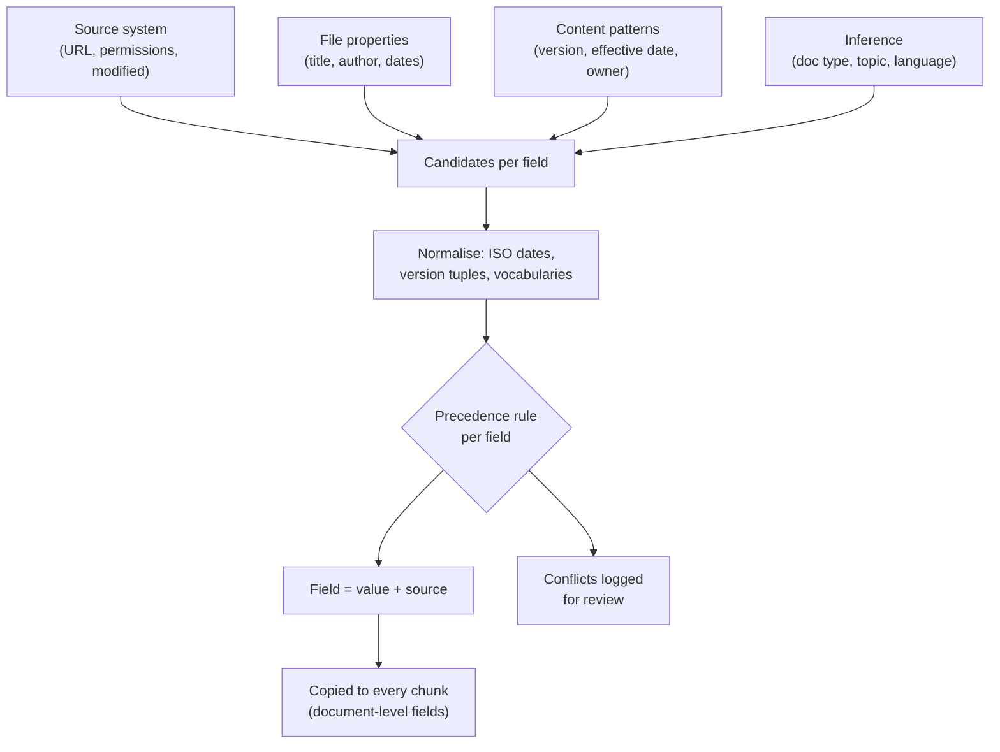

A chunk of text on its own can answer "what does it say?". It cannot answer "which document is this from, is it current, who owns it, which section is it in, and who is allowed to read it?". Those answers are **metadata**, and a RAG system needs them for filtering, ranking, citation and access control. Some metadata arrives with the document from its source system. Much of the rest is sitting in the document itself, in a title, a version line, an "effective from" date, an owner statement, a running header, waiting to be pulled out into structured fields.

This lesson is about that extraction: where metadata can come from, how reliable each source is, how to extract fields from document content with patterns and, where patterns are not enough, with a language model, and how to record where every value came from so that a wrong value can be traced and fixed. *Designing* a metadata schema is covered in [Document metadata](/learn/document-engineering/document-metadata); *using* metadata at query time is covered in [Metadata-aware retrieval](/learn/advanced-retrieval/metadata-aware-retrieval). This lesson sits between them.

## Learning objectives

- List the four sources of document metadata (source system, file properties, document content, inference) and rank their reliability for a given field.
- Extract titles, versions, effective dates, owners and identifiers from document content with patterns, and normalise the values to typed, canonical forms.
- Implement a precedence rule that chooses between conflicting values and records the provenance of each field.
- Explain why access-control metadata must come from the source system and never from content or inference.
- Use a language model with validated structured output for fields patterns cannot capture, and judge when its cost and error rate are acceptable.

## Prerequisites

- [Document metadata](/learn/document-engineering/document-metadata): what fields a RAG document record should have and why.
- [DOCX extraction](/learn/data-processing/docx-extraction) and [PDF extraction](/learn/data-processing/pdf-extraction): reading text and properties from files.
- [Dataclasses and Pydantic](/learn/python-for-rag-engineering/dataclasses-and-pydantic): typed records and validation.
- [Header and footer removal](/learn/document-preprocessing/header-and-footer-removal): running headers, which are one input to metadata.

## Why this matters

Four things in a RAG system depend on metadata, and each fails in a recognisable way when the metadata is missing or wrong.

**Filtering.** "What is the current remote-work policy?" should only consider current HR policies. If documents carry `doc_type` and `effective_date`, the retriever can filter before ranking, as described in [Filtered retrieval](/learn/advanced-retrieval/filtered-retrieval). Without them, the superseded 2023 handbook, with its £250 equipment budget, competes on equal terms with the current one, and since the two are worded almost identically, retrieval may well pick the old one.

**Ranking and freshness.** When two documents disagree, the system needs a way to prefer the newer or more authoritative one. That needs dates and versions that mean what they say.

**Citation.** Users trust an answer more when it says "Remote Work Policy, version 3.2, effective 1 April 2025, owned by HR". A citation of "remote-work-policy.docx" is less useful, and a citation of "Policy template" (a stale file property) is actively misleading.

**Access control.** Users must only retrieve what they are allowed to read. That depends on permission metadata attached to every chunk, as covered in [Document-level permissions](/learn/access-control-and-privacy/document-level-permissions).

The trap is that metadata *looks* authoritative. A field called `modified` with a date in it gets used for freshness ranking whether or not the date is right. In practice, file properties are frequently stale: documents created from templates inherit the template's title, author and dates, and you will see exactly that happen in the code below. Wrong metadata is worse than missing metadata, because missing values are handled as unknown while wrong values are trusted.

## The intuition

Picture a records clerk receiving a box of files to catalogue. For each one she fills in a card: title, date, owner, type. She has four places to look:

- **The delivery note** from the department that sent the box: "HR policies, sent by the HR team, last updated 2 May". Usually accurate for what the sending system knows.
- **The file's label**, stuck on by whoever first created the folder. Often right, often years out of date, sometimes the label of a reused folder.
- **The document itself**: its title page, its "Version 3.2, effective 1 April 2025" line, its "Owner: HR team" statement. The author wrote these deliberately, so when they exist they are usually the best evidence.
- **Her own judgement**: "this reads like a runbook", "this seems to be about expenses". Useful, but a guess, and she marks it as such.

A good clerk does not just write a value on the card. She writes where she got it, so that when someone later says "this date is wrong", she can see whether to blame the label, the delivery note or her own guess. That is the design this lesson builds: every field has a value *and* a source.

## How it works

### Four sources of metadata

| Source | Examples | Reliability | Typical fields |
| --- | --- | --- | --- |
| Source system | SharePoint, Confluence, Google Drive, a CMS, a ticketing system | High for what the system controls | URL, document ID, permissions, last modified time, space or folder, owner account |
| File properties | DOCX core properties, PDF document information | Low to medium; often inherited from templates or set by conversion tools | title, author, created, modified, producer |
| Document content | title heading, version line, effective date, owner statement, error codes, running headers | High when present, because the author stated it on purpose | title, version, effective date, owner, section, identifiers mentioned |
| Inference | classifier, keyword rules, language model, language detector | Varies; always a guess | document type, topic, summary, language, audience |

Three principles follow from this table.

1. **Each field has a best source.** Permissions: the source system, always. Effective date: the content, if stated. Last-modified time: the source system, not the file property. Title: the content's first heading, then the source system's title, then the file property, then the file name.
2. **File properties are a fallback, not a default.** Word's `core_properties`, PDF's `/Info` dictionary and similar fields are whatever the last tool to touch the file wrote there. Templates, document generators, PDF printers and conversion services all leave their own values. Use file properties only when nothing better exists, and record that you did.
3. **Inference is labelled as inference.** A language model's guess that a document is a "policy" is useful for ranking and filtering, but it should be stored with its source so that it can be treated differently from a value the author stated.

### Extracting from content

Most high-value fields in corporate documents follow conventions within a source: "Version 3.2", "Effective from 1 April 2025", "Owner: HR team", "Document ID: HR-POL-014". Patterns (regular expressions) extract these reliably and cheaply. The work is in three details.

**Normalising values.** Extracted strings must become typed, canonical values, or they cannot be filtered or compared:

- **Dates** become ISO dates (`2025-04-01`). Parse with an explicit format where you know it (`datetime.strptime(value, "%d %B %Y")`). Numeric dates are ambiguous: `03/04/2025` is 3 April in the UK and 4 March in the US. If you use a lenient parser such as `dateutil.parser.parse`, set `dayfirst=True` for UK sources, because its default reads that string as 4 March.
- **Versions** are compared as tuples of integers, not as strings: as strings, `"3.10" < "3.9"`.
- **Organisational names** map to a controlled vocabulary: "HR", "Human Resources" and "People team" all become `hr`. Free-text owner values make filters useless.

**Choosing between multiple matches.** A document may mention several dates: the effective date, the date a previous version was withdrawn, a deadline inside a policy ("used by 31 March"). The pattern must anchor on the label ("Effective from"), not just find any date. When a pattern matches more than once, decide explicitly: first occurrence (usually the header block), or all values (for identifiers such as error codes, where the list is the point).

**Document-level versus chunk-level fields.** Title, version, owner and effective date describe the whole document and are copied to every chunk. Section headings, page numbers and the error codes mentioned in a passage describe one chunk. The second kind comes from [Document segmentation](/learn/document-preprocessing/document-segmentation) and from the running headers kept in [Header and footer removal](/learn/document-preprocessing/header-and-footer-removal), and must be attached chunk by chunk.

### Precedence and provenance

When sources disagree, a fixed precedence rule decides. The steps for each field:

1. Collect candidate values from every source that can supply the field.
2. Normalise each candidate to the field's type.
3. Choose the candidate from the highest-precedence source that produced a valid value.
4. Store the value together with its **provenance**: the source, and ideally the rule or pattern that produced it.
5. Optionally, record conflicts (the content says version 3.2, the file name says v3.1) for review.



Provenance pays for itself the first time a value is wrong. "Why is this policy shown as owned by Template Admin?" has an immediate answer if the field says `source: file properties`, and the fix is to improve the precedence rule for that field, not to hunt through the pipeline.

### Access control is never extracted

Permission metadata deserves its own rule: **it comes from the source system's access-control lists, and from nowhere else**. A document that says "Confidential: HR only" in its header is making a claim that may be out of date, mistaken, or written by an attacker. If an inference step decided permissions from content, anyone able to write a document could make it visible to everyone, or invisible to the people who need it. Content markings can be used to *flag* mismatches for review ("this document says confidential but its ACL is company-wide"), which is a valuable check, but never to set permissions.

### When patterns are not enough: language models

Some fields have no consistent surface form: "who is this document for?", "what product does this page describe?", "summarise this runbook in one sentence". Others follow conventions that vary across hundreds of templates. A language model can extract these, given the start of the document and a schema. The safe pattern is:

1. Define the output as a Pydantic model with constrained types (enumerations for document types, dates as `date`, optional fields allowed to be missing).
2. Ask for **extraction, not invention**: the prompt tells the model to return null for anything not stated.
3. Use validated structured output so the response either parses into the model or fails loudly.
4. Store results with `source: llm`, and prefer pattern-extracted values over model-extracted ones when both exist.
5. Evaluate on a labelled sample, field by field, before trusting it, the same way as the noise filters in [Noise removal](/learn/document-preprocessing/noise-removal).

Models are good at this kind of reading, but they can still produce a plausible value that the document does not contain, especially for dates and version numbers. That is why their output is a candidate with a lower precedence, not the final word.

## In code

The first program builds two small Meridian files: a Word policy created from an old template, and a PDF runbook with sensible document properties. It writes them into folders named after their source (`hr` and `it`), as a document-management export might.

```bash
pip install python-docx pymupdf pypdf
```

```python
# make_files.py
import datetime as dt

import docx
import pymupdf


def make_files() -> None:
    # A Word document created from an old template: its core properties are stale.
    d = docx.Document()
    d.core_properties.title = "Policy template"
    d.core_properties.author = "Template Admin"
    d.core_properties.created = dt.datetime(2019, 2, 1, 9, 0)
    d.add_heading("Remote Work Policy", level=1)
    d.add_paragraph("Version 3.2. Effective from 1 April 2025. Owner: HR team.")
    d.add_paragraph("Staff may work remotely up to 3 days a week. "
                    "The home-office equipment budget is £400.")
    d.save("corpus/hr/remote-work-policy.docx")

    # A PDF runbook with sensible document properties but no dates in the text.
    pdf = pymupdf.open()
    page = pdf.new_page()
    page.insert_text((50, 72), "VPN Error Codes", fontsize=16)
    page.insert_text((50, 100), "Error E-4021 means the VPN client is out of date.", fontsize=11)
    pdf.set_metadata({"title": "VPN Error Codes", "author": "Platform team",
                      "creationDate": "D:20250312100000Z", "modDate": "D:20250502083000Z"})
    pdf.save("corpus/it/vpn-error-codes.pdf")
```

The second program extracts metadata from both, applying the precedence rule (content first, then path conventions, then file properties) and printing each field with its source. Create the `corpus/hr` and `corpus/it` folders before running it.

```python
import datetime as dt
import re
from dataclasses import dataclass
from pathlib import Path

import docx
import pypdf

from make_files import make_files


@dataclass
class Field:
    value: object
    source: str          # where the value came from: content, path or file properties


DATE = r"(\d{1,2} (?:January|February|March|April|May|June|July|August|September|October|November|December) \d{4})"
PATTERNS = {
    "version": re.compile(r"\bVersion (\d+(?:\.\d+)*)\b"),
    "effective_date": re.compile(r"\bEffective (?:from|on)?\s*" + DATE),
    "owner": re.compile(r"\bOwner: ([A-Z][\w ]{1,40}?)(?:\.|$)", re.M),
    "error_codes": re.compile(r"\b(E-\d{4})\b"),
}
DOC_TYPE_BY_FOLDER = {"hr": "policy", "it": "runbook"}


def read(path: Path) -> tuple[str, dict]:
    """Body text plus the file's own properties, for .docx and .pdf."""
    if path.suffix == ".docx":
        d = docx.Document(path)
        cp = d.core_properties
        text = "\n".join(p.text for p in d.paragraphs)
        title = d.paragraphs[0].text if d.paragraphs and d.paragraphs[0].style.name.startswith("Heading") else None
        props = {"title": cp.title, "author": cp.author, "modified": cp.modified, "first_heading": title}
    else:
        r = pypdf.PdfReader(path)
        text = "\n".join(p.extract_text() for p in r.pages)
        m = r.metadata                                   # None if the PDF has no info dictionary
        props = {"title": m and m.title, "author": m and m.author, "modified": m and m.modification_date,
                 "first_heading": text.splitlines()[0] if text else None}
    return text, props


def extract(path: Path) -> dict[str, Field]:
    text, props = read(path)
    meta: dict[str, Field] = {}

    # 1. From the content: explicit statements beat everything else.
    for name, pattern in PATTERNS.items():
        found = pattern.findall(text)
        if found:
            value = sorted(set(found)) if name == "error_codes" else found[0]
            if name == "effective_date":
                value = dt.datetime.strptime(value, "%d %B %Y").date()
            meta[name] = Field(value, "content")

    # 2. Title: the document's first heading, else the file property, else the file name.
    if props["first_heading"]:
        meta["title"] = Field(props["first_heading"].strip(), "content")
    elif props["title"]:
        meta["title"] = Field(props["title"], "file properties")
    else:
        meta["title"] = Field(path.stem.replace("-", " ").title(), "path")

    # 3. From the path: folder conventions are reliable if the folders are curated.
    meta["doc_type"] = Field(DOC_TYPE_BY_FOLDER.get(path.parent.name, "unknown"), "path")

    # 4. From file properties, only where nothing better exists.
    if "owner" not in meta and props["author"]:
        meta["owner"] = Field(props["author"], "file properties")
    if props["modified"]:
        meta["file_modified"] = Field(props["modified"].date(), "file properties")
    return meta


make_files()
for path in sorted(Path("corpus").rglob("*.*")):
    print(path)
    for name, f in extract(path).items():
        print(f"  {name:<15} {str(f.value):<28} ({f.source})")
```

```output
corpus/hr/remote-work-policy.docx
  version         3.2                          (content)
  effective_date  2025-04-01                   (content)
  owner           HR team                      (content)
  title           Remote Work Policy           (content)
  doc_type        policy                       (path)
  file_modified   2013-12-23                   (file properties)
corpus/it/vpn-error-codes.pdf
  error_codes     ['E-4021']                   (content)
  title           VPN Error Codes              (content)
  doc_type        runbook                      (path)
  owner           Platform team                (file properties)
  file_modified   2025-05-02                   (file properties)
```

The important lines:

- `PATTERNS` anchor on labels ("Version", "Effective from", "Owner:"), so the 31 March deadline inside a leave policy would never be mistaken for the effective date.
- `datetime.strptime(value, "%d %B %Y")` parses with an explicit format, so there is no day-first ambiguity, and the result is a `date` object that can be compared and filtered.
- The title rule prefers the document's own first heading. In the Word file, the core property says "Policy template", inherited from the template, and is correctly ignored.
- `owner` falls back to the file's author only when the content states no owner, and the source column says so.
- `Field` carries the source with every value. In a real pipeline you would store it next to the value in the document record, for example as `{"owner": "HR team", "owner_source": "content"}`.

What the output means. Look at `file_modified` for the Word document: **2013-12-23**, for a policy that is effective from 2025. That date was never set by anyone at Meridian. It comes from the default template inside `python-docx`, which carries its own last-modified timestamp, and every document created from that template inherits it until a tool updates it. This is the stale-template problem in miniature, and it is why `file_modified` is labelled with its source rather than trusted as the document's age. If a freshness ranker used it, this current policy would be treated as more than ten years old. The PDF's properties, by contrast, are plausible; the point is not that file properties are always wrong, but that you cannot tell from the value alone.

For fields with no fixed surface form, a language model can extract structured values. The program below uses the Anthropic SDK's validated structured output. It needs an API key and was not executed for this lesson, so no output is shown.

```bash
pip install anthropic pydantic
```

```python
import datetime as dt
from typing import Literal

import anthropic
from pydantic import BaseModel, Field


class ExtractedMetadata(BaseModel):
    title: str | None = Field(description="The document's title as written, or null")
    doc_type: Literal["policy", "runbook", "product_doc", "other"]
    effective_date: dt.date | None = Field(description="Only if the document states one")
    owner_team: str | None = Field(description="The team named as owner, or null")
    audience: str | None = Field(description="Who the document is for, if stated or obvious")


client = anthropic.Anthropic()  # reads ANTHROPIC_API_KEY from the environment


def llm_metadata(text: str) -> ExtractedMetadata:
    response = client.messages.parse(
        model="claude-opus-5-5",
        max_tokens=1024,
        system=(
            "You extract metadata from internal documents. Use only information stated in the "
            "document. If a field is not stated, return null. Never guess dates or versions."
        ),
        messages=[{"role": "user", "content": f"<document>\n{text[:8000]}\n</document>"}],
        output_format=ExtractedMetadata,
    )
    return response.parsed_output
```

The important lines: the Pydantic model constrains `doc_type` to four values and `effective_date` to a real date, so the response either validates or raises an error; the system prompt asks for extraction, not inference, and explicitly permits nulls; and only the first 8,000 characters are sent, because metadata almost always sits at the start of a document and the cost scales with the input. In the pipeline, each returned value would be stored with `source: llm` and used only where the pattern extractor found nothing.

Errors people commonly hit:

- **`AttributeError` on `reader.metadata`**: some PDFs have no document information dictionary, so `metadata` is `None`. The `m and m.title` guards in `read` return `None` instead of raising.
- **Timezone-aware versus naive dates.** `python-docx` returns timezone-aware datetimes for core properties; comparing them with naive `datetime` objects raises a `TypeError`. Convert to dates or to UTC consistently.
- **Patterns that match inside body text.** "Owner:" may appear in a table of responsibilities; anchor patterns to the document's header block (first few lines) when the convention allows.

To extend this: add the source system as the highest-precedence source for permissions and modified times; add a `conflicts` list that records when two sources disagree; and add a controlled vocabulary that maps owner strings to team identifiers.

## A real-world example

After AskMeridian's launch, an HR partner noticed that "what is the home-office equipment budget?" sometimes produced "£250", the figure from the superseded 2023 handbook, instead of the current £400. Both handbooks were in the index; the old one had been kept deliberately, because staff occasionally asked how the policy had changed.

The Platform team had already added a freshness boost: when two chunks were close in score, the one from the more recently modified document won. Investigation showed that the boost was working against them. The 2023 handbook had been re-saved during a SharePoint migration in 2025, so its file properties *and* its source-system modified date were newer than the current handbook's. "Last modified" measured when someone last touched the file, not when its policy took effect.

The fix was to extract the date that actually mattered. Both handbooks had a front-matter line, "Effective from ..."; the 2023 one also said "Superseded by the 2025 Employee Handbook". The team added patterns for `effective_date` and `superseded_by`, stored both with `source: content`, changed the freshness boost to use `effective_date`, and by default excluded documents with a `superseded_by` value from retrieval, unless the query asked about history. They also added a validation rule, covered in [Data quality validation](/learn/document-preprocessing/data-quality-validation): any HR policy without an extracted effective date is flagged for the HR team to fix at the source.

## Common mistakes

- **Trusting file properties as facts.** Template-inherited titles, authors and dates are common, and the values look perfectly plausible.
- **Using "last modified" as "effective from".** A migration, a typo fix or a re-save changes the first without changing the second.
- **Storing values without provenance.** When a value is wrong, nobody can tell which source or rule produced it.
- **Leaving extracted strings unnormalised.** Free-text dates, string versions and inconsistent team names cannot be filtered, compared or sorted correctly.
- **Deriving permissions from document content or from a model.** Anyone who can write a document can then change who sees it.
- **Using a lenient date parser with its defaults on UK documents.** `03/04/2025` silently becomes 4 March.
- **Treating language-model output as ground truth.** Plausible but unstated values, especially dates and versions, enter the index with the same authority as stated ones.

## Best practices

- Define, per field, a ranked list of sources, and apply it consistently.
- Store every metadata value with its source; record conflicts between sources for review.
- Normalise to types: ISO dates, integer-tuple versions, controlled vocabularies for teams and document types.
- Take permissions, identifiers and modification times from the source system; never infer permissions.
- Prefer explicit content statements (title heading, version line, effective date) over file properties.
- Use language models only for fields patterns cannot capture, with validated structured output, null-permitting prompts and a field-by-field evaluation.
- Treat a missing required field as a data-quality issue to report, not as a value to guess.

## Performance considerations

Pattern extraction is negligible in cost: a handful of regular expressions run over the first few thousand characters of each document. Reading file properties is also cheap, since they sit in a small part of the file. Source-system metadata may involve API calls; fetch it in batches, and cache it with the document's version identifier so that unchanged documents do not trigger new calls.

Language-model extraction is where cost and latency appear, and it is worth estimating before committing. Suppose a corpus of 50,000 documents, sending the first 2,000 tokens of each plus a 300-token prompt, and receiving about 150 output tokens. That is about 115 million input tokens and 7.5 million output tokens for one full pass. Multiply by your provider's current per-token prices (check the official pricing page; prices change) to get the cost, and note that every change to the extraction prompt or schema implies another full pass unless you scope it to the fields that changed. Latency is less of a concern because the work is offline and parallel, but provider rate limits will set the throughput: at, say, 50 requests per second, 50,000 documents take about 17 minutes; at 5 per second, nearly three hours.

Two techniques keep the cost down: run patterns first and call the model only for documents where required fields are missing, and cache results keyed by the content hash of the text sent, so unchanged documents are never re-extracted.

## Security considerations

- **Permissions come from the source system only.** Content markings ("Confidential") can be used to flag mismatches for human review, never to grant or remove access.
- **Extracted metadata is untrusted input.** A document can contain text crafted to look like a metadata line ("Effective from 1 January 2099", "Owner: IT Security"). Treat such values as claims, validate them (an effective date far in the future is suspicious), and do not let them override source-system fields.
- **Language-model extraction reads untrusted text.** A document can include instructions aimed at the extraction model. Validated structured output limits the damage to the defined fields, but a manipulated summary or `doc_type` can still affect ranking. Keep model-extracted fields at low precedence and out of any security decision.
- **Metadata can contain personal data.** Author names, editor accounts and email addresses in file properties are personal data under laws such as the GDPR. Extract only fields you need, and see [PII detection](/learn/access-control-and-privacy/pii-detection) for handling them.

## Summary

- Metadata (title, type, version, dates, owner, section, permissions) drives filtering, freshness, citation and access control; wrong metadata is worse than missing metadata because it is trusted.
- It comes from four sources of differing reliability: source system, file properties, document content and inference. File properties are often stale, especially from templates.
- Extract content fields with label-anchored patterns, then normalise to typed values: ISO dates, comparable versions, controlled vocabularies.
- Choose between sources with an explicit per-field precedence rule, and store the source of every value.
- Permissions come from the source system only; language models are useful for unstructured fields when their output is validated, labelled and given low precedence.

## Exercises

1. For each field, name the best source and one fallback: (a) document permissions; (b) effective date of an HR policy; (c) title; (d) last-modified time for change detection; (e) document type.

<details><summary>Show solution</summary>

(a) Source system ACLs; no fallback: a document with no known permissions should not be indexed. (b) Content ("Effective from ..."); fallback: none that means the same thing. Leave it empty and flag it, because a modified date is not an effective date. (c) Content (first heading); fallback: source-system title, then file property, then file name. (d) Source system's modification timestamp or version ID; fallback: content hash of the extracted text, which detects real changes regardless of timestamps. (e) Path or source conventions (folder, space, content type in the CMS); fallback: a classifier or language model, labelled as inferred.

</details>

2. Write a function `parse_version(s: str) -> tuple[int, ...]` and show that sorting the versions `["3.9", "3.10", "3.2", "10.0"]` with it gives the right order while sorting the strings does not.

<details><summary>Show solution</summary>

```python
def parse_version(s: str) -> tuple[int, ...]:
    return tuple(int(part) for part in s.split("."))

versions = ["3.9", "3.10", "3.2", "10.0"]
print(sorted(versions))
print(sorted(versions, key=parse_version))
```

```output
['10.0', '3.10', '3.2', '3.9']
['3.2', '3.9', '3.10', '10.0']
```

String comparison works character by character, so "10.0" sorts first ("1" < "3") and "3.10" sorts before "3.2" ("1" < "2"). Tuples of integers compare numerically, part by part.

</details>

3. A source of UK expense documents contains dates such as `03/04/2025`. Show what `dateutil.parser.parse` returns with and without `dayfirst=True`, and explain what you would do in the pipeline.

<details><summary>Show solution</summary>

```python
from dateutil import parser

print(parser.parse("03/04/2025").date())
print(parser.parse("03/04/2025", dayfirst=True).date())
print(parser.parse("1 April 2025").date())
```

```output
2025-03-04
2025-04-03
2025-04-01
```

Without `dayfirst`, the parser reads month first and returns 4 March; with it, 3 April, which is what a UK author meant. In the pipeline, set the parsing convention per source (UK sources day-first), prefer explicit `strptime` formats where the source's convention is known, and record ambiguous numeric dates (both parts 12 or under) in the provenance so that they can be checked if a filter depends on them. Dates written with month names, like the third example, are unambiguous.

</details>

4. Design question. The Platform team wants a `topic` field (for example "leave", "expenses", "security") on every handbook and runbook document, to support filtering. There are 3,000 documents and no consistent labels. Compare three approaches (keyword rules, a language model, a supervised classifier) and recommend one.

<details><summary>Show solution</summary>

- **Keyword rules** (for example, "receipt" or "expenses" implies `expenses`): cheap, transparent, easy to debug; brittle for documents that mention several topics, and someone must maintain the lists.
- **A language model with a fixed list of topics** as an enumeration in a validated schema: handles varied wording and multi-topic documents, needs no training data; costs per document (small for 3,000 documents), can be wrong in plausible ways, and must be evaluated on a labelled sample.
- **A supervised classifier** (for example, logistic regression on TF-IDF or on embeddings): cheap to run and consistent; needs a few hundred labelled documents to train, which is a real cost at this scale.

A reasonable recommendation for 3,000 documents: use the language model with a fixed topic list, allow multiple topics per document, store the result with `source: llm`, and evaluate on 100 hand-labelled documents. Use the labelled set and the model's outputs, once checked, as training data for a classifier later if the corpus grows or the per-document cost becomes significant. Whatever the approach, treat `topic` as a soft filter (boost rather than exclude), because a wrong label that excludes the right document causes a silent miss.

</details>

## Check your understanding

```quiz
[
  {"q": "A Word document's core properties say title 'Policy template' and author 'Template Admin'. Its first heading is 'Remote Work Policy'. What title should the pipeline use?", "options": ["'Policy template', because file properties are authoritative", "The file name, because both other sources may be wrong", "'Remote Work Policy', because the document's own heading is better evidence than template-inherited properties", "Leave the title empty"], "answer": 2, "why": "Template-inherited properties are a common source of stale metadata; the author's own heading is stated deliberately."},
  {"q": "Where should permission metadata for a chunk come from?", "options": ["The source system's access-control lists", "A 'Confidential' marking in the document header", "A language model's assessment of sensitivity", "The folder name"], "answer": 0, "why": "Permissions must come from the system that enforces them; content and inference can be wrong or manipulated."},
  {"q": "What does `sorted([\"3.9\", \"3.10\"])` return, and why does it matter for version metadata?", "options": ["['3.9', '3.10'], so strings are fine", "An error, because the strings contain dots", "['3.10', '3.9'], which is the correct numeric order", "['3.10', '3.9'], because strings compare character by character; versions should be compared as integer tuples"], "answer": 3, "why": "'1' sorts before '9', so the string '3.10' comes first even though version 3.10 is newer."},
  {"q": "Why store a source with every metadata value?", "options": ["So a wrong value can be traced to the source or rule that produced it, and values of different reliability can be treated differently", "It makes the index smaller", "Vector databases require it", "It is needed to compute embeddings"], "answer": 0, "why": "Provenance makes errors debuggable and allows, for example, inferred values to be given lower precedence."},
  {"q": "A freshness boost uses each document's last-modified date. A superseded handbook was re-saved during a migration and now outranks the current one. What is the best fix?", "options": ["Remove the freshness boost entirely", "Extract the effective date and any 'superseded by' statement from the content, and base freshness and exclusion on those", "Use the file's creation date instead", "Delete the old handbook"], "answer": 1, "why": "Last-modified measures when a file was touched, not when its content took effect; the content states the date that matters."}
]
```

## Further reading

- [python-docx documentation: core properties](https://python-docx.readthedocs.io/): reading and writing a Word document's title, author and dates.
- [pypdf documentation: metadata](https://pypdf.readthedocs.io/): reading a PDF's document information dictionary.
- [Anthropic documentation: structured outputs](https://docs.anthropic.com/): validated, schema-constrained responses from Claude.
- [Pydantic documentation](https://docs.pydantic.dev/): typed models and validation used for extracted metadata.
- [dateutil documentation: parser](https://dateutil.readthedocs.io/): lenient date parsing and the `dayfirst` option.
