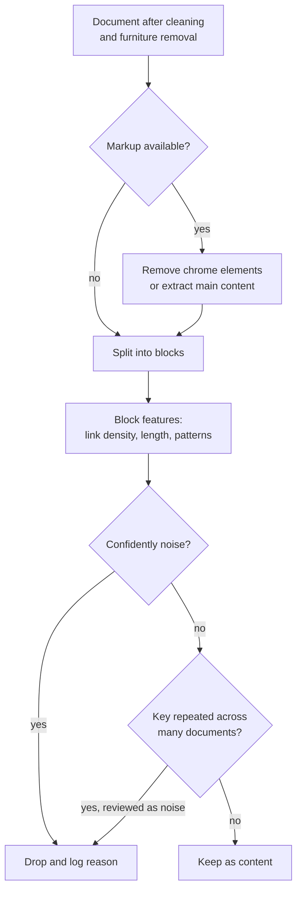

Some of the text a parser extracts is perfectly intact and still worthless for answering questions. A web page carries its navigation bar, cookie banner, "share this page" buttons, related links and copyright line. A wiki export carries an edit history and a table of contents. Every runbook ends with the same legal disclaimer. Emails carry signatures and quoted copies of earlier messages. None of this is damaged, so [Cleaning](/learn/document-preprocessing/cleaning) leaves it alone, and none of it is tied to pages, so [Header and footer removal](/learn/document-preprocessing/header-and-footer-removal) does not catch it. **Noise removal** is the stage that identifies content-free text and keeps it out of the index.

This lesson covers the main kinds of noise in RAG corpora and the three families of technique that remove them: structural removal using document markup, block-level classification using shallow text features, and corpus-level detection of text repeated across documents. It also covers how to measure a noise filter, because the central risk of this stage is not leaving noise in; it is taking content out.

## Learning objectives

- Classify a piece of extracted text as page furniture, noise, or content, and choose the stage that should handle it.
- Remove structural boilerplate from HTML using the document's tags, and classify the remaining blocks with link density and simple patterns.
- Detect boilerplate repeated across documents using document frequency of normalised paragraphs.
- Compute precision, recall and content loss for a noise filter from a labelled sample, and use them to choose between filters.
- Explain why noise-filtering heuristics designed for web-scale pretraining data are often too aggressive for a RAG corpus.

## Prerequisites

- [Cleaning](/learn/document-preprocessing/cleaning) and [Header and footer removal](/learn/document-preprocessing/header-and-footer-removal): the two stages before this one.
- [HTML parsing](/learn/advanced-document-parsing/html-parsing): navigating a parsed HTML tree.
- [Normalisation](/learn/document-preprocessing/normalisation): the match key used here to compare paragraphs.
- [Precision@K](/learn/retrieval-fundamentals/precision-k): the precision idea, applied here to a filter instead of a ranking.

## Why this matters

Noise costs you in three ways, in rising order of seriousness.

**It wastes money and context.** Every token of noise is embedded, stored and, when retrieved, placed in the prompt. A typical intranet page might have more words in its navigation, footer and related-links blocks than in its policy text.

**It creates false matches.** A query about "remote work" matches the "Related: Annual leave · Remote work · Laptops" block on the *expenses* page, because the words are there. The noise chunk is short, so its embedding is dominated by those few words, and it can outrank a real paragraph about remote work. A cookie banner chunk ("We use cookies to improve your experience") is retrieved for any question about the website's privacy settings. These false matches are particularly harmful because they come from many pages at once.

**Repeated noise crowds out real results.** A disclaimer that appears in every one of 400 runbooks becomes 400 near-identical chunks. Any query that resembles the disclaimer ("can procedures change?") retrieves several copies, and those copies fill the top five positions that a real answer needed.

But the opposite failure is worse. A noise filter that removes a real policy paragraph has made that policy unanswerable, permanently and silently. Nobody reviews what a filter dropped unless the pipeline makes them. So noise removal must be designed around a question most data-cleaning advice ignores: *how much content am I willing to lose to remove this noise?* For a RAG corpus, where each document was put there because someone needs it, the answer is "very little".

## The intuition

Think of the difference between reading a newspaper article online and reading it in a printed book of collected journalism. Online, the article is surrounded by menus, adverts, "most read" lists, a subscription prompt and a comment section. The book keeps only the article. An editor converting one into the other uses three kinds of clue:

- **Where things sit.** The menu is in the menu bar; the comments are below the line. The page's own structure says what is content.
- **What things look like.** A block that is entirely links, or three words long, or says "Accept all cookies", is not journalism, wherever it sits.
- **What repeats.** The same subscription prompt appears on every article, so it is clearly part of the site, not of any one article.

A careful editor also knows when to stop. A short block with a link in it may be the article's most important sentence ("The full report is available [here]"). The editor removes what she is *sure* is not the article, and leaves anything doubtful in.

## How it works

### What counts as noise

| Kind | Examples | Typical sources |
| --- | --- | --- |
| Site and template chrome | navigation, breadcrumbs, cookie banners, share buttons, related links, copyright lines | HTML pages, intranet and wiki exports |
| Repeated boilerplate | legal disclaimers, "this document is uncontrolled when printed", confidentiality notices | runbooks, contracts, emails |
| Navigational structure | tables of contents with dot leaders, indexes, "back to top" links | PDFs, long reports, wikis |
| Conversation residue | email signatures, quoted replies, "Sent from my phone" | email and ticket exports |
| Machine debris | base64 blobs, long URLs with tracking parameters, minified scripts, OCR garbage | HTML, emails, scans |

Three distinctions keep the boundaries clear. **Damage** (a broken word) is cleaning's job: repair it. **Page furniture** (repeated per page) is the previous lesson's job. **Noise** is intact, not page-bound, and carries no information a user would ask about. Some things look like noise but are not: a changelog in a runbook answers "what changed in revision 14?", and a "Contact the finance team" line answers "who do I ask about expenses?". Whether something is noise depends on what your users ask.

### Technique one: use the structure

Formats with markup tell you a lot directly. HTML5 has elements whose purpose is site chrome: `<nav>`, `<header>` and `<footer>` (at page level), `<aside>`, plus `<script>`, `<style>` and `<noscript>`, which never contain readable content. Many sites also mark their content area with `<main>` or `<article>`. Removing chrome elements, or extracting only the main element when one exists, is the highest-precision technique available: it removes noise because the author *said* it was not content.

Two cautions. First, `<header>` and `<footer>` are also allowed *inside* an `<article>`, where they hold the article's title and author, so on well-structured pages remove only page-level ones or extract the article first. Second, many intranet and CMS templates do not use semantic elements at all; everything is a `<div>`. For those, CSS classes and IDs (`class="share"`, `id="cookie-banner"`) are the next clue, but they differ per site, so rules based on them must be maintained per source.

The same idea applies to other formats: a Confluence export has its own markup for breadcrumbs and page metadata, an email has MIME parts and a quoted-reply structure, and a Markdown file has front matter that belongs in metadata rather than in the body.

### Technique two: classify blocks by shallow features

What remains after structural removal is a sequence of **blocks**: paragraphs, list items, headings, divs. Kohlschütter, Fankhauser and Nejdl (2010) showed that a few cheap features of each block separate boilerplate from content well on news pages. The most useful are:

- **Link density**: the share of the block's characters that are inside links. Navigation and related-links blocks are almost entirely links; prose rarely is.
- **Length in words**: boilerplate blocks are usually short.
- **Features of neighbouring blocks**: content blocks tend to sit next to other content blocks.

Simple rules on these features (for example, "drop blocks whose link density exceeds 0.5") remove much of what structural removal missed. Patterns for specific, well-known noise (cookie banners, "Sent from my iPhone", "On [date], [name] wrote:") add more.

Large language-model pretraining pipelines use similar line-level heuristics at web scale. The C4 corpus (Raffel et al., 2020), for example, kept only lines ending in terminal punctuation and dropped lines mentioning JavaScript. Those rules were designed for a setting where discarding good text is almost free, because there is far more web text than needed. In a RAG corpus the trade-off is reversed: a heading does not end in a full stop, a table row does not either, and dropping either loses content someone will ask about. Borrow the features, not the thresholds.

### Technique three: find what repeats across documents

Some noise is only visible at corpus level. Meridian's runbooks each end with the same disclaimer; within one runbook it is a normal paragraph. Across 400 runbooks it is obviously boilerplate. The method mirrors header detection, but counts documents instead of pages:

1. Split each document into paragraphs (or lines, for formats without paragraphs).
2. Compute a match key for each paragraph, as in [Normalisation](/learn/document-preprocessing/normalisation), so trivial differences do not hide repeats.
3. Count the **document frequency** of each key: the number of documents containing it at least once.
4. Mark as boilerplate the keys whose document frequency exceeds a threshold, usually computed per source (a share of that source's documents) and with a minimum count.
5. Remove those paragraphs from the body, and record that they were present (for example, a `has_disclaimer` flag) if that fact may matter.

For near-repeats (the same disclaimer with a changed year or company name), compare paragraphs with a similarity measure instead of an exact key. MinHash with locality-sensitive hashing is the standard scalable technique; it is covered in [Duplicate detection](/learn/data-processing/duplicate-detection).

The catch is that **repeated content is not always noise**. "VPN is required on public Wi-Fi" may appear in twenty runbooks because it genuinely applies to all of them, and it is exactly what users ask about. Removing it from every document removes it from the index. Two safeguards help: require a high threshold and review the list of keys before they are applied, and for repeated text that is real content, keep one canonical copy (as its own small document, or in the first document) instead of deleting every copy.



### Order and logging

The techniques run from most to least certain: structural removal first (the author's own markup), then block classification, then corpus-level repeats (which need a first pass over the whole source before any document can be finished). Every dropped block should be logged with the rule that dropped it, so that a reviewer can see, per source, a sample of what was removed. That log is how you discover that a "mostly links" rule is deleting the one paragraph that says where the expense form is.

## The mathematics

A noise filter is a binary classifier: for each block it decides "noise" (positive) or "content" (negative). To judge it, label a random sample of blocks by hand and count four outcomes:

- **True positives** $TP$: noise blocks the filter removed.
- **False positives** $FP$: content blocks the filter removed. These are the expensive mistakes.
- **False negatives** $FN$: noise blocks the filter left in.
- **True negatives** $TN$: content blocks the filter kept.

**Precision** asks: of what the filter removed, how much was really noise?

$$
\text{precision} = \frac{TP}{TP + FP}
$$

**Recall** asks: of all the noise, how much did the filter remove?

$$
\text{recall} = \frac{TP}{TP + FN}
$$

Neither directly answers the question that matters most for RAG, which is: of all the *content*, how much did we lose? Call that the **content loss rate**:

$$
\text{content loss} = \frac{FP}{FP + TN}
$$

This is the false-positive rate of the classifier, renamed to say what it costs you.

A worked example. Meridian's Platform team labels 200 blocks from intranet pages: 60 are noise and 140 are content. Their filter removes 55 blocks, of which 50 are noise and 5 are content. So $TP = 50$, $FP = 5$, $FN = 60 - 50 = 10$, and $TN = 140 - 5 = 135$.

- Precision $= 50 / (50 + 5) = 50/55 \approx 0.909$.
- Recall $= 50 / (50 + 10) = 50/60 \approx 0.833$.
- Content loss $= 5 / (5 + 135) = 5/140 \approx 0.036$.

So the filter removes five-sixths of the noise and loses about 3.6% of content blocks. Whether that is acceptable depends on *which* content: if the 5 lost blocks are "Contact the finance team" lines, perhaps; if they are policy statements, no. Inspect the false positives, not only the rate. The same arithmetic in Python:

```python
import numpy as np

# A hand-labelled sample of 200 blocks: 1 = noise, 0 = content.
truth = np.array([1] * 60 + [0] * 140)
# What the filter flagged: 50 of the 60 noise blocks, plus 5 content blocks by mistake.
flagged = np.zeros(200, dtype=int)
flagged[:50] = 1
flagged[60:65] = 1

tp = int(((flagged == 1) & (truth == 1)).sum())   # noise correctly removed
fp = int(((flagged == 1) & (truth == 0)).sum())   # content wrongly removed
fn = int(((flagged == 0) & (truth == 1)).sum())   # noise left in
precision = tp / (tp + fp)
recall = tp / (tp + fn)
content_loss = fp / int((truth == 0).sum())
print(f"TP={tp} FP={fp} FN={fn}")
print(f"precision={precision:.3f} recall={recall:.3f} content loss={content_loss:.3f}")
```

```output
TP=50 FP=5 FN=10
precision=0.909 recall=0.833 content loss=0.036
```

When comparing two filters, prefer the one with lower content loss unless the other removes far more noise for a negligible increase. The asymmetry is deliberate: leftover noise wastes some tokens and occasionally produces a poor match, while lost content makes questions unanswerable.

## In code

The first program takes a Meridian intranet page with typical chrome, removes structural elements with BeautifulSoup, splits what remains into blocks, and classifies each block with link density and a cookie-banner pattern. It prints each block with its decision and the reason.

```bash
pip install beautifulsoup4
```

```python
import re

from bs4 import BeautifulSoup

HTML = """
<html><head><title>Expenses policy | Meridian Intranet</title>
<style>.nav{color:red}</style><script>trackPageView("expenses");</script></head>
<body>
<div id="cookie-banner">We use cookies to improve your experience. <a href="/cookies">Accept all</a></div>
<header><nav><a href="/">Home</a> | <a href="/hr">HR</a> | <a href="/it">IT</a> | <a href="/search">Search</a></nav></header>
<main>
  <h1>Expenses policy</h1>
  <p>Expenses must be submitted within 30 days of being incurred.</p>
  <p>Anything over £75 needs a receipt. Expenses belong to the finance department.</p>
  <div class="share">Share: <a href="#">Email</a> <a href="#">Teams</a> <a href="#">Copy link</a></div>
  <p>Questions? Contact the <a href="/finance">finance team</a> before you book travel.</p>
  <div class="related"><a href="/leave">Annual leave</a> <a href="/remote">Remote work</a> <a href="/laptops">Laptops</a></div>
</main>
<footer>© 2025 Meridian Ltd · <a href="/privacy">Privacy</a> · <a href="/accessibility">Accessibility</a></footer>
</body></html>
"""

STRUCTURAL = ["script", "style", "nav", "header", "footer", "aside", "form", "noscript"]


def blocks(html: str) -> list[tuple[str, float]]:
    """Text blocks with their link density, after removing structural boilerplate."""
    soup = BeautifulSoup(html, "html.parser")
    for tag in soup(STRUCTURAL):
        tag.decompose()
    out = []
    for el in soup.body.find_all(["h1", "h2", "h3", "p", "li", "div"]):
        if el.find(["p", "div", "li"]):          # skip containers; their children are visited
            continue
        text = " ".join(el.get_text(" ").split())
        if not text:
            continue
        link_chars = sum(len(" ".join(a.get_text(" ").split())) for a in el.find_all("a"))
        out.append((text, link_chars / len(text)))
    return out


def is_noise(text: str, link_density: float) -> str | None:
    """Return the reason a block is noise, or None if it looks like content."""
    if link_density > 0.5:
        return "mostly links"
    if re.search(r"\bcookies?\b", text, re.I) and re.search(r"\baccept\b", text, re.I):
        return "cookie banner"
    return None


for text, density in blocks(HTML):
    reason = is_noise(text, density)
    print(f"{'DROP ' + reason if reason else 'keep':<18} {density:4.2f}  {text[:60]}")
```

```output
DROP cookie banner 0.19  We use cookies to improve your experience. Accept all
keep               0.00  Expenses policy
keep               0.00  Expenses must be submitted within 30 days of being incurred.
keep               0.00  Anything over £75 needs a receipt. Expenses belong to the fi
DROP mostly links  0.68  Share: Email Teams Copy link
keep               0.20  Questions? Contact the finance team before you book travel.
DROP mostly links  0.94  Annual leave Remote work Laptops
```

The important lines:

- `soup(STRUCTURAL)` is BeautifulSoup shorthand for `soup.find_all(STRUCTURAL)`; `decompose()` removes each element and its contents from the tree. The navigation bar, footer, script and style never reach the block stage.
- The loop visits only *leaf* blocks (elements that contain no other block elements), so the text of the `<main>` container is not counted again as one giant block.
- Link density is computed on whitespace-normalised text, so indentation in the HTML does not dilute it.
- `is_noise` returns a *reason*, not just a Boolean, so the log says why each block went.

What the output means. Structural removal took out the navigation and footer before classification. Of the seven remaining blocks, three were dropped: the cookie banner by pattern (its link density, 0.19, would not have caught it) and the share and related-links blocks by link density. The "Questions? Contact the finance team" paragraph has a link but a density of only 0.20, so it survives; that is the right outcome, because it answers "who do I ask about expenses?". The heading "Expenses policy" survives too, although it is two words long. A rule such as "drop blocks under five words", common in pretraining pipelines, would have removed it.

The second program finds boilerplate repeated across a source. It counts, for each normalised paragraph, how many runbooks contain it, and also catches a table of contents by its dot leaders.

```python
import re
from collections import Counter

DISCLAIMER = ("This runbook is provided for Meridian staff only. Procedures may change without notice; "
              "always check the latest revision before acting.")
runbooks = {
    "vpn-errors": f"Contents\nSymptoms ........ 1\nFix ........ 2\n\nError E-4021 means the VPN client is out of date.\n\nUpdate it from the IT portal, then reconnect.\n\n{DISCLAIMER}",
    "password-reset": f"Passwords rotate every 90 days.\n\nUse the self-service portal to reset an expired password.\n\n{DISCLAIMER}",
    "lost-laptop": f"Report a lost laptop to the support desk at once.\n\nThe support desk is open 08:00 to 18:00 UK time.\n\n{DISCLAIMER}",
    "laptop-refresh": f"Laptops are refreshed every 3 years.\n\n{DISCLAIMER}\n\nRequest a refresh through the IT portal.",
    "public-wifi": "VPN is required on public Wi-Fi.\n\nDo not use hotel or café networks without the VPN.",
}

TOC_LINE = re.compile(r"^.{1,80}?\s*\.{4,}\s*\d+$")       # 'Symptoms ........ 1'


def paragraphs(text: str) -> list[str]:
    return [p.strip() for p in text.split("\n\n") if p.strip()]


def key(p: str) -> str:
    return " ".join(p.casefold().split())


# Corpus-level boilerplate: paragraphs that occur in a large share of documents.
df = Counter()
for text in runbooks.values():
    df.update({key(p) for p in paragraphs(text)})
boilerplate = {k for k, n in df.items() if n >= 0.5 * len(runbooks)}
print(f"{len(boilerplate)} boilerplate paragraph(s), found in "
      f"{max(df.values())} of {len(runbooks)} documents\n")

for name, text in runbooks.items():
    kept, dropped = [], []
    for p in paragraphs(text):
        lines = p.split("\n")
        if key(p) in boilerplate:
            dropped.append("boilerplate")
        elif sum(bool(TOC_LINE.match(l)) for l in lines) >= len(lines) - 1 and len(lines) > 1:
            dropped.append("table of contents")
        else:
            kept.append(p)
    print(f"{name:<15} kept {len(kept)}  dropped {dropped}")
```

```output
1 boilerplate paragraph(s), found in 4 of 5 documents

vpn-errors      kept 2  dropped ['table of contents', 'boilerplate']
password-reset  kept 2  dropped ['boilerplate']
lost-laptop     kept 2  dropped ['boilerplate']
laptop-refresh  kept 2  dropped ['boilerplate']
public-wifi     kept 2  dropped []
```

The important lines:

- `df.update({...})` counts each paragraph once per document, which is what *document* frequency means.
- The boilerplate threshold is half of the source's documents. On five documents that is a tiny sample, chosen for illustration; on a real source you would also require a minimum count (say, 20 documents) and review the resulting list before applying it.
- The table-of-contents rule fires only when all lines but one (the "Contents" title) end in dot leaders and a page number, so a single body line that happens to contain dots is safe.

What the output means. The disclaimer was found in four of five runbooks and removed from each, wherever it sat in the document (in `laptop-refresh` it is in the middle, not at the end, which a position-based rule would have missed). The table of contents was removed from the VPN runbook, and the runbook's two real paragraphs stayed. The `public-wifi` runbook has no disclaimer and loses nothing.

Errors people commonly hit:

- **Removing `<header>` and `<footer>` everywhere** on pages where articles use them for their own titles and bylines, so every article loses its title.
- **Link-density thresholds that are too low.** Policy pages written as lists of links to forms ("Submit your claim using the [expenses form]") have moderate link density and real content.
- **Running corpus-level detection on a mixed corpus.** A paragraph common across HR documents is compared with runbooks and product docs, and the threshold no longer means anything. Compute document frequency per source.

To extend this: add patterns for email signatures and quoted replies if you ingest email; record a `removed_blocks` list per document in the ingestion log; and run the labelled-sample evaluation from the mathematics section on each new source before enabling a rule.

## A real-world example

AskMeridian's product documentation index was built from the public help centre for Meridian Sync, Relay and Reports. A month after launch, the Platform team reviewed questions that users had marked unhelpful and found a pattern: questions about data export ("how do I export a report to CSV?") were often answered with "I couldn't find information about that", even though an export page existed.

Inspecting the retrieved chunks showed why. Every help-centre page had a sidebar of links, extracted as plain text: "Getting started · Exporting data · Single sign-on · Billing". Because the help-centre template used `<div>` elements throughout, structural removal did nothing. The sidebar text became a chunk on every page, several hundred near-identical chunks containing the words "exporting data". For export questions, the top five results were sidebar chunks from five different pages, and the generator, instructed to answer only from context, correctly said the context did not contain the answer.

The fix had two parts. A link-density rule removed the sidebar blocks. Then the team ran corpus-level detection per source and found several more repeated blocks: a "Was this article helpful? Yes / No" widget and a "Still need help? Contact support" paragraph. They removed the widget. They kept one copy of the "contact support" paragraph as its own small document, because "how do I contact support?" is a real question. Before applying either rule they ran the labelled-sample evaluation on 300 blocks, which caught one false positive worth fixing: tables of keyboard shortcuts, whose cells were all links to detailed pages, had been flagged as navigation.

## Common mistakes

- **Applying pretraining-style heuristics unchanged.** Rules such as "drop lines without terminal punctuation" or "drop blocks under five words" remove headings, table rows and list items that users ask about.
- **Treating every repeated paragraph as noise.** Safety warnings and shared policies repeat because they apply everywhere; deleting every copy removes them from the index.
- **Not logging what was removed, or why.** Content loss is invisible until a user asks a question the index can no longer answer.
- **Removing structural tags blindly.** Article-level `<header>` and `<footer>` elements contain titles and authors.
- **Evaluating only precision or only recall.** A filter that removes everything has perfect recall; one that removes nothing has no false positives. Measure content loss directly and read the false positives.
- **Using one global threshold for all sources.** Templates, link habits and repetition patterns differ by source.

## Best practices

- Order techniques from most to least certain: markup first, block features second, corpus-level repeats third.
- Prefer extracting the main content area (`<main>`, `<article>`, or a known content container) when the source provides one.
- Return and log a reason for every removed block, and review samples per source.
- Compute corpus-level repeats per source, with both a share threshold and a minimum count, and review the list of keys before applying it.
- Keep one canonical copy of repeated text that is real content.
- Evaluate each new rule on a labelled sample and inspect every false positive.
- Keep the unfiltered text so rules can be changed and re-applied without re-crawling.

## Performance considerations

Parsing HTML dominates the cost of the first technique. BeautifulSoup with the pure-Python `html.parser` is convenient but slow for large crawls; with the `lxml` parser (`BeautifulSoup(html, "lxml")`) it is typically several times faster, and using `lxml` directly is faster still. As an illustration, if parsing takes 20 milliseconds per page, a 50,000-page intranet takes about 1,000 seconds on one core: about 17 minutes, trivially parallel. Block classification is a linear pass and costs little beside parsing.

Corpus-level detection needs a counting pass over the whole source before any document can be finalised. The counter holds one entry per distinct paragraph key. Storing a 16-byte hash instead of the paragraph text keeps this small: 10 million distinct paragraphs is about 160 MB of hashes plus counter overhead, which fits on one machine. For incremental ingestion, keep the counts between runs and update them as documents are added and removed, rather than recounting the whole source each time; then periodically re-check whether previously kept paragraphs have crossed the threshold.

The payoff is measurable in tokens. If chrome and boilerplate make up 40% of the extracted words on intranet pages (an assumption to check on your own source; it varies widely), removing them cuts embedding and storage costs for that source by about 40% and removes a large class of false matches.

## Security considerations

Noise removal decides what text the model will see, which makes it relevant to [indirect prompt injection](/learn/rag-security-fundamentals/indirect-prompt-injection).

- **Hidden text is a classic injection carrier.** HTML can contain text that a browser never shows: elements with `display:none`, white text on white, zero-size fonts, `aria-hidden` regions, HTML comments. A parser that extracts all text extracts these too. Consider removing elements hidden by inline styles or the `hidden` attribute, and flag pages with large amounts of hidden text for review; legitimate pages rarely need it. (Hidden text styled through external CSS files cannot be detected from the HTML alone.)
- **Do not rely on noise removal as a security control.** An attacker can put instructions in visible prose that no noise filter would touch. Defence belongs in the generation stage and in source controls, as covered in [RAG Security Fundamentals](/learn/rag-security-fundamentals).
- **Removed text may still be sensitive.** Email signatures contain phone numbers; quoted replies contain earlier messages that may be outside the user's access rights. Removing them from the index is good for privacy, but the logs of what was removed now contain them. Apply the same retention and access rules to removal logs as to the source.

## Summary

- Noise is intact text with no information value: site chrome, repeated boilerplate, tables of contents, conversation residue and machine debris. It wastes tokens, creates false matches and crowds out real results.
- Use document structure first (HTML chrome elements, main-content containers), then shallow block features such as link density and specific patterns, then document frequency across a source.
- Repeated content is not always noise; keep one canonical copy of repeated text that users need.
- Measure filters with precision, recall and content loss on a labelled sample, and read every false positive; losing content is worse than keeping noise.
- Heuristics from web-scale pretraining pipelines are too aggressive for RAG corpora; borrow their features, not their thresholds.

## Exercises

1. For each item, say whether it is damage, page furniture, noise, or content, and which stage should handle it: (a) "Page 4 of 12" at the bottom of each PDF page; (b) "Sent from Outlook for iOS" at the end of an email; (c) a runbook's revision history table; (d) `team’s`; (e) a "Related articles" list on a help-centre page.

<details><summary>Show solution</summary>

(a) Page furniture: header and footer removal. (b) Noise (conversation residue): noise removal, with a pattern. (c) Content, probably: it answers "what changed and when?". Keep it, perhaps as its own chunk, or extract the latest revision into metadata. (d) Damage (mojibake): cleaning. (e) Noise (site chrome): noise removal, by link density or by the template's class name.

</details>

2. A filter is evaluated on 500 labelled blocks: 120 noise, 380 content. It removes 130 blocks, of which 110 are noise. Compute precision, recall and content loss by hand. Would you deploy it?

<details><summary>Show solution</summary>

$TP = 110$, $FP = 130 - 110 = 20$, $FN = 120 - 110 = 10$, $TN = 380 - 20 = 360$.

- Precision $= 110/130 \approx 0.846$.
- Recall $= 110/120 \approx 0.917$.
- Content loss $= 20/380 \approx 0.053$.

It removes most of the noise but loses about one content block in nineteen, which is too much for most RAG corpora without first reading the 20 false positives. If they are trivial ("Thanks!", "See below"), the filter may be acceptable; if any are policy statements, tighten the rule that removed them and re-evaluate.

```python
tp, fp, fn, tn = 110, 20, 10, 360
print(f"precision={tp/(tp+fp):.3f} recall={tp/(tp+fn):.3f} content loss={fp/(fp+tn):.3f}")
```

```output
precision=0.846 recall=0.917 content loss=0.053
```

</details>

3. Write a function `strip_quoted_reply(email: str) -> str` that removes the quoted part of a reply email: everything from a line matching "On ... wrote:" onwards, and any line starting with `>`. Test it on a short Meridian email.

<details><summary>Show solution</summary>

```python
import re

WROTE = re.compile(r"^On .{5,120} wrote:\s*$", re.M)

def strip_quoted_reply(email: str) -> str:
    m = WROTE.search(email)
    if m:
        email = email[: m.start()]
    lines = [ln for ln in email.splitlines() if not ln.lstrip().startswith(">")]
    return "\n".join(lines).strip()

email = """Yes, receipts are needed for anything over £75.

On 3 March 2025, Sam Patel wrote:
> Do I need a receipt for a £60 taxi?
> Thanks"""
print(strip_quoted_reply(email))
```

```output
Yes, receipts are needed for anything over £75.
```

The "On ... wrote:" header format differs between email clients and languages, so in production you would use several patterns, log which matched, and keep the quoted text when nothing earlier in the thread is indexed (it may be the only copy of the question).

</details>

4. Design question. The help centre adds a 120-word "Security notice" paragraph to every page in the "Admin" section (about 60 of 900 pages). Your corpus-level detector, with a threshold of 50% of the source, does not catch it. Should it be removed? Describe how you would detect and handle it.

<details><summary>Show solution</summary>

At 60 of 900 pages (under 7%), a source-wide share threshold will never catch it. Detection options: compute document frequency *within sections or URL prefixes* (the notice appears on 100% of Admin pages), or use an absolute minimum count (any paragraph in 20 or more documents is reviewed) rather than a share.

Whether to remove it depends on its content. If it is generic ("Admin actions are logged"), remove it from the pages and keep one canonical copy as its own document, so "are admin actions logged?" can still be answered. If it is relevant to every Admin page's subject, consider moving it into metadata or prepending a short form of it only where needed. What you should not do is leave 60 copies, which would crowd the top results for any security-related question.

</details>

## Check your understanding

```quiz
[
  {"q": "Which technique is the highest-precision way to remove navigation menus from HTML pages that use semantic markup?", "options": ["Dropping all blocks shorter than five words", "Removing every paragraph that contains a link", "Lower-casing the page and removing common words", "Removing page-level `<nav>`, `<header>` and `<footer>` elements, or extracting the `<main>` element"], "answer": 3, "why": "The author's own markup says these elements are not content, so removing them rarely loses anything."},
  {"q": "A block reads 'Questions? Contact the finance team before you book travel.' with 'finance team' as a link. Its link density is about 0.2. What should a well-tuned filter do?", "options": ["Drop it, because it contains a link", "Keep it, because its link density is low and it answers a plausible question", "Drop it, because it ends in a full stop", "Move it to the page header"], "answer": 1, "why": "Low link density and useful information make it content; it answers 'who do I ask about expenses?'."},
  {"q": "A filter removes 40 blocks, 30 of which are noise; the labelled sample contains 50 noise blocks and 150 content blocks. What is the content loss rate?", "options": ["10/150, about 0.067", "30/40 = 0.75", "30/50 = 0.6", "10/40 = 0.25"], "answer": 0, "why": "False positives are 40 - 30 = 10 content blocks, out of 150 content blocks in total."},
  {"q": "Why are web-pretraining filters such as 'keep only lines ending in terminal punctuation' often too aggressive for RAG?", "options": ["They are too slow for small corpora", "They only work on non-English text", "They were designed where discarding good text is nearly free; in RAG they remove headings, table rows and list items users ask about", "They require a GPU"], "answer": 2, "why": "Pretraining has a surplus of text, but every document in a RAG corpus is there because someone needs it."},
  {"q": "The sentence 'VPN is required on public Wi-Fi' appears in 30 of 200 runbooks. What is the best treatment?", "options": ["Keep at least one canonical copy so the fact stays retrievable, and avoid flooding results with 30 identical chunks", "Delete it from all 30 runbooks as boilerplate", "Leave all 30 copies, since duplicates are harmless", "Replace it with a link"], "answer": 0, "why": "It is repeated content, not noise; one copy keeps it answerable while avoiding duplicate results."}
]
```

## Further reading

- Christian Kohlschütter, Peter Fankhauser and Wolfgang Nejdl (2010), *Boilerplate Detection using Shallow Text Features*, WSDM 2010: link density and word counts as features for separating boilerplate from content.
- Colin Raffel et al. (2020), *Exploring the Limits of Transfer Learning with a Unified Text-to-Text Transformer*, JMLR: section 2.2 describes the heuristic cleaning of the C4 web corpus.
- Adrien Barbaresi (2021), *Trafilatura: A Web Scraping Library and Command-Line Tool for Text Discovery and Extraction*, ACL 2021 System Demonstrations: a widely used main-content extraction library.
- [Beautiful Soup documentation](https://www.crummy.com/software/BeautifulSoup/bs4/doc/): navigating and modifying parse trees, including `decompose`.
- [HTML Living Standard: sections](https://html.spec.whatwg.org/multipage/sections.html): the defined meaning of `nav`, `header`, `footer`, `aside`, `main` and `article`.
