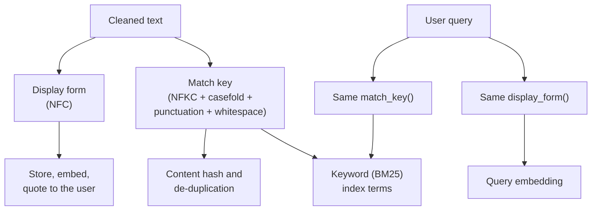

After [Cleaning](/learn/document-preprocessing/cleaning), the text says what the author wrote. It can still say it in many byte-level ways. "Wi-Fi" may be typed with an ordinary hyphen or a non-breaking one, "finance" may begin with a single ligature character, "café" may be one code point or two, and a product name pasted from a Japanese input method may arrive in full-width letters. To a human these are identical. To a hash function, a keyword index and sometimes an embedding model, they are different strings. **Normalisation** is the stage that maps text which *means* the same thing onto one agreed representation, so that equality, matching and de-duplication work.

This lesson covers Unicode normalisation forms, case folding and punctuation folding, and the central design decision of the stage: keeping a lightly normalised *display form* that you store, embed and quote, separate from an aggressively normalised *match key* that you hash, compare and index for keyword search. Normalising a document's *structure* into a common schema is a different topic, covered in [Document normalization](/learn/document-engineering/document-normalization).

## Learning objectives

- Explain the difference between canonical (NFC, NFD) and compatibility (NFKC, NFKD) normalisation and predict the output of each on a given string.
- Choose an appropriate normalisation for stored text, for match keys and for queries, and justify the choice.
- Implement a match-key function combining NFKC, case folding and punctuation folding, and show its effect on keyword retrieval.
- Identify normalisations that destroy meaning (compatibility folding of superscripts, accent stripping, lower-casing identifiers) and decide when each is acceptable.
- Explain why normalisation must be applied identically to documents and queries.

## Prerequisites

- [Cleaning](/learn/document-preprocessing/cleaning): repairing extraction damage, which happens before normalisation.
- [Encoding and Unicode](/learn/data-processing/encoding-and-unicode): code points, combining characters and UTF-8.
- [Query-document matching](/learn/rag-architecture-fundamentals/query-document-matching): lexical matching and why a term that does not literally appear contributes nothing.

## Why this matters

Lexical matching is literal. If the index holds `wi‑fi` with a non-breaking hyphen (U+2011) and the employee types `wi-fi` with the hyphen on their keyboard (U+002D), the terms are different and contribute nothing to the score. The employee sees a correct document ranked below irrelevant ones, and nobody can see why, because both hyphens look the same on screen.

The same problem breaks de-duplication and change detection. Meridian's handbook is edited by HR staff on Windows and macOS machines. One editor's tools store "é" as a single precomposed code point; another's store "e" followed by a combining acute accent. The two files look identical and contain the same policy, yet their content hashes differ, so the pipeline indexes the policy twice. Duplicate chunks then crowd the top results and waste context-window space, a problem [Context deduplication](/learn/context-engineering/context-deduplication) has to clean up much later and at much higher cost.

There is also a quieter cost in embeddings. Embedding models have fixed vocabularies. Characters they rarely saw in training, such as full-width Latin letters or ligatures, may be split into odd sub-word pieces or mapped to an "unknown" token, and the resulting vector drifts away from the vector of the ordinary spelling. You will measure this below.

Normalisation fixes all three problems, but it is easy to overdo. Fold too much and you merge things that are genuinely different: `x²` and `x2`, `año` (year) and `ano` (anus) in Spanish, the product "Sync" and the verb "sync". The skill in this stage is deciding *which* differences to erase, and *where*.

## The intuition

Think of a library catalogue. The book on the shelf has its title exactly as printed: capital letters, accents, a ligature in the typeface. The index card used to *find* it is written differently: all lower case, no fancy letters, punctuation simplified, so that "Café Society", "CAFE SOCIETY" and "cafe society" all lead to the same card. Nobody would reprint the book to match the card, and nobody would file the card by the exact typeface of the cover.

A RAG system needs the same two representations. The **display form** is the book: faithful text that you store, embed and quote to users. The **match key** is the index card: a deliberately simplified version used only for comparison (hashing, de-duplication, keyword search). Most normalisation mistakes come from collapsing the two, either by showing users the index card or by trying to find things with the exact typeface.

## How it works

### Why the same text has several encodings

Unicode often offers more than one way to write the same visible text. There are two kinds of sameness, and Unicode's normalisation forms treat them differently.

**Canonical equivalence** means two sequences are the *same character* in every respect. `é` can be stored as one precomposed code point (U+00E9) or as `e` (U+0065) followed by a combining acute accent (U+0301). Both render identically and mean the same thing in every context. The Ångström sign (U+212B) is canonically equivalent to the letter `Å` (U+00C5).

**Compatibility equivalence** is weaker: two sequences represent the same *abstract* character, but one carries formatting or a presentation variant. The ligature `fi` (U+FB01) is compatibility-equivalent to `fi`; full-width `Ａ` (U+FF21) to `A`; superscript `²` to `2`; `™` to `TM`; the circled `①` to `1`. Sometimes the formatting is decorative (a ligature from a PDF's typeface) and sometimes it carries meaning (a superscript in a formula).

### The four normalisation forms

Unicode Standard Annex #15 defines four normalisation forms, built from two choices: decompose or compose, canonical only or compatibility as well.

| Form | What it does | `é` (as e + accent) | `fi` | `x²` | `Ｅ-4021` |
| --- | --- | --- | --- | --- | --- |
| NFD | Canonical decomposition | e + accent | `fi` | `x²` | `Ｅ-4021` |
| NFC | Canonical decomposition, then recomposition | `é` (one code point) | `fi` | `x²` | `Ｅ-4021` |
| NFKD | Compatibility decomposition | e + accent | `fi` | `x2` | `E-4021` |
| NFKC | Compatibility decomposition, then canonical recomposition | `é` | `fi` | `x2` | `E-4021` |

In Python all four are one call: `unicodedata.normalize("NFC", text)`. Three properties make them safe to rely on:

1. **Each form is idempotent.** Normalising already-normalised text changes nothing, which matters for the reasons given in [Cleaning](/learn/document-preprocessing/cleaning).
2. **Canonically equivalent strings have identical NFC (and NFD) forms**, so comparing NFC strings with `==` is a correct test of canonical equivalence.
3. **Unicode has a stability policy**: text that is normalised under one version of the standard stays normalised under later versions, for characters that were assigned at the time. You can therefore store NFC text and trust it after upgrading Python.

NFC is the conventional choice for text you store and exchange (the W3C recommends it for web content), because it changes nothing a reader could notice. NFKC is the conventional choice for *identifiers and matching*, because it erases presentation differences. Neither is applied by default: Python, databases and most libraries compare strings code point by code point, so you must normalise explicitly.

### Beyond Unicode forms: case, punctuation, whitespace

NFKC does not finish the job for matching. Three more foldings are common in a match key.

**Case folding.** Python's `str.casefold()` is a more aggressive version of `lower()` designed for caseless comparison. It maps German `ß` to `ss` (so "Straße" and "STRASSE" compare equal), which `lower()` does not. Case folding is not locale-aware: Turkish distinguishes dotted and dotless i, and Python's default mapping of `İ` produces `i` plus a combining dot. For a mainly English corpus this rarely matters; for a Turkish one, it needs specific handling.

**Punctuation folding.** Typographic punctuation survives NFKC more often than people expect. The non-breaking hyphen (U+2011) becomes the Unicode hyphen (U+2010), not the ASCII hyphen-minus your keyboard produces. En dashes, em dashes and the minus sign (U+2212) are untouched, as are curly quotes. A match key therefore maps an explicit list of dashes to `-` and curly quotes to straight quotes.

**Whitespace folding.** Runs of whitespace of any kind (spaces, tabs, no-break spaces, line separators) become one space.

**Accent stripping** is the most dangerous folding. Libraries such as `unidecode` transliterate any text into ASCII: `résumé` becomes `resume`, `Łódź` becomes `Lodz`. For English text with occasional loan words that is helpful in a match key, because users often omit accents. In languages where accents distinguish words it merges unrelated terms, and for non-Latin scripts the transliteration is an approximation (`unidecode` turns the Japanese 東京, "Tokyo", into `Dong Jing`, the Mandarin reading of the characters). Strip accents only in match keys, only for languages where you have checked the consequences, and never in stored text.

### Two views of the same text



The design has four rules:

1. **Store and show the display form.** Users and the language model see what the author wrote, minus only invisible encoding differences. A quoted policy with `£` and curly quotes looks right; a quoted policy in case-folded ASCII looks broken.
2. **Embed the display form**, perhaps with NFKC applied as well if your corpus contains many ligatures or full-width characters (see the measurements below). Embedding models were trained on natural text with capitals and punctuation; folding case and punctuation removes signal they can use.
3. **Hash, de-duplicate and keyword-index the match key.** These operations want "same meaning, same bytes", which is exactly what the key provides.
4. **Apply the same functions to the query.** This is the rule that most often breaks. If documents are indexed under `match_key` but the query is tokenised raw, a full-width or ligature query term fails against a folded index in exactly the way the original problem did. Put both functions in one shared module that both the ingestion pipeline and the query service import, and version it.

### What normalisation should not do

Normalisation erases *representational* differences. It should not try to make different *expressions* of the same idea identical:

- **Synonyms and abbreviations** ("holiday" and "annual leave", "WFH" and "remote work") are a vocabulary-mismatch problem, solved with embeddings and [Query expansion](/learn/hybrid-search/query-expansion), not by rewriting the documents.
- **Dates, numbers and units** ("31/03/2025", "31 March 2025", "2025-03-31") should stay as written in the text, because the written form is what users and the model read, and rewriting them risks errors (is "03/04" the 3rd of April or the 4th of March?). Extract a normalised value into metadata instead, as [Metadata extraction](/learn/document-preprocessing/metadata-extraction) does.
- **Spelling variants** (British "normalise", American "normalize") can be folded in a match key with a small, explicit table if your users mix them, but not in stored text.

## In code

The first program indexes four Meridian facts, each carrying one quirk from a real source (a non-breaking hyphen from a Word export, a ligature from a PDF, full-width letters, and a decomposed accent from a macOS file name), plus two ordinary documents. It runs BM25 keyword search twice, once over the display form and once over the match key, and then compares content hashes of the same sentence typed in two ways. It needs only `rank-bm25` and the standard library.

```bash
pip install rank-bm25
```

```python
import hashlib
import re
import unicodedata

from rank_bm25 import BM25Okapi

DASHES = dict.fromkeys(map(ord, "‐‑‒–—−"), "-")
QUOTES = {ord("‘"): "'", ord("’"): "'", ord("“"): '"', ord("”"): '"'}


def display_form(text: str) -> str:
    """What we store, embed and show: canonical composition only (NFC)."""
    return unicodedata.normalize("NFC", text)


def match_key(text: str) -> str:
    """What we compare, hash and index for keyword search: aggressive folding."""
    text = unicodedata.normalize("NFKC", text)       # ligatures, full-width, superscripts
    text = text.casefold()                           # case-insensitive; also handles ß -> ss
    text = text.translate(DASHES).translate(QUOTES)  # typographic punctuation -> ASCII
    return re.sub(r"\s+", " ", text).strip()


def tokens(text: str) -> list[str]:
    return re.findall(r"\w+(?:-\w+)*", text)


# Meridian facts as they arrive from different sources, each with one quirk.
docs = [
    "VPN is required on public Wi‑Fi networks.",                  # non-breaking hyphen (Word export)
    "The finance team owns expenses.",                              # 'fi' ligature (PDF)
    "ＡＴＬＡＳ error E-4021 means the VPN client is out of date.",  # full-width letters
    "Café vouchers are not reimbursed.",                          # decomposed e + accent (macOS)
    "Passwords rotate every 90 days.",
    "Laptops are refreshed every 3 years.",
]
queries = ["public wi-fi", "finance", "atlas error", "café vouchers"]

for label, view in [("display_form", display_form), ("match_key", match_key)]:
    corpus = [tokens(view(d).lower()) for d in docs]
    bm25 = BM25Okapi(corpus)
    print(f"BM25 over {label}:")
    for i, q in enumerate(queries):
        q_terms = tokens(view(q).lower())
        scores = bm25.get_scores(q_terms)
        best = int(scores.argmax())
        verdict = "found " if best == i and scores[best] > 0 else "MISSED"
        matched = [t for t in q_terms if t in corpus[i]]   # terms shared with the right doc
        print(f"  {q!r:<16} {verdict} score {scores[i]:.2f}  matched {matched}")

# Content hashes: the same sentence typed on two machines (composed vs decomposed).
a = "Café vouchers are not reimbursed."
b = "Café vouchers are not reimbursed."
h = lambda s: hashlib.sha256(s.encode("utf-8")).hexdigest()[:12]
print(f"\nequal as typed: {a == b!s:<5}  hashes {h(a)} {h(b)}")
print(f"equal after NFC: {display_form(a) == display_form(b)}  hashes {h(display_form(a))} {h(display_form(b))}")
```

```output
BM25 over display_form:
  'public wi-fi'   found  score 1.19  matched ['public']
  'finance'        MISSED score 0.00  matched []
  'atlas error'    found  score 1.01  matched ['error']
  'café vouchers'  found  score 2.93  matched ['café', 'vouchers']
BM25 over match_key:
  'public wi-fi'   found  score 2.51  matched ['public', 'wi-fi']
  'finance'        found  score 1.45  matched ['finance']
  'atlas error'    found  score 1.98  matched ['atlas', 'error']
  'café vouchers'  found  score 2.90  matched ['café', 'vouchers']

equal as typed: False  hashes 0526ab2791ed 5d2a9d3fc907
equal after NFC: True  hashes 0526ab2791ed 0526ab2791ed
```

The important lines:

- `DASHES` and `QUOTES` are translation tables for `str.translate`, which maps code points to replacement strings in one pass. They list the specific characters to fold, because NFKC leaves them alone (or, for the non-breaking hyphen, turns it into a *different* non-ASCII hyphen).
- `match_key` applies NFKC *before* `casefold`. The order matters for a few characters whose compatibility decomposition produces upper-case letters (full-width `Ａ` becomes `A`, which then folds to `a`).
- Both the documents and the queries go through the same `view` function. That symmetry is the whole point; the exercises ask you to break it and watch what happens.
- `tokens` uses `\w`, which in Python 3 matches letters in any script, so `finance` and `ＡＴＬＡＳ` are tokens, just not the tokens anyone searches for.

What the output means. Over the display form, two of the four queries only *appear* to work: "public wi-fi" matched on "public" alone and "atlas error" on "error" alone, so their scores (1.19 and 1.01) are about half of what the full match earns. In a real corpus with hundreds of documents mentioning "public" or "error", those documents would outrank the right one. "finance" failed outright because the document's first two letters are a single ligature character. "café vouchers" worked even over the display form, because NFC made the composed query and decomposed document identical. Over the match key every query matches every term it should. The hash comparison shows the de-duplication problem in miniature: two strings that print identically have different SHA-256 digests until they are normalised.

The second program asks whether normalisation matters for embeddings, which already "understand" text, and for token counts, which drive cost.

```bash
pip install sentence-transformers tiktoken
```

```python
import unicodedata

import tiktoken
from sentence_transformers import SentenceTransformer

model = SentenceTransformer("sentence-transformers/all-MiniLM-L6-v2")
enc = tiktoken.get_encoding("cl100k_base")

pairs = [
    ("The finance team owns expenses.", "The finance team owns expenses."),
    ("ＡＴＬＡＳ error E-4021", "ATLAS error E-4021"),
    ("Café vouchers are not reimbursed.", "Café vouchers are not reimbursed."),
]
for raw, normal in pairs:
    assert unicodedata.normalize("NFKC", raw) == normal
    a, b = model.encode([raw, normal], normalize_embeddings=True)
    print(f"{normal!r:<40} cosine {a @ b:.3f}   tokens {len(enc.encode(raw)):>2} -> {len(enc.encode(normal))}")
print(model.tokenizer.tokenize("finance"), model.tokenizer.tokenize("ＡＴＬＡＳ"))
```

```output
'The finance team owns expenses.'        cosine 0.827   tokens  9 -> 6
'ATLAS error E-4021'                     cosine 0.608   tokens 15 -> 7
'Café vouchers are not reimbursed.'      cosine 1.000   tokens  9 -> 9
['fi', '##nan', '##ce'] ['[UNK]']
```

What the output means. A sentence and its NFKC form should mean the same thing, so ideally their embeddings would be identical (cosine 1.0). The ligature version scores 0.827, because MiniLM's tokeniser splits `finance` into three unfamiliar pieces. The full-width version scores only 0.608: the tokeniser maps the whole word `ＡＴＬＡＳ` to a single `[UNK]` (unknown) token, so the model never sees the product name at all. The decomposed accent makes no difference, because this model's tokeniser applies its own Unicode processing (it lower-cases and strips accents internally), which is a property of this model, not something to rely on in general. The `tiktoken` counts (using the `cl100k_base` encoding as an example of a byte-level BPE tokeniser) show the cost side: unusual characters take more tokens, so un-normalised text costs more to embed and to place in a prompt.

The practical conclusion is that NFKC is worth applying to *embedding input* when the corpus contains many compatibility characters, even though stored text stays NFC. If you do this, apply NFKC to queries before embedding them as well.

Errors people commonly hit:

- **Normalising documents but not queries**, or doing so in two separate code bases that drift apart. Put the functions in one shared, versioned module.
- **Expecting NFKC to fold dashes and quotes.** It does not fold en dashes, em dashes, minus signs or curly quotes; list them explicitly.
- **Changing the match key without re-indexing.** If the key function changes, every stored key and hash is stale. Treat a key change like an embedding-model change: bump a version number and rebuild.

To extend this: add a small, explicit table of spelling variants your users mix (normalise and normalize, organisation and organization) to the match key, and add a test that asserts `match_key(match_key(x)) == match_key(x)` for a sample of real documents.

## A real-world example

Meridian's AskMeridian logs showed that searches for "Meridian Sync SSO" from the Tokyo office rarely found the single sign-on page of the product documentation, while the same query from London did. The Platform team assumed a language problem at first, but the queries were in English.

The cause was the input method. Staff typing on Japanese keyboards sometimes produced full-width Latin letters, so the query arrived as `ＳＳＯ`. The documentation index had been built with a careful match key that applied NFKC, but the query service was a separate code base that only lower-cased the query before keyword search. The keyword half of the hybrid retriever scored the page at zero for the most important term, and the embedding half, as the measurement above suggests, saw `[UNK]` where the product terms should be.

The fix took ten minutes once found: the query service imported the same `match_key` function as the ingestion pipeline. Finding it took two weeks, because nothing failed loudly. The team's follow-up was structural. They moved `display_form` and `match_key` into a small shared package with its own version number, recorded that version in each index's metadata, and added a startup check in the query service that refuses to serve an index built with a different normaliser version. They also added a handful of queries with full-width letters, ligatures and typographic dashes to their [regression test set](/learn/testing-and-benchmarking/regression-testing).

## Common mistakes

- **Storing and displaying the match key.** Users see case-folded, accent-stripped text, quotes lose their typography, and the model quotes policies that look corrupted.
- **Applying normalisation to documents but not to queries.** The index and the query use different representations, and matching fails for exactly the characters normalisation was meant to handle.
- **Using NFKC on stored text in technical or scientific corpora.** `x²` becomes `x2`, `10⁻³` becomes `10-3` and `½` becomes `1⁄2`, silently changing meaning.
- **Stripping accents for all languages.** Distinct words merge, and non-Latin scripts are reduced to approximate transliterations.
- **Lower-casing identifiers in stored text.** Product names, error codes and acronyms lose distinctions users rely on.
- **Rewriting dates and numbers in the text.** Ambiguous formats get converted wrongly, and the quoted text no longer matches the source document.
- **Changing the normaliser without rebuilding the index.** Old keys and hashes no longer match new ones, so duplicates reappear and keyword search degrades unpredictably.

## Best practices

- Normalise stored text to NFC, always, at the end of cleaning.
- Build a separate match key (NFKC, case folding, explicit dash, quote and whitespace folding) for hashing, de-duplication and keyword indexing.
- Keep normalisation functions in one shared, versioned module used by both ingestion and query code, and record the version in index metadata.
- Consider applying NFKC to embedding input if the corpus has many ligatures or full-width characters; measure the effect on your own retrieval tests first.
- Leave dates, numbers and units as written; extract normalised values into metadata.
- Add tricky characters (full-width, ligatures, typographic dashes, decomposed accents) to your retrieval regression tests.

## Performance considerations

Unicode normalisation in CPython is implemented in C and is fast; `casefold` and `translate` are also single linear passes. As a rough mental model, normalising text costs about the same order of time as copying it a few times, and it is entirely dwarfed by embedding the same text. One cheap optimisation is available: `unicodedata.is_normalized(form, text)` (Python 3.8 and later) can tell you a string is already normalised without building a new one, and most text from modern sources already is NFC.

The more interesting performance effect is *downstream*. Normalisation reduces the number of distinct terms in a keyword index: `Wi-Fi`, `wi‑fi`, `WI-FI` and `Ｗｉ-Ｆｉ` become one entry with one postings list instead of four. That makes the index smaller and, more importantly, makes term statistics such as document frequency correct, which keyword scoring depends on (see [BM25](/learn/sparse-retrieval/bm25)).

Token counts are a direct cost. In the measurement above, the full-width string took 15 `cl100k_base` tokens against 7 for its NFKC form. If a corpus had, say, 1% of its text in compatibility characters that roughly double in token count, normalising would save roughly 1% of embedding and prompt tokens, small but free. In a corpus heavy with PDF ligatures or full-width text the saving is larger.

The cost to plan for is re-indexing. Because the match key is part of every stored key and hash, changing it means recomputing them for the whole corpus. Keyword index rebuilds are usually much cheaper than re-embedding, but they still need to be scheduled.

## Security considerations

Normalisation interacts with security in two ways.

**Homoglyph and spoofing attacks.** Characters from different scripts can look identical: Latin `a` and Cyrillic `а` are different code points. NFKC does *not* map one to the other, because they are not compatibility-equivalent. An attacker who wants a document to evade a keyword filter ("block documents mentioning X") can write X with Cyrillic letters. If filtering matters, use Unicode's confusable-detection data (Unicode Technical Standard #39) or simply flag text that mixes scripts within a word.

**Normalise before you check.** Any security check that compares strings (allow-lists of sources, blocked terms, access-control labels such as `confidential`) must run on normalised text, or an attacker can bypass it with a full-width or decomposed variant. A label written as `ｃｏｎｆｉｄｅｎｔｉａｌ` must not slip past a filter looking for `confidential`. Equally, checks that run *after* normalisation must account for normalisation creating new matches, since NFKC can turn harmless-looking characters into ASCII punctuation.

## Summary

- Unicode offers several byte-level spellings of the same visible text. Canonical forms (NFC, NFD) erase differences that are never meaningful; compatibility forms (NFKC, NFKD) also erase presentation differences that are sometimes meaningful.
- Keep two views: an NFC display form that you store, embed and quote, and an aggressive match key (NFKC, case folding, punctuation and whitespace folding) for hashing, de-duplication and keyword search.
- Apply exactly the same functions to queries as to documents, from one shared, versioned module.
- Un-normalised text hurts keyword matching, de-duplication, embedding quality and token cost, all without raising an error.
- Do not use normalisation to merge synonyms or rewrite dates; that is query expansion and metadata extraction respectively.

## Exercises

1. Without running code, give the NFC, NFKC and `match_key` outputs for each string: (a) `"ＶＰＮ"`; (b) `"10⁻³ seconds"`; (c) `"Meridian’s Wi‑Fi"` (curly apostrophe, non-breaking hyphen). Then check your answers in Python.

<details><summary>Show solution</summary>

(a) NFC leaves full-width letters unchanged (`ＶＰＮ`); NFKC gives `VPN`; the match key gives `vpn`. (b) NFC is unchanged; NFKC turns superscript minus and three into ordinary characters, giving `10-3 seconds`, which shows how compatibility folding changes meaning; the match key gives `10-3 seconds`. (c) NFC is unchanged; NFKC leaves the curly apostrophe and turns the non-breaking hyphen into U+2010, so it still differs from ASCII; the match key gives `meridian's wi-fi`.

```python
import re
import unicodedata

DASHES = dict.fromkeys(map(ord, "‐‑‒–—−"), "-")
QUOTES = {ord("‘"): "'", ord("’"): "'", ord("“"): '"', ord("”"): '"'}

def match_key(text: str) -> str:
    text = unicodedata.normalize("NFKC", text).casefold()
    return re.sub(r"\s+", " ", text.translate(DASHES).translate(QUOTES)).strip()

for s in ["ＶＰＮ", "10⁻³ seconds", "Meridian’s Wi‑Fi"]:
    nfkc = unicodedata.normalize("NFKC", s)
    print(repr(unicodedata.normalize("NFC", s)), repr(nfkc), [hex(ord(c)) for c in nfkc if ord(c) > 127], repr(match_key(s)))
```

```output
'ＶＰＮ' 'VPN' [] 'vpn'
'10⁻³ seconds' '10−3 seconds' ['0x2212'] '10-3 seconds'
'Meridian’s Wi‑Fi' 'Meridian’s Wi‐Fi' ['0x2019', '0x2010'] "meridian's wi-fi"
```

Note one detail the code reveals: NFKC maps the superscript minus to the *minus sign* U+2212, not to an ASCII hyphen, so NFKC alone gives `10−3`; only the explicit dash folding in the match key produces `10-3`.

</details>

2. Modify the first program so that documents are indexed under `match_key` but queries are only lower-cased (the bug from the real-world example). Which of the four queries now fail, and why?

<details><summary>Show solution</summary>

Index with `corpus = [tokens(match_key(d)) for d in docs]` and score with `bm25.get_scores(tokens(q.lower()))`. With the four queries as written, all still succeed, because they happen to be typed in plain ASCII and NFC, which is what the match key produces. The bug only appears when *queries* contain the unusual characters. Add queries such as `"ｆｉｎａｎｃｅ"` (full-width) or `"wi‑fi"` and they fail against the folded index, because the lower-cased query keeps characters the index no longer contains. This is why the bug survived testing at Meridian: the test queries were typed on keyboards that never produced those characters. The lesson is that regression tests need queries with unusual characters, not just documents.

</details>

3. Design a match key for a Meridian corpus that will soon include French and Spanish HR documents. Decide for each of these whether it belongs in the key, and why: NFKC, case folding, accent stripping, dash folding, a British-to-American spelling table.

<details><summary>Show solution</summary>

- **NFKC: yes.** It removes presentation variants that are never meaningful in HR prose, such as ligatures and full-width letters. The superscript risk is low in this corpus; if a technical corpus is added later, revisit it.
- **Case folding: yes.** Keyword search should be case-insensitive for prose; identifiers that differ only in case are rare in HR documents.
- **Accent stripping: no, at least not for all languages.** In Spanish, `año` and `ano` are different words and `sí` (yes) and `si` (if) differ; in French, `où` (where) and `ou` (or) differ. A defensible alternative is to keep accents in the key and add accent-stripped forms only for English documents, or to let the query side handle users who omit accents, for example by searching both forms. Whichever you choose, apply it per language, which requires [Language detection](/learn/document-preprocessing/language-detection) to run first.
- **Dash folding: yes**, it is meaning-preserving in all three languages.
- **Spelling table: yes for English only**, and it should be a small, explicit, reviewed list rather than a general stemmer.

</details>

## Check your understanding

```quiz
[
  {"q": "Which normalisation form is the conventional choice for text you store and show to users?", "options": ["NFKD, because it decomposes everything", "NFC, because it only removes differences a reader can never notice", "NFKC, because it folds ligatures and full-width letters", "No normalisation, because any change alters the author's text"], "answer": 1, "why": "NFC merges only canonically equivalent sequences, which are identical in every context, so stored text looks exactly as written."},
  {"q": "What does `unicodedata.normalize(\"NFKC\", \"x²\")` return, and why does it matter?", "options": ["`x2`, which is why NFKC can change meaning and should not be applied blindly to stored technical text", "`x²`, because NFKC never changes superscripts", "`x^2`, because NFKC writes powers explicitly", "An error, because superscripts are not valid in NFKC"], "answer": 0, "why": "The superscript two is compatibility-equivalent to an ordinary 2, so NFKC turns `x²` into `x2`, losing the meaning of the exponent."},
  {"q": "Documents are indexed under a match key with NFKC and case folding, but the query service only lower-cases queries. Which query is most likely to fail?", "options": ["`annual leave`", "`Annual Leave`", "`ＶＰＮ on public wifi` typed with full-width letters", "`vpn`"], "answer": 2, "why": "Lower-casing does not convert full-width letters to ASCII, so the query terms do not match the NFKC-folded index terms."},
  {"q": "Why should dates such as `31/03/2025` usually be left as written in the stored text?", "options": ["Dates cannot be represented in Unicode normal forms", "Embedding models cannot read ISO dates", "Keyword search ignores numbers", "Rewriting risks errors with ambiguous formats, and the stored text should match the source; a normalised value belongs in metadata instead"], "answer": 3, "why": "Formats like 03/04 are ambiguous, and quoted text should match the source. Extract a normalised date into a metadata field for filtering."},
  {"q": "Two copies of a policy look identical but have different SHA-256 hashes. What is the most likely cause, and fix?", "options": ["One file is corrupted; re-download it", "SHA-256 is non-deterministic; use MD5", "The files differ in Unicode representation, for example composed versus decomposed accents; hash a normalised form", "The files differ in font; hash the PDF instead"], "answer": 2, "why": "Canonically equivalent but differently encoded text produces different bytes and so different hashes; hashing an NFC or match-key form makes equivalent text hash identically."}
]
```

## Further reading

- [Unicode Standard Annex #15: Unicode Normalization Forms](https://www.unicode.org/reports/tr15/): the definitions of NFC, NFD, NFKC and NFKD, and the stability guarantees.
- [Python `unicodedata` module](https://docs.python.org/3/library/unicodedata.html): `normalize`, `is_normalized` and character properties.
- [Unicode Technical Standard #39: Unicode Security Mechanisms](https://www.unicode.org/reports/tr39/): confusable characters and mixed-script detection.
- W3C, *Character Model for the World Wide Web: String Matching*: practical guidance on normalisation and case folding when comparing strings.
- Christopher D. Manning, Prabhakar Raghavan and Hinrich Schütze (2008), *Introduction to Information Retrieval*, Chapter 2 ("The term vocabulary and postings lists"): normalisation, case folding and their effect on keyword indexes.
