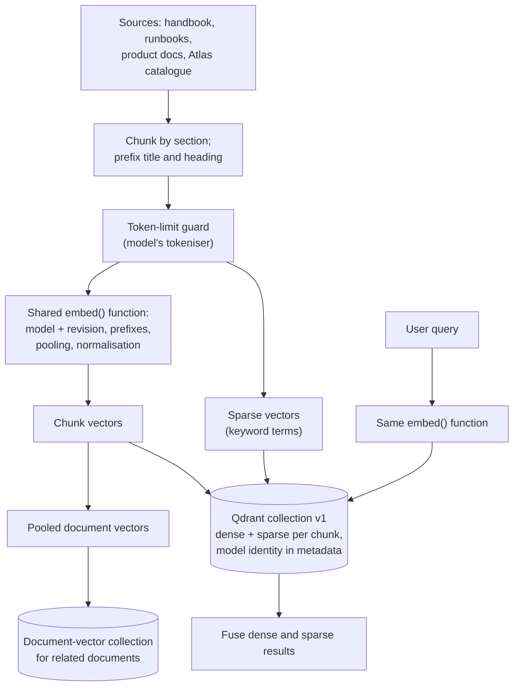

This assessment covers the whole Embedding Fundamentals module: what embeddings are, vector spaces and semantic similarity, word and sentence embeddings, document embeddings, dense representations, dimensionality and how embedding models are built and trained. It mixes quick recall with calculations, code-reading and production scenarios. Aim for at least 70% on the quiz (13 of 18) before moving on, and attempt every open question in writing before opening its model answer. The coding exercises run locally with `sentence-transformers` and need no API key.

```quiz
[
  {
    "q": "What is a text embedding, in the sense used for retrieval?",
    "options": [
      "A compressed copy of the text that can be decompressed exactly",
      "A fixed-length vector of numbers, produced by a model, placed so that texts with related meaning have nearby vectors",
      "The list of token ids the tokeniser produces",
      "A hash of the text used to detect duplicates"
    ],
    "answer": 1,
    "why": "An embedding maps text to a point in a learned vector space where closeness tracks relatedness. It cannot be decompressed into the original text, and it is not the token ids."
  },
  {
    "q": "What does this print?\n```python\nimport numpy as np\na = np.array([3.0, 4.0]); b = np.array([6.0, 8.0])\nprint(round(a @ b / (np.linalg.norm(a) * np.linalg.norm(b)), 2))\n```",
    "options": ["0.5", "2.0", "1.0", "50.0"],
    "answer": 2,
    "why": "b is exactly twice a, so the two vectors point in the same direction and their cosine similarity is 1.0. The dot product is 50, but dividing by the lengths 5 and 10 removes the scale."
  },
  {
    "q": "A static word-embedding model such as word2vec is used to embed \"bank\" in \"river bank\" and in \"bank account\". What happens?",
    "options": [
      "\"bank\" gets the same vector in both, because static embeddings assign one vector per word regardless of context",
      "\"bank\" gets two different vectors, one per sense",
      "The model refuses to embed ambiguous words",
      "The vector for \"bank\" is the average of \"river\" and \"account\""
    ],
    "answer": 0,
    "why": "Static word embeddings are a lookup table: one vector per vocabulary entry. Contextual models, which pass tokens through Transformer layers, are what give a word different vectors in different sentences."
  },
  {
    "q": "How does `all-MiniLM-L6-v2` turn its per-token output vectors into one sentence vector?",
    "options": [
      "It takes the vector of the last token",
      "It concatenates all token vectors",
      "It keeps the largest value in each dimension",
      "It averages the vectors of the real (non-padding) tokens, then normalises"
    ],
    "answer": 3,
    "why": "This model uses mean pooling with the attention mask, followed by normalisation to unit length. Other models use CLS or last-token pooling; each model must be used with the pooling it was trained with."
  },
  {
    "q": "Why must the query and the documents be embedded by the same model?",
    "options": [
      "Different models produce vectors of different lengths, and that is the only problem",
      "Each model learns its own coordinate system, so vectors from different models cannot be meaningfully compared, even when the lengths match",
      "Vector databases store only one model's vectors",
      "Licences forbid mixing models"
    ],
    "answer": 1,
    "why": "Two models define unrelated spaces. Coordinate 17 in one has no relation to coordinate 17 in the other, so cross-model similarity scores are meaningless."
  },
  {
    "q": "What does this print?\n```python\nimport numpy as np\nv = np.array([0.6, 0.0, 0.8])   # a unit vector\nprint(round(float(np.linalg.norm(v[:2])), 2))\n```",
    "options": ["0.6", "1.0", "0.8", "1.4"],
    "answer": 0,
    "why": "Keeping the first two coordinates gives [0.6, 0.0], whose length is 0.6. Truncated vectors are no longer unit length and must be renormalised before dot products can be read as cosines."
  },
  {
    "q": "A 1,000-token document is embedded with a model whose maximum sequence length is 512. What is the result?",
    "options": [
      "An error asking you to shorten the input",
      "Two vectors, one per half",
      "A vector built from roughly the first 512 tokens; the rest has no effect, and no error is raised",
      "A vector that averages the whole document at lower precision"
    ],
    "answer": 2,
    "why": "Input is truncated to the model's limit, keeping the start, silently. Count tokens with the model's own tokeniser at ingestion time to catch this."
  },
  {
    "q": "Nine chunks with pairwise cosine 0 are mean-pooled and renormalised into a document vector. What is the cosine between that vector and any one chunk?",
    "options": ["0.111", "0.5", "0.9", "0.333"],
    "answer": 3,
    "why": "With pairwise cosine c = 0 the formula sqrt((1 + (k - 1)c) / k) reduces to 1 / sqrt(k), and 1 / sqrt(9) = 1/3."
  },
  {
    "q": "A TF-IDF matrix for 10,000 chunks has a 40,000-term vocabulary, and each chunk has about 80 distinct terms. Roughly what is its density?",
    "options": ["0.2%", "2%", "20%", "80%"],
    "answer": 0,
    "why": "Each row has about 80 non-zeros out of 40,000 columns: 80 / 40,000 = 0.002, or 0.2%. Sparse vectors are almost entirely zeros."
  },
  {
    "q": "Which query is a dense, single-vector retriever most likely to answer with a plausible but wrong chunk?",
    "options": [
      "\"Can I work from home on Fridays?\"",
      "\"What does error E-4021 mean?\" when a chunk for E-4012 also exists",
      "\"How much holiday do I get?\"",
      "\"Who approves my expenses?\""
    ],
    "answer": 1,
    "why": "Identifiers that differ by a digit or two carry almost the same meaning to the encoder, so they land close together. Exact strings are where sparse matching is stronger."
  },
  {
    "q": "For two random unit vectors in 100 dimensions, roughly what is the standard deviation of their cosine similarity?",
    "options": ["0.01", "0.5", "0.1", "0.3"],
    "answer": 2,
    "why": "The spread is about 1 / sqrt(d); with d = 100 that is 0.1. In high dimensions random directions are nearly orthogonal."
  },
  {
    "q": "An index will hold 5 million 768-dimensional float32 vectors. Roughly how much memory do the raw vectors need?",
    "options": ["1.5 GB", "3.8 GB", "15.4 GB", "154 GB"],
    "answer": 2,
    "why": "5,000,000 x 768 x 4 bytes = 15.36 billion bytes, about 15.4 GB, before any index overhead."
  },
  {
    "q": "A team halves storage by keeping only the first 192 of 384 coordinates of an ordinary (not Matryoshka-trained) model. What should they expect?",
    "options": [
      "No change, because the first coordinates hold the most important information",
      "A noticeable loss of retrieval quality, because information is spread across all coordinates",
      "An error from the vector database",
      "Better quality, because noise was removed"
    ],
    "answer": 1,
    "why": "Only models trained for it (Matryoshka representation learning) concentrate information in the leading coordinates. For other models, PCA fitted on your data or lower precision are safer ways to save memory."
  },
  {
    "q": "In in-batch contrastive training, what effect does lowering the temperature have?",
    "options": [
      "It magnifies differences between similarities before the softmax, so near-miss negatives are penalised more sharply",
      "It reduces the batch size",
      "It makes all similarities equal",
      "It removes the need for negatives"
    ],
    "answer": 0,
    "why": "Similarities are divided by the temperature before the softmax. A smaller temperature stretches small gaps in cosine into large gaps in probability."
  },
  {
    "q": "A team adopts an E5 model but embeds queries and documents with no prefixes. What is the likely result?",
    "options": [
      "An exception, because the model requires prefixes",
      "Identical results, because prefixes are only for documentation",
      "Faster encoding with no effect on quality",
      "Valid-looking vectors and somewhat lower retrieval quality, because inputs no longer match how the model was trained"
    ],
    "answer": 3,
    "why": "Prefixes such as \"query: \" and \"passage: \" are part of the model's input contract. Leaving them out produces vectors, just not the ones the model was trained to produce."
  },
  {
    "q": "A reimplemented embedding service gives a slightly different vector for the same query depending on which other queries it was batched with. What is the most likely bug?",
    "options": [
      "The model weights are corrupted",
      "Mean pooling includes padding positions because the attention mask is not applied",
      "The tokeniser is non-deterministic",
      "The vector database rounds values"
    ],
    "answer": 1,
    "why": "Padding length depends on the longest text in the batch. If padding vectors are averaged in, the same text's vector depends on its batch companions."
  },
  {
    "q": "Which is the best use of the public MTEB leaderboard when choosing a model for AskMeridian?",
    "options": [
      "Pick the model with the highest overall score and deploy it",
      "Ignore it entirely",
      "Shortlist models using the retrieval tasks, then choose by evaluating them on Meridian's own labelled questions",
      "Use it to set similarity thresholds"
    ],
    "answer": 2,
    "why": "The overall score averages task types unlike yours, and no public dataset contains your documents or users. Benchmarks narrow the field; your own evaluation decides."
  },
  {
    "q": "Meridian wants to show \"related policies\" next to each answer and to detect near-duplicate policy pages. Which representation fits best?",
    "options": [
      "Document-level vectors, for example mean-pooled chunk vectors per policy",
      "The first 256 tokens of each policy",
      "TF-IDF vectors of the query only",
      "One vector per sentence, with no aggregation"
    ],
    "answer": 0,
    "why": "Both tasks are about whole documents, which is what a document vector represents. Specific questions still need chunk vectors."
  }
]
```

## Conceptual questions

**1.** A colleague says: "Embeddings understand meaning, so we no longer need keyword search." Explain, in terms of how dense and sparse representations compute similarity, what embeddings gain over keyword matching and what they lose.

<details><summary>Show model answer</summary>

A sparse representation has one dimension per term, so the dot product only counts terms that appear in both texts. "Holiday" and "annual leave" share no term, so they score zero, however related they are. A dense embedding has a few hundred learned dimensions shared by all texts; every dimension contributes to every comparison, and training placed texts used in similar ways near each other. That is how it bridges vocabulary mismatch and paraphrase.

The price is compression. The encoder keeps whatever helped it place related texts together, which is mostly topic and gist. Exact strings with little "meaning" of their own (error codes, part numbers, names, versions) are blurred, so E-4021 and E-4012 land near each other; small but decisive differences such as negation are often weakened; and you cannot read off why two texts matched. Keyword search keeps exactly those things. Because the two fail on different queries, combining them (hybrid search) usually beats either alone. The decision should come from measuring both on real queries, not from general claims about "understanding".

</details>

**2.** Explain the difference between token embeddings inside a language model, static word embeddings such as word2vec, and the sentence embeddings used for retrieval. Which of them depend on context, and why does that matter for RAG?

<details><summary>Show model answer</summary>

Token embeddings are the rows of a language model's input table: one fixed vector per token, looked up before any Transformer layer. Static word embeddings (word2vec, GloVe) are similar in kind: one vector per word, learned so that words used in similar contexts get similar vectors, but the same vector wherever the word appears. Neither depends on the sentence around it, so "bank" has one vector whether it is a river bank or a bank account.

Sentence embeddings for retrieval come from passing the whole text through a Transformer encoder, in which each token's vector is updated using every other token, and then pooling the contextual token vectors into one vector. They depend on context throughout, and they are trained (contrastively) so that whole texts that belong together are close.

For RAG this matters because queries and chunks are whole texts whose meaning depends on word order and context. Averaging static word vectors loses that, and the internal token table of a chat model was never trained to make whole-text similarity meaningful. Retrieval needs a model trained specifically to embed whole texts.

</details>

**3.** A team argues that a 3,072-dimensional model must retrieve better than a 768-dimensional one because it "has four times more room for meaning". Assess this argument.

<details><summary>Show model answer</summary>

It mixes up a cost with a quality. Dimensionality sets memory ($N \times d \times b$ bytes), search compute ($N \times d$ multiply-adds for exact search) and bandwidth: four times the dimensions means roughly four times all three. Quality comes from the whole model: its size, training data, training method and how well its training matches your task. Larger models often do have larger outputs, so the correlation is real, but it is not caused by the dimension count alone.

Two further points weaken the argument. Real collections have an effective dimensionality, measurable with PCA, far below the nominal $d$, especially for a narrow corpus like a company's documents. And retrieval quality differences between models are often small compared with differences from chunking, hybrid search and reranking. The right response is to evaluate both models on labelled questions from the team's own data and weigh any gain against the fourfold cost.

</details>

**4.** When should a RAG system use chunk-level vectors, and when document-level vectors? Explain using the ideas of truncation and dilution.

<details><summary>Show model answer</summary>

Embedding a long document whole runs into truncation (text beyond the model's token limit is ignored silently) and dilution (one vector for many topics sits between them, close to none; with $k$ unrelated topics each topic's cosine with the average is about $1/\sqrt{k}$). Both hurt questions about specific facts, which are answered by a passage. So answer retrieval should use chunk vectors: each is short enough to be read in full and focused enough that its topic is not diluted. Adding the document title and section heading to each chunk restores some lost context.

Document-level vectors (from pooling chunk vectors, or from a long-context model) are the right tool when the question is about whole documents: routing a query to the right collection or document set, near-duplicate detection, clustering, classification and "related documents". Many systems keep both: chunk vectors for answering, document vectors for routing and recommendations.

</details>

## Coding exercises

**Exercise 1: search with a truncation guard.** Write `embed_checked(texts, model)`, which warns about any text longer than the model's token limit before embedding, and `search(query, chunks, chunk_vecs, model, k)`, which returns the top-k chunks with their cosine scores. Test them on Meridian chunks, including one long chunk.

<details><summary>Show solution</summary>

```python
import numpy as np
from sentence_transformers import SentenceTransformer

model = SentenceTransformer("sentence-transformers/all-MiniLM-L6-v2")

def embed_checked(texts, model):
    """Embed texts; report any that exceed the model's token limit."""
    limit = model.max_seq_length
    for i, t in enumerate(texts):
        n = len(model.tokenizer(t)["input_ids"])          # includes [CLS] and [SEP]
        if n > limit:
            print(f"WARNING: text {i} has {n} tokens; only the first {limit} are embedded")
    return model.encode(texts, normalize_embeddings=True)

def search(query, chunks, chunk_vecs, model, k=2):
    q = model.encode(query, normalize_embeddings=True)
    scores = chunk_vecs @ q
    top = np.argsort(-scores)[:k]
    return [(round(float(scores[i]), 3), chunks[i]) for i in top]

chunks = [
    "Expenses must be submitted within 30 days; anything over £75 needs a receipt.",
    "Up to 5 unused leave days carry over and must be used by 31 March.",
    "The home-office equipment budget is £400.",
    "Atlas error catalogue. " + " ".join(f"Code E-40{n:02d}: see runbook section {n}." for n in range(60)),
]
vecs = embed_checked(chunks, model)
for q in ("Do I need a receipt for a £90 taxi?", "When do I lose leftover holiday days?"):
    print(q, search(q, chunks, vecs, model))
```

```output
WARNING: text 3 has 725 tokens; only the first 256 are embedded
Do I need a receipt for a £90 taxi? [(0.596, 'Expenses must be submitted within 30 days; anything over £75 needs a receipt.'), (0.334, 'The home-office equipment budget is £400.')]
When do I lose leftover holiday days? [(0.455, 'Up to 5 unused leave days carry over and must be used by 31 March.'), (0.233, 'Expenses must be submitted within 30 days; anything over £75 needs a receipt.')]
```

The guard counts tokens with the model's own tokeniser, which is the count its limit applies to. The error-catalogue chunk would have been embedded from its first 256 tokens with no warning from `encode()`; in production, the guard should log to monitoring or send the text back to the chunker rather than print. Both queries find the right chunk without sharing its key words ("taxi" against "expenses", "leftover holiday" against "unused leave days carry over"). Normalised vectors make `chunk_vecs @ q` a cosine.

</details>

**Exercise 2: route queries with document vectors.** Represent three Meridian sources (employee handbook, IT runbooks, product documentation) each by a mean-pooled, renormalised document vector built from its chunk vectors, and route each query to the best-matching source.

<details><summary>Show solution</summary>

```python
import numpy as np
from sentence_transformers import SentenceTransformer

model = SentenceTransformer("sentence-transformers/all-MiniLM-L6-v2")

documents = {
    "employee-handbook": [
        "Annual leave is 25 days; up to 5 unused days carry over.",
        "Staff may work remotely up to 3 days a week.",
        "Expenses must be submitted within 30 days.",
    ],
    "it-runbooks": [
        "Passwords must be rotated every 90 days.",
        "VPN is required on public Wi-Fi.",
        "Lost laptops are reported to the support desk at once.",
    ],
    "product-docs": [
        "Meridian Reports exports to PDF and CSV.",
        "SAML single sign-on is available on the Enterprise plan.",
        "Meridian Sync keeps files up to date across devices.",
    ],
}

def doc_vector(chunks):
    v = model.encode(chunks, normalize_embeddings=True).mean(axis=0)
    return v / np.linalg.norm(v)

names = list(documents)
D = np.stack([doc_vector(documents[n]) for n in names])

for q in ("How do I export a report as a spreadsheet?",
          "Can I carry over my holiday?",
          "I left my laptop on the train"):
    s = D @ model.encode(q, normalize_embeddings=True)
    print(f"{q:<45} -> {names[int(np.argmax(s))]:<18} scores={np.round(s, 3)}")
```

```output
How do I export a report as a spreadsheet?    -> product-docs       scores=[ 0.117 -0.003  0.286]
Can I carry over my holiday?                  -> employee-handbook  scores=[0.348 0.096 0.136]
I left my laptop on the train                 -> it-runbooks        scores=[0.136 0.259 0.049]
```

All three route correctly. The scores are modest (under 0.35) because each document vector is diluted across three topics; what matters for routing is the margin between sources, not the absolute value. With many more chunks per source, dilution grows and margins shrink, so a production router should be evaluated on labelled queries, and may be better as a search over chunk vectors grouped by source than as a comparison with a single pooled vector.

</details>

## Architecture design challenge

Meridian is expanding AskMeridian from the employee handbook and IT runbooks to the full product documentation for Meridian Sync, Relay and Reports and the Atlas error-code catalogue: about 2 million chunks in total, growing by roughly 10% a year. Staff ask natural-language questions about policies, and support engineers paste error codes and product names. The Platform team must also show "related documents" next to answers, and wants to be able to change embedding models in future without downtime.

Design the embedding layer: how the model is chosen and recorded, what is embedded at which granularity, how exact identifiers are handled, how memory is sized, and how a future model change is carried out. State the trade-offs of your design.

<details><summary>Show reference design</summary>



**Model choice.** Shortlist three or four models from the retrieval tasks of a public benchmark, filtered by licence, language coverage, maximum sequence length and size (encoding speed). Build a labelled set of a few hundred real questions (HR phrasing and pasted error codes) with their correct chunks, and choose the model with the best retrieval on it per unit of cost. Record the chosen model's name, revision, pooling, normalisation, prefix convention, maximum length and dimensionality as metadata on the collection.

**Granularity.** Chunk by section so that each chunk is comfortably below the token limit, and prefix each with its document title and heading path. A guard counts tokens with the model's tokeniser and sends anything too long back to the chunker. Answer retrieval uses chunk vectors only. Mean-pooled document vectors, built from chunk vectors at no extra model cost, live in a separate collection used for "related documents" and for near-duplicate checks at ingestion.

**Exact identifiers.** Error codes and product names are where dense vectors are weakest, so each chunk also gets a sparse vector, and queries search both, with the results fused. This handles "E-4021" without giving up paraphrase matching for policy questions.

**Memory.** Assume a 768-dimensional model: $2 \times 10^6 \times 768 \times 4 \approx 6.1$ GB of float32 vectors, growing about 10% a year, plus approximate-index overhead, sparse vectors and replication. Plan for roughly double the raw figure per replica as a starting estimate and verify it on a test build. If memory becomes tight, reduce precision before reducing dimensions; truncate only if the chosen model is Matryoshka-trained.

**Model changes.** A model change is a migration: create collection v2 with the new model's identity, re-embed everything through the shared function, dual-write new documents to both collections, evaluate v2 on the labelled set, then switch the query service's model and collection together in one configuration change. Keep v1 briefly for rollback. The query service refuses to start if its configured model identity differs from the collection's metadata.

**Trade-offs.** Keeping sparse as well as dense vectors adds storage and a fusion step, in exchange for reliable exact matching. Section-sized chunks with prefixes are precise but lose some cross-section context; long-context techniques such as late chunking could help later at extra cost. Document vectors from pooling are cheap but diluted for long documents, which is acceptable for "related documents" but not for answering. Migrations by full re-embedding cost compute (and money, for a hosted model) each time, which argues for choosing carefully and changing rarely.

</details>

## Troubleshooting scenarios

**Scenario 1.** After a routine dependency upgrade over the weekend, AskMeridian's answers became noticeably worse. Nothing errors. Similarity scores for good matches, which used to sit well above the rest, are now close together. The ingestion job was not re-run.

<details><summary>Show diagnosis and fix</summary>

**Diagnosis.** The query side and the document side are no longer embedded the same way. The upgrade most likely changed what the query service loads or how it embeds: a newer model revision pulled because the model was not pinned, a changed default (pooling, normalisation, prompts), or a different model name resolved by configuration. The stored document vectors still come from the old configuration, so query vectors are being compared with vectors from a slightly or entirely different space. Scores bunch together because the systematic relationship between query and document vectors has been lost.

**Fix.** Pin the model by name and revision and restore the previous configuration, or re-embed the corpus with the new one. Then prevent recurrence: one shared embedding function for ingestion and queries; model identity stored as collection metadata and checked at start-up; and a regression test that embeds fixed texts and compares them with stored reference vectors within a tolerance.

</details>

**Scenario 2.** Support engineers report that AskMeridian answers general questions about the VPN runbook well but never finds the troubleshooting steps or the error-code table near the end of it. Shorter runbooks work fine.

<details><summary>Show diagnosis and fix</summary>

**Diagnosis.** Truncation. The long runbooks are being embedded as single chunks (or very large ones) that exceed the model's token limit, so only their opening (usually the overview) shapes the vector. Everything after the limit is invisible to search. Short runbooks fit within the limit, which is why they work. Even within the limit, a very long chunk is diluted across many topics.

**Fix.** Count tokens with the embedding model's own tokeniser for every chunk at ingestion and log or reject any that exceed the limit. Re-chunk the long runbooks by section, prefix each chunk with the runbook title and section heading, and re-embed. Add evaluation questions whose answers are deep in long documents so the problem cannot return unnoticed. For the error codes specifically, add a sparse (keyword) representation as well.

</details>

**Scenario 3.** The team introduced a rule: "only pass chunks with cosine above 0.5 to the generator". With the original model it worked reasonably. After switching to a new model (and re-embedding everything correctly), almost every chunk passes the threshold, including irrelevant ones, and answers get padded with off-topic context.

<details><summary>Show diagnosis and fix</summary>

**Diagnosis.** Similarity scores are on a model-specific scale. Different models, trained differently and with different degrees of anisotropy (vectors crowded into a narrow cone), produce different typical ranges of cosine: one model's "irrelevant" may sit around 0.1, another's around 0.6. A threshold calibrated on one model has no meaning for another. Dimensionality also changes what a "typical" cosine is. Nothing is broken; the threshold is simply uncalibrated.

**Fix.** Recalibrate on labelled data: embed a set of questions with known relevant and irrelevant chunks, look at the two score distributions under the new model, and choose a threshold (or decide that top-k plus a reranker is more robust than any fixed threshold). Record the threshold as part of the model's configuration so that it is revisited whenever the model changes.

</details>
