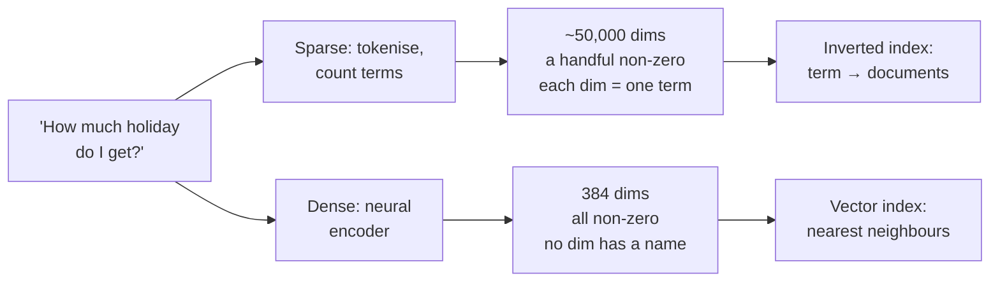

Every retrieval system has to turn text into numbers, and there are two broad ways to do it. One gives every word in the vocabulary its own coordinate, so a text becomes a very long vector that is almost entirely zeros. The other gives every text a few hundred coordinates, all of them in use, none of them standing for any particular word. The first is a **sparse representation**; the second is a **dense representation**, and it is what people mean by "embeddings" in RAG.

This lesson is about the representation itself rather than about search results. It explains what "dense" means precisely, why spreading meaning across many shared dimensions lets a model relate words it has never seen together, what that costs in interpretability and exactness, and how the two kinds of vector are stored and searched differently. The retrieval consequences (which queries each one gets right) were introduced in [Query-document matching](/learn/rag-architecture-fundamentals/query-document-matching); here you will see the reasons behind them.

## Learning objectives

- Define sparse and dense representations and compute the sparsity of a vector or matrix.
- Explain why one-hot and bag-of-words vectors cannot express similarity between different words, and how distributed representations can.
- Demonstrate that a dense vector's meaning is spread across many dimensions, so removing a few barely changes it.
- Compare the storage and search structures used for sparse and dense vectors, with arithmetic.
- Decide, for a given kind of query, whether a dense, sparse or combined representation is the better fit.

## Prerequisites

- [What are embeddings?](/learn/embedding-fundamentals/what-are-embeddings) and [Vector spaces](/learn/embedding-fundamentals/vector-spaces): text as points in a space.
- [Word embeddings](/learn/embedding-fundamentals/word-embeddings): how vectors for individual words are learned.
- [Query-document matching](/learn/rag-architecture-fundamentals/query-document-matching): TF-IDF and cosine similarity, and where lexical and semantic matching each fail.

## Why this matters

Choosing a representation is choosing which mistakes your system will make. A sparse representation of the query "How much holiday do I get each year?" against a handbook that only ever says "annual leave" contains no overlapping coordinates at all, so every score is exactly zero. No amount of tuning fixes that: the representation has no way to say that two different words are related.

A dense representation fixes that problem by construction and introduces others. It cannot tell you why two texts are similar, it blurs exact strings such as product codes, and it needs different infrastructure: an index built for nearest-neighbour search rather than the inverted index that search engines have used for decades. Engineers who understand the representation can predict these behaviours before deployment, explain them to colleagues when they appear, and know when to combine both kinds rather than argue about which is better.

## The intuition

Imagine describing colours to a computer. The sparse way is a catalogue: one checkbox per named colour, "scarlet", "crimson", "navy", "teal", and so on for thousands of names. A colour is described by ticking its name. This is perfectly exact, and completely unhelpful for similarity: "scarlet" and "crimson" are two different checkboxes, so as far as the catalogue is concerned they have nothing in common, exactly as much in common as "scarlet" and "navy".

The dense way is three sliders: red, green, blue. Every colour uses all three. Scarlet and crimson have nearly the same slider positions, so they are visibly close, and you can describe colours that have no name at all. What you lose is the name: a slider setting does not tell you whether the designer meant "crimson" or "cardinal", and two shades that a paint catalogue treats as different products may be one tiny nudge apart.

Text embeddings are the slider approach with a few hundred sliders instead of three, and with one more twist: nobody designed the sliders. They were learned, so no individual slider means "red" or "about holidays". Meaning lives in the combination.

## How it works

### Sparse representations: one dimension per term

A **one-hot** vector for a word has one coordinate per vocabulary entry, all zero except a 1 at that word's position. A **bag-of-words** vector for a text adds up the one-hot vectors of its words, so each coordinate counts a term. **TF-IDF** reweights those counts so rare, discriminating terms count more, as covered in [Query-document matching](/learn/rag-architecture-fundamentals/query-document-matching).

All three share one structure:

1. The number of dimensions equals the vocabulary size, often tens or hundreds of thousands.
2. Each dimension has a fixed, nameable meaning: "the term *receipt*".
3. A given text uses only the few dimensions for the terms it contains, so almost every coordinate is zero.

A vector in which most coordinates are zero is called **sparse**. The fraction of non-zero coordinates is its **density**.

### Dense representations: a fixed number of learned dimensions

A dense embedding has a fixed number of dimensions, chosen by the model's designers (384 for `all-MiniLM-L6-v2`), regardless of vocabulary size. It differs from a sparse vector in four ways:

1. **Every coordinate is in use.** A dense vector typically has no zero entries at all.
2. **Dimensions are learned, not assigned.** Training adjusts the vectors so that related texts end up close together. No dimension is reserved for a word or a concept.
3. **Meaning is distributed.** A concept such as "time off work" is represented by a pattern across many dimensions, and each dimension takes part in many concepts. This is called a **distributed representation**, an idea that goes back to work on neural networks in the 1980s.
4. **The space is shared by all words and texts.** Because "holiday" and "vacation" are both patterns over the same 384 sliders, their vectors can be compared directly, and they come out similar if training saw them used in similar ways.



### Why shared dimensions make similarity possible

The cosine similarity of two vectors sums, over every dimension, the product of their two coordinates (then divides by their lengths). For two sparse vectors, a dimension contributes only if *both* texts contain that term. Two texts with no shared term score exactly 0, however related their meanings.

For dense vectors, every dimension contributes for every pair. Two texts that share no words can still have coordinates that agree across many dimensions, because training placed their meanings near each other. That is the whole mechanism by which dense retrieval bridges vocabulary mismatch.

### What compression costs

A dense encoder maps an enormous space (every possible text) into a few hundred numbers, so it must discard information. Training decides what to keep: whatever helped it place related texts together and unrelated ones apart. Typically lost or weakened:

- **Exact identity of rare strings.** Error codes, part numbers, names and version strings carry little "meaning" the model learned to preserve, so E-4021 and E-4012 land close together.
- **Negation and small factual differences.** "Contractors are eligible" and "contractors are not eligible" differ by one word and usually embed very close together.
- **Interpretability.** You cannot read a dense vector to find out why two texts matched. With TF-IDF you can list the shared terms.

Sparse vectors keep exactly these things and lose the ability to relate different words. That symmetry is why [hybrid search](/learn/hybrid-search) combines the two.

### Learned sparse and multi-vector representations

The dense-versus-sparse line is not absolute. **Learned sparse** models, of which SPLADE is the best-known family, use a neural network to produce a vocabulary-sized vector: still sparse, still with one nameable dimension per term, but with learned weights and with related terms the text did not contain added in ("expansion"). They are covered in [Sparse representations](/learn/sparse-retrieval/sparse-representations). **Multi-vector** models such as ColBERT keep one dense vector per token instead of pooling to one, trading storage for finer matching; see [ColBERT](/learn/reranking-models/colbert). This course treats single-vector dense embeddings as the default and these as options to reach for when measurements justify them.

### Storage and search structures

The two representations are stored differently, and that drives infrastructure choices:

- **Sparse vectors** are stored as lists of (dimension index, value) pairs, one list per document, and searched through an **inverted index**: for each term, the list of documents containing it. A query only touches the lists for its own terms, so search cost depends on how common those terms are, not on the total number of documents.
- **Dense vectors** are stored as contiguous arrays of floats. There is no equivalent of "only look at documents containing this term", because every document has a value in every dimension. Exact search compares the query with every vector; at scale, approximate nearest-neighbour indexes such as [HNSW](/learn/vector-indexing-algorithms/hnsw) find most of the closest vectors without comparing against all of them.

## The mathematics

### Sparsity and the dot product over shared terms

The density of an $N \times V$ matrix with $\text{nnz}$ non-zero entries is

$$
\rho = \frac{\text{nnz}}{N \times V}
$$

- $N$ is the number of documents, $V$ the number of dimensions (vocabulary size for sparse vectors).
- $\text{nnz}$ is the count of non-zero entries.

For sparse vectors the dot product only has to visit dimensions where both are non-zero:

$$
\mathbf{a} \cdot \mathbf{b} = \sum_{i=1}^{V} a_i b_i = \sum_{i \in A \cap B} a_i b_i
$$

where $A$ and $B$ are the sets of dimensions that are non-zero in $\mathbf{a}$ and $\mathbf{b}$. Every term outside the intersection is a product with a zero. If $A \cap B$ is empty, the score is 0.

For two different words' one-hot vectors $\mathbf{e}_i$ and $\mathbf{e}_j$ ($i \neq j$), the intersection is always empty, so $\mathbf{e}_i \cdot \mathbf{e}_j = 0$: every pair of distinct words is equally unrelated.

**Worked example.** A vocabulary of 6 terms: *annual, leave, days, holiday, receipt, expenses*. The document "annual leave days" has TF-IDF weights $(0.6, 0.6, 0.5, 0, 0, 0)$, and the query "holiday days" has $(0, 0, 0.4, 0.9, 0, 0)$. The non-zero sets are $A = \{1, 2, 3\}$ and $B = \{3, 4\}$, so $A \cap B = \{3\}$ and the dot product is $0.5 \times 0.4 = 0.20$. The only credit the document gets comes from "days", a word it shares with the query by chance; "holiday" and "leave", the words that carry the meaning, contribute nothing. The density of the two-row matrix is $5 / (2 \times 6) \approx 0.42$; with a realistic vocabulary of 30,000 terms it would be $5 / 60{,}000 \approx 0.008\%$.

In Python:

```python
import numpy as np

doc   = np.array([0.6, 0.6, 0.5, 0.0, 0.0, 0.0])
query = np.array([0.0, 0.0, 0.4, 0.9, 0.0, 0.0])
shared = np.nonzero(doc)[0].tolist(), np.nonzero(query)[0].tolist()
print("non-zero dims:", shared, " dot =", round(float(doc @ query), 2))
print(f"density: {np.count_nonzero([doc, query]) / 12:.2f}")
```

```output
non-zero dims: ([0, 1, 2], [2, 3])  dot = 0.2
density: 0.42
```

### Storage per vector

A dense vector of $d$ 32-bit floats takes $4d$ bytes. A sparse vector with $n$ non-zero entries, each stored as a 32-bit index and a 32-bit value, takes about $8n$ bytes. For a 384-dimensional embedding that is $4 \times 384 = 1{,}536$ bytes. A 200-token chunk might have around 120 distinct terms, giving $8 \times 120 = 960$ bytes as a sparse vector. Per vector, the two are the same order of magnitude; the real difference is the index structure each one allows.

## In code

This example puts a sparse and a dense representation of the same Meridian corpus side by side and measures the properties described above: shape, density, size, whether different words can be related, and whether meaning survives losing dimensions. It needs no API key; the embedding model downloads once.

```bash
pip install sentence-transformers scikit-learn numpy
```

```python
import numpy as np
from sklearn.feature_extraction.text import TfidfVectorizer
from sentence_transformers import SentenceTransformer

docs = [
    "Annual leave is 25 days; up to 5 unused days carry over until 31 March.",
    "Staff may work remotely up to 3 days a week.",
    "The home-office equipment budget is £400; contractors are not eligible.",
    "Expenses must be submitted within 30 days; anything over £75 needs a receipt.",
    "Passwords must be rotated every 90 days.",
    "VPN is required on public Wi-Fi.",
    "The laptop refresh cycle is 3 years.",
    "The support desk is open 08:00 to 18:00 UK time.",
]
query = "How much holiday do I get each year?"

# --- Sparse: one dimension per vocabulary term ---
tfidf = TfidfVectorizer()
S = tfidf.fit_transform(docs)                      # scipy CSR matrix
sq = tfidf.transform([query])
print("SPARSE  shape:", S.shape, f"non-zero: {S.nnz / np.prod(S.shape):.1%}",
      "bytes:", S.data.nbytes + S.indices.nbytes + S.indptr.nbytes)
print("        query terms found in vocabulary:", [t for t in query.lower().split() if t.strip("?") in tfidf.vocabulary_])
print("        scores:", np.round((S @ sq.T).toarray().ravel(), 3))

# --- Dense: a fixed number of learned dimensions ---
model = SentenceTransformer("sentence-transformers/all-MiniLM-L6-v2")
D = model.encode(docs, normalize_embeddings=True)
dq = model.encode(query, normalize_embeddings=True)
print("\nDENSE   shape:", D.shape, f"non-zero: {np.count_nonzero(D) / D.size:.1%}", "bytes:", D.nbytes)
print("        scores:", np.round(D @ dq, 3))

# --- Words: one-hot vectors are orthogonal; dense word vectors are not ---
w = model.encode(["holiday", "vacation", "password"], normalize_embeddings=True)
print("\none-hot cos(holiday, vacation): 0.0 by construction")
print(f"dense   cos(holiday, vacation) = {w[0] @ w[1]:.3f}   cos(holiday, password) = {w[0] @ w[2]:.3f}")

# --- Distributed: no single dimension carries the meaning ---
rng = np.random.default_rng(0)
top_dim = int(np.argmax(np.abs(D[0])))
D1 = D.copy(); D1[:, top_dim] = 0
print(f"\nlargest dimension of doc 0 is #{top_dim} (value {D[0, top_dim]:+.3f}); "
      f"zeroing it moves doc 0's score from {D[0] @ dq:.3f} to {D1[0] @ dq:.3f}")
for frac in (0.25, 0.5, 0.75):
    keep = rng.random(D.shape[1]) >= frac               # drop a random fraction of dimensions
    s = D[:, keep] @ dq[keep]
    print(f"drop {frac:.0%} of dimensions: top document = {int(np.argmax(s))}, "
          f"rank correlation with full scores = {np.corrcoef(np.argsort(np.argsort(s)), np.argsort(np.argsort(D @ dq)))[0, 1]:.2f}")
```

```output
SPARSE  shape: (8, 60) non-zero: 15.6% bytes: 936
        query terms found in vocabulary: []
        scores: [0. 0. 0. 0. 0. 0. 0. 0.]

DENSE   shape: (8, 384) non-zero: 100.0% bytes: 12288
        scores: [ 0.353  0.171  0.157  0.251  0.125 -0.044  0.164  0.013]

one-hot cos(holiday, vacation): 0.0 by construction
dense   cos(holiday, vacation) = 0.642   cos(holiday, password) = 0.208

largest dimension of doc 0 is #231 (value +0.175); zeroing it moves doc 0's score from 0.353 to 0.337
drop 25% of dimensions: top document = 0, rank correlation with full scores = 0.93
drop 50% of dimensions: top document = 0, rank correlation with full scores = 0.81
drop 75% of dimensions: top document = 0, rank correlation with full scores = 0.86
```

**The important lines.** `TfidfVectorizer().fit_transform` returns a SciPy CSR (compressed sparse row) matrix, which stores only non-zero values (`data`), their column positions (`indices`) and where each row starts (`indptr`); adding the three `nbytes` gives its true memory. `np.count_nonzero` measures density for both. The last block simulates losing dimensions by keeping a random subset of coordinates for all vectors and recomputing scores; `np.argsort(np.argsort(s))` turns scores into ranks, and the correlation of two rank lists is the Spearman rank correlation.

**What the output means.**

- The sparse matrix has one column per vocabulary term (60 in this tiny corpus; tens of thousands in a real one) and 84% of its entries are zero. The dense matrix has 384 columns, every one non-zero.
- None of the query's words appear in the vocabulary ("year" is not "years", and short words such as "i" are dropped by the default tokeniser), so every sparse score is exactly 0. The sparse representation has nothing to compare.
- The dense representation ranks document 0, the annual-leave sentence, first. "Holiday" never appears in it.
- One-hot vectors make "holiday" and "vacation" exactly as unrelated as "holiday" and "password". Dense vectors put "holiday" much nearer "vacation" (0.642) than "password" (0.208).
- The largest single coordinate of the leave document is 0.175 out of 384; zeroing it moves the score by 0.016. Dropping half of all dimensions at random still leaves the leave document on top, with the ranking largely preserved. Meaning is spread across the vector, not stored in a few slots. (Compare a sparse vector: delete the coordinate for "receipt" and every match on "receipt" is gone.)
- The sparse matrix is smaller here (936 against 12,288 bytes) because the documents are one sentence each. The storage arithmetic above shows the gap closes for realistic chunks.

**Errors people hit.** Calling `.toarray()` on a large sparse matrix converts it to a dense NumPy array and can exhaust memory: a 1,000,000 × 50,000 matrix of 64-bit floats would need 400 GB. Keep sparse matrices sparse. On the dense side, forgetting `normalize_embeddings=True` means `@` gives a dot product, not a cosine.

**Extending it.** Add a document containing "E-4021" and query for "E-4012" to see the dense representation's weakness with exact strings; compare with the sparse scores.

## A real-world example

Meridian's Platform team debated whether AskMeridian's search should be "keyword" or "semantic". The HR team wanted semantic search, because staff ask about "holiday", "time off" and "PTO" while the handbook says "annual leave". The support desk wanted keywords, because their engineers paste Atlas error codes such as E-4021 and expect the exact runbook entry.

Instead of arguing, an engineer collected about forty real questions from the support desk's ticket history and the HR inbox, labelled the correct chunk for each, and ran both representations over them. The result divided cleanly along the lines this lesson predicts: dense retrieval found the right chunk for the paraphrased HR questions that sparse retrieval scored as zero; sparse retrieval found error codes and product names that dense retrieval confused with near neighbours.

The team indexed every chunk both ways in its Qdrant cluster, which can store a dense and a sparse vector for the same point, and combined the two result lists. The debate ended because the representation question had been turned into a measurement. The combination methods are covered in the [hybrid search](/learn/hybrid-search) module.

## Common mistakes

- **Expecting dense vectors to preserve exact strings.** Codes, IDs and version numbers blur together, and queries for them return near misses that look plausible.
- **Trying to interpret individual dimensions.** No dimension of a dense embedding means "about leave"; drawing conclusions from one coordinate leads to stories, not findings.
- **Assuming dense vectors understand negation.** "Eligible" and "not eligible" sit close together; a retrieved chunk can say the opposite of what the query needs.
- **Converting large sparse matrices to dense arrays.** Memory grows from the number of non-zeros to the full product of rows and vocabulary.
- **Treating dense and sparse as rivals.** They fail on different queries; choosing one and discarding the other gives up the queries the other gets right.
- **Comparing dense vectors from different models.** Each model learns its own dimensions; coordinate 231 in one model has no relation to coordinate 231 in another.

## Best practices

- Start with dense retrieval for natural-language questions, and add a sparse representation as soon as your users search for identifiers, names or codes.
- Build a small labelled question set and measure both representations on it before choosing; the query mix decides, not general reputation.
- Keep sparse matrices in sparse formats end to end, from `TfidfVectorizer` to the search engine.
- Normalise dense vectors at indexing and query time, and record which model produced them alongside each vector.
- When you need to explain a result, use the sparse side (shared terms) or a cross-encoder score; do not try to explain from dense coordinates.

## Performance considerations

**Memory.** One million 384-dimensional float32 vectors take $10^6 \times 384 \times 4 \approx 1.5$ GB. The same million chunks as sparse vectors averaging 120 non-zeros take about $10^6 \times 120 \times 8 \approx 0.96$ GB, plus the inverted index's own structures. Neither is free; they are the same order of magnitude.

**Search cost.** Exact dense search is $N \times d$ multiply-adds per query: $10^6 \times 384 \approx 3.8 \times 10^8$, a fraction of a second on one CPU core with optimised matrix code, too slow for many concurrent users. Approximate indexes cut this by comparing against a small fraction of vectors. Sparse search cost depends on the posting-list lengths of the query's terms: a query of rare terms touches a few hundred documents, a query of common terms touches many.

**Encoding cost.** A sparse TF-IDF vector is computed by counting, in microseconds. A dense vector needs a forward pass through a neural network, typically milliseconds per text on a CPU, so embedding a large corpus is a batch job measured in minutes to hours, and every query adds an encoding step to its latency.

**Updates.** Adding a term to a sparse index is cheap. Changing the dense model means re-embedding every document, because the new model's dimensions are unrelated to the old one's.

## Summary

- Sparse representations have one dimension per term, mostly zeros, and nameable dimensions; dense representations have a few hundred learned dimensions, all non-zero, none nameable.
- Sparse similarity only counts shared terms, so different words are always unrelated; dense similarity uses every dimension, so related words and paraphrases can score highly.
- Dense vectors are distributed: meaning is spread across many dimensions, and removing some barely changes the ranking.
- Dense compression loses exact strings, negation and interpretability; sparse keeps them and loses synonymy, which is why production systems often combine both.
- Per vector, the two cost similar storage; they differ in index structure (inverted index against nearest-neighbour index) and encoding cost.

## Exercises

**1. Sparse dot product by hand.** A document has TF-IDF weights {"expenses": 0.7, "receipt": 0.5, "days": 0.3} and a query has {"receipt": 0.8, "threshold": 0.6}. Compute the dot product. Which terms contribute?

<details><summary>Show solution</summary>

Only "receipt" is non-zero in both: $0.5 \times 0.8 = 0.40$. "Expenses", "days" and "threshold" each appear in only one vector and contribute zero.

</details>

**2. Measure density at scale.** Fit `TfidfVectorizer` on 200 synthetic sentences built by combining Meridian phrases with random numbers, and report the matrix's shape, density and CSR memory. How does density change as you add more documents with new terms?

<details><summary>Show solution</summary>

```python
import numpy as np
from sklearn.feature_extraction.text import TfidfVectorizer

rng = np.random.default_rng(0)
topics = ["annual leave", "expenses receipt", "password rotation", "laptop refresh", "vpn wifi", "support desk"]
texts = [f"{rng.choice(topics)} policy clause {rng.integers(1000)} applies to team {rng.integers(50)}" for _ in range(200)]
S = TfidfVectorizer().fit_transform(texts)
print(S.shape, f"{S.nnz / np.prod(S.shape):.2%}", S.data.nbytes + S.indices.nbytes + S.indptr.nbytes)
```

Each new number adds a vocabulary term used by few documents, so columns grow faster than non-zeros per row and density falls. Memory grows with the number of non-zeros, not with rows times columns.

</details>

**3. Predict the representation.** For each query against Meridian's index, say whether dense, sparse or both would find the right chunk, and why: (a) "Can I work from home on Fridays?"; (b) "E-4021"; (c) "Are contractors eligible for the equipment budget?"; (d) "Meridian Relay SAML setup".

<details><summary>Show solution</summary>

(a) Dense: "work from home" paraphrases "work remotely"; sparse matches only "work". (b) Sparse: an exact code; dense may return a neighbouring code. (c) Both find the chunk, since the words overlap and the meaning matches; but neither will reliably tell "eligible" from "not eligible", so the generator must read the chunk. (d) Both, with sparse more reliable for the exact product name and acronym; dense helps if the documentation says "single sign-on" instead of SAML.

</details>

**4. Design decision.** Meridian wants one index for 2 million chunks with both dense (384-d) and sparse vectors (about 100 non-zeros each). Estimate raw memory for each and decide whether both fit on a 16 GB machine alongside other services that need 6 GB.

<details><summary>Show solution</summary>

Dense: $2 \times 10^6 \times 384 \times 4 \approx 3.1$ GB. Sparse: $2 \times 10^6 \times 100 \times 8 = 1.6$ GB. Raw total about 4.7 GB, plus index overhead (graph links for an HNSW index, posting-list structures), which can add a substantial fraction. With 10 GB available it fits, with limited headroom for growth; options for later include quantising the dense vectors ([Embedding quantisation](/learn/embedding-optimisation/embedding-quantisation)) or storing them on disk.

</details>

## Check your understanding

```quiz
[
  {
    "q": "What is the cosine similarity between the one-hot vectors for \"holiday\" and \"vacation\"?",
    "options": ["1", "0.5", "0", "It depends on the corpus"],
    "answer": 2,
    "why": "Distinct one-hot vectors have their single 1 in different positions, so every product in the dot product is zero."
  },
  {
    "q": "What makes a representation \"distributed\"?",
    "options": [
      "Each concept is a pattern across many dimensions, and each dimension takes part in many concepts",
      "The vectors are stored across several servers",
      "Each dimension corresponds to one word in the vocabulary",
      "The vectors are drawn from a normal distribution"
    ],
    "answer": 0,
    "why": "Distributed means meaning is spread across shared dimensions rather than assigned to dedicated slots, which is why dense vectors can relate words that never co-occur."
  },
  {
    "q": "Zeroing the largest coordinate of a dense document embedding changes its query score from 0.353 to 0.337. What does this show?",
    "options": [
      "That coordinate encodes the word \"leave\"",
      "The model is overfitted",
      "Sparse vectors would behave the same way",
      "No single dimension carries the document's meaning"
    ],
    "answer": 3,
    "why": "The score barely moves because the meaning is spread over hundreds of dimensions. In a sparse vector, removing a term's coordinate removes every match on that term."
  },
  {
    "q": "Which query is a dense representation most likely to get wrong?",
    "options": [
      "\"Can I work from home?\" when the handbook says \"work remotely\"",
      "\"Are contractors NOT eligible for the budget?\" when the chunk says they are not eligible",
      "\"Part number MX-2207-B\" when MX-2207-A also exists",
      "\"How do I claim back travel costs?\""
    ],
    "answer": 2,
    "why": "Strings that differ by one character have almost the same meaning to the encoder, so they land close together. Exact identifiers are where sparse matching is stronger."
  },
  {
    "q": "Why can a sparse index answer a query without scanning every document, while exact dense search cannot?",
    "options": [
      "Sparse vectors are always smaller",
      "An inverted index lists only the documents containing each query term; dense vectors have a value in every dimension for every document",
      "Dense vectors cannot be stored in memory",
      "Sparse search uses GPUs"
    ],
    "answer": 1,
    "why": "Posting lists let sparse search skip documents that share no term with the query. A dense query has a non-zero product with every document, so exact search must visit them all; approximate indexes exist to avoid that."
  }
]
```

## Further reading

- Hinton (1986), "Learning distributed representations of concepts", *Proceedings of the Eighth Annual Conference of the Cognitive Science Society*.
- Bengio, Ducharme, Vincent and Jauvin (2003), "A Neural Probabilistic Language Model", *Journal of Machine Learning Research* 3.
- Manning, Raghavan and Schütze (2008), *Introduction to Information Retrieval*, chapters 1 (inverted indexes) and 6 (the vector space model). Free at [nlp.stanford.edu/IR-book](https://nlp.stanford.edu/IR-book/).
- Formal, Piwowarski and Clinchant (2021), "SPLADE: Sparse Lexical and Expansion Model for First Stage Ranking", SIGIR 2021.
- Karpukhin et al. (2020), "Dense Passage Retrieval for Open-Domain Question Answering", [arXiv:2004.04906](https://arxiv.org/abs/2004.04906).
- SciPy documentation on [sparse matrices](https://docs.scipy.org/doc/scipy/reference/sparse.html).
