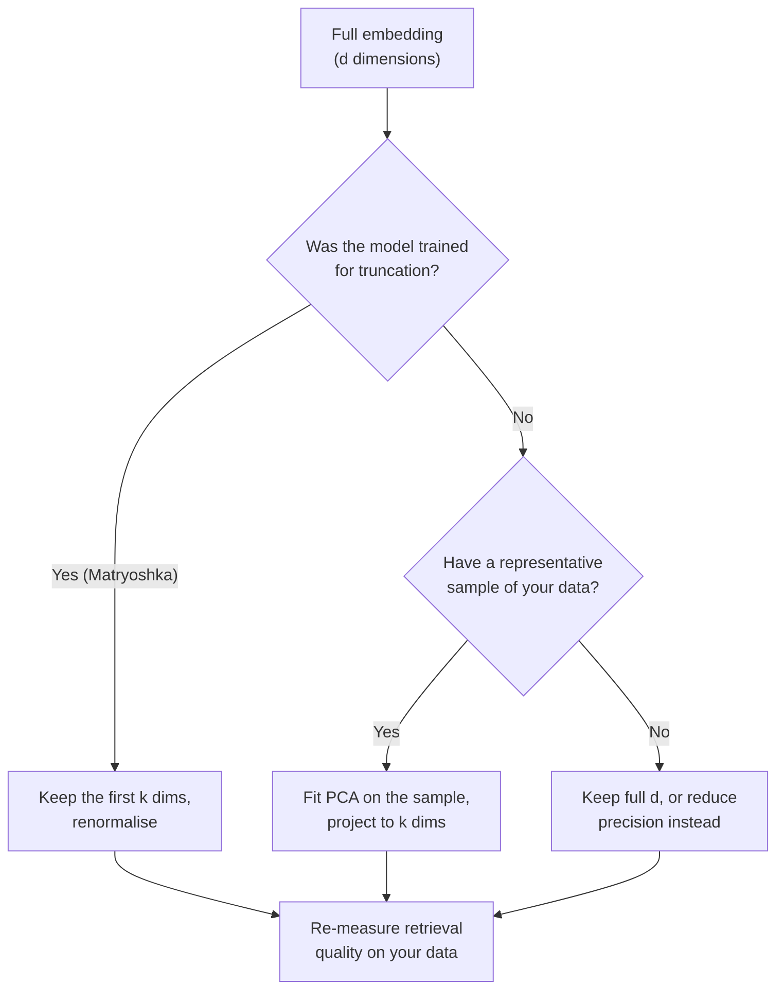

Every embedding model produces vectors of a fixed length: 384 numbers for the model used in this course, 768 or 1,024 for many open models, several thousand for some hosted ones. That number, the **dimensionality** of the embedding, is the first figure on every model card and the one that most directly sets your storage bill. It is also the most misunderstood. More dimensions do not simply mean "more accurate", spaces with hundreds of dimensions behave in ways that two- and three-dimensional intuition gets wrong, and the vectors a model produces usually use far fewer directions than the dimension count suggests.

This lesson builds an accurate picture of what dimensionality buys and costs. You will measure how random directions behave in high dimensions, estimate how many directions a real set of embeddings actually uses, and see why you cannot shorten an ordinary embedding by just keeping its first coordinates.

## Learning objectives

- Explain what the dimensionality of an embedding is and calculate the memory and compute an index needs from it.
- Describe how random directions behave as dimensionality grows, and state the typical cosine between two random unit vectors in $d$ dimensions.
- Distinguish nominal dimensionality from the effective (intrinsic) dimensionality of a set of embeddings, and estimate the latter with PCA.
- Explain why truncating an ordinary embedding damages it, and name the training method that makes truncation safe.
- Weigh dimensionality against quality, latency and cost when choosing a model.

## Prerequisites

- [Vector spaces](/learn/embedding-fundamentals/vector-spaces): vectors, dimensions, and the near-orthogonality of random directions in high dimensions.
- [Semantic similarity](/learn/embedding-fundamentals/semantic-similarity): cosine similarity.
- [Dense representations](/learn/embedding-fundamentals/dense-representations): why embedding meaning is spread across many learned dimensions.

## Why this matters

Dimensionality is a cost multiplier. Every vector in your index costs $d$ numbers to store, every query costs $d$ multiply-adds per comparison, and every byte moved between memory and processor is proportional to $d$. Doubling $d$ roughly doubles the memory and the brute-force search cost of your whole system.

It is also a source of wrong conclusions. Engineers pick the model with the most dimensions on the assumption that it must capture more. They look at a two-dimensional plot of their embeddings and draw conclusions about clusters that do not exist in the original space. They shrink vectors by slicing off the second half, which quietly wrecks retrieval for most models. And they puzzle over why every cosine similarity in their system falls in a narrow band. Each of these mistakes comes from carrying low-dimensional intuition into a high-dimensional space.

## The intuition

Picture describing a film with a handful of numbers. One number, "how funny is it?", separates comedies from tragedies but cannot tell a romantic comedy from a slapstick one. Add "how romantic?" and "how much action?" and many more films become distinguishable. Each new axis lets you separate things that were previously piled on top of each other. That is what dimensions buy: room to keep different things apart.

But there are diminishing returns. If your collection is only Meridian's HR policies, a few dozen axes may separate them all, and the remaining hundreds of axes mostly record small variations that do not matter for search. A model's dimension count is set for everything it was trained on (all of the web, perhaps), not for your corpus.

High dimensions also have a strange property. In two dimensions, two arrows drawn in random directions are often close to each other. In hundreds of dimensions, two random arrows are almost always nearly perpendicular. There is so much room that randomly chosen directions almost never line up. This is good news for an embedding model (it can give thousands of concepts their own nearly separate directions), and it explains why the similarities you see in practice occupy a narrower range than you would expect.

## How it works

### Dimensionality is a design choice of the model

The dimensionality $d$ is fixed when the model is built: it is the width of the model's final layer (or of a projection added after it). You cannot choose it at query time unless the model was trained to support that. Typical values for text embedding models are in the low hundreds to a few thousand; check the model card for exact figures, as they vary by model and version.

A model with a larger $d$ is usually a larger model overall, so it is often better, but the improvement comes from the whole model (more layers, more training data, better training) rather than from the dimension count as such. Comparing two models by $d$ alone is like comparing two cameras by sensor size alone. Use retrieval quality measured on your own data, the subject of [Model selection](/learn/embedding-optimisation/model-selection), to compare models.

### What happens to geometry as d grows

Three behaviours of high-dimensional space matter for retrieval:

1. **Random directions are nearly orthogonal.** As [Vector spaces](/learn/embedding-fundamentals/vector-spaces) showed, the cosine between two random unit vectors in $d$ dimensions is centred on 0 with a spread of about $1/\sqrt{d}$: about 0.05 at $d = 384$. What matters here is how this changes with $d$. At $d = 16$ the spread is 0.25 and random cosines of 0.5 are common; at $d = 1{,}536$ it is about 0.026. The more dimensions, the more concepts a model can give nearly independent directions, and the smaller a cosine has to be before it stands out from chance. The mathematics section below shows where $1/\sqrt{d}$ comes from.
2. **Distances concentrate.** For points scattered uniformly at random, the nearest and the farthest neighbour of a query become almost the same distance away as $d$ grows, a result usually cited from Beyer et al. (1999). This is one face of the **curse of dimensionality**. Real embeddings escape most of it because they are not uniformly scattered: they lie near a much lower-dimensional structure shaped by meaning.
3. **Projections to two dimensions mislead.** A 2-D plot (from PCA, t-SNE or UMAP) keeps some relationships and distorts others. Two points that look close in the plot may be far apart in the original space, and vice versa. Use plots to form hypotheses, then check them with real similarity scores.

The visualiser below shows embeddings projected to two dimensions; keep in mind that what you see is a shadow of the real space.

```playground
embeddings-map
```

### Nominal versus effective dimensionality

A model outputs $d$ numbers, but a collection of embeddings rarely spreads evenly across all $d$ directions. Two reasons:

- **Your corpus is narrower than the model's training data.** A company handbook varies along far fewer axes of meaning than the whole web.
- **Trained embeddings are anisotropic.** Many models' vectors cluster in a narrow cone rather than pointing in all directions, so even unrelated texts have a positive average cosine. [Similarity distributions](/learn/embedding-mathematics/similarity-distributions) looks at this in detail.

**Principal component analysis (PCA)** measures this. It finds the directions along which a set of vectors varies most, in decreasing order, and reports what share of the total variance each direction explains. If 95% of the variance is captured by 30 directions out of 384, the **effective dimensionality** of that collection is about 30. The other 354 directions carry little that distinguishes one document from another.

### Making vectors shorter

Because storage and search scale with $d$, teams often want shorter vectors. There are three ways, and only some are safe:



1. **Truncation (keep the first $k$ coordinates).** For an ordinary model, the first $k$ coordinates are no more important than the rest; information is spread across all of them, so truncation throws away a random-looking slice of the signal. Some models are trained with **Matryoshka representation learning** (Kusupati et al., 2022), which deliberately packs the most useful information into the leading coordinates so that prefixes of several lengths each work as embeddings. For those models, truncation is designed to work; some hosted embedding APIs expose it as a parameter. See [Matryoshka embeddings](/learn/embedding-optimisation/matryoshka-embeddings).
2. **PCA projection.** Fit PCA on a representative sample of your embeddings and project every vector onto the top $k$ components. It adapts to your data, but it must be fitted, stored and applied identically to documents and queries, and refitted if your corpus changes character. [Dimensionality reduction](/learn/embedding-mathematics/dimensionality-reduction) covers it fully.
3. **Lower precision instead of fewer dimensions.** Storing each coordinate in fewer bits ([Embedding quantisation](/learn/embedding-optimisation/embedding-quantisation)) shrinks memory without changing $d$, and is often the better first lever.

## The mathematics

### The typical cosine between random directions

Intuition: in many dimensions, the products $a_i b_i$ of two random unit vectors are many small numbers of random sign, and they largely cancel out.

For two independent random unit vectors $\mathbf{a}, \mathbf{b}$ in $d$ dimensions (directions drawn uniformly), the cosine has

$$
\mathbb{E}[\cos(\mathbf{a}, \mathbf{b})] = 0, \qquad \operatorname{Var}[\cos(\mathbf{a}, \mathbf{b})] = \frac{1}{d}, \qquad \text{so the standard deviation is } \frac{1}{\sqrt{d}}
$$

- $d$ is the dimensionality.
- $\mathbb{E}$ is the average over many random pairs, and $\operatorname{Var}$ the variance.

Why $1/d$: by symmetry, fix $\mathbf{a}$ as the first axis, so the cosine is just $b_1$, the first coordinate of $\mathbf{b}$. The squares of $\mathbf{b}$'s $d$ coordinates add up to 1 and, by symmetry, each has the same average, so $\mathbb{E}[b_1^2] = 1/d$. Its mean is 0 by symmetry, so its variance is $1/d$.

**Worked example.** For $d = 384$: $1/\sqrt{384} = 1/19.6 \approx 0.051$. Roughly 95% of random pairs have a cosine within two standard deviations of 0, that is between $-0.10$ and $0.10$. For $d = 16$: $1/\sqrt{16} = 0.25$, so random cosines of $\pm 0.5$ are common. A cosine of 0.3 is unremarkable noise in 16 dimensions and a strong signal in 384, *for random vectors*. Trained embeddings are not random, so this sets a reference point rather than a threshold.

### Memory and compute

An index of $N$ vectors of dimension $d$, stored with $b$ bytes per coordinate, needs

$$
M = N \times d \times b \text{ bytes}
$$

and exact search compares a query with every vector, costing $N \times d$ multiply-adds.

**Worked example.** $N = 1{,}000{,}000$ chunks, $d = 384$, float32 ($b = 4$): $10^6 \times 384 \times 4 = 1.536 \times 10^9$ bytes, about 1.5 GB, and $3.84 \times 10^8$ multiply-adds per exact query. With $d = 1{,}536$ both figures are four times larger: about 6.1 GB and $1.5 \times 10^9$ multiply-adds.

### Explained variance

PCA finds directions $\mathbf{u}_1, \mathbf{u}_2, \ldots$ with variances $\lambda_1 \geq \lambda_2 \geq \ldots$ (the eigenvalues of the data's covariance matrix). The share of variance explained by the first $k$ directions is

$$
R(k) = \frac{\sum_{j=1}^{k} \lambda_j}{\sum_{j=1}^{d} \lambda_j}
$$

The smallest $k$ with $R(k) \geq 0.95$ is a common rough measure of effective dimensionality. For example, with variances $(4, 2, 1, 0.5, 0.5)$ the total is 8; $R(1) = 0.5$, $R(2) = 0.75$, $R(3) = 0.875$, $R(4) = 0.9375$, $R(5) = 1$, so 95% needs all 5 directions, while 87.5% needs only 3.

The worked examples in Python:

```python
import numpy as np

for d in (16, 384):
    print(f"d={d}: std of random cosine = {1 / np.sqrt(d):.3f}")
print(f"index memory, 1M x 384 float32: {1_000_000 * 384 * 4 / 1e9:.3f} GB")
lam = np.array([4, 2, 1, 0.5, 0.5])
print("R(k):", np.round(np.cumsum(lam) / lam.sum(), 4))
```

```output
d=16: std of random cosine = 0.250
d=384: std of random cosine = 0.051
index memory, 1M x 384 float32: 1.536 GB
R(k): [0.5    0.75   0.875  0.9375 1.    ]
```

## In code

This experiment makes the three claims of this lesson measurable: random directions become nearly orthogonal as $d$ grows; a real collection of embeddings uses far fewer directions than its nominal $d$; and truncating an ordinary embedding hurts more than projecting it with PCA.

For the second and third parts it needs a corpus with more sentences than the handful used elsewhere, because PCA cannot find more directions than there are vectors. It builds 240 sentences from templates (10 Meridian subjects × 24 phrasings). Templates make a deliberately narrow corpus, which will exaggerate how few directions are needed; treat the numbers as an illustration of the method, not as a property of the model.

```bash
pip install sentence-transformers scikit-learn numpy
```

```python
import itertools
import numpy as np
from sklearn.decomposition import PCA
from sentence_transformers import SentenceTransformer

rng = np.random.default_rng(42)

# 1. Random directions become nearly orthogonal as d grows.
print("random unit vectors: spread of pairwise cosine")
for d in (2, 16, 128, 384, 1536):
    X = rng.standard_normal((500, d))
    X /= np.linalg.norm(X, axis=1, keepdims=True)
    cos = (X @ X.T)[np.triu_indices(500, 1)]
    print(f"  d={d:<5} std={cos.std():.3f}  1/sqrt(d)={1/np.sqrt(d):.3f}  max|cos|={np.abs(cos).max():.3f}")

# 2. A real corpus: 240 short Meridian-style sentences built from templates.
subjects = ["annual leave", "remote work", "the equipment budget", "expense claims", "password rotation",
            "the VPN", "laptop refresh", "the support desk", "Meridian Sync", "Meridian Reports"]
frames = ["Questions about {} go to the right team.", "The policy on {} changed this year.",
          "New starters often ask about {}.", "Read the handbook section on {}.",
          "{} is explained in the onboarding guide.", "Managers approve requests about {}.",
          "There is a short FAQ covering {}.", "Please check the rules on {} before asking.",
          "Our wiki has a page on {}.", "Feedback on {} is welcome.",
          "The guidance for {} applies to everyone.", "A reminder about {} was sent on Monday.",
          "Contractors have different rules for {}.", "The FAQ on {} was updated.",
          "See the intranet for details of {}.", "HR and IT both answer questions on {}.",
          "Every office follows the same rules on {}.", "{} came up in the all-hands meeting.",
          "A training video explains {}.", "Ask your manager if {} is unclear.",
          "The team lead summarised {}.", "Exceptions to {} need approval.",
          "A survey asked staff about {}.", "There is a checklist for {}."]
texts = [f.format(s) for s, f in itertools.product(subjects, frames)]
model = SentenceTransformer("sentence-transformers/all-MiniLM-L6-v2")
E = model.encode(texts, normalize_embeddings=True)
print(f"\ncorpus: {E.shape[0]} sentences x {E.shape[1]} dimensions")

pca = PCA().fit(E)
cum = np.cumsum(pca.explained_variance_ratio_)
for share in (0.5, 0.8, 0.9, 0.95):
    print(f"  {share:.0%} of variance needs {int(np.searchsorted(cum, share)) + 1} components")

# 3. Fewer dimensions: keep the first k coordinates, or project with PCA.
def top10(V):
    V = V / np.linalg.norm(V, axis=1, keepdims=True)
    S = V @ V.T
    np.fill_diagonal(S, -np.inf)
    return np.argsort(-S, axis=1)[:, :10]

full = top10(E)
print("\noverlap of each sentence's top-10 neighbours with the full 384-d result")
print(f"  {'k':>4} {'first k dims':>13} {'PCA to k':>9}")
for k in (16, 32, 64, 128):
    trunc = top10(E[:, :k])
    proj = top10(PCA(n_components=k, random_state=0).fit_transform(E))
    o_t = np.mean([len(set(a) & set(b)) / 10 for a, b in zip(full, trunc)])
    o_p = np.mean([len(set(a) & set(b)) / 10 for a, b in zip(full, proj)])
    print(f"  {k:>4} {o_t:>13.2f} {o_p:>9.2f}")
```

```output
random unit vectors: spread of pairwise cosine
  d=2     std=0.709  1/sqrt(d)=0.707  max|cos|=1.000
  d=16    std=0.250  1/sqrt(d)=0.250  max|cos|=0.888
  d=128   std=0.089  1/sqrt(d)=0.088  max|cos|=0.416
  d=384   std=0.051  1/sqrt(d)=0.051  max|cos|=0.238
  d=1536  std=0.026  1/sqrt(d)=0.026  max|cos|=0.116

corpus: 240 sentences x 384 dimensions
  50% of variance needs 6 components
  80% of variance needs 17 components
  90% of variance needs 24 components
  95% of variance needs 32 components

overlap of each sentence's top-10 neighbours with the full 384-d result
     k  first k dims  PCA to k
    16          0.51      0.80
    32          0.61      0.91
    64          0.74      0.93
   128          0.84      0.93
```

**The important lines.** Normalising Gaussian random vectors (`rng.standard_normal` divided by each row's length) is the standard way to draw directions uniformly at random. `np.triu_indices(500, 1)` picks each pair once, excluding a vector with itself. `PCA().fit(E)` with no `n_components` keeps every component so the cumulative variance curve is complete. `top10` renormalises before comparing, because a truncated or projected vector is no longer unit length, and sets the diagonal to minus infinity so a sentence is not its own neighbour. The overlap score is the fraction of the full-dimensional top-10 that the reduced version also returns.

**What the output means.**

- The measured spread of random cosines matches $1/\sqrt{d}$ to three decimal places at every size. Among 124,750 random pairs at $d = 384$, the most similar has a cosine of only 0.238; at $d = 2$, some pair is essentially identical.
- In this templated corpus, 95% of the variance of 384-dimensional vectors lies in 32 directions. A real, more varied corpus would need more, but the pattern (far fewer than $d$) is typical.
- Keeping only the first 16 coordinates preserves about half of each sentence's neighbours; PCA to 16 preserves 80%. The first 16 coordinates of this model are not special; PCA's 16 directions are, by construction, the ones along which this corpus varies most.
- PCA levels off at 0.93 from 64 dimensions. Many sentences here have near-ties among their neighbours (24 phrasings per subject), so small changes reorder the tenth place. Some overlap below 1.0 is expected even for a nearly faithful reduction.

Two caveats keep this honest. PCA was fitted and evaluated on the same 240 sentences, which flatters it; in production, fit on a sample and evaluate on held-out queries. And neighbour overlap is a proxy: what you ultimately care about is whether the right chunk for real questions is still retrieved.

**Errors people hit.** Forgetting to renormalise after truncating or projecting makes dot products differ from cosines. Fitting PCA on documents and then forgetting to apply the same fitted transform to queries puts them in different spaces. Asking `PCA` for more components than there are samples raises `ValueError: n_components=... must be between 0 and min(n_samples, n_features)`.

**Extending it.** Replace the template corpus with a few hundred real chunks from your own documents and labelled queries, and measure recall of the correct chunk rather than neighbour overlap.

## A real-world example

Meridian's Platform team was planning AskMeridian's expansion from the handbook and IT runbooks to the full product documentation for Meridian Sync, Relay and Reports, several hundred thousand chunks in all. An engineer proposed switching to a hosted model with 3,072-dimensional output, arguing that eight times the dimensions of the current 384-dimensional model would capture more nuance. The Qdrant cluster's capacity plan was redone with that figure, and the memory estimate grew eightfold.

Before approving the hardware, the team ran a comparison on 150 labelled questions drawn from real support tickets. The larger model did retrieve the correct chunk more often, but by a margin small enough that most of the difference disappeared once a reranker was added downstream. An open model with 768 dimensions came close to the hosted one on the same questions.

The team chose the 768-dimensional model and kept the option of the larger one open. The lesson they recorded was not "fewer dimensions are better": it was that dimensionality is a cost, quality is a measurement, and the two need to be compared on the team's own questions. They also noted that if they later adopted a model trained for truncation, they could store shorter vectors for the first-stage search and keep full-length ones for a second pass.

## Common mistakes

- **Choosing a model by its dimension count.** Quality comes from the whole model and its training; dimensions mainly determine cost.
- **Truncating an ordinary embedding.** Without Matryoshka-style training, the first $k$ coordinates are not a summary of the vector, and retrieval quality drops sharply.
- **Reading clusters off a 2-D plot.** Projections distort distances; conclusions need checking with similarities in the full space.
- **Applying PCA to documents but not queries,** or fitting a new PCA on each batch. The two sides must share one fitted transform.
- **Using one similarity threshold across models of different dimensionality.** The typical range of cosines depends on $d$ and on the model's training; a threshold calibrated on one model means nothing for another.
- **Ignoring the multiplier.** A dimension choice made casually becomes every vector's storage and every query's compute, for the life of the index.

## Best practices

- Compute index memory as $N \times d \times b$ before choosing a model, including expected corpus growth.
- Compare candidate models on retrieval quality measured with your own labelled questions, then weigh the gain against the cost of their dimensionality.
- Shorten vectors only with a method the model supports (Matryoshka truncation) or that you fit on your data (PCA), and always re-measure retrieval quality afterwards.
- Renormalise vectors after any truncation or projection.
- Try reducing precision before reducing dimensions; it is often cheaper in quality.
- Record the model name and output dimensionality with every stored vector so mismatches are caught at query time.

## Performance considerations

**Memory scales linearly with $d$.** From the formula above, 10 million chunks at $d = 384$ in float32 take about 15 GB; at $d = 1{,}024$, about 41 GB; at $d = 3{,}072$, about 123 GB. Approximate-search indexes add their own overhead (for example, the graph links of HNSW), so treat these as lower bounds.

**Search cost scales linearly with $d$.** Each comparison is $d$ multiply-adds, so a 1,024-dimensional index does roughly 2.7 times the arithmetic of a 384-dimensional one for the same number of comparisons. Search is often limited by memory bandwidth rather than arithmetic: the vectors have to be read from memory, and larger vectors take longer to read.

**Encoding cost depends on the model, not on $d$ alone.** Models with larger outputs are usually larger networks, so they take longer to embed each text, which matters both for ingesting a corpus and for per-query latency.

**Network and storage.** Hosted embedding APIs return vectors as JSON or binary; a 3,072-dimensional float vector serialised as JSON text is tens of kilobytes. At high query volumes, this is visible in latency and bandwidth.

## Summary

- Dimensionality $d$ is fixed by the model and multiplies memory, search compute and bandwidth for every vector you store.
- In $d$ dimensions, random unit vectors have cosines spread around 0 with standard deviation $1/\sqrt{d}$, which is why many concepts can coexist in nearly separate directions.
- Real embedding collections have an effective dimensionality, measurable with PCA, far below their nominal $d$.
- Truncating an ordinary embedding damages it; Matryoshka-trained models are designed for truncation, and PCA fitted on your data is a general alternative.
- More dimensions is not automatically better: compare models on your own questions and weigh any gain against the cost.

## Exercises

**1. Random cosines.** What is the standard deviation of the cosine between two random unit vectors in 1,024 dimensions? Would a cosine of 0.15 between two random vectors be surprising there?

<details><summary>Show solution</summary>

$1/\sqrt{1024} = 1/32 \approx 0.031$. A cosine of 0.15 is nearly five standard deviations from 0, so it would be very unusual for random vectors. (Trained embeddings are not random, and unrelated texts often score well above 0.15 because of anisotropy.)

</details>

**2. Capacity planning.** Meridian expects 4 million chunks. Compute the float32 memory for $d = 384$, $768$ and $1{,}536$. If the Qdrant nodes have 32 GB each and you want vectors to use at most half of a node, how many nodes does each need?

<details><summary>Show solution</summary>

$4 \times 10^6 \times 384 \times 4 \approx 6.1$ GB, at 768 about 12.3 GB, at 1,536 about 24.6 GB. With 16 GB usable per node: 1 node, 1 node, and 2 nodes respectively (ignoring index overhead and replication, which a real plan must add).

</details>

**3. Effective dimensionality of your own data.** Embed at least 300 real paragraphs from a document you have (or from several lessons of this course) with `all-MiniLM-L6-v2`, fit PCA, and report how many components reach 90% and 95% of the variance. Compare with the templated corpus above.

<details><summary>Show solution</summary>

```python
import numpy as np
from sklearn.decomposition import PCA

# paragraphs: a list of at least 300 strings you have loaded
E = model.encode(paragraphs, normalize_embeddings=True)
cum = np.cumsum(PCA().fit(E).explained_variance_ratio_)
for share in (0.9, 0.95):
    print(share, int(np.searchsorted(cum, share)) + 1)
```

Varied, real text normally needs noticeably more components than the 24 and 32 of the template corpus, because it varies along more axes of meaning. It will still be well below 384.

</details>

**4. Design decision.** A team wants to cut index memory in half for a 768-dimensional model that was not trained with Matryoshka learning. List two options, the risk of each, and how you would choose between them.

<details><summary>Show solution</summary>

Option A: PCA to 384 dimensions, fitted on a representative sample. Risk: some loss of retrieval quality; the fitted transform must be versioned, applied to queries, and refitted if content drifts. Option B: store vectors as float16 (half precision) at full dimensionality. Risk: a usually small precision loss; check that the vector store supports it. Choose by measuring recall of the correct chunk on labelled queries for both and taking the one that loses less; precision reduction is often the safer first step. Truncating to the first 384 coordinates is not an option for this model.

</details>

## Check your understanding

```quiz
[
  {
    "q": "Roughly what is the standard deviation of the cosine between two random unit vectors in 384 dimensions?",
    "options": ["0.5", "0.25", "0.01", "0.05"],
    "answer": 3,
    "why": "It is about 1 divided by the square root of d, and the square root of 384 is about 19.6, giving about 0.051."
  },
  {
    "q": "Why does keeping only the first 128 of 384 coordinates damage retrieval for an ordinary embedding model?",
    "options": [
      "Information is spread across all coordinates, so the first 128 are not a summary of the vector",
      "The first coordinates always contain padding",
      "Cosine similarity requires exactly 384 dimensions",
      "Truncated vectors cannot be normalised"
    ],
    "answer": 0,
    "why": "Without Matryoshka-style training, no coordinate is more important than another; truncation discards a large share of the signal."
  },
  {
    "q": "PCA on 10,000 embeddings shows 95% of the variance in 60 of 768 components. What does this suggest?",
    "options": [
      "The model is broken",
      "The collection's effective dimensionality is far below its nominal 768",
      "Only 60 documents are distinct",
      "The vectors were not normalised"
    ],
    "answer": 1,
    "why": "Most of the variation between documents lies in about 60 directions; the rest carry little that distinguishes them. This is typical, especially for a narrow corpus."
  },
  {
    "q": "An index holds 2 million vectors of 1,536 float32 dimensions. Approximately how much raw memory do the vectors need?",
    "options": ["1.2 GB", "3.1 GB", "12.3 GB", "123 GB"],
    "answer": 2,
    "why": "2,000,000 times 1,536 times 4 bytes is about 12.3 billion bytes, before any index overhead."
  },
  {
    "q": "Which statement about dimensionality and quality is most accurate?",
    "options": [
      "Doubling the dimensions always improves retrieval",
      "Dimension count is irrelevant to cost",
      "A 2-D plot shows the true distances between embeddings",
      "Higher-dimensional models are often better, but because of the whole model; quality must be measured, and dimensions mainly set cost"
    ],
    "answer": 3,
    "why": "Dimensions multiply storage and compute. Quality differences come from model size, data and training, and must be measured on your own questions."
  }
]
```

## Further reading

- Beyer, Goldstein, Ramakrishnan and Shaft (1999), "When Is 'Nearest Neighbor' Meaningful?", *International Conference on Database Theory (ICDT)*.
- Kusupati et al. (2022), "Matryoshka Representation Learning", [arXiv:2205.13147](https://arxiv.org/abs/2205.13147).
- Ethayarajh (2019), "How Contextual are Contextualized Word Representations? Comparing the Geometry of BERT, ELMo, and GPT-2 Embeddings", EMNLP 2019, on anisotropy in Transformer representations.
- scikit-learn documentation, [PCA](https://scikit-learn.org/stable/modules/generated/sklearn.decomposition.PCA.html).
- Sentence Transformers documentation, [sbert.net](https://www.sbert.net/), including its notes on Matryoshka models and embedding truncation.
